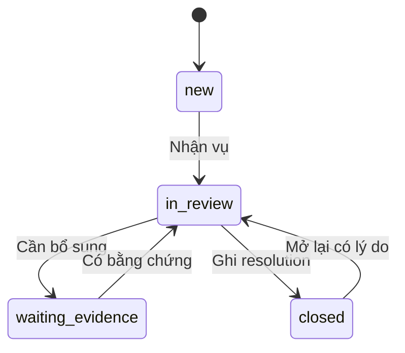
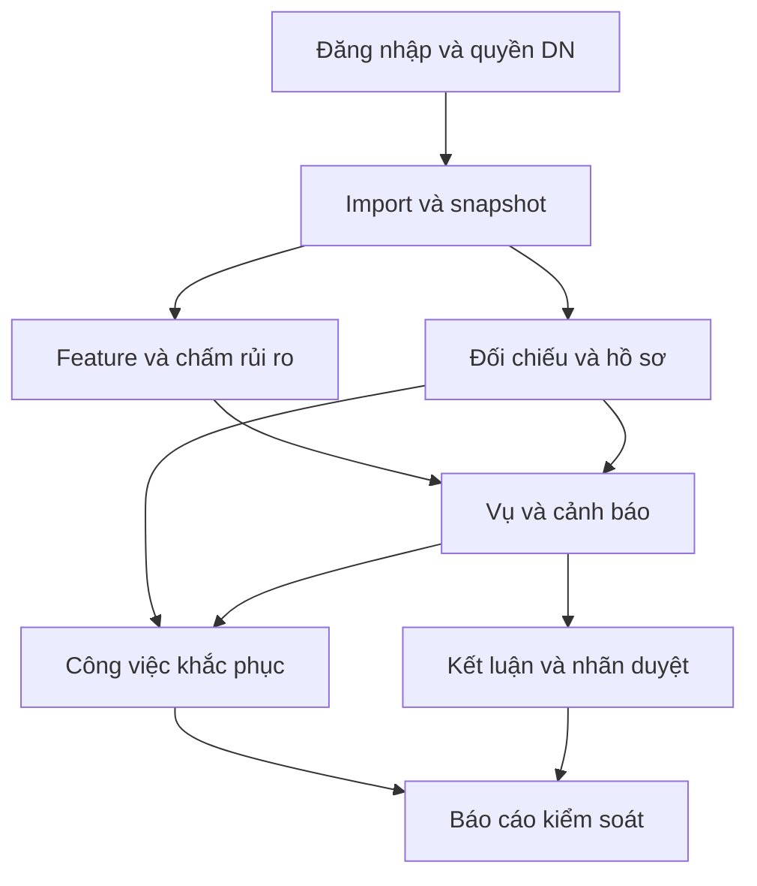

# Contracts, thuật ngữ, trạng thái và module

## CR-053 — lựa chọn DN và routing Portal khi reload

`agent2.company.selection` là preference sessionStorage theo tab, version1:
actor/context/company/page; page chỉ workspace/data-import/encrypted-analysis/
analysis-settings, run workspace chỉ lưu sau khi đọc báo cáo được phép.
Portal lấy ui/context mới trước khi khôi phục iframe; màn hình con kiểm lại
độc lập. URL DN hợp lệ ưu tiên preference hợp lệ; thiếu/thu hồi quyền chọn DN
còn được cấp hoặc không mở dữ liệu nếu không có DN. Không lấy preference làm
authorization, không tự giữ run của DN bị thay thế. Bỏ response khôi phục muộn
khi thay session/agent. Chuyển lựa chọn nhập cũ cùng actor có kiểm scope; snapshot
vẫn đọc qua endpoint phân quyền hiện có, không mở quyền import draft.
Không thay DTO phân tích, FeatureContract, model/key/HE hoặc backend auth.

## CR-052 — artifact/pin cho bridge demo, không đổi FeatureContract

Producer rule-bridge-company-demo/1.0.0 chỉ tạo demo/C001/C002, 32 history +8
reference và5 evaluation riêng; fit snapshot không có giao dịch evaluation.
Artifact vẫn company-method-artifact/1.0.0 qua job offline, dùng full bridge
contract/fingerprint hiện hành. median_flags và dropped all-null học từ train;
không fake tám cột chưa có nguồn hoặc dùng canonical fingerprint cũ.

analysis-bindings/1.0.0 ghim IF/C001, ECOD/C002 và RobustZ từng DN;
candidate receipt ghim file/model/snapshot/contract hash. Kích hoạt file atomic
có lock và compare-before-replace; retry cùng candidate idempotent, đổi policy
hoặc config phải kiểm lại. Pins HE/khóa và binding DN khác giữ nguyên.

Operator setup có scope riêng cho producer mô phỏng, kiểm grants Portal demo
đang được cấu hình trước/trong thao tác; không sửa role/permission hoặc tự fit
từ inference. Không có endpoint fit/model upload. Chế độ backtest ghi thời gian
tạo thực, không claim prospective/production. Cấu hình model local cập nhật
theo request; DB snapshot/model chỉ append mới, không rollback dữ liệu phát sinh.

Snapshot đọc chung trong DN không cấp quyền report của draft actor khác.
Workbench native restore khi report403/404 lấy as_of từ snapshot data đã kiểm
checksum qua cùng quyền snapshot, kiểm tenant/DN/contract; không mở draft access
hoặc đoán giờ. Không đổi schema/byte hai feature adapter hoặc HE protocol.

## CR-051 — eligibility riêng dòng trước chấm snapshot nguồn đầy đủ

Với agent2-rule-snapshot/1.0.0, candidate có posted_at hoặc observed_at sau
as_of vẫn có một hàng kết quả theo thứ tự yêu cầu. Không đưa hàng đó vào frame
33 feature/model. Rule/method unavailable, matched/score null, reason
transaction_not_visible_at_as_of; không coi là not_applicable hoặc no-hit.
ID không tồn tại, sai quyền/checksum/source và as_of sai phạm vi vẫn bị chặn.

snapshot-rule-analysis/1.0.0 thêm availability.available=false và reason code/
message trên hàng ngoài cutoff; summary thêm unavailable_transactions. Metadata
tệp trên hàng không thành predictor/evidence được chấm. Kỳ kết quả UI bỏ các
hàng ngoài cutoff; hiển thị cảnh báo ngay trên hàng. Source/aggregate diagnostics
giữ riêng, không giả row score từ hit lịch sử.

Không có eligible candidate: empty frame/provenance, không replay toàn history
hoặc gọi score_batch. Native core không nhìn thấy: source results unavailable,
native_reference_sha256=null, không giả đã tính engine. Provenance ghim danh
sách requested/eligible/excluded; analysis implementation ghim visibility module.
Không đổi byte/fingerprint feature adapter/contract, model/runtime/preprocess,
luật core hoặc HE protocol; chấm không fit. Chưa deploy/restart Portal live.

## CR-050 — profile nguồn đầy đủ riêng của Agent2

`agent2-rule-snapshot/1.0.0` có tenant_id/company_id, source native-rule-source
1.0.0 và candidate_transaction_ids 1–200 mã duy nhất. Schema wrapper/table
allowlist cộng scalar validator native, hash/count/coverage bắt buộc theo bảng;
không thay Finance input 1.0/1.1/1.2. Giữ lịch sử trong source, không tự biến
lịch sử thành ứng viên. Không nhận mapping hoặc dùng preview cũ khi đổi nguồn.

Upload/preview/commit/idempotency và đọc snapshot dùng SnapshotStore hiện có.
Analyze dispatch theo contract, khóa as_of bằng source và recheck quyền/tính
toàn vẹn. Output `snapshot-rule-analysis/1.0.0` có 35 source-scope catalogue
results và row_coverage riêng từng ứng viên; D1–D6/F4 là scope_results, không
điểm giao dịch. Unavailable/not_applicable khác no-hit; không tự fill score0.
View review chỉ căn cứ/câu hỏi/hành động; technical/catalogue cần quản lý đúng
DN. Đọc snapshot đã xác minh không phải một thao tác xác minh mới.

Profile được chọn rõ để chạy luật tại node DN; không plaintext fallback từ HE.
Không cloud request, fit hoặc bridge33feature; ba nhánh độc lập chưa khả dụng.
Native unsigned/late-observation limits còn áp dụng, từ chối không ép dữ liệu.
Giữ canonical P1 có dấu và schema/worker/model/key/TTL cũ. Không đặt tỷ trọng,
tổng điểm/routing, nhãn/queue hoặc deploy live. Catalogue/readiness là hai việc
riêng: có evaluator không chứng minh nguồn đủ hay phát hiện gian lận chính xác.

## CR-049 — phép so sánh offline riêng, không thay hợp đồng HE

expanded-rule-selection/1.0.0 ràng buộc snapshot/checksum/as_of/feature contract,
tenant/DN và artifact/model/reference/fit receipt trước chọn. Giữ đủ dòng, từ
chối khóa trùng/NaN/Infinity, thiếu điểm không fill0. Baseline rule IDs là
P1/E3/B5/E4, nhưng transaction priority giữ P1; ba master-quality không được
nâng điểm. Mọi nhóm đồng thời giữ nguyên trong cap5 của policy CR-045.

Kết quả này được tạo tại DN từ luật local và điểm ML đã chấm bản mã/giải mã
tại DN, có source_execution và all_rule_evaluations_he=false; không giả envelope
he-four-branch-result hoặc nâng coverage HE. Accuracy/usefulness/time null khi
chưa rà. JSON offline riêng không tự nối ComparisonStore/UI/queue live. Hợp
đồng input/feature/worker, TTL/replay và rule-results của CR-048 giữ nguyên.

## CR-048 — input 1.2.0 opt-in và evaluator B5/E4

Theo yêu cầu nối luật đủ nguồn tại DN, registry hỗ trợ thêm 1.2.0 ở file schema
riêng; mặc định vẫn 1.1.0, giữ byte schema 1.0/1.1 và snapshot cũ. Phiên bản mới
thêm vendors.phone và vendors.related_party_disclosed_at tùy chọn. Vắng/null
hoặc missing_fields là chưa biết; chuỗi rỗng do nguồn khai là không có giá trị
đó trong master đã xuất. Thời điểm khai báo quan hệ không sau observed_at.

rule-inputs/1.2.0 giữ shape nhưng bổ sung guard B5/E4 cho master biết muộn sau
event và contact không có nội dung. Gaps ngăn đánh giá; không suy sổ master đầy
đủ bên ngoài. Evaluator chỉ chạy khi vendor và toàn bộ các master nhìn thấy đủ
bank_account/phone/address/related_party_disclosed_at theo role. Chuẩn hóa và
policy giữ lại: trùng bank token/phone là 3 nội tại, chỉ địa chỉ là 1; điểm giao
dịch vẫn 0 theo master-quality, E4 dùng cùng bằng chứng B5, không cộng lần hai.
So tài khoản ở đây là token legacy chưa xác minh ngân hàng, không thay B1.

RuleResult shape giữ 1.0.0, implementation pin thêm vendor_identity_rules.py;
technical rule_coverage trả whitelist matched/điểm/gaps/căn cứ/details của đủ
35 luật. DTO review giữ giới hạn theo vai trò; không chuyển master finding vào
queue. P1/E3, 33 feature, model và worker HE không đổi. Có evaluator không tự
làm nguồn đủ; 1.0/1.1 hoặc trường thiếu vẫn unavailable/null cho B5/E4.

**BẮT BUỘC:** đây là nguồn chuẩn schema/state. Tên bảng vật lý và đường dẫn module do R0 map vào repo, không bắt viết lại cấu trúc hiện có. Mọi record nghiệp vụ có tenant, ID, version và audit theo phạm vi.

## Thuật ngữ

| Thuật ngữ | Định nghĩa |
|---|---|
| Giao dịch | Dòng nghiệp vụ có ID trong DN |
| Nghĩa vụ | Khoản phải thanh toán theo hóa đơn/hợp đồng đã xét điều chỉnh |
| Case/vụ | Nhóm ứng viên cần kiểm tra cùng bằng chứng liên quan |
| Alert/cảnh báo | Quyết định/thông báo đưa case tới người rà soát |
| as_of | Mốc thông tin hệ thống được phép biết khi chấm |
| Snapshot | Phiên bản dữ liệu có thể tái hiện |
| Candidate | Giao dịch có tín hiệu cần kiểm tra |
| Evidence | Dữ liệu làm căn cứ, không tự mang nhãn rủi ro |
| Fit | Học tham số/phân phối từ lịch sử; không nhãn vẫn cần fit |
| Bundle | Tập version tương thích dùng cho một lần chạy |

## Từ điển trạng thái duy nhất

| Đối tượng/trường | Giá trị | Chuyển trạng thái/quyền |
|---|---|---|
| Case.case_workflow_status | new, in_review, waiting_evidence, closed | reviewer nhận vụ; chờ/bổ sung; đóng có resolution; mở lại có lý do |
| Case.case_resolution | null, confirmed_risk, legitimate, inconclusive | reviewer kết luận theo bằng chứng; revision khi đổi |
| ReviewLabel.label_approval_status | unsubmitted, pending, approved, rejected | gửi duyệt → người đủ quyền duyệt/từ chối; thay nội dung approved tạo revision pending mới |
| ReviewLabel.label_value | null, 0, 1 | approved + 0/1 + đủ provenance mới eligible train theo RULE-LABEL-01 |
| ActionTask.status | open, in_progress, waiting_external, completed, cancelled | assignee cập nhật; complete cần evidence; reopen có lý do |
| AlertDecision.decision | selected, below_threshold, need_evidence, budget_deferred, already_notified, unscorable, mandatory_route | immutable theo policy version; lần xét lại tạo decision mới |
| AlertDelivery.status | pending, sent, failed | retry cùng idempotency key; sent không gửi lại |
| ImportBatch.status | uploaded, validated, committed, rejected | commit chỉ từ validated hash đúng; warning nằm trong report |
| ValidationReport.status | accepted, accepted_with_warnings, rejected | report bất biến theo phiên input/profile |
| ConfigRevision.status | draft, validating, shadow, approved, active, rejected, failed, retired | giám đốc tạo; evaluator kiểm; duyệt qua gate; active mới làm bản cũ retired |
| Job.status | queued, running, succeeded, degraded, failed, cancelled | worker cập nhật; lý do bắt buộc khi không succeeded |
| ReconciliationResult.status | matched, partially_paid, overpaid, unmatched, disputed, unavailable | tính lại tạo revision |
| DocumentChecklist.item_status | present, missing, pending_verification, not_applicable, unknown | theo nguồn và verification |

Bỏ label_status và training_label_status cũ; không đồng nhất case_resolution với label approval. Bỏ review_status không rõ nghĩa; dùng case_workflow_status. remediation_status nếu cần hiển thị là giá trị suy ra từ ActionTask, không lưu một state machine cạnh tranh.

Resolution inconclusive có thể đóng hành chính nhưng không thành label 0; task còn tồn không tự đổi khi case đóng. Label approval là luồng độc lập: unsubmitted → pending → approved/rejected. Thay nhãn approved phải lập revision mới, không sửa ngầm artifact train cũ.

## Module → artifact → trường tối thiểu

| Module logic | Artifact | Trường cốt lõi ngoài tenant/ID/version |
|---|---|---|
| auth | User, CompanyMembership | user_id, role, permissions, status |
| imports/validation | ImportBatch, ValidationReport | source/mapping/hash, contract/profile version, counts, errors, warnings, capabilities |
| snapshots | DataSnapshot | source refs, as_of, content hash |
| features | FeatureContract, FeatureRow | ordered schema/transform, values, missing, evidence_refs |
| methods/calibration | DetectorArtifact, MethodScore | fit snapshot, preprocess, raw/rank, available, reason, reference version |
| orchestration | RunContext | snapshot, bundle, mode, as_of, job status |
| ensemble | EnsembleScore | contributing_methods, availability_profile, fallback, score |
| cases | Case, CaseRevision | candidate_ids, evidence_ids, grouping key, score, workflow, resolution |
| policy/delivery | AlertDecision, AlertDelivery | policy, period, reason, dedupe key, delivery status |
| reconciliation | ReconciliationResult, AllocationRevision | obligation, due/paid/remaining/excess, source refs |
| documents | DocumentRequirementPolicy, DocumentChecklist | requirement, applicability, evidence, verification |
| remediation | ActionTask | case/obligation, assignee, due_at, status, result, completion evidence |
| reviews | ReviewEvent, ReviewLabel | actor, event_time, target scope, value, approval, provenance |
| reporting | ReportSnapshot | filters/as_of, metric definitions, aggregation version, source IDs |
| registry | ReleaseBundle, ConfigRevision | components, diff, status, approval, previous version |
| audit | AuditEvent | actor, action, resource/revision, timestamp, reason, correlation_id |
| evaluation/monitoring | EvaluationReport, DriftReport | dataset/split, budget, metrics, limits, gate result |
| future training | TrainingManifest, EncryptedDataset, ModelArtifact | xem 90; inactive trong R0–R6 |

API/DTO kế toán chỉ allowlist dữ liệu nghiệp vụ; export tuân thủ cùng quyền. State migration phải có bảng old_value → new_value và quy tắc xử lý giá trị lạ; không đoán trường lịch sử mang nghĩa gì.

## Sơ đồ chức năng

## Ánh xạ đường dẫn

### CR-005 — hợp đồng đầu vào 1.0.0 (phần hợp đồng của R1)

Nguồn schema thực thi: `shared/finance_input/src/finance_input/input.schema.json`.
Core schema/kiểu tiền/khóa theo tenant dùng chung nằm tại `shared/finance_input` (Python package riêng, không phụ thuộc web của agent nào). Profile Agent2 và kiểm tra liên kết nằm tại `agent2/sme_fraud/imports.py`, đúng mapping imports/validation R0. Các agent khác chưa được chuyển sang package này.

- Bundle có `contract_version`, `tenant_id`, `companies`, `transactions`, `vendors`, `invoices`, `payment_allocations`, `employees`, `approvals`, `supporting_documents`; `vendor_bank_history` tùy chọn. Mảng rỗng là chưa cung cấp bản ghi, không chứng minh không tồn tại.
- Mỗi dòng có `tenant_id`, `company_id`, `record_id`, `revision`, `observed_at`, `effective_at`, `source`. ID giữ dạng chuỗi. `observed_at` là lúc nguồn được biết, không thay bằng ngày chứng từ hay thời điểm tải. Hai timestamp ISO 8601 có offset; không đoán múi giờ. `revision` và source locator giữ lịch sử, không ghi đè.
- Số tiền canonical là integer VND có dấu trong giới hạn 18 chữ số, không float, không làm tròn; parser tiền Agent1 được trích nguyên mã và khóa hash. Phân loại số âm theo kind và lý do điều chỉnh; khoản trả vượt hoặc hai ID trả cùng hóa đơn được nhận để phân tích.
- Tham chiếu dùng `(tenant_id, company_id, table, record_id, revision)`; allocation là cạnh nhiều–nhiều, không nhét một invoice_id duy nhất vào payment. Gói kiểm tra là tập đóng theo tham chiếu: muốn nhập tăng dần phải ghép với snapshot nền có quyền trước khi validate; không bỏ liên kết lỗi.
- Chứng từ khai báo nguồn simulated/export/original, hash nội dung, chủ thể liên quan và verification riêng. Có dữ liệu không tự là chứng từ đã xác minh hay nhãn.
- `AccessScope` phải do backend tin cậy tạo; thư viện kiểm phạm vi trước duyệt record. Đây không phải xác thực/token/API hay storage. Báo cáo trả đủ lỗi/cách sửa, không bỏ dòng; dữ liệu thiếu bổ sung tạo warning/capability unavailable. Capability chỉ nói dữ liệu hiện có, không chứng nhận detector đã đủ lịch sử/đã fit.

Chưa thay FeatureContract lõi, chưa triển khai preview/commit, snapshot store, replay feature, API hoặc R2; chi tiết/provenance và giới hạn tại `evidence/R1/REPORT.md` và `agent2/docs/INPUT_DATA_CONTRACT.md`.

R0 ghi mỗi module logic trong bảng vào inventory.csv với path thật hoặc proposed_path. Path mới chỉ được đặt sau đối chiếu convention repo; các task bắt buộc dùng mapping này. Tất cả artifacts runtime cần schema validation, khóa ngoại/tenant và version; tên storage vật lý theo DB đã xác minh. Cấu trúc được cố định về trách nhiệm, không ép ngôn ngữ/framework chưa biết.

### CR-006 — API kiểm tra đầu vào, validator/report 1.1.0

`POST /api/v1/companies/{company_id}/imports/validate` nhận bundle JSON 1.0.0. `auth.py` map theo R0; `validation_api.py` là adapter HTTP của imports/validation, dùng lại server chuẩn Python. Backend xác minh Bearer credential, tenant, membership active và permission data.import trước đọc/parse body. Route chỉ nhận đúng một DN; company trong URL/payload không tự tạo quyền. Auth file là adapter local do server quản lý, không phải đăng nhập mới hoặc nguồn quyền do client cung cấp; chưa có bridge identity Portal. Thiếu/hỏng policy phải đóng quyền. Role không thay permission; director không được mặc định mở DN khác.

Giữ schema đầu vào 1.0.0; report 1.1.0 có `errors/warnings` (table/row/field/path/code/message/action), `analysis_limits` theo DN/căn cứ/đối tượng bị ảnh hưởng; không gửi lại dữ liệu/ID DN khác khi bị từ chối. JSON sai/duplicate key/NaN và body vượt giới hạn bị từ chối, không lưu dữ liệu. Thiếu trường là lỗi dữ liệu cụ thể, không tự giả thành lỗi quyền; khai DN ngoài quyền vẫn bị chặn trước schema. Thiếu chứng từ có thể chỉ ở một giao dịch: không lấy việc có một file cho cả DN để suy mọi giao dịch đủ chứng từ.

Chỉ endpoint validate được mở; API nhập/commit/case cũ vẫn đóng. R1-07 mới có kiểm quyền cho validate; upload/preview/commit/snapshot chưa có nên acceptance R1 đầy đủ vẫn PARTIAL. Không đổi luật, feature, ML, trọng số hoặc code Portal.

### CR-007 — import/snapshot protocol 1.0.0

`snapshots.py` theo mapping snapshots R0; `snapshot_api.py` là adapter HTTP của imports/snapshots. Backend nhận tệp JSON nguyên byte theo contract 1.0.0, mapping đổi tên cột cấp record (không code/biểu thức/default thời điểm). Upload và sửa source/mapping có revision và idempotency, không ghi đè source/report/snapshot đã lưu. Preview report khóa import/revision, source SHA256, mapping SHA256, parsed data SHA256, schema SHA256, phiên bản parser/validator/profile và context quyền. Source/mapping đổi làm active preview hết hiệu lực; thiếu preview mới thì không commit.

Commit phải có xác nhận rõ, revision/preview/hash đúng, quyền hiện hành, preview chưa hết hạn và Idempotency-Key. Toàn bộ tạo snapshot, cập nhật import committed, receipt/audit nằm trong một transaction SQLite; cùng yêu cầu trả lại cùng snapshot, khóa idempotency bị dùng với nội dung khác trả conflict. Snapshot có ID, data_checksum, manifest checksum, contract/version/source refs; schema storage 1.0.0, DB mới riêng dưới .runtime theo cấu hình, không mở/migrate DB legacy. Source/report/revision/snapshot/audit/receipt có trigger chặn UPDATE/DELETE; sửa dữ liệu phải import mới hoặc revision draft trước commit. Read/commit kiểm checksum, không trả snapshot bị hỏng. Các draft chỉ thuộc actor + tenant + DN; snapshot được đọc theo quyền DN.

API logic: POST /api/v1/companies/{id}/imports/upload; PUT /imports/{import_id}/source hoặc /mapping; POST /imports/{import_id}/preview và /commit; GET /imports/{import_id}, /imports/{import_id}/report; GET /snapshots/{snapshot_id} và /data (cùng company prefix). Auth trước đọc body/storage, kiểm lại quyền trước mutation trong transaction. Không tin report hoặc quyền do client gửi. Chỉ JSON file trong giai đoạn này; chưa nối UI/multipart CSV/Excel/identity Portal hoặc replay feature. R1 còn PARTIAL cho feature/time integration.

### CR-008 — adapter feature snapshot 1.0.0

Map features R0 qua `agent2/sme_fraud/snapshot_features.py`, gọi trực tiếp `features.build_features` giữ nguyên. `feature_pipeline.py` là job CLI, xác thực quyền đọc snapshot và ghi artifact tách features/rows/evidence; không fit trong HTTP hoặc nối hàng đợi. Contract mới riêng, không gán compatibility với model/cache legacy.

`as_of` của job là giới hạn kiến thức/tồn tại của output. Mỗi revision giao dịch được chấm tại available_at=max(effective_at, observed_at); revision mới tạo feature revision mới, không sửa vector cũ. Context nguồn dùng observed_at<=available_at và effective_at<=event_at. Lịch sử giao dịch phải có effective_at<event_at và available_at<available_at của nhóm; cùng timestamp kinh tế hoặc cùng lúc được biết không thấy nhau. Chọn revision hiện hành theo cả hai thời gian trước mỗi nhóm, không chọn master/latest của tương lai trước rồi lọc. Mọi thời điểm được chuẩn hóa offset trước so sánh; lịch VN chỉ dùng cho biến lịch.

Adapter chỉ xuất numeric allowlist có đủ nguồn; ID/revision/as_of/snapshot checksum ở rows/manifest, source IDs/hash/chứng từ và số tiền đối chiếu ở evidence, không có nhãn trong predictor. Log-magnitude được đặt tên log_abs_amount và kèm dấu riêng, không đổi tiền signed của snapshot. Core cần DTO legacy: placeholder cho trường không có nguồn chỉ nằm trong projection nội bộ; không xuất các feature phụ thuộc giả định đó. Thiếu/zero-denominator/không đủ mẫu theo định nghĩa core trả null với missing reason, không tự impute thành dữ kiện đã biết. Feature manifest khóa snapshot checksums, as_of, ordered schema, adapter/core fingerprints và checksums các kênh.

### CR-010 — quyền đọc chứng từ đã xác minh, adapter 1.0.1

Chỉ đường `build_from_snapshot` sau khi store kiểm quyền và checksum được dùng trạng thái xác minh đã commit mà không yêu cầu người đọc có `evidence.verify`. Việc này không tạo/thay đổi trạng thái verified. Mọi lỗi cấu trúc, thiếu căn cứ xác minh, thời gian, liên kết và tenant vẫn chặn; quyền đọc và revocation vẫn kiểm lại trước xuất. Raw `build_feature_rows`, validate/import/preview/commit giữ yêu cầu quyền xác minh như trước. Không nhận cờ bỏ kiểm tra do client gửi, không bổ sung permission cho scope. Patch contract 1.0.1 giữ nguyên 33 cột và phép tính, fingerprint mới phân biệt hành vi đọc; không tự dùng cache/model legacy khác fingerprint. BR-08 về lịch sử phân bổ thiếu nguồn chưa được sửa trong CR này.

### CR-011 — lịch sử phân bổ thiếu nguồn, adapter 1.1.0

Giữ ordered schema 33 cột; thay semantics missing của `prior_invoice_payment_count`, `prior_invoice_allocation_log_abs`, `prior_invoice_allocation_negative`. Với phân bổ đã biết trước nhóm, gắn invoice ID hiện liên quan và transaction ID trong lịch sử hợp lệ, nếu revision invoice/transaction được tham chiếu chưa khả dụng tại cutoff thì cả ba cột trả null, missing reason `prior_invoice_history_incomplete`. Không dùng revision tương lai hoặc thay bằng revision cũ để lấp số. Tổng `prior_signed_allocation_vnd` ở evidence cũng null khi lịch sử chưa khả dụng, không trình bày tổng một phần như tổng đầy đủ.

Evidence thêm `prior_invoice_history`: status available/unavailable, coverage_basis và unavailable_references. Mỗi mục thiếu có source reference của phân bổ đã biết, field, reference đích, code, thông báo và cách xử lý; không kèm giá trị/timestamp của revision tương lai. Danh sách này ở kênh evidence, không thêm ID/text vào predictor. Record của phân bổ bị thiếu nguồn vẫn được giữ để truy nguyên. Không có liên kết invoice đầy đủ thì prior cũng unavailable/null; không có phân bổ lịch sử liên quan trong tập nhìn thấy, hoặc tổng signed triệt tiêu về 0, vẫn có thể trả 0 khi các liên kết đủ nguồn. available chỉ mô tả tập nguồn nhìn thấy trong snapshot/cutoff, không chứng minh đầy đủ toàn bộ lịch sử ngoài hệ thống. Version/fingerprint mới yêu cầu artifact tương thích, không ghi đè snapshot/cache cũ.

### CR-012 — MethodScore và GraphEvidence 1.0.0, bước đầu R2

Mỗi row giữ tenant/company/record_id/revision/event_at/as_of và một MethodScore cho từng phương pháp yêu cầu. MethodScore: method_id, raw_score, score, score_kind, available, reason (code/message hoặc null), missing_features, artifact_id, preprocess_version, reference_version, feature_contract_fingerprint, evidence_refs, details. available=false buộc raw_score=score=null và reason có nội dung; available=true buộc cả hai điểm hữu hạn và reason=null. Điểm luật giữ nguyên rule_points; ML/thống kê dùng empirical_midrank cố định từ reference đã fit/score trước kỳ chấm, không là xác suất và không được cộng trực tiếp thành ensemble khi D-04 chưa chốt. Điểm hợp lệ 0 vẫn available=true. Không lọc flags/top-K trước chấm.

GraphEvidence tách khỏi MethodScore: available/reason, nodes/links/findings/information_gaps và evidence_refs; không có điểm rủi ro. Liên kết chỉ từ nguồn đã biết trong DN/cutoff; weak_context không tự là vi phạm. Thiếu artifact/feature hoặc model từ tương lai trả unavailable riêng cho phương pháp/dòng, không bỏ dòng hoặc fit trong inference. Unknown input/tenant/corrupt input contract bị chặn.

Adapter native dùng đủ bảng nguồn legacy và giữ nguyên rule hit/ngoại lệ/điểm. Không dùng DTO placeholder của R1 để giả đủ luật: canonical snapshot chưa có bridge tương đương thì rules unavailable với lý do. Snapshot vẫn chấm ML/thống kê cho mọi row đủ feature/artifact và cung cấp graph source-backed. Fit/reference local dùng hai tập lịch sử tách thời gian, selected_columns rõ, minimum_history/profile bắt buộc cho demo kỹ thuật; không tự chốt D-03 cho production. Artifact thử là bundle bytes nội bộ tin cậy, gắn tenant/DN/contract/preprocess/reference/model/code versions; chưa nhận pickle hay cấu hình code từ HTTP, chưa là persistent worker/registry R2 hoàn chỉnh. R2 ghi PARTIAL tới khi các phần còn lại được giao/đạt gate.

### CR-013 — company-method-artifact/1.0.0 và fit job 1.0.0

Mapping methods/calibration mở rộng bằng `method_preprocess.py`, `method_store.py`, `method_jobs.py`. Store SQLite mới riêng có application_id/version, artifact/audit append-only; không migrate DB/pickle cũ. Job theo tenant/DN/actor/idempotency key, request hash gồm snapshot checksum, config và versions; retry không tạo lần fit thứ hai, request khác cùng key trả conflict. Fit cần permission model.fit và data.import; đọc/chấm không cần model.fit. Quyền kiểm lại trước read/write/publish/return. Artifact + succeeded status + audit ghi trong cùng transaction; không có pointer active/latest tự động.

Fit từ snapshot R1 bằng hai lần replay riêng tại history_end/reference_end (end exclusive), lọc event/known-time cùng nằm trong từng kỳ. History kết thúc trước reference, reference trước evaluation_start; không trùng logical transaction ID. Snapshot/features gốc bất biến. Config bắt buộc kỳ, method/profile/min-history, missing_policy và evaluation_mode. Backtest chỉ chặn tương lai của dữ liệu fit/reference; prospective còn kiểm created_at thực của artifact. Không đồng nhất backtest với deployment đã tồn tại trong quá khứ.

Artifact lưu full input FeatureContract (33 cột hiện hành), fingerprint, selected/kept/dropped columns, preprocess output order/version, model/reference/payload versions/hash, snapshot bindings, job/actor/time/config. Inference chỉ load artifact explicit theo DN, kiểm format, checksum, code/runtime, full contract fingerprint trước khi đọc lại model đã đóng gói (deserialize, không phải giải mã mật mã); không đoán tương thích theo số cột hoặc dùng lại legacy/cache. Thiếu/không tương thích trả null/available=false; không gọi fit hoặc fallback model khác.

Preprocess frozen-feature-preprocess/1.0.0: strict không điền thiếu; median_flags học median chỉ từ train và thêm missing indicators. Cột all-null train bị loại cố định có lý do, không dùng reference/test để học lại hoặc điền 0; thiếu toàn bộ cột còn dùng thì unavailable. Reference không đủ feature theo policy làm fit bị từ chối, không âm thầm bỏ dòng. Raw source/mask không đổi; MethodScore.details ghi policy/imputed features/model version khi chấm được bằng policy đã fit. Chưa có scheduler tự phục hồi job crash, UI model lifecycle hoặc release/benchmark R2 đầy đủ.
## CR-015 — RuleInputs theo snapshot, ngày 11/11/2026

`rule-inputs/1.0.0` bổ sung nguồn từng luật trong `MethodScore.details.rule_inputs`, không thay input schema 1.0.0 hoặc feature contract 33 cột. Mỗi RuleInput có rule ID, trạng thái nguồn (`ready`/`unavailable`/`not_applicable`), required bindings, evidence references và gaps gồm bảng/trường/lý do/cách bổ sung. Payload nguồn riêng giữ signed amounts, revision và source provenance; không là feature hoặc nhãn. Resolver chỉ nhận snapshot backend đã kiểm quyền/checksum, so cả effective_at và observed_at trước chọn revision; history loại bản thân và nhóm đồng thời. Chứng từ/phân bổ/phê duyệt chỉ được nối khi reference revision đã khả dụng; không suy nội dung/hiệu lực từ tên tệp.

Nguồn `ready` chỉ cho biết đủ các trường đã khai báo trong phạm vi snapshot, không chứng minh đầy đủ sổ hoặc đã chạy luật legacy. `evaluation_status=not_evaluated` ở producer đầu vào; kết quả đánh giá nằm ở RuleResult theo CR-016. Tổng rules vẫn unavailable/null nếu chưa có evaluator đầy đủ. Không cộng điểm từng hit hoặc gán 0 cho thiếu nguồn. Giữ ML/graph độc lập, không thay config/active hoặc tự duyệt mốc R2.

## CR-016 — rule-results/1.0.0, ngày 11/11/2026

`MethodScore.details.rule_results` giữ một RuleResult cho từng luật: `status` là evaluated_hit/evaluated_no_hit/unavailable/not_applicable; `available`, `matched` nullable, `intrinsic_points`, `score`, `reason`, `gaps`, `evidence_refs`, `details` và source/version bindings. Đã đánh giá có điểm hữu hạn và matched true/false; thiếu nguồn, chưa có evaluator hoặc tên không đủ thông tin trả score/intrinsic_points/matched null với lý do. not_applicable có lý do phạm vi, không biến thành no-hit. Nội dung source readiness không tự tạo điểm.

E3 dùng name_key/name_similarity/assign_noise_points và WEIGHTS/DEFAULT_CONFIG giữ lại; match khi similarity gốc > fuzzy_similarity, hiển thị giá trị làm tròn như engine cũ. Có hit E3 thì intrinsic 3, score đóng góp 0 theo master_quality, matched=true. Không thấy cặp tên đủ ngưỡng trong snapshot nhìn thấy thì evaluated_no_hit, score=0, matched=false; không xác nhận toàn bộ master hoặc tính hợp lệ của giao dịch. Tên không đủ ý nghĩa để so sánh là unavailable, không phải không trùng.

Tổng rules không cộng cơ học các RuleResult: chưa có evaluator/nguồn đầy đủ hoặc chính sách tổng hợp canonical được kiểm chứng thì available=false, score=null. ML/graph và số dòng không phụ thuộc hit luật. Input contract 1.0.0 và feature contract 33 cột giữ nguyên, không thêm nguồn giả hoặc tự fit khi chấm.

## CR-017 — method-output/1.1.0 và native diagnostics

Với profile retained-native, optional top-level `native_rule_diagnostics` có input_checksum, implementation_sha256 và output: giữ toàn bộ output engine ngoài scores/hits, gồm batch_events, coverage/config, master findings, evidence findings, dynamic parameters/policy. Giữ thứ tự/nội dung và các ngoại lệ, không cộng batch event vào điểm dòng; cùng event có một bản ở diagnostics, không nhân bản trên từng giao dịch. Kiểm scope diagnostics và participant IDs của batch event; không chấp nhận cảnh báo ngoài nguồn đã gắn. Từng dòng vẫn giữ native_score và hits đầy đủ, gồm suppressed hits 0 điểm; copy output tách khỏi input/engine objects để tránh alias.

Schema method-output tăng từ 1.0.0 lên 1.1.0; shape MethodScore/RuleResult không đổi. Canonical snapshot không có native_rule_diagnostics nếu chưa chạy engine native đủ nguồn; không giả thiếu = 0 hay phát cảnh báo vào queue. Code hash adapter mới vẫn phải qua guard model CR-013, không tự fit hoặc active. Không đổi kernel, threshold, input/feature contract, fixture baseline hoặc chất lượng gate R2.

## CR-018 — đầu vào P1, input 1.1.0

Schema mới 1.1.0 thêm transactions.payment_channel (bank/cash/other/unknown/null) và bảng tùy chọn payment_history_coverage. Thiếu/unknown/other không được suy từ account 111/112, mô tả hoặc bank_code; P1 chưa khả dụng. Schema 1.0.0 lưu riêng, chọn theo contract_version; dữ liệu cũ không tự gán channel/coverage, snapshot cũ bất biến. Snapshot mới ghi contract_version của payload, validator context khóa cả hai schema và code kiểm P1.

Coverage có metadata tenant/company/ID/revision/effective/observed/source; invoice_refs xác định scope, covered_from/covered_through là khoảng đóng theo effective_at của phân bổ; history_basis since_inception/bounded_period/unknown và coverage_status complete/partial/unknown do nguồn khai báo. Manifest gồm invoice_refs/transaction_refs/allocation_refs của các phiên bản nguồn đã biết tại observed_at, counts tương ứng và records_sha256 của payload canonical được sắp xếp theo ID/revision. Không tự tạo khai báo complete từ số dòng. Export manifest chỉ chứng minh khớp bản ghi đã gửi, không xác minh đầy đủ sổ bên ngoài.

Backend kiểm tham chiếu đúng tenant/DN/revision, duplicate refs, bounds/thời điểm xuất, không liên kết nguồn biết sau, số dòng/hash và toàn bộ tập nguồn thuộc scope đã cung cấp. Không reject overpayment hoặc signed adjustment hợp lệ chỉ vì vượt hóa đơn. Vendor/link/channel thiếu hoặc mâu thuẫn làm P1 source unavailable với lý do; chưa tính số đã trả/điểm. Bounded/partial/unknown không thay phần ngoài khoảng bằng 0; không dùng opening balance giả. Claim mới nhất partial/unknown hoặc stale không fallback claim cũ complete.

Nguồn P1 tại từng giao dịch chỉ dùng records/claims đã biết tại cutoff và có effective_at phù hợp; manifest được kiểm ở thời điểm nguồn khai báo, claim bị stale nếu nguồn liên quan biết mới sau claim nhưng trước cutoff. Giữ current/prior/simultaneous/signed records riêng trong payload, không đổi feature contract 33 cột hoặc dùng claim làm predictor/nhãn. RuleInputs 1.1.0 thêm nguồn P1; đủ input vẫn P1 rule_evaluator_unavailable cho tới khi giao nối evaluator/parity. Không mở UI/queue/active hoặc thay chính sách tổng hợp.

## CR-019 — đánh giá P1 từ phân bổ có nguồn

P1 evaluator v1.0.0 dùng RuleResult shape 1.0.0; RuleInputs patch 1.1.1 mở rộng nguồn cùng nghĩa vụ theo NCC/số hóa đơn chuẩn hóa của kernel và chuỗi điều chỉnh tường minh. Alias ERP cùng giá trị chỉ có một trần, giá trị mâu thuẫn unavailable; từng alias/credit note phải có coverage và refs. Invoice revision thay thế; invoice adjustment/credit note là delta theo adjusts_ref, không cộng hai revision. Thanh toán dùng allocation amount, không lặp toàn bộ amount giao dịch cho nhiều hóa đơn.

Row đối chiếu prior signed allocations + current allocation với cap +1 VND, cần prior payment như native; hit giữ WEIGHTS.P1=20. Prior đòi cả transaction/allocation effective_at và available_at trước event/cutoff; cùng một trong hai mốc vào kiểm nhóm riêng. details.invoice_checks có tổng có dấu và refs; details.simultaneous_checks có group_id ổn định, điểm nhóm và score_role=group_only_not_row_contribution. Các dòng cùng nhóm có thể cùng tham chiếu một kết quả kiểm nhóm; không phải phát event, không cộng điểm nhóm vào row/tổng hoặc tự vào queue.

Điều chỉnh thanh toán/phân bổ âm phải gắn đúng chuỗi gốc cùng nghĩa vụ, revision, thời gian và dấu tiền; không âm hóa khoản trả mới, không cộng hai lần, không tự ép over-reversal về 0. Thiếu phân bổ điều chỉnh, liên kết stale/mâu thuẫn, vượt tiền giao dịch hoặc không xác định cap đều unavailable/null. Snapshot vẫn bất biến, cutoff từng dòng không bị nâng lên global as_of khi chạy lại. Tổng canonical giữ rules_incomplete/null; không đổi feature contract/model, kernel hoặc active lifecycle.

## CR-022 — sửa P1 native đọc hóa đơn chưa khả dụng

Nhánh P1 native dùng guard chung p1_timing.unavailable_fields cho invoice_issued_at/invoice_observed_at được khai báo. So sánh instant có múi giờ, mốc bằng cutoff được nhận; mốc sau cutoff không được dùng. Header hiện tại chưa khả dụng tạo hit information_gap với points=0, hard_trigger=0, signal=null, scoring_role=information_request; không đưa gross/tổng từ nguồn muộn vào evidence. Đây là yêu cầu bổ sung nguồn, không phải evaluated_no_hit.

Lịch sử có header chưa khả dụng tại cutoff hiện tại làm row hoặc batch giữ information_gap; không phát risk từ tổng từng phần. Batch chỉ gom current header khả dụng, không đưa current chưa biết vào trần/tổng nhóm. Lưu các dòng lịch sử gốc để khi source trở nên khả dụng ở lần chi sau có thể dùng; không sửa kết quả các lần chi cũ. Giữ P1=20, dung sai >1 VND và tách điểm nhóm khỏi row.

Đây là sửa lỗi có bằng chứng ở native header profile, không đổi shape method-output/RuleResult, input schemas, 33 feature hoặc model. Header legacy không khai báo mốc thời gian vẫn theo hợp đồng cũ, không được chứng nhận as_of. Native vẫn không có coverage/availability theo allocation như canonical và chưa hỗ trợ signed corrections; không công nhận toàn engine/pipeline đạt. Canonical giữ unavailable/null khi thiếu nguồn.

## CR-023 — HTTP phân tích snapshot P1/E3

`POST /api/v1/companies/{company_id}/snapshots/{snapshot_id}/analyze` nhận JSON `{as_of, view?}`; as_of bắt buộc ISO có timezone, view=review mặc định hoặc technical. Không nhận tenant/role/điểm/model/artifact/nguồn do client gửi. Dùng snapshot đã commit, kiểm scope và checksum; endpoint chỉ đọc, không tạo job/analysis record, fit, active, queue hoặc snapshot mới. Request lặp cùng source/as_of/code có cùng analysis_id; view không đổi phép tính hoặc ID.

HTTP guard Host/Origin/Bearer/membership/data.import chạy trước đọc body; director không tự có quyền DN khác. View technical kiểm role director trong policy backend sau khi đọc lựa chọn view và kiểm lại trong các bước đọc/trước trả. Role không nằm trong AccessScope cũ nên dùng authorize_director riêng, không tin view/client role hoặc ẩn nút. Kế toán được chạy view review bằng quyền đọc hiện có; đọc snapshot đã có nguồn verified không yêu cầu evidence.verify mới.

Đầu ra `snapshot-analysis/1.0.0` có analysis_id, view, as_of chuẩn UTC, snapshot binding/checksums, đủ các dòng khả dụng theo as_of và nhóm đồng thời duy nhất. Mỗi row có transaction_id/revision/event_at/knowledge_at, signed integer VND và loại nguồn simulated/source_export. Global as_of chỉ chặn tập đầu ra; cutoff từng dòng giữ quy tắc R1. analysis_complete=false nói chưa đánh giá toàn bộ luật, không phải việc chạy hai kiểm tra này thất bại.

View review chỉ allowlist nghiệp vụ: payment_invoice/vendor_names, trạng thái needs_review/no_signal/unavailable/not_applicable, needs_review nullable, lý do/nguồn còn thiếu, facts tiền hóa đơn/phân bổ và references. Không gửi điểm/mã luật/threshold/algorithm/model/implementation. E3 matched=true vẫn needs_review dù contribution=0; P1 group hit không bị mất khi row score=0. Nhóm trả một lần ở root groups, rows tham chiếu group_refs. Không gộp thành case hoặc dùng làm budget.

View technical có RuleResult P1/E3, điểm/null, matched và diagnostics; P1 simultaneous_checks chuyển thành refs tới nhóm root để không nhân bản nhóm. Aggregate rules vẫn incomplete/null, không dựng tổng hai luật. Response có schema riêng; MethodScore/RuleResult gốc và core không đổi. Kiểm quyền lại sau serialize trước gửi; lỗi không trả partial rows hoặc nội dung traceback.

Giới hạn kỹ thuật cho bản đồng bộ local: tối đa 200 transaction records, 1.000 source records trong snapshot và 5 MiB response. Quá giới hạn trả 413, không cắt dòng/lịch sử. Đây là engineering guard, không phải D-03/04/09 hoặc ngưỡng nghiệp vụ được duyệt. Chưa nối worker async, lưu analysis/job, ML HTTP, Portal identity hay UI mới.

## CR-024 — màn hình nhập và kết quả có giới hạn nguồn

Lát cắt UI được người dùng giao riêng: root loopback 8766 phục vụ HTML/CSS/JS allowlist, gọi upload/preview/commit/analyze sẵn có. GET /api/v1/ui/context dùng Bearer hiện có, chỉ trả actor_id và DN active có data.import; đọc policy mỗi yêu cầu. Không tạo tài khoản, mã mặc định, cookie hay bypass. Bearer chỉ ở bộ nhớ, xóa input sau kết nối; reload kết nối lại, sessionStorage chỉ lưu actor/company/snapshot/as_of để đọc lại bằng quyền backend. Chưa tích hợp Portal identity.

Bản này chỉ nhận JSON theo input 1.0/1.1; không giả hỗ trợ CSV/Excel hoặc mapping tự suy. Đổi tệp/DN làm mất preview UI; kiểm SHA256 lại trước commit. Lưu cần acknowledgment, đúng preview/context/checksums/revision và key chống trùng được giữ khi retry. Snapshot cũ không bị thay thế. Backend vẫn là nguồn xác nhận, không tin UI.

Kết quả chỉ gọi view review, dùng giờ Việt Nam có +07:00 tường minh; hiển thị DN/snapshot/checksum/analysis_id/as_of/kỳ giao dịch, null thiếu nguồn khác no_signal, nguồn simulated/source_export rõ ràng. Số VND lớn dùng chuỗi/BigInt ở parser phản hồi, upload giữ nguyên byte. Không đổ dữ liệu nguồn vào innerHTML. Groups hiển thị riêng một lần. Chưa có ML HTTP/hàng đợi/kết luận gian lận, R2/R5 tổng thể chưa được nghiệm thu.

## CR-025 — nối phiên Portal và membership Agent2

Portal hiện chỉ có mật khẩu/phiên workspace chung, chưa có user store/membership theo tài khoản. Tái sử dụng phiên này với danh tính workspace và membership khai báo bởi quản lý trong access_file (portal-agent2-access/1.0.0), không lấy tenant/role/permission từ HTTP body hoặc company.json. Default không cấp DN. Không coi đây là SSO đa người dùng hoặc full R5.

Portal phục vụ Agent2 tại /agent2/ qua proxy allowlist cùng origin; lấy X-Session hiện có, guard Host/Origin/X-Platform, bỏ Authorization/role/tenant do browser gửi. Agent2 PortalAuthorizer xác minh qua POST /api/internal/agent2/identity với secret server-only riêng. Cả hai chỉ loopback, không redirect/proxy hệ thống, có timeout/giới hạn body. Endpoint nội bộ không nhận Origin browser. Không truyền bridge secret xuống browser hoặc command line.

Mọi guard/read/recheck dùng phiên còn hạn và policy mới nhất; không cache quyền, không fallback auth-file khi mode Portal, mất Portal thì fail closed. GET/context heartbeat không kéo dài idle TTL; logout/expiry chặn API ngay, UI kiểm lại khi storage/focus và tối đa 15s. context_id chỉ là hash identity/tenant/membership để bỏ dữ liệu cũ khi quyền thay đổi, không tự cấp quyền. Director vẫn chỉ technical theo đúng membership DN. Snapshot/import scopes, quyền evidence.verify và model.fit giữ nguyên.

Iframe cùng origin dùng phiên Portal sẵn có; tab mới mở từ Portal sao chép phiên hiện có trong sessionStorage rồi bỏ opener, không đưa credential lên URL. Không tạo mật khẩu/user store thứ hai. Đường local độc lập vẫn hỗ trợ FileAuthorizer cho công cụ/offline; launcher Portal luôn chọn PortalAuthorizer, không dùng mã local làm fallback. Dữ liệu và snapshot trước đó giữ nguyên; import thuộc actor cũ cần đúng binding actor/tenant khi khai báo quyền.

## CR-027 — bốn nhánh phân tích snapshot chỉ đọc

SnapshotAnalysis 1.1.0 giữ checks/groups P1/E3 và bổ sung rows.branches luôn đủ rules/statistics/graph/ml, summary độ phủ theo nhánh. Chạy score_snapshot một lần cho mọi dòng, không lọc rule-hit trước ML. Luật canonical chưa có evaluator hoặc thiếu nguồn tiếp tục unavailable; không cộng tổng một phần. Graph trả các liên kết/căn cứ tại cutoff, liên kết yếu không là vi phạm và không có điểm rủi ro.

Phân tích nạp model/reference bằng MethodStore read-only, pin artifact ID theo tenant/company từ analysis-bindings/1.0.0 phía server. Không nhận model/method/artifact/role từ HTTP body, không tự chọn latest hoặc fit khi chấm. Binding thiếu/sai/kho thiếu/artifact lỗi hoặc không tương thích trả nhánh unavailable/null với lý do, không làm giả điểm 0 hoặc bỏ dòng; quyền bị thu hồi vẫn từ chối toàn response. Binding đổi giữa request trả 409, ID kết quả gắn snapshot/as_of/code/runtime/binding/artifact. Không có thao tác active/release/queue.

DTO review không có algorithm/feature/raw score/model config; mức xếp hạng tương đối 0–100 là vị trí so với reference, không phải xác suất hoặc ngưỡng cảnh báo. Không tự biến percentile thành needs_review hoặc cộng với điểm luật. Technical chỉ director đúng DN, có MethodScore/GraphEvidence/RuleResult đầy đủ. Nguồn thiếu tổng quan được trình bày theo các record đã biết tại as_of; không nâng cutoff của từng dòng.
