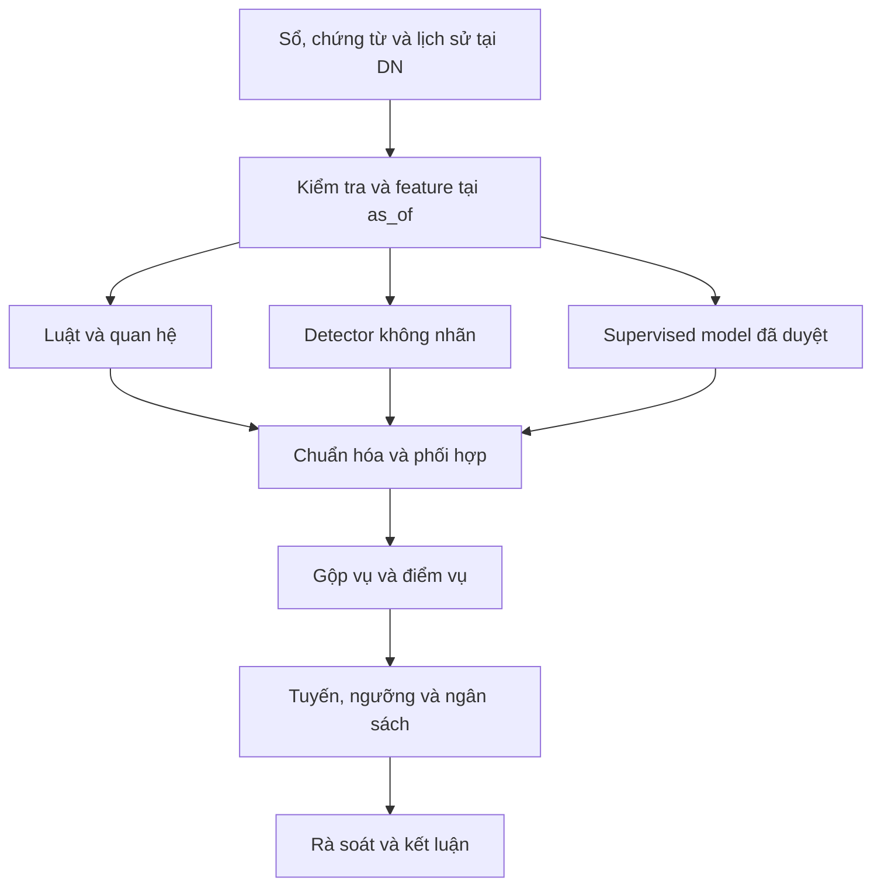

# Agent2 — Pipeline chính để triển khai bằng AI

Phiên bản: 1.3 đề xuất • Cập nhật: 10/11/2026  
Mục tiêu: trợ lý kiểm soát giao dịch cho doanh nghiệp vừa và nhỏ ở Việt Nam, gồm kiểm tra hồ sơ, đối chiếu hóa đơn–thanh toán, phát hiện rủi ro, quản lý khắc phục và báo cáo kiểm soát. Agent2 không tự xác nhận gian lận.

## 0. Cách sử dụng đặc tả

Nguồn nghiệp vụ: `Agent2_Huong_dan_cai_dat_tung_buoc.docx` người dùng cung cấp và yêu cầu về hai trường hợp huấn luyện. Đây là bản đặc tả mới, không phải báo cáo đã kiểm thử mã nguồn. Các đường dẫn mã trong tài liệu nguồn cần kiểm tra thực tế trước khi sửa.

Quy ước:

- **BẮT BUỘC:** hợp đồng triển khai và kiểm tra đúng/sai.
- **ĐỀ XUẤT:** mặc định để bắt đầu, phải đánh giá trước phát hành.
- **CHƯA CHỐT:** quyết định còn thiếu; không được tự bịa thành năng lực đã có.
- Ưu tiên tái cấu trúc runtime trên các thành phần Agent2 cũ đã kiểm chứng theo mục 22. TH1/TH2 là lộ trình mở rộng, không là điều kiện để hoàn thành sửa luồng. Nhánh HE thật chỉ được công nhận sau kiểm chứng giao thức.
- Không thay mã hóa thật bằng phép cộng số ngẫu nhiên, base64, AES thông thường hoặc một lớp giả rồi gọi là HE.

### 0.1 Phạm vi sửa Agent2 hiện có — ưu tiên triển khai hiện tại

Agent2 đã tồn tại nhưng luồng xử lý chưa đúng. Đây là công việc tái cấu trúc, không bắt đầu toàn bộ dự án từ số 0. Các tài sản cần kiểm kê để giữ: luật nghiệp vụ, hàm xác suất/điểm, đồ thị và các cài đặt ML không nhãn hiện có (EntityDeviation, ECOD, Isolation Forest, HBOS, Autoencoder nếu đã có).

**Đã làm rõ với nhóm:** “ML không train” có nghĩa là **ML không nhãn (unsupervised)**. Giữ các cài đặt ML không nhãn dùng được; vẫn thực hiện fit/huấn luyện trên lịch sử DN khi phương pháp yêu cầu, không cần nhãn y. Không coi yêu cầu này là cấm train/refit. Tách fit khỏi chấm để tránh học từ chính batch đang đánh giá; lưu artifact và phiên bản theo DN.

Mục 7–9 và 16 giữ thiết kế TH1/TH2 đã thống nhất cho giai đoạn sau. Phạm vi ưu tiên là runtime + các chức năng nghiệp vụ tại mục 21, theo lộ trình mục 14 mới.

## 1. Chốt lại ý nghĩa hai trường hợp huấn luyện

| Nội dung | TH1 — Synthetic có nhãn | TH2 — N DN học chung bằng HE |
|---|---|---|
| Dữ liệu gốc | Sổ giả lập có kịch bản kiểm soát | Sổ và nhãn thật được xác nhận tại từng DN |
| Tạo đặc trưng | Tái chạy feature pipeline sau tiêm ca | Chạy cùng feature contract tại mỗi DN |
| Nhãn y | 1: ca rủi ro theo kịch bản; 0: ca hợp lệ đã biết | 1: rủi ro xác nhận; 0: hợp lệ xác nhận; chưa kết luận không tham gia supervised train |
| Nơi train | Môi trường phát triển được phép | Cloud tính trên ciphertext theo giao thức đã chọn |
| Model | Logistic và LightGBM để benchmark | Logistic dùng sigmoid xấp xỉ; LightGBM gốc không nhận ciphertext trực tiếp |
| Đầu ra train | Artifact model, tiền xử lý, báo cáo | Trọng số model mã hóa, manifest phiên và kết quả kiểm chứng |
| Chuyển vào runtime | Qua validation thật, shadow và release gate | Mở model có kiểm soát, validation tại DN, shadow và release gate |

### 1.1 Sửa rõ mô tả “bảng xác suất rồi train logistic”

Phân biệt ba đối tượng:

1. **X:** ma trận đặc trưng; một dòng là một giao dịch ở mốc chấm.
2. **y:** nhãn thật theo định nghĩa mục tiêu; không phải điểm do model tự tạo.
3. **p:** đầu ra dự đoán từ trọng số hiện tại; dùng cùng y để tính sai lệch.

Logistic train bằng các vòng: trọng số → z → p → sai lệch p-y → gradient → trọng số mới. Vì vậy cloud thực hiện đủ vòng cập nhật trên ciphertext là **đã train logistic**, không cần thêm một lượt logistic thông thường từ bảng p.

DN không “thêm xác suất để xác nhận” nhãn. Người có thẩm quyền xác nhận tình trạng nghiệp vụ dựa trên bằng chứng. Nếu DN tự tính p trong một giao thức tương tác, đó là một bước tính toán, không phải gán nhãn.

Trong công thức gradient, “bảng so sánh” chính là y. Trong đánh giá, nó là bộ nhãn giữ lại để so với p/điểm vụ. Confusion matrix là kết quả đếm sau khi chọn ngưỡng, không phải dữ liệu thay thế X để train model gốc.

## 2. Kiến trúc và ranh giới triển khai



Tách ba thành phần:

| Thành phần | Chịu trách nhiệm | Không được nhận mặc định |
|---|---|---|
| DN node | Dữ liệu gốc, feature, khóa bí mật, nhãn, inference, bằng chứng, UI | Dữ liệu thô DN khác |
| Cloud training service | Điều phối phiên, lưu ciphertext, tính toán HE, artifact mã hóa | Secret key, X/y dạng rõ và bảng dự đoán cá nhân |
| Offline evaluation/registry | Benchmark và quản lý model/policy | Không được coi model ứng viên là bản active |

TH1 và TH2 là hai nguồn model ứng viên cho cùng một runtime. TH2 không yêu cầu ngừng detector/luật hoặc TH1 khi có DN vắng mặt.

## 3. Mục tiêu dự đoán và cấp nhãn

- BẮT BUỘC chốt supervised target: giao dịch có sai lệch/rủi ro nghiệp vụ đã được xác nhận theo bộ định nghĩa. Không gọi tự động là “gian lận”.
- `label_value`: 0, 1 hoặc null; `label_source`: synthetic_scenario / human_review; `label_status`: confirmed / inconclusive / unreviewed.
- Lưu case_id, transaction_id, người xác nhận, thời điểm xác nhận, phạm vi và phiên bản định nghĩa nhãn.
- Không gán 0 cho dòng dữ liệu thật chưa rà soát; không dùng p hoặc rule hit làm nhãn thật.
- Nhãn cấp vụ không được sao chép 1 cho mọi giao dịch trong vụ. Ví dụ T105 là thanh toán thừa, T096 là thanh toán hợp lệ dùng làm bằng chứng.
- Nhãn được biết sau mốc chấm có thể làm target train sau này; không được đi vào feature tại mốc chấm.
- Phản hồi từ cảnh báo có thiên lệch chọn mẫu. Cần bổ sung rà mẫu không cảnh báo và ghi cơ chế lấy mẫu để đánh giá độ bao phủ.

## 4. Hợp đồng đầu vào và thời gian

| Bảng | Nội dung chính |
|---|---|
| transactions | company_id, transaction_id, created_at, approved_at, posted_at, txn_type, amount_vnd; liên kết NCC, hóa đơn, tài khoản, người lập/duyệt |
| vendors, vendor_bank_history | NCC, tài khoản, valid_from/to, observed_at, trạng thái xác minh |
| invoices | Giá trị, thời điểm, trạng thái, điều chỉnh, ngoại tệ nếu có |
| payment_allocations | Giao dịch phân bổ bao nhiêu cho hóa đơn/nghĩa vụ nào, hoàn/hủy |
| employees, approvals | Vai trò, hạn mức và lịch sử thay đổi |
| supporting_documents | Chứng từ, liên kết, thời điểm hệ thống biết, trạng thái xác minh |
| review_labels | Nhãn riêng khỏi feature và dữ liệu inference |

- VND lưu số nguyên; bút toán điều chỉnh có thể âm, không tự lấy trị tuyệt đối.
- Quy định timezone Asia/Ho_Chi_Minh; lưu thời điểm có timezone hoặc UTC và hiển thị nhất quán.
- Mỗi dữ kiện quan trọng có cả thời gian hiệu lực nghiệp vụ và thời gian được quan sát. Dùng dữ kiện thỏa điều kiện đã biết tại as_of.
- Tách post-entry mode và pre-payment mode. MVP mặc định chấm tại posted_at theo hợp đồng DOCX; không quảng bá cảnh báo trước chi khi chưa có nguồn lệnh thanh toán chờ xử lý.
- Kiểm tra duy nhất theo company_id + transaction_id; danh mục phải đúng DN; cách ly dòng lỗi và ghi nguyên nhân.
- Giao dịch cùng mốc chấm: dùng lịch sử trước nhóm đồng thời, sau đó mới cập nhật. Có thể có phân tích cấp nhóm để phát hiện tổng vượt, nhưng phải version và dùng cùng quy tắc trong train/runtime.
- Hóa đơn và thanh toán có quan hệ nhiều-nhiều phải qua allocation; không cộng toàn bộ khoản chi vào từng hóa đơn.

## 5. Runtime R1 — Tạo đặc trưng và năng lực khả dụng

Tạo một FeatureRow trên mỗi giao dịch hợp lệ. Các tên sau là đề xuất để map với schema thật:

| Đặc trưng | Ý nghĩa | Xử lý thiếu |
|---|---|---|
| amount_to_vendor_median | Tiền so trung vị lịch sử cùng loại | Không chia cho 0; dùng peer group được duyệt hoặc missing |
| days_since_bank_change | Khoảng cách từ thay đổi tài khoản đã biết | Missing riêng với chưa từng đổi |
| bank_change_verified | Có hồ sơ xác minh thay đổi | Không suy “không có bảng” thành “chưa xác minh” |
| prior_paid_same_invoice | Tiền đã phân bổ trước giao dịch, xét hoàn/hủy | unavailable nếu thiếu sổ liên kết |
| projected_overpayment_vnd | Tổng sau khoản đang xét trừ nghĩa vụ còn hiệu lực | Tính theo phân bổ, không nhân đôi |
| prior_invoice_payment_count | Số lần trả hợp lệ trước đó | Theo cùng quy tắc thời gian |
| approval_limit_ratio | Số tiền so hạn mức áp dụng | Missing khi hạn mức không hợp lệ |
| creator_equals_approver | Trùng người lập/duyệt | Chỉ tính khi đủ ID |
| reference_count, history_available | Quy mô lịch sử và cờ năng lực | Luôn giữ để giải thích |

Feature contract gồm tên, thứ tự, dtype, đơn vị, cách missing, cửa sổ, peer group, biến đổi, phiên bản và hash. ID, nhãn, scenario_id, tên file, seed bộ sinh và kết quả rà soát không được là predictor.

Tiền xử lý dùng cùng một implementation khi train/inference. Supervised model học chung cần một phép biến đổi số thống nhất; không tự fit scaler riêng từng DN mà không ghi trong định nghĩa feature. Có thể dùng log/scale hằng số công khai hoặc thống kê train tổng hợp bảo mật, nhưng phải chọn rõ.

## 6. Runtime R2 — Luật, đồ thị và detector không nhãn

- Mỗi luật trả hit / no_hit / insufficient_data; khai báo trường bắt buộc, ngoại lệ và bằng chứng.
- Luật trả trùng phải kiểm tra nghĩa vụ, hoàn/hủy, phân bổ và trả từng phần; tài khoản chung phải xét thu hộ/quan hệ hợp lệ.
- Fit EntityDeviation/ECOD trên lịch sử riêng DN; IF/HBOS/AE là ứng viên benchmark. Không bắt buộc bật tất cả.
- Tất cả giao dịch được chấm bởi các phương pháp khả dụng. Không đặt cổng luật trước ML.
- Lưu raw_score, chiều điểm, percentile, reference_version, available, unavailable_reason, contributions nếu có và evidence_refs.
- Reference percentile lấy từ dữ liệu quá khứ cố định; không fit lại từ test batch. Percentile là thứ hạng, không phải xác suất.
- Thiếu detector dùng fallback đã đánh giá cho availability_profile; không thay điểm thiếu bằng 0 hoặc tùy ý chia lại trọng số.

### 6.1 Nhánh ML không cần nhãn độc lập

Nhánh này hoạt động cả khi chưa có model TH1/TH2. Luồng: lịch sử riêng DN → feature và tiền xử lý → fit detector → chấm dữ liệu kỳ sau → chuẩn hóa điểm bằng reference cố định → phối hợp → gộp vụ.

| Phương pháp | Chức năng | Vai trò ban đầu |
|---|---|---|
| EntityDeviation | Độ lệch theo thực thể/peer group | Ứng viên ưu tiên |
| ECOD | Độ hiếm theo phân phối đặc trưng | Ứng viên ưu tiên |
| Isolation Forest | Điểm cô lập bất thường | Benchmark bổ sung |
| HBOS | Độ hiếm qua histogram | Benchmark bổ sung |
| Autoencoder | Sai số tái tạo mẫu lịch sử | Benchmark bổ sung |

- Lịch sử không nhãn có thể chứa rủi ro; không gọi toàn bộ lịch sử là dữ liệu sạch/hợp lệ.
- Chốt số quan sát tối thiểu, cửa sổ và peer group theo từng phương pháp. Lưu training_snapshot, preprocess, detector, reference distribution và phiên bản theo DN.
- Đánh giá robust preprocessing/ảnh hưởng nhiễm bẩn; không tự xóa tất cả điểm cao trước khi fit rồi coi chúng là lỗi.
- Chạy benchmark trước khi thêm detector. Fit lại theo lịch hoặc yêu cầu có kiểm định; giám đốc theo dõi trạng thái và duyệt phiên bản đạt gate, kế toán không cần chọn thuật toán.
- UI kế toán vẫn xem được căn cứ so sánh như số tiền so lịch sử, mức thiếu dữ liệu và việc cần kiểm tra, dù tên detector được ẩn.

## 7. TH1 — Huấn luyện có giám sát bằng synthetic

### S1. Sinh sổ nền hợp lệ

Sinh DN giả lập đa dạng về quy mô, mùa vụ, NCC, hóa đơn, hợp đồng, hạn thanh toán, nhân viên, hạn mức, lịch sử tài khoản, các lần thanh toán và chứng từ. Giữ hard negatives: chia đợt đúng hợp đồng, đổi tài khoản đã xác minh, ứng trước, hoàn/hủy và chi lớn có căn cứ. Giữ nhất quán định danh và sổ phân bổ.

### S2. Tiêm sự kiện rủi ro

Ví dụ HD78 đã trả đủ bởi T096; thêm T105 thanh toán lần hai. Sửa ledger/event thật của sổ giả lập, không chỉ sửa một cột feature. Lưu injection manifest riêng: DN, scenario family/template, seed, dòng bị thay đổi, nhãn và căn cứ. T096 giữ nhãn hợp lệ nếu bản chất không bị thay đổi.

### S3. Tạo lại đặc trưng theo thời gian

Replay sổ sau tiêm bằng đúng feature pipeline runtime. Các dòng về sau cũng có thể bị thay đổi lịch sử tham chiếu; phải tính lại theo sự kiện. Chạy kiểm tra toàn vẹn nghiệp vụ và nhãn trước export.

### S4. Tách tập chống dấu vết bộ sinh

- Tách DN mô phỏng, nhóm template kịch bản và thời gian; lưu manifest cố định.
- Tạo holdout riêng kiểm tra mẫu kịch bản mới; báo riêng nếu loại rủi ro chưa có trong train.
- Không để bản sao/biến thể gần cùng một nghĩa vụ xuất hiện nhiều tập.
- Fit imputer/scaler/model trên train; validation chọn tham số; calibration/ngưỡng có tập phù hợp riêng; test giữ kín đến khi khóa cấu hình.
- Nếu sinh lại hoặc thay pipeline sau test, ghi phiên bản và tạo kế hoạch đánh giá mới.

### S5. Train và so sánh

Train Logistic và LightGBM trên cùng tập train, target và feature thông tin tương đương. Model có thể có adapter tiền xử lý riêng được version. Ghi class balance, sample/class weights, seed và hyperparameters. Tỷ lệ synthetic không được đọc thành tỷ lệ rủi ro thực tế.

Artifacts: model, preprocess, feature contract, label definition, split manifest, generator version, báo cáo và data provenance. Cả hai là ứng viên; chọn theo chất lượng vụ ở cùng ngân sách, không chỉ accuracy.

### S6. Chuyển miền sang dữ liệu thật

Chạy shadow, không ảnh hưởng cảnh báo active. Dùng nhãn thật đủ chất lượng để đánh giá/cân chỉnh và chọn ngưỡng. Nếu ít nhãn, ghi rõ chưa đủ bằng chứng phát hành. Có thể giữ luật/detector hiện tại làm bản active.

## 8. TH2 — Huấn luyện Logistic trên dữ liệu mã hóa nhiều DN

### 8.1 Mô hình dữ liệu và mô hình khóa

Thiết kế chính giả định **horizontal partition**: mỗi DN có các dòng giao dịch riêng, cùng cột feature/target. Nếu các DN nắm các cột khác nhau của cùng thực thể, đó là bài toán vertical khác; không áp trực tiếp đặc tả này.

BẮT BUỘC chọn một backend với semantics rõ:

| Phương án | Cách khóa hoạt động | Trạng thái |
|---|---|---|
| True multi-key HE | Mỗi DN mã hóa bằng public key riêng; phép tính liên khóa theo giao thức hỗ trợ; đầu ra phụ thuộc tập khóa | Phù hợp yêu cầu khóa độc lập, nhưng phải có backend chứng minh được |
| Collective/threshold HE | Các bên giữ secret share; dữ liệu mã hóa theo public key chung của phiên | Phương án triển khai khác, chỉ dùng nếu nhóm chấp nhận thay đổi mô hình khóa |

Không cộng ciphertext từ các key/context không tương thích. Không coi tài liệu threshold/multiparty của thư viện là bằng chứng đã có đúng multi-key backend. Không mặc định một DN tự mở được model chung. Không mặc định n-of-n hỗ trợ t-of-n hoặc rút bên giữa phiên.

**CHƯA CHỐT:** thư viện/giao thức true multi-key cụ thể. AI được phép xây interface và plain simulator; phải ghi backend_not_implemented cho HE chưa có, không tự chuyển sang plaintext để báo thành công.

### 8.2 Hợp đồng phiên trước khi nhận ciphertext

TrainingManifest cần có session_id, participants, protocol/backend version, key_epoch/key identifiers, context fingerprint, schema/feature hash, split policy, label definition, preprocessing, objective, learning rate, regularization, initialization, rounds/batches, participant weighting, polynomial coefficients/domain, packing/layout, crypto parameters, refresh schedule, quyền mở model, điều kiện thiếu bên, tài nguyên dự kiến và acceptance thresholds.

- Secret key/secret share ở DN; public/evaluation key theo giao thức được gửi đúng nơi.
- Chọn bảo mật mục tiêu và thông số qua công cụ/giao thức được kiểm chứng; không tự phát minh tham số.
- Định nghĩa threat model: cloud chỉ tò mò hay có thể sửa dữ liệu; DN nào có thể thông đồng; có xét poisoning không. Cơ chế không chống được phải ghi rõ.
- Key epoch gắn với mọi ciphertext; thêm/bớt DN phải tạo phiên/luồng chuyển khóa được hỗ trợ, không sửa participants giữa phiên tùy ý.

### 8.3 H1. Chuẩn bị tại DN

Mỗi DN tạo snapshot, FeatureRows và nhãn confirmed; tách train/validation/test theo thời gian/case. Validation/test ở lại DN, không lẫn vào train cloud. Map thứ tự cột và biến đổi số thống nhất. Chỉ giữ dòng train có target đúng định nghĩa.

Log số dòng bị loại/missing/nhãn chưa kết luận. Nếu kiểm tra đầu vào diễn ra ở client không tin cậy, cloud không tự chứng minh tính đúng của ciphertext/nhãn chỉ bằng HE; cần cơ chế riêng nếu threat model yêu cầu.

### 8.4 H2. Mã hóa và tải lên

Đóng gói X_i, y_i theo layout đã duyệt, mã hóa và tải lên kho phiên. Padding có mask để không tính dòng giả vào gradient. Cloud lưu object ciphertext kèm metadata; không vận hành truy vấn SQL/rule engine trên chúng như bảng rõ.

Cloud không nhận transaction_id thật nếu không cần; mapping row-token về giao dịch giữ ở DN. Bảo vệ nội dung và xác thực kênh truyền; hash/chữ ký dùng để ràng buộc phiên, không thay cho chứng minh phép tính đúng.

### 8.5 H3. Train trực tiếp trên ciphertext

Với m dòng, d đặc trưng, trọng số w và bias b:

```text
z = X w + b
p_exact = sigmoid(z) = 1 / (1 + exp(-z))
p_approx = q3(z) = a0 + a1*z + a2*z^2 + a3*z^3
residual = p_approx - y
grad_w = X^T residual / m + lambda*w
grad_b = sum(residual) / m
w_next = w - eta*grad_w
b_next = b - eta*grad_b
```

Đây là công thức logic rõ để đối chiếu. Triển khai HE phải xác định ciphertext nào chứa từng đối tượng, các phép rotation, sum, multiply và chuyển khóa tương ứng. Bias không regularize trong baseline này.

- Cộng và nhân là phép tính **trên dữ liệu đã mã hóa**, không phải bản thân cách mã hóa.
- ĐỀ XUẤT xấp xỉ trực tiếp sigmoid; không chỉ thay exp bằng cubic rồi bỏ qua phép nghịch đảo trong sigmoid.
- q3 là đa thức xấp xỉ trên miền hữu hạn [-L,L], không tự bảo đảm giá trị luôn thuộc [0,1]. Gọi là approx_score khi chưa chứng minh miền/range và hiệu chỉnh.
- Không chốt hệ số cubic tùy ý. Lưu miền, thuật toán chọn hệ số, sai số cực đại và kiểm tra gần biên.
- Kiểm soát scale dữ liệu, regularization, learning rate và số vòng để tránh z vượt miền; nếu không kiểm tra z trên ciphertext được, phải nêu giới hạn của chứng minh/kiểm thử rõ. Clip plaintext tại client phải là phần transform đã chốt; clip ciphertext cần giao thức so sánh riêng.
- Chia m công khai là nhân 1/m; m và kích thước batch có thể làm lộ metadata. Nếu yêu cầu giấu m, cần thiết kế khác.
- Có thể chọn trọng số theo số dòng hoặc cân bằng theo DN; phải chốt trước vì đây là hai mục tiêu học khác nhau. Dữ liệu lệch lớp và DN lớn không được âm thầm chi phối.
- Sau mỗi vòng, model/gradient tiếp tục ở ciphertext. Không gửi bảng p rõ về cloud để “train tiếp” theo mặc định.
- Theo dõi chiều sâu nhân, modulus/scale/noise budget và chi phí refresh. Chọn số vòng cố định từ benchmark rõ nếu không có giao thức dừng sớm bảo mật.
- Refresh/bootstrapping phải dùng cơ chế đã định; không giải mã gradient/trạng thái trung gian cho cloud để làm mới.

Kết thúc H3 tạo **encrypted model weights + bias**, không chỉ “một bảng mã hóa” không có semantics. Nếu một backend xuất intermediate p/gradient, artifact phải khai báo chính xác loại và bước sử dụng; không gọi nó là model.

### 8.6 H4. Mở model được phép

Phiên chính đề xuất mở đúng final model cho các DN được cấp quyền để inference tại chỗ. Các bên đóng góp giải mã/chuyển khóa theo backend; kết quả rõ chỉ tới người nhận được duyệt. Nếu protocol không đáp ứng hạn chế người nhận, không coi yêu cầu đã hoàn thành.

- Ràng buộc request với session, artifact, circuit/job và quyền mở.
- Không xây endpoint giải mã ciphertext bất kỳ. Chỉ signature/hash của cloud chưa chứng minh ciphertext là kết quả phép tính đã duyệt; cần nêu cơ chế xác minh hoặc giả định tin cậy tương ứng.
- Audit, giới hạn số lần mở, xử lý replay và participant dropout.
- Muốn một DN nhận model dưới key riêng cần authorized key switching/recipient protocol; không tự lấy secret key từng bên.
- Model rõ có thể rò thông tin qua suy luận; HE không tự giải quyết model leakage, poisoning hoặc máy DN bị xâm nhập.
- Nếu yêu cầu model luôn mã hóa: thiết kế encrypted inference/decryption riêng; không bật inference rõ trái yêu cầu.

### 8.7 H5. Xác suất và đánh giá tại DN

Sau khi nhận w,b được phép, DN chấm X nội bộ. Lưu `prediction_link`: polynomial q3 hay exact sigmoid. Đổi từ q3 lúc train sang sigmoid lúc inference là một lựa chọn phải đo riêng, không mặc định tương đương.

Tách ba loại giá trị: model_raw_score, calibrated_probability (chỉ khi hiệu chỉnh/kiểm tra phù hợp), percentile để phối hợp. Không đổi tên q3 chưa kiểm định thành xác suất đáng tin cậy.

DN so dự đoán với nhãn validation/test thật. Chỉ chia sẻ metric tổng hợp được duyệt; không mặc định gửi bảng p theo từng giao dịch. Metric nhóm nhỏ vẫn có nguy cơ lộ thông tin; chốt phạm vi và cơ chế tổng hợp theo threat model.

Model học chung phải so với TH1 và baseline tại DN. Có thể phát hành cho DN đủ điều kiện và giữ model cũ ở DN khác; không bắt buộc mọi DN dùng một threshold/model.

### 8.8 Nếu nhóm thực sự muốn DN tính p mỗi vòng

Đây là **giao thức tương tác khác**, không phải bước thêm tự do vào H3:

1. Gửi model/intermediate đã định đến các DN theo quyền mở.
2. DN tính p hoặc gradient trên dữ liệu local.
3. DN mã hóa gradient hoặc cập nhật; cloud tổng hợp bảo mật và cập nhật trọng số.
4. Lặp, xác định ai nhìn thấy model mỗi vòng và xử lý DN vắng mặt.

Nếu dữ liệu ở lại DN và chỉ cập nhật được gửi, đây là hướng federated training với secure aggregation/HE, khác thiết kế cloud nhận Enc(X,y). Đặc tả chính chọn H1–H5. Không kết hợp hai giao thức nếu chưa chốt ranh giới tin cậy và đối tượng truyền.

## 9. Kiểm chứng TH2 theo ba baseline

| Baseline | Mục đích |
|---|---|
| B0: Logistic rõ với sigmoid chuẩn | Mốc chất lượng ML tham khảo |
| B1: Logistic rõ dùng đúng q3, init, batch, objective và rounds của HE | Tách ảnh hưởng xấp xỉ thuật toán |
| B2: Logistic HE cùng thuật toán B1 | Đo sai số và chi phí của mã hóa |

Trên synthetic nhỏ có quyền mở trong môi trường test: so B1/B2 ở trọng số, logit, score, thứ hạng và quyết định cảnh báo; báo B0/B1 để thấy tổn thất do xấp xỉ. Không yêu cầu B0 và B2 có trọng số y hệt khi thuật toán khác nhau.

Đo thời gian mã hóa/upload/train/refresh/mở model, bộ nhớ, kích thước ciphertext, số vòng, số DN, số dòng và d. Đặt tolerance/giới hạn tài nguyên trước chạy acceptance; chưa đạt thì giữ trạng thái experimental. Kiểm tra sai context/key epoch, thiếu bên, replay và request mở không được phép.

## 10. Phối hợp điểm và chọn trên validation

Mọi nguồn model TH1/TH2 đều phải đáp ứng cùng MethodScore contract. Không tính “HE score” như một phiếu thêm; nó chỉ là nguồn huấn luyện của logistic.

- Fit detector và preprocess trên kỳ cũ.
- Chọn bộ phương pháp nhỏ/trọng số ở kỳ validation tiếp theo; stacking chỉ dùng điểm ngoài mẫu theo thời gian.
- Khóa gộp vụ và cách tính điểm vụ trước chọn threshold/policy ở kỳ riêng.
- Test mới giữ kín, giữ cùng case/episode trong một tập; cách ly vụ kéo dài qua biên nếu cần để tránh rò thời gian.
- So cùng budget sau gộp vụ: vụ đúng, false alerts/DN/tuần, precision trên vụ đã kết luận, tỷ lệ có kết luận và phút rà soát. Báo PR-AUC cho supervised model; accuracy không phải tiêu chí chính khi mất cân bằng.
- Lấy mẫu không cảnh báo để ước lượng bỏ sót theo thiết kế lấy mẫu; không tuyên bố recall thực nếu chưa có đủ ground truth.
- Vụ inconclusive không gán 0 và không giấu khỏi báo cáo.

## 11. Gộp vụ, policy và rà soát

- Phân biệt giao dịch ứng viên với giao dịch bằng chứng. HD78 có T105 cần kiểm tra và T096 dùng đối chiếu; không tự biến T096 thành giao dịch rủi ro.
- Gộp theo company_id + risk_family + nghĩa vụ/chứng từ; cùng NCC không đủ để gộp.
- Baseline điểm vụ: max điểm của **giao dịch ứng viên**, không lấy mọi dòng bằng chứng. Benchmark trước khóa.
- Vụ có case_id ổn định, revision và lịch sử; rerun/retry không tạo vụ hoặc cảnh báo trùng.
- Tuyến bắt buộc theo bảng luật nghiệp vụ được duyệt; owner, SLA và quá tải phải chốt trước active.
- Tuyến ưu tiên: qua ngưỡng và căn cứ, tối đa B vụ mới/DN/tuần. ĐỀ XUẤT thử B=3, tuần lịch Asia/Ho_Chi_Minh. Không đủ vụ đạt thì gửi ít hơn.
- Lưu below_threshold, need_evidence, budget_deferred, already_notified và selected; backlog xét lại có hạn hiệu lực và theo dõi tuổi vụ. Kiểm soát budget khi chạy đồng thời.
- Căn cứ ML gồm dữ liệu nguồn, so sánh phù hợp, giới hạn và việc cần kiểm tra; không yêu cầu mọi cảnh báo ML phải trúng luật.
- UI: vấn đề → số liệu/chứng từ → việc cần đối chiếu → ưu tiên/tín hiệu → kết luận.
- Workflow: new/in_review/waiting_evidence/closed. Resolution riêng: confirmed_risk/legitimate/inconclusive.
- Lưu reviewer, thời gian, lý do, bằng chứng, sửa/mở lại vụ và audit. Phân quyền theo DN.

## 12. Hợp đồng artifact và lưu trữ

| Artifact | Trường tối thiểu |
|---|---|
| RunContext | run_id, company_id, as_of, snapshot_id, mode, bundle_version, status |
| FeatureRow | row_token/transaction_id local, feature_version, values, missing_flags, evidence_refs |
| MethodScore | raw_score, percentile, available, reason_codes, method_version, reference_version |
| SupervisedModel | origin synthetic/local/he_joint, feature_hash, preprocess_version, target_version, prediction_link, validation_report, status |
| EncryptedDataset | session_id, participant_token, context/key_epoch, layout, feature_hash, ciphertext_refs, split=train |
| TrainingJob | manifest, status, ciphertext checkpoint, rounds_completed, protocol transcript refs |
| Case/Decision | candidate_ids, evidence_ids, grouping_version, score_version, policy_version, decision, budget_period |
| ReleaseBundle | feature, detector/model, reference, ensemble/fallback, grouping, policy versions và rollback target |

Cloud lưu ciphertext objects và metadata có kiểm soát; local DN giữ sổ, feature rõ, mapping, nhãn và bằng chứng. Logs không chứa khóa, X/y rõ hoặc dump ciphertext kèm dữ liệu giải mã. Checkpoint mã hóa gắn phiên và không resume bằng key epoch khác.

## 13. Module và interface cho AI triển khai

| Module | Trách nhiệm/interface logic |
|---|---|
| contracts | Schema và enums; validate input/output |
| ingestion | build_snapshot(company_id, as_of) |
| features | build_features(snapshot, feature_contract) |
| rules / methods | check_availability, fit, score; trả MethodScore mọi dòng |
| synthetic | generate_ledger, inject_events, replay_features, build_split_manifest |
| supervised/plain | train_logistic, train_lightgbm, train_polynomial_reference |
| he/protocol | setup_session, encrypt_dataset, train_encrypted, refresh, finalize_model, release_model |
| he/backend | Adapter true multi-key hoặc threshold rõ loại; unsupported trả lỗi tường minh |
| evaluation | temporal/group splits, prediction comparison, case-level budget benchmark |
| ensemble / cases / policy | Phối hợp, gộp, tính điểm vụ, cấp ngân sách |
| reviews / registry / monitoring | Phản hồi, bundle lifecycle, drift, audit và rollback |

Interface chỉ là hợp đồng logic; AI đối chiếu `agent2/schema.py`, `agent2/methods.py`, `pipeline_v4.py`, `alerting.py` theo DOCX trước khi tạo file tương ứng. Tái sử dụng phần đúng; không xóa baseline trước khi có báo cáo so sánh.

## 14. Lộ trình tái cấu trúc và acceptance

| Mốc | Deliverable | Điều kiện hoàn thành |
|---|---|---|
| R0 | Kiểm kê mã cũ và lỗi luồng; lưu baseline | Có danh mục giữ/bọc adapter/sửa/thay; test thể hiện lỗi luồng hiện tại |
| R1 | Shared validation, snapshot, feature contract | Không rò thời gian/DN; import dùng chung web tổng |
| R2 | Bọc luật, điểm/xác suất, đồ thị, ML không nhãn; job fit/refit lịch sử | Ma trận điểm mọi giao dịch; parity thành phần tái sử dụng đạt yêu cầu |
| R3 | Điều phối mới, gộp vụ, policy | Không lọc theo luật trước ML; không gửi trùng/vượt budget |
| R4 | Đối chiếu, hồ sơ, ActionTask và báo cáo | Có luồng từ phát hiện đến khắc phục có bằng chứng |
| R5 | Hai UI theo quyền và audit | Kế toán xử lý được nghiệp vụ; giám đốc quản lý cấu hình/ủy quyền |
| R6 | So cấu hình cũ/mới, shadow, release và rollback | Đạt tiêu chí đã chốt, có báo cáo thay đổi và giới hạn |
| F1 | TH1 synthetic nếu triển khai mở rộng | Theo mục 7, tách biệt việc hoàn thành runtime |
| F2 | Plain polynomial reference và HE synthetic | Theo mục 8–9; backend thật được kiểm chứng |
| F3 | Pilot TH2 và phát hành theo DN | Có validation thật, quyền mở và vận hành đạt gate |

Chốt trước đánh giá các giới hạn về báo nhầm, số vụ đúng, thời gian rà soát, tài nguyên và độ bao phủ nhãn. Khi chưa đủ ground truth, báo cáo hành vi/độ đúng kỹ thuật và giới hạn chất lượng; không tuyên bố ML phát hiện chính xác. Vụ xử lý khắc phục và hồ sơ không bị giới hạn bởi budget cảnh báo mới 3 vụ/tuần.

## 15. Kiểm thử tối thiểu bắt buộc

1. Dữ liệu/chứng từ đến muộn không đổi feature quá khứ.
2. Thanh toán hai đợt hợp lệ không bị gán synthetic risk; thanh toán thừa có đúng nhãn và bằng chứng.
3. Tiêm ledger rồi replay khác với sửa feature thủ công; labels/scenario IDs không vào predictor.
4. Case/template/DN/time split không rò; dòng chưa rà soát không thành negative.
5. Missing detector khác điểm thấp; giao dịch no-hit luật vẫn được ML chấm.
6. Pipeline train/runtime feature và schema hash tương thích.
7. B1/B2 cùng thuật toán được so đúng; q3 có kiểm thử miền và ngoài miền.
8. Backend từ chối ciphertext sai context/khóa; không gom secret key lên cloud.
9. Chỉ đúng output được duyệt mới mở; thiếu bên/timeout không âm thầm plaintext fallback.
10. Shadow không gửi active; retry/concurrency không tạo vụ trùng hoặc vượt budget.
11. Nhãn cấp vụ không tự áp lên giao dịch bằng chứng; inconclusive báo riêng.
12. Rollback không mất review/audit và có thể tái hiện cảnh báo cũ.

## 16. Những quyết định nhóm phải chốt cho TH2

- Khóa độc lập true multi-key là bắt buộc hay chấp nhận collective threshold? Backend cụ thể nào đáp ứng?
- Model cuối ai được thấy: mỗi DN, cloud, hay chỉ mô hình mã hóa? Có chấp nhận DN nhìn model mỗi vòng không?
- n-of-n hay t-of-n? Khi bên rời phiên/mất khóa thì xử lý thế nào theo giao thức thực có?
- Threat model và giới hạn thông đồng, giả mạo kết quả tính và poisoning là gì?
- Feature transform chung, weighting theo DN, polynomial/domain, refresh, round budget và mức tài nguyên nào được chấp nhận?
- Validation có đủ nhãn/độ bao phủ không? Metric nào được chia sẻ và ai được nhận?

AI được tiếp tục phần không phụ thuộc các quyết định này. HE thật và active release phải giữ trạng thái blocked/experimental ở chỗ chưa đáp ứng.

## 17. Chỉ dẫn giao việc cho AI

> Hãy tái cấu trúc Agent2 hiện có theo R0–R6. Trước tiên đọc mã, xác định lỗi luồng và lập bản đồ các thành phần giữ lại: luật, điểm/xác suất, đồ thị, ML không nhãn hiện có. Bổ sung hoặc giữ job fit/refit trên lịch sử DN có version; không cần nhãn y. Viết characterization tests và bọc adapter trước khi sửa orchestration. Chấm toàn bộ giao dịch khả dụng, rồi phối hợp, gộp vụ và áp policy. Thêm đối chiếu, hồ sơ, ActionTask và báo cáo; dùng auth/import chung và hai UI theo quyền. Không viết lại toàn bộ thuật toán đang đúng, không bỏ fit bắt buộc của detector, không coi percentile là xác suất. Model thiếu artifact phải unavailable, không tự train trong request chấm. TH1/TH2 là F1–F3 và không chặn sửa runtime. Giữ baseline/rollback; chỉ loại luồng cũ sau khi có kiểm thử và so sánh. Không tự phát hành model hoặc backend HE chưa qua gate.

## 18. Tham khảo và phạm vi xác minh

- Tài liệu người dùng: `Agent2_Huong_dan_cai_dat_tung_buoc.docx`; đây là nguồn nghiệp vụ chính.
- MK-HELR: Kang và cộng sự, Scientific Reports (2024), DOI https://doi.org/10.1038/s41598-024-63393-1 . Trong lượt này xác minh được thông tin bài/abstract qua PubMed: https://pubmed.ncbi.nlm.nih.gov/38871748/ ; chưa truy xuất được toàn văn để tái kiểm chứng chi tiết giao thức/refresh. Không coi bài này là backend đã chọn.
- OpenFHE official docs: https://openfhe-development.readthedocs.io/en/latest/ . Xác nhận có CKKS, threshold FHE và interactive bootstrapping. Đây không phải bằng chứng rằng true multi-key theo khóa độc lập đã sẵn sàng cho thiết kế này.
- OpenFHE multiparty API: https://openfhe-development.readthedocs.io/en/latest/api/classlbcrypto_1_1MultipartyBase.html . Đối chiếu phiên bản cụ thể khi chọn backend.
- Công thức logistic, hợp đồng artifact, các gate và interface trong file là thiết kế đề xuất của dự án, cần kiểm thử thực tế; chưa có cam kết hiệu năng hoặc bảo mật sản xuất.


## 19. Phân quyền và hai giao diện

### 19.1 Nguyên tắc

App có một hệ thống đăng nhập và phân quyền chung, hai không gian sử dụng theo vai trò. Không xây hai pipeline chấm khác nhau cho hai giao diện. Cùng một vụ, dữ liệu và kết luận được trình bày ở mức chi tiết phù hợp.

- Vai trò MVP: accountant (kế toán) và director (giám đốc), gắn với membership của từng DN. Một người có thể mang vai trò khác nhau tại các DN khác nhau.
- Backend kiểm tra quyền trên mọi API và tác vụ nền. Ẩn nút/menu không phải cơ chế phân quyền.
- company_id trong request không tự tạo quyền; xác minh user có membership/quyền tương ứng trước truy vấn.
- Director chỉ có quyền trong DN được cấp. Không mặc định director được quản trị nền tảng, xem DN khác hoặc lấy khóa bí mật.
- Hệ thống có thể dùng nhiều route trong cùng web; UI đổi theo quyền, API và dữ liệu vẫn dùng chung hợp đồng.

### 19.2 Giao diện kế toán — giấu phương pháp, giữ căn cứ

Mục tiêu: người dùng biết cần kiểm tra gì mà không phải hiểu thuật toán ML.

Các màn hình:

1. Tổng quan việc cần làm: vụ mới, đang xử lý, chờ chứng từ, quá hạn.
2. Danh sách vụ có bộ lọc theo thời gian, loại vấn đề và trạng thái.
3. Chi tiết vụ: giao dịch ứng viên, giao dịch bằng chứng, chứng từ gốc, số liệu so sánh và hành động cần làm.
4. Nhập dữ liệu/báo lỗi đầu vào nếu được cấp quyền import.
5. Ghi nhận phản hồi, bổ sung bằng chứng và xem lịch sử xử lý.

Ẩn tên ECOD/IF/AE/Logistic, trọng số, hyperparameters, ma trận benchmark và phần chỉnh policy. Dùng diễn đạt nghiệp vụ, ví dụ “Khoản chi cao hơn mức thường gặp của NCC” thay cho tên detector. Mức ưu tiên không được trình bày thành xác suất gian lận.

Không giấu nguồn chứng từ, phép đối chiếu, thiếu dữ liệu, mức độ chưa chắc chắn hoặc việc đây là tín hiệu cần kiểm tra. API kế toán trả DTO theo allowlist; không gửi toàn bộ thông tin quản trị xuống browser rồi chỉ ẩn bằng CSS.

Kế toán được ghi phản hồi theo quyền được cấp. ĐỀ XUẤT MVP: phản hồi là kết quả rà soát của người thao tác; chỉ trở thành nhãn train confirmed sau bước xác nhận của giám đốc/người được ủy quyền. Đây là kiểm soát chất lượng nhãn, không xóa phản hồi ban đầu. Lưu review_status và training_label_status riêng.

### 19.3 Giao diện giám đốc — quản lý và chỉnh cấu hình

Các màn hình:

1. Dashboard chất lượng theo DN: vụ đúng, báo nhầm, tỷ lệ có kết luận, tải và thời gian rà soát.
2. Dữ liệu: trạng thái import, lỗi, thiếu năng lực, snapshot và lịch sử thay thế.
3. Cấu hình: ngân sách, ngưỡng, cách gộp và bật/tắt phương pháp trong các profile được hỗ trợ.
4. Đánh giá phiên bản: so cấu hình hiện tại/ứng viên, shadow, duyệt active và rollback.
5. Người dùng và quyền trong DN; nhật ký thay đổi và kết luận.
6. Nhãn và huấn luyện: duyệt nhãn, yêu cầu fit lại, trạng thái model không nhãn/TH1/TH2.
7. TH2: chọn tham gia phiên, phạm vi dữ liệu và quyền mở model theo giao thức; khóa vẫn do thành phần quản lý khóa ở DN xử lý.

Giám đốc chỉnh **cấu hình có schema**, không nhập code Python/SQL/biểu thức tùy ý chạy trên server. Model/luật mới phải qua adapter và validation. Hiển thị các metric kỹ thuật nâng cao khi cần, đồng thời giải thích tác động nghiệp vụ.

Luồng chỉnh: draft → validation → shadow → approved → active; có trạng thái rejected/failed. Lưu người sửa, lý do, diff và phiên bản. Không sửa trực tiếp bundle active hoặc cảnh báo lịch sử. Quyền giám đốc không bỏ qua release gate; ứng viên chưa đủ dữ liệu vẫn ở shadow. Chỉ đổi phân công/vai trò nghiệp vụ theo quyền, không cần chạy lại benchmark model cho thao tác quản lý người dùng.

### 19.4 Ma trận quyền MVP

| Hành động | Kế toán | Giám đốc |
|---|---|---|
| Xem vụ, chứng từ trong phạm vi được giao | Có | Có trong DN |
| Xem căn cứ và hướng dẫn kiểm tra | Có | Có |
| Xem tên thuật toán, trọng số và benchmark | Không | Có |
| Nhập dữ liệu | Theo permission data.import | Có nếu được cấp permission tương ứng |
| Ghi phản hồi/bổ sung bằng chứng | Có trong vụ được phép | Có |
| Xác nhận nhãn dùng train | Không theo mặc định MVP | Có, hoặc ủy quyền rõ |
| Sửa ngưỡng, budget, grouping, model profile | Không | Tạo draft, qua gate |
| Duyệt active/rollback | Không | Có khi đạt điều kiện |
| Quản lý thành viên DN | Không | Có; không tự cấp quyền nền tảng |
| Đọc secret key DN khác / dữ liệu DN khác | Không | Không |

Schema bổ sung: User, CompanyMembership(user_id, company_id, role, status), Permission/RolePermission hoặc cơ chế tương đương, ConfigRevision, ReviewApproval và AuditEvent. Backend thực thi quyền trên upload, preview, commit, export, download, case detail, config, jobs và file bằng chứng.

## 20. Dùng chung kiểm tra dữ liệu với web tổng

### 20.1 Kết luận kiến trúc

Có thể dùng chung màn nhập liệu, đăng nhập, mapping và thư viện/backend validation. Chưa kiểm tra web hiện tại nên chưa kết luận tái sử dụng được nguyên trạng; cần kiểm kê contract/API và vị trí xử lý dữ liệu.

Dùng một luồng: màn nhập chung → kiểm tra quyền/DN → kiểm tra nền tảng → kiểm tra profile Agent2 → preview lỗi/năng lực → commit snapshot hợp lệ → Agent2 tạo đặc trưng.

Không dựng một bộ validator riêng ở frontend Agent2 khác backend chung. Frontend có thể kiểm tra nhanh để phản hồi sớm; backend mới là nơi quyết định nhận dữ liệu. Nếu Agent khác có hợp đồng khác, gọi core validator + profile riêng, không bắt mọi dữ liệu phải thỏa toàn bộ Agent2.

### 20.2 Ba lớp kiểm tra

| Lớp | Trách nhiệm | Ví dụ |
|---|---|---|
| Shared core | Kiểu file/schema, parse số/ngày, trường chung, trùng ID, tenant | amount_vnd phải đúng kiểu và đơn vị; ID duy nhất trong DN |
| Agent2 profile | Năng lực phân tích, liên kết hóa đơn/chi trả, thời điểm quan sát, cột cho detector | Thiếu bank history chỉ tắt năng lực tương ứng |
| Training profile | Nhãn, split và feature contract/phiên mã hóa | Chưa kết luận không được biến thành nhãn 0 |

Kiểm tra đầu vào không đồng nghĩa phát hiện rủi ro. Một giao dịch trùng thanh toán có thể là dòng nhập hoàn toàn hợp lệ về schema và phải chuyển sang Agent2 để phân tích; không chặn nó chỉ vì đáng ngờ.

### 20.3 ValidationReport và import an toàn khi chạy lại

Report có import_id, company_id, source_hash, schema_version, validator_version, profile_version, parsed_snapshot_hash, status, counts, errors, warnings và capabilities. Mỗi lỗi gồm row/field nếu có, code, severity, message nghiệp vụ và cách sửa.

- Status: rejected / accepted_with_warnings / accepted.
- Lỗi phá hợp đồng quan trọng phải reject hoặc quarantine theo policy, không âm thầm bỏ dòng.
- Thiếu lịch sử/chứng từ bổ sung thường tạo warning và unavailable capability, không tự chặn mọi phương pháp.
- Preview và commit cùng import_id và cùng phiên bản dữ liệu đã kiểm; file/mapping thay đổi phải validate lại. Commit chỉ nhận báo cáo hợp lệ từ backend, không tin report do browser tự gửi.
- Chống nhập lặp bằng idempotency theo DN/import; commit transaction để không nửa chừng.
- File/snapshot đã dùng để chấm không bị ghi đè. Sửa dữ liệu tạo revision và quyết định chấm lại có audit.
- Cache kết quả theo hash dữ liệu, DN, mapping, contract/profile version và context liên quan; không dùng report của DN khác.
- Ghi nhãn riêng; không ép mọi dòng import phải có nhãn. Dòng chưa rà soát vẫn được runtime chấm.

API logic đề xuất, điều chỉnh theo web thật:

| API | Chức năng |
|---|---|
| POST /imports/preview | Upload/map, validate theo profile được phép; trả import_id và report |
| POST /imports/{id}/commit | Kiểm tra quyền và report chưa lỗi thời; tạo snapshot |
| GET /imports/{id}/report | Trả lỗi/cảnh báo và năng lực được phép xem |
| POST /agent2/runs | Nhận snapshot_id + as_of; backend chốt bundle theo quyền |
| POST /agent2/configs | Director tạo draft cấu hình; không đổi active ngay |

### 20.4 Web chung không đồng nghĩa gom dữ liệu rõ lên cloud

Phân biệt dùng chung giao diện/module với dùng chung nơi lưu và chạy dữ liệu:

- Nếu web tổng chạy trong môi trường DN được phép xử lý sổ rõ: dùng chung API validation tại DN.
- Nếu web tổng là SaaS nhưng yêu cầu TH2 là cloud chỉ nhận ciphertext: file rõ phải được validation/feature/encrypt tại DN node trước upload; dùng chung thư viện validation triển khai tại DN. Không upload file rõ lên SaaS chỉ để kiểm tra rồi nói dữ liệu chưa rời DN.
- Cloud TH2 chỉ kiểm tra metadata, hash schema/context, manifest và các điều kiện ciphertext mà backend hỗ trợ. Không tuyên bố kiểm tra được nội dung nghiệp vụ của ciphertext như dữ liệu rõ.
- Kiểm tra client/browser đơn thuần không chứng minh dữ liệu thật hoặc nhãn đúng với cloud. Nếu cần chống client gian lận, thiết kế attestation/proof/giao thức riêng theo threat model.
- Hai giao diện kế toán/giám đốc đều dùng cùng import report đã phân quyền; không tạo hai bản dữ liệu hoặc hai chuẩn kiểm tra khác nhau.

### 20.5 Bổ sung vào lộ trình và kiểm thử

R0: kiểm kê auth/import/validator của web tổng; xác định deployment ở DN hay cloud, reuse map và điểm thiếu.
R1: tích hợp shared core + Agent2 profile, preview/commit và snapshot.
R5: hoàn thiện hai UI/DTO, permission checks, workflow phản hồi và duyệt nhãn.
R6: thử thay cấu hình theo draft/shadow/active, audit và phân tách tenant trước phát hành.

Kiểm thử bổ sung:

1. Kế toán gọi trực tiếp API quản trị vẫn bị từ chối; payload/export không lộ cấu hình ẩn.
2. User đổi company_id/case_id/import_id không truy cập được DN ngoài membership.
3. Giám đốc không có quyền nền tảng hoặc secret key chỉ do role.
4. Hai giao diện nhận cùng kết quả nghiệp vụ và import report cho cùng phiên bản được phép.
5. Sửa file/mapping sau preview làm report cũ không commit được.
6. Retry import không nhân đôi giao dịch; lịch sử đã chấm không bị ghi đè.
7. Thiếu nhãn không chặn inference; thiếu lịch sử chỉ giảm capabilities đúng phạm vi.
8. TH2 dùng web tổng trên cloud không làm lộ file/X/y rõ trong upload, logs hoặc telemetry.
9. Sửa config tạo revision; active chỉ đổi sau gate; audit truy được người và lý do.
10. Phản hồi kế toán không tự thành nhãn confirmed cho train trước bước duyệt theo policy.


## 21. Chức năng nghiệp vụ mở rộng

### 21.1 Đối chiếu hóa đơn – thanh toán

Màn hình độc lập dùng cả khi không có cảnh báo rủi ro. Tính số phải trả còn hiệu lực, tiền đã phân bổ, số còn lại/chênh lệch sau khi xét hoàn, hủy, điều chỉnh và tiền tệ.

- Trạng thái: matched, partially_paid, overpaid, unmatched, disputed hoặc unavailable theo dữ liệu.
- Hỗ trợ một khoản trả nhiều hóa đơn và một hóa đơn trả nhiều đợt qua allocation.
- Gợi ý ghép chỉ là đề xuất; người có quyền xác nhận. Sửa allocation tạo revision, không ghi đè lịch sử.
- Không mặc định mọi khoản còn phải trả/quá hạn/chưa ghép là rủi ro hay label=1.
- Đầu ra: ReconciliationResult(company_id, obligation_id, as_of, amount_due, allocated_paid, remaining_amount, excess_amount, status, evidence_refs, version).

### 21.2 Kiểm tra hồ sơ

Dùng DocumentRequirementPolicy theo loại nghiệp vụ, điều kiện áp dụng và phiên bản do DN quản lý. Đây là cấu hình kiểm soát nội bộ; không tự tuyên bố đầy đủ nghĩa vụ pháp luật.

- Trạng thái tài liệu: present, missing, pending_verification, not_applicable, unknown.
- Có file chưa đồng nghĩa nội dung đã được xác minh. Thiếu nguồn dữ liệu khác với đã kiểm tra và xác nhận thiếu hồ sơ.
- Hiển thị thiếu tài liệu nào, người bổ sung, hạn và hướng dẫn.
- Tạo ActionTask cho bổ sung; không tự tạo nhãn gian lận chỉ vì thiếu giấy tờ.
- Đầu ra: DocumentChecklist gắn transaction/case, requirement_version, kiểm tra tại thời điểm nào và nguồn bằng chứng.

### 21.3 Theo dõi khắc phục sau rà soát

Tách case_resolution, remediation_status và training_label_status. Xác nhận sai lệch không có nghĩa đã khắc phục xong.

ActionTask gồm task_id, company_id, case_id hoặc obligation_id, task_type, description, assignee, due_at, status, completion_evidence_refs, result, created_by, revision. Trạng thái: open, in_progress, waiting_external, completed, cancelled; có lý do hủy/mở lại.

Ví dụ: vụ HD78 → giao kế toán đối chiếu NCC → bổ sung chứng từ → ghi nhận kết quả hoàn/điều chỉnh đã được xác minh → người có quyền xác nhận hoàn tất. Agent2 theo dõi công việc; thực hiện chuyển tiền/sửa sổ nằm ở hệ thống nghiệp vụ với quyền riêng.

Chỉ đóng task khi thỏa điều kiện bằng chứng theo loại việc. Hạn và phân công có thể sửa có audit. Nhắc việc trong app theo cấu hình; email/kênh ngoài cần tích hợp, người nhận và quyền gửi rõ ràng. Không dùng budget cảnh báo rủi ro mới để ẩn task đang tồn.

### 21.4 Báo cáo kiểm soát cho giám đốc

- Vụ mới/đã kết luận/chưa kết luận, task tồn/quá hạn, thời gian xử lý.
- Nhóm sai lệch lặp lại, tình trạng đối chiếu và độ đầy đủ hồ sơ.
- Chất lượng cảnh báo theo nhãn đã xác nhận và độ bao phủ kết luận.
- Phân biệt transaction_amount_related, discrepancy_amount, confirmed_loss_amount, recovered_amount; chưa biết thì null, không điền 0.
- Không cộng nhiều lần cùng giao dịch qua nhiều vụ. Báo số tiền theo định nghĩa và phép tổng hợp được lưu phiên bản.
- Tiền cần đối chiếu không đồng nghĩa tổn thất; tiền đã thu hồi cần bằng chứng xác minh.
- Bộ lọc DN, kỳ, loại vấn đề, trạng thái; báo cáo ghi as_of và giới hạn dữ liệu.

### 21.5 Điều chỉnh nhãn và quyền

Bổ sung issue_type: data_issue, missing_document, payment_discrepancy, process_exception, unexplained_anomaly. Issue type không tự tạo y. Mục tiêu supervised và mapping nhãn phải được chốt riêng.

Giám đốc có thể ủy quyền người đủ vai trò xác nhận nhãn/hoàn tất công việc; không bắt giám đốc duyệt từng phản hồi. Cấu hình kiểm tra độc lập cho nghiệp vụ nhạy cảm: tránh người lập tự xác nhận hợp lệ nếu chính sách yêu cầu, lưu ngoại lệ nếu có. Mọi thao tác có audit.

Dashboard giám đốc mặc định ưu tiên kết quả nghiệp vụ/tải xử lý; thuật toán, trọng số và benchmark nằm trong phần nâng cao. Kế toán thấy đối chiếu, hồ sơ, công việc của mình và bằng chứng; không thấy thông số detector.

### 21.6 Chức năng sau MVP

- Kiểm tra trước thanh toán: chỉ bật khi có nguồn payment intent, revision, trạng thái duyệt, thời hạn hiệu lực kết quả và kiểm tra lại sát bước thực hiện. Không dùng kết quả posted-mode để tuyên bố đã ngăn chi sai.
- Hồ sơ NCC: tổng hợp các giao dịch/vụ/tài khoản theo lịch sử có căn cứ; không tự gắn nhãn NCC gian lận.
- Tra cứu ngôn ngữ tự nhiên: sau khi API đọc có phân quyền ổn định. Câu trả lời dẫn chứng; không cho LLM tự thay số tiền, kết luận, chuyển tiền hoặc đổi cấu hình.
- Chốt ranh giới với các agent khác trước khi bổ sung quản lý công nợ tổng thể, dòng tiền hoặc kế toán sổ cái.

### 21.7 Acceptance chức năng mới

1. Thanh toán 50+70 cho nghĩa vụ 120 được đối chiếu đúng; hoàn/hủy cập nhật theo as_of.
2. Unmatched/missing document không tự thành nhãn rủi ro.
3. Một vụ đã kết luận vẫn có thể có task chưa hoàn tất.
4. Task/report/export tuân thủ quyền và tenant như case.
5. Báo cáo không cộng trùng tiền; không biến discrepancy thành confirmed loss.
6. Kế toán dùng được luồng đối chiếu → kiểm tra → khắc phục mà không chọn thuật toán.

## 22. Kế hoạch giữ thành phần cũ và thay luồng sai

### 22.1 Lập danh mục trước sửa

Tạo báo cáo inventory theo bảng: component, đường dẫn thật, version/hash, input/output, dependency, artifact cần có, side effect, fit requirement, known_issue, quyết định keep/adapter/fix/replace và test đi kèm. Chưa đọc repo thì không tự điền tên hàm hoặc khẳng định module đúng.

| Thành phần cũ | Hướng giữ | Phần phải kiểm chứng |
|---|---|---|
| Luật | Giữ điều kiện/ngoại lệ đã đúng, bọc output chuẩn | Quy tắc thời gian, dữ liệu thiếu, evidence và phạm vi DN |
| Xác suất/điểm | Giữ hàm tính có ý nghĩa đúng | Là p, percentile, rule score hay heuristic; miền, chiều, calibration |
| Đồ thị | Giữ dựng quan hệ/truy vấn dùng được | Liên kết tại as_of, phạm vi DN, ngoại lệ, không nối tương lai |
| ML không nhãn | Giữ cài đặt, fit/refit lịch sử; dùng artifact tương thích | Preprocess, feature order, reference, fit state, phiên bản |
| Orchestrator/flags/budget | Thay điểm gây sai luồng | Không lọc trước chấm; gộp trước budget; chống trùng |
| UI/API và import | Tái sử dụng phần phù hợp | Backend permissions, DTO hai vai trò và shared validator |

### 22.2 ML không nhãn — fit lịch sử và chấm giao dịch

- Detector thuần thống kê/hàm có sẵn: chạy nếu đủ lịch sử tham chiếu theo contract.
- Detector có artifact fitted: load và score khi đúng schema/preprocess/phiên bản.
- Detector cần fit nhưng thiếu artifact: trả unavailable + missing_fitted_artifact, dùng fallback. Không fit lén trong request inference.
- Fit/refit ML không nhãn nằm trong phạm vi runtime cần hoàn thiện: job riêng theo DN, dùng lịch sử trước kỳ chấm, có quyền và phiên bản. IF/AE cần học từ dữ liệu; ECOD/HBOS cần fit phân phối; EntityDeviation cần lịch sử tham chiếu. Đây là fitting không nhãn, không phải TH1/TH2.
- Không diễn giải “không train” thành dùng mô hình chưa khởi tạo hoặc bỏ preprocessing đã học.

### 22.3 Sửa luồng bằng adapter

1. Chốt commit/snapshot baseline và fixture đầu vào; giữ log đầu ra thành phần.
2. Viết characterization tests cho hành vi đúng cần giữ; ghi riêng hành vi sai cần thay.
3. Bọc luật, đồ thị, score và ML vào contract chung. Adapter không gửi alert và không đổi active config.
4. Orchestrator mới: snapshot → feature → tất cả phương pháp khả dụng → matrix → ensemble → case → policy → queue.
5. Nối đối chiếu/hồ sơ/tasks/report qua cùng snapshot, evidence và quyền; không chạy lại detector chỉ vì đổi màn hình.
6. So đầu ra thành phần trước/sau adapter trên cùng fixture. Chênh lệch do sửa bug phải giải thích và có test; không ép tái tạo bug để đạt parity.
7. Chạy shadow end-to-end, so thêm vụ không trúng luật, missing data, ngân sách và công rà soát.
8. Chuyển entrypoint có rollback khi đạt gate; loại đường gửi cảnh báo cũ sau khi chắc không còn caller gây double-send.

### 22.4 Những lỗi luồng phải tìm trong mã cũ

- ML chỉ chấm giao dịch đã bị luật flag.
- Mỗi detector tự lọc top-K trước khi phối hợp.
- Áp ngân sách theo dòng trước gộp vụ.
- Đọc danh mục hiện tại để đánh giá giao dịch quá khứ.
- Chuyển missing score thành 0 hoặc gọi heuristic là xác suất.
- Fit model/scaler ngay trong request chấm bằng chính batch đang đánh giá.
- UI kế toán và giám đốc gọi hai đường chấm khác nhau.
- Chạy lại tạo vụ mới, gửi lại hoặc ghi đè phản hồi cũ.

Đây là danh sách cần kiểm tra, không phải khẳng định repo hiện có mắc tất cả lỗi trên.
