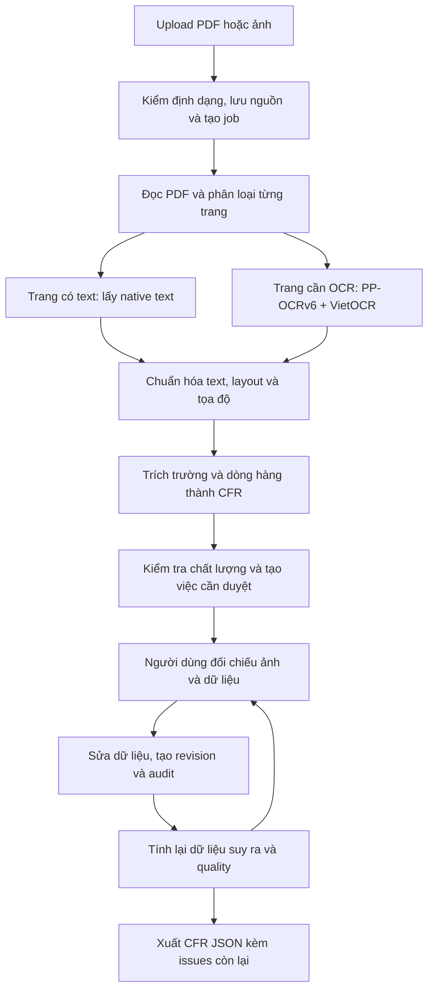

# Agent 3 — Tax Compliance Assistant

**Đầu vào nghiệp vụ PLAN_09 — 16/10:** đã có bảng quyết định cho ba nhóm rule, hồ sơ review gắn revision/hash, lưu chứng cứ bổ sung, phân loại theo item và kiểm chứng thanh toán/ledger. Có CLI local và API chỉ đọc `business-readiness`; chưa có màn nhập hồ sơ trên UI, chưa tự bật rule thật. Theo xác nhận người dùng, chưa có danh mục sản phẩm nên mapping hàng thật còn chờ. [Báo cáo và cách dùng](docs/agent3/plans/evidence/business_review_20261016_v1/REPORT.md).

**Cập nhật pháp lý V2 — 16/10/2026:** đã hoàn tất ba bước bổ sung căn cứ, tạo phiên bản registry/ruleset và kiểm thử nghiệp vụ. Corpus hiện có 21 trích đoạn từ 8 văn bản, đủ locator đã chọn cho 7/7 rule versions; cửa sổ kỹ thuật đến hết 16/10/2026. 384 Python tests và 11 nhóm browser checks đạt. Toàn bộ model thật vẫn DRAFT, mapping hàng hóa chưa duyệt. [Báo cáo hiện tại, giới hạn và cách chạy lại](docs/agent3/plans/evidence/legal_revision_20261016_v2/REPORT.md). Các số liệu corpus V1 bên dưới là snapshot trước đợt V2.

> OCR-based extraction and normalization of Vietnamese accounting documents, with human review, revision tracking, and planned tax compliance checks.

**Cập nhật: 16/10/2026 · PLAN_09 tích hợp kỹ thuật + PLAN_12 giải thích/corpus nguồn một phần + nhánh OCR V2 trong PLAN_06 · M2 pháp lý còn chờ nghiệm thu.**

Nhánh [OCR/extraction V2](docs/agent3/plans/PLAN_OCR_EXTRACTION_V2.md) đang triển khai **bên trong PLAN_06**. Đã đóng băng baseline OCR thật, sửa binding tổng tiền lệch dòng và thử tách dòng dài; OCR thử nghiệm chưa bật mặc định. [Kết quả, lệnh chạy và giới hạn](docs/agent3/plans/evidence/ocr_extraction_v2/runbook.md).

### Mở web nhanh trên workspace hiện tại

**Nhấp đúp [OPEN_AGENT3.cmd](OPEN_AGENT3.cmd)** ở thư mục gốc. File này tự chuẩn bị kết nối demo, chạy server và worker, mở trình duyệt, sao chép mã truy cập. Trên web bấm **Dán mã và kết nối**; nếu trình duyệt chặn đọc clipboard, dùng Ctrl+V vào ô mã rồi bấm Kết nối. Upload sẽ được worker tự nhận, không cần chạy lệnh cho từng job.

Giữ cửa sổ chạy mở; Ctrl+C để dừng, hoặc nhấp đúp [STOP_AGENT3.cmd](STOP_AGENT3.cmd). Nếu cổng 8000 đang có ứng dụng khác, launcher dùng cổng trống kế tiếp và mở đúng URL; không tắt server đang có. Chạy lại file mở web sẽ dùng lại phiên launcher demo còn hoạt động.

```powershell
# Từ D:\financial
.\OPEN_AGENT3.cmd
```

UI mới có hóa đơn gốc/dữ liệu cạnh nhau, nhóm trường, bảng dòng hàng, zoom, nhãn tiếng Việt, nguồn/candidate tách xem và chọn, nhập tiền Việt Nam và giữ bản nháp khi xung đột. Hướng dẫn và phạm vi: [runbook UI](docs/agent3/plans/evidence/ui_review_v2/runbook.md). Bộ mẫu thực và giới hạn OCR: [báo cáo pilot](docs/agent3/plans/evidence/real_invoice_pilot_v1/REPORT.md).

Launcher dùng DB demo PLAN_06 và giữ master đã có; token local sinh ngẫu nhiên, lưu trong thư mục runtime bị gitignore. Đây là cách chạy trên máy đã có venv/model, không phải bộ cài máy mới hay đăng nhập production.

Agent 3 là thành phần đọc, chuẩn hóa và hướng tới kiểm tra tuân thủ thuế cho chứng từ kế toán Việt Nam. Hiện hệ thống đã nối được luồng **PDF/ảnh → trích xuất dữ liệu → kiểm tra chất lượng → người dùng đối chiếu và sửa → xuất dữ liệu chuẩn hóa**. Mỗi lần sửa có phiên bản và lịch sử để truy nguyên.

**Phần kiểm tra luật thuế thực tế chưa được nghiệm thu.** PLAN_09 đã nối CFR đã lưu/review → quality → planning → ZEN → template → API/UI/export/replay. Trên UI có phần **Kiểm tra phạm vi thuế**; sau khi lưu bấm **Kiểm tra bản đã lưu**. Rules/models thực tế còn DRAFT, mappings hàng thật chưa duyệt; PASS/FAIL/REVIEW qua engine được kiểm bằng fixture tổng hợp. [Gate PLAN_09](docs/agent3/plans/evidence/gate_09.md), [hướng dẫn UI/API](docs/agent3/plans/evidence/plan09/demo_runbook.md). Chưa tự chạy compliance khi upload, chưa chứng nhận tax accuracy hoặc production.

## 1. Thông tin dành cho leader

**Corpus pháp lý, 16/10:** đã tải lại 11 PDF Chính phủ/Công báo, tất cả khớp hash; biên tập 11 trích đoạn runtime từ 4 văn bản, giữ 6 đoạn tham khảo ngoài runtime. Đối chiếu ảnh trang, giới hạn ngày riêng cho khoản đã sửa đổi và giữ ngoại lệ khi retrieval. Corpus phủ đủ locator cho 2/7 rule versions, không phải legal approval; ruleset hiện chỉ đến trước 15/10/2026 nên chưa mở hỗ trợ hóa đơn sau mốc này. [Báo cáo và nguồn/trang/hash](docs/agent3/plans/evidence/plan12/legal_corpus_20261016/REPORT.md).

**PLAN_12:** đã thêm BM25 có ràng buộc phiên bản/căn cứ, context tối thiểu, adapter Ollama local cho ứng viên Qwen3-8B, validator từng claim, API và UI **Diễn giải và nguồn tham chiếu**. Explanation lưu riêng theo evaluation/revision, giữ nguyên report/replay thuế. Mặc định template; corpus nguồn tối thiểu đã có, model chưa bật, chất lượng retrieval/readability và pháp lý còn PENDING. Bản đầu chỉ cho model sắp xếp/chọn các cách diễn đạt hữu hạn đã xác nhận. [Gate PLAN_12](docs/agent3/plans/evidence/gate_12.md), [cách chạy và cấu hình](docs/agent3/plans/evidence/plan12/runbook.md). XML/Excel/ERP tiếp tục hoãn theo phạm vi người dùng chọn.

| Nội dung | Trạng thái hiện tại |
|---|---|
| Mục tiêu | Giảm công nhập liệu, giúp kế toán đối chiếu chứng từ và tiến tới kiểm tra thuế có căn cứ |
| Đã làm được | Đọc PDF/ảnh, OCR theo trang, trích trường và dòng hàng, chuẩn hóa, đánh giá chất lượng, review/sửa có audit, xuất JSON |
| Model OCR | **PP-OCRv6 detector + VietOCR `vgg_transformer`**, mặc định chạy CPU |
| Mức tự động hóa | Hỗ trợ đọc và chuẩn bị dữ liệu; **vẫn cần người duyệt**, chưa tự chấp nhận chứng từ |
| Kiểm chứng | [PLAN_12 validation](docs/agent3/plans/evidence/plan12/validation_summary.json): 343 Python tests, syntax/DOM checks và Chrome desktop/mobile PASS; model/corpus thực chưa nghiệm thu. Accuracy OCR thực báo riêng tại [pilot](docs/agent3/plans/evidence/real_invoice_pilot_v1/REPORT.md) |
| Baseline review | 15 artifact chứng từ / 17 trang; sửa mô phỏng, export và replay được kiểm chứng |
| Việc tiếp theo | Hoàn tất P09-T06/duyệt luật và mapping; nghiệm thu corpus/model/readability PLAN_12; PLAN_10/11/13 đang hoãn |
| Cần hỗ trợ | Hóa đơn Việt Nam có quyền dùng, reviewer nghiệp vụ độc lập, bộ nhãn và tiêu chí nghiệm thu |

Đọc nhanh **mục 2–3** để hiểu sản phẩm, **mục 6–7** để xem bằng chứng và giới hạn, **mục 8** để nắm việc sắp tới. Người triển khai xem thêm **mục 10–12**.

Nguồn đối chiếu: [gate PLAN_06](docs/agent3/plans/evidence/gate_06.md), [báo cáo kiểm chứng](docs/agent3/plans/evidence/plan06/validation_summary.json), [lộ trình tổng](docs/agent3/plans/README.md).

## 2. Bài toán và phạm vi Agent 3

Chứng từ đầu vào có thể là PDF có text, PDF scan hoặc ảnh. Kế toán cần tìm đúng số hóa đơn, ngày lập, bên bán/bên mua, MST, tiền và thuế; đồng thời phải đối chiếu lại khi ảnh mờ, layout khác hoặc OCR đọc sai.

Agent 3 xây dựng một lớp dữ liệu chung để các công đoạn sau sử dụng cùng cấu trúc, có bằng chứng nguồn và biết trường nào còn thiếu hoặc chưa đáng tin. Khi nối kiểm tra thuế, hệ thống cần xác định đúng nghĩa vụ, thời điểm áp dụng và căn cứ pháp lý trước khi chạy rule.

| Phạm vi | Hiện trạng |
|---|---|
| Đọc và chuẩn hóa chứng từ | Đã triển khai, kiểm chứng kỹ thuật trên fixture/baseline đã nêu |
| Đối chiếu, sửa và truy vết | Đã có API, UI mới và kiểm tra Chrome tự động; còn nghiệm thu người dùng thực |
| Kiểm tra chất lượng dữ liệu | Đã có; tách thiếu dữ liệu, lỗi định dạng, mâu thuẫn số liệu và độ tin cậy |
| Kiểm tra tuân thủ thuế | PLAN_07–09; chưa có kết luận thuế được nghiệm thu trên pipeline mới |
| XML, Excel và bank statement | Kế hoạch mở rộng PLAN_10–11 |
| LLM giải thích, ERP, đối soát | Các chặng sau; chưa là chức năng đã bàn giao của MVP hiện tại |

Workspace còn giữ prototype, thử nghiệm ZEN và nghiên cứu ViLegalBERT. Các tài sản đó là nguồn tham khảo; kết quả hoặc endpoint cũ không tự chứng nhận khả năng của pipeline `/v1` hiện hành.

## 3. Luồng xử lý hiện tại



**CFR — Canonical Financial Record** là bản ghi tài chính chuẩn hóa: cùng một mẫu dữ liệu cho chứng từ dù nguồn là PDF hay ảnh. CFR hiện chứa bên bán/bên mua, thông tin hóa đơn, tiền tệ, tổng tiền, dòng hàng, dữ liệu suy ra và thông tin truy nguyên.

Ví dụ: người duyệt sửa MST bên mua. Hệ thống tạo revision mới, xác định lại hướng INPUT/OUTPUT và đối tác, rồi đánh giá quality lại. Nếu sửa tiền hoặc VAT của dòng hàng, tổng tính từ items được tính lại. **Tổng ghi trên chứng từ và tổng tính từ dòng hàng được giữ riêng**; nếu không khớp, hệ thống tiếp tục yêu cầu đối chiếu.

## 4. Chức năng đã triển khai

### Nhận và đọc chứng từ

- Upload có xác thực, kiểm quyền theo đơn vị và chống tạo trùng theo khóa yêu cầu.
- Phân loại PDF/ảnh; đọc và render theo trang, giới hạn dung lượng, số trang và tài nguyên xử lý.
- PDF có text sử dụng native text khi phù hợp; trang cần OCR đi qua worker riêng.
- Lưu nguồn, hash và tọa độ để tìm lại vùng chứng từ tương ứng.
- Có trạng thái job, retry có giới hạn và đường yêu cầu dữ liệu/chuyển xử lý riêng.

### Trích xuất và chuẩn hóa

- Trích tên/MST bên bán, bên mua; số, ký hiệu, ngày hóa đơn; tiền tệ và các tổng tiền.
- Trích dòng hàng theo các dạng layout đã kiểm chứng; mỗi dòng có ID ổn định, tách khỏi số thứ tự hiển thị.
- Chuẩn hóa ngày, MST và số tiền; dùng **Decimal**, serialize tiền bằng chuỗi thập phân để giữ độ chính xác.
- Phân biệt thuế suất số với **KCT** và **KKKNT**; không coi hai nhóm này là thuế suất 0%.
- Lưu giá trị gợi ý/cạnh tranh và bằng chứng, thay vì ép mọi trường thành giá trị chắc chắn.
- Hướng hóa đơn chưa xác định giữ `AMBIGUOUS/null`, không tự đoán INPUT hoặc OUTPUT.

### Quality và review

- Đánh giá mức đầy đủ, các trường quan trọng, định dạng và mâu thuẫn số liệu.
- Phân biệt có giá trị với đủ tin cậy để sử dụng; OCR có text không đồng nghĩa text đúng.
- Tạo review tasks theo issue, field và revision; có phân trang, yêu cầu bổ sung dữ liệu và chuyển xử lý riêng.
- UI `/review` hiển thị trang, bbox, raw value, dữ liệu chuẩn hóa và candidates; hỗ trợ sửa/xác nhận theo batch.
- Có công cụ calibration, nhưng **chưa có calibration thực tế được nghiệm thu**. Auto-accept đang tắt, thresholds chưa chốt.

### Lưu trữ, sửa và xuất

- Phân tách tenant, taxpayer và phiên bản hồ sơ đơn vị; giữ dữ liệu nguồn và revision cũ.
- Correction event có người sửa, thời gian, lý do, giá trị trước/sau và bằng chứng.
- Revision, audit, tính lại, quality mới và tasks được ghi cùng transaction; lỗi audit phải rollback toàn bộ.
- Hai người cùng sửa một revision: chỉ một yêu cầu thành công; người còn lại nhận `409` và revision mới nhất.
- Xuất CFR JSON, tổng quan dữ liệu, issues còn lại và kiểm tra replay lịch sử.
- Ảnh có kiểm quyền, token hết hạn và kiểm hash; token truy cập UI giữ trong bộ nhớ trang.

Chi tiết API và cách dùng: [runbook PLAN_06](docs/agent3/plans/evidence/plan06/runbook.md).

## 5. OCR và khả năng thay model

Ứng dụng mặc định dùng **PP-OCRv6 để phát hiện vùng chữ** và **VietOCR `vgg_transformer` để nhận dạng chữ**. Đây là pipeline kết hợp; không phải dùng toàn bộ bộ nhận dạng PP-OCRv6 cho mọi bước.

| Thành phần | Vai trò |
|---|---|
| PP-OCRv6 detector | Tìm vùng có chữ trên ảnh |
| VietOCR | Đọc chữ trong vùng đã phát hiện |
| OCR bridge | Kiểm và chuẩn hóa kết quả về hợp đồng chung, gắn nguồn/tọa độ |
| Engine registry | Khai báo model, môi trường worker, trọng số, cấu hình và ngân sách tài nguyên |

Model được chọn tại [default.json](agent3_tax_compliance/configs/ocr/default.json). Extraction/CFR dùng kết quả chuẩn hóa chung, không phụ thuộc trực tiếp framework OCR. Đổi engine đã đăng ký có thể thực hiện qua cấu hình; thêm engine mới cần adapter/profile và kiểm chứng tương ứng.

Tesseract được giữ để tương thích và so sánh lịch sử. Một số engine khác có profile nhưng chưa nghiệm thu inference qua bridge hiện hành. **Không tự fallback sang model khác khi engine lỗi.**

VietOCR adapter hiện chưa trả recognizer confidence. Điểm từ detector là điểm phát hiện vùng chữ, **không phải xác suất nội dung OCR hoặc field đúng**; không dùng trực tiếp để tự chấp nhận chứng từ.

Dự án đang dùng model có sẵn, chưa train/fine-tune OCR riêng trong các chặng đã bàn giao. Việc có cần train sẽ phụ thuộc phân tích lỗi trên dữ liệu Việt Nam có nhãn độc lập.

[Cấu hình và cách thay model](agent3_tax_compliance/configs/ocr/README.md) · [Runbook OCR](docs/agent3/plans/evidence/plan03/model_switch/runbook.md).

## 6. Kết quả kiểm chứng và cách đọc số liệu

### Kiểm thử chức năng

Theo [validation summary PLAN_06](docs/agent3/plans/evidence/plan06/validation_summary.json):

| Nhóm | Số kiểm thử PASS |
|---|---:|
| Foundation: hợp đồng, tiền, scope, lưu trữ | 22 |
| Ingestion/PDF/ảnh | 23 |
| OCR bridge/layout | 27 |
| Extraction/CFR | 27 |
| Quality/calibration contracts | 34 |
| Review/correction/jobs | 27 |
| **Tổng Python tests** | **160** |

Ngoài ra có JavaScript syntax/DOM harness và 10 schema mới cho review được kiểm tra. Schemas nền móng, OCR, extraction và quality đã có ở các gate trước. **Số tests không phải phần trăm accuracy.**

Các tình huống quan trọng đã kiểm chứng: hai reviewer cùng sửa, gửi trùng, candidate của chứng từ khác, audit lỗi rollback, sửa MST làm đổi hướng hóa đơn, sửa items làm đổi tổng, human proof sai, retry hết giới hạn, worker hết lease, phân quyền và phân trang theo tenant.

### Kết quả extraction trên baseline phát triển

[Gate PLAN_04](docs/agent3/plans/evidence/gate_04.md) công khai cả kết quả đúng và lỗi:

| Nhóm đo | Field khớp | Rows khớp |
|---|---:|---:|
| Native PDF | 162/162 | 16/16 |
| Nhóm hybrid, gồm native + OCR | 37/49 | 1/5 |
| Riêng subset có OCR và nhãn | 23/35 | 0/4 |

Các nhóm có quan hệ bao hàm, **không cộng thành mẫu độc lập**. Nhãn là nhãn tổng hợp phục vụ phát triển, chưa có reviewer độc lập xác nhận. Có **6 field được trích thành PRESENT nhưng sai** trong baseline; đọc dòng hàng từ OCR còn yếu. Hai tài liệu bổ sung không có nhãn field nên không được dùng để tuyên bố accuracy.

Đây là lý do giữ manual review bắt buộc và chưa bật auto-accept.

### Baseline review/correction

[Baseline PLAN_06](docs/agent3/plans/evidence/plan06/baseline_summary.json) gồm **15 artifact / 17 trang**, tái dùng 10 native và 5 hybrid đã pin. Các lượt sửa bằng script kiểm chứng revision, rederive, quality, export, signed evidence và replay. PLAN_06 không chạy lại OCR để tạo số liệu này.

P95 transaction correction local là **49,91 ms**, đo trên 15 lần đầu. Chỉ số này **không bao gồm upload, đọc PDF, inference OCR, HTTP/UI hoặc thời gian người sửa**, nên không đại diện tốc độ toàn pipeline.

Thời gian sửa thực tế, accuracy sau human review và p95 OCR end-to-end **chưa đo**. Các lượt sửa mô phỏng không được tính là tài liệu đã được chuyên gia độc lập duyệt.

## 7. Giới hạn và điều kiện nghiệm thu

| Giới hạn | Ảnh hưởng / cách xử lý hiện tại |
|---|---|
| Chưa có pilot Việt Nam đủ điều kiện nghiệm thu | Chỉ công bố kết quả kỹ thuật trong scope đã kiểm chứng |
| Chưa có nhãn/reviewer độc lập và frozen release evaluation | Chưa công bố accuracy production hoặc chốt calibration/threshold |
| OCR và trích dòng hàng còn lỗi | Giữ evidence, yêu cầu đối chiếu; không tự sửa tổng để che sai lệch |
| UI chưa nghiệm thu browser/người dùng | Đã kiểm syntax/DOM; còn thử thao tác, mobile, keyboard và accessibility |
| Chưa thêm/tách/gộp dòng hoặc sửa segmentation nhiều hóa đơn | REQUEST_DATA/OPERATOR, làm rõ nguồn rồi upload lại |
| Chưa có daemon tự drain queue | Demo local gọi CLI cho từng capture job |
| Auth là shared-secret adapter local | SSO, nhiều worker và production hardening cần chặng riêng |
| Chưa có tax verdict trên pipeline mới | Xuất dữ liệu/quality/issues, không suy ra đủ điều kiện thuế |

**`COMPLETED` trong capture nghĩa là lượt nhập liệu đã qua kiểm tra thủ công trong phạm vi profile.** Không chứng minh hóa đơn hợp lệ pháp lý, đủ điều kiện khấu trừ hoặc tuân thủ thuế.

Để nghiệm thu sản phẩm trên dữ liệu thực, cần hoàn tất các điều kiện [DQ-01–05](docs/agent3/plans/evidence/plan00/technical_scope_decision.md):

1. Pilot hóa đơn Việt Nam có quyền dùng: theo scope đã lập là **10 PDF text, 10 PDF scan và 10 ảnh**.
2. Reviewer độc lập, đối chiếu nhãn và xử lý các trường hợp bất đồng.
3. Chia dữ liệu theo nhóm tài liệu/template/vendor, chống leakage và khóa tập đánh giá.
4. Người phụ trách nghiệp vụ, mục tiêu chất lượng và chính sách chấp nhận rõ ràng.
5. Đo accuracy, review load, thời gian người sửa và kiểm thử sử dụng thực tế.

FATURA và MC-OCR hiện có là tài sản phát triển/nghiên cứu; việc đã tải hoặc chuẩn bị dataset không thay bằng chứng nghiệm thu hóa đơn Việt Nam và nhãn độc lập theo scope trên.

## 8. Tiến độ và việc làm tiếp theo

| Chặng | Kết quả chính | Trạng thái |
|---|---|---|
| PLAN_00 | Scope, dataset và fixture kỹ thuật | Đạt kỹ thuật; điều kiện dữ liệu thực còn mở |
| PLAN_01 | CFR, Decimal, evidence và lưu trữ nền móng | Đã kiểm chứng kỹ thuật |
| PLAN_02 | Upload, reader và routing | Đã kiểm chứng kỹ thuật |
| PLAN_03 | OCR/layout bridge và registry | Đã kiểm chứng kỹ thuật |
| PLAN_04 | Extraction, items, chuẩn hóa và derive | Đạt kỹ thuật; lỗi accuracy đã công khai |
| PLAN_05 | Quality, calibration tools và review policy | Đạt kỹ thuật/manual; calibration/release thực còn mở |
| PLAN_06 | Review UI/API, correction, rederive và export | Đạt kỹ thuật/manual; nghiệm thu thực/browser/người dùng còn mở |
| PLAN_07 | Legal Registry, VAT taxonomy và Rule Planning | Đã triển khai kỹ thuật; legal approval/mapping PENDING; [gate](docs/agent3/plans/evidence/gate_07.md) |
| PLAN_08 | GoRules ZEN, Decimal, trace và aggregation | Đã triển khai kỹ thuật; models thực tế DRAFT; [gate](docs/agent3/plans/evidence/gate_08.md) |
| PLAN_09 | Tích hợp MVP compliance và template explanation | Đã có API/UI và revision workflow kỹ thuật; T06/M2 pháp lý PENDING; [gate](docs/agent3/plans/evidence/gate_09.md) |
| PLAN_10–11 | XML, Excel và bank statement | Chưa triển khai theo roadmap mới |
| PLAN_12 | Giải thích có kiểm soát | IMPLEMENTED kỹ thuật một phần; corpus/model thật/readability PENDING; [gate](docs/agent3/plans/evidence/gate_12.md) |
| PLAN_13 | ERP connector | Chưa triển khai; hoãn theo phạm vi hiện tại |
| PLAN_14 | Production hardening và phát hành | Chưa triển khai |
| PLAN_15 | Đối soát nhiều nguồn | Giai đoạn sau MVP |

“Đạt kỹ thuật” nghĩa là hợp đồng và chức năng đã qua các kiểm chứng đã nêu; không có nghĩa mọi điều kiện nghiệm thu dữ liệu thực của chặng đã đóng.

**PLAN_07–09 đã triển khai kỹ thuật:** registry, capability, taxonomy interface, planning, ZEN process riêng, Decimal facts, trace, attempt/result store, aggregation và template/UI theo revision. [Runbook PLAN_09](docs/agent3/plans/evidence/plan09/demo_runbook.md). Thiếu dữ liệu/căn cứ giữ blocker; model DRAFT chưa được chạy như luật đã duyệt. UI kiểm tra bằng thao tác người dùng trên bản đã lưu, chưa tự chạy khi upload.

**Ưu tiên dữ liệu và người dùng:** hoàn thiện pilot Việt Nam, gán nhãn độc lập, kiểm UI bằng người dùng và đo lỗi/thời gian review. Kết quả quyết định mức tự động hóa chấp nhận được và việc có cần cải thiện/train OCR hoặc thay extraction strategy.

PLAN_09 đã nối template explanation và UI kiểm tra revision đã lưu. Người dùng chọn hoãn PLAN_10/11/13 và triển khai nhánh PLAN_12 trước: phần kỹ thuật đã có, corpus/model thật và đánh giá còn mở. LLM không tự tính hoặc thay verdict của rule engine; nghiệm thu dữ liệu/pháp lý M2 vẫn PENDING.

Ước lượng PLAN_07 là **6–9 ngày công một người tập trung**, chưa tính chờ nguồn pháp lý, dữ liệu và người nghiệp vụ. Đây là ước lượng phạm vi, không phải cam kết deadline. [Lộ trình 16 PLAN](docs/agent3/plans/README.md) ghi phụ thuộc, task và gate từng chặng.

## 9. Nguyên tắc thiết kế

| Nguyên tắc | Ý nghĩa |
|---|---|
| Nguồn và lịch sử bất biến | Không ghi đè chứng từ gốc hoặc revision cũ để sửa lỗi |
| Evidence đi cùng dữ liệu | Truy được về nguồn/trang/vùng hoặc correction event |
| PRESENT không đồng nghĩa đúng | Xét riêng có giá trị, định dạng hợp lệ và độ tin cậy |
| Thiếu dữ liệu giữ UNKNOWN | Không biến thiếu bằng chứng thành PASS/FAIL hoặc không áp dụng |
| Tiền giữ chính xác | Decimal và chuỗi thập phân; không float ở hợp đồng tiền |
| Sửa phải tính lại | Observed fields đổi phải rederive và đánh giá quality revision mới |
| Model thay qua adapter | Extraction/review dùng hợp đồng chuẩn hóa chung |
| Scope kiểm ở máy chủ | Phân quyền tenant/taxpayer trước đọc, sửa và phân trang |
| Kết quả gắn version/hash | Truy được input, config, policy, implementation và revision |

## 10. Cấu trúc source và tài liệu

README mô tả workspace hiện hành. Code/runbook dùng các đường dẫn dưới đây; khi đóng gói repository cần giữ các thành phần phụ thuộc tương ứng để liên kết và lệnh còn sử dụng được.

```text
.
├── README.md
├── agent3_tax_compliance/
│   ├── src/
│   │   ├── app.py                 # App factory, API /v1 và review UI
│   │   ├── domain/                # CFR, field, evidence, tiền, taxpayer
│   │   ├── persistence/           # SQLite, nguồn, revision và audit
│   │   ├── ingestion/             # Upload, đọc PDF/ảnh và routing
│   │   ├── adapters/ocr/          # Registry, worker bridge, normalization
│   │   ├── extraction/            # Trích trường, items và evidence resolver
│   │   ├── canonicalization/      # Chuẩn hóa, identity, derive
│   │   ├── quality/               # Validation, completeness, calibration
│   │   ├── review/                # Tasks, correction, API và static UI
│   │   └── jobs/                  # Capture worker, state và recovery
│   ├── configs/                   # OCR, quality, examples và profiles
│   ├── contracts/                 # JSON Schema/registry theo phiên bản
│   ├── migrations/                # Foundation tới migration 006
│   └── tests/                     # Kiểm thử và fixture tổng hợp
├── scripts/                       # Export schema, baseline, validators
├── docs/agent3/
│   ├── NEW_PLAN.md                # Thiết kế pipeline tổng thể
│   └── plans/                     # PLAN_00–15, gate, runbook và evidence
├── data invoice/
│   ├── ocr_e2e_workflow/           # Benchmark và adapter OCR
│   └── plan*_local/               # Dữ liệu/baseline local, quản lý riêng
├── archive/                       # Lịch sử và mã pin để replay
└── vilegalbert_test/              # Nghiên cứu bổ trợ, ngoài capture runtime
```

Workspace còn code prototype cũ ngoài các module hiện hành trên. Không dùng tài liệu prototype hoặc `requirements.txt` tổng quát làm hướng dẫn mặc định cho runtime capture mới.

## 11. Môi trường và chạy demo

### Runtime đã kiểm chứng

| Thành phần | Runtime hiện tại |
|---|---|
| App capture/review | Python **3.10.5**, Windows x64, env riêng `agent3_tax_compliance/.venv` |
| API/contracts | FastAPI, Pydantic v2; phiên bản pin trong lock files |
| PDF/ảnh | PyMuPDF và Pillow |
| Lưu trữ | SQLite foundation riêng, migration 006 cho review/jobs |
| OCR | Worker/interpreter riêng; model và assets local theo engine profile |
| UI | HTML/CSS/JavaScript, phục vụ cùng app tại `/review` |
| Validation | Python hệ thống có `jsonschema`; Python tests dùng app env; Node.js cho JS checks |

[Runtime decision](docs/agent3/plans/evidence/plan01/runtime_decision.md) và lock files [foundation](agent3_tax_compliance/requirements-foundation.lock), [ingestion](agent3_tax_compliance/requirements-ingestion.lock) là nguồn đối chiếu. Chưa nghiệm thu bộ cài hoàn chỉnh trên máy sạch hoặc các hệ điều hành khác. Virtualenv, model weights, dataset và DB baseline là tài sản local, không mặc định có sau `git clone`.

### Chạy trên workspace đã provision

Cách mở nhanh được giới thiệu ở đầu README dùng launcher local tự chạy worker. Các lệnh dưới đây là cách cấu hình thủ công cho developer; `uvicorn src.app:create_app` đơn lẻ không tự chạy worker.

Thực hiện theo [runbook PLAN_06](docs/agent3/plans/evidence/plan06/runbook.md): tạo token/grants, chọn DB demo riêng, provision taxpayer master và chuẩn bị OCR worker/model. Không có tài khoản/token hardcode để đăng nhập.

Sau khi đặt biến môi trường và provision đúng scope, tại `agent3_tax_compliance`:

```powershell
# Chạy API trên loopback; giữ terminal này mở.
.\.venv\Scripts\python.exe -m uvicorn src.app:create_app --factory --host 127.0.0.1 --port 8000 --no-access-log
```

Mở **`http://127.0.0.1:8000/review`**, nhập token, taxpayer và master revision, rồi upload. Trong terminal khác có cùng cấu hình môi trường/quyền:

```powershell
# Thay <capture-job-id> bằng ID UI trả về sau upload.
.\.venv\Scripts\python.exe -m src.jobs.worker --taxpayer-id demo-payer --job-id <capture-job-id>
```

UI theo dõi job, mở chứng từ để đối chiếu và sửa. API docs tại **`http://127.0.0.1:8000/docs`**; [OpenAPI lưu trong repository](docs/agent3/plans/evidence/plan06/openapi.json).

Ảnh, export và record APIs yêu cầu quyền tương ứng; `/review` là client tĩnh, không thay cơ chế xác thực API. `demo-payer` là scope ví dụ trong runbook, không đại diện doanh nghiệp thật.

## 12. Kiểm tra và tái hiện kết quả

### Kiểm thử riêng review

Tại `agent3_tax_compliance`, với app env đã chuẩn bị:

```powershell
.\.venv\Scripts\python.exe -m unittest discover -s tests/review -v
node --check src/review/static/app.js
node tests/review/review_client.test.js
```

Review tests dùng fixture tổng hợp và native PDF để kiểm luồng, không cần inference PP-OCRv6/VietOCR. Không thay smoke inference thật hoặc accuracy evaluation bằng các tests này.

### Tái hiện gate hiện hành

Tại root workspace, khi đã có baseline local của các chặng trước:

```powershell
agent3_tax_compliance/.venv/Scripts/python.exe scripts/export_review_contracts.py
agent3_tax_compliance/.venv/Scripts/python.exe scripts/build_review_baseline.py
python scripts/validate_review.py
```

Builder sao DB PLAN_05 sang PLAN_06 rồi migrate bản sao. Validator chạy các suite, kiểm schemas/replay và đối chiếu hash của bằng chứng/DB/môi trường cũ. Máy mới cần chuẩn bị tài sản local và runtime trước; validator không tự tải dataset/model hoặc provision toàn bộ môi trường.

Replay **15 assessment lịch sử PLAN_05** bằng đúng implementation đã pin:

```powershell
agent3_tax_compliance/.venv/Scripts/python.exe scripts/replay_plan05_snapshot.py
```

Quality code đã đổi ở PLAN_06 để kiểm human proof. [Phiên bản cũ trong archive](archive/plan06_pinned_plan05_quality/README.md) có hash khớp báo cáo cũ. Không ghi đè assessment hoặc báo cáo lịch sử để làm chúng khớp code mới.

## 13. Tài liệu nên đọc

| Nhu cầu | Tài liệu |
|---|---|
| Tiến độ, phụ thuộc và ước lượng | [Lộ trình PLAN_00–15](docs/agent3/plans/README.md) |
| Thiết kế tổng thể | [NEW_PLAN](docs/agent3/NEW_PLAN.md) |
| Phạm vi đã kiểm chứng mới nhất | [Gate PLAN_09](docs/agent3/plans/evidence/gate_09.md), [test summary](docs/agent3/plans/evidence/plan09/validation_summary.json) |
| Nghiệm thu còn mở và giới hạn | [Capture MVP acceptance](docs/agent3/plans/evidence/plan06/capture_mvp_acceptance.md) |
| Chạy UI/API/worker | [Runbook PLAN_06](docs/agent3/plans/evidence/plan06/runbook.md) |
| Trạng thái và recovery | [State machine](docs/agent3/plans/evidence/plan06/state_machine.md) |
| Hợp đồng dữ liệu | [Contracts README](agent3_tax_compliance/contracts/README.md) |
| Model và cách đổi engine | [OCR registry/config](agent3_tax_compliance/configs/ocr/README.md) |
| Lỗi extraction đã đo | [Gate PLAN_04](docs/agent3/plans/evidence/gate_04.md) |
| Quality/calibration còn thiếu | [Gate PLAN_05](docs/agent3/plans/evidence/gate_05.md) |
| Công việc chặng tiếp theo | [PLAN_10](docs/agent3/plans/PLAN_10_INVOICE_XML.md) và [phần M2 còn mở](docs/agent3/plans/evidence/plan09/compliance_mvp_report.md) |

Các PLAN mô tả cả phần đã làm và phần dự kiến. Gate/báo cáo kiểm chứng quyết định phạm vi được công bố; sự tồn tại của tài liệu, enum, profile hoặc prototype không đồng nghĩa chức năng đã được nghiệm thu.
