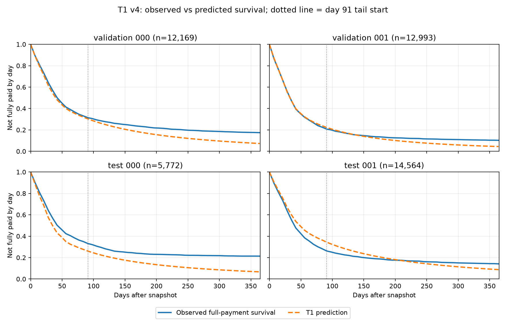

# T1 v4: ngày trả đủ, survival curve và hazard đuôi (28/10/2026)

## Giao thức

Phân tích model và cohort v4 đã khóa; **không train hoặc chỉnh model**. Lấy
snapshot đầu tiên của mỗi hóa đơn trong bốn World validation/test, với ít nhất
**365 ngày theo dõi**. Có **45.498 cặp `(World, invoice_id)` duy nhất**, ngày snapshot từ
01/07/2024 đến 16/12/2024, thời gian theo dõi tối thiểu **380 ngày**. Nhóm này
khác batch inference 31/12/2025; không lấy tỷ lệ ở đây gán trực tiếp cho batch
đó. Chỉ số là theo số hóa đơn, không theo giá trị công nợ.

Sự kiện cần dự báo là **trả đủ hóa đơn bằng tiền mặt**. Hóa đơn chưa trả đủ đến
ngày 365 vẫn là chưa trả; write-off là trạng thái đóng cạnh tranh, không phải
ngày trả đủ. Vì tất cả hóa đơn có ít nhất 365 ngày theo dõi, tỷ lệ trả đủ đến
từng mốc dưới đây quan sát được mà không cần kẹp nhãn hay ước lượng Kaplan–Meier.
Ngày trả sau 365 và khả năng trả cuối cùng của khoản còn mở chưa xác định
đồng đều giữa các hóa đơn.

Mã chạy lại:
[`analyze_t1_v4_payment_survival.py`](../../analysis/analyze_t1_v4_payment_survival.py).
Kết quả gốc: [`summary.json`](../../outputs/data/v4_shortpay_4shock_20261028/survival_diagnostic_20261028/summary.json),
[`survival_curves.csv`](../../outputs/data/v4_shortpay_4shock_20261028/survival_diagnostic_20261028/survival_curves.csv),
[`weekly_survival_curves.csv`](../../outputs/data/v4_shortpay_4shock_20261028/survival_diagnostic_20261028/weekly_survival_curves.csv)
và [`weekly_hazards.csv`](../../outputs/data/v4_shortpay_4shock_20261028/survival_diagnostic_20261028/weekly_hazards.csv).
Script kiểm hash cohort, model, manifest/Parquet và mã train. Test kỹ thuật
cho công thức đuôi và nhãn write-off đã qua.

## 1. Phân phối ngày trả đủ thực tế

| World | Hóa đơn | Trả đủ ≤120 ngày | Trả đủ ngày 121–365 | Chưa trả đủ ngày 365 | Đã write-off ≤365 |
|---|---:|---:|---:|---:|---:|
| validation 000 | 12.169 | 72,4% | 10,1% | 17,4% | 13,1% |
| validation 001 | 12.993 | 82,9% | 6,8% | 10,3% | 7,9% |
| test 000 | 5.772 | 71,9% | 6,8% | 21,4% | 20,3% |
| test 001 | 14.564 | 77,5% | 8,4% | 14,1% | 9,7% |
| **Gộp** | **45.498** | **77,0%** | **8,2%** | **14,8%** | **11,4%** |

Có **3.729** hóa đơn thực sự trả đủ sau ngày 120 nhưng trước hoặc đúng ngày
365. Trong **6.752** hóa đơn chưa trả đủ ở ngày 365, **5.203** đã write-off;
**1.549** vẫn chưa trả đủ và chưa write-off. Trung vị ngày trả đủ của toàn
bộ hóa đơn, tính theo sự kiện tích lũy đến ngày 365, là **32–43 ngày** tùy
World. **Không World nào đạt tỷ lệ trả đủ 90% trước ngày 365**.

Theo quy tắc accounting của máy phát, write-off đóng hóa đơn mà không ghi
trả đủ. Tỷ lệ write-off đã quan sát trong nhóm gộp là **11,4%**, nên ngay cả
khi tất cả hóa đơn còn lại cuối cùng trả đủ, tỷ lệ trả đủ tối đa cũng không
vượt **88,6%**. Vì vậy Q90 vô điều kiện của *thời gian tới khi trả đủ* không
có giá trị hữu hạn cho nhóm gộp này. Đây là đặc tính của synthetic, chưa phải
kết luận về khách hàng SME thật. Hai World riêng có write-off trên 10%
(`validation_000`, `test_000`) cũng có giới hạn tương tự.

## 2. Survival curve dự báo và thực tế



Đường biểu diễn tỷ lệ **chưa trả đủ**; đường dự báo thấp hơn đường thực tế
nghĩa là T1 **dự báo quá nhiều hóa đơn sẽ trả đủ**. Vạch chấm tại ngày 91 là
điểm bắt đầu ngoại suy.

| World | Trả đủ ngày 91: thực / dự báo | Trả đủ ngày 120: thực / dự báo | Trả đủ ngày 365: thực / dự báo |
|---|---:|---:|---:|
| validation 000 | 68,6% / 69,7% | 72,4% / 75,2% | 82,6% / 92,7% |
| validation 001 | 79,2% / 77,7% | 82,9% / 82,5% | 89,7% / 95,6% |
| test 000 | 66,9% / 73,9% | 71,9% / 78,8% | 78,6% / 93,4% |
| test 001 | 73,8% / 65,6% | 77,5% / 71,7% | 85,9% / 91,3% |

Trong 13 tuần trực tiếp, sai lệch khác chiều giữa World: `test_000` dự báo
quá cao khoảng **7,1 điểm phần trăm** ở ngày 91, còn `test_001` dự báo quá
thấp khoảng **8,2 điểm phần trăm**. Đến ngày 365, **cả bốn World đều dự báo
quá cao tỷ lệ trả đủ**, từ **5,4 đến 14,7 điểm phần trăm**. Phép đo trước đó
trên tất cả snapshot đủ 120 ngày vẫn là nguồn chính cho calibration 4/13 tuần;
phân tích này dùng một snapshot/hóa đơn để soi đuôi dài.

## 3. Hazard 13 tuần và phần ngoại suy

| World | Tuần 13 thực / dự báo | Tuần 14 thực / ngoại suy | Tuần 20 thực / ngoại suy |
|---|---:|---:|---:|
| validation 000 | 4,8% / 5,3% | 2,7% / 5,0% | 1,7% / 4,7% |
| validation 001 | 7,6% / 7,1% | 3,6% / 6,1% | 2,8% / 5,3% |
| test 000 | 5,1% / 6,9% | 3,1% / 6,0% | 1,6% / 5,2% |
| test 001 | 7,1% / 5,3% | 3,6% / 4,4% | 1,7% / 4,0% |

Hazard thực tế là tỷ lệ trả đủ trong tuần **trên các hóa đơn thực sự chưa trả
đủ ở đầu tuần**. Hazard dự báo là trung bình dự báo cho cùng nhóm đó. T1 fit
hazard trực tiếp đến tuần 13; từ tuần 14 dùng trung bình hazard dự báo bốn
tuần cuối, giữ cố định theo từng hóa đơn và kẹp tối thiểu 0,02. Hazard thực
tế giảm rõ sau tuần 13, còn hazard ngoại suy vượt hazard thực tế ở **cả bốn
World ngay từ tuần 14**. Vì thế sai lệch đuôi không bắt đầu ở phép kẹp hiển
thị 120 ngày; nó bắt đầu ở giả định ngoại suy sau ngày 91.

Write-off tích lũy làm chênh lệch về sau lớn hơn: tuần 52, nhóm chưa trả đủ
đã có **1.580/2.138**, **1.016/1.349**, **1.162/1.235** và **1.399/2.087**
hóa đơn write-off tương ứng bốn World. Khi tách các hóa đơn đã write-off ra
khỏi tập còn hoạt động, hazard thực tế tuần 14 vẫn thấp hơn hazard dự báo ở
cả bốn World. Như vậy **write-off không giải thích hết** sai lệch ban đầu của
phần đuôi; về dài hạn, mô hình T1 hiện vẫn ép xác suất trả đủ tiến đến 100%
vì ngoại suy hazard dương, trong khi synthetic có trạng thái write-off cuối.

## Kết luận

Có hai vấn đề tách biệt: calibration của hazard trực tiếp 13 tuần khác nhau
theo World; và **đuôi hình học sau tuần 13 quá lạc quan** trên nhóm có đủ
365 ngày theo dõi. Ngoài ra, Q90 vô điều kiện có thể **không tồn tại** khi
xác suất không bao giờ trả đủ vượt 10%. Chỉ mở rộng trần 120 ngày hoặc fit
thêm tuần mà không xử lý trạng thái write-off sẽ không giải quyết định nghĩa
Q90. Cần quyết định có dự báo Q90 **có điều kiện là sẽ trả đủ** hay mô hình
joint/competing-risk cho xác suất trả đủ và write-off, rồi đánh giá trên
World tách biệt. Chưa dùng các World test này để hiệu chỉnh model.

Chạy lại:

```powershell
python analysis/analyze_t1_v4_payment_survival.py
```
