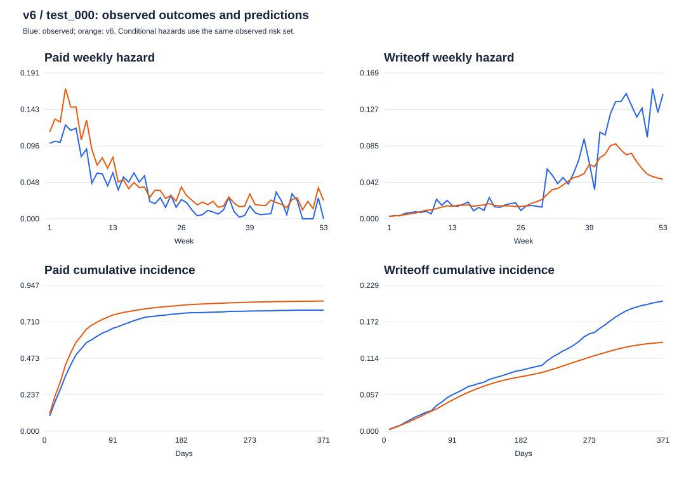

# Chẩn đoán sai lệch v6 trên `test_000`

**Ngày 05/11/2026. Phạm vi: phân tích hồi cứu, không train hoặc chọn lại model.**

Đối tượng là hazard competing risks v6 trong
`outputs/data/t1_competing_v6_20261101/`, không phải unified collection v2.
`test_000` là `v4_shortpay_4shock_20261028_test_000`.
Không thay model dịch vụ, calibration, protocol hoặc cổng sản phẩm.

**Kết luận:** chưa thấy lỗi nhãn Write-off, censoring hay risk set giải thích
sai lệch này. Có dịch chuyển phân phối và sai lệch có điều kiện rõ rệt,
tập trung ở cohort tháng 7/2024 và khách chịu shock mạnh. V6 **đã có** lịch
sử Write-off và đang sử dụng nó; vấn đề không phải thiếu hoàn toàn nhóm
feature này. Thiếu tín hiệu kinh tế/shock sớm là giả thuyết có bằng chứng
hỗ trợ, **chưa được xác nhận bằng thí nghiệm thêm feature**.

| Giả thuyết | Kết quả kiểm tra | Đánh giá |
|---|---|---|
| Nhãn Write-off/censoring/risk set sai | Nhãn, dòng tiền, ngày đóng và số hàng tuần đều khớp; không có tuần thiếu follow-up trong cohort này | Chưa có bằng chứng là nguyên nhân |
| Feature train khác `test_000` | Lịch sử dài hơn, khách trưởng thành hơn, tỷ lệ Write-off lịch sử cao hơn, cơ cấu tuổi nợ/ngành khác | Có, nhưng drift riêng lẻ chưa chứng minh nguyên nhân |
| Hazard Paid/Write-off sai theo tuần | Paid quá cao trong 13 tuần đầu; Write-off quá thấp ở đuôi | Xác nhận |
| Sai lệch tập trung ở phân nhóm | Tháng 7, food processing/services, một số khách lớn và shock cao | Xác nhận, xem cả cỡ mẫu và đóng góp |
| Thiếu lịch sử Write-off hoặc kinh tế | Sáu feature lịch sử đã có và hữu ích; không có macro/ngành trực tiếp trong 71 đầu vào hazard | Loại giả thuyết thiếu hoàn toàn lịch sử; thiếu tín hiệu kinh tế còn là giả thuyết |

## Dữ liệu và cách đối chiếu

- Train: đúng **200.000 snapshot fit**, 128 công ty trong bốn World nguồn;
  không trộn tám công ty calibration/World vào fit. Có **100.028 hóa đơn
  riêng biệt**; một hóa đơn có thể xuất hiện ở nhiều snapshot train.
- Đối chiếu ngoài fit: **10.454 anchor** trên các công ty nguồn
  `calibration_select` đã tách sẵn. Tập này từng được dùng chọn calibration,
  nên không gọi là một test xác nhận mới.
- Test: tái dựng đúng **5.772 anchor**, một anchor/hóa đơn theo protocol v6,
  bảy cutoff từ 01/07 đến 16/12/2024. Đây là test cũ đã được xem trong phát
  triển; toàn bộ kết quả bên dưới chỉ dùng chẩn đoán.
- Dự báo tái lập khớp artifact đã lưu ở 28/91/365 ngày với **sai khác 0**.
  Bộ chọn v6 giữ identity; dùng chính model đã khóa, không fit lại.

Nguồn số đo: [summary.json](../../outputs/analysis/t1_v6_diagnosis_20261105_r2/summary.json),
[verification.json](../../outputs/analysis/t1_v6_diagnosis_20261105_r2/verification.json).

## 1. Nhãn Write-off, censoring và risk set

Đối chiếu từng snapshot với ngày đóng và loại đóng trong invoice gốc;
đồng thời tái dựng ngày trả đủ từ các dòng tiền và credit note có ngày.
Write-off amount được tính lại từ mệnh giá trừ credit note và tiền đã thu
trước/ngay ngày xóa nợ. Không dùng `is_bad_debt` cuối World để dựng feature.

**Không phát hiện:** nhãn/ngày sự kiện sai, nhiều sự kiện đóng mâu thuẫn,
snapshot của hóa đơn đã đóng hoặc chưa phát hành, trùng khóa snapshot,
write-off amount sai trên 1 VND, hoặc khoản thu sau Write-off. Các kiểm
kế toán tiền/ngày chạy trên toàn bộ invoice/payment của năm World đã đọc;
kiểm nhãn snapshot chạy trên toàn bộ tập fit và anchor test nêu trên.

Số hàng risk set được tính độc lập rồi so với metadata train:

| Nhãn tuần | Số hàng train |
|---|---:|
| Open | 2.397.029 |
| Paid | 152.552 |
| Write-off | 40.128 |
| Credit-note-only | 0 |
| Tổng | **2.589.709** |

Tuần `(7(k−1), 7k]` chỉ giữ hóa đơn còn mở đầu tuần và có đủ quan sát đến
cuối tuần. Dừng ở mọi cause đóng. Hàng có sự kiện trong một tuần hành
chính chưa quan sát đủ cũng bị bỏ, tương tự hàng chưa có sự kiện.
Đã kiểm thứ tự/nhãn từ `expand_weekly` thực tế trên mẫu cố định 512 snapshot
mỗi World; số đếm toàn bộ được tái dựng độc lập.

Train có **1.494 snapshot** không quan sát được sự kiện trước ngày đóng
nhãn hành chính, nhưng follow-up tối thiểu vẫn **378 ngày**. Test có **9**
anchor tương tự, follow-up tối thiểu **380 ngày**. Không có snapshot thiếu
53 tuần quan sát. Tại 365 ngày test có **60 hóa đơn còn mở**; 60 không đồng
nghĩa với 9 trường hợp censor ở cuối cửa sổ hành chính.

`cause=0` ở bảng snapshot có nghĩa chưa quan sát sự kiện trước label end;
`open=0` ở bảng tuần có nghĩa đã quan sát đủ tuần đó mà chưa có sự kiện.
Hai ý nghĩa không bị tráo trong phép kiểm này. Cohort này cũng không cần
IPCW để chấm 365 ngày vì đủ follow-up; chưa suy rộng kết luận này sang
cohort gần hiện tại bị censor mạnh. Credit-note-only không có support nên
không phải một rủi ro đã học.

Bằng chứng: [label_risk_audit.json](../../outputs/analysis/t1_v6_diagnosis_20261105_r2/label_risk_audit.json),
[risk_set_counts.csv](../../outputs/analysis/t1_v6_diagnosis_20261105_r2/risk_set_counts.csv).

## 2. Phân phối feature train và test

Đo đủ **64 feature snapshot**, so với pool fit, từng World nguồn, và thêm
bản train chỉ giữ anchor được lấy mẫu sớm nhất của mỗi hóa đơn để quan sát
ảnh hưởng của snapshot lặp. Không gọi bản dedup này là cùng thiết kế lấy
anchor với test: train đã qua lấy mẫu quota trước khi dedup.

| Feature | Train | `test_000` | Dấu hiệu |
|---|---:|---:|---|
| `c_tenure_days`, median | 788 ngày | 2.004 ngày | KS 0,796; **79,62% giá trị test hữu hạn vượt range train** |
| `f_n_hist`, median | 982 | 3.168 | KS 0,562 |
| `age_days`, median | 42 ngày | 18 ngày | KS 0,345 |
| `f_writeoff_rate_asof`, mean | 1,52% | 2,65% | KS 0,460 |
| `f_writeoff_180d_rate`, mean | 2,61% | 4,63% | KS 0,318 |
| `c_writeoff_rate_eb_v6`, mean | 2,67% | 4,62% | KS 0,259 |
| `f_resid_trend`, median | +0,61 | −6,58 | KS 0,387 |

Tỷ lệ hóa đơn chưa quá hạn tăng từ **54,06% lên 79,12%**. Tỷ trọng ngành
dịch vụ tăng từ **9,97% lên 16,34%**, còn steel/metals giảm từ **15,38%
xuống 9,48%**. Đây là phân phối theo snapshot/anchor, không phải tỷ trọng
số công ty hay doanh thu.

`cut_month` và `days_to_tet` có PSI rất lớn, nhưng test chỉ thuộc nửa cuối
năm còn train trải nhiều năm. Không diễn giải drift lịch này tự động thành
lỗi feature. PSI dùng bin quantile train và một nhóm missing; với biến quá
nhiều số 0, quantile trùng nhau làm PSI mất độ nhạy, nên đọc cùng KS,
missingness và range. Không dùng p-value trên hàng phụ thuộc để tuyên bố
ý nghĩa thống kê.

Khi chuẩn hóa tỷ trọng train theo **nhóm quá hạn × số lần trả đủ lịch sử**
của test, các strata được hỗ trợ bao phủ **99,74%** test. Write-off 365 ngày
của train sau chuẩn hóa là **12,56%**, vẫn thấp hơn **20,32%** quan sát ở
toàn test. Đây là bằng chứng mô tả rằng khác cơ cấu tuổi nợ/lịch sử đơn
giản chưa giải thích hết sai lệch; không phải điều chỉnh đầy đủ cho mọi
confounder hay một phép ước lượng nhân quả.

Nguồn: [feature_drift.csv](../../outputs/analysis/t1_v6_diagnosis_20261105_r2/feature_drift.csv),
[composition.csv](../../outputs/analysis/t1_v6_diagnosis_20261105_r2/composition.csv),
[age_history_label_shift.csv](../../outputs/analysis/t1_v6_diagnosis_20261105_r2/age_history_label_shift.csv).

## 3. Hazard Paid/Write-off theo tuần

Hazard thực tế = số sự kiện trong tuần / số hóa đơn còn trong risk set đầu
tuần. Hazard dự báo bên dưới là trung bình dự báo **trên chính risk set
quan sát đó**, không lấy trung bình cả hóa đơn đã đóng. Bảng dải tuần gộp
theo số invoice-week; CSV giữ riêng cả 53 tuần và mẫu số.

| Tuần | Invoice-week | Paid thực tế → v6 | Write-off thực tế → v6 |
|---|---:|---:|---:|
| 1–4 | 19.752 | 10,50% → **13,32%** | 0,39% → 0,36% |
| 5–13 | 22.036 | 8,10% → **10,82%** | 1,14% → 0,99% |
| 14–26 | 14.692 | 3,78% → 3,93% | 1,51% → 1,55% |
| 27–39 | 8.197 | 1,09% → **2,18%** | 4,04% → **3,33%** |
| 40–53 | 2.729 | 1,25% → **2,02%** | 10,88% → **7,09%** |

Cuối kỳ risk set nhỏ: tuần 51 có 86 hóa đơn, tuần 52 có 73, tuần 53 có 62.
Không coi một tuần đuôi riêng lẻ là ước lượng chính xác cao.

Tích phân hazard theo survival của từng hóa đơn cho kết quả:

| Chân trời | Paid thực tế → v6 | Write-off thực tế → v6 |
|---|---:|---:|
| 28 ngày | 35,93% → 43,12% | 1,35% → 1,22% |
| 91 ngày | 66,87% → 75,49% | 5,72% → 4,90% |
| 180 ngày | 76,49% → 81,71% | 9,48% → 8,53% |
| 365 ngày | 78,64% → 84,53% | 20,32% → 13,91% |

**Có hai cơ chế cùng xuất hiện:** Paid quá cao đầu kỳ làm model mất quá
nhiều survivor để phân bổ cho Write-off về sau; đồng thời hazard Write-off
có điều kiện ở đuôi cũng quá thấp. Vì thế chỉ nhìn CIF cuối kỳ hoặc chỉ
tăng hazard Write-off cuối kỳ đều chưa mô tả đủ vấn đề.

Ở 180 ngày, xác suất còn mở thực tế khoảng **14,03%**, model chỉ **9,76%**.
Gap Write-off tăng từ −0,95 điểm % tại 180 ngày lên −6,41 điểm % tại 365
ngày. Trên công ty nguồn `calibration_select`, gap 365 ngày lại là Paid
**−0,22** và Write-off **+0,73 điểm %**: không phải cùng một độ lệch cố định
có thể sửa bằng một offset chung.

Bootstrap 1.000 lần theo 40 công ty trong test: CI 95% gap Paid 365 là
**[+3,66; +8,08] điểm %**; Write-off là **[−8,80; −3,92] điểm %**. Đây là
bất định giữa công ty trong một World, chưa bao gồm bất định giữa các nền
kinh tế/World.



Biểu đồ tới 371 ngày để hiển thị đủ 53 tuần; bảng 365 ngày dùng phần tuần
theo đúng `state_at_day`, không đồng nhất hai chân trời.
Nguồn: [từng tuần](../../outputs/analysis/t1_v6_diagnosis_20261105_r2/weekly_hazards.csv),
[dải tuần](../../outputs/analysis/t1_v6_diagnosis_20261105_r2/weekly_hazard_bands.csv),
[bootstrap](../../outputs/analysis/t1_v6_diagnosis_20261105_r2/gap_company_bootstrap.csv).

## 4. Sai lệch theo ngành, khách hàng, tuổi nợ và shock

Các gap dưới đây là **dự báo trừ thực tế** ở 365 ngày, đơn vị điểm %.

**Ngành của công ty bán:**

| Ngành | n | Gap Paid | Gap Write-off |
|---|---:|---:|---:|
| Food processing | 716 | +13,13 | **−14,27** |
| Services | 943 | +8,62 | **−8,92** |
| Wholesale | 1.398 | +5,47 | −6,17 |
| Textile/clothing | 956 | +4,71 | −5,24 |
| Plastic/rubber | 1.212 | +5,20 | −5,14 |
| Steel/metals | 547 | −3,62 | **+2,69** |

Ngành người mua được chấm riêng: thiếu Write-off lớn nhất ở food processing
(−9,10 điểm %) và steel/metals (−8,43 điểm %). Không đánh đồng ngành người
mua với ngành người bán.

**Tuổi nợ tại cutoff:**

| Quá hạn | n | Gap Write-off |
|---|---:|---:|
| Chưa quá hạn | 4.567 | −3,96 |
| 1–30 ngày | 330 | **−19,41** |
| 31–60 ngày | 95 | **−28,37** |
| 61–90 ngày | 54 | **−27,40** |
| 91–180 ngày | 367 | −12,47 |
| Trên 180 ngày | 359 | −10,54 |

Hai nhóm 31–90 ngày có ít quan sát. Nhóm chưa quá hạn tuy gap nhỏ hơn,
vẫn đóng góp **3,13/6,41 điểm %** thiếu Write-off toàn tập vì chiếm phần
lớn hóa đơn. Không chỉ tập trung sửa nợ rất cũ.

**Khách hàng:** nhóm có ít nhất 20 lần trả đủ lịch sử chiếm 4.944 anchor
và vẫn thiếu Write-off **6,15 điểm %**. Khách đã có Write-off trước cutoff
thiếu **6,47 điểm %**, khách chưa có thiếu **6,36 điểm %**. Lỗi không chỉ
thuộc khách mới hoặc chưa từng có nhãn Write-off.

20 khách có số sự kiện Write-off dự báo thiếu lớn nhất đóng góp **74,34%**
thiếu hụt ròng của toàn tập; top 5 đóng góp **37,00%**. Đây là xếp hạng hồi
cứu theo sai số, không dùng để chọn model hay cam kết cho khách mới.

Ví dụ `F017-C0018`: 88 anchor, thực tế Write-off **85,23%**, dự báo **6,03%**.
Tại cutoff đầu có 1.387 hóa đơn trả đủ được biết và **0 Write-off đã biết**;
median số ngày từ lần trả gần nhất chỉ 4 ngày. Oracle cho biết default đầu
tiên xảy ra 01/08/2024, rồi Write-off đầu tiên 03/02/2025, trễ **186 ngày**.
Một count Write-off quá khứ không thể tự báo trước biến cố mới này. Các
ngày oracle chỉ phục vụ giải thích; không đưa vào model. Máy phát có thể
có default lặp lại, nên `customers.default_date` chỉ là **default đầu tiên**,
không đại diện mọi biến cố của khách.

**Shock:** dùng tổng cường độ các kênh demand/supply/price/credit nhân
exposure riêng của người mua tại cutoff. Đây là biến ẩn máy phát, dùng
chia nhóm hồi cứu. Các mức 1 hoặc 2 là đơn vị synthetic, không phải ngưỡng
kinh tế đã hiệu chỉnh trên SME thật.

| Áp lực shock tại cutoff | n | Write-off thực tế | v6 | Gap |
|---|---:|---:|---:|---:|
| Không có | 2.693 | 4,75% | 4,78% | +0,03 điểm % |
| Trên 0,5 đến 1 | 349 | 16,62% | 12,72% | −3,90 điểm % |
| Trên 1 đến 2 | 1.561 | 31,97% | 24,25% | −7,71 điểm % |
| Trên 2 | 1.155 | 42,25% | 21,70% | **−20,55 điểm %** |

Nhóm trên 0 đến 0,5 chỉ có 14 anchor, không diễn giải riêng. Tỷ trọng
snapshot/anchor có áp lực trên 2 tăng từ **0,97% train lên 20,01% test**.
Không có áp lực tại cutoff không có nghĩa không bị ảnh hưởng trước đó
hoặc trong tương lai.

Anchor tháng 7 có gap Write-off **−12,31 điểm %**, đóng góp **−6,28 điểm %**
trên toàn tập, gần hết gap ròng −6,41. Tháng 7 có hai cutoff, gồm cohort
đang mở đầu protocol và hóa đơn mới sau đó; không gọi toàn nhóm này là
cohort của một ngày duy nhất. Mức shock và tháng có liên hệ mạnh nên đã
kiểm thêm trong **cùng tháng 7 và cùng nhóm chưa quá hạn**:

| Shock tại cutoff | n | Write-off thực tế → v6 |
|---|---:|---:|
| Trên 0 đến 1 | 221 | 7,24% → 3,16% |
| Trên 1 đến 2 | 893 | 10,08% → 4,61% |
| Trên 2 | 661 | **21,94% → 4,50%** |

Chênh lệch còn lại củng cố nghi vấn thiếu tín hiệu shock, nhưng vẫn có thể
chịu ảnh hưởng ngành, khách, frailty và chọn cohort. Không coi đây là tác
động nhân quả đã tách riêng.

Nguồn: [subgroup_bias.csv](../../outputs/analysis/t1_v6_diagnosis_20261105_r2/subgroup_bias.csv),
[customer profiles](../../outputs/analysis/t1_v6_diagnosis_20261105_r2/leading_customer_profiles.csv),
[shock cùng tuổi nợ/tháng](../../outputs/analysis/t1_v6_diagnosis_20261105_r2/shock_age_calendar_slices.csv).

## 5. Thiếu feature lịch sử Write-off hoặc kinh tế?

**Lịch sử Write-off đã có.** Sáu feature là `c_closed_n_asof`,
`c_writeoff_n_asof`, `c_writeoff_rate_eb_v6`, `c_writeoff_180d_n`,
`f_writeoff_rate_asof`, `f_writeoff_180d_rate`. Chúng chỉ dùng sự kiện biết
trước/ngay cutoff và chiếm **2,04% split gain** của hazard model. Split gain
không phải tỷ lệ đóng góp nhân quả.

Xáo trộn đồng thời sáu cột trong từng World, giữ model cố định, ba lần với
seed cố định:

| Tập | ΔBrier Write-off 91 ngày | ΔBrier Write-off 365 ngày |
|---|---:|---:|
| Công ty nguồn `calibration_select` | +0,001201 | +0,001470 |
| `test_000` | +0,005568 | +0,001990 |

Brier tăng là xấu hơn, và cả ba lần đều tăng. Nhóm feature có tín hiệu hữu
ích; thêm lại những count đã tồn tại không giải quyết giả thuyết. Phép
permutation phá tương quan với các feature khác, nên chỉ đo mức model dựa
vào thông tin này, **không thay cho ablation train lại** và không đo được
lợi ích của một feature lịch sử mới.

**Điều kiện kinh tế chưa được đưa trực tiếp vào v6.** Hazard nhận 64 feature
snapshot cộng 7 feature lịch. Không có ngành người mua/người bán, macro
đã công bố, hay chỉ báo demand/credit shock trực tiếp. `f_resid_28d`,
`f_resid_trend`, lịch sử trả và cơ cấu quá hạn là proxy nội sinh, có thể
phản ứng trễ với biến cố mới.

Máy phát thật sự dùng các kênh shock để thay đổi thanh khoản người mua và
hazard default. Do đó có cơ chế dữ liệu phù hợp với sai lệch đo được, nhưng
không tự chứng minh một macro feature khả dụng sẽ khắc phục model.
Kiểm `published_macro_as_of` cho thấy chỉ báo công bố được hiện có là
`covid_stress` từ OxCGRT: dao động 0–1 trên train, nhưng **bằng 0 ở cả bảy
cutoff test**. Chỉ thêm biến này không giúp phân biệt cường độ demand/credit
shock 2024 trong test hiện tại. `common_factor`, `credit_crunch`, exposure,
default date và `shock_truth` không tự trở thành feature được phép chỉ vì
chúng nằm trong Parquet.

**Ưu tiên nghiên cứu tiếp:** kiểm feature dẫn trước có thời điểm công bố
rõ ràng cho credit/demand/chi phí và ngành; kiểm feature lịch sử thay đổi
gần đây, thay vì chỉ tích lũy count. Muốn xác nhận nguyên nhân cần khóa
ablation trên nguồn: v6 hiện tại, bỏ nhóm Write-off, thêm feature kinh tế
as-of hợp lệ, và kết hợp. Giữ cùng split/sampling/cấu hình khi so sánh,
kiểm Brier/CIF cả Paid lẫn Write-off, rồi dùng World/thời kỳ mới để xác nhận.
Không chỉnh theo các slice test đã xem hoặc đưa shock tương lai/ẩn vào fit.

Nguồn: [permutation](../../outputs/analysis/t1_v6_diagnosis_20261105_r2/writeoff_history_permutation.csv),
[importance](../../outputs/analysis/t1_v6_diagnosis_20261105_r2/feature_importance.csv),
[macro as-of](../../outputs/analysis/t1_v6_diagnosis_20261105_r2/published_macro_asof.csv),
[feature v6](../../experiments/t1_competing_v6/features.py),
[cơ chế shock/default](../../agent1/synth/world.py).

## Tái lập và bảo toàn

[Script chính](../../analysis/diagnose_t1_v6.py) và
[profile khách hàng](../../analysis/diagnose_t1_v6_customers.py) chỉ đọc
artifact cũ. Thư mục đầu ra mới phải chưa tồn tại ở lần chạy chính:

```powershell
.\.venv\Scripts\python.exe -B -m analysis.diagnose_t1_v6 --output outputs/analysis/t1_v6_diagnosis_rerun
.\.venv\Scripts\python.exe -B -m analysis.diagnose_t1_v6_customers --directory outputs/analysis/t1_v6_diagnosis_rerun
.\.venv\Scripts\python.exe -B -m pytest tests/test_t1_v6_diagnosis.py tests/test_t1_competing_v6.py tests/test_t1_competing_v5.py -q -p no:cacheprovider
```

**23 kiểm thử đã qua.** Kiểm nhãn/expansion/hazard denominator có kiểm thử
riêng cho Paid/Write-off/credit-only, censor giữa tuần và snapshot lặp.
**123 file gốc được kiểm hash không đổi**, gồm artifact v6, mã v5/v6 và năm
World nguồn/test đã dùng. Không fit, hiệu chỉnh hoặc chọn tham số mới.
Model SHA-256 giữ nguyên
`9375373bcf413618642cb12f39c7d9a63bb5f24bac24a7c64b9e2eb54f95db44`.
