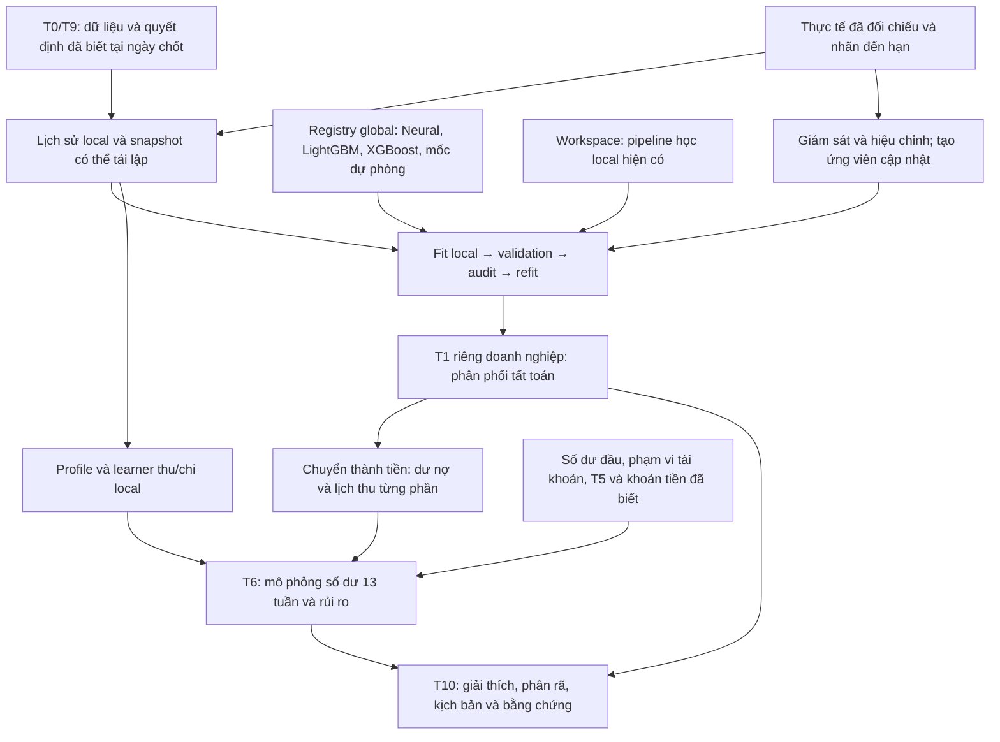

# Chốt pipeline T1 → T6 → T10: global dùng chung, thích nghi riêng theo doanh nghiệp

**Bổ sung hiện hành, bước 7:** [T10 cho bundle partial/T6 đã lưu](T10_BUNDLE_EVIDENCE_2026-11-13.md)
đã nối bằng chứng adapter, snapshot phiên bản và kịch bản T6 đầy đủ vào dịch
vụ. [Bước 5–6](T6_PARTIAL_PATHS_PERIODIC_2026-11-13.md) đã sửa partial paths,
chu kỳ và quy trình doanh nghiệp mới. Những bảng và kế hoạch ban đầu bên
dưới được giữ theo thời điểm quyết định, không phủ định các cập nhật này.

**Cập nhật sau quyết định này:** người dùng yêu cầu bỏ Workspace/local ensemble.
Phần T1 bên dưới được giữ như hồ sơ quyết định trước đó và đã được thay bằng
[hợp đồng T1 đang triển khai](T1_GLOBAL_LOCAL_RUNTIME_2026-11-13.md).
T1 phục vụ hiện chỉ chọn các global và nhánh học tiếp; T6/T10 vẫn theo phạm vi
và giới hạn riêng, không coi toàn bộ thiết kế dưới đây là đã triển khai.

**Ngày chốt: 13/11/2026. Trạng thái: quyết định thiết kế từ session và bằng chứng hiện có; chưa phải thông báo đã triển khai toàn bộ hoặc đo thêm chất lượng.**

Mục tiêu là một gói phương pháp gửi cho nhiều doanh nghiệp. Mỗi doanh nghiệp dùng lịch sử của mình để học, chọn và lưu phiên bản riêng. Đại Phát là một fixture synthetic để kiểm tra phương pháp, không phải khách hàng cần bàn giao. Một model local chỉ cần được đánh giá trên tương lai của doanh nghiệp đã học nó; không yêu cầu model Đại Phát dự báo tốt cho các doanh nghiệp khác.

Quyết định hiện tại: **T1 giữ nhiều global và nhánh học tiếp, Neural là mốc mặc định; T6 là bộ tổng hợp xác suất và tiền có các thành phần học local; T10 giải thích đúng T1/T6 đã chọn.** Không ép mọi doanh nghiệp dùng Neural, không mặc định fine-tune luôn có lợi, không xây thêm một catalog local trùng Workspace.

Tài liệu này thay phần định hướng tiếp tục phát triển của quyết định [chốt T1 trước đó](../03_Evaluation/T1_CHOT_2026-11-13.md), theo các yêu cầu mới hơn trong session. Artifact, quyết định triển khai và số đo của các lượt cũ giữ nguyên. Không tự thay cấu hình tenant hoặc trạng thái nghiệm thu.

## 1. Sơ đồ và phạm vi chung

Chân trời chính là **13 tuần**. Toàn bộ công nợ còn mở hợp lệ tại ngày chốt tham gia dự báo. Giới hạn 30 chỉ áp dụng cho danh sách/SHAP cần hiển thị; không giới hạn danh mục T6. Không tự ngoại suy phần tất toán sau tuần 13.

Khi không có AR mở, T1 trả danh mục rỗng; T6 vẫn chạy số dư đầu, lịch T5 và các nguồn thu/chi khác đủ điều kiện. Điểm AR chia dư nợ không áp dụng cho kỳ có tổng AR bằng 0; không gán điểm bằng 0 rồi coi là T1 dự báo tốt.

Giữ yêu cầu **không dự báo thu từ hóa đơn phát hành sau ngày chốt**. Thu bán ngay có thể là thành phần riêng khi có dữ liệu và được bật rõ; không đổi tên thu bán chịu từ hóa đơn mới thành thu hoạt động để đưa lại vào phạm vi. Báo cáo phải ghi rõ đang gồm những nguồn tiền nào. Nếu loại một nguồn còn có trong sao kê thật, phần chênh ngoài phạm vi vẫn được báo, không xóa khỏi nhãn ngân hàng.

## 2. Dữ liệu và thời gian: nền chung cho mọi tầng

1. T0 chuẩn hóa hóa đơn, tiền, ngày, khách hàng và quan hệ thay thế/điều chỉnh. T9 cung cấp phân bổ đã có bằng chứng, lịch sử duyệt/đảo và snapshot theo `known_at`.
2. Ngày tiền thực thu và ngày biết phân bổ là hai trường khác nhau. Dự báo tại T chỉ đọc thông tin đã biết tại T. Feature của một origin quá khứ không được nhìn phân bổ, bản sửa hoặc hành vi xảy ra sau origin đó.
3. Nhãn tất toán được tính bằng tiền thực thu; credit note, hủy, xóa nợ và giảm trừ không trở thành dòng tiền vào. Tiền đã có trong số dư đầu không cộng lại vào dự thu.
4. Tuần thiếu sao kê/phạm vi tài khoản chưa xác nhận là thiếu quan sát, không phải tuần không thu/không chi. Nhãn chưa đủ theo dõi là chưa biết, không tự gán chưa trả.
5. Builder train, validation, audit và serving phải có cùng hợp đồng kế toán/feature. Giữ mã hóa đơn và origin để biết số hóa đơn độc lập, số snapshot lặp và số dòng risk khai triển.
6. Global chỉ học trên doanh nghiệp nguồn của nó. Khi chấm doanh nghiệp mới, chỉ local adapter được học lịch sử riêng của doanh nghiệp đó. Không gộp dữ liệu của nhóm đánh giá vào fit global.

Mỗi doanh nghiệp có registry, artifact local, scaler/normalizer, profile tiền, trạng thái hiệu chỉnh và nhật ký riêng. Global gốc là bất biến; học local tạo bản sao. Ở phiên bản đầu, mỗi đợt refit bắt đầu lại từ global gốc và cửa sổ local đã khóa để tránh học trùng lịch sử nhiều lần qua các đợt. Tiếp tục từ bản local trước chỉ là chế độ bổ sung khi có sổ dữ liệu đã xử lý và được đánh giá riêng.

## 3. Bản thân T1

### 3.1. Bài toán và đầu ra

Giữ T1 landmark survival theo tuần: tại ngày chốt, mô hình nhận trạng thái hóa đơn còn mở, lịch sử khách và doanh nghiệp đã biết; trả xác suất tất toán bằng tiền trong các tuần 1–13 và khối lượng chưa tất toán trong kỳ.

Với hazard `h(i,w)`, xác suất tuần w là survival tới trước w nhân `h(i,w)`. Tổng 13 xác suất tuần cộng phần còn lại bằng 1. CDF tất toán và tỷ lệ tiền thu từng phần là hai đại lượng khác nhau. Phần chưa tất toán ở tuần 13 cũng không đồng nghĩa xác suất mất vốn vĩnh viễn.

Giao diện T1 cần giữ: doanh nghiệp, hóa đơn, cutoff, horizon, PMF/CDF, tail, schema, phiên bản model và scaler, global cha, cutoff train, bằng chứng validation/audit và hash đầu vào. Dữ liệu thiếu/hóa đơn ngoài hỗ trợ được gắn trạng thái, không bịa xác suất đã kiểm định.

### 3.2. Các ứng viên được giữ

| Ứng viên | Vai trò |
|---|---|
| G0: global hiện tại Neural 75% + customer 25% | Mốc mặc định nghiên cứu ban đầu và ứng viên không cập nhật |
| Neural global đơn | Đối chứng cùng họ cho lợi ích học tiếp |
| Neural global → local | Học tiếp tham số Neural, giữ biến đổi đầu vào global |
| LightGBM global chưa học tiếp | Ứng viên và đối chứng cùng họ |
| LightGBM global → local | Thêm boosting từ cây global |
| XGBoost global chưa học tiếp | Ứng viên và đối chứng cùng họ |
| XGBoost global → local | Thêm boosting từ cây global |
| Workspace local hiện có | Một pipeline đối thủ hoàn chỉnh, dùng lại cách học/chọn local sẵn có |

Workspace không phải tên khác của nhánh customer 25%. RF/ExtraTrees/HistGB vẫn được giữ trong Workspace; chưa cần xây thêm bản global thích nghi tương ứng. Workspace có feature/cách dựng mẫu khác; nó tham gia so sánh toàn pipeline, không dùng để cô lập riêng tác dụng pretrain.

Danh sách này là nhóm ứng viên ở tầng lựa chọn. Các preset, grid, cách trộn và ngân sách được khóa trên tập phát triển, không liên tục mở thêm thuật toán theo kết quả test. Pipeline Neural A1 cũ được giữ làm đối chứng tái lập trong quá trình phát triển; việc thay nó bằng một cách trộn khác phải được ghi thành thay đổi protocol.

G0 là điểm xuất phát nghiên cứu đang được giữ, chưa phải global đã chứng minh dùng tốt cho doanh nghiệp thật hoặc model đang được tự kích hoạt trong dịch vụ. Dịch vụ hiện vẫn có cơ chế Workspace/model active riêng.

Các global của lượt family đã học cùng mẫu 100.000 dòng risk, nhưng giữ nhãn nguồn lịch sử trước sửa cash-calendar; nhãn local/replay đã sửa. Trước một release global mới, cả ba họ phải được train/kiểm bằng cùng contract feature–nhãn đã chuẩn hóa và audit nguồn riêng. Không tự đưa bản refit từng thất bại audit vào gói để gọi là đã giải quyết vấn đề. Hiện các artifact giữ lại là điểm xuất phát thí nghiệm có provenance, không phải chứng nhận nguồn global đã hoàn hảo.

### 3.3. Cách học tiếp và lượng dữ liệu

Neural tiếp tục từ trọng số global với learning rate nhỏ, kiểm soát epoch/Adam và đóng băng scaler trong v1. LightGBM/XGBoost tiếp tục bằng cách thêm cây mới, kiểm cây cũ không bị sửa và model global không bị đột biến. Refit lá/refresh là nhánh nghiên cứu riêng, chưa mặc định thay cơ chế đã đo.

Neural và hai họ cây dùng cùng 18 feature, snapshot, nhãn, trọng số local và thời gian. Tốc độ học và ngân sách là tham số riêng từng thuật toán. Có thể trộn model đã thích nghi với global của chính họ bằng alpha được validation chọn. Không mặc định giữ tỷ lệ 75/25 cho mọi model sau thích nghi; 75/25 chỉ mô tả G0 gốc.

**A1 là chính sách dữ liệu tham chiếu cho vòng phát triển tiếp:** bỏ trần 50 snapshot/ngày; tối đa 12.000 dòng risk sau khai triển theo tuần cho mỗi bảng fit/refit. Đây là ngân sách thí nghiệm, không phải ngưỡng dữ liệu tối ưu đã chứng minh hay giới hạn cố hữu của sản phẩm. Mẫu phải ổn định, có trọng số và có receipt; nếu đổi ngân sách, khai báo thành phiên bản trước khi đánh giá. A0/A2 giữ làm chẩn đoán, không tự chọn mức dữ liệu khác nhau sau khi xem future của từng họ.

Replay v1 giữ 30% tổng khối lượng trọng số như lượt đã đo, không phải 30% số dòng. Tham số này còn có thể giới hạn thích nghi; thay đổi nó cần thử nghiệm phát triển riêng. Local không cần giữ chất lượng trên doanh nghiệp khác. Replay chỉ là điều chuẩn hóa cần đánh giá trên tương lai của chính doanh nghiệp đích.

Validation/audit/evaluation dùng toàn bộ danh mục đủ điều kiện. Tăng snapshot không được gọi là tăng tương ứng số hóa đơn độc lập.

### 3.4. Quy trình chọn cho doanh nghiệp

`Lịch sử local tại T → fit các ứng viên → validation theo thời gian → chọn một pipeline → audit → refit → phiên bản riêng doanh nghiệp`.

- Mỗi origin validation chỉ sử dụng model được fit từ những feature và nhãn có thể biết trước origin đó. Tất cả ứng viên được chấm trên cùng tập hóa đơn và cùng adapter tiền.
- Tiêu chí chính: `cash13 = 0,5 × [tổng |sai số thu tuần| + trung bình |sai số thu lũy kế|] / tổng dư nợ tại origin`. Lấy trung bình đều origin trong doanh nghiệp; khi chấm nhiều doanh nghiệp thì tổng hợp đều World/doanh nghiệp/origin.
- Guard: chất lượng xác suất tất toán (IBS/Brier có trọng số tiền), lỗi từng kỳ và khả năng phục vụ không được xấu quá mức đã khóa. Đổi họ phải có mức cải thiện đủ rõ; hòa/khác biệt nhỏ ưu tiên phiên bản đang dùng hoặc cấu hình đơn giản hơn.
- Validation chọn họ, cấu hình học và alpha. Audit chỉ nhận hoặc bác lựa chọn đã khóa; không tiếp tục thử ứng viên thứ hai trên chính audit.
- **Audit ở tầng chọn chung phải so với phiên bản đang phục vụ doanh nghiệp**, mặc định G0 khi chưa có incumbent tốt hơn. Audit so cây với global riêng của cây chỉ trả lời hiệu quả học tiếp cùng họ; chưa đủ để cho cây thay Neural/Workspace đang phục vụ.
- Nếu qua audit, refit với lựa chọn đã khóa trên dữ liệu đủ nhãn tại T. Audit đánh giá bước lựa chọn trước refit; chất lượng phiên bản sau refit phải được đánh giá như một phần của toàn quy trình trên future được giữ kín.
- Nếu audit bác/thiếu dữ liệu, giữ phiên bản đang phục vụ còn tương thích. Khi chưa có phiên bản đủ điều kiện, dùng fallback khai báo rõ. Không bắt buộc chuyển về một global kém hơn incumbent local đã được kiểm chứng.

Ngưỡng đã đo (`IBS <= base ×1,02 +0,0001`, cash gain audit tối thiểu 0,0001) được giữ làm cấu hình tham chiếu. Đó không phải mức cải thiện có ý nghĩa kinh doanh cho mọi doanh nghiệp; guard đối với incumbent và tiêu chí ổn định phải được khóa trong protocol đánh giá selector mới. Không dùng metric tương lai để quyết định accept.

### 3.5. Doanh nghiệp ít lịch sử

Không giữ cứng lịch initial fit gần nhất T−329 cho pipeline triển khai. Builder mới phải dựng fold từ thời gian quan sát/nhãn thực sự có, dùng các origin hợp lệ gần validation nhất và kiểm ngày nhãn tới hạn trước mỗi fold.

Tuy nhiên ba tháng lịch sử không tự tạo được nhiều kỳ kiểm định 13 tuần độc lập. Khi chưa đủ nhãn/cửa sổ để chọn, hệ thống vẫn cập nhật feature và thống kê local có shrinkage về prior, nhưng giữ model mặc định/incumbent. Có thể tạo ứng viên học tiếp để theo dõi; không tự tuyên bố nó đã vượt audit 13 tuần.

V1 giữ nhãn đủ theo dõi theo hợp đồng đã đo. Học thêm các đoạn risk bị right-censor có thể giảm lãng phí dữ liệu ngắn lịch sử, nhưng phải triển khai và kiểm chứng như một phiên bản nhãn/training riêng; không âm thầm gán các tuần chưa quan sát thành không trả. Không có một ngưỡng số hóa đơn chung đủ cho mọi trường hợp.

## 4. T1 → T6: hợp đồng chuyển xác suất thành tiền

T6 nhận đúng phiên bản T1 đã chọn cho doanh nghiệp. Không dùng Neural mặc định cho T6 khi giao diện T1 đang hiển thị cây hoặc Workspace khác.

Adapter lấy: danh mục mở tại T, dư nợ sau tiền đã nhận/giảm trừ hợp lệ, PMF/CDF T1, profile thu từng phần, khóa khách hàng và dấu hỗ trợ dữ liệu. Nó trả tiền kỳ vọng theo hóa đơn/khách/tuần, phần ngoài 13 tuần và mô tả phân phối/đường thu dùng cho mô phỏng.

**Khi không có profile trả từng phần:** v1 có thể dùng giả định nhận phần còn nợ tại tuần tất toán, ghi rõ giả định. Với hóa đơn có profile đủ bằng chứng: dùng tỷ lệ thu tương lai trên chính dư nợ tại T; thống kê local có prior/điều chuẩn khi ít mẫu. Không nhân xác suất tất toán với toàn bộ dư nợ rồi cộng thêm profile partial lần nữa.

Profile hiện có trong `cash_history.partial_distribution` là trung bình các tỷ lệ tiền theo tuần. Nó hữu ích cho kỳ vọng. Mô phỏng hiện tại lại rút một tuần nhận toàn bộ dư nợ từ vector đó; cách này chưa mô phỏng đúng đường trả nhiều lần. **Thiết kế đích phải lưu/lấy mẫu cả đường tỷ lệ thu nhiều tuần cho nhóm có partial profile**, bảo toàn tổng tiền và phụ thuộc thời gian; nếu chưa có thì dải tiền phải ghi rõ giới hạn.

Các kiểm tra giao diện bắt buộc:

- Không âm tiền, không thu vượt dư nợ hợp lệ; các khoản nhận ngoài kỳ được giữ riêng.
- Tổng thu kỳ vọng T6 bằng tổng dự thu của từng hóa đơn/khách từ adapter; kỳ vọng tính trực tiếp, không phụ thuộc seed MC.
- CDF tất toán và lịch tiền vẫn được lưu riêng. Không biến tail 13 tuần thành vỡ nợ rồi trừ tiền thêm một lần bằng T2.
- Hoãn liên hệ/gần đây đã gọi chỉ ảnh hưởng danh sách xử lý; không loại hóa đơn đó khỏi tổng dự thu.
- `model_version`, `adapter_version`, `profile_version`, cutoff và snapshot phải khớp ở T1, T6 và T10.

## 5. Bản thân T6

### 5.1. Cấu trúc được chọn

**T6 là máy mô phỏng và cộng dồn dòng tiền, có các thành phần được học/hiệu chỉnh. Không cần biến toàn bộ T6 thành một Neural duy nhất.** Gửi cùng một engine cho mọi doanh nghiệp, kèm prior/cấu hình nguồn và learner có khả năng học local.

Mỗi đường s, tuần k:

`B(s,k) = B0 + tổng_{w<=k}[thu AR(s,w) + thu khác thuộc phạm vi(s,w) − chi đã biết(w) − phần chi chưa nằm trong lịch(s,w)]`.

Giữ riêng số dư kỳ vọng, P10/P50/P90 và đường mẫu. P50 là trung vị các đường mô phỏng; không đổi tên số dư kỳ vọng thành P50. Số dư đầu và tài khoản phải được đối chiếu cùng phạm vi; thiếu lịch chi không được ngầm coi bằng 0.

| Thành phần | Nguồn dùng chung | Thích nghi tại doanh nghiệp |
|---|---|---|
| Thu AR đang mở | Gói T1 và adapter | Model T1 được chọn, profile thu từng phần local |
| Thu bán ngay, chi biến đổi ngoài lịch | Learner toàn cục chuẩn hóa quy mô, priors và baseline | Học tiếp hoặc fit local; validation chọn, audit giữ/bác |
| Lịch nghĩa vụ và khoản đã biết | Quy tắc T5, hợp đồng dữ liệu | Đọc lịch đã biết, số đã trả và xác nhận phạm vi theo tuần |
| Phụ thuộc giữa khách/hóa đơn | Cấu trúc mô phỏng chung và prior nguồn | Ước lượng/điều chuẩn tham số nếu có đủ lỗi lịch sử |
| Bất định thu/chi và dải tiền | Profile phần dư/calibrator nguồn tương thích | Cập nhật bằng sai số ngoài mẫu local đã đến hạn |
| Cảnh báo thiếu tiền | Bộ tính xác suất và luật quyết định | Cash floor và chi phí bỏ sót/báo giả của doanh nghiệp |

Không gọi cập nhật số dư đầu/lịch T5 là fine-tune. Học tiếp T6 nằm ở learner thu/chi; ước lượng lại nằm ở profile, tham số phụ thuộc và calibrator. Đây là các cơ chế khác nhau, cùng được quản lý trong bundle T6 riêng doanh nghiệp.

### 5.2. Learner thu/chi và ngân sách ban đầu

Chọn **LightGBM theo horizon/phân vị làm hướng global ban đầu cho thu bán ngay và chi biến đổi**, chuẩn hóa theo quy mô quá khứ của doanh nghiệp. Nhánh local có thể tiếp tục boosting, với LR/budget riêng được validation chọn. Đây là thành phần cần phát triển/kiểm chứng; chưa có bằng chứng rằng learner này đã thắng hoặc đã được phục vụ trong T6 hiện tại.

Giữ seasonal/naive và GBM local hiện có làm đối chứng. Chronos/GRU/LSTM chỉ là lựa chọn nghiên cứu khi đủ chuỗi và chứng minh tốt hơn; không đưa hết vào gói mặc định chỉ vì đã có mã. T6 không buộc dùng cùng họ mô hình được chọn cho T1.

Chỉ fit từ dòng tiền đã phân loại/đối chiếu, có dấu đủ phủ; chuẩn hóa và đặc trưng chỉ dùng quá khứ. Learner chi dự báo phần chưa có trong lịch; nếu dự báo tổng chi biến đổi thì trừ phần đã biết trước khi cộng, tránh tính hai lần. Các khoản hoàn/đầu tư/tài trợ đã biết được hạch toán riêng, không tự gán thành thu AR.

Bộ tuần nguồn cần cân bằng đóng góp theo doanh nghiệp/origin sau chuẩn hóa quy mô, để một doanh nghiệp lớn không quyết định toàn bộ learner. Nếu dùng dự báo T1 làm đầu vào learner T6, phải tạo chúng bằng T1 ngoài thời gian ở từng origin; không dùng dự báo trong mẫu hoặc bản T1 đã học tương lai để tạo feature T6.

Bản dịch vụ hiện có yêu cầu ít nhất 104 tuần để xét seasonal/GBM, và 156 tuần cho một số nhánh deep; đó là điều kiện của pipeline hiện có, không chứng minh mọi SME phải chờ đủ hai năm. Thiếu dữ liệu local thì dùng prior/learner nguồn tương thích nếu đã được kiểm chứng; nếu chưa có, báo thành phần chưa được dự báo. Không dùng thiếu quan sát làm số 0 để đủ chiều đầu vào.

### 5.3. Mô phỏng phụ thuộc và thu từng phần

Giữ MC độc lập làm đối chứng. Hướng engine đích là **MC có nhân tố chung toàn danh mục, nhân tố khách hàng và phần riêng hóa đơn**, khởi đầu từ cấu trúc t-copula đã có trong mã nghiên cứu. Phải giữ đúng phân phối biên của T1/adapter và đường tiền nhiều lần. Không mặc định mã copula cũ đã cắm được nguyên trạng vào đường phục vụ mới.

Tham số phụ thuộc được chọn trên nguồn trước rồi chỉ điều chỉnh bằng dữ liệu local ngoài mẫu đủ bằng chứng. Khi không đủ dữ liệu, giữ prior và hiển thị giả định; không ước lượng một rho tùy ý để làm dải rộng vừa đủ. Stress chung hoàn toàn theo khách là một kịch bản, không phải tham số phụ thuộc đã được học.

Phiên bản T6 mới phải so MC độc lập với các cấu hình phụ thuộc trên cùng forecast và dữ liệu. Chọn bằng proper score cho phân phối/interval score, kèm calibration, thay vì chỉ ưu tiên coverage cao do dải rất rộng. Không hứa mô hình có phụ thuộc luôn tốt hơn.

Giữ mặc định 1.000 đường cho sử dụng và lưu seed; số đường là ngân sách số học có thể cấu hình. Đo sai số Monte Carlo riêng với sai số mô hình. Kỳ vọng vẫn tính trực tiếp; không vì giảm SHAP mà bỏ hóa đơn khỏi mô phỏng.

### 5.4. Hiệu chỉnh và cảnh báo local

1. Lưu forecast trước khi biết nhãn. Khi kết quả ở horizon k thật sự được đối chiếu/biết, cập nhật lỗi đúng horizon k; không cập nhật nhãn 13 tuần ngay ở tuần 1.
2. Offline có thể dựng phần dư ngoài thời gian bằng backtest đúng ngày biết và split riêng, nhưng phải ghi là backtest; không sửa ngày tạo để giả thành forecast prospective.
3. Học calibrator theo horizon hoặc nhóm horizon, có prior nguồn và mức hỗ trợ local. Dữ liệu dùng hiệu chỉnh phải có trước mốc đánh giá, không tái sử dụng audit để vừa fit calibrator vừa báo audit độc lập.
4. Chỉ chia sẻ phần dư giữa forecast cùng phạm vi tài khoản, thành phần thu/chi, horizon và quy trình dự báo tương thích. Đổi họ model/phạm vi lớn cần reset hoặc kiểm tra vận chuyển calibrator. Tránh reset mọi thứ sau mỗi refit tham số nhỏ nếu chính quy trình refit đã được khóa và kiểm chứng.
5. Conformal/ACI là hướng hiệu chỉnh cần tích hợp và kiểm chứng theo thời gian; mục tiêu 80% là coverage theo tuần/horizon, không mặc nhiên là phủ đồng thời cả 13 tuần. Thuật toán ACI nghiên cứu có kết quả về tần suất phủ dài hạn, không chứng minh implementation có clamp/nhãn trễ hiện tại tự bảo đảm mọi kỳ. [Gibbs & Candès](https://arxiv.org/abs/2106.00170).
6. Hiệu chỉnh dải không tự hiệu chỉnh xác suất thiếu tiền. Nếu cần xác suất calibrated, học/kiểm một bộ riêng bằng sự kiện thiếu tiền ngoài mẫu, đủ cả kỳ có/không thiếu tiền; nếu chưa đủ thì ghi xác suất MC thô. Không suy xác suất mới từ hai đầu khoảng đã nới.

Hiện `calibrate_bands` cần 12 origin không chồng lấn, cùng model version và cùng scope; với kỳ 13 tuần và phiên bản thường đổi, rất khó tích lũy đủ local evidence. Cần thay bằng cơ chế theo horizon/quy trình đã kiểm chứng, có xử lý phụ thuộc thời gian; không chỉ hạ ngưỡng số mẫu rồi gọi là calibrated.

Tính cả `P(B_k < floor)` và `P(min_{k<=13} B_k < floor)` trực tiếp từ cùng tập đường mô phỏng. Không lấy tổng xác suất tuần hoặc giả định các tuần độc lập. Ngưỡng cảnh báo và luật kéo dài/xác nhận được khóa từ phát triển và chi phí sử dụng, không chọn theo kết quả tương lai. Trạng thái thiếu lịch/thiếu sao kê đi cùng cảnh báo về độ đủ dữ liệu.

### 5.5. Chọn và chấm T6

Khóa lựa chọn T1 trước khi xét các cấu hình T6, rồi kiểm chứng lại toàn bộ quy trình ở cuối. Không đổi T1 để bù ngược lỗi lịch chi và làm MAE ngân hàng có vẻ đẹp hơn.

Chấm riêng thu AR, thu khác, chi đã biết, chi dự báo và số dư. T6 chọn bằng CRPS hoặc proper interval/quantile score đã khai báo, kèm MAE/bias, coverage/độ rộng, Brier xác suất thiếu tiền và báo giả/bỏ sót. Một điểm chính và guard phải khóa trước; không sau khi thấy kết quả mới chọn chỉ tiêu thắng. MAE số dư không đủ để chọn T1 vì lỗi thu và chi có thể bù nhau.

Với phạm vi không bao phủ toàn bộ ngân hàng, báo đồng thời chất lượng thành phần trong phạm vi và sai số đối chiếu ngân hàng có phân rã ngoài phạm vi. Không trình bày một đường chỉ gồm AR như dự báo đầy đủ khả năng thanh khoản.

## 6. T1, T6 → T10

**T10 không cần một model dự báo thứ ba để fine-tune lại số tiền.** Nó đọc bundle và forecast đã lưu, tạo lời giải thích, phân rã và kịch bản có nguồn. T10 thích nghi bằng reference local, ngữ cảnh doanh nghiệp, cash floor và chi phí sử dụng; không sửa xác suất để lời giải thích nghe hợp lý.

| Lớp giải thích | Đích và cách làm |
|---|---|
| Vì sao hóa đơn có xác suất này? | Grouped SHAP/Shapley trên đúng T1 đang phục vụ, đích rõ như xác suất tất toán 4 tuần; giải thích cả pooling/ensemble |
| Vì sao tiền về theo lịch này? | Dư nợ × lịch tỷ lệ tiền từ adapter; nêu rõ phần dùng model tất toán và phần dùng partial profile |
| Vì sao số dư tuần k thấp? | Phân rã kế toán khớp đúng B0 + thu − chi, theo hóa đơn/khách/khoản chi/tuần; không gọi đây là SHAP của P10/P90 |
| Vì sao ưu tiên khoản này? | Chính sách, công thức, điểm, phạm vi đủ điều kiện và nguồn xác suất thực tế |
| Nếu thu sớm/khách trả chậm/hoãn chi? | Chạy lại cùng T6, cùng bundle và luồng ngẫu nhiên; báo thay đổi số dư, dải và rủi ro nếu đã mô phỏng lại |
| Vì sao dùng model này cho doanh nghiệp? | Model toàn cục cha, mức dữ liệu local, lựa chọn validation, audit/fallback, cutoff và phiên bản |

Reference SHAP lấy từ dữ liệu doanh nghiệp tại cutoff; giữ cách census/mẫu phân tầng và kiểm độ nhạy đã có. Đủ sáu nhóm chỉ có 64 coalition, nhưng additivity là chính xác đối với nhóm/reference đã chọn, không chứng minh toàn bộ đóng góp có ý nghĩa nhân quả. Tính contribution trên logit không được gắn nhãn là contribution theo điểm phần trăm. Model không hỗ trợ/không đủ reference thì trả unavailable/insufficient.

Chính sách xếp hạng là một lớp riêng. Với policy dùng xác suất T1, đích pipeline mới là đọc xác suất từ active T1 và giải thích đúng nguồn đó. Nếu giữ baseline triage riêng như runtime hiện tại, phải đặt tên/nguồn rõ và giữ lời giải thích riêng; không gán SHAP của Neural cho điểm của customer baseline. Thay nguồn xác suất xếp hạng là thay chính sách cần đánh giá, không chỉ thay giao diện.

Giữ thao tác thu nợ, tranh chấp, lời hứa và hạn chế liên hệ làm ngữ cảnh/quy tắc đủ điều kiện. Không suy từ SHAP rằng gọi điện sẽ tạo ra một lượng tiền. Delta rủi ro khi giả định thu ngay là giá trị kịch bản thanh khoản, không phải tác dụng nhân quả của hành động thu nợ hay ROI đã đo. [Janzing và cộng sự](https://proceedings.mlr.press/v108/janzing20a.html).

What-if phải dùng cùng phiên bản T1/adapter/T6 và common random numbers theo từng nguồn ngẫu nhiên. Không retrain hoặc chọn lại model để so một kịch bản. Dịch dòng tiền kỳ vọng như chức năng hiện có chỉ được mô tả là độ nhạy kỳ vọng; chỉ báo P10/P90/ΔP mới nếu thật sự chạy lại mô phỏng. Khi ép thu sớm một khoản partial, thay thế đường tiền tương ứng, tránh cộng thêm vào khoản vẫn được thu trong baseline.

Nếu có LLM, chỉ nhận dữ liệu có cấu trúc, số/đơn vị đã tính và bằng chứng được phép dùng; trả câu diễn giải. Kiểm số, nguồn, đích, đơn vị và sự nhất quán với forecast. Khi không đạt, dùng template/giữ bảng. T10 không tự bịa nguyên nhân, ngày thu, xác suất thành công của cuộc gọi hoặc khoản chi chưa khai báo.

## 7. Chu kỳ học local, registry và giám sát

Tách **job học** và **job dự báo**. Lệnh train dựng dữ liệu, thử/chọn/audit/refit, đóng gói ứng viên. Forecast chỉ đọc bundle đã được chọn và feature hiện tại; không tự train toàn bộ mỗi khi người dùng bấm xem.

Bundle doanh nghiệp chứa ít nhất:

- Global cha và hash, schema/normalizer, active T1 cùng alpha và policy chọn.
- Cutoff dữ liệu, mẫu học/replay, receipt validation/audit và lý do fallback.
- Cash adapter/profile, learner thu/chi, tham số phụ thuộc và trạng thái hiệu chỉnh theo horizon.
- Phạm vi tài khoản/tiền, giả định ngoài phạm vi, cash floor và chính sách cảnh báo.
- Policy giải thích/reference, chính sách xếp hạng và phiên bản engine T6.

Mỗi forecast lưu hash snapshot, phiên bản bundle, thành phần đang được dùng, seed/budget, thời điểm tạo và toàn bộ giả định. Lưu model thực tế, không chỉ lưu tên "Neural" hoặc tên phiên bản T1.

Sau mỗi kỳ nhãn đến hạn: cập nhật metric, drift và lỗi thành phần; hiệu chỉnh đúng scope; đủ dữ liệu mới hoặc có drift thì tạo ứng viên mới. Lịch cập nhật được cấu hình theo doanh nghiệp, không dựa vào một số hóa đơn cố định cho tất cả. Học tiếp tạo bản mới và chỉ được thay incumbent khi qua quy trình đã khóa; giữ khả năng rollback. Không đem local weights của doanh nghiệp A sang doanh nghiệp B hoặc ghi ngược vào global dùng chung như thao tác mặc định.

## 8. Bằng chứng đang có và phần chưa có

| Phần | Đã có bằng chứng | Việc còn phải làm cho pipeline đích |
|---|---|---|
| T1 A0/A1/A2 | 75 context synthetic đã xem; cùng census; kiểm Adam, nguồn và dự báo | Window gần hiện tại và đánh giá khả năng thích nghi với lịch sử ngắn |
| T1 ba họ global → local | 75 context, 225 family-context; 3.000 điểm validation tính lại; 675 phân phối phát lại khớp | Selector giữa các họ + Workspace, audit với incumbent và phục vụ/registry bundle mới |
| T1 → tiền | Có conversion dư nợ/partial profile và kiểm kỳ vọng | Đường mô phỏng trả nhiều lần và đánh giá uncertainty của adapter |
| T6 dịch vụ | MC 1.000 đường, phần hoạt động local/T5, phân rã, hiệu chỉnh hạn chế | Tích hợp phụ thuộc, learner global → local cho thu/chi và calibrator phù hợp local ngắn |
| T6 copula/ACI | Có mã/nghiên cứu lịch sử riêng | Không được coi là đã tích hợp hoặc đạt coverage trong pipeline hiện tại |
| T10 | SHAP đúng phân phối đang phục vụ, ranking explanation, phân rã, kịch bản kỳ vọng | Liên thông đầy đủ model chọn mới, kịch bản MC/ΔP và giải thích lựa chọn model |
| Toàn quy trình nhiều doanh nghiệp | Có nhiều phép đo synthetic từng phần | Test doanh nghiệp mới giữ kín theo quy trình khóa; chưa có bằng chứng hiệu quả trên SME thật |

Số đo quan trọng:

- Ba World/18 doanh nghiệp dài lịch sử: sau audit, Neural 0,310754; LightGBM 0,322474; XGBoost 0,326572. Đại Phát: XGBoost 0,062336; LightGBM 0,064727; Neural đối xứng 0,081736; Neural A1 cũ 0,068900. Cả ba nhánh học trên chính lịch sử từng doanh nghiệp, không lấy model Đại Phát chấm các World khác.
- Hai cây global chưa thích nghi trên Đại Phát đã khoảng 0,073; lợi ích thêm do học tiếp là khoảng 11,31%/14,93%, không phải toàn bộ chênh lệch với G0 0,202117. Các cải thiện nhỏ sau audit ở cohort dài lịch sử so với global riêng có khoảng bootstrap chứa 0.
- Toàn bộ 18 context onboarding trong nghiên cứu cap/family đều fallback; chưa chứng minh học tiếp được với 3–9 tháng lịch sử.
- Backtest T6 mới nhất chỉ có một doanh nghiệp synthetic, các stress dùng lại danh mục. Dải buffered Workspace phủ 55,8%, global 0%, thấp hơn mức danh nghĩa 80%; schedule_gap bỏ sót 26/26 tuần thiếu tiền. Những điểm ACI cũ không sửa được kết luận của lượt này.

## 9. Tiêu chí đánh giá toàn quy trình và thứ tự làm tiếp

**Bước 7 bổ sung sau yêu cầu 5–6:** hoàn thiện T10 cho bundle mới: xuất dữ
liệu tiền theo hóa đơn/tuần ngay từ adapter/T6, giữ phiên bản và mức hỗ trợ;
T10 đọc forecast đã lưu, phân biệt SHAP xác suất, phân rã kế toán và độ nhạy
rủi ro. Kịch bản so P10/P50/P90 và Δ xác suất thiếu tiền bằng nguồn ngẫu
nhiên chung. Implementation và giới hạn ở [hợp đồng T10](T10_BUNDLE_EVIDENCE_2026-11-13.md).
Danh sách năm bước sau là kế hoạch ban đầu của quyết định này.

1. **Khóa dữ liệu, thời gian và giao diện.** Sửa window T1 cho dữ liệu thực sự có; version nhãn/censoring; bảo toàn PMF/tiền; tắt new-credit đúng phạm vi ở đường pipeline đích. Giữ các report/artifact đã khóa làm lịch sử.
2. **Làm selector T1.** Dùng các global đã có + nhánh thích nghi + Workspace, cùng scoring population, chọn bằng local past và audit với incumbent. Chấm cả final refit. Grid LR/budget riêng, A1 làm mức dữ liệu chính của vòng này.
3. **Hoàn thiện T6 theo từng thành phần.** Sửa partial paths trước khi khẳng định dải; đối chiếu MC độc lập/phụ thuộc; thêm learner global → local cho thu/chi, hiệu chỉnh theo horizon và kiểm xác suất cảnh báo. Không mở quá nhiều họ deep cùng lúc.
4. **Nối T10 vào bundle mới.** Giải thích đúng model, cash adapter, scope và engine; kịch bản dùng cùng luồng RNG và bảo toàn tiền; nguồn xác suất ranking minh bạch.
5. **Đánh giá khóa trên doanh nghiệp mới.** Tách doanh nghiệp nguồn để train global, doanh nghiệp phát triển để khóa policy, doanh nghiệp test cuối để chấm. Doanh nghiệp test được học từ quá khứ riêng; các future origin dùng chấm phải giữ kín khi chọn model. Chấm cả trường hợp thiếu dữ liệu/fallback, không loại khỏi báo cáo.

Đối chứng chính gồm G0 cố định, Neural-only có thích nghi, Workspace hiện có, selector nhiều họ và các ablation T6 cần thiết. Chấm theo doanh nghiệp, mức lịch sử, quy mô danh mục, khách ít dữ liệu, partial, stress thu/chi và thiếu lịch. Bootstrap theo doanh nghiệp/World phù hợp với thiết kế, không coi snapshot/tuần stress là các doanh nghiệp độc lập.

Thành công của selector là dự báo của **pipeline mà nó thực sự chọn trước khi biết future** tốt hơn hoặc đáp ứng guard so với incumbent/đối chứng ở mức đã khóa, với chi phí phục vụ chấp nhận được. Bảng chọn họ thắng sau khi nhìn future chỉ là oracle chẩn đoán, không phải pipeline sử dụng. [Cawley & Talbot](https://jmlr.org/papers/v11/cawley10a.html).

Đây là quyết định kiến trúc và phạm vi phát triển; các mức cải thiện/gate định lượng mới phải đăng ký trong protocol tương ứng trước khi chạy test cuối. Không khẳng định một model thắng mọi doanh nghiệp hoặc cả pipeline đã được nghiệm thu chỉ từ các phép thử hiện tại.

## 10. Nguồn đã đối chiếu

- Toàn bộ trao đổi hiển thị trong session và đoạn session cũ đính kèm `Pasted text.txt`; ưu tiên yêu cầu mới nhất về nhiều global → local và validation chọn.
- [A0/A1/A2 và đối chứng ngân sách](../../outputs/t1/neural_data_ablation_20261113/REPORT.md), [verification](../../outputs/t1/neural_data_ablation_20261113/verification.json).
- [Ba họ global → local](../../outputs/t1/global_local_families_20261113/REPORT.md), [protocol](../../outputs/t1/global_local_families_20261113/protocol.json), [verification](../../outputs/t1/global_local_families_20261113/verification.json).
- [Refit/học local sau sửa nhãn](../03_Evaluation/T1_REFIT_LOCAL_ADAPTATION_2026-11-13.md), [fine-tune/Workspace trên Đại Phát](../03_Evaluation/T1_DAI_PHAT_FINETUNE_VS_WORKSPACE_2026-11-13.md), [chọn T1/SHAP trước đó](../03_Evaluation/T1_T6_SHAP_SELECTION_2026-11-12.md).
- [Backtest T6 trong phạm vi](../03_Evaluation/T6_GLOBAL_SCOPE_NO_NEW_INVOICES_2026-11-13.md), [report gốc](../../outputs/t6/global_scope_no_new_credit_20261113/REPORT.md), [verifier độc lập](../../outputs/t6/global_scope_no_new_credit_20261113/independent_verification.json).
- [T6 nghiên cứu lịch sử](06_t6_monte_carlo_conformal.md), [T10 nghiên cứu lịch sử](07_t7_t9_t10.md), [T0/T9/T10 thực hiện được](../T0_T9_T10_DA_LAM_DUOC.md), [hợp đồng dịch vụ](../../agent1_service/README.md).
- Mã hiện tại: [T1/loader](../../agent1/adaptive/compact_t1.py), [feature landmark](../../agent1/adaptive/landmark_features.py), [Neural adaptation](../../agent1/adaptive/landmark_adaptation.py), [family runner](../../experiments/t1_compact/global_local_families.py), [forecast](../../agent1/adaptive/methods.py), [profile/hiệu chỉnh](../../agent1/adaptive/cash_history.py), [thu/chi local](../../agent1/adaptive/operating.py), [SHAP](../../agent1/adaptive/landmark_explanations.py), [phân rã tiền](../../agent1/adaptive/cash_explanations.py), [MC nghiên cứu](../../agent1/models/t6_cash.py), [kịch bản T10 nghiên cứu](../../agent1/models/t10.py).
- API cơ chế học cây: [LightGBM](https://lightgbm.readthedocs.io/en/stable/pythonapi/lightgbm.train.html), [XGBoost](https://xgboost.readthedocs.io/en/stable/python/python_api.html#xgboost.train). Kết quả dự án lấy từ artifact/CSV; các nguồn ngoài chỉ hỗ trợ nguyên tắc phương pháp.

[Receipt rà soát](../../outputs/analysis/t1_t6_t10_pipeline_decision_20261113/review_receipt.json) lưu hash nguồn, kiểm liên kết và đối chiếu số đo đã trích. Đây là kiểm tài liệu/bằng chứng, không phải test chất lượng hoặc xác nhận pipeline đích đã được triển khai.
