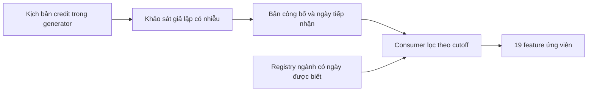

# Một hướng xử lý distribution shift v6: điều kiện tín dụng và ngành

**Ngày 05/11/2026. Hồ sơ nghiên cứu ban đầu: chưa train ở bước này;
kết quả tiếp nối P0–P4 đã có bên dưới.**

**Cập nhật P0–P4 sau báo cáo này:** đã chạy ablation ngành và hành vi ledger
as-of, loại macro khảo sát khỏi pipeline mới, thử riêng bổ sung World và
chấm bốn fresh World sau khóa lựa chọn. Ứng viên có cải thiện nhỏ nhưng
chưa qua ECE/Write-off ở mọi World. Xem [kết quả P0–P4](../03_Evaluation/T1_V6_PRACTICAL_FEATURES_2026-11-05.md)
và [protocol](T1_V6_PRACTICAL_FEATURES_PROTOCOL_2026-11-05.md). Nội dung khảo
sát và đề xuất bốn nhánh bên dưới là nghiên cứu ban đầu, không phải kết
quả train của pipeline mới.

**Bổ sung sau rà soát khả năng tiếp cận B2B cùng ngày:** khảo sát dưới đây
là phép đo giả định, không phải nguồn doanh nghiệp đang lấy được. Kế hoạch
ablation bốn nhánh ở mục 5 được giữ như đề xuất nghiên cứu ban đầu. Hướng
thực tế hiện tại chỉ xét ngành có nguồn và ngày biết thật; hoãn năm feature
khảo sát. Đã thêm adapter riêng, không tự lấy ngày hóa đơn làm ngày biết
ngành. Xem [audit nguồn và bản sửa đầu vào](T1_V6_B2B_FEATURE_ACCESS_2026-11-05.md).

Phạm vi là hazard competing risks v6 trên cohort v4. Điểm xuất phát là
[chẩn đoán `test_000`](../03_Evaluation/T1_V6_CAUSE_DIAGNOSIS_2026-11-05.md).
Chỉ xét **một hướng: bổ sung ngữ cảnh tín dụng quan sát được theo thời điểm
công bố, cùng ngành người mua/người bán**. Chưa đổi sampling, calibration,
cash head hoặc mô hình dịch vụ.

**Kết luận nghiên cứu:** nên kiểm hướng này bằng một lớp đo quan sát tách
riêng. Không có cơ sở nối PMI thật vào lịch shock synthetic hiện tại rồi
kỳ vọng tự sửa sai lệch. Prototype đã dựng được đầu vào có trễ và nhiễu,
nhưng phát hiện giới hạn lớn: **2.942/5.772 anchor tháng 7 (50,97%) chưa
thể thấy shock mới qua khảo sát tháng**. Đây cũng là nhóm đóng góp gần hết
gap Write-off trong chẩn đoán cũ. Vì vậy chưa thể xem feature kinh tế này
là lời giải đủ cho sai lệch v6.

## 1. Vì sao chọn tín dụng trước

Trong [`World.customer_paths`](../../agent1/synth/world.py), các shock
làm giảm thanh khoản riêng của người mua theo các hệ số synthetic:

```text
L -= 0,35 × demand_buyer + 0,25 × supply_buyer
   + 0,20 × price_buyer  + 0,85 × credit_buyer
   + 0,10 × supply_seller
hazard_default ∝ exp(0,7 × max(-L, 0) + sector_stress)
```

Kênh credit có đường truyền trực tiếp và hệ số lớn trong công thức này;
đây là lý do chọn nghiên cứu, **không phải ước lượng tầm quan trọng thực tế**.
Exposure, thời điểm, thời gian kéo dài và frailty vẫn quyết định kết quả.
Shock demand cũng tác động đồng thời trong test, nên phép nghiên cứu một
kênh chưa phân rã được toàn bộ lỗi.

Ngành có hai vai trò khác nhau. Ngành người mua xác định phạm vi của shock
nhắm ngành; ngành người bán đi vào rủi ro default nền, độ nhạy COVID/credit
crunch, điều khoản và cơ chế doanh thu. Cần giữ hai trường riêng. Trong
[design v4](../../data/synthetic/v4_shortpay_4shock_20261028_design.json),
các episode **credit đều có phạm vi toàn nền kinh tế**, không nhắm ngành.
Vì vậy bản đầu dùng một chỉ báo tín dụng chung và ngành tĩnh; không tạo
sáu đường shock ngành giả rồi coi chúng là sáu tín hiệu độc lập.

Chẩn đoán cũ cho thấy cơ cấu tuổi nợ/lịch sử đơn giản chưa giải thích hết
gap. Điều này chưa chứng minh conditional shift sau khi điều kiện hóa trên
toàn bộ feature. Tuy nhiên, cũng chưa đủ cơ sở giả định đây chỉ là
covariate shift thuần túy. Importance weighting trong khuôn khổ cổ điển
giả định quan hệ có điều kiện giữa đầu vào và đầu ra giữ nguyên; vì vậy
chưa chọn reweighting làm hướng đầu tiên. [Sugiyama và cộng sự, JMLR](https://www.jmlr.org/papers/v8/sugiyama07a.html).

## 2. Cái gì thực sự quan sát được trong dữ liệu hiện có?

| Dữ liệu | Có sẵn / thời điểm biết | Liên hệ với generator và quyết định |
|---|---|---|
| `covid_stress` có `published_date` | Có trong macro; consumer hiện chỉ nhận nguồn OxCGRT | Đi vào cơ chế stress; bằng 0 ở bảy cutoff test theo audit cũ, không phân biệt shock credit mới |
| WDI Việt Nam | Manifest và file thật có trên đĩa | Generator dùng đường lãi suất trong luồng khác; chưa có bằng chứng nó điều khiển các episode credit 2021/2024 này |
| PMI Việt Nam | Không có trong manifest nguồn đang dùng | Shock replay không được sinh từ PMI; chưa có liên kết cơ chế để dùng làm feature cho thí nghiệm này |
| Ngành `firms` / `customers` | Có trường tĩnh; **thiếu ngày được biết** | Có ý nghĩa cơ chế, nhưng phải có registry ghi thời điểm biết trước khi đưa vào snapshot |
| `common_factor`, `credit_crunch`, exposure, default date, `shock_truth` và lịch episode trong config | Trạng thái/thiết kế máy phát | Chỉ dùng ở producer mô phỏng hoặc audit; không phải dữ liệu công bố cho estimator |
| Khảo sát tín dụng prototype | **Dữ liệu mới được giả định**, chưa tồn tại trong World gốc | Thử khả thi nếu có một phép đo như vậy; không chứng minh đã có nguồn tương ứng tại Việt Nam |

Đã đối chiếu [`data/raw/MANIFEST.json`](../../data/raw/MANIFEST.json) và sự
tồn tại của hai file WDI/OxCGRT. Không tải nguồn mới hoặc dùng một chuỗi
kinh tế hiện tại để lấp ngược dữ liệu quá khứ.

PMI là khảo sát các thay đổi về hoạt động, đơn hàng, giá và những thành phần
liên quan; headline manufacturing PMI là chỉ số tổng hợp. Nó không tự đồng
nhất với điều kiện cung tín dụng của generator. [S&P Global, phương pháp PMI](https://www.spglobal.com/market-intelligence/en/solutions/products/resources/pmi-faq).

Khảo sát về khả năng cung tín dụng là một dạng phép đo có tiền lệ: Bank of
England hỏi bên cho vay về khả năng và mức sẵn lòng cung tín dụng, đồng thời
xem xét rủi ro ngành. Nguồn này chỉ hỗ trợ **khái niệm phép đo**, không cung
cấp dữ liệu Việt Nam hoặc tham số cho prototype; khảo sát của họ theo quý,
không phải lịch tháng giả định ở đây. [Bank of England, compilation guide](https://www.bankofengland.co.uk/credit-conditions-survey/compilation-guide).

## 3. Prototype đã làm: phép đo mới, có giới hạn thông tin

Mã nằm riêng trong [`experiments/t1_credit_context/`](../../experiments/t1_credit_context/).
Không sửa whitelist 64 feature hay artifact của v6.



**Giả định phép đo, chưa hiệu chỉnh trên SME thật:** panel cố định 128
đơn vị độc lập với khách được chấm; xác suất phản hồi 80%; hỏi có bị hạn
chế tín dụng trong tháng vừa kết thúc không. Với đơn vị khảo sát j:

```text
p(j,m) = sigmoid(-2 + b(j) + 1,2 × credit_pressure_mean(m) + e(m))
b(j) ~ Normal(0; 0,4²), cố định theo panel
e(m) ~ Normal(0; 0,25²), sai số đo chung mỗi kỳ
response(j,m) ~ Bernoulli(p(j,m))
```

`restricted_share` là tỷ lệ trả lời có trong số phản hồi. Có nhiễu lấy mẫu,
sai khác người trả lời, không phản hồi và sai số đo chung. Consumer không
nhận xác suất đáp ứng, áp lực thật hoặc kết quả tương lai. Các tham số
được ghi trong [measurement_design.json](../../outputs/analysis/t1_credit_context_20261105/measurement_design.json);
không tối ưu chúng theo Brier/gap trên test.

Mỗi bản chỉ dùng **tháng đã kết thúc**, công bố sau cuối tháng 15 ngày,
tiếp nhận sau công bố 1 ngày. RNG tách khỏi World, cố định theo World và
tháng; thêm episode tương lai hoặc kéo dài chân trời không đổi bản quá khứ.
Không giả định khảo sát dự báo được episode chưa xảy ra. Prototype từ chối
credit nhắm ngành/vùng vì chưa có thiết kế panel đại diện cho các phạm vi đó.

Đọc config thay vì `shock_truth.parquet` **không tự biến biến ẩn thành dữ
liệu hợp lệ**. Producer ở đây vẫn cần trạng thái máy phát để mô phỏng một
nguồn quan sát *mới*. Quan hệ giữa khảo sát và credit được đặt vào bằng
thiết kế. Đây là thí nghiệm về giá trị của một nguồn thông tin giả định,
không phải khôi phục nguồn đã tồn tại trong cohort gốc. Trước khi dùng thật
cần nguồn tương ứng, quyền sử dụng và lịch sử các bản công bố.

Consumer chỉ nhận schema công bố đã đăng ký. Dùng bản mới nhất có
`ingested_at <= cutoff`, với `period_end < published_at <= ingested_at`.
Bản quá 62 ngày tính từ cuối kỳ tham chiếu, hoặc dưới 30 người phản hồi,
được đánh dấu missing; không gán thành trạng thái kinh tế bình thường.
Chênh lệch tháng chỉ tính khi hai tháng liền nhau đều đủ điều kiện.
Việc lưu ngày biết và phiên bản dữ liệu phù hợp với nguyên tắc real-time
vintage; dữ liệu sửa lại được biết hôm nay không mặc nhiên khả dụng ở một
cutoff cũ. [St. Louis Fed, real-time periods](https://fred.stlouisfed.org/docs/api/fred/realtime_period.html).

19 feature ứng viên gồm:

- 5 feature tín dụng: tỷ lệ hạn chế, chênh lệch tháng, tuổi kỳ tham chiếu,
  cờ missing tỷ lệ và cờ missing chênh lệch.
- 14 one-hot ngành: sáu ngành và unknown cho từng bên mua/bán. Không mã
  hóa ngành thành số có thứ tự; không dùng target encoding từ nhãn test.

Registry ngành prototype giả định phân loại KYC đã được ghi **tại ngày
hóa đơn đầu tiên quan sát được**. Đây là giả định bổ sung vì Parquet gốc
không có `known_at`. Consumer yêu cầu ngày này; biết sau cutoff hoặc không
có phân loại thì dùng unknown. Không lấy exposure hoặc hồ sơ default làm
đại diện ngành. Ở lần audit này toàn bộ dòng có ngành theo giả định đó;
điều này không xác nhận độ đầy đủ KYC ngoài thực tế.

## 4. Kết quả audit đã đo, chưa phải kết quả model

[Script audit](../../analysis/audit_t1_credit_context.py) đọc đúng 200.000
snapshot fit từ cache v6 và 5.772 anchor test từ artifact chẩn đoán cũ;
không thêm công ty calibration vào fit. Bảng feature xuất riêng, không
chứa oracle hoặc nhãn. Cột oracle chỉ có trong CSV audit.

| Cutoff test | n | Kỳ tham chiếu mới nhất được biết | Tỷ lệ khảo sát |
|---|---:|---|---:|
| 01/07/2024 | 2.755 | 05/2024 | 13,40% |
| 29/07/2024 | 187 | 06/2024 | 20,62% |
| 26/08/2024 | 64 | 07/2024 | 28,28% |
| 23/09/2024 | 73 | 08/2024 | 34,58% |
| 21/10/2024 | 313 | 09/2024 | 33,03% |
| 18/11/2024 | 1.118 | 10/2024 | 12,38% |
| 16/12/2024 | 1.262 | 11/2024 | 13,08% |

Hai tỷ lệ đầu chỉ có dao động khảo sát ở kỳ chưa chịu shock mới; không
diễn giải mức 20,62% tháng 6 là đã phát hiện credit tháng 7. Bản phản ánh
tháng 7 chỉ được biết từ **16/08/2024**, sau cả hai cutoff tháng 7.
Nếu giữ cố định mọi ngẫu nhiên và chỉ thêm episode tháng 7, các feature
tín dụng tại hai cutoff tháng 7 **giống hệt** trường hợp không có episode;
đã có kiểm thử đối chứng này.

Do đó, khảo sát có thể chứa thông tin mới cho các dự báo sau ngày công bố,
nhưng không nhận diện trực tiếp shock tháng 7 tại anchor trước công bố.
Model vẫn có thể đổi dự báo tháng 7 do học rủi ro nền/ngành tốt hơn; chưa
đo được lợi ích đó. Với một cú shock mới không được báo trước, chỉ báo
phản ánh quá khứ không thể cung cấp chính trạng thái chưa quan sát được.

Trong fit có 13.033 snapshot tại cutoff credit đang hoạt động và 15.618
snapshot có credit trong kỳ tham chiếu khả dụng; có 4.200 snapshot credit
đang hoạt động nhưng chưa nằm trong kỳ tham chiếu. Ở test, số tương ứng là
3.079, 1.568 và 2.942. Đây là số snapshot/anchor, **không phải số episode
độc lập**. Bốn World nguồn chủ yếu phát lại cùng episode credit 2021 với
dịch lịch; số môi trường tín dụng độc lập còn rất ít.

Tỷ lệ khảo sát khả dụng nằm trong range **2,94–40,45% ở train** và
**12,38–34,58% ở test**, không có giá trị test vượt min/max train. Điều này
chỉ là một kiểm support thô của một biến, không chứng minh overlap đa biến
hoặc đã xử lý distribution shift. Cường độ credit kịch bản test đạt 1,1,
so với 0,9 ở episode train; nhiễu và lấy trung bình có thể che phần ngoài
support trên thang đo quan sát.

Tương quan giữa tỷ lệ khảo sát và credit trung bình **cùng kỳ tham chiếu**
ở năm World khoảng 0,47–0,70. Đây là kiểm producer nối đúng cơ chế đã giả
định; **không phải bằng chứng khảo sát có sẵn, tác động nhân quả được nhận
dạng hoặc Brier sẽ cải thiện**. Tương quan không đo khả năng báo sớm tại cutoff.

Nguồn: [cutoff audit](../../outputs/analysis/t1_credit_context_20261105/cutoff_observability_audit.csv),
[measurement coupling](../../outputs/analysis/t1_credit_context_20261105/measurement_coupling.csv),
[summary](../../outputs/analysis/t1_credit_context_20261105/summary.json).

## 5. Đề xuất ban đầu đã được thay thế

Đề xuất sau audit từng xét bốn nhánh dưới đây. Đây **không phải protocol
P0–P4 đã chạy**, vì protocol thực tế loại khảo sát và thêm ledger thay thế.
Giữ bảng để giải thích lịch sử lựa chọn đầu vào, không giữ như backlog
phải triển khai hoặc bằng chứng đã train các nhánh C/D.

| Nhánh | Feature ngoài v6 | Câu hỏi |
|---|---|---|
| A | Không thêm | Đối chứng refit cùng dữ liệu/config |
| B | Ngành mua/bán | Ngữ cảnh ngành có ích riêng không? |
| C | Khảo sát tín dụng as-of | Phép đo công bố có ích riêng không? |
| D | Cả hai | Ngành có giúp sử dụng phép đo tín dụng không? |

Phép thử giả định này yêu cầu cùng 200.000 dòng fit/risk set/config/seed,
identity calibration, feature đóng băng tại cutoff, chỉ chọn trên nguồn và
baseline refit khớp trước khi diễn giải chênh lệch. Các test/fresh đã xem
không trở thành xác nhận mới. Chỉ báo công bố trễ không được tra tại tuần
tương lai; không dời anchor tháng 7 qua ngày công bố để làm đẹp kết quả.

Các hướng dẫn fit/selector/World mới trong đề xuất ban đầu đã bỏ khỏi mục
này vì không còn là kế hoạch thực hiện. Protocol thực tế, whitelist,
selector, guard Paid và tiêu chí ECE/Write-off đọc tại
[protocol practical](T1_V6_PRACTICAL_FEATURES_PROTOCOL_2026-11-05.md);
[kết quả P0–P4](../03_Evaluation/T1_V6_PRACTICAL_FEATURES_2026-11-05.md)
giữ riêng số đo. Audit khả năng tiếp cận dữ liệu đọc tại
[B2B feature access](T1_V6_B2B_FEATURE_ACCESS_2026-11-05.md). Chưa có feed
khảo sát thật/vintage/quyền dùng thì không đưa năm feature này vào vận hành.

## Tái lập và bảo toàn

```powershell
.\.venv\Scripts\python.exe -B -m analysis.audit_t1_credit_context --output outputs/analysis/t1_credit_context_rerun
.\.venv\Scripts\python.exe -B -m pytest tests/test_t1_credit_context.py tests/test_t1_v6_diagnosis.py tests/test_t1_competing_v6.py tests/test_t1_competing_v5.py -q -p no:cacheprovider
```

Thư mục đầu ra phải chưa tồn tại. Lần chạy lưu ở
[`outputs/analysis/t1_credit_context_20261105/`](../../outputs/analysis/t1_credit_context_20261105/).
**35 kiểm thử qua**, gồm 12 trường hợp mới về thời điểm công bố/tiếp nhận,
bất biến trước episode tương lai, khoảng trống bản công bố, missing,
ngành biết muộn và chặn cột latent. **129 file được kiểm hash không đổi**;
không fit hoặc hiệu chỉnh. Model v6 SHA-256 vẫn là
`9375373bcf413618642cb12f39c7d9a63bb5f24bac24a7c64b9e2eb54f95db44`.
Bằng chứng bảo toàn và hash đầu vào ở
[verification.json](../../outputs/analysis/t1_credit_context_20261105/verification.json).
