# Sổ tay Agent1

**Thực hành với bộ dữ liệu Đại Phát**<br>
Bản cập nhật **07-11-26** · Sổ điều hành dòng tiền

Tài liệu dùng một doanh nghiệp phân phối mô phỏng để thực hành toàn bộ luồng trên web. Bạn sẽ nạp sáu CSV, kiểm tra công nợ, tạo hoặc chọn phiên bản dự báo, xem kế hoạch từng tuần, thử khách trả chậm và xuất Excel.

| Mục | Giá trị để thực hành |
|---|---|
| Workspace | [Đại Phát tại cổng 8012](http://127.0.0.1:8012/workspace#data) |
| Bộ đầu vào | Sáu CSV trong `pilot/demo_dai_phat/` hoặc ZIP tải trên trang Dữ liệu |
| Ngày chốt | **31-10-26** cho cả kiểm định và dự báo |
| Số dư đầu kỳ | **425.000.000 đồng** theo sao kê mô phỏng |
| Ngưỡng cảnh báo | **200.000.000 đồng** |
| Kỳ chạy đầu | **13 tuần**, kịch bản **Kế hoạch gốc** |
| Kỳ thử tình huống | **26 tuần**, so kế hoạch gốc với thu chậm thêm **28 ngày** |

**Đường đi trên web**

1. **Dữ liệu** → kiểm tra và lưu từng file.
2. **Quản lý** → **Phiên bản & kiểm định** → xem kết quả rồi chọn phiên bản.
3. **Dự báo** → lập kế hoạch → thử kịch bản → **Xuất Excel**.

Đại Phát dùng dữ liệu mô phỏng. Các điểm kiểm định và kết quả dòng tiền trong tài liệu dùng để diễn tập quy trình. Ảnh được chụp từ workspace chạy bộ dữ liệu này.

## 1. Bảng kinh tế và tài chính

| Câu hỏi | Số liệu Agent1 dùng | Ví dụ đọc kết quả |
|---|---|---|
| Tiền nào đã vào ngân hàng? | Sao kê ghi nhận tiền đã vào tài khoản. Phân bổ nối khoản thu với hóa đơn để giảm dư nợ. | Đại Phát có 6 khoản tổng **42 triệu** chưa ghép. Tiền đã nằm trong số dư ngân hàng. Ghép đúng hóa đơn sau khi xác minh sẽ cập nhật công nợ tương ứng. |
| Công nợ nào còn phải thu? | Giá trị hóa đơn trừ các lần thanh toán đã ghi nhận đến ngày chốt. | Hóa đơn 80 triệu đã nhận 30 triệu còn phải thu **50 triệu**. Khoản đã xóa nợ được loại khỏi công nợ đưa vào dự báo. |
| Số dư tuần tới là bao nhiêu? | Số dư cuối tuần trước cộng thu dự kiến, trừ chi đã lên lịch và khoản chi được ước lượng nếu bật nhánh hoạt động. | Kế hoạch gốc 13 tuần, tuần 1 dự thu khoảng **638,9 triệu**, dự chi **165 triệu**. Với số dư đầu 425 triệu, số dư cuối tuần khoảng **898,9 triệu**. |
| Khi nào cần kiểm tra nguy cơ thiếu tiền? | So số dư kỳ vọng và các đường mô phỏng với ngưỡng tiền tối thiểu. | Đặt ngưỡng **200 triệu** để nhận cảnh báo khi dòng tiền có nguy cơ xuống dưới mức đó. Mức này là mốc theo dõi, không được trừ vào số dư. |
| Khách chậm trả ảnh hưởng thế nào? | Dịch thời điểm thu theo số ngày giả định rồi tính lại các tuần. | Trong ví dụ 26 tuần, thu chậm 28 ngày khiến số dư thấp nhất từ khoảng **900,5 triệu** xuống **âm 496,4 triệu**. Một phần thu bị đẩy ra ngoài kỳ. |
| Nên xem hóa đơn nào trước? | Danh sách ưu tiên theo quy tắc đã kiểm định, kèm dư nợ, quá hạn, tranh chấp và lời hứa. | Nếu hóa đơn đang tranh chấp, kiểm tra nguyên nhân trước khi liên hệ. Đối chiếu danh sách với thông tin kế toán đang có. |

**Cách đọc dải tiền.** Đường số dư là giá trị kỳ vọng theo giả định hiện tại. P10 và P90 là hai mốc của số dư trên các đường mô phỏng. Độ phủ thực tế cần được đo bằng sao kê ở những tuần có dữ liệu đối chiếu.

## 2. Bảng kỹ thuật và cách thích nghi

| Thành phần | Cách hoạt động | Điều cần kiểm tra |
|---|---|---|
| Nhập và đối soát | Ghép cột, kiểm tra tham chiếu hóa đơn và sao kê, tổng phân bổ và số dư từng kỳ. Bản xem trước cho biết dòng lỗi và dòng trùng mã. | Chọn đúng loại bảng, ngày trong file và dấu phân cách số. Rà soát mã trước khi cập nhật. |
| Ngày chốt | Hóa đơn, giao dịch và sự kiện chỉ được dùng nếu đã biết đến ngày chốt. Lịch chi tương lai được tính nếu đã ghi nhận trước hoặc tại ngày đó. | Dùng cùng ngày chốt cho số dư đầu kỳ và dữ liệu thanh toán. |
| Học và chọn phiên bản | So các phương án theo thời gian. Tập học dùng để fit, validation để chọn cấu hình và phối hợp, audit kiểm tra phương án đã chọn ở giai đoạn sau. | Xem ngày chốt, số mẫu và điểm so với mốc lịch sử. Khi cổng kiểm tra không đạt, hệ thống dùng mốc. |
| Mô hình trả tiền | Phương án quy tắc, thống kê và học có nhãn ước lượng xác suất tất toán theo tuần. Ensemble kết hợp dự đoán của nhiều ứng viên. | Điểm Brier 4 tuần kiểm tra xác suất tất toán. Giá trị nhỏ hơn thể hiện sai số thấp hơn. |
| Rủi ro xóa nợ | Học sự kiện xóa nợ ghi nhận trong 365 ngày từ phát hành khi đủ nhãn và lịch sử. | Hóa đơn chưa trả không tự trở thành nhãn xóa nợ. Thiếu nhãn thì không hiện xác suất. |
| Số dư và kịch bản | Dùng phiên bản đã lưu, công nợ mở, lịch chi và 400 đường mô phỏng. Kỳ dự báo chọn từ 1 đến 52 tuần. | Thu và chi hoạt động được ước lượng tối đa 13 tuần đầu. Phần sau dùng công nợ hiện có và lịch chi đã biết. |
| Lưu và xuất báo cáo | Kế hoạch giữ ngày chốt, tham số, dấu vân tay dữ liệu và phiên bản. Excel có ba sheet. Báo cáo train chi tiết được mã hóa. | Dùng đúng kế hoạch, đúng kịch bản khi xuất. Xem tên phương pháp, tuning và các cửa sổ dữ liệu trong báo cáo có mật khẩu. |

**Vì sao dự báo chạy nhanh?** Các trọng số đã học được đọc từ phiên bản lưu sẵn. Lượt lập kế hoạch chủ yếu tính xác suất cho công nợ còn mở và mô phỏng thu chi. Một lượt 26 tuần trên Đại Phát đo được khoảng **8,7 giây** trong lõi tính toán. Thời gian từng lượt có trong **Phạm vi, giả định và thời gian tính**.

<!-- PUBLIC_GUIDE -->
## 3. Hướng dẫn sử dụng trên web

### Bước 1 · Mở kho Đại Phát và kết nối

1. Mở [Dữ liệu doanh nghiệp](http://127.0.0.1:8012/workspace#data) trên máy chạy Agent1.
2. Bấm **Kết nối**. Mở file `api-token.txt` trong thư mục `.state-business-firm-DEMO_DAIPHAT-data-keys` dưới thư mục repo, sao chép mã vào ô **Khóa truy cập**, rồi bấm **Kết nối →**.
3. Xác nhận thanh trên cùng hiện **MÔI TRƯỜNG DEMO · ĐƯỢC PHÉP TRAIN**. Nếu thấy số lượng dữ liệu đã đủ theo bước 2, có thể đi tiếp tới bước 4.

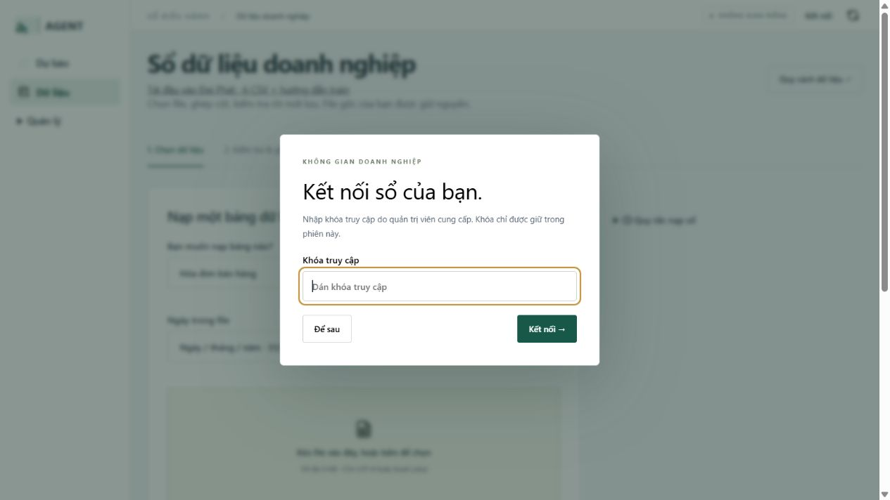

Khóa truy cập do kho Đại Phát cấp. Báo cáo huấn luyện đã mã hóa dùng mật khẩu báo cáo được cấp riêng. Nếu dịch vụ đã tắt, quản trị viên có thể khởi động lại bằng lệnh sau từ thư mục Agent1.

```text
.\scripts\start-business.ps1 -Port 8012 -Company DEMO_DAIPHAT -DemoTraining
```

### Bước 2 · Giải nén và chọn đúng bảng

Trong thư mục repo, mở **pilot → demo_dai_phat** để lấy sáu CSV. Nếu tải ZIP từ web, giải nén trước khi nạp. Bạn cũng có thể lấy ZIP bằng nút tải đầu vào Đại Phát trên trang **Dữ liệu**. Lần lượt nạp theo thứ tự dưới đây để các mã tham chiếu đã tồn tại khi nạp thanh toán và nhật ký.

| File cần chọn | Loại bảng trên web | Số dòng |
|---|---|---:|
| `01_invoices.csv` | Hóa đơn bán hàng | 12.780 |
| `02_bank.csv` | Dòng sao kê ngân hàng | 17.642 |
| `03_payments.csv` | Khoản thanh toán đã nhận | 16.258 |
| `04_statements.csv` | Kỳ sao kê và số dư | 142 |
| `05_outflows.csv` | Lịch chi đã biết | 27 |
| `06_actions.csv` | Nhật ký thu nợ và lời hứa | 5.001 |

Với cả sáu file, đặt **Ngày trong file** là **Năm - tháng - ngày · 2026-12-31** và **Số tiền trong file** là **Không phân cách · 1500000.50**. Đây là định dạng của CSV gốc. Bảng kết quả hiển thị ngày dạng `dd-mm-yy`.

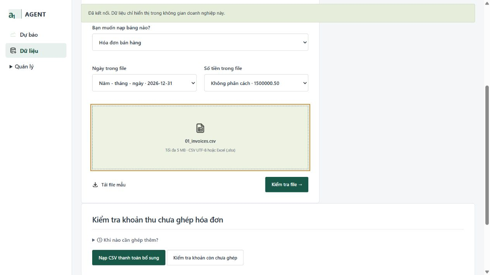

### Bước 3 · Kiểm tra rồi xác nhận lưu từng file

1. Chọn **loại bảng** và **định dạng**, bấm vùng chọn file rồi mở một CSV theo bảng ở bước 2.
2. Bấm **Kiểm tra file →**. Rà soát cột được nhận diện, số dòng hợp lệ và vài dòng mẫu. Nếu chỉnh ánh xạ cột, bấm kiểm tra lại.
3. Khi kết quả hợp lệ, bấm **Xác nhận lưu dữ liệu**. Chờ thông báo đã lưu, sau đó chọn loại bảng tiếp theo.
4. Sau file thứ sáu, so số lượng trên trang **Dữ liệu** với bảng ở bước 2.

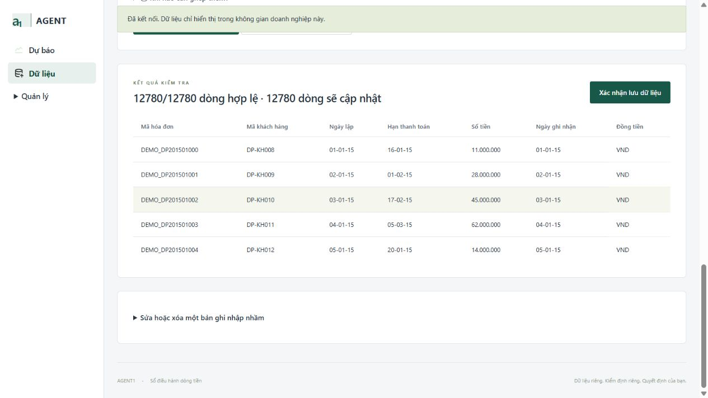

Nếu báo thiếu **Mã thanh toán**, **Mã hóa đơn** hoặc **Ngày tiền về** khi đang mở `05_outflows.csv`, đổi loại bảng sang **Lịch chi đã biết** rồi kiểm tra lại. Nếu báo lỗi ngày hoặc tiền, kiểm tra hai ô định dạng trước khi sửa file. Khi nạp lần đầu vào kho trống, số dòng cập nhật theo mã cũ thường bằng 0.

### Bước 4 · Kiểm tra khoản thu còn chờ ghép

Trong **Dữ liệu**, tìm **Kiểm tra khoản thu chưa ghép hóa đơn** rồi bấm **Kiểm tra khoản còn chưa ghép**. Bộ Đại Phát cố ý để **6 khoản, tổng 42.000.000 đồng**, cho bạn tập đọc hàng chờ. Các liên kết trong `03_payments.csv` đã được ghi nhận khi lưu file.

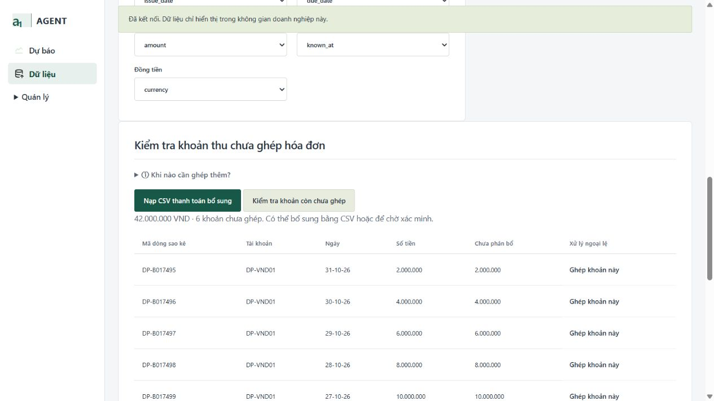

- **Chưa biết hóa đơn nào** → để khoản đó chờ xác minh. Bạn có thể đi tiếp với bộ demo.
- **Đã biết nhiều khoản** → dùng **Nạp CSV thanh toán bổ sung**. Giữ mã thanh toán cũ khi cập nhật.
- **Cần xử lý một ngoại lệ** → bấm **Ghép khoản này**. Kiểm tra mã sao kê và số tiền điền sẵn, chọn đúng hóa đơn, rồi mới lưu.

### Bước 5 · Tạo lượt kiểm định

1. Mở **Quản lý → Phiên bản & kiểm định** ở thanh điều hướng. Nếu đã có phiên bản ngày **31-10-26** và muốn dùng lại, xem bước 6.
2. Trong **Tạo phiên bản mới**, nhập **31-10-26** vào **Ngày chốt dữ liệu**. Tích xác nhận đã nạp đủ thanh toán sau khi kiểm tra sáu bảng.
3. Giữ tùy chọn học mặc định cho bài thực hành, bấm **Bắt đầu kiểm định** và theo dõi trạng thái phía dưới. Khi thấy **Đã hoàn tất**, kết quả phiên bản xuất hiện ở cột bên cạnh.

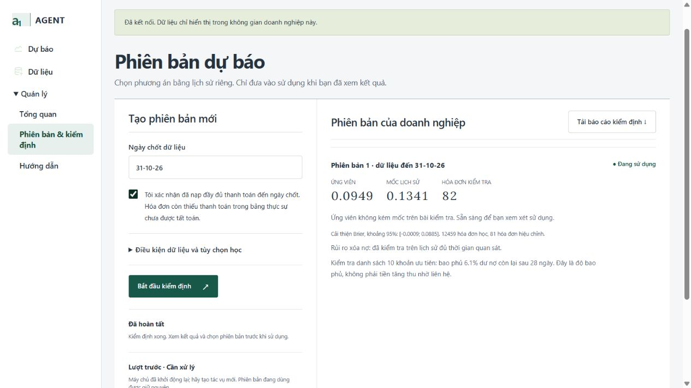

Bộ lớn cần ít nhất **3 GiB RAM trống** để khởi động. Lượt học có thể chạy nhiều giờ và tiếp tục khi bạn chuyển mục trên web. Giữ máy và dịch vụ hoạt động. Khi job báo lỗi, đọc bước đang chạy và thông báo ở lượt mới nhất trước khi thử lại.

### Bước 6 · Đọc điểm và chọn phiên bản

Phiên bản minh họa trên Đại Phát có **12.459 hóa đơn học**, **81 hóa đơn validation** và **82 hóa đơn audit**. Brier 4 tuần của ứng viên là **0,0949**, mốc lịch sử là **0,1341**. Điểm giảm khoảng **29,3%** trên mẫu kiểm tra. Khoảng tin cậy của mức cải thiện vẫn chứa 0, nên cần thêm kỳ kiểm tra để đánh giá độ ổn định.

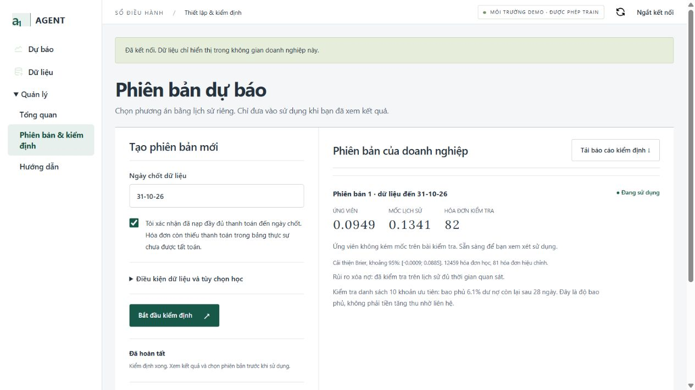

Bấm **Sử dụng phiên bản này** ở thẻ cần chọn. Dấu **Đang sử dụng** xác nhận phiên bản đã được kích hoạt. Sang **Dự báo** và lập kế hoạch mới để áp dụng.

**Tải báo cáo kiểm định** trên web xuất bản tóm tắt JSON. Báo cáo HTML có mật khẩu nằm trong **outputs → private-training-reports** trong thư mục repo. Mở bằng trình duyệt và nhập mật khẩu trong file `report-password.txt` ở thư mục khóa doanh nghiệp để xem ứng viên, cấu hình, chia tập và điểm chi tiết. Lượt minh họa là phiên bản đã lưu trước khi khôi phục ngân sách neural 100 vòng cho những lượt sau.

### Bước 7 · Lập kế hoạch gốc 13 tuần

Mở **Dự báo** và điền các trường trong bảng. Giữ **Phạm vi và tùy chọn** ở mặc định trong lần đầu. Hệ thống dùng công nợ còn mở và lịch chi đã nhập.

| Trường | Giá trị nhập |
|---|---|
| Ngày dự báo | `31-10-26` |
| Số tuần | `13` |
| Số dư đầu kỳ (VND) | `425000000` |
| Ngưỡng cảnh báo (VND) | `200000000` |
| Kịch bản | **Kế hoạch gốc** |
| Đã nạp đủ thanh toán đến ngày dự báo | Tích sau khi đã lưu đủ dữ liệu demo |

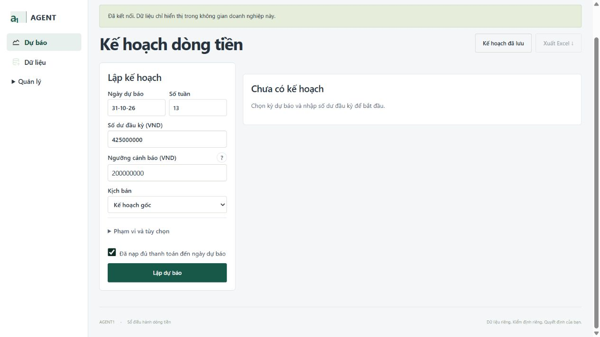

Bấm **Lập dự báo**. Khi có kết quả, tiêu đề ghi **13 tuần · 31-10-26**. Nếu dùng phiên bản đã kích hoạt, nhãn kết quả hiện **PHIÊN BẢN RIÊNG**. Nút **?** giải thích ngưỡng cảnh báo.

### Bước 8 · Đọc biểu đồ và bảng từng tuần

Bắt đầu từ **Dự thu**, **Dự chi** và **Số dư thấp nhất**. Đường xanh cho biết số dư kỳ vọng. Dải P10/P90 biểu thị vùng số dư mô phỏng quanh đường này. Di chuột lên biểu đồ để xem giá trị tại một tuần cụ thể.

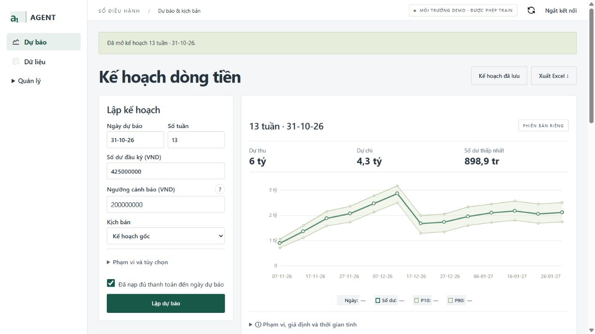

Xuống **Kế hoạch từng tuần** để kiểm tra ngày kết thúc tuần, dự thu, dự chi, số dư, dải mô phỏng và xác suất dưới ngưỡng. Cuộn ngang để xem các cột bên phải nếu cửa sổ hẹp. Mở **Phạm vi, giả định và thời gian tính** để xem lịch chi thiếu, phần hoạt động đã được tính và thời gian xử lý.

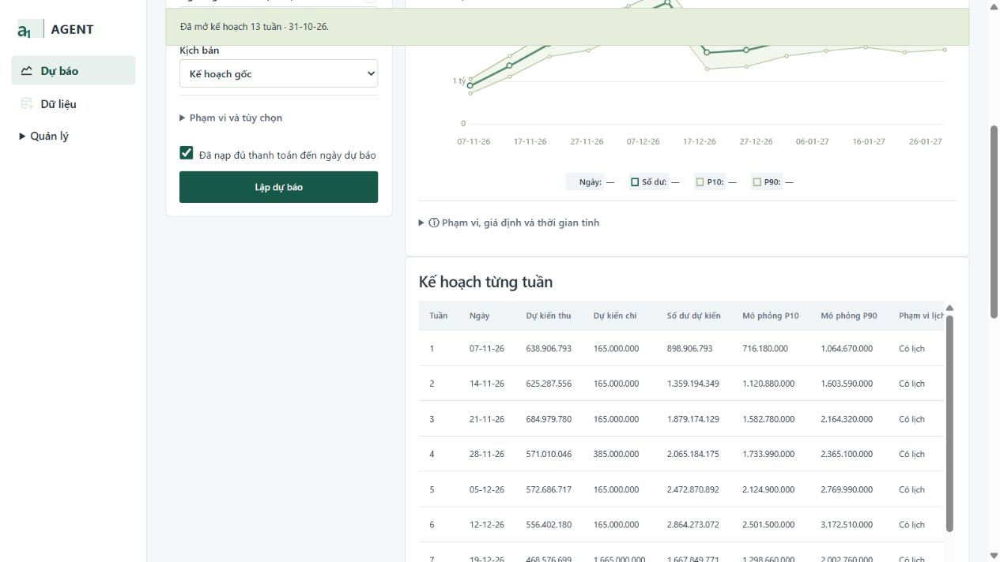

### Bước 9 · Xem danh sách khoản cần chú ý

Cuộn xuống **Khoản cần chú ý**. Kiểm tra hóa đơn, mã khách, dư nợ và hạn trả. Các cột tiếp theo ghi lời hứa, tranh chấp, lý do và xác suất tất toán 4 tuần. Dùng số dư còn phải thu để đối chiếu với sổ.

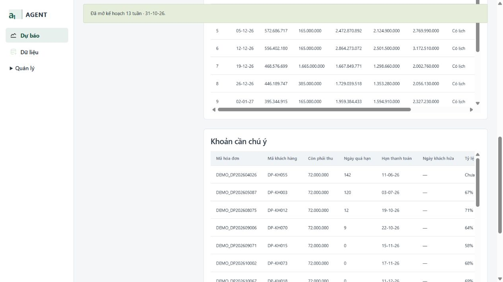

Ví dụ, hóa đơn có tranh chấp được ghi **Chờ giải quyết tranh chấp**. Khoản có ngày hứa đã đến hạn nên được kiểm tra với lịch sử thực hiện của khách. Danh sách hỗ trợ chọn việc cần xem trước. Metric thu hồi hiện đo mức bao phủ công nợ còn mở trong top 10, chưa đo số tiền tăng thu sau liên hệ.

### Bước 10 · So sánh kịch bản 26 tuần

1. Trở lại form. Đổi **Số tuần** thành **26**, chọn **Kế hoạch gốc**, giữ ngày **31-10-26**, số dư **425000000** và ngưỡng **200000000**. Bấm **Lập dự báo**.
2. Sau khi kết quả gốc xuất hiện, đổi **Kịch bản** sang **Thu chậm thêm 28 ngày**. Giữ các trường còn lại rồi bấm **Lập dự báo** lần nữa.
3. Đọc dòng **So với kế hoạch gốc**. Trong lượt chụp, dự thu giảm khoảng **649,9 triệu**, chi giữ nguyên, số dư thấp nhất giảm khoảng **1,4 tỷ** xuống **âm 496,4 triệu**.

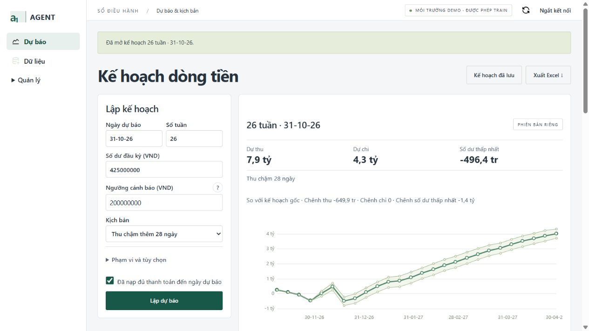

Để hiện so sánh, hai lượt cần cùng ngày chốt, số tuần, số dư đầu, ngưỡng, phiên bản và phạm vi tính. Sau khi đổi một trong các trường này, chạy lại **Kế hoạch gốc** với cùng thông số rồi mới chạy kịch bản.

### Bước 11 · Tự đặt giả định và phạm vi

Chọn **Tự đặt giả định** trong ô **Kịch bản**. Bạn có thể nhập **Thu chậm 14 ngày**, **Thay đổi chi 10%** và chọn một mã khách cần thử. Để trống mã khách sẽ áp dụng chậm trả cho mọi khách. Số ngày chậm được làm tròn lên theo tuần. Dấu âm ở thay đổi chi dùng để giảm chi.

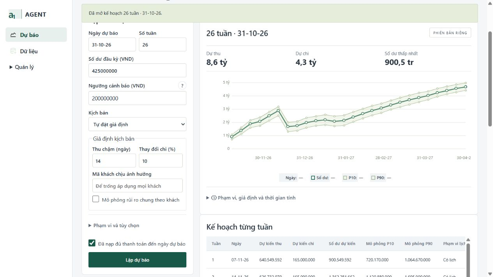

- **Rủi ro chung theo khách** mô phỏng việc nhiều hóa đơn của cùng khách chịu cùng biến động.
- **Các tuần đã xác nhận lịch chi** nhận số tuần cách nhau bằng dấu phẩy. Nếu không có khoản chi và tuần chưa xác nhận, bảng ghi **Chưa biết**.
- **Ước lượng dòng tiền hoạt động** dùng phiên bản đủ điều kiện sao kê. Với kỳ dài hơn 13 tuần, nhánh này chỉ áp dụng cho 13 tuần đầu. Mở phần giả định trong kết quả để xem phạm vi.

### Bước 12 · Xuất Excel và mở kế hoạch cũ

Khi đã thấy kết quả đúng kỳ và đúng kịch bản, bấm **Xuất Excel ↓** ở góc phải trang **Kế hoạch dòng tiền**. File có đuôi `.xlsx`. Kỳ 26 tuần ngày 31-10-26 có tên dạng `agent1-ke-hoach-31-10-26-26t.xlsx`.


| Sheet | Nội dung cần kiểm tra |
|---|---|
| **Kết quả dự báo** | Ngày chốt, số tuần, số dư đầu kỳ, ngưỡng, số dư thấp nhất, kịch bản, thời gian tính và mã phiên bản. |
| **Kế hoạch từng tuần** | Mỗi tuần một dòng với thu, chi, số dư, P10/P90 và tình trạng lịch chi. Bản 26 tuần có 26 dòng dữ liệu. |
| **Khoản cần chú ý** | Hóa đơn, khách, tiền còn phải thu, hạn, lời hứa, tranh chấp và chỉ số rủi ro nếu có. |

Để mở lại một lượt, chọn **Kế hoạch đã lưu → Tải danh sách**, bấm bản cần xem rồi xuất Excel từ bản đó. Trong **Đối chiếu với sao kê thực tế**, chọn ngày đã có sao kê đối soát và bấm **Đối chiếu kế hoạch**. Bộ Đại Phát chốt sao kê tại **31-10-26**. Muốn chấm sai số cho các tuần sau ngày này cần bổ sung sao kê thực tế tương ứng.
