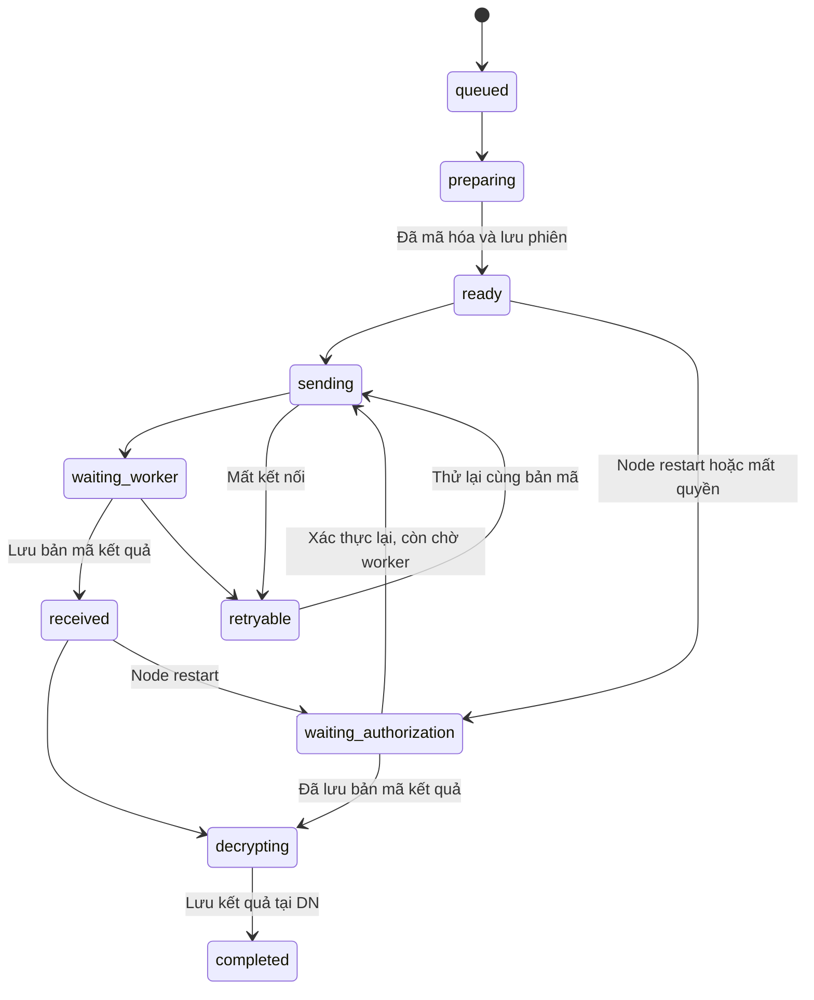

# Một lượt chấm HE có trạng thái và khôi phục — CR-032

**CR-040:** [worker chết giữa phép tính nay có thể khôi phục](HE_WORKER_RECOVERY.md) với managed request đã khóa hash, còn hạn và còn nguyên state. Khóa file OS + attempt token giữ một chủ thực thi, replay binding không cho đổi packet; legacy/terminal failure vẫn không tự mở lại. Worker DB version 2, không đổi model/snapshot hoặc khóa DN.

**CR-034:** đã có [giao diện theo dõi và lấy kết quả dùng phiên Portal](HE_WEB_ANALYSIS.md) khi người vận hành bật HE tại backend DN. Các mô tả chưa UI bên dưới là trạng thái lịch sử CR-032; cloud public vẫn chưa triển khai.

**CR-033:** khóa bọc kho phiên và khóa ký node đã có [bảo vệ Windows DPAPI theo tài khoản và cách chuyển khóa cũ](HE_KEYS_AND_SESSIONS.md). Cấu hình hiện dùng 1.2.0 bắt buộc DPAPI; ví dụ 1.1.0 bên dưới là tương thích legacy. Demo hiện chạy với khóa DPAPI, cần Windows.

Đã có luồng **gửi yêu cầu → xem trạng thái → nhận bản mã → giải mã tại DN → lấy kết quả**, với yêu cầu/idempotency và phiên HE được lưu bền vững tại node doanh nghiệp. Dùng Mahalanobis thử nghiệm và hai service loopback ở [HE_TWO_SERVICES.md](HE_TWO_SERVICES.md); chưa có màn hình Portal hoặc cloud public.

## Cách dùng đơn giản nhất

Từ D:/agent22/agent2, sau khi hai service đã được cấu hình/bật:

```powershell
& .venv/Scripts/python.exe -X utf8 -B -m experiments.he_inference.job_client --node-url http://127.0.0.1:8869 --token-file <credential-reader-cua-DN.token> --company <DN> --artifact-id <mth-id-da-fit> --snapshot-id <snp-id-can-cham> --as-of <ISO-8601-co-mui-gio> --receipt <phieu-theo-doi-local.json> --output <ket-qua-local.json>
```

Các `<...>` phải thay bằng đường dẫn/ID thật; token là credential backend DN được cấp `data.import`, không phải password Portal. CLI chỉ gửi thông tin tham chiếu tới node DN; không gửi credential tới worker.

- CLI **lưu phiếu trước khi gửi HTTP lần đầu**, gồm request fingerprint, Idempotency-Key và job ID khi nhận được. Phiếu không có token, model/feature rõ hoặc HE secret key.
- Nếu mất mạng, hết thời gian chờ hoặc thoát CLI, **chạy lại cùng lệnh và cùng tệp phiếu**. CLI dùng lại key/job ID, không tạo yêu cầu khác. Có thể truyền `--idempotency-key <key>` tường minh; key phải khớp phiếu đã có.
- Nếu CLI báo `pending`, yêu cầu vẫn được theo dõi bằng phiếu. Nếu node vừa restart, CLI xác thực lại và resume yêu cầu đang chờ quyền. Kết quả hoàn tất được ghi atomic; file cũ chỉ được dùng lại khi nội dung đúng cùng kết quả, không ghi đè dữ liệu khác.
- Đổi doanh nghiệp/model/snapshot/as_of thì dùng phiếu mới hoặc key mới có chủ đích. Đổi nội dung nhưng giữ key/phiếu cũ trả conflict; không âm thầm ghi đè yêu cầu.
- Muốn khôi phục sau restart phải **giữ cả DB state và khóa lưu trữ tại DN**. Mất khóa không thể giải mã phiên/kết quả; hệ thống không tự tạo khóa khác hoặc chạy lại để che lỗi.

## Trạng thái có thể theo dõi



API có message tiếng Việt và lịch sử phase để thấy cả các bước quá nhanh giữa hai lần poll. `completed` nghĩa là lượt phân tích đã xong, không xác nhận giao dịch có sai phạm. Kết quả vẫn có thể partial/unavailable với điểm null/lý do khi thiếu nguồn hoặc model không hỗ trợ. Trạng thái terminal khác: `failed`, `expired`; không tự tạo nonce mới hoặc model khác để chạy tiếp.

## API node doanh nghiệp

Mọi route bên dưới cần Authorization backend hiện có; owner là tenant/DN/actor đã tạo job, không lấy từ body. Chỉ đọc/chấm cần `data.import`; không đòi `model.fit`.

| Thao tác | API | Kết quả |
|---|---|---|
| Gửi/nhấn lại cùng yêu cầu | POST /v1/companies/{company}/he/jobs + Idempotency-Key | 202 kèm job_id/status_url/result_url, hoặc 200 trạng thái terminal cũ |
| Theo dõi | GET /v1/companies/{company}/he/jobs/{job_id} | Phase/message/attempts/events; không trả key/checkpoint hoặc score sớm |
| Lấy kết quả | GET /v1/companies/{company}/he/jobs/{job_id}/result | 200 kết quả đã giải mã tại DN; 202 đang xử lý; 409 failed/expired |
| Tiếp tục sau restart/cần xác thực | POST /v1/companies/{company}/he/jobs/{job_id}/resume, JSON {} | Xác thực owner hiện tại rồi tiếp tục cùng job |

Body submit vẫn chỉ:

```json
{"artifact_id":"mth_<64-hex>","snapshot_id":"snp_<32-hex>","as_of":"2026-10-03T00:00:00+07:00"}
```

Key bắt buộc 8–128 ký tự theo profile hiện có. Idempotency namespace gồm tenant/DN/actor/key, body chuẩn hóa timestamp UTC trước hash. Duplicate đồng thời dùng cùng job; body khác cùng key trả 409. Actor khác hoặc URL DN khác không đọc được job cũ (404), quyền bị thu hồi không đọc được status/result đã cache. GET không tự cấp quyền cho background worker; resume/submit cần credential owner hiện tại.

Route POST `/he/analyze` cũ tiếp tục hoạt động như wrapper đồng bộ khi bật kho job, dùng cùng persistent job/key; trường hợp chờ lâu hãy dùng API status. Cấu hình legacy 1.0 không có kho job vẫn chỉ có luồng cũ; các job route trả storage-required, không tự lưu plaintext/khóa.

## Khôi phục hoạt động thế nào?

1. Node ghi yêu cầu và key vào DB trong transaction trước trả job ID.
2. Sau khi đọc đúng artifact/snapshot và tạo feature, node tạo bản mã rồi **ghi checkpoint đã mã hóa trước mọi lệnh gửi worker**. Checkpoint chỉ là JSON có kiểu và private TenSEAL context được serialize, không pickle model/callback hoặc token. Khôi phục cần phiên bản checkpoint/TenSEAL và exporter đã khóa tương thích; build khác bị từ chối, không tự tạo phiên mới.
3. Trước gửi evaluate, node ghi dấu request/nonce đã có thể tới worker. Sau mất kết nối hoặc restart, node gửi đúng request cũ hoặc lấy ciphertext đã có; không tạo phiên/nonce mới.
4. Bản mã kết quả nhận về được ghi bền vững trước decrypt. Nếu node dừng ở bước này, sau xác thực lại có thể decrypt mà không gọi mạng hoặc đọc/fit model lần nữa.
5. Kết quả rõ được mã hóa lưu tại DN, phase completed và việc bỏ checkpoint hiện hành được commit cùng transaction. Mất phản hồi tới người dùng chỉ cần lấy lại kết quả/job cũ.

Khi node restart, job chưa xong chuyển `waiting_authorization`. **Không lưu bearer token trên đĩa** để tự chạy bằng credential cũ; người dùng hợp lệ submit cùng key hoặc resume để cấp quyền hiện tại. Job hoàn tất đọc lại được ngay sau xác thực. Hai node không được đồng thời mở một state directory (OS file lock).

Retry transport dùng backoff 2/4/8/16/30 giây, không tạo yêu cầu khác. Nếu request hết hạn trước khi có thể gửi, job expired. Nếu đã gửi nhưng chưa biết worker có xong hay không, node thử lấy kết quả cũ khi worker trở lại; không tự chấm lại bằng nonce mới.

## Lấy bản mã cũ từ worker

Thêm `POST /v1/results`: node được cấp grant ký một retrieval envelope mới, thời hạn tối đa 60 giây, chứa scope/session/nonce/request hash cũ. Worker kiểm grant hiện tại, chữ ký và key node đã đăng ký phiên, rồi **chỉ đọc cache ciphertext đã tồn tại**. Endpoint này không fit/evaluate/decrypt hoặc tạo worker job mới.

Vì là lấy kết quả đã có bằng quyền xác thực mới, retrieval có thể đọc cache sau khi TTL inference 300 giây đã hết. `/v1/evaluate` cũ vẫn từ chối request hết hạn; không kéo dài hoặc ký lại request inference. Kết quả không tồn tại/worker bị gián đoạn trước commit được báo rõ; không đoán đã chấm hoặc chạy plaintext thay thế. Nếu worker bị xóa state, đổi identity/key không tương thích hoặc chưa hề có kết quả, không thể bịa lại lượt cũ.

## Kho phiên và khóa lưu trữ tại DN

Cấu hình legacy **he-enterprise-service/1.1.0** thêm hai trường bắt buộc (node mới dùng [1.2.0 có DPAPI](HE_KEYS_AND_SESSIONS.md)):

```json
{
  "version": "he-enterprise-service/1.1.0",
  "auth_file": "<auth-policy-DN.json>",
  "model_db": "<models.sqlite3-cua-DN>",
  "snapshot_db": "<snapshots.sqlite3-cua-DN>",
  "worker_url": "http://127.0.0.1:8868",
  "worker_verify_key": "<public-response-key-64-hex>",
  "provisioning_key_file": "<private-node-provisioning.hex>",
  "state_dir": "<thu-muc-state-rieng-tai-DN>",
  "state_key_file": "<private-node-state-wrapping.hex>"
}
```

Ở định dạng legacy, `state_key_file` là 32 byte ngẫu nhiên dưới dạng **64 ký tự hex chữ thường**, do người vận hành tạo/giữ riêng tại DN. Config 1.2.0 bắt buộc khóa được DPAPI bọc, giữ nguyên HKDF và giá trị khóa khi chuyển từ legacy để đọc DB cũ. Không dùng password, token đăng nhập hoặc key của worker. Chỉ demo tự tạo key tạm; dịch vụ thật không tự tạo hoặc ghi đè key khi thiếu/sai. Dùng thư mục private/.runtime của node, không commit vào Git, không đưa vào bundle worker hoặc static web.

Nội dung request/checkpoint gồm HE secret context, receipt gốc và kết quả được bảo vệ bằng **AES-256-GCM**, nonce mới mỗi lần ghi; HKDF tách khóa mã hóa và khóa HMAC idempotency. AAD ràng buộc job/tenant/DN/actor/key hash/request hash/phase/generation/timestamp. Sai khóa, sửa blob/phase hoặc chép checkpoint sang job khác đều fail closed; không deserialize model/HE context hoặc overwrite record hỏng để chạy tiếp. DB metadata còn có ID/scope/phase/timestamps, không phải toàn bộ metadata đều được che.

Kết thúc/failed/expired loại checkpoint/key khỏi record hiện hành; không khẳng định secure erase các page SQLite cũ hoặc backup. Key lưu trữ vẫn cần giữ để đọc kết quả cũ. File key tách DB là cơ chế thử nghiệm, **chưa KMS/HSM/rotation/anti-rollback**; bảo vệ ACL và backup DB/key tại DN thuộc người vận hành. Mất key hoặc phục hồi backup không đồng bộ không nằm trong bảo đảm khôi phục này.

## Kiểm thử và demo

```powershell
& .venv/Scripts/python.exe -X utf8 -B -m experiments.he_inference.jobs_demo --output-dir <thu-muc-moi-trong>
& .venv/Scripts/python.exe -X utf8 -B scripts/run_he_tests.py --report <he-tests-moi.json>
```

Demo chạy hai process/service, 2 DN/10 giao dịch, poll đủ phase, nhấn lại cùng key, ngắt worker, restart worker/node, xác thực lại, decrypt bằng key đã lưu và đọc kết quả completed sau restart. Các ca bổ sung kiểm mất reply sau worker đã tính, node dừng sau received trước decrypt, không xuất model/tạo context lần nữa, cache retrieval sau TTL, wrong key/AAD/corruption/actor/scope và client receipt retry. [Báo cáo](../../Agent2_Spec_v2_1/evidence/HE/job_lifecycle_20261112/REPORT.md).

Kho job riêng (không migrate model/snapshot/worker DB) giới hạn 512 job/8 job chưa xong, 2 processor; pending blob tối đa 16 MiB. Chưa có retention/purge/cancel hoặc scheduler nhiều máy. Khi hết dung lượng/khóa/integrity, giữ yêu cầu và báo lỗi, không xóa key cũ hoặc tạo job thay thế. Chỉ Mahalanobis hai feature, loopback HTTP nội bộ và dữ liệu thử; chưa nút Portal, cloud public/TLS production, OS sandbox hoặc proof trước cloud ác ý. Snapshot/model/catalog/luật/đồ thị/ML live giữ nguyên.

Nguồn API crypto: [AESGCM/AEAD](https://cryptography.io/en/stable/hazmat/primitives/aead/), [HKDF](https://cryptography.io/en/stable/hazmat/primitives/key-derivation-functions/#hkdf). Dùng thư viện không đồng nghĩa phiên bản sản phẩm đã được nghiệm thu bảo mật.
