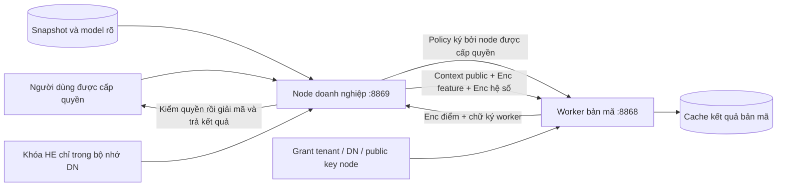

# Node doanh nghiệp và worker bản mã — CR-031

**CR-033:** node config 1.2.0 bắt buộc [khóa bọc và khóa ký được Windows DPAPI bảo vệ](HE_KEYS_AND_SESSIONS.md); demo hiện cần Windows. Khóa HE pending lưu trong checkpoint AES-GCM tại DN; mô tả RAM-only bên dưới chỉ thuộc luồng legacy CR-031.

**CR-032:** đã có [kho job/checkpoint mã hóa tại DN và luồng khôi phục qua node restart](HE_JOB_LIFECYCLE.md). Dùng node config 1.1.0 với state_dir/state_key_file; các mô tả RAM-only/idempotency trong process bên dưới giữ lịch sử CR-031 cho cấu hình legacy. Bốn nhánh/Portal/cloud public chưa thay đổi.

Đã tách luồng Mahalanobis thành **hai dịch vụ HTTP loopback, hai tiến trình và hai thư mục làm việc**. Worker có bản đóng gói riêng chỉ gồm mã kiểm policy/tính ciphertext; không có module doanh nghiệp, model store, snapshot hoặc mã giải mã. Đây là thử nghiệm local, chưa phải triển khai hai máy/cloud công cộng, chưa chuyển Portal hoặc bốn nhánh lên cloud.



## Ranh giới hai bên

| Phần | Node doanh nghiệp | Worker |
|---|---|---|
| Dữ liệu gốc, snapshot, bằng chứng | Đọc trong đúng scope tại DN | Không nhận hoặc cấu hình đường dẫn |
| Model gốc và tiền xử lý | Đọc artifact tường minh từ MethodStore read-only | Chỉ nhận hệ số mã hóa |
| Feature 33 cột và hai cột model chọn | Tạo/kiểm contract tại DN, mã hóa hai cột hợp lệ | Chỉ nhận vector ciphertext, không tên feature hoặc ID giao dịch gốc |
| Khóa giải mã HE | Trong RAM của node, không ghi tệp/gửi đi | Không có |
| Khóa ký | Node giữ provisioning signing key | Worker giữ response-signing key riêng, không phải khóa giải mã HE |
| Kết quả | Xác minh binding/chữ ký/quyền rồi decrypt; trả DTO nghiệp vụ | Lưu/trả ciphertext đã ký và metadata public |

Model vẫn là **he_mahalanobis_2d** thử nghiệm. Job fit riêng tại DN theo [HE_REGISTRY_EXPORT.md](HE_REGISTRY_EXPORT.md), không có endpoint fit trên hai dịch vụ này. IF/ECOD/LOF/AE hoặc artifact không tương thích giữ unavailable, không fit lại hoặc chạy plaintext ở worker. Model/feature rõ không gửi qua HTTP worker.

## API tại DN

`POST /v1/companies/{company}/he/analyze` dùng credential worker hiện có của backend DN, chỉ gửi tới **node DN**:

```http
Authorization: Bearer <credential-cua-DN>
Idempotency-Key: <mot-khoa-8-128-ky-tu>
Content-Type: application/json
```

```json
{
  "artifact_id": "mth_<64-hex-thuc>",
  "snapshot_id": "snp_<32-hex-thuc>",
  "as_of": "2026-10-03T00:00:00+07:00"
}
```

Backend kiểm quyền trước body/DB và trước trả; chỉ cần `data.import`, không đòi `model.fit` cho đọc/chấm. Không nhận feature rõ, file, role, URL worker, model pickle hoặc key từ request. Response gồm run_id, nguồn snapshot, trạng thái và đủ dòng với `score` hoặc null/reason. Không trả receipt kỹ thuật, tên feature, thuật toán/tham số, ciphertext hoặc khóa. Điểm là anomaly score của phép thử, không xác suất sai phạm; không tự sinh queue.

`GET /health` chỉ mô tả vai trò/vị trí xử lý. Host phải localhost/127.0.0.1 đúng port, không nhận browser Origin/CORS. Đây là API nội bộ chưa gắn UI; không dùng password Portal thay credential backend. Mọi endpoint khác không có luồng đọc tệp/giải mã tùy ý.

## API worker và cấp quyền phiên

1. Người vận hành cài `grants_file` phía worker với **tenant, DN và public key dài hạn của node** được phép. Không tự cấp grant từ dữ liệu request hoặc profile công ty.
2. Node giữ private provisioning key tại DN. `POST /v1/sessions` nhận envelope **được node ký** gồm policy public của phiên và expiry; worker đối chiếu grant backend trước xác minh chữ ký. Policy chỉ có scope/context/model ID opaque/client public key/hash của ciphertext, không có model rõ hoặc HE secret key.
3. `POST /v1/evaluate` chỉ nhận envelope bản mã đã ký, không nhận policy kèm theo để tự cấp quyền. Worker dùng session đăng ký trước, kiểm lại grant/expiry/chữ ký/binding trước tính hoặc trả cache. Context có secret key bị native evaluator từ chối.
4. Worker trả ciphertext điểm đã ký. Node kiểm đúng request/scope/context/model/key epoch/row handles và quyền trước decrypt. Không có `/decrypt`, `/fit`, `/imports/upload` hoặc truy cập DB doanh nghiệp tại worker.

Chữ ký chỉ chứng minh nguồn gói/binding, không chứng minh worker ác ý đã tính đúng. Health/telemetry và gói code không phải attestation hoặc privacy proof. Giữ threat model và các giới hạn từ [HE_INFERENCE_EXPERIMENT.md](HE_INFERENCE_EXPERIMENT.md).

## Retry, vòng đời và giới hạn thử nghiệm

- Cùng Idempotency-Key/body/actor/DN trong phiên node trả cùng run_id/kết quả, không tạo worker job thứ hai. Đổi body cùng key trả 409. Cached plaintext cũng phải kiểm lại quyền.
- Worker lưu policy và **kết quả ciphertext** vào DB riêng; cùng scope/session/nonce/request hash trả kết quả cũ sau khi kiểm quyền/expiry. Nonce bị dùng cho body khác trả conflict; yêu cầu đang chạy trả 409. Cache ciphertext hoàn tất đọc lại được sau khi worker restart.
- Nếu phản hồi worker bị mất, node giữ nguyên export/HE key trong RAM để retry cùng request và nhận ciphertext cũ; không mã hóa hoặc fit lại khi retry. Worker job bị gián đoạn trước lưu kết quả được đánh dấu failed, không âm thầm tính lại bằng plaintext.
- **Node restart chưa khôi phục khóa hoặc pending request.** Cache/idempotency của node chỉ trong vòng đời process; chưa có KMS/durable session hoặc bảo đảm exactly-once qua node restart. Đây là bước tách hai phía, không tự coi đã hoàn tất quản lý khóa bền vững.
- Phiên bản mã tối đa 300 giây; node giữ tối đa 8 phiên đang dùng, hết 290 giây bỏ session/key và trả expired cho key cũ trong cùng process (tối đa 512 tombstone). Worker tối đa 128 session/512 job, 2 phép tính đồng thời, 8 kết nối xử lý. Chưa có retention/cleanup tự động cho DB worker.
- Body node tối đa 4 KiB; registration 16 KiB; ciphertext packet 16 MiB. Các giới hạn 8 dòng/2 feature, domain/tolerance CKKS của CR-029/030 giữ nguyên. Không cắt dòng; thiếu nguồn null.

## Demo một lệnh

Tại D:/agent22/agent2:

```powershell
& .venv/Scripts/python.exe -m pip install -r requirements-he.txt
& .venv/Scripts/python.exe -X utf8 -B -m experiments.he_inference.services_demo --output-dir <thu-muc-moi-trong>
```

Demo tạo policy/model/snapshot/key mô phỏng trong thư mục tạm, build worker bundle, bật hai service bằng port trống, gọi qua HTTP cho C001/C002, kiểm đủ 10 kết quả, retry và DB nguồn giữ nguyên; kết thúc tự dừng hai tiến trình. Không ghi khóa vào evidence hoặc sửa mật khẩu/cấu hình/DB Portal live. [Báo cáo và kiểm thử](../../Agent2_Spec_v2_1/evidence/HE/services_20261112/REPORT.md).

## Khởi động riêng bằng cấu hình được cấp

Build worker source bundle, không sao chép cả repository sang worker:

```powershell
& .venv/Scripts/python.exe -X utf8 -B -m experiments.he_inference.worker_bundle --output-dir <worker-bundle-moi-trong>
```

Gói chỉ có protocol, evaluator ciphertext, HTTP guards, store ciphertext và worker server; requirements chỉ TenSEAL/cryptography, không scikit-learn/joblib/shared finance package. Worker main từ chối khởi động nếu nhìn thấy module enterprise hoặc sme_fraud trong import path. Đây là giới hạn import/package, **không phải sandbox OS**: demo cùng tài khoản Windows, không chứng minh chống người kiểm soát máy worker. Khi triển khai thật cần máy/container, filesystem và quyền tách riêng.

Worker config — dùng đường dẫn tuyệt đối đã được người vận hành chuẩn bị:

```json
{
  "version": "he-worker-service/1.0.0",
  "state_dir": "<thu-muc-state-rieng-worker>",
  "grants_file": "<worker-grants.json>",
  "response_signing_key_file": "<private-worker-response-signing.hex>"
}
```

Grant công khai phía worker:

```json
{
  "version": "he-worker-grants/1.0.0",
  "grants": [
    {"tenant_id": "<tenant>", "company_id": "<DN>", "node_verify_key": "<public-Ed25519-64-hex-cua-node>", "active": true}
  ]
}
```

Từ worker bundle, cài requirements-worker.txt trong environment riêng; **không mang model DB, snapshot DB, auth token hoặc HE key của DN vào worker**. Dùng Python environment tương ứng, unset PYTHONPATH trỏ về source DN rồi chạy:

```powershell
python -X utf8 -B -m experiments.he_inference.worker_server --config <worker-config.json> --port 8868
```

Node config nằm tại DN:

```json
{
  "version": "he-enterprise-service/1.0.0",
  "auth_file": "<auth-policy-DN.json>",
  "model_db": "<models.sqlite3-cua-DN>",
  "snapshot_db": "<snapshots.sqlite3-cua-DN>",
  "worker_url": "http://127.0.0.1:8868",
  "worker_verify_key": "<public-response-signing-key-64-hex-cua-worker>",
  "provisioning_key_file": "<private-node-provisioning.hex>"
}
```

Từ source node, giữ cấu hình/credential ở doanh nghiệp và chạy:

```powershell
& .venv/Scripts/python.exe -X utf8 -B -m experiments.he_inference.enterprise_server --config <node-config.json> --port 8869
```

Các `<...>` là placeholder, không phải cấu hình chạy được. Signing keys dùng Ed25519 raw private bytes dạng hex (khác HE secret key), thuộc người vận hành cấp/quản lý; file private của bản thử chưa KMS/wrapping. Public key worker được pin ở node và public key node được cấp trong grant worker. Không tự tạo grant/credential thật từ API hoặc làm theo gói do người gọi gửi.

Hiện cả hai service **chỉ bind loopback**; worker_url chỉ chấp nhận HTTP localhost/127.0.0.1. Không có tùy chọn bind Internet hoặc gửi tới URL cloud tùy ý. Việc triển khai qua mạng thật, TLS/mTLS/reverse proxy, identity production, persistent key/session, OS/native sandbox và proof trước cloud ác ý là phần tiếp theo, không bật ngầm ở lát cắt này. Python [http.server](https://docs.python.org/3.12/library/http.server.html) chỉ dùng thử nghiệm, không phải server production; [Ed25519](https://cryptography.io/en/stable/hazmat/primitives/asymmetric/ed25519/) cung cấp chữ ký, không thay việc kiểm đúng phép tính HE.
