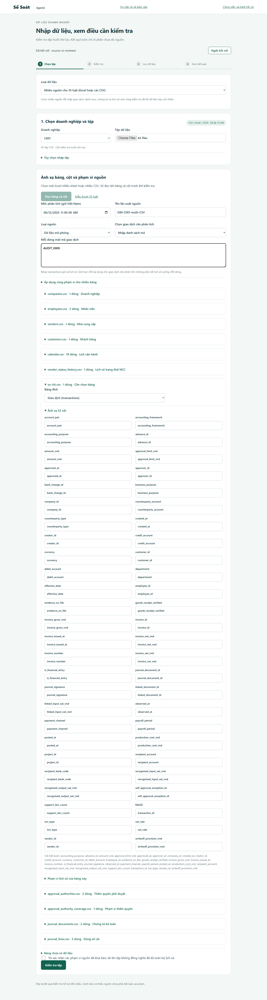
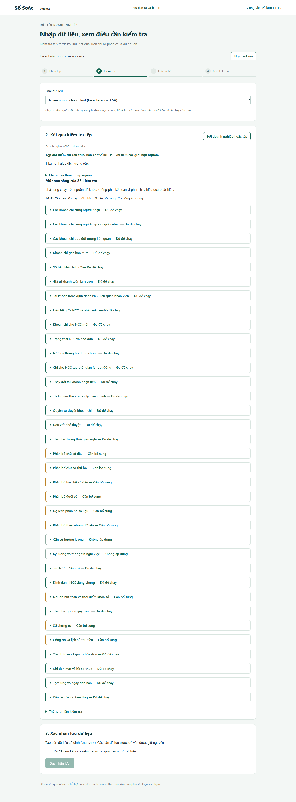

# Nhập nhiều nguồn cho 35 luật

Chức năng nằm tại **Nhập dữ liệu** (`/data-import`), dùng quyền doanh nghiệp
từ phiên Portal. Chọn **Nhiều nguồn cho 35 luật (Excel hoặc các CSV)**.

## Thao tác

1. **Chọn doanh nghiệp** được cấp quyền và tệp nguồn. Nhận một Excel `.xlsx`
   nhiều sheet, một CSV, hoặc nhiều CSV cùng lúc. Mỗi CSV tương ứng một bảng;
   tên tệp có thể khác tên chuẩn rồi ánh xạ trên màn hình. Excel cũng có thể
   ánh xạ tên sheet sang bảng chuẩn.
2. Bấm **Đọc bảng và cột**. Màn hình nhận diện tên, cột và số dòng; đây chưa
   phải kết quả kiểm tra nghiệp vụ. Không có snapshot nào được tạo ở bước này.
3. Điền **Mốc phân tích**, **Tên lần xuất nguồn** và chọn nguồn thật/mô phỏng.
   Có thể nhập các trường này qua sheet `metadata`, sau đó xác nhận trên web.
   Thời gian không có múi giờ được hiểu là giờ Việt Nam; ngày dễ hiểu theo hai
   cách cần chọn ngày/tháng hoặc tháng/ngày trong **Tùy chọn nhập tệp**.
4. Chọn các giao dịch cần phân tích: sheet/CSV `candidates`, danh sách mỗi dòng
   một mã, hoặc toàn bộ giao dịch nếu không quá 200. `transactions` vẫn giữ
   cả lịch sử. Không xóa lịch sử để giới hạn còn 200 giao dịch.
5. Mở bảng cần chỉnh. Chọn **Bảng đích**, mở **Ánh xạ cột** và đổi tên đích
   nếu nguồn dùng tên khác. Ví dụ `MaGD` → `transaction_id`. Ánh xạ chỉ đổi
   tên; không nhận biểu thức, không tự tạo giá trị thiếu, nhãn hoặc bằng chứng.
6. Mở **Phạm vi lịch sử của bảng này**, khai báo mức đầy đủ và các mốc nguồn.
   Có thể áp dụng chung cho các bảng có dữ liệu nếu chúng thật sự cùng phạm vi.
   Bảng rỗng không được tự xác nhận đầy đủ qua nút áp dụng chung.
7. Xác nhận các phạm vi đã khai báo rồi bấm **Kiểm tra tệp**. Sửa lỗi đúng
   tệp/sheet, dòng và trường được nêu. Thay tệp, mapping hoặc phạm vi phải
   kiểm tra lại; kết quả kiểm tra cũ không được dùng để lưu.
8. Xem **Mức sẵn sàng của 35 kiểm tra**. Mở từng mục cần bổ sung để biết bảng
   nguồn nào còn thiếu, thiếu phạm vi hay thiếu bằng chứng đúng thời điểm.
9. Tích xác nhận đã xem giới hạn rồi bấm **Xác nhận lưu**. Tạo snapshot bất
   biến, giữ bản cũ; gửi lại cùng yêu cầu không tạo snapshot trùng.
10. Tiếp tục đến **Vụ cần rà** nếu backend có bundle workspace. Dùng đúng
    snapshot vừa lưu và cấu hình đã được duyệt cho doanh nghiệp. Thiếu bundle
    tương thích vẫn bị chặn, không tự kích hoạt cấu hình hay fit model.

Màn hình ánh xạ từ các CSV mô phỏng:

## Khai báo lịch sử

| Trường | Ý nghĩa |
|---|---|
| `status=complete` | Bên xuất xác nhận đã cung cấp đầy đủ trong phạm vi khai báo |
| `partial` | Chỉ có một phần nguồn |
| `unknown` | Chưa xác nhận được mức đầy đủ |
| `history_basis=bounded_period` | Lịch sử chỉ trong một kỳ có giới hạn |
| `since_inception` | Lịch sử từ khi bắt đầu phát sinh, do bên xuất xác nhận |
| `covered_from` | Bắt đầu phạm vi được cung cấp |
| `covered_through` | Kết thúc phạm vi; phải khớp mốc phân tích |
| `observed_at` | Thời điểm khai báo phạm vi đã được biết, không sau mốc phân tích |

Không khai báo thì nguồn giữ trạng thái chưa đủ; tải tệp lên không làm
coverage tự trở thành `complete`. Chọn **Chưa rõ** và xóa các mốc phạm vi
trên web sẽ rút lại khai báo tương ứng đã có trong sheet `coverage`.
Số dòng và checksum được server tính từ dữ liệu sau ánh xạ, không nhận
manifest cũ đã tính cho một tệp khác.

## Đọc mức sẵn sàng

| Trạng thái | Cách hiểu |
|---|---|
| Đủ để chạy | Kiểm tra khả dụng trên các ứng viên/phạm vi đang xét |
| Chạy một phần | Có ứng viên đủ nguồn và có ứng viên chưa đủ |
| Cần bổ sung | Chưa đủ nguồn, coverage, mẫu thống kê, bằng chứng hoặc chính sách miền |
| Không áp dụng | Kiểm tra ngoài loại giao dịch đang chọn |

Đây là mức khả dụng của luật hiện có, không phải kết luận vi phạm, xác suất
gian lận hoặc xác minh độc lập rằng hệ thống kế toán đã xuất đủ dữ liệu.
Preview không fit model, không gửi cloud, không ghi vụ hay tiêu ngân sách.
Mã luật, điểm, ngưỡng và kết quả trúng/không trúng không nằm trong DTO mức
sẵn sàng của màn hình nhập.

Kết quả kiểm tra nguồn mô phỏng trước khi lưu:

## Tổ chức nguồn

Tải **Mẫu Excel 35 luật** trên màn hình để có đúng tên bảng và cột. Mẫu là
khung trống; không có khoản chi, bằng chứng hoặc khai báo đầy đủ giả.
Không cần điền mọi sheet nếu doanh nghiệp chưa có nguồn đó. Bảng không có
dữ liệu được thu gọn; luật cần bảng thiếu vẫn báo chưa đủ nguồn.

- Lõi: `companies`, `employees`, `transactions`.
- NCC/quan hệ: `vendors`, `entity_links`, `vendor_status_history`,
  `bank_account_changes`, `tax_risk_history`.
- Thanh toán/chứng từ: `payment_requests`, `procurement_links`,
  `transaction_documents`, `supplier_payment_agreements`, lịch định kỳ.
- Nhân sự/quyền: chấm công, nghỉ phép, sự kiện nhân sự, quyết toán lương,
  thẩm quyền và phạm vi phê duyệt.
- Sổ cái/kiểm soát: `journal_documents`, `journal_lines`, nhật ký bút toán,
  lịch khóa sổ, chính sách trọng yếu/quy trình, sổ/hủy chứng từ.
- Công nợ/tạm ứng: khách hàng, hóa đơn phải thu, phân bổ tiền thu, phạm vi
  lịch sử thu tiền, giải trình, tạm ứng và các sự kiện liên quan.

Profile này dùng cấu trúc nguồn của 35 luật giữ lại; không tự biến bảng
`invoices` / `payment_allocations` của hợp đồng canonical thành các trường
hóa đơn native. Tệp canonical cũ vẫn dùng mục **Tệp chuẩn đã có**.

Giữ mã doanh nghiệp và định danh dưới dạng **Text** để bảo toàn số 0 đầu.
Tiền VND là số nguyên có dấu, không dấu phân nhóm/phần lẻ; số lớn trong
Excel cần Text để tránh mất chữ số. Sheet không có công thức hoặc macro.
Khoản điều chỉnh âm vẫn cần đối chiếu nguồn; chưa tự mở chính sách mọi luật
sang số âm. Xem [giới hạn đầu vào](FULL_RULE_PIPELINE.md).

Giới hạn: 10 MB/tệp hoặc gói; nhiều CSV được đóng gói base64 nên kích thước
gói lớn hơn tổng tệp gốc. Excel tối đa 40 MB sau giải nén, 30.000 dòng nguồn,
200 ứng viên. Không tự cắt lịch sử hay bỏ cột/dòng có lỗi để vượt giới hạn.

## Kỹ thuật và vận hành

`POST .../imports/{import_id}/inspect` đọc revision hiện hành qua cùng quyền
nhập và phạm vi doanh nghiệp. `PUT .../mapping` dùng `profile=rule_sources`;
các bước preview/commit và khóa checksum/context tiếp tục dùng protocol cũ.
Snapshot chuẩn hóa là `agent2-rule-snapshot/1.0.0`; tệp gốc/gói chứa từng CSV
gốc và mapping được lưu riêng, bất biến. Không thay model, khóa, bundle hay
phiên phân tích hiện hành.

Các route/asset đã được allowlist trong Portal. Khi đưa bản sửa lên phiên
local đang dùng, cần backup rồi khởi động lại đúng Portal/Agent2 để nạp code
và allowlist; không đổi đường dẫn DB hoặc tạo lại khóa. Runtime thay đổi cần
qualification lại bundle; model chỉ cần fit lại nếu feature contract thay đổi.
Chức năng nhập này không triển khai thêm tính toán HE hoặc đưa luật lên cloud.
