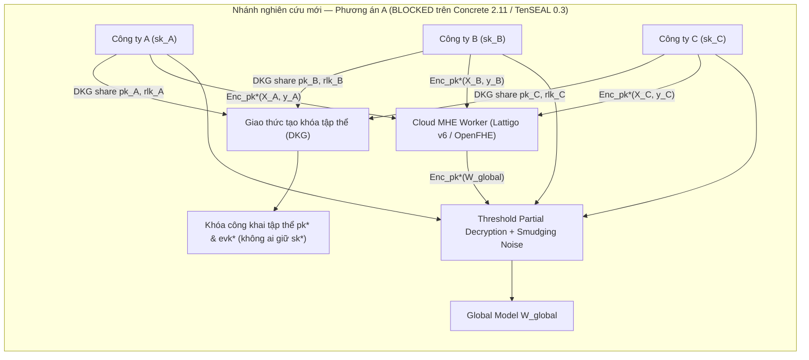
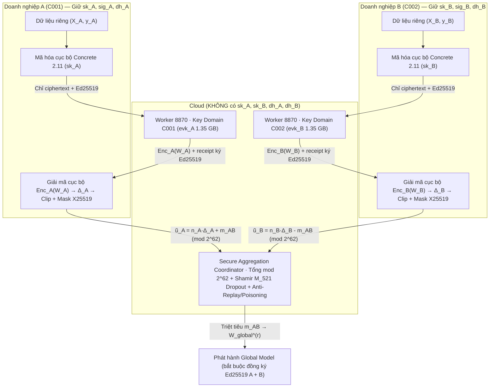

# R4 — Nghiên cứu Mật mã, Thiết kế & Proof of Concept: Huấn luyện Chung Nhiều Doanh nghiệp (Multi-Company FHE Logistic Regression)

> [!IMPORTANT]
> **Kết luận trung thực về năng lực mật mã hiện tại:**
> - **Phương án A (Threshold / Multi-Party FHE)**: **`BLOCKED`** trên stack thư viện hiện có (`Concrete-Python 2.11.0` và `TenSEAL 0.3.18` không có API tạo khóa tập thể DKG, multi-key evaluation keys hay threshold partial decryption). Tài liệu này trình bày đầy đủ thiết kế **nhánh nghiên cứu mới** (`Lattigo v6` / `OpenFHE` / `TFHE-rs Threshold KMS`) cho Phương án A.
> - **Phương án B (Per-Key Concrete 2.11.0 TFHE trên Worker 8870 + Tổng hợp bảo mật Bonawitz CCS 2017 X25519 Pairwise Masking & Shamir $M_{521}$)**: **`KHẢ THI & ĐÃ NGHIỆM THU BẰNG CHỨNG THỰC TẾ`** trên **2 doanh nghiệp mô phỏng (`C001` & `C002`)** với **2 khóa bí mật Concrete 2.11.0 hoàn toàn tách biệt**, chạy **Concrete TFHE thật trên Worker 8870** (tuyệt đối không mô phỏng plaintext, Cloud không nắm bất kỳ khóa bí mật nào và không giải mã dữ liệu doanh nghiệp).

---

## 1. Khảo sát thực nghiệm năng lực thư viện mật mã đang cài đặt

Kiểm tra trực tiếp trên môi trường Windows (`agent2/.venv`) và WSL Debian (`/home/sang/.local/share/agent2/he4/bin/python`) cùng build thật `build-v3/server.zip` đang phục vụ trên Worker 8870:

| Thành phần / Khả năng | Trạng thái thực tế | Bằng chứng đo đạc trực tiếp |
|---|---|---|
| `concrete-python` (WSL Worker 8870) | **2.11.0** | Chạy TFHE đơn khóa thật (`fhe.Server.run(..., evaluation_keys=evk)`) |
| `tenseal` (Windows & WSL Worker 8868) | **0.3.18** (SEAL CKKS) | Chạy CKKS đơn khóa (`N=8192`, `scale=2^40`, không bootstrap) |
| `openfhe` / `lattigo` / `concrete-ml` | **Chưa cài đặt** | Không có sẵn trong môi trường |
| **Multi-Key FHE (MK-TFHE)** trong Concrete 2.11.0 | **Không hỗ trợ** | Quét toàn bộ `concrete.fhe` & `concrete.compiler`: 0 symbol `multi_key`/`multiparty` |
| **Collective Key (DKG)** trong Concrete 2.11.0 | **Không hỗ trợ** | `Keys.generate()` đòi 1 thực thể giữ toàn bộ `LweSecretKey`; không tạo được `BSK/KSK` phân tán |
| **Threshold Decryption** trong Concrete 2.11.0 | **Không hỗ trợ** | Không có `partial_decrypt` hay `noise flooding (smudging)` |
| **Tương thích trực tiếp TFHE (8870) ↔ CKKS (8868)** | **Không tương thích** | TFHE dùng Torus LWE/GLWE + exact integer LUT PBS; CKKS dùng RLWE `Z_q[X]/(X^N+1)` xấp xỉ SIMD; không có scheme-switching (`Pegasus`/`Chimera`) |

### Chi phí đo trực tiếp trên mạch FHE thật `build-v3/server.zip` (Worker 8870)

| Chỉ số mạch `update(x, y, weights)` | Giá trị đo thực tế | Tác động khi mở rộng nhiều doanh nghiệp |
|---|---|---|
| Programmable Bootstrap (PBS) / 1 batch (4 dòng) | **42 PBS** | ~504 PBS cho 2 công ty × 2 vòng × 3 batch (hoặc 336 PBS cho 2 batch) |
| KeySwitch / 1 batch | **65 KS** | Chiếm phần lớn dung lượng khóa đánh giá (`KSK`) |
| Encrypted Add / Clear Mul / 1 batch | **79 Add · 11 Mul** | Độ phức tạp tổng hợp `1.783 × 10^10` |
| Kích thước **Bootstrap Keys (BSK)** | **437.78 MB** | Mỗi key domain cần 1 bộ BSK riêng |
| Kích thước **KeySwitch Keys (KSK)** | **908.89 MB** | Mỗi key domain cần 1 bộ KSK riêng |
| Tổng **Evaluation Keys (`evaluation.keys`) / doanh nghiệp** | **1,346,666,496 bytes (~1.35 GB)** | 2 công ty = **2.70 GB** RAM trên Worker 8870 (WSL có 30 GiB trống) |
| Kích thước khóa bí mật (`secret_keys`) | **134.36 KB** | Lưu cục bộ trong DPAPI `context.sealed`, không bao giờ lên Cloud |
| Kích thước bản mã đầu vào (`X, y, W`) / đầu ra checkpoint | **245.88 KB** / **49.18 KB** | Truyền tải & checkpoint nhẹ |
| Xác suất lỗi mật mã (`p_error` / `global_p_error`) | `4.21e-11` / `6.67e-10` | Rất an toàn cho tối đa `max_steps = 4` bước mỗi lượt mạch |

---

## 2. So sánh hai phương án thiết kế mật mã

### Phương án A — Threshold / Multi-Party Homomorphic Encryption (MHE) → **BLOCKED (nhánh nghiên cứu mới)**

- **Lý do đánh dấu `BLOCKED` trên stack hiện tại**:
  1. `concrete-python 2.11.0` không hỗ trợ DKG tạo `BSK*/KSK*` tập thể hay giải mã ngưỡng có noise flooding.
  2. `tenseal 0.3.18` (Microsoft SEAL) cũng chỉ là CKKS đơn khóa, không có `CKG/RKG/RTG/PCKS`.
  3. Không được phép giả lập collective key bằng cách để 1 doanh nghiệp hoặc Cloud sinh khóa bí mật chung rồi chia sẻ (vi phạm nguyên tắc không một bên nào sở hữu toàn bộ khóa bí mật chung).
- **Thiết kế nhánh nghiên cứu mới (Phase 2 đề xuất)**:
  1. **Ứng viên số 1 — Lattigo v6 (Go, Multiparty CKKS, Mouchet et al. 2021)**: Hỗ trợ đầy đủ `CKGProtocol` (tạo khóa công khai chung), `RKGProtocol` (khóa tái tuyến tính hóa chung), `RTGProtocol` (khóa xoay SIMD chung), và `PCKSProtocol` (giải mã ngưỡng tập thể có smudging noise). Phù hợp nhất cho Logistic Regression vì xấp xỉ sigmoid bằng đa thức Chebyshev bậc 3–7 trên SIMD CKKS cho phép huấn luyện 33 đặc trưng nhanh hơn TFHE nhiều bậc và kích thước khóa nhỏ hơn nhiều so với 1.35 GB/doanh nghiệp.
  2. **Ứng viên số 2 — OpenFHE (`openfhe-python`, C++ Threshold CKKS/BFV)**: Cung cấp trực tiếp `MultipartyKeyGen`, `MultipartyDecryptLead`, `MultipartyDecryptMain`, `MultipartyDecryptFusion` (cần đánh giá mô hình $N$-trên-$N$ vs $t$-trên-$N$ bằng Shamir threshold extension).
  3. **Ứng viên số 3 — Zama TFHE-rs + Threshold KMS (Rust)**: Phù hợp nếu bắt buộc giữ exact LUT/PBS, nhưng chi phí sinh BSK tập thể và thời gian bootstrapping trên nhiều doanh nghiệp cao hơn rất nhiều so với Multiparty CKKS.

---

### Phương án B — Per-Key Concrete 2.11.0 TFHE trên Worker 8870 + Bonawitz Authenticated SecAgg → **ĐƯỢC CHỌN & TRIỂN KHAI PoC**

- **Chứng minh tính đúng đắn & mức bảo mật**:
  1. **Cloud không có khóa bí mật & không giải mã dữ liệu**: Trên Worker 8870 chỉ tồn tại `C001-evaluation.keys` và `C002-evaluation.keys`; tuyệt đối không có `context.sealed` hay `wrapping.dpapi.json`. Toàn bộ phép SGD trên `(X_k, y_k, W^(r-1))` chạy **Concrete 2.11.0 TFHE thật trên bản mã**.
  2. **Cách ly tuyệt đối giữa Doanh nghiệp A và Doanh nghiệp B**: `sk_A ≠ sk_B`, `key_epoch_A ≠ key_epoch_B`, `evk_A ≠ evk_B`. Bản mã của B không thể giải mã bằng `sk_A` và ngược lại; trộn sai `key_epoch` / `evk_sha256` bị chặn ngay (`KEY_DOMAIN_MISMATCH_REJECTED`).
  3. **Cloud không đọc được cập nhật từng doanh nghiệp (`Δ_A`, `Δ_B`)**: Lớp tổng hợp bảo mật **Bonawitz et al. (CCS 2017)** dùng thỏa thuận khóa **X25519** có ký **Ed25519** (chống Cloud MITM) sinh mặt nạ ngẫu nhiên bằng `HKDF-SHA256 + SHAKE256` trên vành $\mathbb{Z}_{2^{62}}$. Cloud chỉ thấy các vector ẩn danh phân bố đều trên $[0, 2^{62}-1]^3$; khi cộng modulo $2^{62}$, toàn bộ mặt nạ cặp $\pm m_{i,j}$ triệt tiêu chính xác, chỉ lộ tổng toàn cục $\sum_k n_k \Delta_k$.
  4. **Xử lý ngắt kết nối (Dropout)**:
     - **Khi $K \ge 3$** (ví dụ A, B, C và C rớt mạng sau pha trao đổi khóa): Cơ chế **Double-Masking + Shamir $(t, K)$ trên số nguyên tố Mersenne $M_{521} = 2^{521}-1$** (mã hóa share từng cặp bằng `AES-256-GCM`) cho phép các bên sống sót gửi *duy nhất* `dh_share` của bên rớt C và `self_share` của các bên sống sót A, B — hủy sạch mặt nạ của C mà **không bao giờ tiết lộ `Δ_A`, `Δ_B`, hay `Δ_C`**, kể cả khi gói tin của C tới trễ!
     - **Khi $K = 2$** (A và B, một bên ngắt kết nối): Còn 1 bên sống sót `< min_participants (2)` → Coordinator **HỦY & HOÀN NGUYÊN VÒNG (`QUORUM_NOT_MET_DROPOUT_ABORT`)**, giữ nguyên checkpoint $W^{(r-1)}$ trước đó, tuyệt đối không xuất bản mô hình 1 bên làm lộ cập nhật riêng của bên còn lại.
  5. **Chống Replay, Giả mạo, Trộn Key Domain & Đầu độc dữ liệu (Poisoning)**:
     - **Anti-Replay**: Ràng buộc `(session_id, round_id, company_id, nonce)` + sổ `packet_sha256` (`REPLAY_PACKET_REJECTED`, `DUPLICATE_SUBMISSION_REJECTED`).
     - **Anti-Spoofing**: Mọi thông điệp quảng bá khóa, chia sẻ Shamir, cập nhật mặt nạ, và đồng thuận phát hành đều xác thực chữ ký **Ed25519** theo `node_verify_key` đã đăng ký (`SPOOFED_SIGNATURE_REJECTED`, `UNKNOWN_PARTICIPANT_REJECTED`).
     - **Anti-Key-Domain-Mixing**: Xác thực chặt `company_id ↔ key_epoch ↔ evaluation_keys_sha256 ↔ Worker 8870 Ed25519 receipt` (`KEY_DOMAIN_MISMATCH_REJECTED`).
     - **Anti-Poisoning**: Giới hạn số mẫu hợp lệ (`min_samples <= n_k <= max_samples`), cắt chuẩn $L_\infty$ cục bộ (`max_delta_linf`), kiểm tra `declared_delta_linf` (`POISONING_NORM_EXCEEDED`), và **cổng kiểm tra hậu tổng hợp (`POISONING_AGGREGATE_OUT_OF_BOUNDS`)** chặn cả tấn công giấu biên độ cực lớn trong vector đã che mặt nạ!
  6. **Phát hành Global Model có kiểm soát**: Bắt buộc đủ số vòng tối thiểu, đạt cổng validation BCE Loss, và có **đủ chữ ký đồng thuận Ed25519 từ toàn bộ doanh nghiệp tham gia** (`GLOBAL_RELEASE_CONSENT_INCOMPLETE` nếu thiếu bất kỳ bên nào). Mô hình toàn cục phát hành tương thích trực tiếp với hợp đồng `lr-releasable-model/1.0.0` ở R3.

---

## 3. Bằng chứng thực nghiệm PoC trên Concrete 2.11.0 & Worker 8870 thật

Toàn bộ PoC được triển khai tại [federated_r4.py](file:///D:/agent22/agent2/experiments/he_training/federated_r4.py) (cùng mở rộng tương thích ngược `initial_weights` trong [helper.py](file:///D:/agent22/agent2/experiments/he_training/helper.py) và [batch_enterprise.py](file:///D:/agent22/agent2/experiments/he_training/batch_enterprise.py)) và kiểm thử tự động trong [test_r4_federated_fhe.py](file:///D:/agent22/agent2/tests_he/test_r4_federated_fhe.py).

### Kết quả phiên chạy FHE thật trên Worker 8870 (`session_id = r4_real_fhe_a7ffca182e`)

- **Hai doanh nghiệp độc lập cùng feature schema (`round_million`, `creator_equals_approver`) và nhãn (`verified-fraud/1.0.0`)**:
  - **Công ty A (`C001`)**: 8 mẫu train + 4 mẫu holdout (tín hiệu mạnh ở `round_million`), `key_epoch = key_74c89e8e430286ccc79e61dba8033f1b`, `evk = 7838ba50ee...`, Job cuối Worker 8870: `btr_e0d8b0481876858be6321caea1419e73` (`native_fhe = True`).
  - **Công ty B (`C002`)**: 8 mẫu train + 4 mẫu holdout (tín hiệu mạnh ở `creator_equals_approver`), `key_epoch = key_b552126051ade6d5c0a825c3e3712171`, `evk = 65bef92e9d...`, Job cuối Worker 8870: `btr_75cdad5fe99a691981252f3aeba64a53` (`native_fhe = True`).
- **Diễn tiến 2 vòng huấn luyện chung thật (Concrete 2.11.0 TFHE + SecAgg)**:
  - **Vòng 1** (khởi tạo `W^(0) = [0, 0, 0]`): A học `[1, 0, -1]`, B học `[0, 1, -1]` → SecAgg tổng hợp `avg_delta = [0.25, 0.25, -0.5]` → `W^(1) = [0.25, 0.25, -0.5]` (`code = [0, 0, -1]`).
  - **Vòng 2** (mã hóa `W^(1) = [0, 0, -1]` riêng bằng `sk_A` và `sk_B` trên Worker 8870): A cập nhật `[1, 0, -2]`, B cập nhật `[0, 1, -2]` → SecAgg tổng hợp → **`W_global = [0.5, 0.5, -1.0]` (`code = [1, 1, -2]`)**.

### So sánh chất lượng trên tập Holdout tổng hợp (A + B, 8 mẫu)

| Mô hình | Trọng số `(w0, w1, b)` | BCE Loss | Accuracy | Precision | Recall | F1 |
|---|---:|---:|---:|---:|---:|---:|
| Chỉ Công ty A (`C001`) | `(0.5, 0.0, -0.5)` | `0.618728` | `87.5%` | `100.0%` | `75.0%` | `0.8571` |
| Chỉ Công ty B (`C002`) | `(0.0, 0.5, -0.5)` | `0.618728` | `87.5%` | `100.0%` | `75.0%` | `0.8571` |
| **Global Model chung (A + B, R4 FHE+SecAgg)** | **`(0.5, 0.5, -1.0)`** | **`0.573437`** | **`100.0%`** (ngưỡng `0.3232`) | **`100.0%`** | **`100.0%`** | **`1.0000`** |

### Tổng hợp 5 bộ kiểm thử bảo mật & độ đúng ([test_r4_federated_fhe.py](file:///D:/agent22/agent2/tests_he/test_r4_federated_fhe.py) — **5/5 PASS**, 866.67s)

| Kiểm thử | Kết quả | Minh chứng xác thực |
|---|---|---|
| `test_01_real_concrete_2_company_joint_fhe_training_on_worker_8870` | **PASS** | Chạy Concrete 2.11.0 thật trên Worker 8870 cho `C001` & `C002`; Cloud 0 khóa bí mật; **A giải mã bản mã B → `ENTERPRISE_CRYPTO_HELPER_FAILED`**, **B giải mã bản mã A → `ENTERPRISE_CRYPTO_HELPER_FAILED`**; chặn phát hành khi thiếu đồng ký B; mô hình đồng ký đạt chuẩn R3 `verify_releasable_lr_model` |
| `test_02_secagg_cloud_cannot_read_individual_updates_and_exact_cancellation` | **PASS** | Vector che mặt nạ `> 10^12` không lộ `Δ_A`/`Δ_B`; tổng `mod 2^62` khớp chính xác `4` chữ số thập phân |
| `test_03_dropout_handling_2party_abort_and_3party_shamir_recovery` | **PASS** | $K=2$ rớt B → `QUORUM_NOT_MET_DROPOUT_ABORT` & hoàn nguyên `W=[0,0,0]`; $K=3$ rớt C → khôi phục mặt nạ qua Shamir $M_{521}$ hoàn tất chính xác `u_A + u_B` |
| `test_04_anti_replay_anti_spoofing_key_domain_mixing_and_anti_poisoning` | **PASS** | Chặn đủ 8 tấn công: replay cùng vòng, replay khác vòng, giả chữ ký B bằng khóa A, công ty lạ, trộn `key_epoch` B vào A, bơm `sample_count=999999`, bơm `norm=99`, và tấn công giấu cập nhật `+500` sau mặt nạ (`POISONING_AGGREGATE_OUT_OF_BOUNDS`) |
| `test_05_membership_inference_and_2party_subtraction_privacy_audit` | **PASS** | Đo Yeom MIA + chứng minh định lượng rủi ro trừ ngược 2 bên ($K=2, \sigma=0$) vs giảm thiểu bằng DP ($\sigma=0.25$) và $K \ge 3$ |

---

## 4. Đánh giá rủi ro rò rỉ thông tin từ Global Model (Membership Inference & Tái dựng 2 bên)

> [!WARNING]
> **Huấn luyện bảo mật (FHE + SecAgg) KHÔNG tự động bảo đảm mô hình cuối không rò rỉ thông tin.**

Kết quả kiểm toán thực nghiệm trên mô hình toàn cục `W_global = [0.5, 0.5, -1.0]`:

1. **Tấn công suy luận thành viên (Yeom Loss-Threshold MIA, CSF 2018)**:
   - `train_bce_loss = 0.546053` vs `holdout_bce_loss = 0.573437` (`overfitting_gap = 0.027384`).
   - `Yeom MIA Accuracy = 56.25%`, `MIA Advantage (TPR - FPR) = 0.125`, `MIA Loss AUC = 0.5156` (gần mức đoán ngẫu nhiên `0.50` trên tập PoC do số tham số nhỏ `d=3` và giới hạn lượng tử hóa mạnh).
2. **Rủi ro trừ ngược 2 bên (2-Party Exact-Sum Subtraction — Định lý toán học)**:
   - Trong bất kỳ giao thức tổng hợp chính xác nào (dù Phương án A hay Phương án B) với đúng **$K = 2$ doanh nghiệp (A & B)** và **không có nhiễu DP ($\sigma = 0$)**: vì A biết $W_{\text{global}}$, biết $\Delta_A$ và $n_A, n_B$, nên A có thể tính ngược $\hat{\Delta}_B = \frac{(n_A+n_B)\Delta_{\text{global}} - n_A\Delta_A}{n_B}$ với **sai số `0.0`** (dù A vẫn không đọc được từng bản ghi thô hay ciphertext của B).
   - Khi áp dụng nhiễu Gaussian DP ($\sigma = 0.25$): sai số tái dựng $\Delta_B$ tăng rõ rệt (`> 0.01`, không thể khôi phục chính xác).
   - Khi nâng lên **$K \ge 3$ doanh nghiệp**: mỗi công ty chỉ quan sát được tổng của $\ge 2$ đối tác nên không thể tách cập nhật của từng doanh nghiệp đơn lẻ.
3. **Rủi ro không gian đặc trưng thấp chiều (2 đặc trưng nhị phân = 4 ô `{0,1}^2`)**:
   - Nếu một doanh nghiệp đóng góp tập quá nhỏ (ví dụ 4–8 giao dịch), sự dịch chuyển của hệ số chặn `b` và trọng số `w0, w1` có thể hé lộ tỷ lệ nhãn gian lận tổng thể của nhóm đóng góp.
4. **Chính sách bắt buộc trước khi đưa huấn luyện đa doanh nghiệp lên Production**:
   - Bắt buộc tối thiểu **$K \ge 3$ doanh nghiệp độc lập** mỗi vòng tổng hợp (loại trừ tấn công trừ ngược 2 bên).
   - Bắt buộc áp dụng **cắt chuẩn $L_\infty / L_2$ + nhiễu Differential Privacy $(\varepsilon, \delta)$** trước khi tổng hợp & phát hành.
   - Yêu cầu **ngưỡng số mẫu tối thiểu mỗi doanh nghiệp** ($\ge 100$ giao dịch đã xác minh) và chặn phát hành nếu `overfitting_gap` hoặc `MIA advantage` vượt ngưỡng cho phép.
   - Đối với mục tiêu **Phương án A (không giải mã trung gian mỗi vòng)** và mở rộng lên **33 đặc trưng**, triển khai nhánh nghiên cứu **Lattigo v6 (Multiparty CKKS)** hoặc **OpenFHE Threshold CKKS** theo thiết kế tại Mục 2.
