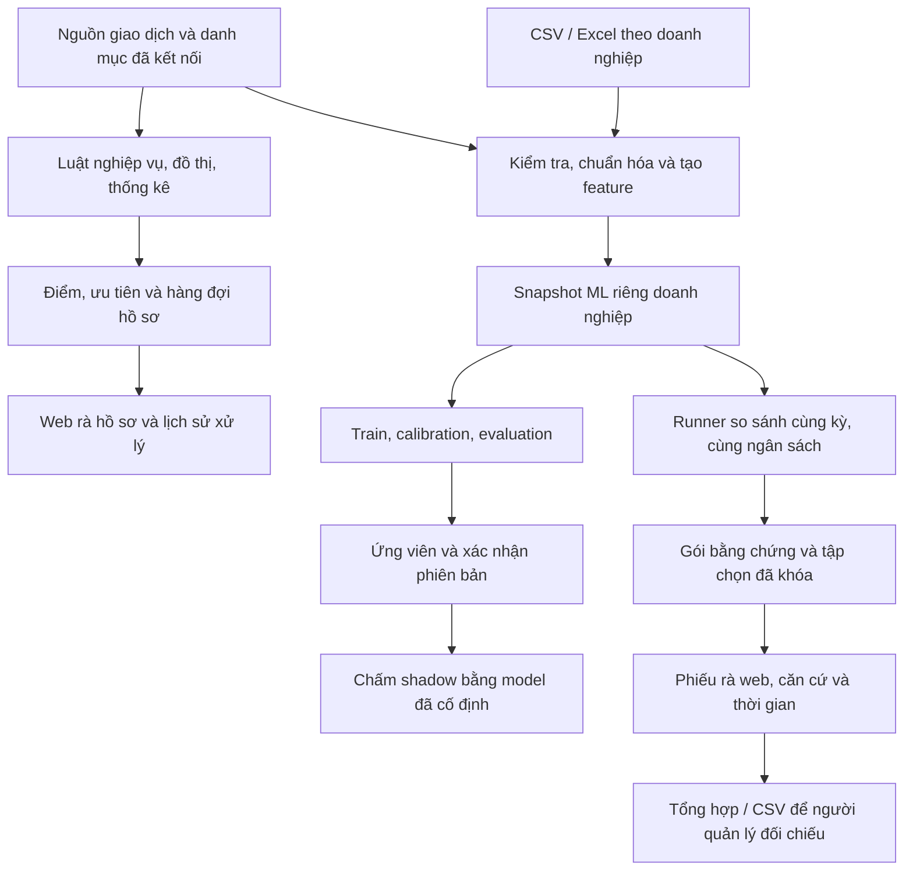

# Báo cáo tổng quan Agent 2

**Ngày báo cáo:** 07/11/2026.

**Dự án:** Multi-Agent-Finance · **Nhánh:** `agent2-Sang`.

**Phạm vi:** mã nguồn, tài liệu kiểm chứng và database demo trong workspace `D:\agent22`.

## 1. Tóm tắt

Agent 2 là thành phần hỗ trợ rà soát giao dịch và phát hiện dấu hiệu rủi ro tài chính cho doanh nghiệp SME. Hệ thống kết hợp **luật nghiệp vụ, đồ thị quan hệ và machine learning**, cung cấp hồ sơ có căn cứ để người có trách nhiệm kiểm tra.

Hiện đã có ứng dụng web local dùng chung cổng **8765** cho hồ sơ, nhập CSV/Excel, lựa chọn ML theo doanh nghiệp và phiếu rà. Người quản lý có thể đánh giá, xác nhận và giữ một phiên bản model riêng cho từng doanh nghiệp; cập nhật dữ liệu không tự đổi model đang dùng.

Phần ML đang ở chế độ **shadow**: kết quả phục vụ đối chiếu, chưa tự thay hàng đợi, kết luận hoặc thông báo nghiệp vụ. Nguồn kiểm chứng chủ yếu là dữ liệu mô phỏng. Hệ thống đủ để trình diễn và kiểm thử các luồng đã nêu; mức độ chính xác, lợi ích vận hành và khả năng dùng thực tế còn cần được nghiệm thu với doanh nghiệp.

| Nội dung chính | Trạng thái |
| --- | --- |
| Luật và quản lý hồ sơ | Đã có bộ luật, quan hệ đồ thị, điểm rủi ro, ưu tiên và hàng đợi |
| Nhập dữ liệu trên web | CSV/Excel → kiểm tra lỗi → chuẩn hóa → tạo 194 feature → xác nhận lưu |
| ML theo doanh nghiệp | Có 5 adapter; mỗi doanh nghiệp giữ model đã xác nhận riêng |
| Đánh giá công bằng | So sánh cùng kỳ và cùng số giao dịch rà, xuất gói có manifest/checksum |
| Rà kết quả | Phiếu web có dữ kiện, căn cứ, hành động, lưu nháp và đồng hồ máy chủ |
| Kiểm chứng gần nhất | 211 test Python, 146 kiểm tra JavaScript; 30/30 kiểm tra browser của lượt hợp nhất |
| Phần cần hoàn thiện | Nguồn thật, kết quả người rà, đăng nhập thực tế, tích hợp và vận hành triển khai |

## 2. Mục tiêu và phạm vi nghiệp vụ

Agent 2 hỗ trợ ba việc chính:

1. **Phát hiện và giải thích dấu hiệu cần rà:** chia nhỏ khoản chi, quan hệ bên liên quan, bất thường phê duyệt/thời gian, nhân sự/NCC, chứng từ và công nợ theo nguồn được cung cấp.
2. **Sắp xếp công việc kiểm tra:** gom hồ sơ, lưu căn cứ và lịch sử, áp dụng ưu tiên/ngân sách/SLA theo chính sách đã cấu hình.
3. **Thử ML phù hợp từng doanh nghiệp:** tách train/calibration/evaluation theo thời gian, đánh giá ứng viên, giữ phiên bản được xác nhận và đo mức hữu ích qua người rà.

Đầu vào gồm giao dịch, danh mục doanh nghiệp/nhân viên/NCC/khách hàng, lịch và các nguồn nghiệp vụ tùy khả dụng. Nhãn gian lận phải có người xác minh, thời điểm và căn cứ. Đầu ra gồm tín hiệu luật, hồ sơ/bằng chứng, phiên bản model, điểm ML, lịch sử thao tác và kết quả rà có thời gian.

Luật và feature dùng dữ kiện đã biết tại thời điểm xét. Thiếu nguồn được ghi nhận theo chính sách từng kiểm soát; không tự tạo bằng chứng hoặc suy rằng thiếu dữ liệu đồng nghĩa không có rủi ro.

## 3. Kiến trúc hiện tại

Backend viết bằng **Python**, máy chủ web local dùng `ThreadingHTTPServer`, lưu trạng thái vào **SQLite**. Frontend dùng **HTML/CSS/JavaScript**. Các thành phần ML sử dụng NumPy, SciPy, scikit-learn và CatBoost tùy chọn.

Nhánh hồ sơ luật và nhánh ML có dữ liệu/kết quả được quản lý theo phạm vi riêng. Nhập CSV vào không gian ML chưa tự chấm lại toàn bộ hồ sơ luật. Chạy ML trên web cũng chưa tự tạo một gói phiếu so sánh; gói này được sinh bằng runner rồi nhập tại máy chủ.

Trong phạm vi báo cáo, việc tích hợp trực tiếp luồng trao đổi với các agent khác chưa được nghiệm thu. Khi nối vào hệ thống Multi-Agent-Finance cần thống nhất hợp đồng dữ liệu/API, định danh doanh nghiệp/giao dịch, thời điểm quan sát và phạm vi quyền.

### Các module chính

| Thành phần | Vai trò |
| --- | --- |
| `sme_fraud/rules.py`, `entity_graph.py`, `identity_graph.py` | Luật, liên kết và lịch sử thực thể |
| `features.py`, `feature_contract.py`, `feature_evidence.py` | Tạo feature, kiểm hợp đồng và căn cứ theo thời gian |
| `case_admission.py`, `case_queue.py`, `case_identity.py` | Điều kiện nhận, hàng đợi và định danh hồ sơ |
| `data_import.py` | Kiểm tra tệp giao dịch, chuẩn hóa và xác nhận nhập |
| `company_ml.py`, `ml_estimators.py` | Snapshot, thuật toán, phiên bản, kích hoạt và chấm ML |
| `company_ml_comparison.py`, `ml_review_packets.py` | So sánh cùng điều kiện và khóa gói bằng chứng |
| `ml_review_web.py` | Phiếu rà, chủ sở hữu, thời gian, nháp, kết quả và xuất CSV |
| `review_store.py`, `review_server.py`, `review_workflow.py` | SQLite, API/giao diện và luồng rà hai cấp |
| `review_roles.py`, `notifications.py`, `review_backup.py` | Quyền theo công ty, thông báo và backup/restore |
| `review_ui/`, `start_review.py` | Giao diện và khởi động đúng profile local |

## 4. Luật nghiệp vụ và đồ thị

Ma trận kiểm thử đã đối chiếu **35 mã** thuộc các nhóm A–F và các kiểm soát P/T bổ sung:

| Nhóm | Phạm vi khái quát |
| --- | --- |
| A | Hạn mức, mẫu hình chia nhỏ, giao dịch cận ngưỡng, giá trị bất thường và thanh toán/hóa đơn |
| B | Xung đột lợi ích, quan hệ nhân viên–NCC, tài khoản/liên hệ và đối tượng cần kiểm tra |
| C | Thời điểm thao tác, phân quyền, tự duyệt và quy trình phê duyệt |
| D | Thống kê chữ số/Benford theo cửa sổ và phân đoạn đủ điều kiện |
| E | Rủi ro nhân sự, lương và chất lượng danh mục |
| F | Điều chỉnh, override, số chứng từ và công nợ theo nguồn nghiệp vụ |
| P/T | Kiểm soát thanh toán, tiền mặt/chứng từ VAT, tạm ứng và xử lý liên quan |

Đồ thị dùng các liên kết có định danh và hiệu lực theo thời gian. Việc thay, xóa hoặc thu hồi quan hệ được xét khi tách lại cụm; địa chỉ đơn lẻ không đủ để gom theo A3. Điểm phát hiện và ưu tiên xử lý được giữ riêng; một số phát hiện chỉ là ngữ cảnh/chất lượng nguồn và không tự mở hồ sơ giao dịch.

Kết quả ma trận ngày 27/10 ghi nhận **228 ô có test đạt, 17 ô không áp dụng có lý do**, trong bảy nhóm tình huống cho từng mã. Đây là độ phủ các tình huống đã khai báo, không phải tỷ lệ chính xác trên doanh nghiệp thật. Các kiểm soát phụ thuộc nguồn như F1/C4/E2/F2/F3/F4 vẫn cần dữ liệu SME thật và nghiệm thu độc lập. [Ma trận](../rules/rule_test_matrix_20261027.md), [đặc tả](../../../rule_class_1.md), [cổng nghiệm thu nguồn](../../../reports/rule_source_acceptance.md).

## 5. Nhập dữ liệu và quản lý nhãn

Màn hình `/data-import` đã có đủ luồng **chọn doanh nghiệp → tải tệp → kiểm tra → xem trước → xác nhận lưu → chuyển sang ML**. CSV/Excel được kiểm tra tên cột, mã giao dịch trùng, phạm vi doanh nghiệp/danh mục, số tiền, thời gian, dữ liệu thiếu và cấu trúc tệp. Lỗi được chỉ rõ theo dòng/cột kèm cách sửa.

Giới hạn hiện tại là **10 MB, 10.000 giao dịch**, Excel `.xlsx` đúng một sheet, không công thức; mã/tài khoản cần kiểu Text để giữ số 0 đầu. Bản xem trước có hiệu lực **20 phút**. Feature lịch sử dùng thông tin khả dụng tại thời điểm xét; việc học chuẩn hóa ML chỉ diễn ra trên kỳ train.

| Loại cập nhật | Cách xử lý hiện tại |
| --- | --- |
| Nhập CSV/Excel giao dịch | Thay toàn bộ tập ML của công ty sau xác nhận; cần đủ lịch sử; nhãn của tập thay thế được xóa theo cảnh báo |
| Cập nhật nguồn đã kết nối | Đọc nguồn đã cấu hình; giữ nhãn cho giao dịch/feature không đổi |
| Bổ sung CSV nhãn | Ghép theo mã giao dịch, giữ nhãn không liên quan; nhãn giống hệt không làm thay đổi tập nhãn |
| Nhãn xung đột | Xem trước nội dung cũ/mới; chọn giữ hoặc sửa. Sửa cần lý do, xác nhận và lưu lịch sử |

Cơ chế ghép nhãn đã khắc phục trường hợp bổ sung một tệp nhỏ làm mất các nhãn trước đó. Xung đột bao gồm thay lớp 0/1 hoặc thay người rà, thời điểm, căn cứ. Dữ liệu/phiên bản cũ và quyền phạm vi được kiểm tra lại trước ghi. [Nhập dữ liệu](../ml/data_import_20261104.md), [bổ sung nhãn](../ml/company_ml_labels_20261106.md).

## 6. ML riêng cho từng doanh nghiệp

### Thuật toán đã có

| Thuật toán | Cách triển khai/điều kiện |
| --- | --- |
| Isolation Forest | Phát hiện bất thường không cần nhãn; lưu model và ngưỡng đã xác nhận |
| Autoencoder | Mạng MLP tái tạo dữ liệu bằng scikit-learn; có báo trạng thái chưa hội tụ |
| ECOD | Biến thể suy luận dùng phân phối tham chiếu cố định từ train |
| Local Outlier Factor | Chế độ `novelty=True`, chấm dữ liệu ngoài kỳ học |
| CatBoost | Thư viện tùy chọn; mọi dòng train cần nhãn xác minh, đủ hai lớp 0/1 và biết nhãn trước cuối kỳ train |

**Nhiều lựa chọn thuật toán đã có; model đang dùng do người quản lý xác nhận.** Hệ thống chưa tự tối ưu hoặc chọn thuật toán thắng cho mỗi doanh nghiệp từ các chỉ số demo.

### Kiểm soát quá trình học và sử dụng

- Tách kỳ theo thời gian: train học model/tiền xử lý, calibration chọn ngưỡng, evaluation đối chiếu về sau; tối thiểu 5/2/2 dòng.
- Ứng viên chưa xác nhận không thay phiên bản đang dùng. Có giữ phiên bản hoặc quay lại phiên bản từng kích hoạt còn tương thích.
- Mỗi công ty giữ binding riêng; cập nhật dữ liệu không tự kích hoạt model mới.
- Backend kiểm điều kiện CatBoost theo đúng kỳ; UI hiển thị lý do khóa và không dùng phản hồi cũ của công ty/kỳ trước.
- Chấm/giữ được kiểm tra hợp đồng feature, định dạng nguồn, runtime, artifact và phạm vi; model không tương thích thì nút chấm bị khóa.
- Precision/recall chỉ có ý nghĩa trong phần evaluation có nhãn xác minh. Điểm giữa các thuật toán không cùng thang đo.

[Chi tiết cấu hình ML](../../../examples/company_ml/README.md), [điều kiện CatBoost/tương thích](../ml/company_ml_readiness_20261105.md).

## 7. So sánh model và phiếu rà

Runner so sánh khóa **cùng doanh nghiệp, snapshot, kỳ dữ liệu và ngân sách giao dịch** trước khi chạy. Gói kết quả lưu artifact, dự đoán, tập chọn và bằng chứng có manifest/checksum. Web và CLI chỉ nhận đúng tập đã khóa, từ chối tệp thừa/thiếu, trùng định danh hoặc bị sửa.

Lượt demo C001/C002 dùng **18 train / 6 calibration / 6 evaluation** cho mỗi công ty và **5 giao dịch/model/doanh nghiệp**. IF, Autoencoder, ECOD, LOF đã chạy; CatBoost bị bỏ qua do thiếu nhãn train. **40 vị trí chọn** gộp thành **12 giao dịch duy nhất**. Danh sách top 5 có thể chứa dòng dưới ngưỡng calibration; cần phân biệt tập lấy mẫu để rà với cảnh báo vượt ngưỡng.

Phiếu `/ml-reviews` ẩn tên model, điểm và thứ hạng khi rà. Người dùng ghi căn cứ, tham chiếu chứng từ, kết quả hữu ích/không cần hành động/chưa đủ căn cứ và hành động cụ thể. Có lưu nháp, nhận quyền sửa theo chủ sở hữu, kiểm phiên bản và đồng hồ xác nhận ở máy chủ; khi tab ẩn/mất kết nối có cơ chế dừng và bỏ thời gian chưa xác nhận.

Người có quyền quản lý xuất CSV theo công ty. Tổng hợp tên model chỉ mở sau khi hoàn tất phiếu trong phạm vi tài khoản. Kết quả “hữu ích” không tự trở thành nhãn gian lận hoặc quyết định kích hoạt model. Hiện **chưa có kết quả rà thực tế trong 12 phiếu**, nên chưa xác định model tốt nhất cho từng công ty. [So sánh](../ml/company_ml_comparison_20261104.md), [phiếu web](../ml/ml_review_web_20261105.md), [khóa bằng chứng](../ml/ml_review_packet_lock_20261106.md).

## 8. Giao diện, quyền và vận hành

| Hạng mục | Hiện trạng |
| --- | --- |
| Địa chỉ local | Một server tại `http://127.0.0.1:8765/` cho `/`, `/data-import`, `/company-ml`, `/ml-reviews` |
| Khởi động | `python -B start_review.py`; profile lưu riêng trên máy, đối chiếu instance khi dùng lại/dừng |
| Phân quyền | Có chính sách vai trò và phạm vi công ty; máy chủ cấp danh tính, không tin vai trò do browser tự khai |
| Demo quản lý | Danh tính quản lý mô phỏng chỉ được bật cùng `--qa`; chưa có đăng nhập người dùng thật |
| Luồng hai cấp | Có module và đã kiểm thử trên môi trường mô phỏng: người rà gửi → người khác có quyền chốt/trả; việc bật luồng tùy cấu hình server |
| Xung đột/khôi phục phiên | Kiểm tra revision, CSRF và trạng thái trước thao tác; không tự lặp POST sau lỗi mạng |
| Nhật ký/backup | Có lịch sử cấu hình, rà soát và backup/restore SQLite/artifact theo luồng hiện hữu |
| Thông báo | Có chính sách sự kiện, outbox, người nhận và chống trùng; gửi–nhận Email/Zalo thật chưa nghiệm thu |

Việc hợp nhất ngày 07/11 đã giữ nguyên các bảng hồ sơ và nguồn được đối chiếu, chuyển riêng phần ML/phiếu rà từ phiên cũ vào database chính. Các database QA giữ riêng trên đĩa. Bản clone Git chứa mã, schema, test và mẫu; dữ liệu vận hành, SQLite, artifact đã fit và profile máy giữ ở local. [Biên bản hợp nhất](unified_local_20261107.md), [phạm vi bản Git](../../AGENT2_GITHUB.md).

## 9. Trạng thái dữ liệu demo được đối chiếu

Đã đọc SQLite **ở chế độ chỉ đọc** khi lập báo cáo ngày 07/11/2026, không khởi động lại server hoặc thay dữ liệu:

| Chỉ tiêu | Giá trị |
| --- | ---: |
| Hồ sơ trong database chính | 1.146 |
| Snapshot ML theo doanh nghiệp | 2 |
| Phiên bản model đã lưu | 5 |
| Model đang dùng/binding | 2 |
| Lượt chấm ML đã lưu | 9 |
| Gói phiếu ML | 1 |
| Phiếu ML | 12 |
| Bản ghi công việc/kết quả rà ML | 0 |

| Doanh nghiệp | Giao dịch ML | Feature | Nhãn trong demo | Model đang dùng |
| --- | ---: | ---: | ---: | --- |
| C001 | 30 | 194 | 0 | Isolation Forest · v3 |
| C002 | 30 | 194 | 1 | ECOD · v2 |

Database là `.runtime/review/sprint14_demo.sqlite3`. Danh mục phiên hợp nhất có 5 doanh nghiệp; dữ liệu ML mới có hai công ty trong bảng trên. **1.146 hồ sơ và 60 dòng ML thuộc các phạm vi dữ liệu khác nhau**, không dùng hai con số này để suy tỷ lệ phát hiện.

Bản tích hợp lịch sử ngày 28/10 dùng 41.082 giao dịch và 1.211 hồ sơ trong workspace khác. Số liệu lịch sử đó không phải số dòng hiện tại của màn hình ML hoặc database chính. Trạng thái có thể thay đổi sau khi người dùng nhập dữ liệu, kích hoạt hoặc rà phiếu.

## 10. Bằng chứng kiểm thử

| Lượt/nguồn | Kết quả ghi nhận | Phạm vi và giới hạn |
| --- | --- | --- |
| Bản nguồn chuẩn bị đẩy Git ngày 07/11 | 211 test Python/16 module; 0 lỗi, 0 skip | Hồi quy liên quan nhập dữ liệu, ML, nhãn, phiếu, quyền, workflow, backup và hợp nhất; không phải toàn bộ suite mọi thời kỳ |
| JavaScript cùng lượt | 146 kiểm tra đạt; Node báo 92 test entry | Một số script cũ tự báo nhiều kiểm tra bên trong một entry; không cộng lại hai số |
| Browser hợp nhất 8765 | 30/30 kiểm tra Playwright đạt | Menu, phạm vi, preview, model/phiếu giữ nguyên, desktop/mobile; chỉ POST preview, không xác nhận nhập hoặc ghi kết quả người rà |
| Demo mới từ bản Git | 9 kiểm tra đạt | Bốn route, quyền quản lý QA, CSV C001 và Excel C002: preview/lưu/chuyển sang ML |
| Kiểm tra kịch bản hướng dẫn ngày 07/11 | Mẫu lỗi báo 3 lỗi; hai công ty nhập 30 dòng/194 feature; IF/ECOD chấm 6 dòng | Chạy backend trên database tạm; giữ model sau nhập lại; gói so sánh có 8 kết quả, 40 vị trí, 12 phiếu hợp lệ |
| Ma trận luật ngày 27/10 | 35 mã, 228 ô test đạt và 17 N/A; 607 test ở lượt đó | Kết quả lịch sử trên fixture, không cộng với bộ 211 và không phải độ chính xác thực tế |

Báo cáo này đối chiếu nhật ký/biên bản đã có và database chỉ đọc; **không chạy lại các bộ test**. Bằng chứng chi tiết:

- [Bản nguồn và phạm vi kiểm thử Git](../../AGENT2_GITHUB.md).
- [Biên bản hợp nhất và 30 kiểm tra browser](unified_local_20261107.md).
- [Hướng dẫn demo và kịch bản đã kiểm tra](../../HUONG_DAN_SU_DUNG_VA_DEMO.md).
- [Kết quả Python local](../../../.publish/Multi-Agent-Finance/.runtime/github_update_20261107_python_tests.json), [demo từ Git](../../../.publish/Multi-Agent-Finance/.runtime/github_update_20261107_source_smoke.json), [browser local](../../../.runtime/unified_8765_20261106/browser_1793984471892/results.json).

Các liên kết `.runtime`/`.publish` là bằng chứng trên máy này, không được đưa theo bản clone Git. Commit bản nguồn gần nhất được đối chiếu trong clone công bố là **`cf78d4b` — Unify Agent 2 imports, ML reviews and local workspace**; báo cáo và hướng dẫn vừa tạo là tài liệu local bổ sung sau commit đó.

## 11. Giới hạn và việc cần tiếp tục

| Ưu tiên | Công việc | Điều kiện để coi là hoàn thành |
| --- | --- | --- |
| 1 | Nghiệm thu nguồn của doanh nghiệp thử nghiệm | Có mapping/schema, mã định danh, thời điểm quan sát, coverage và bộ đối chứng đã chốt; dữ liệu lỗi/thiếu được giải thích |
| 2 | Rà đủ gói so sánh C001/C002 | Có căn cứ, hành động và thời gian thực tế; tổng hợp cùng kỳ/cùng ngân sách; phân biệt mô phỏng với kết quả doanh nghiệp thật |
| 3 | Chọn và đánh giá model từng công ty | Có người phê duyệt tiêu chí hữu ích, tải rà và chất lượng trên kỳ về sau; CatBoost chỉ mở khi đủ nhãn hợp lệ |
| 4 | Tích hợp danh tính và các agent khác | Xác thực/cấp quyền thật, hợp đồng dữ liệu/API, phạm vi công ty và kiểm thử luồng tích hợp được thống nhất |
| 5 | Hoàn thiện nhập liệu phục vụ thực tế | Mapping ERP/đổi tên cột, chính sách nhập tăng dần và đối chiếu trùng nếu được chọn; hiện CSV/Excel vẫn thay toàn bộ tập ML |
| 6 | Đo hiệu năng và công suất | Đo nhiều lượt trên khối lượng đại diện, tối ưu nguồn hỗ trợ hồ sơ; phân biệt nợ SLA trước kỳ, ngày đủ điều kiện và thời gian xử lý thực tế |
| 7 | Chuẩn bị vận hành triển khai | Kiểm tra khôi phục, môi trường/thư viện, kênh thông báo thật và thiết bị/trình duyệt ngoài phạm vi đã kiểm tra |

Các hạng mục trên là đề xuất ưu tiên từ hiện trạng, chưa phải công việc đã triển khai hoặc lịch bàn giao đã chốt. [Backlog nền](../../BACKLOG.md) giữ các vấn đề công suất, hiệu năng, bằng chứng và nghiệm thu nguồn.

## 12. Đánh giá mức sẵn sàng

Agent 2 đã có nguyên mẫu tích hợp để trình diễn đầy đủ vòng dữ liệu → ML theo doanh nghiệp → chấm shadow → rà bằng chứng, cùng nền luật/đồ thị/hồ sơ đã được kiểm chứng theo các tình huống khai báo. Những lỗi mất nhãn, nhận bằng chứng ngoài manifest và lệch điều kiện UI/backend đã có bản sửa và bằng chứng kiểm thử tương ứng.

Bước tiếp theo có giá trị nhất là chạy một đợt thử có người dùng và dữ liệu doanh nghiệp được kiểm soát: chốt nguồn, rà đúng ngân sách, ghi căn cứ/thời gian, rồi đánh giá model riêng từng công ty. Chỉ từ các test kỹ thuật và số cảnh báo mô phỏng hiện tại chưa thể kết luận Agent 2 đã tối ưu cho doanh nghiệp hoặc sẵn sàng triển khai vận hành thực tế.

Tài liệu đi kèm: [hướng dẫn sử dụng và demo](../../HUONG_DAN_SU_DUNG_VA_DEMO.md), [trạng thái dự án](../../STATUS.md), [mục lục báo cáo](../README.md).
