# Agent 3: trợ lý thuế cho doanh nghiệp nhỏ và vừa

Bài dự thi "Phòng Kế toán Số", AI-Quantum Challenge 2026. Bản ngày 07/11/2026. Mọi ảnh chụp từ ứng dụng đang chạy; dữ liệu trong ảnh là **mô phỏng**, không phải doanh nghiệp thật.

## 1. Agent 3 làm gì

Mỗi kỳ khai thuế, doanh nghiệp cần biết: **khoản thuế đầu vào nào có nguy cơ bị loại, vì sao, theo điều luật nào, nên làm gì để ít thiệt hại nhất.** Agent 3 đối chiếu hóa đơn điện tử, sao kê ngân hàng và bảng kê của cổng thuế, chỉ ra từng khoản kèm điều khoản luật còn hiệu lực đúng ngày, rồi để kế toán xử lý ngay trên màn hình. Toàn bộ chạy trên máy của doanh nghiệp.

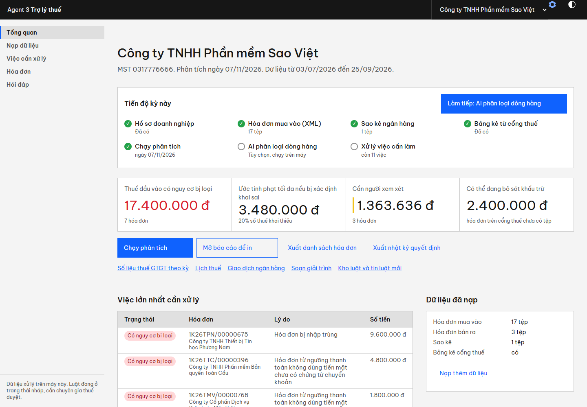
*Hình #. Trang Tổng quan của công ty mô phỏng Sao Việt: bốn con số tiền, các việc lớn nhất, hạn nộp gần nhất.*

| Nỗi đau của doanh nghiệp | Agent 3 làm gì |
|---|---|
| Bị loại khấu trừ: hóa đơn từ 5 triệu đồng thiếu chứng từ chuyển khoản, hóa đơn nhập trùng, đã bị thay thế, ghi sai mã số thuế người mua, người bán bỏ địa chỉ kinh doanh. Khi bị kiểm tra: truy thu, phạt 20% số thuế khai thiếu, cộng tiền chậm nộp 0,03% mỗi ngày | Rà mọi hóa đơn trong vài giây, tính số tiền có nguy cơ, so sánh chi phí tự khai bổ sung với để cơ quan thuế phát hiện |
| Luật đổi liên tục (riêng 01/7/2026 có nhiều văn bản bị thay thế) | Kho luật tự đồng bộ từ cổng pháp luật quốc gia, tự biết văn bản nào hết hiệu lực; mỗi cảnh báo dẫn điều khoản đúng ngày |
| Giải trình với cơ quan thuế mất nhiều ngày gom giấy tờ | Soạn thư nháp và gói hồ sơ (hóa đơn, chứng từ, quyết định đã duyệt) trong vài phút |
| Dò thủ công từng hóa đơn với sao kê, không có nhật ký ai quyết định gì | Đối chiếu ba nguồn cùng lúc; mọi quyết định có người duyệt, chứng từ, thời điểm, xuất được Excel |

**Không làm:** đăng nhập thay doanh nghiệp vào cổng thuế hoặc ngân hàng; nộp tờ khai; thay người có thẩm quyền ký; đưa dữ liệu ra ngoài máy. Luật hiện ở trạng thái nháp, chưa có chuyên gia thuế duyệt.

## 2. Cách hoạt động

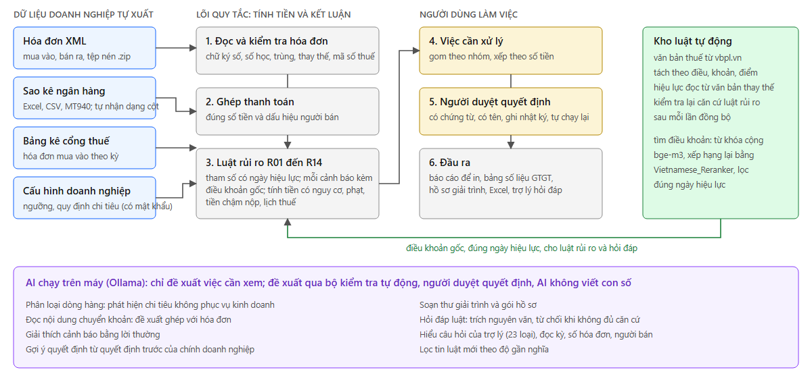
*Hình #. Lõi quy tắc tính tiền và kết luận (xám); người dùng làm việc và quyết định (vàng); kho luật (xanh lá); AI chỉ đề xuất (tím).*

**Bốn nguyên tắc:** (1) quy tắc tính con số và kết luận rủi ro, mô hình ngôn ngữ không bao giờ viết con số; (2) AI chỉ đọc, phân loại, diễn đạt, và mọi đề xuất qua bộ kiểm tra tự động; (3) người duyệt quyết định, quyết định có chứng từ và tên; (4) không chắc thì từ chối hoặc trích nguyên văn, không đoán.

**Các phần AI** (chạy trên máy qua Ollama, card đồ họa 6 GB):

| Phần AI | Mô hình | Việc thuế được giảm | Bộ kiểm tra loại khi nào |
|---|---|---|---|
| Phân loại dòng hàng | qwen3:8b | Không phải đọc tay vài trăm hóa đơn để tìm chi tiêu cá nhân (điện thoại, tivi, máy chơi game); dòng đã xác nhận được nhớ | Nhóm ngoài danh mục; lý do không nhắc tên hàng |
| Đọc nội dung chuyển khoản | qwen3:8b | Đề xuất ghép khoản chi có nội dung tự do với hóa đơn, giảm rủi ro "thiếu chứng từ chuyển khoản" | Cụm tên người bán không có trong nội dung hoặc không giống tên người bán |
| Giải thích cảnh báo | qwen3:8b | Chủ doanh nghiệp hiểu rủi ro bằng lời thường | Có con số không nằm trong dữ kiện |
| Soạn thư giải trình | qwen3:8b | Từ nhiều ngày gom giấy tờ xuống vài phút có bản nháp | Mã dữ kiện lạ, số lạ, nhắc điều luật mà không trích đúng nguyên văn, tự kết luận đúng sai |
| Hỏi đáp về luật | bge-m3, Vietnamese_Reranker, qwen3:8b | Tra quy định trong 30 đến 60 giây thay vì lục nhiều văn bản | Trích dẫn không nguyên văn; số không có trong căn cứ; lạc chủ đề; con số của trường hợp khác; câu trả lời có hoặc không không có trong đoạn trích; điều khoản nói trường hợp phủ định |
| Hiểu câu hỏi của trợ lý | bge-m3 cộng bộ phân loại, qwen3:4b khi chưa rõ | Hỏi bằng lời thường thay vì lọc bảng và xuất Excel | Ngoài 23 loại câu hỏi thì từ chối |
| Tin luật mới | bge-m3, qwen3:8b | Không phải theo dõi cổng pháp luật hằng ngày | Như hỏi đáp luật |
| Gợi ý quyết định | không dùng mô hình | Xử lý hàng loạt trường hợp lặp lại, quyết định nhất quán giữa các kỳ | Chỉ điền sẵn biểu mẫu, chứng từ để trống |

**Khung cố định và cấu hình riêng.** Lõi luật (14 luật rủi ro R01 đến R14, kho luật, bộ đọc hóa đơn) dùng chung, không doanh nghiệp nào sửa được. Mỗi doanh nghiệp tự thiết lập: kỳ khai, tháng kết thúc năm tài chính, ngành nghề, quy định chi tiêu nội bộ (gợi ý theo mã ngành, sửa được, thêm được), ngưỡng nội bộ, nhóm hàng đặc thù cho AI, ngày nghỉ riêng. Ràng buộc: ngưỡng chỉ được **chặt hơn** luật; quy định nội bộ chỉ **thêm nhắc nhở**, không làm nhẹ kết quả. Mọi cấu hình nằm trong trang **Quản trị có mật khẩu** (mục 4); người dùng hằng ngày chỉ thấy 5 mục: Tổng quan, Nạp dữ liệu, Việc cần xử lý, Hóa đơn, Hỏi đáp.

## 3. Hướng dẫn demo 10 phút

Bật ứng dụng: bấm đúp `chay_agent3.bat`, trình duyệt mở `http://127.0.0.1:8640`. Cần Ollama đang chạy cho các bước dùng AI. Dữ liệu demo nằm trong thư mục `agent3_demo`; tệp `DN_Phan_mem_Sao_Viet/HUONG_DAN.md` là bản in gọn của mục này.

**Muốn xem nhanh 30 giây:** ở trang đầu bấm **"Xem thử với dữ liệu mô phỏng"** (công ty Vật liệu Xây dựng Minh An, đã có sẵn mọi thứ). Phần dưới là cách tự làm từ đầu với công ty Sao Việt.

### Bước 1. Đặt mật khẩu quản trị (một lần)

Bấm biểu tượng bánh răng ở góc trên bên phải, nhập mật khẩu ít nhất 8 ký tự hai lần. Mật khẩu chỉ cần để thay đổi cấu hình; nạp dữ liệu, xử lý việc, hỏi đáp không cần.

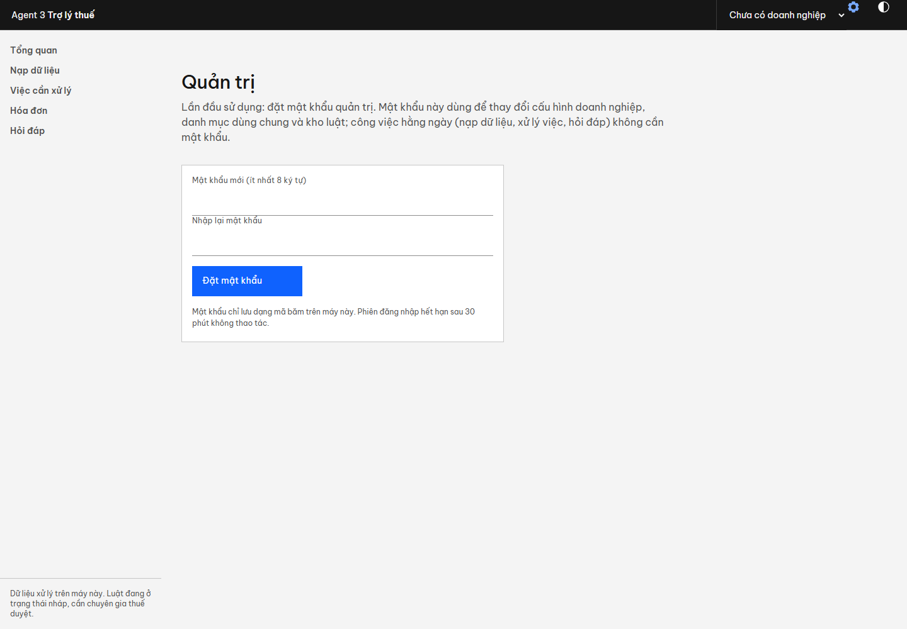
*Hình #. Lần đầu mở trang Quản trị: đặt mật khẩu. Mật khẩu chỉ lưu dạng mã băm trên máy.*

### Bước 2. Thêm doanh nghiệp

Quản trị, rồi **Thêm doanh nghiệp**. Nhập: mã số thuế `0317776666`; tên `Công ty TNHH Phần mềm Sao Việt`; địa chỉ bất kỳ; phương pháp **Khấu trừ**; kỳ khai **Theo quý**; ngành nghề `6201 Lập trình máy vi tính; 6311 Xử lý dữ liệu, cho thuê máy chủ`; năm tài chính kết thúc tháng 12.

Phải thấy: gõ thử `0317776667` thì hiện **✗ Sai số kiểm tra**; gõ đúng `0317776666` thì hiện **✓** (kiểm tra chạy trên máy: đúng dạng và đúng số kiểm tra, còn mã có đang hoạt động hay không thì tra trên cổng thuế).

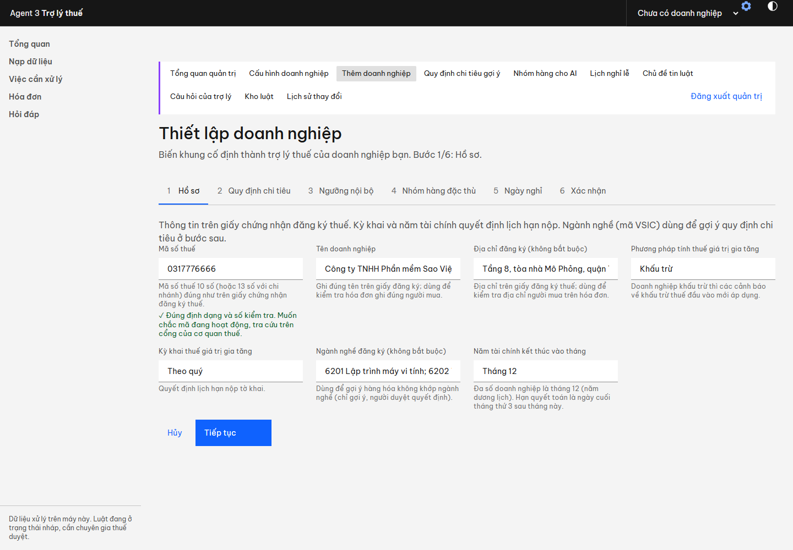
*Hình #. Bước 1 của trình thiết lập: mã số thuế được kiểm tra ngay khi gõ.*

Bấm **Tiếp tục**: bước 2 đã **đánh dấu sẵn** các quy định gợi ý theo ngành 62 và 63 (thiết bị công nghệ thông tin, dịch vụ mua của nước ngoài, bản quyền trả trước) cùng hai quy định chung (tiếp khách, hàng từ 30 triệu). Mỗi quy định sửa được nội dung, số tiền, từ khóa; có nút **Thêm quy định riêng**. Giữ nguyên, bấm **Tiếp tục** đến hết rồi **Tạo doanh nghiệp**.

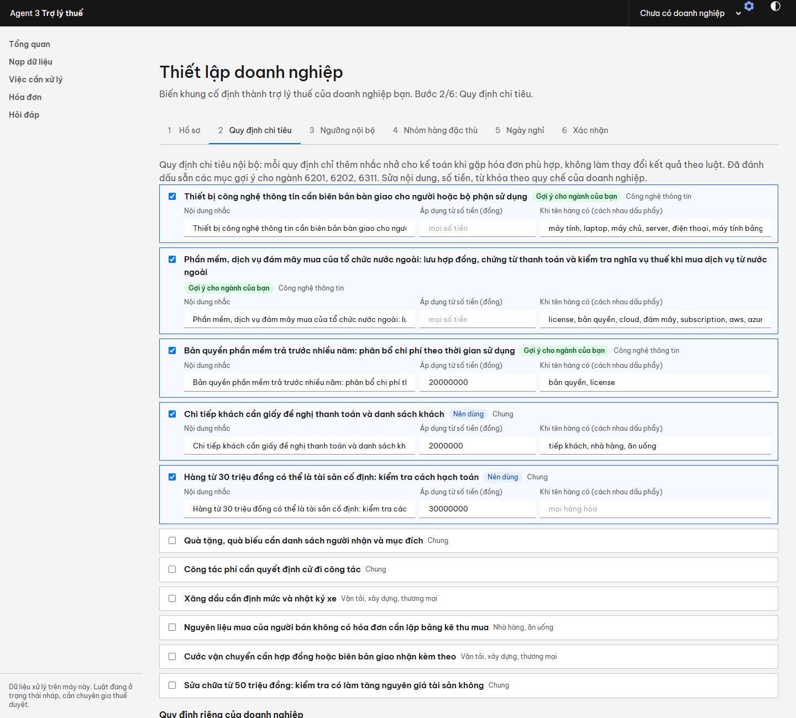
*Hình #. Bước 2: quy định gợi ý theo ngành, đánh dấu sẵn, sửa được.*

### Bước 3. Nạp dữ liệu

Mở thư mục `A_tha_vao_Nap_nhanh`, chọn cả 6 tệp (Ctrl+A), kéo vào ô **Nạp dữ liệu**. Không cần đặt tên hay chia thư mục: hệ thống nhận ra từng loại theo nội dung.

Phải thấy: **22 tệp** (17 hóa đơn mua vào, 3 bán ra, 1 sao kê, 1 bảng kê); khung xanh dương báo **sao kê đã tự nhận dạng cột** (ngân hàng này hệ thống chưa gặp); khung vàng báo 1 hóa đơn ghi sai mã số thuế; hệ thống tự phân tích: **12 việc, thuế có nguy cơ 17.400.000 đồng**. Thả lại cùng một tệp lần nữa không làm dữ liệu nhân đôi.

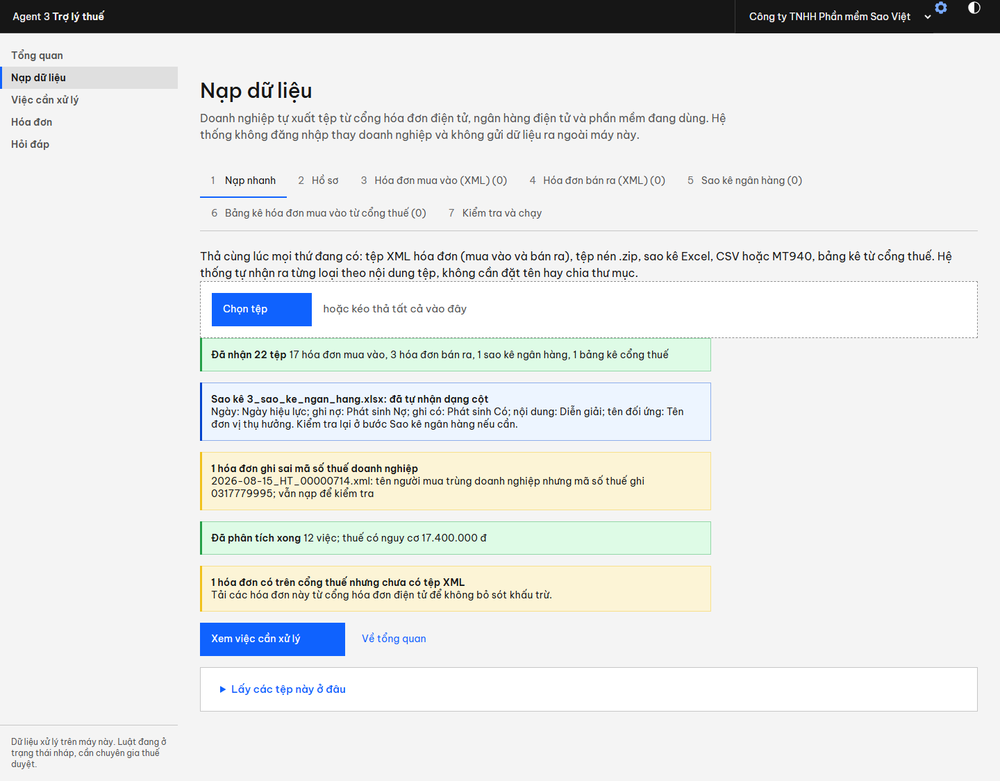
*Hình #. Kết quả sau khi thả 6 tệp.*

Với vài trăm hóa đơn, xuất XML từng hóa đơn rất mất công: nên tải **bảng kê một lần cho cả kỳ** từ cổng hóa đơn điện tử, và lấy XML hàng loạt từ hộp thư nhận hóa đơn (tải hết tệp đính kèm thành một tệp .zip) hoặc từ phần mềm kế toán. Agent 3 không tự đăng nhập cổng thuế vì việc đó cần mật khẩu doanh nghiệp.

### Bước 4. Nhập danh sách doanh nghiệp rủi ro

Quản trị, **Cấu hình doanh nghiệp**, mục **Danh sách rủi ro**: tên `Doanh nghiệp bỏ địa chỉ kinh doanh`, ngày `15/09/2026`, bấm **Chọn tệp và nhập**, chọn tệp trong thư mục `B_nhap_o_Quan_tri`. Phải thấy **Đã nhập 2 mã số thuế**. Sang Tổng quan bấm **Chạy phân tích**: có thêm việc "người bán trong danh sách rủi ro" (13 việc).

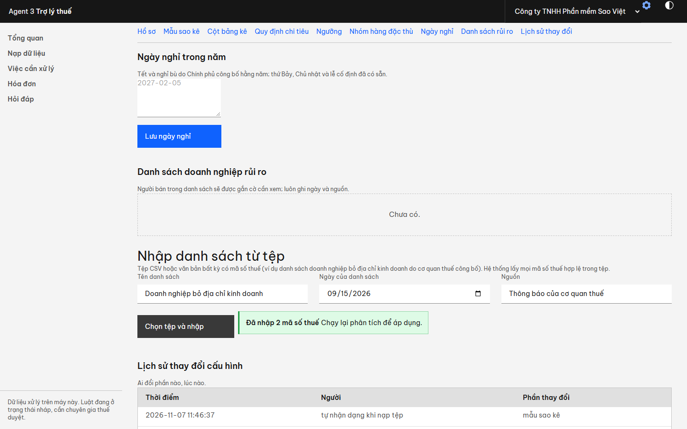
*Hình #. Nhập danh sách rủi ro do cơ quan thuế công bố; ghi ngày của danh sách.*

### Bước 5. Xử lý việc cần xử lý

Vào **Việc cần xử lý**. Danh sách có ô chọn **"Mọi vấn đề"**, ô tìm kiếm và ô chọn tháng để lọc; danh sách hiện 50 việc mỗi lần nên dùng được với hàng trăm hoặc hàng nghìn hóa đơn.

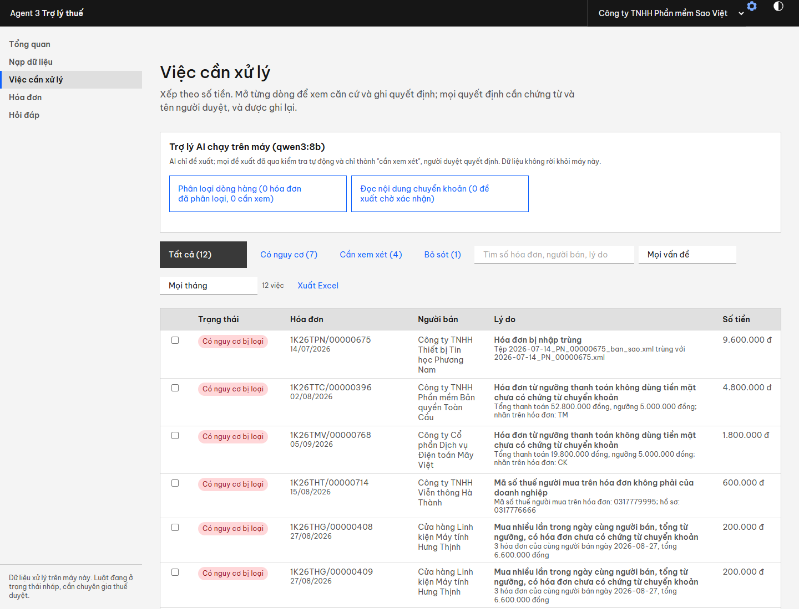
*Hình #. Việc cần xử lý của công ty Sao Việt: danh sách xếp theo số tiền, có ô lọc theo vấn đề, tìm kiếm và tháng.*

Bấm hóa đơn **396** (bản quyền phần mềm 52.800.000 đồng, trả tiền mặt). Khung bên phải cho: lời giải thích dễ hiểu (AI, đã kiểm tra số liệu), bảng **"Nên xử lý thế nào để ít thiệt hại nhất"** (tự khai bổ sung ngay so với để cơ quan thuế phát hiện), các căn cứ pháp lý. Chọn **Không kê khai khấu trừ hóa đơn này**, ghi lý do và người duyệt, bấm **Lưu**: thuế có nguy cơ giảm từ 17.400.000 xuống 12.600.000 đồng. Nếu trước đó đã quyết định cho một hóa đơn cùng người bán, cùng loại cảnh báo, khung **Gợi ý từ quyết định trước** cho phép điền sẵn.

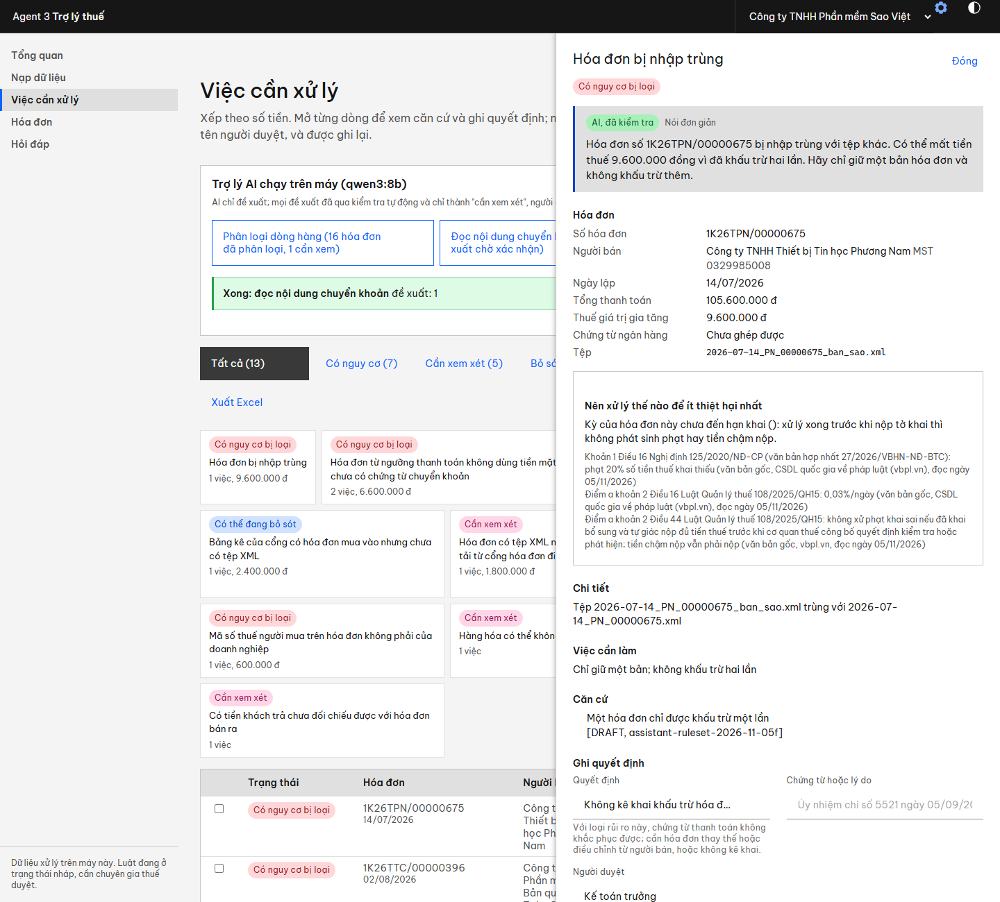
*Hình #. Khung chi tiết: giải thích, so sánh chi phí giữa các cách xử lý, căn cứ, ghi quyết định.*

### Bước 6. Dùng AI (cần Ollama)

Trong khung "Trợ lý AI chạy trên máy" ở đầu trang Việc cần xử lý:
1. **Phân loại dòng hàng** (khoảng 2 phút). Phải thấy việc "Hàng hóa có thể không phục vụ kinh doanh" cho hóa đơn **264** (máy chơi game PlayStation 5 Pro, tivi OLED 65 inch).
2. **Đọc nội dung chuyển khoản** (vài giây). Phải thấy **1 đề xuất**: khoản 15.000.000 đồng, nội dung "chuyen tien bao tri phong may cho nhat tin", ghép với hóa đơn **536** của Công ty Bảo trì Hệ thống Nhất Tín (trả từ tài khoản cá nhân của giám đốc nên quy tắc thường không ghép được). Vào trang đề xuất, nhập tên người duyệt, bấm **Xác nhận**: việc "giao dịch cùng số tiền nhưng không xác định được" biến mất và quyết định được ghi lại.

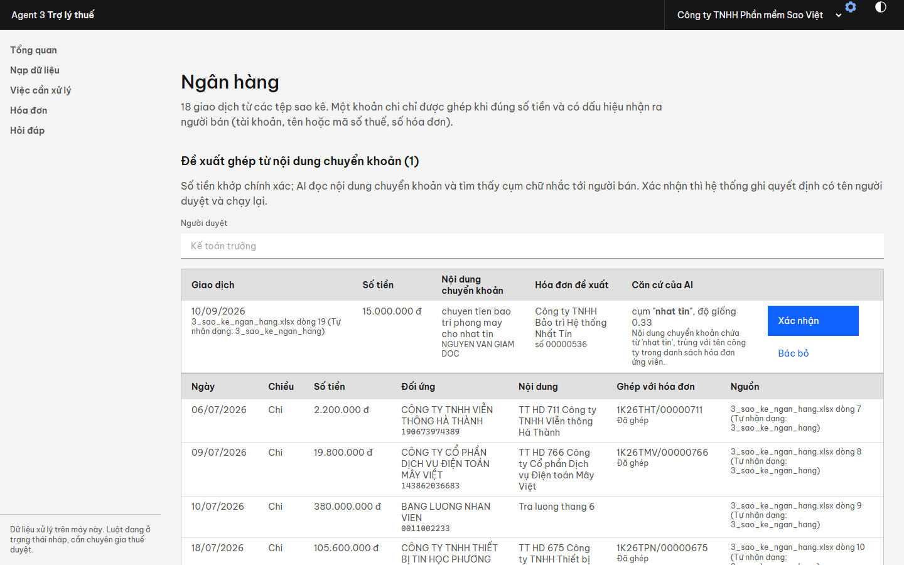
*Hình #. Đề xuất ghép từ nội dung chuyển khoản: cụm chữ AI tìm thấy, độ giống tên người bán, nút Xác nhận hoặc Bác bỏ.*

### Bước 7. Hỏi đáp

Trang **Hỏi đáp**: bấm **"Trợ lý trả lời được gì"** để xổ ra 7 nhóm, 23 loại câu hỏi, mỗi loại có mô tả, giới hạn và câu ví dụ bấm được. Hàng gợi ý bên dưới ghép từ dữ liệu của chính doanh nghiệp đang mở. Gõ bằng lời thường, kể cả không dấu hoặc viết tắt (hđ, ncc, mst).

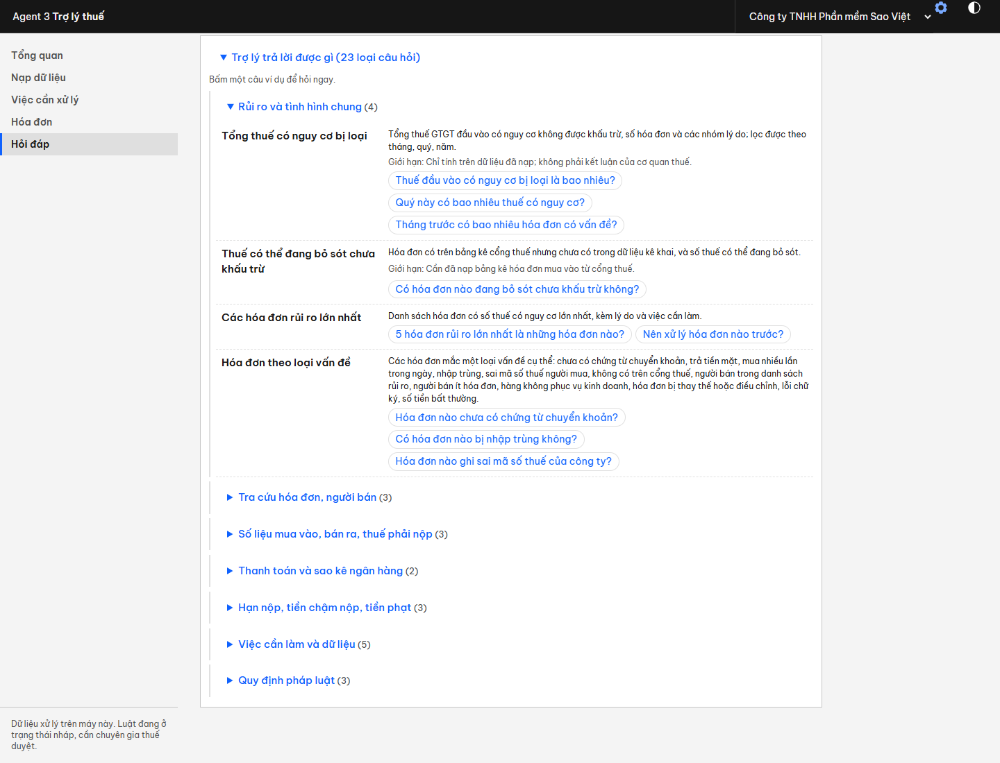
*Hình #. Danh sách các loại câu hỏi trợ lý trả lời được, sinh từ đúng danh mục trợ lý dùng để hiểu câu hỏi.*

| Gõ | Phải thấy |
|---|---|
| Quý 3 có bao nhiêu thuế có nguy cơ bị loại? | 17.400.000 đồng trên 7 hóa đơn, bảng theo lý do, khớp trang Tổng quan |
| Vì sao hóa đơn 396 bị cảnh báo? | Thông tin hóa đơn, cảnh báo, việc cần làm và căn cứ pháp lý (trả lời ngay) |
| Hạn nộp tờ khai gần nhất là khi nào? | Lịch thuế: tờ khai quý 3 hạn 31/10/2026 là thứ Bảy nên dời sang 02/11/2026 |
| Tiền chậm nộp tính bao nhiêu phần trăm một ngày? | Trích nguyên văn điều luật còn hiệu lực, 30 đến 60 giây |
| Thời tiết Hà Nội hôm nay thế nào? | Trợ lý từ chối, không đoán |

Mỗi câu trả lời có dòng **"Trợ lý hiểu câu hỏi là: ..."** (loại câu hỏi và tham số đã đọc: kỳ, số hóa đơn, người bán). Nếu hiểu sai, bấm một nút ở dòng "Không đúng ý? Hỏi theo loại khác".

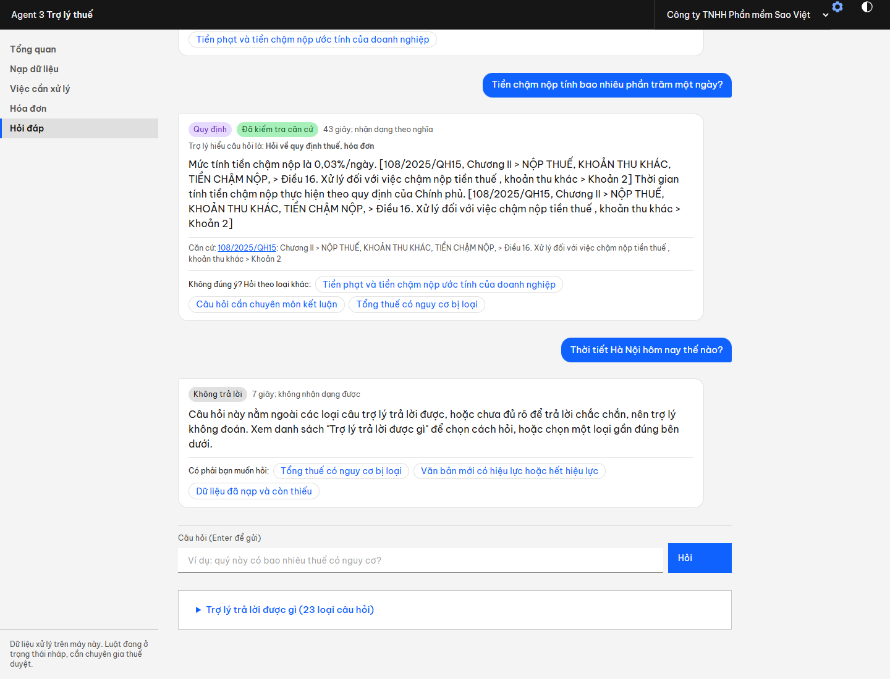
*Hình #. Phiên hỏi đáp: câu về luật có trích dẫn và nhãn đã kiểm tra căn cứ; câu ngoài phạm vi bị từ chối.*

### Đáp án: các tình huống cài sẵn trong dữ liệu Sao Việt

| Tình huống | Hóa đơn | Hệ thống phải báo |
|---|---|---|
| Thuê máy chủ tháng 9, 19,8 triệu, chưa chuyển khoản | Mây Việt số 768 | Có nguy cơ (thuế 1,8 triệu); đồng thời không có trên bảng kê cổng thuế |
| Bản quyền phần mềm 52,8 triệu trả tiền mặt | Toàn Cầu số 396 | Có nguy cơ (thuế 4,8 triệu) |
| 3 lần mua ổ cứng cùng ngày, mỗi lần 2,2 triệu, tiền mặt | Hưng Thịnh số 408, 409, 410 | Mua nhiều lần trong ngày (cộng dồn 6,6 triệu) |
| Bản sao hóa đơn laptop nhập trùng | Phương Nam số 675 | Hóa đơn trùng (thuế 9,6 triệu) |
| Ghi nhầm mã số thuế người mua | Hà Thành số 714 | Có nguy cơ (thuế 0,6 triệu); vẫn nạp kèm cảnh báo |
| Bảo trì phòng máy 15 triệu, trả từ tài khoản giám đốc | Nhất Tín số 536 | Cần xem; AI đề xuất ghép, Xác nhận thì hết |
| Máy chủ 77 triệu của người bán mới, hóa đơn số 4 | Minh Phát số 4 | Người bán phát hành rất ít hóa đơn |
| PlayStation 5 Pro và tivi OLED | An Khang số 264 | Hàng có thể không phục vụ kinh doanh (sau bước 6); người bán trong danh sách rủi ro (sau bước 4) |
| Có trên cổng thuế nhưng không có tệp | Phương Nam số 999 | Có thể đang bỏ sót khấu trừ (thuế 2,4 triệu) |
| Khách tạm ứng 150 triệu ngày 30/9, chưa có hóa đơn bán ra | (sao kê) | Tiền khách trả chưa đối chiếu được với hóa đơn bán ra |

Tổng thuế đầu vào có nguy cơ khi chưa xử lý gì: **17.400.000 đồng** = 1,8 + 4,8 + 0,6 + 9,6 + 0,6 triệu.

## 4. Trang Quản trị

Mở bằng biểu tượng bánh răng, cần mật khẩu. Máy chủ chặn mọi thao tác đổi cấu hình khi chưa đăng nhập, không chỉ ẩn nút; phiên hết hạn sau 30 phút; nhập sai 5 lần thì chờ 1 phút. Quên mật khẩu: xóa tệp `data/admin.json` trên máy chủ rồi đặt lại (chỉ người có quyền truy cập máy làm được).

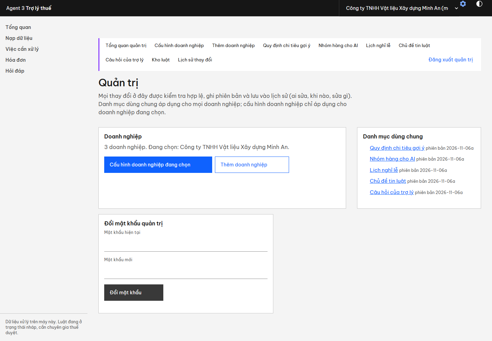
*Hình #. Trang Quản trị: thanh mục tím ở đầu trang dẫn tới cấu hình doanh nghiệp, các danh mục dùng chung, kho luật, lịch sử thay đổi.*

| Mục | Dùng để |
|---|---|
| Cấu hình doanh nghiệp | Hồ sơ, mẫu sao kê, cột bảng kê, quy định chi tiêu, ngưỡng nội bộ, nhóm hàng đặc thù, ngày nghỉ riêng, danh sách rủi ro, lịch sử |
| Thêm doanh nghiệp | Trình thiết lập 6 bước; sao chép cấu hình từ doanh nghiệp đã có |
| Quy định chi tiêu gợi ý | Danh sách gợi ý ở bước 2 của trình thiết lập; cột Ngành nhận hai chữ số đầu mã VSIC |
| Nhóm hàng cho AI | Các nhóm AI chọn khi phân loại dòng hàng (không xóa được CA_NHAN và KHONG_RO) |
| Lịch nghỉ lễ | Ngày lễ cố định và nghỉ Tết, nghỉ bù theo từng năm, dùng để dời hạn nộp. **Lịch 2026 lấy theo phương án đã đăng báo, đang để chưa đối chiếu; cần kiểm tra với thông báo của Bộ Nội vụ** |
| Chủ đề tin luật | Chủ đề dùng để lọc tin luật mới theo độ gần nghĩa |
| Câu hỏi của trợ lý | Mô tả, giới hạn, câu ví dụ nhận dạng và câu gợi ý của từng loại câu hỏi; thêm câu ví dụ đúng cách công ty hay hỏi thì trợ lý nhận dạng tốt hơn |
| Kho luật | Đồng bộ văn bản mới (khoảng 1 giờ lần đầu, sau đó chỉ tải phần thay đổi) |
| Lịch sử thay đổi | Ai sửa danh mục nào, lúc nào, sửa gì |

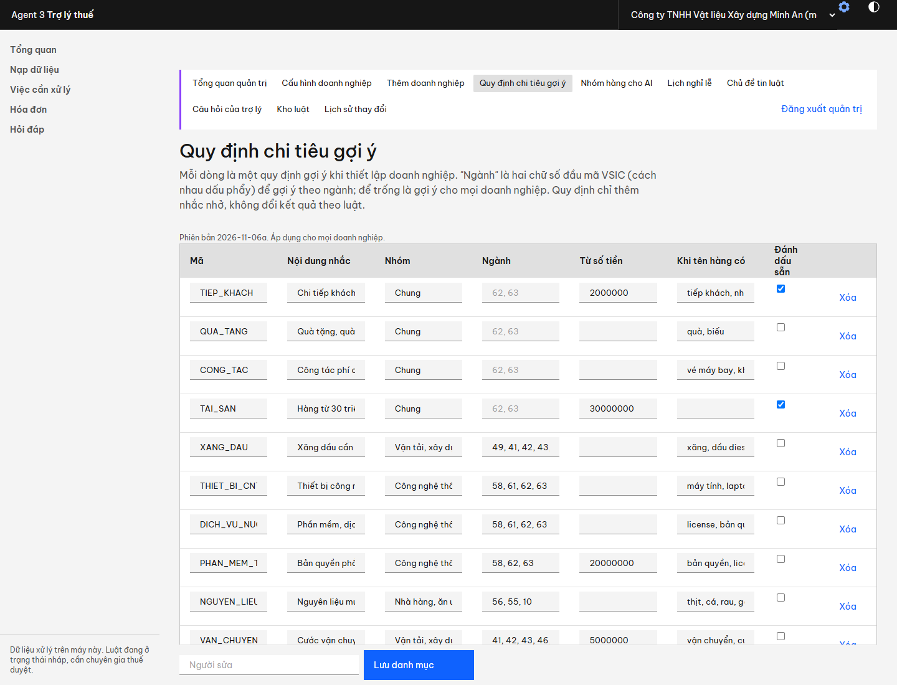
*Hình #. Một danh mục dùng chung: sửa trực tiếp từng dòng, ghi người sửa; lưu có phiên bản và lịch sử; dữ liệu sai bị từ chối kèm lý do.*

## 5. Độ chính xác và giới hạn

Các phép đo dưới đây do nhóm phát triển tự soạn bộ câu hỏi và đối chiếu với nguyên văn văn bản; chưa có chuyên gia thuế bên ngoài duyệt, chưa thử trên dữ liệu doanh nghiệp thật.

| Phép đo | Kết quả | Ghi chú |
|---|---|---|
| Trợ lý hiểu đúng loại câu hỏi và đọc đúng tham số | **30/31** trên bộ giữ lại viết sau cùng, chạy một lần (số độc lập). Ba bộ đã dùng để chỉnh: 58/59, 54/55, 50/53 | Lần chạy đầu của bộ giữ lại thứ hai (gõ không dấu, viết tắt) chỉ đạt 41/53, dẫn tới sửa phần viết tắt và không dấu. Câu ngoài phạm vi (thời tiết, dịch thuật, giá vàng) đều bị từ chối |
| Con số trong câu trả lời về dữ liệu | Đối chiếu từng con số với phép tính trực tiếp trên cùng kết quả phân tích, bằng bài kiểm thử tự động | Con số do hàm tính, mô hình không viết số |
| Hỏi đáp về luật (kèm bộ xếp hạng lại) | Phát triển 9/10; giữ lại thứ nhất 21/22; giữ lại thứ hai 20/28. Không còn câu sai nào mang nhãn đã kiểm tra | Không phải số độc lập: hai bộ giữ lại đã dùng để sửa lỗi. Các câu trượt chủ yếu là hệ thống trả nguyên văn điều khoản thay vì trả lời |
| Lỗi thật bắt được trong lần kiểm tra cuối | Ba lỗi, đều đã sửa và có kiểm thử: nhầm "khai sai **dẫn đến**" với "**không** dẫn đến thiếu thuế" (trả mức phạt sai); kết luận "chuyển quyền sử dụng đất có chịu thuế" từ điều khoản không nói điều đó; tìm người bán nhầm vì "chưa có" và "Sửa chữa Cơ khí" giống nhau khi bỏ dấu | Bài học: mỗi thay đổi ở bước tìm điều khoản phải chạy lại cả ba bộ và đọc từng câu sai, không chỉ đếm số đạt |
| Tìm điều khoản (54 câu) | Số câu có điều khoản đúng đứng đầu: từ khóa 31; thêm bge-m3 39; thêm bộ xếp hạng lại **45** | Mô hình nhúng tiếng Việt tinh chỉnh (Vietnamese_Embedding) đã đo và không hơn bge-m3 nên không dùng |
| Phân loại dòng hàng | Bộ phát triển 96,9% đúng; bộ giữ lại 20 dòng 95% đúng (đo ngày 05/11) | Chạy lại trên dữ liệu Sao Việt: gắn cờ đúng hóa đơn 264, không gắn cờ sai |
| Ghép thanh toán bằng quy tắc | 45/45 trên bộ thử ghép | |
| Quy mô | Doanh nghiệp mô phỏng 1.000 hóa đơn: phân tích khoảng 2 giây (lần đầu đọc tệp 26 giây); 144 việc gom thành 3 nhóm; trang hóa đơn chia 20 trang | Có sẵn doanh nghiệp "mo-phong-1000-hoa-don" để tự thử |
| Kiểm thử tự động | SOTEST bài đạt | Đọc XML, luật, nạp dữ liệu, giao diện máy chủ, kho luật, trợ lý hỏi đáp, danh mục dùng chung, khóa quản trị, gợi ý quyết định |

**Giới hạn cần biết**
- Hỏi đáp về luật mất 30 đến 60 giây và vẫn cần đối chiếu nguyên văn (có đường dẫn ở mỗi câu), nhất là mức phạt và ngưỡng cụ thể.
- Bộ luật rủi ro ở trạng thái nháp; chưa có chuyên gia thuế duyệt; chưa thử với dữ liệu doanh nghiệp thật.
- Kho luật chưa có luật thuế tài nguyên, bảo vệ môi trường, sử dụng đất phi nông nghiệp; 235 trang trên nguồn chỉ có tệp đính kèm nên không đọc được nội dung.
- Lịch nghỉ lễ 2026 chưa đối chiếu với thông báo chính thức.
- Không có Ollama thì phần quy tắc (rủi ro, ghép thanh toán, lịch thuế) vẫn chạy đủ; phần AI dùng câu mẫu, hỏi đáp luật trả nguyên văn điều khoản.
