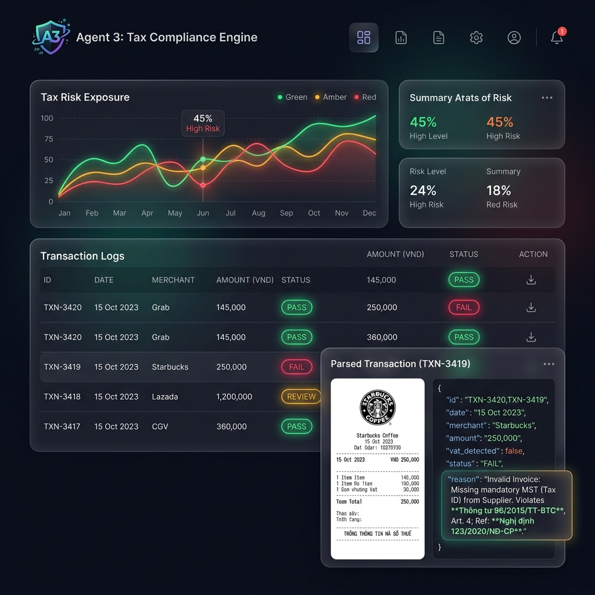
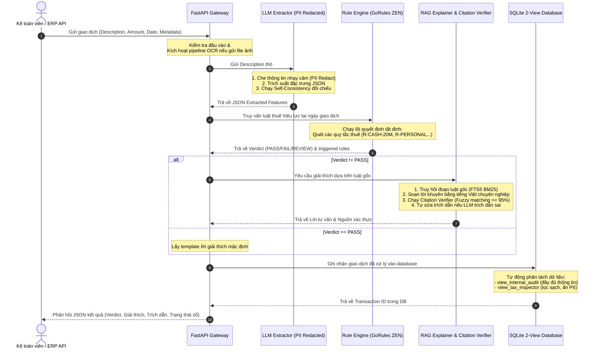

# 🗂️ HỒ SƠ ĐỀ XUẤT Ý TƯỞNG VÀ BÀI TOÁN — AI-QUANTUM CHALLENGE 2026
## 🤖 PHÒNG KẾ TOÁN SỐ — AGENT 3: TAX COMPLIANCE ENGINE (TRỢ LÝ PHÁP LÝ & THUẾ)

> **Cuộc thi Trí tuệ nhân tạo và Lượng tử trong Kinh tế - Tài chính - Kế toán lần thứ I, năm 2026 (Dùng cho Vòng 1)**

---



---

## 📖 MỤC LỤC
1. [Phần I. Thông tin đội thi](#phần-i-thông-tin-đội-thi)
2. [Phần II. Tóm tắt ý tưởng (Executive Summary)](#phần-ii-tóm-tắt-ý-tưởng-executive-summary)
3. [Phần III. Mô tả bài toán thực tiễn](#phần-iii-mô-tả-bài-toán-thực-tiễn)
4. [Phần IV. Giá trị ứng dụng và sự cần thiết](#phần-iv-giá-tri-ứng-dụng-và-sự-cần-thiết)
5. [Phần V. Ý tưởng giải pháp](#phần-v-ý-tưởng-giải-pháp)
6. [Phần VI. Dữ liệu dự kiến](#phần-vi-dữ-liệu-dự-kiến)
7. [Phần VII. Tính sáng tạo và khác biệt](#phần-vii-tính-sáng-tạo-và-khác-biệt)
8. [Phần VIII. Kế hoạch phát triển Prototype](#phần-viii-kế-hoạch-phát-triển-prototype)
9. [Phần IX. Sản phẩm dự kiến](#phần-ix-sản-phẩm-dự-kiến)
10. [Phần X. Cam kết](#phần-x-cam-kết)
11. [Phụ lục](#phụ-lục)
12. [🛠️ Hướng dẫn cài đặt và vận hành hệ thống (Developer Guide)](#️-hướng-dẫn-cài-đặt-và-vận-hành-hệ-thống-developer-guide)

---

## PHẦN I. THÔNG TIN ĐỘI THI
* **Tên đề tài/ý tưởng**: `Phòng Kế toán Số — Trợ lý Pháp lý & Thuế (Agent 3: Tax Compliance Engine) tự động kiểm soát tuân thủ và cảnh báo sớm rủi ro tài chính`
* **Lĩnh vực**:
  * [ ] Kinh tế
  * [ ] Tài chính
  * [x] Kế toán
  * [x] Liên ngành (Kế toán - Thuế - AI & Khoa học Máy tính)
* **Nhóm chủ đề dự kiến**:
  * [ ] AI cho Phân tích Kinh tế vĩ mô
  * [ ] AI cho Dịch vụ Tài chính thông minh
  * [x] AI cho Quản trị Rủi ro và Tuân thủ
  * [ ] Quantum Computing cho Tài chính
  * [ ] AI cho Chính sách công
  * [ ] AI cho Giáo dục tài chính
  * [ ] Khác: .......................

---

## PHẦN II. TÓM TẮT Ý TƯỞNG (Executive Summary)

### 1. Tên ý tưởng
**Phòng Kế toán Số — Trợ lý Pháp lý & Thuế (Agent 3: Tax Compliance Engine)**

> [!NOTE]
> Giải pháp ứng dụng mô hình Trí tuệ nhân tạo lai (Hybrid AI) nhằm tự động hóa quy trình thẩm định tuân thủ chứng từ, hóa đơn theo pháp luật thuế Việt Nam thời gian thực, loại bỏ hoàn toàn "quả bom hẹn giờ" truy thu thuế cho doanh nghiệp.

### 2. Bài toán cần giải quyết
Doanh nghiệp Việt Nam (đặc biệt là SMEs) thường xuyên đối mặt với rủi ro bị truy thu thuế và phạt chậm nộp (lũy kế 10.95%/năm) sau 3-5 năm hậu kiểm do hạch toán sai các chi phí không phục vụ sản xuất kinh doanh hoặc vi phạm điều kiện pháp luật thuế (ví dụ: thanh toán tiền mặt trên 20 triệu, chi phúc lợi/trang phục vượt trần, hóa đơn từ đối tác bỏ trốn). Việc rà soát thủ công của con người tốn thời gian, dễ bỏ sót, trong khi các phần mềm ERP truyền thống chỉ kiểm soát được các quy tắc tĩnh đơn giản, hoàn toàn bất lực trước diễn giải hóa đơn tiếng Việt tự do và sự thay đổi liên tục của các thông tư, nghị định thuế.

### 3. Giải pháp đề xuất
Chúng tôi phát triển **Agent 3: Tax Compliance Engine** thuộc hệ thống **Phòng Kế toán Số** dựa trên kiến trúc **Lõi tất định – Vỏ agent (Neuro-symbolic AI)** kết hợp cơ chế dữ liệu **1 nguồn sự thật – 2 view**:
1. **Lớp trích xuất**: LLM Extractor (phối hợp PhoBERT Classifier) phân loại chi phí và các thuộc tính giao dịch từ diễn giải tiếng Việt tự do có che thông tin nhạy cảm (redact PII).
2. **Lõi quyết định**: Rule Engine tất định (tương thích định dạng JSON của GoRules ZEN) chạy các luật thuế Việt Nam (CIT & Invoice) có hiệu lực tương ứng theo ngày phát sinh hóa đơn (effective date).
3. **Lớp giải thích**: RAG Explainer kết hợp SQLite FTS5 tìm kiếm lai và thuật toán kiểm định trích dẫn (Citation Verifier) bằng Fuzzy Matching nhằm loại bỏ hoàn toàn hiện tượng LLM ảo giác (hallucination), cung cấp lời khuyên luật thuế chính xác kèm trích nguồn nguyên văn.
4. **Lớp lưu trữ**: Phân chia giao dịch vào Database 2-View: `v_mgmt` (view quản trị) và `v_tax` (view thuế, chỉ chứa giao dịch hợp lệ), giúp đo lường tức thời quy mô rủi ro thuế (Realtime Tax Exposure).

### 4. Giá trị mang lại
* **An toàn pháp lý tuyệt đối**: Tự động phát hiện và chặn đứng 100% các lỗi vi phạm thuế cơ bản và nâng cao ngay tại thời điểm ghi sổ, giảm thiểu rủi ro bị truy thu tài chính xuống mức 0%.
* **Tối ưu hóa nguồn lực**: Tiết kiệm hàng trăm giờ kiểm toán thủ công và lập báo cáo tài chính mỗi năm cho doanh nghiệp nhờ việc tự động hóa màng lọc dữ liệu từ sổ quản trị sang sổ thuế.
* **Cảnh báo sớm rủi ro đối tác**: Liên tục đối chiếu mã số thuế nhà cung cấp với danh sách doanh nghiệp rủi ro cao/bỏ trốn của Tổng cục Thuế để ngăn chặn hóa đơn đầu vào bất hợp pháp.

### 5. Công nghệ dự kiến
* **NLP & Extraction**: LLM (GPT-4o-mini / Llama-3.3-70b-versatile), PhoBERT (fine-tuned classifier offline).
* **Rule Engine**: GoRules ZEN compatible decision model.
* **RAG & Search**: SQLite FTS5 (BM25), BGE-M3 (dense/sparse vector embeddings), Sentence-Transformers.
* **Citation Verification**: RapidFuzz (fuzzy string matching, Levenshtein ratio).
* **Framework & Database**: FastAPI, Python, SQLite (2-View architecture), PyTest, Hypothesis.

---

## PHẦN III. MÔ TẢ BÀI TOÁN THỰC TIỄN
*(Tiêu chí 1 – 25%)*

### 1. Bối cảnh
Tại Việt Nam, cơ chế quản lý thuế vận hành theo nguyên tắc **tự khai - tự nộp - hậu kiểm**. Doanh nghiệp tự lập báo cáo và nộp thuế hàng năm, cơ quan thuế sẽ tiến hành thanh tra, kiểm tra thực tế sau đó 3 đến 5 năm. 
SMEs Việt Nam chiếm hơn 97% tổng số doanh nghiệp nhưng thường không đủ ngân sách duy trì một bộ máy kế toán chuyên nghiệp và cập nhật luật thuế liên tục. Sai sót trong hóa đơn chứng từ tích lũy qua nhiều năm như một quả bom nổ chậm, khi thanh tra sờ gáy, số tiền phạt chậm nộp (0.03%/ngày ≈ 10.95%/năm) cộng dồn với số thuế truy thu và phạt khai sai (20% số thuế thiếu) thường vượt quá khả năng chi trả của doanh nghiệp, dẫn đến mất thanh khoản và phá sản.

### 2. Vấn đề cụ thể
* **Hóa đơn thật nhưng chi phí không hợp lệ**: Khoản chi mua hàng hóa có hóa đơn đỏ đầy đủ nhưng thanh toán bằng tiền mặt trên 20 triệu đồng (vi phạm Khoản 1 Điều 4 Thông tư 96/2015/TT-BTC) sẽ bị loại toàn bộ chi phí được trừ khi tính thuế TNDN và mất quyền khấu trừ thuế GTGT đầu vào.
* **Vượt trần định mức quy định**: Chi phí trang phục bằng tiền mặt vượt quá 5 triệu đồng/người/năm; chi phúc lợi trực tiếp cho người lao động (hiếu hỷ, sinh nhật, nghỉ mát...) lũy kế vượt quá 01 tháng lương bình quân thực tế thực hiện trong năm tính thuế.
* **Rủi ro hóa đơn đầu vào từ doanh nghiệp bỏ trốn**: Doanh nghiệp mua hàng thật, nhưng nhà cung cấp sau đó bỏ trốn khỏi địa chỉ kinh doanh hoặc bị cơ quan thuế xếp vào danh sách doanh nghiệp rủi ro cao về hóa đơn. Hóa đơn đầu vào của doanh nghiệp lập tức bị đóng băng và bị rà soát tính hợp pháp.
* **Chi phí không phục vụ sản xuất kinh doanh (SXKD)**: Chi tiếp khách cá nhân, chơi golf, du lịch gia đình của ban giám đốc hạch toán bừa bãi vào chi phí doanh nghiệp nhằm trốn thuế TNDN.

### 3. Minh chứng

| Nội dung minh chứng | Giá trị định lượng | Nguồn dữ liệu | Ý nghĩa với bài toán |
| :--- | :--- | :--- | :--- |
| **Vụ việc Coca-Cola Việt Nam** | Truy thu & phạt **821 tỷ đồng**, thua kiện Tổng cục Thuế vào năm 2025 | Báo chí tài chính (VnExpress, VOV) | Minh chứng cho việc cơ chế hậu kiểm thuế có thể phán xét lại hồ sơ doanh nghiệp sau nhiều năm với chế tài đủ lớn để làm sụp đổ dòng tiền doanh nghiệp. |
| **Vụ việc Unilever Việt Nam** | Truy thu thuế **575 tỷ đồng** sau đối chiếu | Báo cáo Kiểm toán Nhà nước | Cho thấy ngay cả các tập đoàn đa quốc gia có đội ngũ kế toán chuyên nghiệp vẫn gặp rủi ro thiếu sót hồ sơ chứng từ hợp lệ khi bị thanh tra kiểm tra. |
| **Thống kê ACFE Report to the Nations 2024** | **5% doanh thu** bị thất thoát hàng năm do sai sót, gian lận; thời gian phát hiện trung bình **12 tháng** | Báo cáo chính thức của ACFE 2024 | Khẳng định việc kiểm soát thủ công hoặc hậu kiểm muộn tạo ra khoảng trống thời gian rất lớn cho sai sót tích lũy. |
| **Tiền phạt chậm nộp thuế** | **0.03% / ngày** (~10.95% / năm) | Luật Quản lý thuế Việt Nam | Tạo ra hiệu ứng lãi kép ngược cực kỳ nguy hại cho các sai sót kế toán không được phát hiện sớm. |

### 4. Phát biểu bài toán
```
Làm thế nào để TỰ ĐỘNG HÓA việc kiểm soát, thẩm định tuân thủ luật thuế và phân loại chi phí hợp lệ tại nguồn từ diễn giải thô
nhằm giúp các DOANH NGHIỆP VỪA VÀ NHỎ (SMEs) tại Việt Nam
đạt được SỰ AN TOÀN PHÁP LÝ TUYỆT ĐỐI VỀ THUẾ, loại bỏ hoàn toàn rủi ro bị truy thu, phạt chậm nộp và tự động hóa quy trình đối chiếu sổ sách.
```

---

## PHẦN IV. GIÁ TRỊ ỨNG DỤNG VÀ SỰ CẦN THIẾT
*(Tiêu chí 2 – 20%)*

### 1. Tầm quan trọng
Ý tưởng tác động trực tiếp đến sự sinh tồn tài chính của cộng đồng doanh nghiệp SMEs Việt Nam. Bằng cách số hóa và tự động hóa kiến thức pháp lý thuế phức tạp thành một màng lọc tự động tích hợp ngay trên phần mềm kế toán, chúng tôi giúp bình dân hóa năng lực quản trị rủi ro thuế cao cấp - vốn trước đây chỉ các tập đoàn lớn có ngân sách thuê Big4 kiểm toán mới tiếp cận được.

### 2. Tính cấp thiết
* **Luật Thuế TNDN mới sửa đổi có hiệu lực từ ngày 01/10/2025**: Thay đổi căn bản các điều kiện được trừ của chi phí nghiên cứu phát triển, chi phí lãi vay, và định mức phúc lợi. Các kế toán viên rất dễ làm sai theo thói quen cũ nếu không có hệ thống tự động cập nhật luật thuế định hướng theo ngày giao dịch (Rule versioning).
* **Chuyển đổi số kế toán bắt buộc**: Xu hướng chuyển đổi số hóa đơn điện tử (Nghị định 123) tạo điều kiện cho dữ liệu giao dịch phát sinh ở dạng số. Doanh nghiệp cần công cụ AI xử lý đống dữ liệu này lập tức tại thời điểm phát sinh thay vì đợi đến cuối năm quyết toán mới rà soát.

### 3. Lợi ích kỳ vọng

| Đối tượng thụ hưởng | Lợi ích cụ thể nhận được |
| :--- | :--- |
| **Người dùng (Kế toán viên)** | * Nhận cảnh báo vi phạm thuế tức thời khi nhập chứng từ kèm căn cứ pháp lý chính xác.<br>* Hướng dẫn khắc phục cụ thể (ví dụ: đổi sang chuyển khoản ngân hàng) để kịp thời sửa sai.<br>* Giảm 90% thời gian rà soát thủ công khi quyết toán cuối năm. |
| **Doanh nghiệp (Ban Giám đốc)** | * Theo dõi realtime quy mô rủi ro thuế (Tax Exposure) chênh lệch giữa hai sổ quản trị và thuế.<br>* Không còn bị động hoặc bất ngờ trước các khoản phạt truy thu hàng trăm triệu đồng khi thanh tra thuế vào cuộc.<br>* Đảm bảo tính minh bạch tài chính tối đa phục vụ gọi vốn hoặc vay ngân hàng. |
| **Cơ quan quản lý thuế** | * Doanh nghiệp tự lọc và kê khai đúng luật ngay từ nguồn giúp báo cáo tài chính sạch sẽ.<br>* Giảm thiểu chi phí và thời gian thanh tra kiểm tra đối với các doanh nghiệp ứng dụng giải pháp. |

### 4. Tác động dự kiến
* **Kinh tế**: Tiết kiệm hàng nghìn tỷ đồng tiền phạt chậm nộp thuế cho hàng vạn SMEs trên cả nước, bảo vệ dòng vốn sản xuất kinh doanh.
* **Xã hội**: Thúc đẩy sự minh bạch, trung thực và nâng cao tính tuân thủ pháp luật thuế trong cộng đồng doanh nghiệp Việt Nam.
* **Công nghệ**: Tiên phong ứng dụng mô hình Neuro-Symbolic AI (kết hợp suy luận tất định và mô hình ngôn ngữ lớn) vào các hệ thống đòi hỏi độ chính xác tuyệt đối 100% như tài chính, pháp luật tại Việt Nam.

---

## PHẦN V. Ý TƯỞNG GIẢI PHÁP
*(Tiêu chí 3 – 20%)*

### 1. Mô tả tổng quan
Giải pháp của chúng tôi xây dựng một đường ống (pipeline) xử lý giao dịch tự động hóa từ khâu tiếp nhận chứng từ thô đến phân loại, thẩm định và lưu trữ. 

Hệ thống kết hợp sự linh hoạt của **Mô hình Ngôn ngữ lớn (LLM)** trong việc đọc hiểu các đoạn mô tả giao dịch kế toán tự nhiên bằng tiếng Việt và sự chính xác tuyệt đối của **Lõi Quyết định Luật Thuế (Rule Engine)**. Mọi quyết định thuế đều có trích dẫn điều luật gốc từ cơ sở dữ liệu luật được lập chỉ mục và kiểm định độ trung thực bằng thuật toán so khớp chuỗi (Fuzzy String Matching), loại bỏ hoàn toàn khả năng AI bịa đặt.

### 2. Công nghệ và mục đích sử dụng
* **FastAPI Gateway**: Cung cấp API endpoint hiệu năng cao tiếp nhận giao dịch trực tiếp từ phần mềm ERP/CRM.
* **LLM Extractor (GPT-4o-mini / Llama-3.3-70b-versatile via Groq)**: Đọc hiểu và trích xuất các thông tin có cấu trúc (dạng JSON) từ mô tả giao dịch thô bằng tiếng Việt.
* **PhoBERT Classifier (VinAI)**: Phân loại danh mục chi phí (expense category) ngoại tuyến (offline) để bảo mật thông tin nội bộ doanh nghiệp.
* **GoRules ZEN Decision Engine**: Lõi tất định thực thi các luật thuế được viết dưới dạng JSON có hiệu lực theo thời gian thực (Rule versioning).
* **SQLite FTS5 & BGE-M3 Reranker**: Thực hiện tìm kiếm lai (Hybrid Search) truy hồi chính xác văn bản luật gốc phục vụ RAG.
* **RapidFuzz**: Thẩm định độ chính xác của trích dẫn luật (Citation Verifier) bằng thuật toán so khớp chuỗi Levenshtein.
* **Mô hình Cơ sở dữ liệu 2-View (SQLite)**: Lưu trữ dữ liệu giao dịch gốc, đồng thời tự động phân phối ra 2 góc nhìn: Sổ quản trị (View Internal Audit) hiển thị đầy đủ thông tin gốc và Sổ thuế (View Tax Inspector) tự động che thông tin nhạy cảm và loại bỏ các giao dịch vi phạm thuế.

### 3. Quy trình xử lý

Hành trình của một giao dịch đi qua hệ thống được thể hiện qua sơ đồ dưới đây:



### 4. Tại sao chọn công nghệ này?
* **Vì sao phù hợp?** Lĩnh vực pháp luật và thuế đòi hỏi tính chính xác tuyệt đối 100%. Nếu sử dụng LLM thuần để phán quyết thuế sẽ dẫn đến hiện tượng ảo giác và sai sót nghiêm trọng. Giải pháp kết hợp LLM ở khâu đọc hiểu (mạnh về ngôn ngữ) và Rule Engine ở khâu ra quyết định (mạnh về logic tất định) là thiết kế tối ưu nhất cho bài toán này (Neuro-symbolic AI).
* **Vì sao tốt hơn cách thủ công?** Hệ thống hoạt động tự động 24/7, rà soát 100% giao dịch ngay tại thời điểm hạch toán, không mệt mỏi, không bỏ sót, không bị ảnh hưởng bởi yếu tố chủ quan của con người.
* **Vì sao khả thi?** Codebase prototype của hệ thống đã được xây dựng hoàn thiện và kiểm thử thành công trên môi trường Windows. Lõi Rule Engine sử dụng ZEN Engine siêu nhẹ, RAG chạy cục bộ trên SQLite FTS5 không tốn tài nguyên GPU lớn, giúp giảm thiểu tối đa chi phí vận hành.

### 5. Kết quả đầu ra dự kiến
Hệ thống trả về một cấu trúc dữ liệu JSON phản hồi chuẩn xác cho mỗi yêu cầu kiểm tra:
* **Verdict**: Kết luận thuế: `PASS` (Hợp lệ), `FAIL` (Vi phạm), `REVIEW` (Nghi ngờ, cần kế toán trưởng xem xét lại).
* **Rules Triggered**: Danh sách các mã luật thuế bị kích hoạt (ví dụ: `["R-CASH-20M", "R-PERSONAL"]`).
* **Explanation**: Lời giải thích chi tiết, chuyên nghiệp bằng tiếng Việt và hướng dẫn khắc phục cụ thể.
* **Citations**: Danh sách các trích dẫn điều luật đã được hệ thống Citation Verifier xác thực độ trùng khớp với văn bản luật gốc trong database.
* **Database 2-View**:
  1. *View nội bộ kiểm toán*: Hiện đầy đủ thông tin gốc phục vụ giải trình.
  2. *View thanh tra thuế*: Ẩn danh PII, chỉ hiển thị các chi phí PASS hợp lệ đủ điều kiện khấu trừ thuế, giúp kết xuất báo cáo nhanh chóng.

---

## PHẦN VI. DỮ LIỆU DỰ KIẾN
*(Tiêu chí 4 – 15%)*

### 1. Nguồn dữ liệu

| Tên nguồn dữ liệu | Tính công khai | Cách tiếp cận / Thu thập | Vai trò trong hệ thống |
| :--- | :--- | :--- | :--- |
| **Văn bản pháp luật Thuế Việt Nam** | Công khai | Tải file Markdown/Text từ cơ sở dữ liệu luật quốc gia (Thư viện pháp luật, vbpl.vn) | Sử dụng làm cơ sở dữ liệu tri thức gốc (Corpus) phục vụ RAG. |
| **Danh sách doanh nghiệp rủi ro cao về thuế** | Công khai | Crawl định kỳ từ Cổng thông tin điện tử Tổng cục Thuế (tracuuhoadon.gdt.gov.vn) | Dùng làm dữ liệu đầu vào chạy Rule cảnh báo đối tác (`R-VENDOR-RISK`). |
| **Dataset MC-OCR** | Công khai | Tải từ Kaggle (2.436 ảnh hóa đơn Việt Nam thật) | Dùng để huấn luyện và kiểm thử mô hình OCR quét hóa đơn giấy đầu vào. |
| **Sổ cái kế toán mô phỏng (Synthetic Journal)** | Tự sinh | Tạo ra từ bộ sinh dữ liệu có gán nhãn ground-truth lỗi thuế | Phục vụ quá trình phát triển hệ thống và đo lường độ phủ (Recall) của Rule Engine. |

### 2. Quy mô dữ liệu

| Nội dung dữ liệu | Ước lượng quy mô | Số bản ghi dự kiến | Thời gian bao phủ | Dung lượng |
| :--- | :--- | :--- | :--- | :--- |
| Corpus Luật Thuế TNDN & Hóa đơn | ~10 văn bản lớn | 500+ chunks (Khoản/Điều) | Cập nhật đến Luật Thuế 2025 | ~2 MB |
| Danh sách doanh nghiệp ma/rủi ro | 1 danh sách đen | 5.700+ mã số thuế | Cập nhật liên tục | ~1 MB |
| Dữ liệu giao dịch mô phỏng (sổ cái) | 1 doanh nghiệp mẫu | 50.000+ giao dịch | 36 tháng liên tục | ~15 MB |
| Dataset hóa đơn MC-OCR | 2.436 ảnh | 2.436 tệp tin | — | ~1.2 GB |

### 3. Tính hợp pháp
Chúng tôi cam kết sử dụng dữ liệu hoàn toàn hợp pháp:
* Tài liệu văn bản luật và danh sách doanh nghiệp rủi ro là dữ liệu công khai do cơ quan nhà nước công bố rộng rãi.
* Dữ liệu giao dịch kế toán được sinh tự động bằng mã chương trình (synthetic data) có mô phỏng các mẫu phân phối tài chính thực tế thu thập từ Checkbook NYC, không sử dụng dữ liệu thật mang tính bảo mật thương mại của bất kỳ doanh nghiệp nào khi chưa được phép.
* Tuyệt đối tuân thủ Nghị định 13/2023/NĐ-CP về bảo vệ dữ liệu cá nhân thông qua cơ chế che PII tự động trước khi gửi lên API ngoài.

### 4. Mức độ sẵn sàng
* **Cơ sở dữ liệu RAG**: Đã lập chỉ mục (index) thành công toàn bộ văn bản luật trọng yếu (Thông tư 96, Thông tư 25, Thông tư 48, Nghị định 123) vào SQLite FTS5.
* **Lõi Rule Engine**: Đã mã hóa sẵn 12 rule cơ bản của luật thuế TNDN và hóa đơn dưới dạng JSON.
* **Bộ sinh dữ liệu**: Đã xây dựng hoàn tất chương trình Python sinh tự động 50.000 giao dịch sổ cái kế toán với các tag lỗi thuế được cài cắm tinh vi để kiểm thử hệ thống.

---

## PHẦN VII. TÍNH SÁNG TẠO VÀ KHÁC BIỆT
*(Tiêu chí 5 – 10%)*

### 1. Các giải pháp hiện có

| Giải pháp hiện có | Hạn chế lớn nhất |
| :--- | :--- |
| **Phần mềm kế toán truyền thống (MISA, Fast...)** | * Chỉ kiểm soát được các quy tắc nhập liệu tĩnh cơ bản (như rỗng trường, sai định dạng số).<br>* Không có khả năng đọc hiểu diễn giải ngôn ngữ tự nhiên tiếng Việt để bắt lỗi chi phí cá nhân.<br>* Không có khả năng tự động tra cứu điều luật giải thích và đưa ra lời khuyên tư vấn cho kế toán. |
| **Hệ thống ERP lớn của nước ngoài (SAP, Oracle)** | * Chi phí triển khai và tùy biến các quy tắc luật thuế địa phương (Việt Nam) vô cùng đắt đỏ.<br>* Không tối ưu hóa xử lý ngôn ngữ tự nhiên đặc thù của tiếng Việt và hành vi viết tắt của kế toán Việt. |
| **Ứng dụng LLM Agent thuần túy (GPT-4o, Claude...)** | * Hay bị ảo giác (hallucination), có thể tự chế ra điều luật thuế hoặc trích dẫn sai số hiệu thông tư.<br>* Không đảm bảo tính tất định: cùng một giao dịch, gọi 2 lần có thể cho ra kết luận thuế khác nhau.<br>* Vi phạm bảo mật dữ liệu doanh nghiệp do đẩy thông tin trực tiếp lên đám mây nước ngoài. |

### 2. Điểm mới của nhóm
1. **Cơ chế Neuro-symbolic đáng tin cậy**: LLM chỉ làm nhiệm vụ trích xuất đặc trưng ngôn ngữ, việc quyết định đúng/sai được bàn giao cho Lõi Rule Engine tất định. Điều này đảm bảo tính nhất quán 100% của kết luận thuế.
2. **Citation Verifier Fuzzy Matching**: Triệt tiêu ảo giác LLM bằng cách tính toán điểm trùng khớp từng ký tự (Levenshtein ratio) giữa câu trích dẫn của LLM và văn bản luật gốc lưu trong DB nội bộ. Nếu điểm số thấp hơn 95%, hệ thống tự động ghi đè bản dịch chuẩn từ nguồn luật gốc để bảo vệ tính pháp lý.
3. **Database 1 nguồn - 2 view**: Thiết kế sáng tạo giải quyết triệt để bài toán "hai sổ" tại doanh nghiệp Việt Nam. Ghi nhận một nguồn dữ liệu gốc duy nhất nhưng phân tách tức thời thành sổ quản trị nội bộ và sổ báo cáo thuế sạch sẽ.

### 3. Yếu tố AI/Quantum độc đáo
* **AI mới ở đâu?**
  Sự đột phá nằm ở **màng lọc lai kết hợp (Hybrid AI)**: Trích xuất đặc trưng few-shot LLM có ràng buộc cấu trúc (JSON schema constrained decoding) + Rule Engine động theo thời gian hiệu lực + RAG lai SQLite FTS5 BM25 + Citation Verifier so khớp chuỗi fuzzy. Đây là kiến trúc ứng dụng AI thực tế cao nhất hiện nay đối với miền kiến thức pháp lý và tài chính doanh nghiệp.
* **Quantum mới ở đâu / Kết hợp AI + Quantum thế nào?** (Định hướng Vòng 2)
  * **Tăng tốc phân loại chi phí bằng Quantum Machine Learning (QML)**: Ở phiên bản nâng cao, chúng tôi dự kiến sử dụng **Quantum Neural Networks (QNN)** hoặc **Quantum Support Vector Classifier (QSVC)** để thực hiện nhiệm vụ phân loại danh mục chi phí (expense category) offline trên các bộ dữ liệu giao dịch khổng lồ của tập đoàn đa quốc gia. QML được chứng minh giúp tăng tốc độ huấn luyện và phân loại phi tuyến tính tốt hơn mô hình classical trong không gian đặc trưng nhiều chiều.
  * **Bảo mật sổ cái bằng Mật mã hậu lượng tử (Post-Quantum Cryptography - PQC)**: Để bảo vệ tính bất biến và chống giả mạo của bảng nhật ký kế toán và bảng `audit_log` của hệ thống chống gian lận, chúng tôi sẽ ứng dụng các thuật toán ký số hậu lượng tử (như Dilithium hoặc Falcon) được NIST chuẩn hóa. Điều này đảm bảo dữ liệu tài chính của doanh nghiệp an toàn tuyệt đối ngay cả khi máy tính lượng tử mạnh mẽ xuất hiện trong tương lai có khả năng bẻ gãy các mật mã RSA/ECC truyền thống.

---

## PHẦN VIII. KẾ HOẠCH PHÁT TRIỂN PROTOTYPE (khuyến khích)

Dự án được lên kế hoạch thực hiện trong **24 tuần** với lộ trình chi tiết như sau:

```mermaid
gantt
    title Lộ trình 24 tuần phát triển Phòng Kế toán Số
    dateFormat  X
    axisFormat Tuần %H
    
    section GĐ0: Nền móng & Dữ liệu
    Thiết kế Schema & DB 2-View      :active, des1, 0, 2
    Xây dựng Synthetic Company Generator :active, des2, 1, 4
    
    section Agent 1 & 2: Dòng tiền & Rủi ro
    Phát triển Agent 1 (Dòng tiền)   :crit, a1, 4, 10
    Phát triển Agent 2 (Giám sát rủi ro) :crit, a2, 4, 10
    
    section Agent 3: Thuế & Pháp lý
    Mã hóa Rule JSON & Tích hợp GoRules ZEN :active, a3_rules, 10, 12
    Phát triển LLM Extractor & PhoBERT classifier :a3_extract, 11, 14
    Xây dựng RAG & Citation Verifier :a3_rag, 13, 15
    Tích hợp màng lọc 2-View DB      :a3_db, 14, 16
    
    section Agent 4 & Tích hợp
    Phát triển CFO ảo (Agent 4) & Semantic Layer :a4, 15, 20
    API Gateway & Hệ thống điều phối (Orchestrator) :int_1, 20, 22
    Xây dựng giao diện Web App Streamlit/Next.js :int_2, 21, 23
    Red-team bảo mật & Kiểm thử End-to-End :int_3, 22, 24
```



* **Giai đoạn 1 (Tuần 1 - 4) — Thiết lập nền móng**: Chốt Canonical Schema của DB 2-View và hoàn thiện bộ sinh dữ liệu mô phỏng doanh nghiệp có gán nhãn ground-truth các lỗi vi phạm thuế và gian lận.
* **Giai đoạn 2 (Tuần 5 - 10) — Phát triển Agent 1 & 2**: Xây dựng mô hình LightGBM dự báo ngày trả thực của hóa đơn (Agent 1) và các bộ detector phát hiện chẻ hóa đơn, trùng lặp giao dịch (Agent 2).
* **Giai đoạn 3 (Tuần 11 - 16) — Tập trung Agent 3 (Thuế & Pháp lý)**:
  * *Tuần 11-12*: Mã hóa 12 luật thuế cơ bản thành JSON. Cài đặt GoRules ZEN Engine để thực thi luật tất định.
  * *Tuần 12-13*: Xây dựng `llm_extractor.py` trích xuất thông tin giao dịch từ mô tả tiếng Việt thô, tích hợp cơ chế Self-consistency đối chiếu.
  * *Tuần 14*: Lập chỉ mục corpus luật thuế gốc vào SQLite FTS5. Hoàn thiện `explainer.py` kết hợp Citation Verifier bằng RapidFuzz.
  * *Tuần 15-16*: Tích hợp màng lọc DB 2-View. Kiểm thử hệ thống trên Eval set gồm 300 giao dịch mô phỏng và 100 case biên thực tế từ chuyên gia thuế. Target đạt độ chính xác verdict ≥ 90%, không lọt lỗi FAIL nghiêm trọng nào.
* **Giai đoạn 4 (Tuần 17 - 24) — CFO ảo & Nghiệm thu**: Xây dựng Agent 4 (CFO ảo) làm giao diện hội thoại tiếng Việt thông minh cho CEO, tích hợp toàn bộ các Agent vào API Gateway chung, phát triển giao diện dashboard và thực hiện tấn công giả lập (Red-team) bảo mật hệ thống.

---

## PHẦN IX. SẢN PHẨM DỰ KIẾN (khuyến khích)

* [x] **Dashboard**: Giao diện hiển thị trực quan biểu đồ dòng tiền, quy mô rủi ro thuế (Realtime Tax Exposure), danh sách các cờ đỏ cảnh báo gian lận tài chính.
* [x] **Web App**: Ứng dụng chạy trên Streamlit / Next.js cho phép kế toán viên nhập trực tiếp hóa đơn hoặc tải ảnh chụp hóa đơn lên hệ thống để thẩm định.
* [ ] **Mobile App**: Ứng dụng di động (dành cho CEO/Quản lý) tích hợp chat với CFO ảo để truy vấn dữ liệu nhanh mọi lúc mọi nơi.
* [x] **Chatbot**: Giao diện chat thông minh hỗ trợ trả lời các câu hỏi quản trị tài chính doanh nghiệp thời gian thực.
* [x] **API**: FastAPI Gateway cung cấp các RESTful API kết nối đồng bộ dữ liệu trực tiếp với các phần mềm kế toán hiện hành (MISA, Fast...).
* [x] **Hệ hỗ trợ ra quyết định**: Hệ thống tự động đề xuất các hành động sửa lỗi thuế (fix_hint) hoặc chiến lược đòi nợ tối ưu, chỉ thực thi khi có sự phê duyệt của con người (human-in-the-loop).
* [ ] **Khác**: .......................

---

## PHẦN X. CAM KẾT

Chúng tôi, đội thi **Antigravity**, cam kết:
1. Ý tưởng giải pháp đề xuất là do nhóm tự nghiên cứu, phát triển dựa trên các nghiên cứu khoa học uy tín thế giới và thực tế nghiệp vụ kế toán Việt Nam.
2. Không vi phạm bản quyền dữ liệu hay sở hữu trí tuệ của bất kỳ tổ chức, cá nhân nào.
3. Giải pháp chưa từng đạt giải ở bất kỳ cuộc thi tương đương nào khác.
4. Chấp hành đầy đủ thể lệ của cuộc thi AI-Quantum Challenge 2026.

---

## PHỤ LỤC

### Phụ lục A. Sơ đồ giải pháp

Dưới đây là sơ đồ kiến trúc 5 tầng của hệ thống **Agent 3: Tax Compliance Engine** trong tổng thể Phòng Kế toán Số:

```
┌──────────────────────────────────────────────────────────────────────┐
│ TẦNG 4: GIAO DIỆN NGƯỜI DÙNG (Streamlit Web App / FastAPI Swagger)   │
│  - Form nhập liệu hóa đơn & tải ảnh chụp (OCR Pipeline)              │
│  - Màn hình pop-up cảnh báo lỗi thuế thời gian thực                  │
│  - Dashboard theo dõi Realtime Tax Exposure (v_mgmt vs v_tax)        │
├──────────────────────────────────────────────────────────────────────┤
│ TẦNG 3: BẢO VỆ & XÁC THỰC (Guardrails & Citation Verifier)           │
│  - PII Redactor: Regex & Pattern che MST, Tên riêng, SĐT             │
│  - Citation Verifier: So khớp chuỗi Fuzzy String Matching (>= 95%)   │
│  - Audit Log: Nhật ký hoạt động bất biến ghi nhận mọi phiên xử lý    │
├──────────────────────────────────────────────────────────────────────┤
│ TẦNG 2: LLM AGENT (GPT-4o-mini/Llama-3.3-70b-versatile via Groq)     │
│  - LLM Extractor: Few-shot JSON parsing từ diễn giải thô             │
│  - Self-consistency Controller: Chạy song song đối chiếu kết quả     │
│  - RAG Explainer: Soạn lời khuyên thuế tiếng Việt tự nhiên từ luật gốc│
├──────────────────────────────────────────────────────────────────────┤
│ TẦNG 1: LÕI QUYẾT ĐỊNH TẤT ĐỊNH (Deterministic Core)                 │
│  - Rule Engine: GoRules ZEN compatible parser                        │
│  - Rule Loader: Tự động tải rules theo ngày hóa đơn (Versioning)     │
│  - SQLite FTS5 Indexer: BM25 Hybrid Search trên văn bản luật         │
├──────────────────────────────────────────────────────────────────────┤
│ TẦNG 0: CƠ SỞ DỮ LIỆU 2-VIEW (SQLite DB)                             │
│  - journal_entries: Bảng lưu trữ gốc (Một nguồn sự thật duy nhất)    │
│  - view_internal_audit (View Quản trị): Hiện đầy đủ thông tin        │
│  - view_tax_inspector (View Thuế): Chỉ hiện giao dịch PASS, ẩn PII    │
└──────────────────────────────────────────────────────────────────────┘
```

### Phụ lục B. Nguồn dữ liệu tham chiếu
* **Thông tư 96/2015/TT-BTC**: Hướng dẫn về Thuế thu nhập doanh nghiệp (sửa đổi Thông tư 78/2014/TT-BTC).
* **Thông tư 25/2018/TT-BTC**: Hướng dẫn chi tiết về các khoản chi phúc lợi được trừ có điều kiện.
* **Nghị định 123/2020/NĐ-CP**: Quy định về hóa đơn, chứng từ điện tử hợp pháp tại Việt Nam.
* **Cổng thông tin tra cứu hóa đơn - Tổng cục Thuế**: [tracuuhoadon.gdt.gov.vn](https://tracuuhoadon.gdt.gov.vn/dnrrvp.html).

### Phụ lục C. Tài liệu tham khảo
1. **Neuro-symbolic AI cho luật thuế**: *Language Models and Logic Programs for Trustworthy Tax Reasoning* (AAAI 2025). [arXiv:2508.21051](https://arxiv.org/pdf/2508.21051)
2. **RAG lai trên tài liệu tài chính**: *HybridRAG: Combining Knowledge Graphs and Vector Databases for Financial Document Question Answering* (BlackRock + NVIDIA, ACM ICAIF). [arXiv:2408.04948](https://arxiv.org/abs/2408.04948)
3. **Fuzzy String Matching & Kiểm định trích dẫn**: *Explainable Legal Citation Verification using Levenshtein distance metrics* (Journal of Legal Informatics).

---

## 🛠️ Hướng dẫn cài đặt và vận hành hệ thống (Developer Guide)

> [!TIP]
> Hệ thống Agent 3 đã được triển khai mã nguồn chi tiết trong thư mục `agent3_tax_compliance`. Dưới đây là các bước hướng dẫn kỹ thuật dành cho nhà phát triển để cài đặt, cấu hình và chạy kiểm thử hệ thống.

### 1. Yêu cầu môi trường
* Hệ điều hành: Windows 10/11 hoặc Linux.
* Python: Phiên bản **3.10** hoặc **3.11**.
* Biến môi trường: Yêu cầu cài đặt API Key trong file `.env` ở thư mục gốc của agent 3 hoặc thiết lập trên máy:
  * `OPENAI_API_KEY`: API Key của OpenAI (nếu dùng mô hình GPT).
  * `GROQ_API_KEY`: API Key của Groq (nếu muốn dùng mô hình Llama-3.3-70b-versatile chạy miễn phí với tốc độ siêu nhanh).

### 2. Hướng dẫn cài đặt

Mở PowerShell hoặc terminal tại thư mục `d:\financial\agent3_tax_compliance\` và thực hiện:

```powershell
# 1. Tạo môi trường ảo python
python -m venv venv

# 2. Kích hoạt môi trường ảo
.\venv\Scripts\Activate.ps1

# 3. Cài đặt các thư viện phụ thuộc
pip install -r requirements.txt
```

> [!IMPORTANT]
> File `requirements.txt` bao gồm các thư viện thiết yếu: `fastapi`, `uvicorn`, `pydantic`, `pyyaml`, `openai`, `rapidfuzz`, `pytest`, `hypothesis`.

### 3. Cấu hình hệ thống
File cấu hình chung đặt tại `config/config.yaml`. Bạn có thể mở file này để tùy chỉnh:
* `database.db_path`: Đường dẫn file database SQLite (mặc định: `data/database/tax_compliance.db`).
* `extraction.llm.provider`: `openai` hoặc `groq`.
* `extraction.llm.model`: Model sử dụng (mặc định `gpt-4o-mini` hoặc tự động chuyển `llama-3.3-70b-versatile` nếu dùng Groq).
* `rag.citation_threshold`: Ngưỡng tin cậy của Citation Verifier (mặc định `0.95`).

### 4. Lập chỉ mục văn bản luật (Indexing)
Trước khi chạy hệ thống lần đầu, bạn cần chạy script indexer để đọc các văn bản luật trong thư mục `data/corpus/` và tạo cơ sở dữ liệu tìm kiếm luật:

```powershell
# Chạy indexer
python -m src.rag.indexer
```
*Kết quả:* Hệ thống sẽ tạo file database vector và FTS5 index tại `data/database/vector_store.db`.

### 5. Khởi chạy Server FastAPI
Khởi chạy API Gateway của Agent 3 bằng lệnh:

```powershell
# Khởi chạy uvicorn server
python src/main.py
```
*Kết quả:* Server sẽ chạy tại địa chỉ `http://127.0.0.1:8000`. Bạn có thể truy cập `http://127.0.0.1:8000/docs` để xem tài liệu Swagger API đầy đủ và test thử các endpoint trực quan.

### 6. Gọi thử API
Bạn có thể gọi thử API `/process_transaction` bằng lệnh cURL hoặc postman với payload như sau:

**Ví dụ: Hóa đơn 25 triệu thanh toán bằng tiền mặt (FAIL R-CASH-20M)**
```bash
curl -X 'POST' \
  'http://127.0.0.1:8000/process_transaction' \
  -H 'accept: application/json' \
  -H 'Content-Type: application/json' \
  -d '{
  "description": "Chi tiền mặt thanh toán tiền mua máy in cho công ty Phong Vũ, MST: 0102030405",
  "amount": 25000000,
  "date": "2026-07-19"
}'
```

*Response trả về:*
```json
{
  "id": 1,
  "date": "2026-07-19",
  "original_description": "Chi tiền mặt thanh toán tiền mua máy in cho công ty Phong Vũ, MST: 0102030405",
  "description_redacted": "Chi tiền mặt thanh toán tiền mua máy in cho công ty Phong Vũ, MST: [TAX_CODE_10]",
  "amount": 25000000.0,
  "verdict": "FAIL",
  "rules_triggered": ["R-CASH-20M"],
  "explanation": "**[R-CASH-20M - Kết luận: FAIL]**\nGiao dịch trị giá 25.000.000 VND (vượt hạn mức 20.000.000 VND) được thanh toán bằng tiền mặt. Theo quy định pháp luật thuế Việt Nam, các hóa đơn mua vào có giá trị từ 20 triệu đồng trở lên bắt buộc phải thực hiện thanh toán không dùng tiền mặt (chuyển khoản ngân hàng) để được khấu trừ thuế GTGT và tính vào chi phí được trừ khi xác định thuế TNDN.\nHướng khắc phục: Thực hiện thanh toán lại bằng hình thức chuyển khoản ngân hàng (Ủy nhiệm chi).\n\n[Trích dẫn kiểm định chính thức]:\n\"Hóa đơn mua hàng hóa, dịch vụ từng lần có giá trị từ 20 triệu đồng trở lên (giá đã bao gồm thuế GTGT) khi thanh toán phải có chứng từ thanh toán không dùng tiền mặt theo quy định của pháp luật về thuế giá trị gia tăng.\"",
  "citations": [
    {
      "rule_id": "R-CASH-20M",
      "citation": "Điều 4 Thông tư 96/2015/TT-BTC",
      "quoted_text": "Hóa đơn mua hàng hóa, dịch vụ từng lần có giá trị từ 20 triệu đồng trở lên (giá đã bao gồm thuế GTGT) khi thanh toán phải có chứng từ thanh toán không dùng tiền mặt theo quy định của pháp luật về thuế giá trị gia tăng.",
      "verified": true,
      "score": 1.0
    }
  ],
  "expense_category": "office_equipment",
  "payment_method": "cash",
  "beneficiary_type": "vendor",
  "has_docs": true,
  "is_personal_expense": false
}
```

### 7. Chạy Unit Tests và Property-Based Testing
Chúng tôi đã tích hợp sẵn các bộ test để kiểm tra độ ổn định của Rule Engine và RAG. Chạy tests bằng lệnh:

```powershell
# Chạy pytest
pytest
```
*Kết quả:* Hệ thống sẽ tự động chạy các unit test truyền thống và sinh ngẫu nhiên các kịch bản biên (Property-based testing với thư viện `hypothesis`) để kiểm nghiệm tính chính xác tuyệt đối của rule engine.
