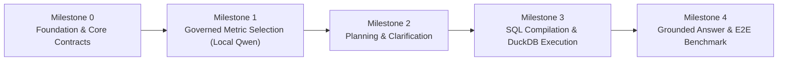

# V0 Implementation Roadmap: Milestones, Issues & Tasks

Tài liệu này chi tiết hóa bản đặc tả [docs/V0.md](file:///home/ducquan/Documents/Python/AI-Fin/Multi-Agent-Finance/agent4/docs/V0.md) thành lộ trình thực thi theo cấu trúc phân cấp: **Milestones $\rightarrow$ Issues $\rightarrow$ Tasks** cho từng module của hệ thống **Financial Analytics Assistant**.

Các Issue đã được tách thành file giao việc độc lập cho agent tại
[docs/issues/README.md](../issues/README.md). Module plan và roadmap vẫn là đặc
tả tổng; file trong `docs/issues/` là đơn vị đưa vào issue loop.

---

## Tổng quan Lộ trình Milestones

| Milestone | Tên Milestone | Tài liệu Đặc tả Module | Trọng tâm chính | Tiêu chuẩn hoàn thành (Exit Criteria) |
| :--- | :--- | :--- | :--- | :--- |
| **M0** | **Foundation & Core Contracts** | [docs/core_and_catalog.md](file:///home/ducquan/Documents/Python/AI-Fin/Multi-Agent-Finance/agent4/docs/core_and_catalog.md) | Xây dựng package `agent4/core/`, chuẩn hóa intake, auth context, error sanitization và metric catalog. | Pass toàn bộ `test_intake_auth_catalog.py`. |
| **M1** | **Governed Metric Selection** | [docs/metrics_selection.md](file:///home/ducquan/Documents/Python/AI-Fin/Multi-Agent-Finance/agent4/docs/metrics_selection.md) | Triển khai retrieval (dense + lexical + RRF), dynamic few-shot, tích hợp LLM local Qwen 4B, và cổng validation authority. | Pass toàn bộ `test_retrieval_and_fewshot.py` và `test_selection_and_metric_validation.py`. |
| **M2** | **Planning & Clarification** | [docs/query_planning.md](file:///home/ducquan/Documents/Python/AI-Fin/Multi-Agent-Finance/agent4/docs/query_planning.md) | Xây dựng Semantic Planner, cơ chế phát hiện câu hỏi mơ hồ (`needs_clarification`) và Plan Validator. | Pass toàn bộ `test_planning_and_plan_validation.py`. |
| **M3** | **SQL Compilation & DuckDB** | [docs/sql_engine.md](file:///home/ducquan/Documents/Python/AI-Fin/Multi-Agent-Finance/agent4/docs/sql_engine.md) | Triển khai SQL Compiler tham số hóa, cổng SQL Safety 7 chốt, và Read-only Execution Engine trên DuckDB. | Pass toàn bộ `test_compiler_safety_execution.py`. |
| **M4.1** | **Result & Grounded Answer** | [docs/grounded_answer.md](file:///home/ducquan/Documents/Python/AI-Fin/Multi-Agent-Finance/agent4/docs/grounded_answer.md) | Triển khai Result Validator, Grounded Answer Generator và Answer Validator có cơ chế fallback an toàn. | Pass toàn bộ `test_result_answer_response.py` & `test_security_redteam.py`. |
| **M4.2** | **Pipeline, API & Benchmark** | [docs/pipeline_and_api.md](file:///home/ducquan/Documents/Python/AI-Fin/Multi-Agent-Finance/agent4/docs/pipeline_and_api.md) | Triển khai Pipeline Orchestrator, Observability, FastAPI endpoint và nghiệm thu 120 câu hỏi Benchmark. | Pass 180/180 tests và 120/120 câu hỏi Benchmark (100%). |

---

## Chi tiết Từng Milestone $\rightarrow$ Issue $\rightarrow$ Task Theo Module

### Milestone 0: Foundation & Core Contracts (M0)
> **Mục tiêu:** Thiết lập nền móng kiến trúc, xử lý lỗi an toàn không rò rỉ dữ liệu, cơ chế xác thực server-side, và Metric Catalog snapshot.

#### Issue M0.1: Core Configuration, Error Sanitization & Boundary Contracts
- **Module:** `agent4/core/`
- **File đích:** `agent4/core/config.py`, `agent4/core/errors.py`, `agent4/core/context.py`
- **Contract ID:** `query.intake.v1`, `auth.policy-context.v1`, Section 1 (`contracts.md`)
- **Tasks chi tiết:**
  - **Task M0.1.1 (Config):** Tạo `config.py` đọc biến môi trường: đường dẫn DuckDB (`data/cfo_warehouse.duckdb`), Ollama / OpenAI-compatible endpoint cho model Qwen 4B (`QWEN_MODEL_NAME`, `QWEN_API_BASE`), query timeout, row cap.
  - **Task M0.1.2 (Error Sanitization):** Triển khai lớp `ContractError` trong `errors.py`. Hiện thực hóa logic lọc sạch (`_sanitize_message`, `_sanitize_details`) đảm bảo thông báo lỗi ra ngoài không bao giờ chứa raw SQL, stack trace, credentials, mật khẩu hoặc số liệu dòng tài chính thô.
  - **Task M0.1.3 (Boundary Key Enforcement):** Viết hàm `enforce_exact_keys()` từ chối bất kỳ request/object nào chứa unknown fields ngay tại ranh giới module.
  - **Task M0.1.4 (Query Intake):** Viết hàm `query_intake()` trong `context.py`: chuẩn hóa khoảng trắng, chữ thường (`normalized_question`), hỗ trợ `vi-VN` và `en-US`, kiểm tra độ dài câu hỏi `<= 500` ký tự, và bỏ qua mọi claims người dùng tự gán trong payload.
  - **Task M0.1.5 (Auth & Policy Context):** Viết hàm `build_auth_context()`: chỉ khởi tạo từ IdP claims và server policy, tính toán `policy_hash` (sha256), fail-closed nếu thiếu thông tin xác thực.

#### Issue M0.2: Metric Catalog & Metadata Governance
- **Module:** `agent4/core/`
- **File đích:** `agent4/core/catalog.py`
- **Contract ID:** `metric.catalog.v1`
- **Tasks chi tiết:**
  - **Task M0.2.1 (Catalog Model):** Định nghĩa schema dataclass/Pydantic cho `MetricDefinition` gồm: `metric_id`, `label`, `label_en`, `description`, `aliases`, `unit`, `kind` (`amount`/`ratio`), `period_type` (`flow`/`snapshot`), `supported_views`, `supported_dimensions`, `supported_operations`, `default_view`, `status` (`approved`/`draft`), `owner`, `verified_handler`, `sql_expr`, `base_relation`.
  - **Task M0.2.2 (Catalog Operations):** Hiện thực hóa `MetricCatalog` với đầy đủ các phương thức: `get()`, `contains()`, `get_capability()`, `list_visible_metrics(auth_context)`, `get_catalog_hash()`.
  - **Task M0.2.3 (Catalog Security Gate):** Đảm bảo metric có `status != "approved"` (như `experimental_cash_burn`) hoặc `verified_handler == False` (như `unverified_custom_kpi`) tuyệt đối không xuất hiện trong danh sách khả dụng cho production selection.
  - **Task M0.2.4 (Verification Test):** Chạy và pass 100% các bài test trong [tests/contracts/test_intake_auth_catalog.py](file:///home/ducquan/Documents/Python/AI-Fin/Multi-Agent-Finance/agent4/tests/contracts/test_intake_auth_catalog.py).

---

### Milestone 1: Governed Metric Selection Pipeline (Local Qwen) (M1)
> **Mục tiêu:** Thiết lập đường cơ sở Full-Catalog (`E0`), xây dựng chỉ mục vector cục bộ (`.npz`), truy hồi lai đa tầng (Dense + Lexical + RRF + Metadata Rerank — `E1`, `E2`), Dynamic Few-shot (`E3`, `E4`), trích xuất metric bằng mô hình local `Qwen3:4b`, chốt chặn `Metrics Validator` (Contract 15), và cơ chế phục hồi có giới hạn (`Bounded Recovery` — `E5`). Chi tiết xem tại [docs/plans/metrics_selection.md](metrics_selection.md) và [docs/metric_selection_evaluation.md](../metric_selection_evaluation.md).

#### Issue M1.0 (M1-S1): Catalog Adapter, Local Qwen Selector, Deterministic Validator & Full-Catalog Baseline (`E0`)
- **Module:** `agent4/metric_selection/`
- **File đích:** `catalog_adapter.py`, `llm_selector.py`, `validator.py`, `eval_adapter.py`, `config.py`
- **Contract ID:** `metric.catalog.v1` (adapter), `metric.selection.llm.v1` (Contract 14), `metric.validation.v1` (Contract 15)
- **Tasks chi tiết:**
  - **Task M1.0.1 (Catalog Adapter):** Ánh xạ 66 `MetricDef` trong `agent4/engine/metrics.py` (`REGISTRY`) sang `MetricCatalog` (`metric.catalog.v1`) trong khi vẫn bảo toàn 15 definitions mặc định cho bộ contract test v1.
  - **Task M1.0.2 (LLM Selector & Draft Sanitizer):** Xây dựng `LLMMetricSelector` (`Qwen3:4b` qua Ollama + deterministic test double) và `validate_llm_selection_draft()` chặn mọi câu lệnh SQL, công thức, tên bảng/cột vật lý.
  - **Task M1.0.3 (Metrics Validation Gate):** Hiện thực hóa `validate_metrics()` với đầy đủ 8 bước kiểm định (Contract 15).
  - **Task M1.0.4 (Baseline `E0` & Verification):** Chuyển `tests/contracts/test_selection_and_metric_validation.py` sang gọi code production (`7/7` pass) và chạy thực nghiệm **Baseline `E0` (Full Catalog $\rightarrow$ Qwen3:4b $\rightarrow$ Validator)** qua `vals/run_eval.py`.

#### Issue M1.1a (M1-S2): Embedding Provider, Document Builder & Persisted Offline Vector Index
- **Module:** `agent4/metric_selection/`
- **File đích:** `embedding.py`, `index.py`, `config.py`
- **Contract ID:** `metric.embedding-provider.v1` (Contract 5), `metric.document-builder.v1` (Contract 6)
- **Tasks chi tiết:**
  - **Task M1.1a.1 (Document Builder):** Hiện thực hóa `build_metric_documents()` cho các metric `status == "approved"`, không chứa SQL hay dữ liệu giao dịch.
  - **Task M1.1a.2 (Configurable Embedding Provider):** Hỗ trợ `qwen3-embedding:0.6b` qua Ollama và deterministic hashing provider cho offline tests; xử lý đúng lỗi `retrieval_unavailable` (`retryable=True`).
  - **Task M1.1a.3 (Offline NumPy Index):** Hiện thực hóa `MetricVectorIndex` (`.npz` + JSON metadata) hỗ trợ `build_index`, `load_index`, `rebuild_index`, và `is_index_stale` theo `catalog_hash`.
  - **Task M1.1a.4 (Verification):** Pass `3/3` tests trong `TestEmbeddingAndDocumentBuilderContracts` trên code production.

#### Issue M1.1 (M1-S3): Online Hybrid Metric Retrieval & Fusion (`E1`, `E2`)
- **Module:** `agent4/metric_selection/`
- **File đích:** `dense.py`, `lexical.py`, `fusion.py`, `rerank.py`, `orchestrator.py`
- **Contract ID:** `metric.retrieval.dense.v1`, `lexical.v1`, `fusion.v1`, `rerank.v1`, `orchestrator.v1` (Contracts 7–11)
- **Tasks chi tiết:**
  - **Task M1.1.1 (Dense & Lexical Retrievers):** Xây dựng `dense_retrieve()` (cosine similarity trên vector chuẩn hóa) và `lexical_retrieve()` (khớp nhãn, `aliases`/`synonyms`, token chuẩn hóa).
  - **Task M1.1.2 (RRF Fusion & Metadata Reranker):** Triển khai `fuse_candidates()` ($k=60$) và `rerank_candidates()` (`label_match`, `view_compatibility`, `language_match`).
  - **Task M1.1.3 (Retrieval Orchestrator):** Triển khai `orchestrate_retrieval()` trả về 3 trạng thái chuẩn (`candidates_found`, `empty_candidates`, `retrieval_unavailable`).
  - **Task M1.1.4 (Verification & Experiments `E1`, `E2`):** Pass `5/5` tests trong `TestMetricRetrievalPipelineContracts`; chạy thực nghiệm `E1` (Dense) và `E2` (Hybrid) tại $K \in \{5, 10, 12, 15\}$, đánh giá `Complete Gold Set Recall@K` và đối chiếu với `E0`.

#### Issue M1.2 (M1-S4): Dynamic Few-shot Retrieval, Bank Governance & Ablation (`E3`, `E4`)
- **Module:** `agent4/metric_selection/`
- **File đích:** `agent4/metric_selection/fewshot.py`
- **Contract ID:** `fewshot.example-bank.v1` (Contract 12), `fewshot.retrieval.dynamic.v1` (Contract 13)
- **Tasks chi tiết:**
  - **Task M1.2.1 (Example Bank Governance):** Hỗ trợ `DEFAULT_FEWSHOT_BANK` và bộ nạp chuẩn hóa `data/example_bank.jsonl`, lọc `quality_status == "approved"` và chặn prompt injection.
  - **Task M1.2.2 (Multi-Strategy Few-shot Retriever):** Hỗ trợ các chiến lược `zero`, `static`, `similarity`, `coverage`, `hybrid` với bất biến bắt buộc $\text{example.metric\_ids} \subseteq \text{candidate\_metric\_ids}$ (`compatible_only=True`), `self-exclusion`, và `token_budget`.
  - **Task M1.2.3 (Verification & Ablation `E3`, `E4`):** Pass `3/3` tests trong `TestDynamicFewShotContracts` (đạt 11/11 toàn file `test_retrieval_and_fewshot.py`) và chạy thực nghiệm `E3` (Static Few-shot) vs `E4` (Dynamic Few-shot).

#### Issue M1.3 (M1-S5): Bounded Recovery, End-to-End Selection Integration & Submission Gate (`E5`)
- **Module:** `agent4/metric_selection/`
- **File đích:** `recovery.py`, `orchestrator.py`, `llm_selector.py`, `validator.py`, `config/selection.yaml`
- **Contract ID:** Toàn bộ Contracts 5 $\rightarrow$ 15
- **Tasks chi tiết:**
  - **Task M1.3.1 (Bounded Recovery):** Triển khai `recovery.py` xử lý có giới hạn (`max_retries <= 1`) các tình huống `empty_candidates`, `retrieval_unavailable`, lỗi JSON schema, và mở rộng ứng viên có kiểm soát mà tuyệt đối không đi vòng qua `validate_metrics()`.
  - **Task M1.3.2 (Full Verification & Experiment `E5`):** Pass toàn bộ **18/18 contract tests** của Module 2 trên code production, chạy thực nghiệm `E5`, tổng hợp bảng so sánh `E0`–`E5`, và khóa cấu hình `config/selection.yaml`.

#### Issue M1.4 (M1-S6): Multi-Tier Governed Cache (L1 Artifact & L2 Embedding/Selection Cache)
- **Module:** `agent4/core/`, `agent4/metric_selection/`
- **File đích:** `agent4/core/cache.py`, `agent4/metric_selection/index.py`, `agent4/metric_selection/embedding.py`, `agent4/metric_selection/fewshot.py`, `agent4/metric_selection/orchestrator.py`
- **Contract ID:** `cache.governed.v1`, `metric.embedding-provider.v1`, `metric.retrieval.orchestrator.v1`
- **Tasks chi tiết:**
  - **Task M1.4.1 (`LRUTTLCache` & Scoped Key Builder):** Xây dựng `agent4/core/cache.py` với giới hạn `max_entries`, `ttl_seconds`, `max_rows_per_entry`, `clone_on_read=True` (bảo toàn tính bất biến) và hàm tạo khóa bắt buộc nhúng `tenant_id`, `policy_hash`, `catalog_hash`.
  - **Task M1.4.2 (L1 Artifact Memory Cache):** Lưu `MetricVectorIndex` (`.npz`) và `ExampleBank` (`jsonl`) trên RAM theo `(path, mtime_ns, catalog_hash)` (`maxsize=2`), tránh đọc đĩa lặp lại ở mỗi request.
  - **Task M1.4.3 (L2 Embedding & Selection Cache):** Cache vector nhúng câu hỏi và kết quả truy hồi/chọn metric đã qua kiểm duyệt; tuyệt đối không cache các lỗi tạm thời (`retrieval_unavailable`).
  - **Task M1.4.4 (Verification):** Pass toàn bộ `tests/contracts/test_cache_governance.py`.

---

### Milestone 2: Query Planning & Plan Validation (M2)
> **Mục tiêu:** Chuyển đổi yêu cầu người dùng thành bản kế hoạch ngữ nghĩa độc lập với cơ sở dữ liệu vật lý, phát hiện câu hỏi mơ hồ, hỗ trợ hỏi lại có hướng dẫn đa lượt và thẩm định tính hợp lệ của ranh giới truy vấn.

#### Issue M2.1: Semantic Query Planner
- **Module:** `agent4/planning/`
- **File đích:** `agent4/planning/planner.py`
- **Contract ID:** `query.planning.v1`
- **Tasks chi tiết:**
  - **Task M2.1.1 (Slot Extraction):** Trích xuất các thành phần ngữ nghĩa từ câu hỏi: khoảng thời gian (`start`, `end`, `as_of`, `grain`), chiều phân tích (`dimensions`), bộ lọc (`filters`), góc nhìn (`view`), phép toán (`operation`), sắp xếp (`sort`, `top_k`).
  - **Task M2.1.2 (Clarification Detector):** Phát hiện các trường hợp câu hỏi thiếu thông tin cốt lõi (thiếu thời gian, mơ hồ giữa lợi nhuận gộp/ròng, mơ hồ giữa công nợ phải thu/phải trả). Trả về trạng thái `status: "needs_clarification"`, điền `unresolved_slots` và `question_for_user`. Tuyệt đối không tự suy đoán.
  - **Task M2.1.3 (Draft Safety Check):** Đảm bảo `SemanticPlanDraft` tuyệt đối không chứa câu lệnh SQL hay tên bảng vật lý.

#### Issue M2.2: Semantic Plan Validation Gate
- **Module:** `agent4/planning/`
- **File đích:** `agent4/planning/validator.py`
- **Contract ID:** `query.plan-validation.v1`
- **Tasks chi tiết:**
  - **Task M2.2.1 (Period Type vs Time Mode):** Kiểm tra metric kiểu `snapshot` (như `cash_balance`, `ar_balance`, `loan_balance`) bắt buộc dùng `time.mode == 'as_of'`. Metric kiểu `flow` bắt buộc dùng `time.mode == 'range'`.
  - **Task M2.2.2 (Allowlist Validation):** Đối chiếu `dimensions` và `filters` với danh mục cho phép (`ALLOWED_DIMENSIONS`, `ALLOWED_FILTER_FIELDS`). Chặn các toán tử lạ ngoài `=` và `IN`.
  - **Task M2.2.3 (Limits Enforcement):** Kiểm tra giới hạn số ngày tối đa (`max_days <= 750`), `start <= end`, và `top_k <= 100`.
  - **Task M2.2.4 (Trust Boundary Sealing):** Tạo đối tượng `ValidatedPlan` bất biến, gắn `tenant_id`, `policy_hash`, `catalog_hash`, và danh sách `applied_defaults`.
  - **Task M2.2.5 (Verification Test):** Chạy và pass 100% các bài test trong [tests/contracts/test_planning_and_plan_validation.py](file:///home/ducquan/Documents/Python/AI-Fin/Multi-Agent-Finance/agent4/tests/contracts/test_planning_and_plan_validation.py).

#### Issue M2.3: Interactive Clarification Mode & Multi-turn Session Resolution
- **Module:** `agent4/planning/`
- **File đích:** `agent4/planning/clarification.py`
- **Contract ID:** `query.clarification.v1`, `query.planning.v1`, `query.plan-validation.v1`
- **Tasks chi tiết:**
  - **Task M2.3.1 (Structured Clarification & Suggested Choices):** Sinh cấu trúc `clarification` gồm `unresolved_slots`, `partial_interpretation` (các slot đã hiểu) và `slot_prompts` kèm danh sách lựa chọn gợi ý (`choices`) song ngữ lấy từ `MetricCatalog` (lọc theo `auth_context`) và từ điển allowlist.
  - **Task M2.3.2 (Multi-turn Session Store & Slot Merging):** Lưu trạng thái chờ làm rõ trong `ClarificationSessionStore` (khóa theo `(tenant_id, user_id, session_id)`, `ttl=300s`, `max_turns=3`), hợp nhất câu trả lời bổ sung ở lượt tiếp theo và bắt buộc kiểm định lại qua `validate_semantic_plan_draft()`.
  - **Task M2.3.3 (Verification Test):** Pass toàn bộ `tests/contracts/test_clarification_mode.py`.

---

### Milestone 3: SQL Compilation, Safety & DuckDB Execution (M3)
> **Mục tiêu:** Biên dịch an toàn sang SQL tham số hóa từ ValidatedPlan, kiểm tra an toàn 7 chốt, và thực thi read-only trên DuckDB thật kèm L3 Execution Cache.

#### Issue M3.1: Deterministic SQL Compiler
- **Module:** `agent4/sql/`
- **File đích:** `agent4/sql/compiler.py`
- **Contract ID:** `sql.compiler.v1`
- **Tasks chi tiết:**
  - **Task M3.1.1 (Trust Gate Input):** Compiler chỉ nhận đối tượng `ValidatedPlan` hợp lệ, từ chối mọi đầu vào là chuỗi thô hay draft chưa qua kiểm duyệt.
  - **Task M3.1.2 (View & Dimension Mapping):** Ánh xạ view nghiệp vụ (`mgmt` $\rightarrow$ `v_mgmt`, `tax` $\rightarrow$ `v_tax`, `gl` $\rightarrow$ `v_gl`, `budget` $\rightarrow$ `budget`). Ánh xạ chuẩn các chiều phân tích (`month`, `quarter`, `year`, `branch_code`, `product_line`, `cost_category`, `department_code`, `partner_code`, `segment`).
  - **Task M3.1.3 (Parameterization & Row Cap):** Mọi giá trị ngày tháng, mã chi nhánh, mã đối tác đều được chuyển thành bind parameters (`?`), không nối chuỗi. Luôn luôn có `LIMIT ?` với `row_cap <= 1000`. Ép kiểu an toàn `CAST(year_no AS INTEGER) * 100` khi xử lý bảng ngân sách tránh lỗi tràn số INT16.
  - **Task M3.1.4 (Deterministic Ordering):** Đảm bảo mệnh đề `ORDER BY` sắp xếp xác định trên tất cả các chiều phân tích khi thực hiện breakdown đa chiều.
  - **Task M3.1.5 (Fingerprinting):** Sinh mã băm định danh truy vấn `query_fingerprint` dạng `sha256:...`.

#### Issue M3.2: SQL Safety Validation Gate
- **Module:** `agent4/sql/`
- **File đích:** `agent4/sql/safety.py`
- **Contract ID:** `sql.safety.v1`
- **Tasks chi tiết:**
  - **Task M3.2.1 (7 Security Checks):** Hiện thực hóa đầy đủ 7 chốt kiểm duyệt an toàn:
    1. `read_only`: Chỉ chấp nhận `SELECT` / `WITH`, không có từ khóa DML/DDL (`INSERT`, `UPDATE`, `DELETE`, `DROP`, `ALTER`, `COPY`, `ATTACH`, `PRAGMA`).
    2. `single_statement`: Chặn triệt để nhiều câu lệnh ghép bằng dấu chấm phẩy (`;`).
    3. `approved_relations`: Chỉ truy vấn các view/bảng được cấp phép (`v_mgmt`, `v_tax`, `v_gl`, `budget`, ...).
    4. `approved_columns`: Không cho phép truy xuất các cột nhạy cảm (`password`, `secret`, ...).
    5. `parameterized`: Không chứa literal chuỗi lạ ngoài tham số hóa.
    6. `row_cap_present`: Bắt buộc có mệnh đề `LIMIT`.
    7. `tenant_scope_present`: Kiểm tra tenant scope và khớp `catalog_hash`.
  - **Task M3.2.2 (Rejection Details):** Từ chối fail-closed và ghi nhận chi tiết chốt kiểm tra bị vi phạm.

#### Issue M3.3: Read-Only SQL Execution on DuckDB & L3 Result Cache
- **Module:** `agent4/sql/`
- **File đích:** `agent4/sql/executor.py`
- **Contract ID:** `sql.execution.v1`, `cache.governed.v1`
- **Tasks chi tiết:**
  - **Task M3.3.1 (Read-Only Connection):** Kết nối tới `data/cfo_warehouse.duckdb` bằng `duckdb.connect(db_path, read_only=True)`.
  - **Task M3.3.2 (Timeout & Outage Handling):** Đo thời gian thực thi, ngắt truy vấn nếu vượt quá timeout, chuyển lỗi gián đoạn thành trạng thái `temporarily_unavailable` có cờ `retryable: true`.
  - **Task M3.3.3 (Watermark & Column Formatting):** Trích xuất tự động `data_watermark` từ bảng `company_info` (`as_of_date`), format kết quả thành các đối tượng `columns` (kèm `type`, `unit`) và `rows` dạng chuỗi số thập phân có cấu trúc.
  - **Task M3.3.4 (L3 SQL Result Cache):** Tích hợp cache kết quả SQL theo khóa `(tenant_id, catalog_hash, data_watermark, query_fingerprint, row_cap)` với giới hạn `max_rows_per_entry <= 200`.
  - **Task M3.3.5 (Verification Test):** Chạy và pass 100% các bài test trong [tests/contracts/test_compiler_safety_execution.py](file:///home/ducquan/Documents/Python/AI-Fin/Multi-Agent-Finance/agent4/tests/contracts/test_compiler_safety_execution.py).

---

### Milestone 4: Grounded Answer, Evidence Preview, E2E Pipeline & Evaluation Benchmark (M4)
> **Mục tiêu:** Kiểm định kết quả truy vấn, sinh câu trả lời bám sát số liệu kèm Preview Evidence, tích hợp toàn bộ pipeline và xác nhận độ chính xác qua bộ câu hỏi benchmark.

#### Issue M4.1: Result Validation, Grounded Answer Generation & Preview Evidence
- **Module:** `agent4/answer/`
- **File đích:** `result_validator.py`, `generator.py`, `validator.py`, `evidence.py`
- **Contract ID:** `result.validation.v1`, `answer.generation.v1`, `answer.validation.v1`, `evidence.preview.v1`
- **Tasks chi tiết:**
  - **Task M4.1.1 (Result Validator):** Kiểm tra schema cột không trùng lặp, giá trị số không bị `NaN` hay `Infinity`. Xử lý an toàn mẫu số bằng 0 của ratio (`ratio_undefined` kèm `val = None`). Phát hiện và gắn cảnh báo `partial_data_watermark` khi kỳ truy vấn chạm hoặc vượt mốc `2026-10-14` (kỳ chưa đóng sổ). Phát hiện `no_data` khi kết quả trả về 0 dòng hoặc ngoài dải thời gian dữ liệu.
  - **Task M4.1.2 (Answer Generator):** Sinh câu trả lời có cấu trúc với danh sách các khẳng định số liệu (`claims`), mỗi claim liên kết chặt với `source_columns` và `source_rows`. Ưu tiên deterministic templates cho câu trả lời định lượng chính xác.
  - **Task M4.1.3 (Answer Validator):** Đối chiếu từng con số trong câu trả lời với kết quả thực tế. Chặn đứng các suy diễn nguyên nhân vô căn cứ (ví dụ tự giải thích *"do nắng nóng"*, *"do sự kiện ra mắt"* khi query không trích xuất text diễn giải). Chặn rò rỉ prompt injection từ cột description của nhà cung cấp `NCC-MK-DG` (`A8_PROMPT_INJECTION`).
  - **Task M4.1.4 (Automatic Fallback):** Nếu answer draft của LLM bị validator từ chối, tự động thay thế bằng deterministic safe template, tuyệt đối không trả câu trả lời lỗi ra ngoài.
  - **Task M4.1.5 (Preview Evidence Builder):** Triển khai `build_evidence_preview()` trong `agent4/answer/evidence.py` tạo `claim_citations` (liên kết từng con số tới dòng/cột nguồn), `preview_table` (`sample_rows` giới hạn tối đa 5 dòng đã khử độc A8 injection), `metric_explanations` (từ `MetricCatalog` kèm giải thích sổ `mgmt`/`tax`) và `verification_badge`.

#### Issue M4.2: End-to-End Orchestrator Pipeline & Observability
- **Module:** `agent4/`
- **File đích:** `agent4/pipeline.py`, `agent4/api.py`
- **Contract ID:** `query.response.v1`, `observability.pipeline.v1`
- **Tasks chi tiết:**
  - **Task M4.2.1 (Pipeline Orchestrator):** Xây dựng hàm `run_governed_pipeline(request, idp_claims, server_policy)` liên kết thông suốt cả 9 bước cùng Multi-Tier Cache (`M1.4`, `M3.3`), `ClarificationSessionStore` (`M2.3`) và `Preview Evidence` (`M4.1`). Xử lý chuẩn 7 trạng thái phản hồi cuối: `ready`, `needs_clarification`, `unsupported`, `forbidden`, `no_data`, `temporarily_unavailable`, `error`.
  - **Task M4.2.2 (Provenance & Opt-in Evidence/Clarification Assembly):** Gắn đầy đủ thông tin truy xuất nguồn gốc (`catalog_hash`, `data_watermark`, `source`, `query_fingerprint`) và đính kèm có điều kiện khối `evidence` / `clarification` theo `options`.
  - **Task M4.2.3 (Observability Logger):** Thu thập telemetry, latency từng stage, `cache_stats` (`hits`, `misses`, `estimated_memory_kb`), token usage, candidate count. Bảo đảm không log Chain-of-Thought, raw SQL công khai, credential hay raw financial rows.
  - **Task M4.2.4 (FastAPI Service):** Tạo endpoint `POST /v1/query` tiếp nhận `query.intake.v1` và trả về `query.response.v1`.

#### Issue M4.3: Full Suite Verification & 120-Question Benchmark
- **Module:** `tests/`, `scripts/`
- **File đích:** `tests/benchmark/test_e2e_benchmark_db.py`, `scripts/evaluate_contract_benchmark.py`
- **Tasks chi tiết:**
  - **Task M4.3.1 (Unit & Security Tests):** Chạy toàn bộ test suite (`pytest tests/`) đạt tỷ lệ pass 100%, bao gồm các bài kiểm tra tấn công Red-Team (SQLi, direct prompt injection, indirect injection A8) và contract tests cho Cache, Clarification, Evidence Preview.
  - **Task M4.3.2 (Benchmark Runner):** Chạy `python scripts/evaluate_contract_benchmark.py` đối chiếu bộ câu hỏi song ngữ với cơ sở dữ liệu `cfo_warehouse.duckdb`.
  - **Task M4.3.3 (Ground Truth Verification):** Xác nhận số liệu của các sự kiện nghiệp vụ trong `cfo_warehouse_ground_truth.json` khớp chính xác 100%:
    - `A1_MARKETING_SPIKE` (BM-023: chi phí marketing T9 tăng lên 1,39 tỷ).
    - `A2_DISTRESSED_CUSTOMER` (BM-067: nợ quá hạn của KH0082).
    - `A7_IT_MARGIN_SQUEEZE` (BM-022 & BM-069: biên lãi gộp IT giảm từ T4/2026).
    - `A9_ELECTRICITY_HCM` (BM-043 & BM-070: tiền điện HCM T6/2026 tăng vọt 76,4 triệu).
    - Chênh lệch chi phí giữa view `mgmt` và `tax` trong tháng 08/2026 (BM-061 vs BM-062).
  - **Task M4.3.4 (Documentation & Sign-off):** Cập nhật nhật ký hoàn thành V0 sẵn sàng cho các vòng cải tiến V1 tiếp theo.
