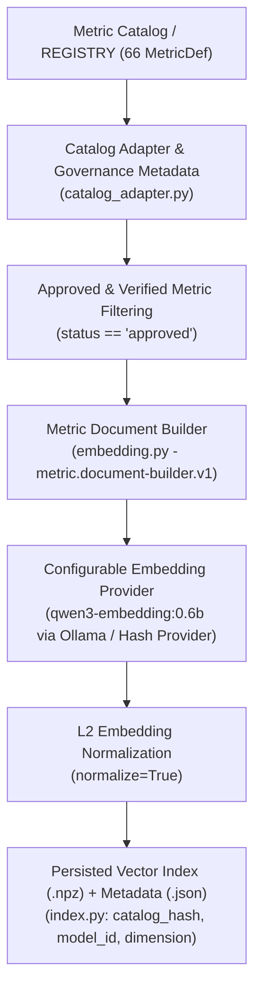
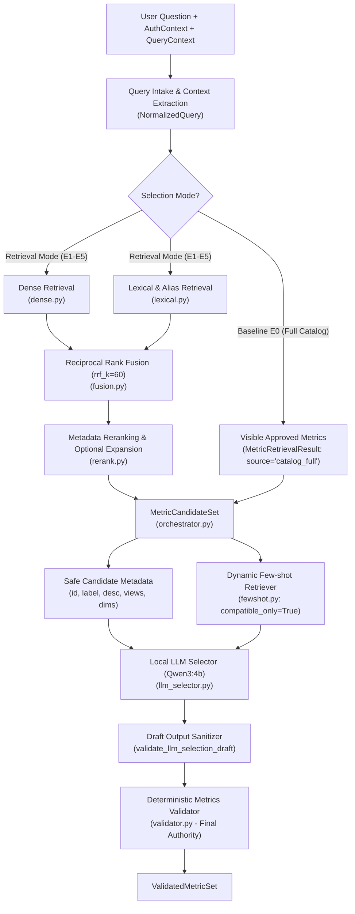
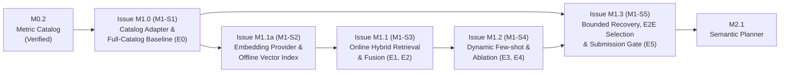

# Module 2: Governed Metric Selection — Architecture, Implementation Plan & Benchmark Roadmap (`agent4/metric_selection/`)

> **Milestone:** M1 — Governed Metric Selection Pipeline (Sub-milestones `M1-S1` $\rightarrow$ `M1-S5`)  
> **Thư mục mã nguồn:** `agent4/metric_selection/`  
> **Contracts phụ trách:** Contracts 5, 6, 7, 8, 9, 10, 11, 12, 13, 14, 15 trong [contracts.md](../../contracts.md)  
> **Tài liệu liên quan:**  
> - Đánh giá & Thực nghiệm: [docs/metric_selection_evaluation.md](../metric_selection_evaluation.md) | [docs/evaluation.md](../evaluation.md)  
> - Quyết định Kiến trúc (ADR): [docs/adr_metric_selection.md](../adr_metric_selection.md)  
> - Issue Backlog: [docs/issues/README.md](../issues/README.md)  
> **File kiểm thử nghiệm thu (Contract Gate):**  
> - [tests/contracts/test_retrieval_and_fewshot.py](../../tests/contracts/test_retrieval_and_fewshot.py)  
> - [tests/contracts/test_selection_and_metric_validation.py](../../tests/contracts/test_selection_and_metric_validation.py)

---

## 1. Module Overview

### 1.1. Goals (Mục tiêu tối ưu hóa)
Module `agent4/metric_selection/` chuyển đổi câu hỏi tài chính đã chuẩn hóa (`NormalizedQuery`) cùng ngữ cảnh phân quyền (`AuthContext`, `QueryContext`) thành tập chỉ tiêu tài chính đã được thẩm định (`ValidatedMetricSet`). Kế hoạch thiết kế lại này hướng tới 6 mục tiêu cốt lõi theo thứ tự ưu tiên:
1. **End-to-end correctness & data safety**: Đảm bảo metric được chọn khớp chính xác ý định tài chính và tuân thủ tuyệt đối quyền truy cập (`allowed_views`, `allowed_metrics`), trạng thái phê duyệt (`status == "approved"`), nguồn xử lý (`verified_handler == True`) và tính tương thích kỳ kế toán (`flow` vs `snapshot`).
2. **Metric selection accuracy**: Tối đa hóa `Exact Set Match` và `Micro/Macro F1` cho cả câu hỏi 1 metric, nhiều metric (`multi_metrics`), câu hỏi mơ hồ (`ambiguous` $\rightarrow$ `needs_clarification`), và câu hỏi ngoài phạm vi (`unsupported`).
3. **Retrieval recall cho truy vấn đa chỉ tiêu (Multi-metric queries)**: Tối ưu hóa **Complete Gold Set Recall@K** (`all_metrics_covered_at_k`), đảm bảo toàn bộ các metric cần thiết cho một câu hỏi so sánh/tổng hợp đều nằm trong `MetricCandidateSet`.
4. **Reproducibility & deterministic validation**: Mọi bước từ xây dựng index, truy hồi, trộn RRF, rerank đến thẩm định cuối cùng đều có tính tất định (deterministic), gắn mã băm phiên bản (`catalog_hash`, `index_version`, `config_fingerprint`).
5. **Inference efficiency trên phần cứng cục bộ (Local hardware)**: Vận hành hoàn toàn local qua Ollama (`Qwen3:4b` cho LLM selector, `qwen3-embedding:0.6b` cho dense retrieval) và lưu trữ vector nhẹ bằng NumPy (`.npz`), không phụ thuộc API trả phí bên ngoài hay cơ sở dữ liệu vector cồng kềnh.
6. **Benchmark-driven modularity**: Không mặc định kiến trúc phức tạp là tốt hơn. Bắt đầu từ **Full-Catalog Baseline (`E0`)**, đo lường thực nghiệm từng thành phần (`E1` Dense, `E2` Hybrid, `E3` Static Few-shot, `E4` Dynamic Few-shot, `E5` Recovery/Fallback) và chỉ giữ lại cấu hình vượt qua cổng quyết định (Decision Gate).

### 1.2. Responsibilities (Trách nhiệm của Module)
- Chuyển đổi và đồng bộ siêu dữ liệu từ `MetricCatalog` (`agent4/core/catalog.py`) và `REGISTRY` (`agent4/engine/metrics.py`) thông qua tầng `CatalogAdapter` có kiểm soát quản trị (governance metadata).
- Xây dựng và lưu trữ chỉ mục vector cục bộ (Offline Stage) cho các metric có `status == "approved"`, kèm cơ chế phát hiện chỉ mục lỗi thời (`stale-index detection`) qua `catalog_hash`.
- Thu hẹp tập ứng viên (`MetricCandidateSet`) ở Online Stage bằng Full-Catalog pass-through (`E0`) hoặc Hybrid Retrieval (Dense + Lexical + RRF Fusion + Metadata Reranking).
- Truy hồi ví dụ hướng dẫn (`Dynamic Few-shot`) đã được duyệt (`quality_status == "approved"`), sạch prompt injection và tương thích tuyệt đối với tập ứng viên ($\text{example.metric\_ids} \subseteq \text{candidate\_metric\_ids}$).
- Gọi mô hình cục bộ `Qwen3:4b` với đầu ra có cấu trúc JSON (`metric.selection.llm.v1`) để đề xuất trạng thái (`resolved`, `ambiguous`, `unsupported`) và danh sách `metric_ids`.
- Thực thi chốt chặn thẩm định cuối cùng (`Metrics Validator` — `metric.validation.v1`) và cơ chế phục hồi có giới hạn (`Bounded Recovery`) dựa trên tín hiệu quan sát được tại thời điểm suy luận.

### 1.3. Non-Goals (Ngoài phạm vi)
- **Không sinh SQL hoặc công thức kế toán**: LLM và bộ truy hồi tuyệt đối không sinh câu lệnh `SELECT`, công thức TK 511/632, tên bảng vật lý (`gl_wide`, `v_mgmt`) hay tên cột (`debit_amount`, `credit_amount`).
- **Không lập kế hoạch thời gian/chiều phân tích hoàn chỉnh**: Việc tách `start_date`, `end_date`, `as_of`, `filters`, `sort`, `top_k` thuộc về Module 3 (`Query Planning` — Milestone M2). Module 2 chỉ sử dụng `query_context` (nếu đã có `requested_view`, `requested_dimensions`, `requested_operation`) để kiểm tra tính tương thích capability của metric.
- **Không triển khai hạ tầng phân tán**: Không đưa vào Milvus, Qdrant, Elasticsearch hay dịch vụ cloud trả phí khi quy mô catalog là 15–66 metrics.

### 1.4. Competition Requirements & Trust Boundaries (Ranh giới Tin cậy)
1. **Retrieval chỉ tạo `MetricCandidateSet`, không phải quyết định cuối cùng**: Dense retriever, Lexical retriever, RRF Fusion và Reranker chỉ tìm và xếp hạng các metric `approved` trong `MetricCatalog`, không tự bịa `metric_id` ngoài catalog và không cấp quyền truy cập.
2. **Dynamic Few-shot không mở rộng candidate set hay quyền hạn**: Ở chế độ production (`compatible_only=True`), mọi ví dụ được chọn phải thỏa mãn bất biến:
   $$\text{example.expected\_selection.metric\_ids} \subseteq \text{candidate\_metric\_ids}$$
3. **Output của LLM (`Qwen3:4b`) luôn là `untrusted draft`**: LLM chỉ được chọn metric trong `candidate_metric_ids`, không được sinh SQL, công thức, tên bảng/cột vật lý, và không được tự thay đổi `view`, `tenant_id` hay `roles`.
4. **Metrics Validator (`validator.py`) là Authority cuối cùng**: Mọi đầu ra từ LLM (kể cả sau bước retry/recovery) đều bắt buộc đi qua `validate_metrics()`. Không một cơ chế fallback nào được phép đi vòng qua (bypass) Validator.

---

## 2. Current State & Repository Audit

### 2.1. kết quả Kiểm toán Hiện trạng Repository (Mandatory Repository Inspection)

| Hạng mục kiểm toán | Hiện trạng thực tế trong Repository (Confirmed Evidence) | Hệ quả kỹ thuật |
| :--- | :--- | :--- |
| **1. Cấu trúc `agent4/metric_selection/`** | Chỉ mới có 3 file khung: `__init__.py` (7 dòng), `config.py` (146 dòng), `errors.py` (42 dòng). Chưa có bất kỳ file thực thi nào (`embedding.py`, `dense.py`, `lexical.py`, `fusion.py`, `rerank.py`, `orchestrator.py`, `fewshot.py`, `llm_selector.py`, `validator.py`). | Toàn bộ logic Contracts 5–15 hiện mới nằm trong bản mẫu `tests/contract_harness.py` (dòng 700–1410). |
| **2. Kiểm thử Contract hiện tại** | `tests/contracts/test_retrieval_and_fewshot.py` (11 tests) và `tests/contracts/test_selection_and_metric_validation.py` (7 tests) đang import trực tiếp từ `tests.contract_harness`, chưa gọi code production trong `agent4/metric_selection/`. (Trong khi M0 `test_intake_auth_catalog.py` đã chuyển sang gọi `agent4.core.*`). | Khi triển khai M1, phải chuyển import của 2 file test này sang `agent4.metric_selection.*` mà vẫn giữ nguyên 18/18 bài test và assertions. |
| **3. Cấu trúc Metric Catalog & Số lượng Metric thực tế** | Tồn tại **2 nguồn metric** song song:<br/>- `agent4/core/catalog.py` (`MetricCatalog`, `DEFAULT_METRICS_DEFINITIONS`): **15 metrics** (13 `approved` + 1 `draft` `experimental_cash_burn` + 1 `verified_handler=False` `unverified_custom_kpi`).<br/>- `agent4/engine/metrics.py` (`M`, `REGISTRY`): **66 metrics** (`MetricDef` frozen dataclass) chia theo P&L, OPEX, Balances, Cash Flow, AR/AP, Anomalies, Planning, Tax. | `vals/run_eval.py`, `data/eval/contract_benchmark_questions.jsonl` (140 câu), `data/example_bank.jsonl` (15 ví dụ) và `config/metric_relationships.yaml` đều kiểm tra và tham chiếu tới **66 metric canonical trong `REGISTRY`**, trong khi 18 contract tests v1 dùng **15 metric trong `DEFAULT_METRICS_DEFINITIONS`**. |
| **4. Tích hợp LLM & Embedding hiện tại** | - `agent4/core/config.py`: `qwen_base_url = "http://localhost:11434/api/chat"`, `qwen_model = "qwen3:4b"`.<br/>- `config/selection.yaml`: `llm.model: qwen3:4b`, `embedding.provider: hashing`, `embedding.model: hashing-v1`, `dimensions: 768`.<br/>- `agent4/metric_selection/config.py`: `LLMSelectionConfig.model` mặc định `"qwen3:8b"`, và `EmbeddingConfig.provider` bị khóa cứng `Literal["hashing"] = "hashing"`. | Cần mở rộng `EmbeddingConfig.provider` trong `agent4/metric_selection/config.py` để hỗ trợ `Literal["hashing", "ollama", "mock"]` và đồng bộ model mặc định `qwen3:4b` / `qwen3-embedding:0.6b`. |
| **5. Thiết kế Offline / Online Retrieval hiện tại** | Trong `tests/contract_harness.py`, `EmbeddingProvider` dùng băm SHA-256 16 chiều và `dense_retrieve` thực chất đang chấm điểm dựa trên chuỗi con (`alias in q_lower`) chứ chưa nhân vô hướng vector thật và chưa tách biệt bước xây dựng chỉ mục Offline (`.npz`) với bước truy vấn Online. | Cần thiết kế tách bạch Offline Index Builder (`index.py` lưu `.npz` + JSON metadata) và Online Dense/Lexical Retriever thực thụ. |
| **6. Kho ví dụ Few-shot (`data/example_bank.jsonl`)** | `data/example_bank.jsonl` có 15 ví dụ dùng metric ID của `REGISTRY` (`debt_balance`, `ap_by_vendor`, `selling_expenses`...) với schema `{"id", "question", "answer", "decision_tags", "confusable_metrics"}`, khác với schema `fewshot.example-bank.v1` (`example_id`, `expected_selection`, `context_constraints`, `quality_status`, `token_count`). | Module `fewshot.py` cần có bộ chuẩn hóa (normalizer/loader) đọc được cả `DEFAULT_FEWSHOT_BANK` (schema Contract 12 cho contract test) và `data/example_bank.jsonl` (cho benchmark v2). |
| **7. Hạ tầng Đánh giá (`vals/run_eval.py`)** | `vals/run_eval.py` (1154 dòng) đã hoàn thiện và hỗ trợ `--mode retrieval`, `--mode selection`, `--mode e2e`, chấm `recall_at_k`, `precision_at_k`, `all_metrics_covered_at_k` (Complete Gold Set Recall@K), `reciprocal_rank` (MRR), `exact_match_accuracy`, micro P/R/F1, `invalid_metric_rate`, latency p50/p95. Tuy nhiên **chưa có production adapter** (`predict(request) -> dict`) nối `agent4/metric_selection/` vào `vals/run_eval.py`. | Cần xây dựng `agent4/metric_selection/eval_adapter.py` ngay từ Milestone đầu tiên (`M1-S1` / Issue `M1.0`) để chạy benchmark thật qua `vals/run_eval.py`. |

### 2.2. Đối chiếu Tương thích `MetricDef` (`agent4/engine/metrics.py`) vs `MetricCatalog` (`contracts.md`)

Bảng dưới đây xác nhận chính xác sự khác biệt giữa `MetricDef` (66 metrics trong `agent4/engine/metrics.py`) và hợp đồng `metric.catalog.v1` / `metric.validation.v1`:

| Trường trong Contract (`metric.catalog.v1`) | Trường tương ứng trong `MetricDef` (`agent4/engine/metrics.py`) | Trạng thái | Quy tắc ánh xạ trong `CatalogAdapter` (`catalog_adapter.py`) |
| :--- | :--- | :--- | :--- |
| `metric_id: str` | `id: str` | Khác tên trường | `metric_id = metric_def.id` |
| `label: str` | `label: str` | Tương thích trực tiếp | Giữ nguyên `metric_def.label` |
| `description: str` | `description: str` | Tương thích trực tiếp | Giữ nguyên `metric_def.description` |
| `aliases: list[str]` | `synonyms: tuple[str, ...]` | Khác tên & kiểu | `aliases = list(metric_def.synonyms)` |
| `unit: str` | `unit: str` (`VND`, `%`, `days`, `ratio`, `count`) | Tương thích trực tiếp | Giữ nguyên `metric_def.unit` |
| `kind: str` | `kind: str` (`flow`, `snapshot`, `ratio`, `custom`) | Tương thích trực tiếp | Giữ nguyên `metric_def.kind` |
| `period_type: str` | `@property def period_type -> str` (`flow` \| `snapshot`) | Là `@property` | Đọc `metric_def.period_type` (đã xử lý đúng `ratio` có `num_kind=snapshot` và `SNAPSHOT_CUSTOM = {"ar_aging", "overdue_receivables", "cash_coverage_days"}`). |
| `supported_views: list[str]` | `views: tuple[str, ...]` (`("mgmt",)`, `("mgmt", "tax")`, `("tax",)`) | Khác tên & kiểu | `supported_views = list(metric_def.views)` |
| `supported_dimensions: list[str]` | `group_bys: tuple[str, ...]` (`month`, `branch`, `customer`...) | Khác tên & kiểu | `supported_dimensions = list(metric_def.group_bys)` |
| `supported_operations: list[str]` | *Không có trường trực tiếp trên `MetricDef`* | **Thiếu trên `MetricDef`** | Suy dẫn tất định từ cấu trúc `MetricDef`:<br/>- Luôn có `"aggregate"` và `"compare"`/`"comparison"`.<br/>- Nếu `any(g in metric_def.group_bys for g in ("month", "quarter", "year"))`: thêm `"timeseries"`.<br/>- Nếu `len(metric_def.group_bys) > 0`: thêm `"breakdown"` và `"rank"`/`"ranking"`. |
| `default_view: str` | `default_view: str` (`"mgmt"` hoặc `"tax"`) | Tương thích trực tiếp | Giữ nguyên `metric_def.default_view` |
| `status: str` | *Không có trên `MetricDef`* | **Thiếu trên `MetricDef`** | Gán từ bảng Governance Metadata (mặc định `"approved"` cho 66 canonical metrics trong `REGISTRY`; cho phép cấu hình override). |
| `verified_handler: bool` | *Không có trên `MetricDef`* | **Thiếu trên `MetricDef`** | Gán từ bảng Governance Metadata (mặc định `True` cho 66 canonical metrics đã có `terms`/`num`/`den` hoặc custom handler). |
| `category: str` | `category: str` (`pnl`, `opex`, `cash`, `ar`, `ap`, `tax`...) | Có trên `MetricDef` | Bảo lưu trong dict catalog để làm giàu `MetricDocument` và phục vụ phân tích lỗi theo nhóm. |

> [!IMPORTANT]
> **Nguyên tắc Không Gộp Ngầm Hai Namespace (Non-Aliasing Rule):**  
> Tập 15 metrics trong `DEFAULT_METRICS_DEFINITIONS` (`gross_margin`, `net_profit_margin`, `operating_expense`, `cash_balance`, `loan_balance`...) phục vụ bộ 18 contract tests v1. Tập 66 metrics trong `REGISTRY` (`gross_margin_pct`, `net_margin_pct`, `operating_expenses`, `cash_and_equivalents`, `debt_balance`...) phục vụ benchmark v2 (140 câu) và runtime. Tầng `CatalogAdapter` giúp `MetricCatalog` khởi tạo được từ cả hai nguồn với cùng một giao diện `metric.catalog.v1`, tuyệt đối không tự động dịch nhãn qua lại để làm sai lệch điểm đánh giá.

---

## 3. Target Architecture

Kiến trúc mục tiêu tách biệt rõ ràng **Offline Stage (Xây dựng Chỉ mục)** và **Online Stage (Truy hồi, Chọn & Thẩm định Metric)**, đồng thời hỗ trợ chế độ **Full-Catalog Baseline (`E0`)** làm mốc tham chiếu bắt buộc.

### 3.1. Offline Stage — Metric Index Building



**Yêu cầu kỹ thuật cho Offline Stage:**
- **Xây dựng tài liệu ngữ nghĩa (`build_metric_documents`)**: Kết hợp có cấu trúc các trường nghiệp vụ `label`, `label_en` (nếu có), `description`, `aliases`/`synonyms`, `category`, `unit`, `period_type`, `supported_views`, và tên hiển thị tiếng Việt của `supported_dimensions` (`GROUP_LABELS` trong `agent4/engine/metrics.py`).
- **Ràng buộc an toàn tài liệu**: Tuyệt đối không đưa vào `document_text` các biểu thức SQL (`SELECT`, `SUM`, `COALESCE`, `CASE WHEN`), tên bảng/cột vật lý (`gl_wide`, `v_mgmt`, `credit_amount`, `debit_amount`), công thức định khoản kế toán (`formula`, `accounts`), hoặc dữ liệu giao dịch. Chỉ xây dựng document cho metric có `status == "approved"`.
- **Quản lý vòng đời Index (`index.py`)**:
  - Cung cấp 4 hàm rõ ràng: `build_index()`, `load_index()`, `rebuild_index()`, và `is_index_stale(index_meta, catalog_hash, embedding_config)`.
  - Lưu trữ nhẹ bằng NumPy nén (`.npz` cho mảng `vectors: float32[N, D]` và `metric_ids: str[N]`) kèm siêu dữ liệu kiểm chứng (`catalog_hash`, `model_id`, `model_version`, `dimension`, `normalized`, `document_version`, `created_at`).
  - Không bao giờ tự động gọi Ollama để build lại toàn bộ index một cách âm thầm trong luồng online request nếu không được cấu hình cho phép; nếu phát hiện index thiếu hoặc `catalog_hash` lệch (`stale index`), báo lỗi rõ ràng (`retrieval_unavailable`) hoặc kích hoạt cơ chế fallback được cấu hình.

### 3.2. Online Stage — Metric Selection Workflow



### 3.3. Baseline Workflow (`Experiment E0` — Full-Catalog Selection)
Trước khi sử dụng bất kỳ bộ truy hồi phức tạp nào, hệ thống phải chạy được luồng cơ sở **E0**:
1. Lấy toàn bộ danh sách metric hợp lệ và được phân quyền cho user qua `catalog.list_visible_metrics(auth_context)` (13 metrics với catalog v1; tối đa 66 metrics với catalog canonical v2).
2. Đóng gói danh sách này thành một `MetricRetrievalResult` hợp lệ (`status="candidates_found"`, `retrieval_sources=["catalog_full"]`, kèm `catalog_hash`).
3. Không dùng few-shot (`examples=[]`), truyền danh sách ứng viên rút gọn (`metric_id`, `label`, `description`, `unit`, `period_type`, `supported_views`, `supported_dimensions`) vào `LLMMetricSelector` (`Qwen3:4b`, `temperature=0.0`, `format="json"`).
4. Kiểm tra đầu ra bằng `validate_llm_selection_draft()` và thẩm định qua `validate_metrics()` (`validator.py`).

### 3.4. Module Boundaries & Cấu trúc Thư mục `agent4/metric_selection/`

```text
agent4/metric_selection/
├── __init__.py          # Public API của package metric_selection
├── config.py            # Cấu hình Pydantic (MetricSelectionConfig, load_config, config_fingerprint)
├── errors.py            # Các lớp lỗi nội bộ và ánh xạ sang ContractError (agent4.core.errors)
├── catalog_adapter.py   # Chuyển đổi MetricDef (agent4/engine/metrics.py) <-> MetricCatalog (metric.catalog.v1)
├── embedding.py         # Contract 5 (EmbeddingProvider: Ollama/Hash) & Contract 6 (build_metric_documents)
├── index.py             # Offline Vector Index (.npz): build_index, load_index, rebuild_index, stale detection
├── dense.py             # Contract 7 (metric.retrieval.dense.v1) - Cosine/Dot-product trên vector chuẩn hóa
├── lexical.py           # Contract 8 (metric.retrieval.lexical.v1) - Exact label, alias/synonym, token/BM25
├── fusion.py            # Contract 9 (metric.retrieval.fusion.v1) - Reciprocal Rank Fusion (rrf_k=60)
├── rerank.py            # Contract 10 (metric.retrieval.rerank.v1) - Metadata reranker & confusable expansion
├── orchestrator.py      # Contract 11 (metric.retrieval.orchestrator.v1) - Kết nối retrieval & full-catalog mode
├── fewshot.py           # Contract 12 & 13 (fewshot.example-bank.v1 & fewshot.retrieval.dynamic.v1)
├── llm_selector.py      # Contract 14 (metric.selection.llm.v1) - Qwen3:4b client & validate_llm_selection_draft
├── validator.py         # Contract 15 (metric.validation.v1) - 8 chốt kiểm định (Ultimate Authority)
├── recovery.py          # Bounded recovery & fallback điều khiển bằng tín hiệu quan sát được
└── eval_adapter.py      # Async adapter predict(request) tích hợp trực tiếp với vals/run_eval.py
```

### 3.5. Data Contracts & Đề xuất Điều chỉnh Hợp đồng (Contracts 5 $\rightarrow$ 15)

Module tuân thủ nghiêm ngặt toàn bộ **Contracts 5 đến 15** trong [contracts.md](../../contracts.md):
- **Contract 5 (`metric.embedding-provider.v1`)**: Kiểm tra `model_id`, `model_version`, `dimension`, `normalize=True`, `max_batch_size` (32), `max_text_length` (1000). Khi provider dừng/timeout $\rightarrow$ ném `ContractError("retrieval_unavailable", final_status="temporarily_unavailable", retryable=True)`.
- **Contract 6 (`metric.document-builder.v1`)**: Chỉ tạo document cho metric `status == "approved"`, gắn `catalog_hash` và `document_version="metric-doc-v2"`.
- **Contract 7 (`metric.retrieval.dense.v1`)**: Kiểm tra khớp `catalog_hash`, `dimension`, và `normalized == True`. Chỉ trả metric `approved` tồn tại trong catalog.
- **Contract 8 (`metric.retrieval.lexical.v1`)**: Khớp nhãn, `aliases`/`synonyms` và từ khóa chuẩn hóa tiếng Việt/tiếng Anh; trả kèm `matched_terms`.
- **Contract 9 (`metric.retrieval.fusion.v1`)**: Gộp theo RRF ($\sum \frac{1}{k + \text{rank}}$ với $k=60$), khử trùng lặp theo `metric_id`, giữ nguyên `retrieval_sources`, `dense_score`, `lexical_score`. Trả `empty_candidates` nếu cả hai rỗng.
- **Contract 10 (`metric.retrieval.rerank.v1`)**: Tính điểm `0.60 * label_match + 0.25 * view_compatibility + 0.15 * language_match`. Không bao giờ thêm metric mới ngoài tập đầu vào.
- **Contract 11 (`metric.retrieval.orchestrator.v1`)**: Trả đúng 1 trong 3 trạng thái `candidates_found`, `empty_candidates`, `retrieval_unavailable`.
- **Contract 12 & 13 (`fewshot.example-bank.v1` & `fewshot.retrieval.dynamic.v1`)**: Chỉ chọn ví dụ `quality_status == "approved"`, không chứa mẫu prompt injection (`INJECTION_PATTERNS`), không trùng câu hỏi hiện tại, thỏa mãn `example.metric_ids ⊆ candidate_metric_ids` khi `compatible_only=True`, khớp `supported_views`, và không vượt `token_budget` / `max_examples`.
- **Contract 14 (`metric.selection.llm.v1`)**: Kiểm tra `status in {"resolved", "ambiguous", "unsupported"}`. Chặn tuyệt đối mọi chuỗi chứa từ khóa SQL (`SELECT`, `FROM`, `DROP`, `SUM(`) hoặc tên bảng/cột vật lý (`v_mgmt`, `gl_wide`, `credit_amount`, `debit_amount`).
- **Contract 15 (`metric.validation.v1`)**: Tách biệt rõ 3 lớp kiểm định:
  1. **Model Output Validity**: Schema JSON hợp lệ, trạng thái hợp lệ, không chứa SQL/tên bảng vật lý (`validate_llm_selection_draft`).
  2. **Selection & Governance Validity**: `selected_metric_ids ⊆ candidate_metric_ids ⊆ catalog_metric_ids`, `status == "approved"`, `verified_handler == True`, quyền truy cập `requested_view in auth_context["allowed_views"]`, và `m_id in auth_context["allowed_metrics"]`.
  3. **Business & Semantic Compatibility**: `requested_view in cap["supported_views"]`, `requested_dimensions ⊆ cap["supported_dimensions"]`, `requested_operation in cap["supported_operations"]`, và **không kết hợp metric `flow` với metric `snapshot`** trong cùng một truy vấn (`incompatible_metrics`).

#### Đề xuất Cập nhật Hợp đồng / Cấu hình (Explicit Contract & Config Revisions)
Không thay đổi phá vỡ (breaking change) bất kỳ schema nào của Contracts 5–15 trong `contracts.md`. Đề xuất 2 bổ sung tương thích ngược (backward-compatible):
1. **Cập nhật `agent4/metric_selection/config.py` (`EmbeddingConfig` & `RetrievalConfig`)**:
   - *Hiện tại*: `EmbeddingConfig.provider` chỉ nhận `Literal["hashing"] = "hashing"`; `RetrievalConfig` yêu cầu ít nhất `dense_enabled` hoặc `lexical_enabled` là `True`.
   - *Đề xuất*: Mở rộng `EmbeddingConfig.provider: Literal["hashing", "ollama", "mock"] = "hashing"`, thêm `base_url: str = "http://localhost:11434"`, `model_version: str = "2026.10"`, `normalize: bool = True`. Trong `RetrievalConfig`, thêm `mode: Literal["hybrid", "dense_only", "lexical_only", "full_catalog"] = "hybrid"` để cấu hình chạy thực nghiệm `E0` (Full-Catalog) mà không cần sửa code.
   - *Tác động tương thích*: Giữ nguyên toàn bộ giá trị mặc định của `config/selection.yaml` hiện tại nên `vals/run_eval.py` và các bài test hiện có chạy bình thường 100%.
2. **Bổ sung nguồn `"catalog_full"` và `"lexical_fallback"` vào `retrieval_sources` của Contract 11 (`metric.retrieval.orchestrator.v1`)**:
   - *Hiện tại*: `retrieval_sources` chứa `["dense", "lexical"]`.
   - *Đề xuất*: Khi chạy ở chế độ `full_catalog` (`E0`) hoặc khi kích hoạt bounded fallback lúc `empty_candidates`/`retrieval_unavailable`, `MetricRetrievalResult` ghi nhận `retrieval_sources: ["catalog_full"]` (hoặc `["lexical_fallback"]`) để truy vết minh bạch mà vẫn đi qua `validate_metrics()` đúng chuẩn Contract 15.

---

## 4. Technology Decisions

Mọi lựa chọn công nghệ đều được ghi nhận lý do, đánh đổi (tradeoffs), phương án thay thế và trạng thái (**Confirmed** hoặc **Provisional** — chờ kết quả thực nghiệm xác nhận). Chi tiết đầy đủ được lưu tại [docs/adr_metric_selection.md](../adr_metric_selection.md).

| Hạng mục | Quyết định lựa chọn | Trạng thái | Lý do & Đánh đổi (Rationale & Tradeoffs) | Phương án thay thế (Alternatives) |
| :--- | :--- | :--- | :--- | :--- |
| **1. Chiến lược Baseline vs Retrieval** | Triển khai **Full-Catalog Selection (`E0`)** trước, sau đó so sánh thực nghiệm với **Hybrid Retrieval (`E2`)** | **Confirmed** (Quy trình) / **Provisional** (Kiến trúc nộp bài cuối) | Với 66 metrics (~2.5k tokens), đưa toàn bộ catalog hợp lệ vào prompt giúp đạt **100% Recall** cho câu hỏi đa metric (`multi_metrics`), loại bỏ lỗi rớt ứng viên ở bước cắt Top-K. Tuy nhiên prompt dài hơn có thể làm tăng độ trễ hoặc nhiễu giữa các metric dễ nhầm lẫn. Chỉ chọn Retrieval nếu `E2`/`E4` thắng `E0` trên benchmark. | Dùng ngay Hybrid Retrieval mà không có baseline `E0` (Bị bác bỏ vì không đo được mức suy giảm recall do cắt Top-K). |
| **2. Mô hình LLM Selector** | **`qwen3:4b`** chạy cục bộ qua Ollama (`temperature=0.0`, `think=False`, JSON schema output) + Deterministic Test Double cho unit tests | **Confirmed** (Baseline) | Tốc độ suy luận nhanh trên phần cứng local, tiêu tốn ít VRAM (~3GB), hỗ trợ tốt tiếng Việt và chế độ ép khuôn JSON (`format="json"`). Tắt `<think>` mặc định để giảm latency p95. | `qwen3:8b` (chậm hơn ~2x, chỉ xét nếu `qwen3:4b` không phân biệt được các cặp metric khó sau khi đã có few-shot). |
| **3. Mô hình Embedding & Provider** | **`qwen3-embedding:0.6b`** qua Ollama cho thực nghiệm Dense/Hybrid + **`HashingEmbeddingProvider`** cho kiểm thử contract offline | **Provisional** (Cần kiểm chứng qua `E1`/`E2`) | `qwen3-embedding:0.6b` nhẹ, hỗ trợ đa ngôn ngữ Việt–Anh và chạy chung hạ tầng Ollama local. Đối với dense retrieval, chuẩn hóa L2 (`normalize=True`) và thử nghiệm tiền tố truy vấn/tài liệu theo chuẩn Qwen3 Embedding. `HashingEmbeddingProvider` đảm bảo `pytest` chạy nhanh < 1s và không phụ thuộc daemon Ollama khi chạy CI. | `bge-m3` hoặc `multilingual-e5-base` (chỉ thử nếu `qwen3-embedding:0.6b` có Recall@10 thấp trên tập câu hỏi đồng nghĩa tiếng Việt). |
| **4. Lưu trữ Vector (Vector Storage)** | **NumPy nén (`.npz`) + file `.json` metadata** lưu tại `.cache/metric_selection_index.npz` | **Confirmed** | Với $N \le 66$ metrics và $D \le 1024$, phép nhân ma trận `np.dot(matrix, query_vec)` mất `< 0.1 ms` trên CPU, bộ nhớ `< 500 KB`, hoàn toàn tất định và dễ kiểm tra `catalog_hash`. | FAISS, ChromaDB, Qdrant, DuckDB VSS (Quá nặng và không cần thiết cho 66 vectors). |
| **5. Chiến lược Truy hồi & Reranking** | **Dense + Lexical (Exact/Alias/Token) + RRF ($k=60$) + Metadata Reranker** (kèm mở rộng quan hệ `confusable_with` có kiểm soát) | **Provisional** (Đánh giá từng tầng ở `E1`, `E2`) | Lexical bắt chính xác thuật ngữ kế toán Việt Nam (*"phải thu"*, *"giá vốn"*, *"khấu hao"*, *"dso"*); Dense bắt câu hỏi diễn giải (*"tiền khách đang nợ"*, *"sống được bao lâu"*). Metadata Reranker ưu tiên `view_compatibility` và `label_match` mà không tốn chi phí gọi thêm mô hình Cross-Encoder. | Neural Cross-Encoder Reranker (Trì hoãn; chỉ xét nếu Metadata Reranker không đưa được toàn bộ gold metrics của câu `multi_metrics` vào Top-K). |
| **6. Chiến lược Dynamic Few-shot** | Đánh giá tuần tự: **Zero-shot (`E2`) $\rightarrow$ Static (`E3`) $\rightarrow$ Dynamic Similarity / Coverage / Hybrid (`E4`)** với `compatible_only=True` | **Provisional** (Quyết định qua Ablation `E2`–`E4`) | Few-shot giúp LLM phân biệt các cặp dễ nhầm (`gross_vs_net`, `amount_vs_ratio`, `accounting_vs_tax`, `narrow_vs_broad_cost` trong `data/example_bank.jsonl`), nhưng có nguy cơ làm thiên lệch lựa chọn nếu ví dụ không tương thích. Bắt buộc kiểm chứng bằng ablation. | Mặc định bật adaptive few-shot mà không đo đạc (Bị bác bỏ). |
| **7. Kiến trúc Validator & Recovery** | **Validator 8 bước tất định (`validator.py`)** + **Bounded Recovery (`max_retries <= 1`)** dựa trên tín hiệu quan sát được | **Confirmed** | Đảm bảo 100% tính an toàn dữ liệu và tuân thủ Contract 15. Khi truy hồi trả rỗng (`empty_candidates`) hoặc lỗi embedding (`retrieval_unavailable`), có thể fallback có kiểm soát sang Lexical hoặc Full-Catalog (`catalog_full`) rồi chạy lại qua Validator. | Tự động sửa `metric_id` của LLM bằng khoảng cách chuỗi mà không qua Validator (Bị cấm vì vi phạm ranh giới tin cậy). |

---

## 5. Implementation Milestones, Issues & Tasks

Để tương thích hoàn toàn với hệ thống đánh số của toàn dự án (`M0` Core & Catalog $\rightarrow$ `M1` Metric Selection $\rightarrow$ `M2` Query Planning $\rightarrow$ `M3` SQL Engine $\rightarrow$ `M4` Answer & E2E) và không làm gãy liên kết phụ thuộc của `M2.1` (`Depends on: M1.3`), Milestone **M1** được chia thành **5 Sub-milestones (`M1-S1` đến `M1-S5`)** tương ứng với **5 Issues thực thi theo lát cắt dọc (Vertical Slices)**:



### Bảng Tổng hợp Milestones & Issues của Module 2 (`M1`)

| Sub-Milestone | Issue ID & File | Độ phức tạp | Phụ thuộc | Thực nghiệm & Cổng kiểm thử (Verification & Eval Gate) |
| :--- | :--- | :---: | :--- | :--- |
| **M1-S1: Catalog & Full-Catalog Baseline** | [M1.0_catalog_adapter_and_baseline.md](../issues/M1.0_catalog_adapter_and_baseline.md) | **M** | `M0.2` | Pass 7/7 tests trong `test_selection_and_metric_validation.py` (trên code production) + Chạy xong **Baseline `E0`** trên 140 câu `contract_benchmark_questions.jsonl`. |
| **M1-S2: Embedding & Offline Indexing** | [M1.1a_embedding_and_offline_index.md](../issues/M1.1a_embedding_and_offline_index.md) | **S** | `M1.0` | Pass 3/3 tests trong `TestEmbeddingAndDocumentBuilderContracts` + Unit tests cho `build_index`, `load_index`, `rebuild_index`, `stale-index detection`. |
| **M1-S3: Hybrid Retrieval** | [M1.1_retrieval_pipeline.md](../issues/M1.1_retrieval_pipeline.md) | **M** | `M1.1a` | Pass 5/5 tests trong `TestMetricRetrievalPipelineContracts` + Chạy xong **`E1` (Dense)** và **`E2` (Hybrid)**, đối chiếu `Complete Gold Set Recall@K` và Selection F1 với `E0`. |
| **M1-S4: Dynamic Few-shot & Selector Improvements** | [M1.2_dynamic_fewshot.md](../issues/M1.2_dynamic_fewshot.md) | **M** | `M1.1` | Pass 3/3 tests trong `TestDynamicFewShotContracts` + Chạy xong **`E3` (Static Few-shot)** và **`E4` (Dynamic Few-shot)**, đối chiếu với `E2` và `E0`. |
| **M1-S5: Recovery, Evaluation & Submission Readiness** | [M1.3_selector_validation.md](../issues/M1.3_selector_validation.md) | **M** | `M1.0`, `M1.1`, `M1.2` | Pass toàn bộ **18/18 contract tests** của Module 2 + Chạy xong **`E5` (Recovery/Fallback)** + Chốt kiến trúc chiến thắng và cấu hình `config/selection.yaml`. |

---

### Chi tiết Từng Issue & Tasks

#### Issue M1.0 (Sub-milestone M1-S1): Catalog Adapter, LLM Selector, Deterministic Validator & Full-Catalog Baseline (`E0`)
- **File đích**: `agent4/metric_selection/catalog_adapter.py`, `agent4/metric_selection/llm_selector.py`, `agent4/metric_selection/validator.py`, `agent4/metric_selection/eval_adapter.py`, `agent4/metric_selection/config.py`
- **Contracts**: `metric.catalog.v1` (adapter), `metric.selection.llm.v1` (Contract 14), `metric.validation.v1` (Contract 15)
- **Tasks**:
  - [ ] **Task M1.0.1 (`catalog_adapter.py`)**: Viết hàm chuyển đổi 66 `MetricDef` từ `agent4/engine/metrics.py` (`REGISTRY`) sang cấu trúc `MetricCatalog` (`metric.catalog.v1`), ánh xạ tường minh `id -> metric_id`, `views -> supported_views`, `group_bys -> supported_dimensions`, `synonyms -> aliases`, `period_type`, suy dẫn `supported_operations`, và gắn `status="approved"`, `verified_handler=True`. Giữ nguyên khả năng khởi tạo `MetricCatalog()` mặc định (15 metrics) cho contract tests v1.
  - [ ] **Task M1.0.2 (`llm_selector.py`)**: Triển khai `LLMMetricSelector` hỗ trợ gọi `Qwen3:4b` qua Ollama (`temperature=0.0`, `think=False`, JSON output) và chế độ deterministic offline test double cho unit test. Triển khai `validate_llm_selection_draft(draft)` kiểm tra schema và chặn mọi từ khóa SQL/tên bảng/cột vật lý.
  - [ ] **Task M1.0.3 (`validator.py`)**: Triển khai `validate_metrics(llm_selection, retrieval_result, catalog, auth_context, query_context)` thực thi đầy đủ 8 bước kiểm định của Contract 15, tách bạch lỗi cú pháp LLM, lỗi thẩm quyền/tập con ứng viên và lỗi tương thích nghiệp vụ (`flow` vs `snapshot`).
  - [ ] **Task M1.0.4 (`eval_adapter.py` & Chuyển đổi Contract Tests)**: Viết hàm tạo `full_catalog_candidates(catalog, auth_context)` và async adapter `predict(request)` cho `vals/run_eval.py`. Cập nhật `tests/contracts/test_selection_and_metric_validation.py` để import trực tiếp từ `agent4.metric_selection`.
  - [ ] **Task M1.0.5 (Thực nghiệm `E0`)**: Chạy `vals/run_eval.py --mode selection` với cấu hình `E0` (Full Catalog $\rightarrow$ `Qwen3:4b` $\rightarrow$ Validator) và ghi nhận báo cáo baseline đầu tiên.

#### Issue M1.1a (Sub-milestone M1-S2): Embedding Provider, Document Builder & Persisted Offline Vector Index
- **File đích**: `agent4/metric_selection/embedding.py`, `agent4/metric_selection/index.py`, `agent4/metric_selection/config.py`
- **Contracts**: `metric.embedding-provider.v1` (Contract 5), `metric.document-builder.v1` (Contract 6)
- **Tasks**:
  - [ ] **Task M1.1a.1 (`embedding.py` — Document Builder)**: Hiện thực hóa `build_metric_documents(catalog, locale)` chỉ lấy các metric `status == "approved"`, kết hợp `label`, `description`, `aliases`, `category`, `unit` và nhãn `supported_dimensions`. Đảm bảo không chứa SQL, công thức tài khoản hay dữ liệu giao dịch.
  - [ ] **Task M1.1a.2 (`embedding.py` — Embedding Provider)**: Hiện thực hóa `EmbeddingProvider` hỗ trợ backend `ollama` (`qwen3-embedding:0.6b`) và backend deterministic `hashing` (cho offline contract tests). Kiểm tra nghiêm ngặt `model_id`, `model_version`, `dimension`, `normalize=True`, `max_batch_size`, `max_text_length`; khi provider lỗi/offline phải ném `ContractError("retrieval_unavailable", final_status="temporarily_unavailable", retryable=True)`.
  - [ ] **Task M1.1a.3 (`index.py` — Offline Vector Index)**: Hiện thực hóa `MetricVectorIndex` lưu trữ mảng vector chuẩn hóa vào `.npz` kèm metadata (`catalog_hash`, `model_id`, `model_version`, `dimension`, `document_version`, `index_version`). Hỗ trợ `build_index()`, `load_index()`, `rebuild_index()`, và `is_stale()`.
  - [ ] **Task M1.1a.4 (Verification)**: Cập nhật `TestEmbeddingAndDocumentBuilderContracts` trong `tests/contracts/test_retrieval_and_fewshot.py` để gọi trực tiếp `agent4.metric_selection.embedding` và thêm unit tests cho vòng đời offline index (`index.py`).

#### Issue M1.1 (Sub-milestone M1-S3): Online Hybrid Metric Retrieval — Dense, Lexical, RRF Fusion, Metadata Rerank & Orchestrator (`E1`, `E2`)
- **File đích**: `agent4/metric_selection/dense.py`, `agent4/metric_selection/lexical.py`, `agent4/metric_selection/fusion.py`, `agent4/metric_selection/rerank.py`, `agent4/metric_selection/orchestrator.py`
- **Contracts**: Contracts 7, 8, 9, 10, 11 (`metric.retrieval.dense.v1`, `lexical.v1`, `fusion.v1`, `rerank.v1`, `orchestrator.v1`)
- **Tasks**:
  - [ ] **Task M1.1.1 (`dense.py`)**: Hiện thực hóa `dense_retrieve()` kiểm tra khớp `catalog_hash`, `dimension`, `normalized=True`, tính độ tương đồng tích vô hướng (cosine similarity trên vector đã chuẩn hóa L2) trên index của các metric `approved`, hỗ trợ cấu hình `top_k` ($K \in \{5, 10, 12, 15\}$).
  - [ ] **Task M1.1.2 (`lexical.py`)**: Hiện thực hóa `lexical_retrieve()` kết hợp khớp chính xác nhãn (`label`, `label_en`), cụm từ đồng nghĩa (`aliases`/`synonyms`), và độ phủ token chuẩn hóa tiếng Việt/tiếng Anh. Chỉ trả về metric `approved` kèm danh sách `matched_terms`.
  - [ ] **Task M1.1.3 (`fusion.py`)**: Hiện thực hóa `fuse_candidates(dense_out, lexical_out, rrf_k=60)` gộp kết quả theo RRF, khử trùng lặp theo `metric_id`, bảo toàn `retrieval_sources`, `dense_score`, `lexical_score`, trả `empty_candidates` khi cả hai rỗng.
  - [ ] **Task M1.1.4 (`rerank.py` & `orchestrator.py`)**: Hiện thực hóa `rerank_candidates()` chấm điểm `label_match` (0.60), `view_compatibility` (0.25), `language_match` (0.15) mà không thêm metric mới; hiện thực hóa `orchestrate_retrieval()` trả đúng 3 trạng thái `candidates_found`, `empty_candidates`, `retrieval_unavailable`.
  - [ ] **Task M1.1.5 (Verification & Thực nghiệm `E1`, `E2`)**: Chuyển `TestMetricRetrievalPipelineContracts` sang gọi code production; chạy benchmark retrieval & selection cho **`E1` (Dense Only)** và **`E2` (Hybrid Retrieval)** tại $K \in \{5, 10, 12, 15\}$; phân tích tác động của cắt ngưỡng Top-K lên nhóm `multi_metrics` so với `E0`.

#### Issue M1.2 (Sub-milestone M1-S4): Dynamic Few-shot Bank Governance, Retrieval Strategies & Ablation (`E3`, `E4`)
- **File đích**: `agent4/metric_selection/fewshot.py`
- **Contracts**: Contract 12 (`fewshot.example-bank.v1`), Contract 13 (`fewshot.retrieval.dynamic.v1`)
- **Tasks**:
  - [ ] **Task M1.2.1 (Example Bank Loader & Governance)**: Xây dựng `DEFAULT_FEWSHOT_BANK` (phục vụ contract tests v1) và bộ nạp chuẩn hóa `load_example_bank()` cho `data/example_bank.jsonl` (phục vụ canonical catalog v2). Áp dụng bộ lọc quản trị: chỉ giữ `quality_status == "approved"`, loại bỏ mọi mẫu chứa `INJECTION_PATTERNS`, kiểm tra không rò rỉ dữ liệu đánh giá (`load_example_manifest` trong `vals/run_eval.py`).
  - [ ] **Task M1.2.2 (Multi-strategy Few-shot Retriever)**: Hiện thực hóa `retrieve_dynamic_fewshot()` hỗ trợ 5 chiến lược cấu hình được: `zero` (không dùng few-shot), `static` (cố định các mẫu đại diện đa dạng cấu trúc), `similarity` (độ tương đồng ngữ nghĩa/từ vựng), `coverage` (độ phủ ứng viên và `decision_tags`), và `hybrid` (kết hợp độ tương đồng + độ phủ đa dạng cấu trúc câu hỏi: đơn chỉ tiêu, đa chỉ tiêu, so sánh, mơ hồ, ngoài phạm vi).
  - [ ] **Task M1.2.3 (Hard Invariants Enforcement)**: Đảm bảo bất biến bắt buộc ở mọi chiến lược: loại trừ câu hỏi trùng chính xác với câu hỏi hiện tại (`self-exclusion`), kiểm tra `example.metric_ids ⊆ candidate_metric_ids` khi `compatible_only=True`, kiểm tra `view in supported_views`, không vượt `token_budget` và `max_examples`, trả về đúng 3 trạng thái `examples_found`, `no_compatible_examples`, `fewshot_unavailable`.
  - [ ] **Task M1.2.4 (Verification & Thực nghiệm `E3`, `E4`)**: Chuyển `TestDynamicFewShotContracts` sang gọi `agent4.metric_selection.fewshot`; chạy thực nghiệm đối chứng **`E3` (Hybrid Retrieval + Static Few-shot)** và **`E4` (Hybrid Retrieval + Dynamic Few-shot)** so với `E2` và `E0`.

#### Issue M1.3 (Sub-milestone M1-S5): Bounded Recovery, End-to-End Integration & Submission Readiness (`E5`)
- **File đích**: `agent4/metric_selection/recovery.py`, `agent4/metric_selection/orchestrator.py`, `agent4/metric_selection/llm_selector.py`, `agent4/metric_selection/__init__.py`, `config/selection.yaml`
- **Contracts**: Toàn bộ Contracts 5 $\rightarrow$ 15
- **Tasks**:
  - [ ] **Task M1.3.1 (Bounded Recovery Mechanisms — `recovery.py`)**: Thiết kế và triển khai cơ chế phục hồi có giới hạn (`max_retries <= 1`) chỉ dựa trên các tín hiệu quan sát được tại thời điểm suy luận (observable inference-time signals):
    1. *Embedding provider offline / Stale index (`retrieval_unavailable`)*: Nếu cho phép degraded mode, chuyển sang Lexical-only hoặc Full-Catalog (`catalog.list_visible_metrics(auth_context)`) tạo `MetricRetrievalResult` mới; nếu chế độ strict contract, trả `temporarily_unavailable` (`retryable=True`).
    2. *Empty retrieval (`empty_candidates`)*: Mở rộng sang danh sách metric được phép của user (`Full-Catalog fallback`) để phân biệt câu hỏi diễn đạt lạ với câu hỏi `unsupported` thực sự.
    3. *Invalid LLM JSON / Schema error*: Retry tối đa 1 lần với nhắc lỗi định dạng; nếu vẫn lỗi, trả lỗi chuẩn hóa, không đoán mò.
    4. *LLM chọn metric ngoài candidate set (`metric_outside_candidates`)*: Trong pipeline tích hợp có bật fallback, nếu metric được chọn tồn tại trong `catalog.list_visible_metrics(auth_context)`, có thể tạo `MetricRetrievalResult` mở rộng có kiểm soát và chạy lại `validate_metrics()`; trong kiểm thử đơn vị của `validate_metrics()` trực tiếp, luôn ném `ContractError("metric_outside_candidates")` đúng Contract 15.
  - [ ] **Task M1.3.2 (Full Contract Verification Gate)**: Xác nhận cả 2 file `tests/contracts/test_retrieval_and_fewshot.py` và `tests/contracts/test_selection_and_metric_validation.py` import 100% từ `agent4.metric_selection` và pass 18/18 tests cùng `make verify`.
  - [ ] **Task M1.3.3 (Thực nghiệm `E5` & Chốt cấu hình Submission)**: Chạy **`E5` (Best Configuration + Bounded Recovery)** qua `vals/run_eval.py`, lập bảng so sánh tổng hợp `E0`–`E5`, chọn kiến trúc chiến thắng dựa trên số liệu thực nghiệm và khóa cấu hình trong `config/selection.yaml`.

---

## 6. Evaluation Strategy

Chi tiết đặc tả đánh giá được quy định tại [docs/metric_selection_evaluation.md](../metric_selection_evaluation.md). Dưới đây là cấu trúc cốt lõi:

### 6.1. Bộ dữ liệu (Datasets)
- **Bộ Benchmark Chính thức (`data/eval/contract_benchmark_questions.jsonl`)**:
  - Gồm **140 câu hỏi** (`schema_version: "benchmark-case.v2"`, `dataset_version: "contract-benchmark-v2.0"`, `split: "dev"`), bao phủ **21 metric đích** trong `REGISTRY` (66 metrics) và **9 nhóm kịch bản (`case_category`)**:
    1. `single_metric_aggregate` (20 câu): Truy vấn trực tiếp, từ đồng nghĩa và diễn giải cho 1 metric.
    2. `timeseries_and_comparison` (20 câu): Biến động theo tháng/quý và so sánh kỳ.
    3. `dimensional_breakdown_filter_topk` (20 câu): Phân rã theo chi nhánh, khoản mục, khách hàng, nhà cung cấp.
    4. `business_views` (15 câu): Phân biệt khung quản trị (`mgmt`) và khung thuế (`tax`).
    5. `ambiguous_needs_clarification` (15 câu): Câu hỏi mơ hồ giữa các metric gần nhau (ví dụ lợi nhuận gộp vs ròng, thanh toán hiện hành vs thanh toán nhanh).
    6. `unsupported_out_of_catalog` (12 câu): Yêu cầu chỉ tiêu ngoài danh mục (giá cổ phiếu, thị phần...).
    7. `no_data_and_edge_cases` (8 câu): Kỳ không có phát sinh, kỳ chưa đóng sổ, mẫu số bằng 0.
    8. `authorization_and_security` (10 câu): Ràng buộc quyền xem view/metric và tấn công prompt injection.
    9. `multi_metrics` (20 câu): Yêu cầu chọn đồng thời 2–5 metrics tương thích (hoặc phát hiện kết hợp không tương thích `flow` + `snapshot`).
- **Quy tắc chống rò rỉ (Anti-Leakage Rules)**:
  - Chạy `python vals/run_eval.py --validate-only --example-bank data/example_bank.jsonl` trước mọi thực nghiệm để đảm bảo không có câu hỏi nào trong `example_bank.jsonl` trùng với bộ benchmark.
  - Adapter `eval_adapter.py` chỉ nhận đúng các trường đầu vào cho phép (`id`, `user_query`, `locale`, `auth_context`, `query_context`, `options`, `seed`); tuyệt đối không đọc `expected_*` hay `case_category`.

### 6.2. Ma trận Thực nghiệm Bắt buộc (Required Experiment Matrix)

| Mã TN | Tên thực nghiệm | Retrieval Strategy | Few-shot Strategy | Recovery / Fallback | Mục tiêu kiểm chứng (Hypothesis) |
| :---: | :--- | :--- | :--- | :--- | :--- |
| **E0** | **Full-Catalog Baseline** | `full_catalog` (Toàn bộ metric được phép, $K = N_{\text{visible}}$) | `zero` (Không dùng few-shot) | Không | Thiết lập mốc tham chiếu với **Recall = 100%** cho mọi metric trong catalog; đo độ chính xác và độ trễ của `Qwen3:4b` khi nhìn toàn bộ catalog. |
| **E1** | **Dense Retrieval Only** | `dense_only` (`qwen3-embedding:0.6b`, $K \in \{5, 10, 12, 15\}$) | `zero` | Không | Đánh giá khả năng bắt câu hỏi diễn giải/đồng nghĩa của mô hình embedding và điểm gãy của `Complete Gold Set Recall@K`. |
| **E2** | **Hybrid Retrieval** | `hybrid` (Dense + Lexical + RRF $k=60$ + Metadata Rerank, $K \in \{5, 10, 12, 15\}$) | `zero` | Không | Kiểm chứng xem việc bổ sung Lexical + RRF + Metadata Reranking có cải thiện `Recall@K`, `all_metrics_covered_at_k` và `Exact Set Match` so với `E1` và `E0` hay không. |
| **E3** | **Hybrid + Static Few-shot** | Cấu hình Retrieval tốt nhất từ `E0`/`E2` | `static` (Bộ ví dụ cố định bao phủ các cấu trúc câu hỏi) | Không | Kiểm chứng tác động của việc cung cấp ví dụ mẫu tĩnh đối với tỷ lệ tuân thủ JSON schema và phân biệt cặp metric dễ nhầm. |
| **E4** | **Hybrid + Dynamic Few-shot** | Cấu hình Retrieval tốt nhất từ `E0`/`E2` | `similarity` / `coverage` / `hybrid` (`compatible_only=True`) | Không | Kiểm chứng xem chọn ví dụ động theo ngữ cảnh & độ phủ có vượt qua `E2` (Zero-shot) và `E3` (Static) mà không gây thiên lệch hay không. |
| **E5** | **Best Config + Bounded Recovery** | Cấu hình thắng cuộc từ `E0`–`E4` | Cấu hình thắng cuộc từ `E0`–`E4` | Bật `Bounded Recovery` (`max_retries=1`, fallback ứng viên) | Đo tỷ lệ cứu thành công các ca lỗi truy hồi rỗng / lỗi cú pháp JSON / rớt ứng viên mà không làm tăng False Positive. |

### 6.3. Hệ thống Chỉ số Đo lường (Required Evaluation Metrics)
1. **Chỉ số Retrieval** (chấm trên các ca có `expected_metric_ids` khác rỗng):
   - `Recall@K` ($K \in \{5, 10, 12, 15\}$): Tỷ lệ trung bình các metric đúng xuất hiện trong Top-K.
   - `Complete Gold Set Recall@K` (`all_metrics_covered_at_k` trong `vals/run_eval.py`): Tỷ lệ câu hỏi mà **toàn bộ 100% tập metric cần tìm** đều nằm trong Top-K (chỉ số sống còn cho nhóm `multi_metrics`).
   - `MRR` (`reciprocal_rank`) & `Precision@K`.
   - `Retrieval Latency` (ms, p50 / p95).
2. **Chỉ số Selection**:
   - `Exact Set Match` (`selection.exact_match_accuracy`): Khớp chính xác cả `status` (`resolved` / `ambiguous` / `unsupported`) lẫn tập `metric_ids`.
   - `Micro & Macro Precision / Recall / F1` trên tập `metric_ids`.
   - `Invalid Metric Rate` (`selection.invalid_metric_rate`): Tỷ lệ chọn `metric_id` không tồn tại trong catalog.
   - `Within-Candidates Rate` (`selection_within_candidates`): Tỷ lệ chọn nằm trong `candidate_metric_ids`.
   - Phân tích lỗi chi tiết theo nhóm: False-positive metric, Missing metric (do Retrieval miss vs do LLM miss), nhầm `ambiguous` $\leftrightarrow$ `resolved`.
3. **Chỉ số Hệ thống (System & Resource Metrics)**:
   - Độ trễ đầu-cuối của bước chọn metric (`latency_p50_ms`, `latency_p95_ms`, `stage_latency_ms`).
   - Lượng token tiêu thụ (`input_tokens`, `output_tokens`), mức sử dụng CPU/RAM và thời gian nạp model/index.

### 6.4. Cổng Quyết định (Decision Gates)
- **Gate G1 (Sau `E0`)**: `Invalid Metric Rate == 0.0` sau Validator; tỷ lệ tuân thủ JSON schema đạt $\ge 98\%$. Kết quả `E0` được lưu làm baseline chuẩn (`reports/eval/M1_E0_baseline/summary.json`).
- **Gate G2 (Sau `E1` & `E2` — So sánh Retrieval vs Full Catalog)**:
  - Để Retrieval (`E2` tại ngưỡng $K^*$) thay thế `E0` làm chế độ mặc định, `E2` phải đạt `Complete Gold Set Recall@K* >= 0.95` (mục tiêu tạm thời — provisional target) **VÀ** đạt `Selection Exact Match` cao hơn hoặc tương đương `E0` (hoặc giảm latency/token đáng kể mà không làm tụt `Exact Match` quá 1 case).
  - **Quy tắc thực chứng**: Nếu `Full-Catalog (E0)` cho kết quả `Selection Exact Match` cao hơn `E2` với độ trễ nằm trong ngân sách cho phép, **giữ `Full-Catalog` làm cấu hình chính thức** cho các thực nghiệm tiếp theo và cho bản nộp bài!
- **Gate G3 (Sau `E3` & `E4` — Ablation Few-shot)**: Chỉ bật Few-shot (`static` hoặc `dynamic`) trong cấu hình mặc định nếu nó cải thiện hoặc giữ nguyên `Exact Set Match` và `Micro F1` so với không dùng few-shot (`E2`/`E0`).
- **Gate G4 (Sau `E5` — Final Module Gate)**: Pass 18/18 contract tests, `Invalid Metric Rate == 0.0`, không có regression so với cấu hình tốt nhất trước đó.

---

## 7. Risks & Mitigations

| Nhóm rủi ro | Mô tả rủi ro cụ thể | Giải pháp giảm thiểu (Mitigation) |
| :--- | :--- | :--- |
| **1. Rủi ro Kỹ thuật (Multi-metric Truncation)** | Cắt ngưỡng Top-K quá nhỏ ($K=5$) làm rớt 1 trong các metric của câu hỏi `multi_metrics` (2–5 metrics), khiến Validator chặn hoặc LLM thiếu ứng viên. | Đo `all_metrics_covered_at_k` ở $K \in \{5, 10, 12, 15, 20\}$ và so sánh trực tiếp với `E0` (Full Catalog, $K=66$). Hỗ trợ mở rộng ứng viên theo đồ thị `config/metric_relationships.yaml` (`specialization`, `confusable_with`). |
| **2. Rủi ro Tương thích Hợp đồng (Dual Catalog Namespace)** | Lẫn lộn giữa 15 metric của `DEFAULT_METRICS_DEFINITIONS` (dùng trong contract tests v1) và 66 metric của `REGISTRY` (dùng trong benchmark v2 `vals/run_eval.py`). | Tách lớp `catalog_adapter.py`; mọi hàm trong `agent4/metric_selection/` nhận đối tượng `catalog: MetricCatalog` qua dependency injection, không hard-code danh sách metric bên trong logic xử lý. |
| **3. Rủi ro Hiệu năng (Local Inference Latency)** | `Qwen3:4b` trên Ollama bật chế độ `<think>` hoặc nạp lại model nhiều lần gây timeout hoặc latency p95 cao. | Thiết lập `think=False` mặc định trong request Ollama, giữ kết nối HTTP persistent (`httpx.AsyncClient`), nén gọn biểu diễn mỗi candidate metric trong prompt. |
| **4. Rủi ro Rò rỉ Đánh giá (Evaluation Leakage)** | Ví dụ trong `example_bank.jsonl` trùng hoặc gần giống câu hỏi trong `contract_benchmark_questions.jsonl`. | Bắt buộc kiểm tra tự động qua `load_example_manifest()` trong `vals/run_eval.py` và áp dụng quy tắc `self-exclusion` (`ex.question.lower() != query.lower()`) trong `fewshot.py`. |
| **5. Rủi ro Triển khai (Embedding / Index Drift)** | Thay đổi mô tả metric trong catalog nhưng quên cập nhật file `.npz` dẫn đến lệch vector. | Lưu `catalog_hash`, `model_id`, `model_version`, `dimension` ngay trong `.npz` metadata; hàm `dense_retrieve` và `load_index` tự động từ chối index nếu `catalog_hash` không khớp. |

---

## 8. Definition of Done (Tiêu chuẩn Hoàn thành Module 2)

Module `agent4/metric_selection/` chỉ được đánh dấu **Verified & Complete** khi thỏa mãn toàn bộ 5 tiêu chí sau:
1. **Functionality**: Toàn bộ các thành phần trong `agent4/metric_selection/` (`catalog_adapter.py`, `embedding.py`, `index.py`, `dense.py`, `lexical.py`, `fusion.py`, `rerank.py`, `orchestrator.py`, `fewshot.py`, `llm_selector.py`, `validator.py`, `recovery.py`, `eval_adapter.py`) được hiện thực hóa đầy đủ, tách biệt rõ LLM logic, quy tắc nghiệp vụ và quản lý index.
2. **Tests**:
   - Hai file [tests/contracts/test_retrieval_and_fewshot.py](../../tests/contracts/test_retrieval_and_fewshot.py) và [tests/contracts/test_selection_and_metric_validation.py](../../tests/contracts/test_selection_and_metric_validation.py) import trực tiếp từ `agent4.metric_selection` (không còn import các hàm M1 từ `tests.contract_harness`) và **PASS 18/18 tests**.
   - `make format-check`, `make lint`, `make typecheck` và `make test-selection` đều đạt `exit code = 0`.
3. **Contract Compliance**: Tuân thủ 100% các bất biến của Contracts 5–15 trong `contracts.md`, đặc biệt là ranh giới tin cậy của `validate_metrics()` (không cho phép bất kỳ metric ngoài candidate set, ngoài catalog, chưa `approved`, chưa `verified_handler`, trái quyền `allowed_views`/`allowed_metrics`, hoặc xung đột `flow` + `snapshot` đi qua).
4. **Benchmark Evidence**: Đã chạy thực tế chuỗi thực nghiệm `E0` $\rightarrow$ `E5` bằng `vals/run_eval.py` trên bộ 140 câu hỏi `data/eval/contract_benchmark_questions.jsonl`, lưu đầy đủ `summary.json`, `predictions.jsonl`, `cases.jsonl`, `failures.jsonl` và phân tích lỗi từng nhóm câu hỏi.
5. **Documentation & Reports**: Có đầy đủ báo cáo xác minh cho từng Issue (`reports/issues/M1.*.md`) và cập nhật trạng thái trong `docs/issues/README.md`.
