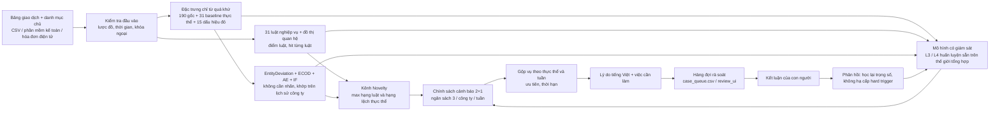

# Kiến trúc pipeline

Mã: `agent2/pipeline.py` (CLI `python -m agent2.pipeline`), `agent2/data.py` (nạp), `agent2/methods.py` (phương pháp), `agent2/alerting.py` (cảnh báo), `agent2/hybrid.py` (lai).

## 1. Sơ đồ

## 2. Các giai đoạn

| # | Giai đoạn | Mã | Đầu vào | Đầu ra | Ghi chú |
|---|---|---|---|---|---|
| 1 | Nạp và hợp nhất | `data.load` | `transactions`, `features`, `labels`, `splits`, danh mục chủ | Một bảng phân tích | Lưu bộ nhớ đệm `_cache/*.pkl` |
| 2 | Đặc trưng quá khứ | `feats.engineered_features`, `feats_v4.v4_features` | Giao dịch sắp theo `posted_at` | 31 + 15 cột | Mỗi dòng chỉ thấy các dòng đăng trước nó; hòa thì cập nhật sau |
| 3 | Luật + đồ thị | `sme_fraud.rules.score_rules` | Giao dịch, đặc trưng, đồ thị thực thể | `rule_graph`, `rule_direct`, `rule_hard`, `hit_*`, `rule_ids`, `explanation_vi` | `hit_*` dùng cho mô hình học |
| 4 | Điểm không nhãn | `methods.EntityDeviation` và cộng sự; `hybrid.attach_unsupervised` | Giai đoạn huấn luyện của chính công ty | Điểm đuôi theo từng bộ phát hiện, hạng AE, IF | Hạng so với phân phối huấn luyện của công ty |
| 5 | Mô hình có giám sát | `methods.Supervised`, `hybrid.LGBM`, `hybrid.Collective`, `methods.CalibratedStack` | Thế giới tổng hợp (huấn luyện sẵn) | Điểm cho từng dòng | Áp cho công ty mới không cần nhãn |
| 6 | Chọn cảnh báo | `alerting.select_mixed`, `metrics.weekly_alerts` | Điểm mô hình chính và điểm Novelty | Cờ cảnh báo | 2 khe mô hình + 1 khe Novelty khi B = 3 |
| 7 | Gộp vụ | `alerting.build_cases` | Cờ, điểm | Một dòng cho mỗi (công ty, thực thể, tuần) | Thực thể = nhà cung cấp, rồi nhân viên, rồi người lập |
| 8 | Lý do | `alerting.reasons_for_row` | Hit luật, đuôi thực thể | Câu tiếng Việt | Xếp luật theo trọng số học |
| 9 | Xuất | `pipeline.to_case_queue`, `review_page.py` | Vụ | `cases.csv`, `case_queue.csv`, `report.json`, trang HTML | Định dạng tương thích `review_ui` của bạn bạn |

## 3. Ba hồ sơ triển khai

| Hồ sơ | Dùng khi | Thành phần | Ưu / nhược |
|---|---|---|---|
| `cold` | Ngày đầu, không có mô hình huấn luyện sẵn | Chỉ kênh Novelty | Không cần nhãn; recall thấp hơn (35 đến 53% trên v4) |
| `precision` (mặc định cho SME) | Có mô hình huấn luyện sẵn | CES chiếm 2 khe, Novelty 1 khe | Báo nhầm thấp (7%); recall trung bình |
| `wide` | Chấp nhận nhiều báo nhầm hơn | L3 chiếm 2 khe, Novelty 1 khe (L4 chưa được nối vào `pipeline.py`) | Recall cao; báo nhầm 11 đến 18% trên ca khó |

Ghi chú: các hồ sơ `precision` và `wide` đang dùng mô hình huấn luyện trên v3 (`models/pretrained_v1.joblib`). **Cần huấn luyện lại trên v4** sau khi chọn cấu hình (thư mục 05).

## 4. Ba bậc khởi đầu lạnh (thiết kế [N], từ Phần 8)

| Bậc | Thời điểm | Thành phần | Điều kiện chuyển |
|---|---|---|---|
| 1 | Ngày đầu | Luật tất định + đối chiếu danh mục + baseline theo nhóm đồng ngành (cần xây) | Có sổ và danh mục chủ |
| 2 | Sau khoảng 3 tháng | Thêm baseline theo thực thể và các phương pháp phi tham số (EntityDeviation, ECOD) | Đủ lịch sử mỗi thực thể (từ 20 điểm tham chiếu) |
| 3 | Sau khoảng 12 tháng | Thêm Isolation Forest, autoencoder; bật mô hình huấn luyện sẵn | Có lịch sử đủ dài |

Hiện nay `cold` = bậc 2. Bậc 1 (baseline theo nhóm đồng ngành) **chưa có** — xem giả thuyết H4.

## 5. Nguyên tắc thiết kế
1. **Nhân quả:** không đặc trưng nào dùng thông tin sau thời điểm đăng sổ của dòng.
2. **Cách ly công ty:** đặc trưng thực thể và hạng tham chiếu chỉ khớp trên lịch sử của công ty đang chấm; mô hình chung chỉ mang tri thức từ thế giới tổng hợp.
3. **Tách nhãn:** mô hình không bao giờ đọc `labels.csv`/`truth_cases.csv` ở thời điểm chấm.
4. **Ngân sách cứng:** số cảnh báo không phụ thuộc phân phối điểm.
5. **Có kênh không học:** một khe luôn dành cho kênh không nhãn.
6. **Giải thích trước:** mỗi cảnh báo phải có lý do. Hiện nay nếu không tìm được lý do cụ thể, mã hiển thị câu chung "Điểm bất thường tổng hợp cao so với lịch sử của chính doanh nghiệp"; mục tiêu là loại bỏ trường hợp này (nhất là với 15 dấu hiệu đỏ v4 chưa có câu lý do).
