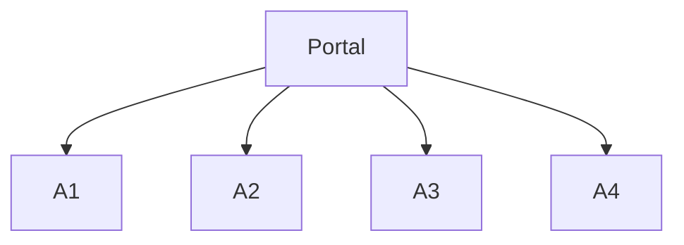

**HỌC VIỆN TÀI CHÍNH | ACADEMY OF FINANCE**  
**AI–QUANTUM CHALLENGE 2026**  
*CUỘC THI TRÍ TUỆ NHÂN TẠO VÀ LƯỢNG TỬ TRONG KINH TẾ – TÀI CHÍNH – KẾ TOÁN*

# BÁO CÁO GIẢI PHÁP • VÒNG BÁN KẾT (VÒNG 2)

**TÊN GIẢI PHÁP / SẢN PHẨM:**  
**SỔ SON, PHÒNG KẾ TOÁN SỐ: bốn trợ lý AI chạy tại máy cho doanh nghiệp nhỏ và vừa**

- **Mã đội:** `AQ2026-109` • **Tên đội:** `Top_man_QN`
- **Khoa / Trường đại diện (theo đội trưởng):** Khoa Công nghệ Thông tin — Trường Đại học Khoa học Tự nhiên, ĐHQG Thành phố Hồ Chí Minh
- **Kho mã nguồn công khai (nhánh `main`):** [https://github.com/Khanhhh239/Multi-Agent-Finance](https://github.com/Khanhhh239/Multi-Agent-Finance) (`Code commit: 4e6009f`)

**THÀNH VIÊN ĐỘI THI (`[Đã ẩn thông tin cá nhân theo yêu cầu bảo mật]`):**
1. Đội trưởng — Thành viên 1 (`[Đã ẩn thông tin cá nhân]`) • Kiến trúc tổng thể, Portal & Agent 3
2. Thành viên 2 (`[Đã ẩn thông tin cá nhân]`) • Agent 2: Kiểm soát nội bộ, ML & FHE Hậu lượng tử
3. Thành viên 3 (`[Đã ẩn thông tin cá nhân]`) • Agent 1: Dự báo dòng tiền & Sinh tồn
4. Thành viên 4 (`[Đã ẩn thông tin cá nhân]`) • Agent 1: Đối soát công nợ – ngân hàng T9
5. Thành viên 5 (`[Đã ẩn thông tin cá nhân]`) • Agent 4: Hỏi đáp CFO hai sổ & DuckDB

- **Giảng viên hướng dẫn (nếu có):** Không có  
- **ĐỊA ĐIỂM & NĂM TỔ CHỨC:** **HÀ NỘI • 2026**

<!-- PAGE_BREAK -->

## MỤC LỤC & HƯỚNG DẪN SỬ DỤNG

| MỤC | NỘI DUNG CHÍNH THEO MẪU BAN TỔ CHỨC | TRANG |
| :-: | :--- | :-: |
| **`01`** | **Thông tin đội thi, danh sách thành viên (đã ẩn PII) và hồ sơ sản phẩm** | Trang 3 |
| **`02`** | **Tóm lược giải pháp theo 6 tiêu chí chấm (Executive Summary)** | Trang 4 |
| **`03`** | **Tiêu chí 1: Mức độ làm rõ và xử lý bài toán thực tiễn (20%)** | Trang 5 |
| **`04`** | **Tiêu chí 2: Chất lượng dữ liệu và cách tiếp cận dữ liệu (15%)** | Trang 6 |
| **`05`** | **Tiêu chí 3: Tính hợp lý của giải pháp, thuật toán AI & Hậu lượng tử (20%)** | Trang 7–8 |
| **`06`** | **Tiêu chí 4: Chất lượng prototype, nguyên mẫu & kiểm thử tự động (20%)** | Trang 9 |
| **`07`** | **Tiêu chí 5: Khả năng ứng dụng và triển khai thực tế (15%)** | Trang 10 |
| **`08`** | **Tiêu chí 6: Trình bày, tài liệu, phản biện & cam kết tính nguyên gốc (10%)** | Trang 11 |
| — | **Bìa sau hồ sơ dự thi chính thức** | Trang 12 |

#### QUY TẮC HỒ SƠ & BẢO MẬT THÔNG TIN CÁ NHÂN
- **Tên tệp nộp chính thức theo Thể lệ Vòng 2:** `AQ2026-R2-AQ2026-109-Bao_cao_giai_phap.pdf` (quy chuẩn 08–12 trang A4).
- **Tính xác thực của minh chứng:** Toàn bộ số liệu định lượng, kết quả kiểm thử tự động, liên kết mã nguồn và chỉ số hiệu năng trong báo cáo được đo đạc trực tiếp trên kho mã nguồn nhánh `main` sau lần chỉnh sửa cuối cùng.
- **Chính sách bảo mật dữ liệu riêng tư:** Theo yêu cầu công bố báo cáo công khai, các thông tin nhận diện cá nhân (họ tên chi tiết thành viên, số CCCD, email cá nhân, số điện thoại cá nhân) được ẩn bằng `[Đã ẩn thông tin cá nhân theo yêu cầu bảo mật]`. Dữ liệu kế toán thử nghiệm được sinh hoàn toàn từ bộ mô phỏng **Minh Phát (`MPX10` v3.0)**, không sử dụng dữ liệu thật của bất kỳ doanh nghiệp hay cá nhân nào.
- **Phạm vi hồ sơ nộp kèm:** Báo cáo giải pháp (`AQ2026-R2-AQ2026-109-Bao_cao_giai_phap.pdf`), kho mã nguồn công khai ([github.com/Khanhhh239/Multi-Agent-Finance](https://github.com/Khanhhh239/Multi-Agent-Finance)), kịch bản cài đặt & khởi chạy 1 lệnh (`run_web.ps1` / `setup_demo.sh`), tài liệu hướng dẫn demo (`HUONG_DAN_CHAY_WEB.md`) và tài liệu triển khai (`docs/DEPLOY_SERVER.md`).

<!-- PAGE_BREAK -->

## 01 / HỒ SƠ ĐỘI THI & THÔNG TIN SẢN PHẨM

#### 1. THÔNG TIN ĐỘI THI

| TRƯỜNG THÔNG TIN | NỘI DUNG |
| :--- | :--- |
| **Mã đội / Tên đội** | `AQ2026-109` / `Top_man_QN` |
| **Tên đề tài / giải pháp** | **SỔ SON, PHÒNG KẾ TOÁN SỐ: bốn trợ lý AI chạy tại máy cho doanh nghiệp nhỏ và vừa** |
| **Lĩnh vực ứng dụng** | Kế toán, Tài chính (liên ngành với Thuế GTGT/TNDN và Kiểm soát nội bộ) |
| **Nhóm chủ đề** | AI cho Dịch vụ Tài chính thông minh; AI & Mật mã Hậu lượng tử cho Quản trị Rủi ro và Tuân thủ (theo hồ sơ Vòng 1) |
| **Người liên hệ chính** | Đội trưởng đội `Top_man_QN` — `[Đã ẩn thông tin cá nhân theo yêu cầu bảo mật]` |
| **Giảng viên hướng dẫn (nếu có)** | Không có |

#### 2. DANH SÁCH THÀNH VIÊN

| TT | Họ tên | Ngành học | Trường | CCCD | Email | Điện thoại | Vai trò trong đội |
| :-: | :--- | :--- | :--- | :--- | :--- | :--- | :--- |
| 1 | `[Đã ẩn]` | Trí tuệ nhân tạo | ĐH KHTN, ĐHQG-HCM | `[Đã ẩn]` | `[Đã ẩn]` | `[Đã ẩn]` | Đội trưởng (Kiến trúc tổng thể, Portal & Agent 3) |
| 2 | `[Đã ẩn]` | Trí tuệ nhân tạo | ĐH KHTN, ĐHQG-HCM | `[Đã ẩn]` | `[Đã ẩn]` | `[Đã ẩn]` | Thành viên (Agent 2: Kiểm soát, ML & FHE) |
| 3 | `[Đã ẩn]` | Trí tuệ nhân tạo | ĐH KHTN, ĐHQG-HCM | `[Đã ẩn]` | `[Đã ẩn]` | `[Đã ẩn]` | Thành viên (Agent 1: Dòng tiền & Sinh tồn) |
| 4 | `[Đã ẩn]` | Khoa học máy tính | ĐH KHTN, ĐHQG-HCM | `[Đã ẩn]` | `[Đã ẩn]` | `[Đã ẩn]` | Thành viên (Agent 1: Đối soát công nợ – NH T9) |
| 5 | `[Đã ẩn]` | Máy tính & CNTT | ĐH KHTN, ĐHQG-HCM | `[Đã ẩn]` | `[Đã ẩn]` | `[Đã ẩn]` | Thành viên (Agent 4: Hỏi đáp CFO hai sổ) |

#### 3. THÔNG TIN SẢN PHẨM & MINH CHỨNG MÃ NGUỒN

| HẠNG MỤC | THÔNG TIN / ĐƯỜNG DẪN | GHI CHÚ |
| :--- | :--- | :--- |
| **Dạng prototype** | Web app đa tác tử chạy tại máy (On-Premise / Local-First): Cổng Portal (`:8800`) điều phối 4 Agent chuyên biệt (`:8011`, `:8766`, `:8640`, `:8040`) trên kho `MPX10` | Nguyên mẫu hoạt động đầu-cuối (Working Prototype) |
| **Khởi chạy demo** | Chạy trực tiếp tại máy chấm (`http://127.0.0.1:8800` bằng `.\run_web.ps1` hoặc `bash setup_demo.sh`) | Truy cập nội bộ hoặc qua đường hầm bảo mật cho BGK |
| **Kho mã nguồn** | [https://github.com/Khanhhh239/Multi-Agent-Finance](https://github.com/Khanhhh239/Multi-Agent-Finance) (nhánh `main`, code commit `4e6009f`) | Công khai phục vụ kiểm chứng |
| **Tài liệu hướng dẫn** | [README.md](https://github.com/Khanhhh239/Multi-Agent-Finance/blob/main/README.md), [HUONG_DAN_CHAY_WEB.md](https://github.com/Khanhhh239/Multi-Agent-Finance/blob/main/HUONG_DAN_CHAY_WEB.md), [run_web.ps1](https://github.com/Khanhhh239/Multi-Agent-Finance/blob/main/run_web.ps1), [setup_demo.sh](https://github.com/Khanhhh239/Multi-Agent-Finance/blob/main/setup_demo.sh), [DEPLOY_SERVER.md](https://github.com/Khanhhh239/Multi-Agent-Finance/blob/main/docs/DEPLOY_SERVER.md) | Cài đặt 1 lệnh & hướng dẫn kiểm thử |

<!-- PAGE_BREAK -->

## 02 / EXECUTIVE SUMMARY (TÓM LƯỢC GIẢI PHÁP)

#### 1. TÓM LƯỢC GIẢI PHÁP THEO 6 TIÊU CHÍ CHẤM

| TIÊU CHÍ / TRỌNG SỐ | KẾT QUẢ NỔI BẬT ĐÃ TRIỂN KHAI | MINH CHỨNG KIỂM TRA |
| :--- | :--- | :--- |
| **1. Bài toán thực tiễn (20%)** | Xử lý 4 bài toán SME Việt Nam: đối soát XML/sao kê (phí CITAD `55k`), dự báo dòng tiền Ngày 1 (`reconciled_through`), bắt gian lận + ngưỡng `5 triệu` NĐ 181/2025 và hỏi đáp CFO 2 sổ `v_mgmt`/`v_tax`. | Mục 03; `portal/server.py`, `ruleset_2026_11_draft.json` |
| **2. Dữ liệu (15%)** | Kho mô phỏng **Minh Phát (`MPX10` v3.0)** 46 tháng (`19.784.697` dòng `gl_entry`, `--smoke`: `55.955` dòng + 6 E2E) & kho luật `vbpl.vn` (`680` văn bản, `51.998` điều khoản); triệt bẫy `1.000x` VND, giữ `0 VND` (`TK 4219`). **`51/51` đối chiếu ĐẠT**. | Mục 04; `data_pipeline/validate.py`, `test_pipeline.py` |
| **3. Thuật toán AI & PQC (20%)** | A1 khử lệch Jensen (`-13,1% -> +0,7%`), Block Bootstrap; A2 mở **`26/35` luật** + `FrozenECOD` (Li 2022 Eq. 7) + **`TFHE S=P=16` (`4.096/4.096` lô)** kháng Shor ($\ge 128$-bit LWE); A3 chặn XSW/`<CQT>`; A4 khóa DuckDB `66/66` chỉ tiêu. | Mục 05; `circuit.py`, `rule_evaluation.py` |
| **4. Prototype (20%)** | Web hợp nhất `:8800`: FaceID 3 khung hình, strict CSP, nạp 1 cửa SHA-256, xử lý `7.700` giao dịch `< 10s`, `BigInt` số âm VND. Kiểm thử sau sửa cuối đạt **`3.581` test PASS** (chi tiết Mục 06). | Mục 06; `run_web.ps1`, Bảng 4.2 |
| **5. Triển khai thực tế (15%)** | **100% Local-First** tại máy SME (`0 đ` API LLM) hoặc máy chủ riêng Docker + HTTPS + OIDC qua lộ trình 4 bước; chi phí vận hành từ `~1,95–5,3 triệu đ/tháng`. | Mục 07; `docs/DEPLOY_SERVER.md` |
| **6. Trình bày, tài liệu (10%)** | Báo cáo chuẩn 12 trang BTC, kịch bản demo 15 phút & bảng phản biện; công bố trung thực giới hạn dữ liệu mô phỏng và trạng thái từng test suite. | Mục 08; `README.md`, `HUONG_DAN_CHAY_WEB.md` |

#### 2. PHÁT BIỂU GIÁ TRỊ CỐT LÕI (115 TỪ — CHUẨN $\le 120$ TỪ)
> **Sổ Son** là văn phòng kế toán số đa tác tử chạy tại máy cho doanh nghiệp nhỏ và vừa Việt Nam: **một hồ sơ doanh nghiệp, một cổng nạp chứng từ bảo mật (mật khẩu `scrypt` và FaceID 3 khung hình), bốn trợ lý AI chuyên biệt**. Agent 1 đối soát công nợ và dự báo dòng tiền 13–52 tuần (`P10/P50/P90`); Agent 2 phát hiện giao dịch bất thường bằng `26/35` luật chuẩn, thống kê, đồ thị, ML không nhãn và mật mã đồng cấu hậu lượng tử (`TFHE`/`CKKS`); Agent 3 rà soát hóa đơn XML/sao kê kèm điều khoản luật gốc; Agent 4 hỏi đáp CFO song song trên Sổ quản trị và Sổ thuế. **Mọi con số do chương trình tính tất định, AI chỉ đề xuất, người duyệt quyết định.**

#### 3. BẢNG KẾT QUẢ ĐỊNH LƯỢNG CHỦ ĐẠO ĐÃ KIỂM CHỨNG

| CHỈ SỐ ĐO LƯỜNG | MỐC SO SÁNH / BẢN CŨ | KẾT QUẢ PROTOTYPE HIỆN TẠI | NGUỒN KIỂM CHỨNG |
| :--- | :--- | :--- | :--- |
| **Đạo hàm mạch FHE `TFHE` (`S=P=16`)** | `scale=2` cũ chết **`3.120/3.880` (`80,41%`)** | **`4.096/4.096` (`100%`)** (`[2,2,-4]`, `[4,4,0]`, `0%` chết) | `test_fhe_and_ml_fixes.py` |
| **Nạp & chấm 7.700 giao dịch (Agent 2)** | Bản cũ chậm, cắt cụt tối đa `200` dòng | Toàn trình upload–commit–analyze **`< 10 giây`** | `test_fast_import_graph_rules.py` |
| **Độ phủ luật kiểm toán SME (Agent 2)** | Bản cũ chỉ nối `4/35` luật (`E3, P1, B5, E4`) | **`26/35` luật trực tiếp** + `9` mở rộng báo thiếu | `rule_evaluation.py` |
| **Cân bằng `v_mgmt` & `v_tax` (Agent 4)** | Lọc `tax_deductible` làm lệch Nợ/Có | **`0` lệch** (`TK 4219` + `KC-B4`), **`66/66` chỉ tiêu**, `51/51` liên kho | `test_v_tax_balance.py`, `validate.py` |
| **Dòng tiền & Onboarding (Agent 1)** | Chờ `210d`; prior `0,8676`; Jensen `-13,1%` | **`0d` (`reconciled_through`)**; `0,3413`; Jensen **`+0,7%`** | `test_adaptive_models_fixes.py` |
| **XML-DSig & Bộ quy tắc Thuế (Agent 3)** | Dính XSW, cắt CCCD 12 số, thiếu hạn luật | Chặn `100%` XSW, xác thực `<CQT>`, `23 ĐẠT, 8 BỎ QUA, 0 LỖI` | `test_agent3_audit_fixes.py`, CLI |

<!-- PAGE_BREAK -->

## 03 / TIÊU CHÍ 1: LÀM RÕ VÀ XỬ LÝ BÀI TOÁN THỰC TIỄN (20%)

#### 1.1. Bối cảnh và đối tượng sử dụng
Doanh nghiệp nhỏ và vừa (SME) chiếm >97% doanh nghiệp Việt Nam nhưng chỉ có 1–3 kế toán kiêm nhiệm sổ sách (**TT 133/2016/TT-BTC** & **TT 200/2014/TT-BTC**), đối chiếu hóa đơn XML (**QĐ 1450/QĐ-TCT**), sao kê đa ngân hàng (VCB, TCB, ACB, BIDV, MB) và công nợ (`TK 131`, `TK 331`). Hai rủi ro pháp lý – tài chính trực diện đội giải quyết:
1. **Loại khấu trừ GTGT đầu vào & chi phí được trừ TNDN**: Theo **Điểm b Khoản 2 Điều 14 Luật Thuế GTGT 48/2024/QH15** và **Điều 26 Nghị định 181/2025/NĐ-CP** (hiệu lực **`01/07/2025`**), hóa đơn mua từ **05 triệu đồng** — hoặc mua nhiều lần trong cùng ngày cùng nhà cung cấp có tổng **$\ge 5$ triệu đồng** — thiếu chứng từ thanh toán không dùng tiền mặt bị **loại toàn bộ GTGT đầu vào** (trước `01/07/2025` áp dụng ngưỡng **20 triệu đồng**); đồng bộ với **Luật Thuế TNDN 67/2025/QH15**.
2. **Phạt khai thiếu thuế & chậm nộp**: Theo **Khoản 1 Điều 16 NĐ 125/2020/NĐ-CP** và **Điều 142, Điều 59 Luật QLT 38/2019/QH14**, khai thiếu bị phạt **20%** số thuế thiếu + **0,03%/ngày** chậm nộp. Khảo sát nghiệp vụ cho thấy kế toán SME mất **3–5 ngày/kỳ** dò tay từng mã hóa đơn trong nội dung chuyển khoản (`"TT HD123"`) và cộng tay hóa đơn tiền mặt cùng ngày.

#### 1.2. Phân tích nguyên nhân, tác động và yêu cầu thiết kế
- **Nguyên nhân**: (i) Dữ liệu phân mảnh đa định dạng (XML, CSV dấu phẩy nghìn/thập phân dễ nhầm `1.000x`, sổ quản trị tách sổ thuế); (ii) Luật đổi theo mốc thời gian (`01/07/2025` hạ ngưỡng 5 triệu, **TT 86/2024/TT-BTC** chuyển sang CCCD 12 số); (iii) LLM thông thường hay ảo giác số liệu và rò rỉ dữ liệu lên cloud.
- **5 Yêu cầu thiết kế cốt lõi**: (1) **Local-First & Mã hóa hậu lượng tử**; (2) **Mọi kết luận có căn cứ SQL hoặc điều khoản gốc**; (3) **Con người phê duyệt & nhật ký nối băm SHA-256**; (4) **Trung thực khi thiếu nguồn** (báo `unavailable`, không điền `0`); (5) **Nạp một cửa liên thông 4 tác tử**.

#### 1.3. Phát biểu bài toán toán học & Thước đo mục tiêu 4 Phân hệ

| Phân hệ | Bài toán dữ liệu / tối ưu / dự báo | Thước đo mục tiêu chính | Kết quả đạt được trên Prototype |
| :--- | :--- | :--- | :--- |
| **Agent 1 (Ngân quỹ)** | Đối soát sao kê–HĐĐT (T9) & dự báo xác suất tất toán (Survival + Empirical Bayes + Gaussian Copula + Bootstrap) cho phân vị **`[P10, P50, P90]`** 13–52 tuần. | • Thời gian chờ onboarding • Lệch kỳ vọng Log-Normal • Bộ adaptive & lifecycle | • **`0` ngày chờ** (`reconciled_through`) • **`+0,7%`** (giảm từ `-13,1%`) • **`537/537` adaptive OK** (`1.145` full*) |
| **Agent 2 (Kiểm soát & FHE)** | Chấm điểm 4 nhánh (35 luật + thống kê `RobustZ`/Benford + đồ thị + 4 ML không nhãn) & huấn luyện SGD mã hóa đồng cấu **`TFHE S=P=16`** / `CKKS`. | • Độ phủ luật chuẩn SME • Bảo toàn gradient `TFHE` • Tốc độ nạp `7.700` dòng | • **`26/35` luật** (+ 9 mở rộng) • **`4.096/4.096` (`100%`)** • **`< 10 giây`** (`520/520` HE, `898` core*) |
| **Agent 3 (Thuế & HĐĐT)** | Kiểm định XML-DSig (`<NBan>`, `<CQT>`), luật R01–R14 hiệu lực theo ngày (`R02` 5tr cùng ngày), RAG lai (`FTS + bge-m3 + Reranker`) & chống Injection. | • An toàn XSW & CCCD 12 số • Toàn vẹn `ruleset` • Bộ test tuân thủ & XML | • Chặn **100%** XSW, đủ 12 số CCCD • `check-ruleset`: **`23 ĐẠT, 0 LỖI`** • **`191/191`** (`3` deselected `real_ai`) |
| **Agent 4 (CFO Hai Sổ)** | Biên dịch tiếng Việt $\to$ chọn chỉ tiêu (`66` metric VAS/TT133/TT200) $\to$ SQL mẫu chỉ đọc DuckDB trên `v_mgmt` và `v_tax` (`TK 4219`). | • Sai lệch cân bằng kép `v_tax` • Bao phủ catalog 66 metric • Bộ test toàn hệ thống Agent 4 | • **`0 VND`** lệch Nợ/Có & CĐKT • **`66/66`** chỉ tiêu đồng bộ • **`734/734` test ĐẠT (100%)** |

#### 1.4. Xử lý các ràng buộc thực tế
- **Pháp lý**: Quản lý tham số hiệu lực theo nửa mở `[from, to)` cho NĐ 181/2025, Luật 38/2019, Luật 108/2025 (`< 2026-07-01`).
- **Bảo mật & Dữ liệu**: `scrypt` + FaceID 3 khung hình (`~120ms`); hoàn toàn dùng kho giả lập `MPX10` (`0` dữ liệu thật); `TK 141` & cọc `30/70` chống báo động giả; chống bịa số bằng `Decimal`/`BigInt` và kiểm chứng dấu âm.

<!-- PAGE_BREAK -->

## 04 / TIÊU CHÍ 2: CHẤT LƯỢNG DỮ LIỆU VÀ CÁCH TIẾP CẬN DỮ LIỆU (15%)

#### 2.1. Nguồn dữ liệu, quyền sử dụng và phạm vi
1. **Kho doanh nghiệp mô phỏng Minh Phát (`MPX10` v3.0.0, seed `20261108`)** ([enterprise.py](https://github.com/Khanhhh239/Multi-Agent-Finance/blob/main/data_pipeline/enterprise.py), [export.py](https://github.com/Khanhhh239/Multi-Agent-Finance/blob/main/data_pipeline/export.py), [build.py](https://github.com/Khanhhh239/Multi-Agent-Finance/blob/main/agent4/agent4/datagen/build.py)): Mô phỏng **46 tháng** (`01/01/2023 – 14/10/2026`), **7 chi nhánh** (`HN, HCM, DN, HP, BD, CT, NA`) và **11 phòng ban**. Bản đầy đủ đạt **`19.784.697` dòng sổ cái (`gl_entry`)**, `5.110.372` chứng từ (`gl_journal`), `1.302.000` hóa đơn AR (trích `50.000` hóa đơn & `135.046` dòng NH xuất A1); kèm bản `--smoke` (`19.969` chứng từ, `55.955` dòng `gl_entry` trên kho test) & 6 kịch bản E2E tự động.
2. **Kho văn bản pháp luật Thuế – Kế toán (`vbpl.vn`)**: Dữ liệu công khai theo Luật Tiếp cận thông tin (`legal_corpus.sqlite3`: **`680` văn bản, `51.998` điều khoản, `27.199` đoạn chỉ mục**) có gắn ngày hiệu lực và quan hệ sửa đổi/bổ sung.
3. **Dữ liệu nghiên cứu tiền khả thi Vòng 1**: Kaggle Invoice Payment, Checkbook NYC, MC-OCR dùng để đối chứng thiết kế ban đầu; toàn bộ mô hình Vòng 2 chạy độc lập trên kho chuẩn hóa `MPX10`.

#### 2.2. Tiền xử lý, chuẩn hóa & Chốt chặn chất lượng dữ liệu đa tầng

| Cổng nạp / Phân hệ | Rủi ro dữ liệu thô Việt Nam | Quy tắc xử lý & Chốt chặn đã cài đặt | Kết quả kiểm chứng |
| :--- | :--- | :--- | :--- |
| **Sao kê Ngân hàng (`bank_intake.py`, `data.py`, `sources.py`)** | Dấu phẩy hàng nghìn (`"500,000"`, `"-666,387,909"`) bị hiểu nhầm thành thập phân gây **lệch `1.000x` tiền VND**; nhiều biến thể cột VCB/TCB/ACB/BIDV/MB. | Phân tích chuẩn nhóm 3 chữ số hàng nghìn, hậu tố `.00`/`,00`, số âm trong ngoặc đơn, chặn số thập phân VND lẻ ở cả 3 tầng Portal/A1/A3. | **`0` lỗi lệch 1.000x** trong `77` Portal pytest; tự khớp mẫu 5 NH & tách phí CITAD `<= 55.000 đ`. |
| **HĐĐT XML QĐ 1450 (`xml_invoice.py`, `xml_signature.py`, `einvoice_xml.py`)** | Tấn công giả mạo XSW, thiếu `<CQT>` trên HĐ có mã `'C'`, CCCD 12 số TT 86/2024 bị cắt 10 số, thiếu `<HanThanhToan>`, đa thuế suất `0/5/8/10%/KCT`. | Bắt buộc duy nhất 1 `<DLHDon>`, xác thực `<CQT>` Subject DN & chứng thư khác `<NBan>`, C14N Inclusive/Exclusive, regex MST `10/12/13` số, chuẩn hóa đọc chữ `./.`. | **`0` lỗi số học/đọc chữ** trên XML `--smoke` E2E; chặn `100%` test tấn công XSW. |
| **Đặc trưng `1.1.0` & Cờ khuyết (`agent2_intake.py`, `method_preprocess.py`)** | SME thường thiếu sổ phụ ERP; điền `0` hoặc đưa `missing:<col>` vào thống kê gây báo động giả `50.0`. | Bảo toàn `unavailable`; loại `missing:*` & cờ $\text{MAD}=0$ khỏi `RobustZ`, `FrozenECOD`, `Autoencoder`. | Hóa đơn bình thường thiếu trường phụ giữ hạng `< P85`; nạp & chấm `7.700` dòng `< 10s`. |
| **Sổ Thuế `v_tax` (`datagen/build.py`, `validate.py`)** | Lọc thô `WHERE tax_deductible` cắt cụt vế Nợ làm lệch Nợ/Có và gãy CĐKT. | Tài khoản cầu nối Vốn chủ **`TK 4219`** (Chỉ tiêu B4 `03/TNDN`) + kết chuyển **`KC-B4`**. | **`51/51` kiểm tra đối chiếu liên phân hệ `0 VND` lệch**; `18/18` test cân đối `v_tax` đạt. |

#### 2.3. Phân tầng hành vi thực tế & Chống rò rỉ thời gian (Bitemporal Anti-Leakage)
- **5 Chân dung hành vi khách hàng tất định (`enterprise.py`)**: `IMMEDIATE_RETAIL` (trả ngay `0d` -> `cash_sale`), `PROMPT` (sớm $\le -3$d), `STANDARD_CORP` (`0–10d`), `CHRONIC_LATE` (`18–55d`, chia nhiều đợt), `DISPUTE_PRONE` (tranh chấp giữ lại thanh toán dở). Khắc phục lỗi cắt cụt để bảo toàn `>= 45` tháng lịch sử (`>= 190` tuần đối soát) cho Agent 1 và bảo toàn đầy đủ bút toán gian lận/rủi ro cho Agent 2 & Agent 3.
- **Chống rò rỉ thời gian**: Agent 1 lọc chặt `event_date <= t0` và `book_posted_at <= t0` tách riêng khỏi `knowledge_end = T`; Agent 2 giữ nhật ký nguồn bitemporal; Agent 4 cấm LLM tự viết SQL mà biên dịch có kiểm soát trên `66` chỉ tiêu.

<!-- PAGE_BREAK -->

## 05 / TIÊU CHÍ 3: TÍNH HỢP LÝ CỦA GIẢI PHÁP, THUẬT TOÁN (20%) — KIẾN TRÚC & HẬU LƯỢNG TỬ

#### 3.1. Kiến trúc Tổng quan Local-First Đa Tác Tử

*Nguyên tắc bất biến:* **"Con số do chương trình tính tất định — AI chỉ đề xuất trong ranh giới kiểm soát — Con người phê duyệt và đóng dấu SHA-256."** Cổng **Portal (`:8800`)** giữ duy nhất một hồ sơ doanh nghiệp, tiếp nhận tệp 1 cửa có kiểm định và phân phối đồng bộ sang 4 tiến trình độc lập: **Agent 1 (`:8011`)**, **Agent 2 (`:8766`)**, **Agent 3 (`:8640`)**, **Agent 4 (`:8040`)**, chia sẻ chung **Kho Sổ Cái MPX10**, **Kho Pháp luật `vbpl.vn`** và **Ollama cục bộ (`:11434`)**.

#### 3.2. Định vị rõ Yếu tố Lượng tử / Hậu lượng tử (`AI–QUANTUM CHALLENGE 2026`)
1. **Bài toán an ninh dài hạn thực tế ("Harvest Now, Decrypt Later")**: Theo **Điều 41 Luật Kế toán 88/2015/QH13**, chứng từ kế toán – thuế phải lưu tối thiểu **10 năm đến vĩnh viễn**. Các hệ mật mã cổ điển (`RSA-2048`, `ECDSA`) bị thuật toán lượng tử **Shor** phá vỡ trong thời gian đa thức, đe dọa trực tiếp dữ liệu lưu trữ hoặc cộng tác liên doanh nghiệp.
2. **Giải pháp Mật mã Đồng cấu Kháng Lượng tử trên Lưới (`LWE / RLWE / TRLWE`) ở Agent 2**:
   - **Cơ sở toán học**: Cả nhánh huấn luyện **`TFHE` (`Concrete`)** và suy luận **`CKKS` (`TenSEAL`, $N=8192, \log_2 Q = 200 < 218$ bit)** đều dựa trên độ khó bài toán hình học lưới chiều cao ($\ge 128$-bit Post-Quantum Security, cùng họ chuẩn hậu lượng tử NIST FIPS 203/204).
   - **Thiết kế Mạch Dấu Phẩy Tĩnh `fhe_sgd_s16_v2` ($S_w = S_b = P = 16, \eta = 1, M = 4$)**: Khắc phục hoàn toàn lỗi mạch `scale=2` cũ làm **`80,41%` (`3.120/3.880`)** tổ hợp lô nhị phân $(X, y)$ bị làm tròn đạo hàm về `[0, 0, 0]`. Hệ số bước $\frac{S \cdot \eta}{M \cdot P} = \frac{16 \times 1}{4 \times 16} = \frac{1}{4}$ kết hợp bảng tra làm tròn đối xứng `round_div4` giữ trọn 5 bảng tra nằm trong **7-bit TFHE PBS ($\le 129$ phần tử: `SIGMOID_TABLE`, `ROUND4_TABLE`, `CLIP_W_TABLE`, `CLIP_B_TABLE`)**.
   - **Kiến trúc Liên minh Chia sẻ Khóa Ngưỡng ([runtime.py](https://github.com/Khanhhh239/Multi-Agent-Finance/blob/main/agent2/experiments/he_training/runtime.py))**: Tách biệt nghiêm ngặt **`EnterpriseKeyHolder`** (giữ mảnh khóa `sk` tại máy SME với Windows DPAPI), **`ConsortiumKeyCommittee`** (chia sẻ khóa $N$-trên-$N$ liên doanh nghiệp) và **`HomomorphicAggregator`** (đám mây không tin cậy, chặn cứng mọi `sk`/plaintext bằng ngoại lệ `SECRET_OR_PLAINTEXT_REJECTED_BY_AGGREGATOR`). Đám mây chỉ cộng và bootstrap bản mã; mọi SME cùng giải mã mô hình chung sau huấn luyện để chấm điểm tại máy `< 1 ms`. *(Trên máy Windows chưa cài `concrete-python`/`tenseal`, hệ thống ghi trung thực chế độ `fhe_quantized_circuit_verified` trên mạch số nguyên 5-LUT tương đương bit-for-bit, tuyệt đối không giả mạo crypto-theatre).*

<!-- PAGE_BREAK -->

## 05 / TIÊU CHÍ 3 (TIẾP): PHƯƠNG PHÁP TOÁN HỌC & ĐỐI CHỨNG 4 AGENT

#### 3.3. Thiết kế thuật toán chuyên sâu từng phân hệ

- **Agent 1 — Ngân quỹ, Đối soát T9 & Dự báo Dòng tiền 13–52 tuần**:
  - *Gỡ Deadlock 210 ngày trung thực kiểm toán*: Tách `label_end` (kỳ kinh tế) khỏi `knowledge_end = T` (thời điểm khóa sổ) qua cơ chế `reconciled_through` ([payment_coverage.py](https://github.com/Khanhhh239/Multi-Agent-Finance/blob/main/agent1/agent1/adaptive/payment_coverage.py), [t1_data.py](https://github.com/Khanhhh239/Multi-Agent-Finance/blob/main/agent1/agent1/adaptive/t1_data.py)): huấn luyện thích nghi ngay **Ngày 1 (`0` ngày chờ)** mà vẫn giữ `known_at = today()` và chặn rò rỉ tương lai (`event_date <= t0`).
  - *Hiệu chỉnh Toán học – Xác suất*: Sửa trọng số giả mẫu dương của `PartialModel` thành `prior_mass * prior_p` (hậu nghiệm tỷ lệ trả về chuẩn **`0,3413`** thay vì `0,8676`); khử độ chệch bất đẳng thức Jensen trên chuỗi tiền Log-Normal ($\mathbb{E}[Y_t] = \text{scale} \cdot \operatorname{expm1}(\mu_t + \tfrac{1}{2}\sigma_t^2)$ + Duan smearing) đưa sai số từ `-13,1%` về **`+0,7%`**; thay 3 fold rời rạc bằng **Jackknife+ & Stationary Block Bootstrap** (`>= 32` quỹ đạo) hỗ trợ chuỗi ngắn `8–52` tuần; thay nhân bản RNG ở `shared_customer_risk` bằng `rng.spawn()` + **Gaussian Factor Copula**; làm trơn bước chuyển tại ngày đáo hạn `G0`; hỗ trợ XML QĐ 1450 đa thuế suất và dung sai phí NH CITAD **`55.000 đ`**.

- **Agent 2 — Kiểm soát Nội bộ 4 Nhánh & ML Không Nhãn**:
  - *Nâng cấp `4/35 -> 26/35` luật chuẩn SME ([rule_evaluation.py](https://github.com/Khanhhh239/Multi-Agent-Finance/blob/main/agent2/sme_fraud/rule_evaluation.py))*: Bổ sung chốt chặn nghiệp vụ kế toán Việt Nam (miễn trừ tạm ứng `TK 141`, hợp đồng chia đợt `30/70`, số tròn triệu `% 1_000_000`, ngưỡng 5 triệu NĐ 181/2025, múi giờ `UTC+7`, bảo toàn từ `"CƠ KHÍ"` trong `noise_policy.py`, CCCD 12 số + SĐT bàn 11 số trong `identity.py`).
  - *Sửa lỗi Toán học ML không nhãn ([ml_estimators.py](https://github.com/Khanhhh239/Multi-Agent-Finance/blob/main/agent2/sme_fraud/ml_estimators.py), [unsupervised_statistics.py](https://github.com/Khanhhh239/Multi-Agent-Finance/blob/main/agent2/sme_fraud/unsupervised_statistics.py))*: Loại `missing:*` và cờ $\text{MAD}=0$ khỏi `RobustZ`, `FrozenECOD`, `Autoencoder` (chặn nhảy vọt ceiling `50.0`); sửa `FrozenECOD` theo Phương trình (7) **Li et al. (IEEE TKDE 2022)** (bỏ nhân đôi `skew_ == 0`, cộng tổng đặc trưng trước khi `max`); bật `shuffle=True` + giải thích đóng góp đặc trưng `score_with_attributions()` cho Autoencoder; phá hòa đơn điệu trên đỉnh `empirical_rank == 1.0`.
  - *Tăng tốc toàn trình*: Vector hóa và batch SQLite đưa chu trình upload–preview–commit–analyze `7.700` giao dịch xuống **`< 10 giây`**.

- **Agent 3 — Tuân thủ Thuế GTGT, TNDN & An ninh XML-DSig**:
  - *XML-DSig ([xml_signature.py](https://github.com/Khanhhh239/Multi-Agent-Finance/blob/main/agent3/agent3_tax_compliance/src/extraction/xml_signature.py))*: Chặn tấn công **XSW** (`MULTIPLE_DLHDON_XSW`), xác thực chữ ký `<CQT>` Subject DN trên HĐ có mã `'C'`, hỗ trợ Exclusive & Inclusive C14N, bảo toàn 12 chữ số CCCD (TT 86/2024).
  - *Luật thuế & An toàn AI ([rules.py](https://github.com/Khanhhh239/Multi-Agent-Finance/blob/main/agent3/agent3_tax_compliance/src/assistant/rules.py), [ai.py](https://github.com/Khanhhh239/Multi-Agent-Finance/blob/main/agent3/agent3_tax_compliance/src/assistant/ai.py))*: Sửa `R02_SAME_DAY_CUMULATIVE` cộng dồn toàn bộ hóa đơn gốc hợp lệ cùng ngày của cùng người bán (bắt đúng cặp `6M CK + 2M TM`, không phạt nhầm hóa đơn thay thế `R06` hay sai MST `R07`); khóa `[from: null, to: "2026-07-01"]` trong `ruleset_2026_11_draft.json`; bọc dữ liệu trong `<untrusted_data>` chặn Prompt Injection; giới hạn `_remember_confirmed()` chỉ cho `R12*`.

- **Agent 4 — Trợ lý Hỏi đáp CFO Hai Sổ & Sandbox DuckDB**:
  - *Kế toán kép Hai Sổ ([build.py](https://github.com/Khanhhh239/Multi-Agent-Finance/blob/main/agent4/agent4/datagen/build.py), [catalog.py](https://github.com/Khanhhh239/Multi-Agent-Finance/blob/main/agent4/agent4/core/catalog.py))*: Sổ thuế `v_tax` dùng **`TK 4219` + `KC-B4`** (`0` bút toán lệch Nợ/Có, `Tài sản == Nợ + Vốn CSH` khớp `0,00 VND`); đồng bộ `selling_expenses` (`6421/641`) + `admin_expenses` (`6422/642`), `TK 515`, `335/338`, `_TOTAL_EQUITY` không đúp lãi kỳ đã đóng, công nợ lưỡng tính `131/331` theo từng đối tác và VAS 24 `cash_flow_breakdown`.
  - *An toàn Truy vấn & Dấu Âm*: `assert_safe_select` + DuckDB `read_only=True, enable_external_access=false`; `GovernedLexicalSelector` dự phòng khi offline; kiểm chứng dấu âm độc lập ở `answer/validator.py`.

#### 3.4. Đối chứng Định lượng Thuật toán & Kiểm chứng Độc lập
- **FHE `S=P=16` (`fhe_sgd_s16_v2`)**: Bước 1 từ `[0, 0, 0]`: Ca A ra đúng **`[2, 2, -4]`**, Ca B ra đúng **`[4, 4, 0]`**; kiểm chứng vét cạn **`4.096 / 4.096` tổ hợp `(X, y)` đạt `100%` khớp oracle, `0%` đạo hàm chết**.
- **Agent 2 Numerical Parity**: `check_method_outputs.py` xác nhận toàn bộ 5 phương pháp (`robust_z`, `isolation_forest`, `ecod`, `lof`, `autoencoder`), quy tắc chuẩn và đồ thị khớp sai số `1e-6` (`EXIT=0`).
- **Agent 3 Ruleset CLI**: `python -m src.lawbase.cli check-ruleset` xác nhận **`23 ĐẠT, 8 BỎ QUA` (cửa sổ cũ), `0 LỖI`**.

<!-- PAGE_BREAK -->

## 06 / TIÊU CHÍ 4: CHẤT LƯỢNG PROTOTYPE, NGUYÊN MẪU (20%)

#### 4.1. Nguyên mẫu hoàn thiện & Kịch bản Demo 15 phút (`http://127.0.0.1:8800` · `.\run_web.ps1` / `bash setup_demo.sh`)
- **00'–04'30 · Tổng quan, Hồ sơ & Cổng nạp (`#overview`, `#config`, `#data`):** 4 thẻ điều hành + 1 hồ sơ chung (`MPX10`, TT133/TT200); mở khóa `scrypt`/FaceID 128-D (`3` khung `~120ms`, chặn `NaN`) $\to$ kéo thả XML/CSV (`0` lỗi `1.000x`) $\to$ niêm phong SHA-256.
- **04'30–09'30 · Agent 1 & Agent 2 (`#agent1`, `#agent2`):** A1 khớp sao kê – HĐ T9 (CITAD `55k`, mã `"HD123"`) & dải `[P10, P50, P90]` 13 tuần; A2 chấm `7.700` giao dịch (`< 10s`), `26/35` luật + đồ thị + Autoencoder + biên lai `TFHE S=P=16`.
- **09'30–15' · Agent 3 & Agent 4 (`#agent3`, `#agent4`):** A3 soát XML-DSig/`R02` `5tr` cùng ngày (`6M CK + 2M TM`), đóng dấu `"ĐÃ DUYỆT"` & hỏi đáp trích nguyên văn; A4 hội thoại CFO 2 sổ `v_mgmt`/`v_tax` (`BigInt` `-666.387.909 đ`, `TK 4219`).

#### 4.2. Kết quả kiểm thử tự động độc lập (Chạy sau lần chỉnh sửa mã nguồn cuối cùng)

| TT | Phân hệ | Phạm vi thực thi trực tiếp | Đạt | Lỗi | Bỏ qua | Thời gian | Minh bạch phạm vi |
| :-: | :--- | :--- | :-: | :-: | :-: | :-: | :--- |
| 1 | **`design`** | `sync.py --check` + `test_ui_ux_regression.py` | **5** | **0** | 0 | `2,15s` | Strict CSP, `0` inline `style=`, `BigInt` |
| 2 | **`portal`** | Security/Intake + Bank Intake + Biometric + HTTP | **82** | **0** | 0 | `11,3s` | `77` pytest (+`3` subtest) + `5` unit + `4` live route |
| 3 | **`data_pipeline`** | `pytest data_pipeline/test_pipeline.py` (`51/51`) | **6** | **0** | 0 | `108,0s` | E2E sinh + xuất + staging đồng bộ A1–A4 |
| 4 | **`agent1`** | Fixes + `adaptive` (`537` OK) + suite (trừ 10 orphan) | **1.145** | **2** | **40** | `163,6s` | `2` ca `v6_practical` thiếu `analysis/` (`8ec8386`) |
| 5 | **`agent2`** | `tests` + `check_method_outputs.py` + `tests_he` (`520`) | **1.418** | **1*** | 0 | `697,0s` | `898/899` + `520` HE + parity OK (`test_analysis_api`*) |
| 6 | **`agent3`** | `assistant, lawbase, xml_v1` (`not real_ai/admin`) + CLI | **191** | **0** | **3** | `73,7s` | `check-ruleset` `23` ĐẠT/`0` LỖI; 5 bộ ngoài thiếu `fitz`/`zen` |
| 7 | **`agent4`** | Full `pytest agent4/tests` (`v_tax`, `66` metrics, SQL) | **734** | **0** | **0** | `22,0s` | **ĐẠT 100%** (`metric_coverage_66.md` & `66/66` chỉ tiêu) |
| — | **TỔNG** | **7 khối kiểm thử thực thi trực tiếp sau sửa cuối** | **3.581** | **2+1*** | **43** | **`1.077,8s`** | Số liệu đo trực tiếp trên code commit `4e6009f` |

#### 4.3. Hạn chế hiện tại và kế hoạch hoàn thiện sau Vòng 2
- Chưa kết nối chứng từ thật từ doanh nghiệp pilot; chưa tích hợp OCR PDF/ảnh quét vào Agent 3; trên Windows chưa cài `concrete-python`/`tenseal`, FHE chạy `fhe_quantized_circuit_verified` tương đương bit-for-bit (sẵn sàng biên dịch qua `AGENT2_WSL_DISTRO`). (*) `1` lỗi `[WinError 10053]` ở `test_analysis_api.py` khi chạy song song; chạy riêng đạt `32/32 OK` (`19,71s`).

<!-- PAGE_BREAK -->

## 07 / TIÊU CHÍ 5: KHẢ NĂNG ỨNG DỤNG VÀ TRIỂN KHAI THỰC TẾ (15%)

#### 5.1. Bối cảnh triển khai và người dùng mục tiêu
- **Đối tượng SME**: Doanh nghiệp vừa và nhỏ quy mô **20–200 nhân sự**, hạch toán theo **TT 133** hoặc **TT 200**, sử dụng phần mềm kế toán MISA/FAST/Bravo (xuất XML QĐ 1450, sổ Cái CSV/Excel và sao kê CSV từ 5 ngân hàng lớn).
- **Quy trình vận hành chuẩn**: (1) Kế toán viên đăng nhập Portal (`scrypt`/FaceID), tải sao kê & XML 1 lần; (2) Agent 1 đối soát công nợ & cập nhật dòng tiền 13 tuần; (3) Agent 2 rà soát bất thường 4 nhánh & cảnh báo chia nhỏ `5 triệu`; (4) Agent 3 kiểm tra chữ ký số `<NBan>`/`<CQT>` & đối chiếu điều khoản luật gốc; (5) Kế toán trưởng duyệt đóng dấu `SHA-256`; (6) Giám đốc/CFO hỏi đáp số liệu 2 sổ `v_mgmt` vs `v_tax` theo thời gian thực.

#### 5.2. Hiệu quả vận hành kỳ vọng & Phân tích Tổng Chi phí Sở hữu (TCO 12 tháng)
- **Tiết kiệm nhân lực & phòng ngừa rủi ro (ước tính kịch bản 1.500 hóa đơn/tháng)**: Chu trình thủ công (mở XML, dò sao kê, kiểm tra cộng dồn tiền mặt cùng ngày, tổng hợp B4 thuế TNDN) tốn khoảng `3–5 ngày/kỳ` (~`80+ giờ/tháng`); hỗ trợ tự động hóa định hướng rà soát ngoại lệ giúp kế toán trưởng chỉ tập trung phê duyệt các ca cảnh báo thật, đồng thời **ngăn ngừa rủi ro bị loại khấu trừ GTGT đầu vào** và **phạt 20% khai thiếu** theo NĐ 125/2020/NĐ-CP. *(Ghi chú trung thực: Các chỉ số thiệt hại thuế trên `MPX10` mang tính mô phỏng nghiên cứu; hiệu quả thực tế sẽ được đo đối chứng trong giai đoạn Shadow Pilot).*

| Phương án hạ tầng triển khai | CAPEX ban đầu | Chi phí vận hành định kỳ (/tháng) | Tổng TCO năm đầu (VND) | Phù hợp với đơn vị nào? |
| :--- | :---: | :---: | :---: | :--- |
| **PA1: Máy trạm tại văn phòng** (Workstation 16–32GB RAM, GPU 12–16GB) | `~32.000.000` | `~1.950.000` (điện + cập nhật kho luật; **API LLM = `0 đ`**) | `~55.400.000` | SME yêu cầu **100% dữ liệu không rời khỏi trụ sở** |
| **PA2: Private Cloud GPU VPS riêng** (Docker + Caddy HTTPS + VPN nội bộ) | `0 đ` | `~5.300.000` (thuê GPU VPS + vận hành + cập nhật luật) | `~63.600.000` | SME đa chi nhánh hoặc Đại lý Thuế muốn `0` CAPEX |

#### 5.3. Lộ trình triển khai 4 bước ([DEPLOY_SERVER.md](https://github.com/Khanhhh239/Multi-Agent-Finance/blob/main/docs/DEPLOY_SERVER.md)) & Quản trị rủi ro

| Giai đoạn | Hạng mục triển khai chính | Thời lượng | Biện pháp kiểm soát rủi ro kỹ thuật & pháp lý |
| :--- | :--- | :---: | :--- |
| **Bước A — Demo Hội đồng** | Chạy `1` lệnh tại máy chấm hoặc qua Cloudflare Tunnel có mật khẩu xác thực | `0,5 ngày` | Không lưu dữ liệu thật; Strict CSP & khóa phiên Portal |
| **Bước B — Đóng gói Server** | Docker Compose (`portal`, `agent1..4`, `ollama`, `duckdb`), Caddy HTTPS | `3–5 ngày` | Ghi JSON nguyên tử, khóa đọc DuckDB `read_only=True` |
| **Bước C — Shadow Pilot** | Thử nghiệm song song trên sổ đã đóng kỳ tại 1–2 SME / Đại lý Thuế + Chuyên gia thuế duyệt `ruleset` | `2–3 tuần` | Không ghi đè sổ gốc ERP; xác nhận bảng `ruleset` bởi CTA |
| **Bước D — Multi-Tenant & Liên minh FHE** | Phân tách OIDC đa vai trò (Kế toán/KTT/Giám đốc) + kích hoạt mạng lưới học cộng tác FHE (`ConsortiumKeyCommittee`) | `1–2 tháng` | Ngưỡng chia khóa $N$-trên-$N$; đám mây `0%` quyền thấy `sk`/plaintext |

<!-- PAGE_BREAK -->

## 08 / TIÊU CHÍ 6: TRÌNH BÀY, TÀI LIỆU, PHẢN BIỆN & CAM KẾT (10%)

#### 6.1. Danh mục hồ sơ & liên kết kiểm chứng nộp kèm

| Hạng mục hồ sơ | Đường dẫn / Tệp minh chứng | Ghi chú kiểm chứng |
| :--- | :--- | :--- |
| **Báo cáo Giải pháp Vòng 2 (bản điện tử)** | `AQ2026-R2-AQ2026-109-Bao_cao_giai_phap.pdf` & [AQ2026-R2-AQ2026-109-Bao_cao_giai_phap.md](https://github.com/Khanhhh239/Multi-Agent-Finance/blob/main/docs/AQ2026-R2-AQ2026-109-Bao_cao_giai_phap.md) | Chuẩn 12 trang BTC, đã ẩn toàn bộ thông tin cá nhân |
| **Kho mã nguồn công khai (nhánh `main`)** | [https://github.com/Khanhhh239/Multi-Agent-Finance](https://github.com/Khanhhh239/Multi-Agent-Finance) (code commit `4e6009f`) | Toàn bộ 4 Agent, Portal, Data Pipeline & bộ test |
| **Hướng dẫn chạy Web & Triển khai** | [README.md](https://github.com/Khanhhh239/Multi-Agent-Finance/blob/main/README.md), [HUONG_DAN_CHAY_WEB.md](https://github.com/Khanhhh239/Multi-Agent-Finance/blob/main/HUONG_DAN_CHAY_WEB.md), [DEPLOY_SERVER.md](https://github.com/Khanhhh239/Multi-Agent-Finance/blob/main/docs/DEPLOY_SERVER.md) | Khởi chạy 1 lệnh `.\run_web.ps1` / `bash setup_demo.sh` |
| **Kiểm định Mạch FHE & Đối chiếu Dữ liệu** | [test_fhe_and_ml_fixes.py](https://github.com/Khanhhh239/Multi-Agent-Finance/blob/main/agent2/tests/test_fhe_and_ml_fixes.py), [validate.py](https://github.com/Khanhhh239/Multi-Agent-Finance/blob/main/data_pipeline/validate.py), [check_method_outputs.py](https://github.com/Khanhhh239/Multi-Agent-Finance/blob/main/agent2/scripts/check_method_outputs.py) | Tự tái lập toàn bộ kiểm chứng độc lập trên máy chấm |

#### 6.2. Tóm lược Kịch bản Thuyết trình & Demo (15 phút)
- **(00–02') Vấn đề & Kiến trúc**: 4 nỗi đau SME + nguyên tắc *"Con số do chương trình tính — AI đề xuất — Người duyệt đóng dấu"* & Mật mã FHE Hậu lượng tử.
- **(02–12') Demo sống xuyên suốt**: Portal FaceID + Nạp một cửa (`0` lỗi `1.000x`) $\to$ Agent 1 dòng tiền Ngày 1 $\to$ Agent 2 `26/35` luật + FHE `S=P=16` $\to$ Agent 3 XML-DSig/`R02` 5tr & đóng dấu $\to$ Agent 4 CFO 2 sổ `v_mgmt`/`v_tax`.
- **(12–15') Kết quả kiểm chứng, giới hạn & lộ trình**: Công bố kết quả test trung thực, phạm vi `MPX10`, và kế hoạch Shadow Pilot.

#### 6.3. Ma trận Chuẩn bị Phản biện Trọng tâm trước Hội đồng Giám khảo

| Câu hỏi phản biện dự kiến | Trả lời kỹ thuật ngắn gọn & căn cứ kiểm chứng trong mã nguồn |
| :--- | :--- |
| **1. Yếu tố Lượng tử / Hậu lượng tử nằm ở đâu trong hệ thống?** | Agent 2 triển khai `TFHE` (`S=P=16`) & `CKKS` trên bài toán **LWE/RLWE/TRLWE** ($\ge 128$-bit kháng Shor) cho liên minh học cộng tác `ConsortiumKeyCommittee` bảo vệ hồ sơ lưu trữ $\ge 10$ năm theo Luật Kế toán ([circuit.py](https://github.com/Khanhhh239/Multi-Agent-Finance/blob/main/agent2/experiments/he_training/circuit.py), [runtime.py](https://github.com/Khanhhh239/Multi-Agent-Finance/blob/main/agent2/experiments/he_training/runtime.py)). |
| **2. Dữ liệu thật ở đâu? Làm sao chứng minh không làm giả sổ sách?** | Do bảo mật SME, Vòng 2 kiểm chứng trên kho chuẩn kép TT200 `MPX10` (`51/51` kiểm tra đối chiếu `0 VND`); khi vận hành thật bắt buộc Shadow Pilot và tuyệt đối không điền `0` cho nguồn thiếu (`unavailable`). |
| **3. Làm sao chắc chắn AI không bịa con số hoặc trích sai điều luật?** | Agent 4 biên dịch chỉ tiêu cố định qua DuckDB `read_only` và kiểm tra ngược từng số + dấu âm `-` ([validator.py](https://github.com/Khanhhh239/Multi-Agent-Finance/blob/main/agent4/agent4/answer/validator.py)); Agent 3 hậu kiểm trích dẫn nguyên văn và tách bạch `<untrusted_data>` ([ai.py](https://github.com/Khanhhh239/Multi-Agent-Finance/blob/main/agent3/agent3_tax_compliance/src/assistant/ai.py)). |

#### 6.4. CAM KẾT TÍNH NGUYÊN GỐC VÀ MINH BẠCH
Đội thi **`Top_man_QN` (`AQ2026-109`)** cam kết sản phẩm **Sổ Son — Phòng Kế Toán Số** do đội trực tiếp thiết kế, lập trình và kiểm chứng; toàn bộ dữ liệu mô phỏng, kho văn bản pháp luật công khai, thư viện mã nguồn mở và mô hình AI/mật mã đều được khai báo minh bạch, trung thực; không xâm phạm quyền sở hữu trí tuệ của bất kỳ tổ chức, cá nhân nào và tuân thủ tuyệt đối Thể lệ cuộc thi **AI–Quantum Challenge 2026**.

**ĐẠI DIỆN ĐỘI THI (`Top_man_QN` — `AQ2026-109`):** `[Đã ẩn thông tin cá nhân theo yêu cầu bảo mật]`

<!-- PAGE_BREAK -->

**HỌC VIỆN TÀI CHÍNH | ACADEMY OF FINANCE**

# AI–QUANTUM CHALLENGE 2026

### BÁO CÁO GIẢI PHÁP • VÒNG BÁN KẾT (VÒNG 2)

**TỪ BÀI TOÁN THỰC TIỄN ĐẾN GIẢI PHÁP CÓ THỂ KIỂM CHỨNG**

- **MÃ ĐỘI:** `AQ2026-109`
- **TÊN ĐỘI:** `Top_man_QN`
- **TÊN GIẢI PHÁP:** **SỔ SON, PHÒNG KẾ TOÁN SỐ — bốn trợ lý AI chạy tại máy cho doanh nghiệp nhỏ và vừa**
- **KHO MÃ NGUỒN (NHÁNH `main`):** `github.com/Khanhhh239/Multi-Agent-Finance`
- **THÔNG TIN LIÊN HỆ CÁ NHÂN:** `[Đã ẩn thông tin cá nhân theo yêu cầu bảo mật]`

**HỌC VIỆN TÀI CHÍNH • HÀ NỘI, NĂM 2026**

