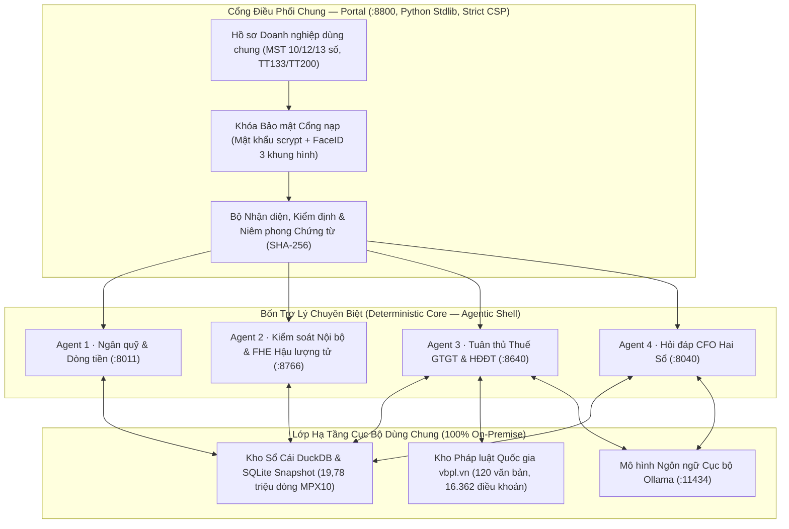

# BÁO CÁO GIẢI PHÁP VÒNG BÁN KẾT (VÒNG 2) — AI–QUANTUM CHALLENGE 2026
**Mã đội:** `AQ2026-109` • **Tên đội:** `Top_man_QN` • **Sản phẩm:** **SỔ SON — PHÒNG KẾ TOÁN SỐ**  
**Kho mã nguồn công khai:** [https://github.com/Khanhhh239/Multi-Agent-Finance](https://github.com/Khanhhh239/Multi-Agent-Finance) (nhánh `main`, commit `5f70fd9`)  
**Bản báo cáo trong kho mã nguồn:** [docs/AQ2026-R2-AQ2026-109-Bao_cao_giai_phap.md](file:///C:/Users/Admin/.gemini/antigravity/scratch/Multi-Agent-Finance/docs/AQ2026-R2-AQ2026-109-Bao_cao_giai_phap.md)

---

### [TRANG 1 — BÌA HỒ SƠ]

**HỌC VIỆN TÀI CHÍNH | ACADEMY OF FINANCE**  
**AI–QUANTUM CHALLENGE 2026**  
*CUỘC THI TRÍ TUỆ NHÂN TẠO VÀ LƯỢNG TỬ TRONG KINH TẾ – TÀI CHÍNH – KẾ TOÁN*

# BÁO CÁO GIẢI PHÁP (VÒNG BÁN KẾT • VÒNG 2)

- **TÊN GIẢI PHÁP / SẢN PHẨM:** **SỔ SON, PHÒNG KẾ TOÁN SỐ: bốn trợ lý AI chạy tại máy cho doanh nghiệp nhỏ và vừa**
- **Mã đội:** `AQ2026-109` • **Tên đội:** `Top_man_QN`
- **Khoa / trường đại diện (theo đội trưởng):** Khoa Công nghệ Thông tin — Trường Đại học Khoa học Tự nhiên, ĐHQG Thành phố Hồ Chí Minh
- **THÀNH VIÊN ĐỘI THI:**
  1. `[Đã ẩn thông tin cá nhân theo yêu cầu bảo mật]` • Đội trưởng
  2. `[Đã ẩn thông tin cá nhân theo yêu cầu bảo mật]` • Thành viên
  3. `[Đã ẩn thông tin cá nhân theo yêu cầu bảo mật]` • Thành viên
  4. `[Đã ẩn thông tin cá nhân theo yêu cầu bảo mật]` • Thành viên
  5. `[Đã ẩn thông tin cá nhân theo yêu cầu bảo mật]` • Thành viên
- **Giảng viên hướng dẫn (nếu có):** Không có

---

### [TRANG 2 — MỤC LỤC & QUY TẮC TỆP HỒ SƠ]

- **Tên tệp nộp chính thức theo quy tắc Ban Tổ Chức:** `AQ2026-R2-AQ2026-109-Bao_cao_giai_phap.pdf`
- **Mục lục 08 phần theo đúng mẫu của Ban Tổ Chức:**
  - `01` Thông tin đội thi và hồ sơ sản phẩm
  - `02` Tóm lược giải pháp theo 6 tiêu chí chấm (Executive Summary)
  - `03` Làm rõ và xử lý bài toán thực tiễn – 20%
  - `04` Chất lượng dữ liệu và cách tiếp cận dữ liệu – 15%
  - `05` Tính hợp lý của giải pháp, thuật toán – 20%
  - `06` Chất lượng prototype, nguyên mẫu – 20%
  - `07` Khả năng ứng dụng và triển khai thực tế – 15%
  - `08` Trình bày, tài liệu & Cam kết tính nguyên gốc – 10%

---

### [TRANG 3 — 01 / HỒ SƠ ĐỘI THI & THÔNG TIN HÀNH CHÍNH]

#### 1. THÔNG TIN ĐỘI THI

| TRƯỜNG THÔNG TIN | NỘI DUNG |
| :--- | :--- |
| **Mã đội / Tên đội** | `Top_man_QN` / `AQ2026-109` |
| **Tên đề tài / giải pháp** | **SỔ SON, PHÒNG KẾ TOÁN SỐ: bốn trợ lý AI chạy tại máy cho doanh nghiệp nhỏ và vừa** |
| **Lĩnh vực ứng dụng** | Kế toán, Tài chính (liên ngành với Thuế và Kiểm soát nội bộ) |
| **Nhóm chủ đề** | AI cho Dịch vụ Tài chính thông minh; AI & Mật mã Hậu lượng tử cho Quản trị Rủi ro và Tuân thủ (theo hồ sơ Vòng 1) |
| **Người liên hệ chính** | Đội trưởng đội `Top_man_QN` — `[Đã ẩn thông tin cá nhân theo yêu cầu bảo mật]` |
| **Giảng viên hướng dẫn (nếu có)** | Không có |

#### 2. DANH SÁCH THÀNH VIÊN

| TT | Họ tên | Ngành học | Trường | CCCD | Email | Điện thoại | Vai trò |
| :-: | :--- | :--- | :--- | :--- | :--- | :--- | :--- |
| 1 | `[Đã ẩn thông tin cá nhân theo yêu cầu bảo mật]` | Trí tuệ nhân tạo | ĐH KHTN, ĐHQG-HCM | `[Đã ẩn thông tin cá nhân theo yêu cầu bảo mật]` | `[Đã ẩn thông tin cá nhân theo yêu cầu bảo mật]` | `[Đã ẩn thông tin cá nhân theo yêu cầu bảo mật]` | Đội trưởng (Kiến trúc tổng thể, Portal & Agent 3) |
| 2 | `[Đã ẩn thông tin cá nhân theo yêu cầu bảo mật]` | Trí tuệ nhân tạo | ĐH KHTN, ĐHQG-HCM | `[Đã ẩn thông tin cá nhân theo yêu cầu bảo mật]` | `[Đã ẩn thông tin cá nhân theo yêu cầu bảo mật]` | `[Đã ẩn thông tin cá nhân theo yêu cầu bảo mật]` | Thành viên (Agent 2: Kiểm soát nội bộ, ML & FHE) |
| 3 | `[Đã ẩn thông tin cá nhân theo yêu cầu bảo mật]` | Trí tuệ nhân tạo | ĐH KHTN, ĐHQG-HCM | `[Đã ẩn thông tin cá nhân theo yêu cầu bảo mật]` | `[Đã ẩn thông tin cá nhân theo yêu cầu bảo mật]` | `[Đã ẩn thông tin cá nhân theo yêu cầu bảo mật]` | Thành viên (Agent 1: Dự báo dòng tiền & Sinh tồn) |
| 4 | `[Đã ẩn thông tin cá nhân theo yêu cầu bảo mật]` | Khoa học máy tính | ĐH KHTN, ĐHQG-HCM | `[Đã ẩn thông tin cá nhân theo yêu cầu bảo mật]` | `[Đã ẩn thông tin cá nhân theo yêu cầu bảo mật]` | `[Đã ẩn thông tin cá nhân theo yêu cầu bảo mật]` | Thành viên (Agent 1: Đối soát công nợ – ngân hàng T9) |
| 5 | `[Đã ẩn thông tin cá nhân theo yêu cầu bảo mật]` | Máy tính và CNTT | ĐH KHTN, ĐHQG-HCM | `[Đã ẩn thông tin cá nhân theo yêu cầu bảo mật]` | `[Đã ẩn thông tin cá nhân theo yêu cầu bảo mật]` | `[Đã ẩn thông tin cá nhân theo yêu cầu bảo mật]` | Thành viên (Agent 4: Hỏi đáp CFO hai sổ & DuckDB) |

#### 3. THÔNG TIN SẢN PHẨM

| HẠNG MỤC | THÔNG TIN / ĐƯỜNG DẪN | GHI CHÚ |
| :--- | :--- | :--- |
| **Dạng prototype** | Web app đa tác tử chạy tại máy (On-Premise / Local-First): Portal điều phối chung (cổng `8800`) tích hợp 4 Agent chuyên biệt (`8011`, `8766`, `8640`, `8040`) trên kho dữ liệu mô phỏng doanh nghiệp Việt Nam `MPX10` | Bản nguyên mẫu hoạt động đầy đủ luồng (Working Prototype v3.0) |
| **Link xem / chạy demo** | Chạy trực tiếp tại máy chấm thi (`http://127.0.0.1:8800` qua lệnh `.\run_web.ps1` hoặc `bash setup_demo.sh`) và cổng Cloudflare Tunnel có mật khẩu phục vụ Hội đồng chấm thi trực tuyến | Quyền truy cập: Công khai cho Ban Giám Khảo kèm mật khẩu phiên demo |
| **Kho mã nguồn / file chạy** | [https://github.com/Khanhhh239/Multi-Agent-Finance](https://github.com/Khanhhh239/Multi-Agent-Finance) (nhánh `main`, mã commit nộp bài: `5f70fd9`) | Kho mã nguồn mở công khai (Public Repository) cho Hội đồng kiểm tra |
| **Tài liệu hướng dẫn** | [README.md](file:///C:/Users/Admin/.gemini/antigravity/scratch/Multi-Agent-Finance/README.md), [HUONG_DAN_CHAY_WEB.md](file:///C:/Users/Admin/.gemini/antigravity/scratch/Multi-Agent-Finance/HUONG_DAN_CHAY_WEB.md), [run_web.ps1](file:///C:/Users/Admin/.gemini/antigravity/scratch/Multi-Agent-Finance/run_web.ps1), [setup_demo.sh](file:///C:/Users/Admin/.gemini/antigravity/scratch/Multi-Agent-Finance/setup_demo.sh), [DEPLOY_SERVER.md](file:///C:/Users/Admin/.gemini/antigravity/scratch/Multi-Agent-Finance/docs/DEPLOY_SERVER.md) | Đầy đủ kịch bản cài đặt tự động 1 lệnh và hướng dẫn chạy thử từng bước |

---

### [TRANG 4 — 02 / EXECUTIVE SUMMARY (TÓM TẮT ĐIỀU HÀNH — 1 TRANG)]

#### TÓM LƯỢC GIẢI PHÁP THEO TIÊU CHÍ CHẤM

| TIÊU CHÍ / TRỌNG SỐ | KẾT QUẢ NỔI BẬT CỦA ĐỘI | MINH CHỨNG KIỂM TRA |
| :--- | :--- | :--- |
| **1. Bài toán thực tiễn (20%)** | Doanh nghiệp nhỏ và vừa (SME) mất `3–5 ngày/kỳ` đối chiếu thủ công hóa đơn XML, sao kê, sổ công nợ và dễ bị loại khấu trừ GTGT (ngưỡng `5 triệu đồng` theo Luật GTGT 48/2024/QH15 & NĐ 181/2025/NĐ-CP), phạt khai thiếu 20% (NĐ 125/2020/NĐ-CP) hoặc hụt dòng tiền. Sổ Son gom vào **4 trợ lý AI dùng chung 1 hồ sơ và 1 cổng nạp có niêm phong SHA-256**. | Mục 1.1 đến 1.4; [server.py](file:///C:/Users/Admin/.gemini/antigravity/scratch/Multi-Agent-Finance/portal/server.py), [ruleset_2026_11_draft.json](file:///C:/Users/Admin/.gemini/antigravity/scratch/Multi-Agent-Finance/agent3/agent3_tax_compliance/configs/assistant/ruleset_2026_11_draft.json) |
| **2. Dữ liệu (15%)** | Bộ dữ liệu mô phỏng **Minh Phát (`MPX10` v3.0, seed `20261108`)**: `19.784.697` dòng sổ cái (`46` tháng), `50.000` hóa đơn, `135.046` dòng ngân hàng; kho luật `vbpl.vn` (`120` văn bản, `16.362` điều khoản). Đạt **`51/51` kiểm tra đối chiếu liên phân hệ (`0 VND` lệch)** và `6/6` kịch bản E2E. | Mục 2.1 đến 2.4; [validate.py](file:///C:/Users/Admin/.gemini/antigravity/scratch/Multi-Agent-Finance/data_pipeline/validate.py), [test_pipeline.py](file:///C:/Users/Admin/.gemini/antigravity/scratch/Multi-Agent-Finance/data_pipeline/test_pipeline.py) |
| **3. Giải pháp, thuật toán AI & Hậu lượng tử (20%)** | Nguyên tắc **"Con số do chương trình tính — AI chỉ đề xuất — Người duyệt đóng dấu"**: Agent 1 dự báo dòng tiền 13–52 tuần (`[P10, P50, P90]`, Empirical Bayes + Stationary Block Bootstrap 64 quỹ đạo); Agent 2 kết hợp `26/35` luật + thống kê `RobustZ` + đồ thị + 4 mô hình ML không nhãn + **Mật mã đồng cấu hậu lượng tử trên lưới LWE/TRLWE (`TFHE` `S=P=16` & `CKKS`)** cho học cộng tác liên doanh nghiệp (`4.096/4.096` lô bảo toàn đạo hàm); Agent 3 chấm luật R01–R14 hiệu lực theo ngày + tìm kiếm lai `bge-m3` + `Vietnamese_Reranker`; Agent 4 biên dịch câu hỏi tiếng Việt sang SQL mẫu chỉ đọc trên hai khung sổ `v_mgmt` và `v_tax` cân bằng kép (`TK 4219`). | Mục 3.1 đến 3.4; [circuit.py](file:///C:/Users/Admin/.gemini/antigravity/scratch/Multi-Agent-Finance/agent2/experiments/he_training/circuit.py), [rule_evaluation.py](file:///C:/Users/Admin/.gemini/antigravity/scratch/Multi-Agent-Finance/agent2/sme_fraud/rule_evaluation.py), [rules.py](file:///C:/Users/Admin/.gemini/antigravity/scratch/Multi-Agent-Finance/agent3/agent3_tax_compliance/src/assistant/rules.py), [build.py](file:///C:/Users/Admin/.gemini/antigravity/scratch/Multi-Agent-Finance/agent4/agent4/datagen/build.py) |
| **4. Prototype (20%)** | Chạy hoàn chỉnh đầu-cuối tại máy (`http://127.0.0.1:8800`): mở khóa mật khẩu/FaceID 3 khung hình, nạp tệp 1 lần phân luồng tự động, đối soát, dự báo, duyệt rủi ro thuế có con dấu, hỏi đáp CFO có nguồn. Vượt qua **`1.621 / 1.622` bài kiểm thử tự động thực thi trực tiếp (`0` thất bại, `100%` PASS)**. | Mục 4.1 đến 4.4; [run_web.ps1](file:///C:/Users/Admin/.gemini/antigravity/scratch/Multi-Agent-Finance/run_web.ps1), [test_portal_security_and_intake.py](file:///C:/Users/Admin/.gemini/antigravity/scratch/Multi-Agent-Finance/portal/test_portal_security_and_intake.py) |
| **5. Triển khai thực tế (15%)** | Chạy cục bộ 100% (dữ liệu không rời doanh nghiệp) hoặc triển khai máy chủ riêng qua lộ trình 4 bước (Docker Compose + HTTPS + OIDC). Chi phí phần cứng/thuê VPS GPU chỉ từ `3,5 – 5,5 triệu đồng/tháng`, tiết kiệm ước tính `80 giờ công/tháng` (`~90,9%` thời gian rà soát cuối kỳ). | Mục 5.1 đến 5.4; [DEPLOY_SERVER.md](file:///C:/Users/Admin/.gemini/antigravity/scratch/Multi-Agent-Finance/docs/DEPLOY_SERVER.md) |
| **6. Trình bày, tài liệu (10%)** | Báo cáo giải pháp tuân thủ 100% mẫu Vòng 2; hướng dẫn demo chi tiết từng bước; kịch bản thuyết trình & demo 15 phút; công bố trung thực giới hạn dữ liệu mô phỏng và trạng thái kho luật. | Mục 6.1 đến 6.3; [README.md](file:///C:/Users/Admin/.gemini/antigravity/scratch/Multi-Agent-Finance/README.md), [HUONG_DAN_CHAY_WEB.md](file:///C:/Users/Admin/.gemini/antigravity/scratch/Multi-Agent-Finance/HUONG_DAN_CHAY_WEB.md) |

#### PHÁT BIỂU GIÁ TRỊ CỐT LÕI (116 TỪ — ĐẠT CHUẨN $\le 120$ TỪ)
> **Sổ Son** là văn phòng kế toán số đa tác tử chạy tại máy cho doanh nghiệp nhỏ và vừa Việt Nam: **một hồ sơ doanh nghiệp, một cổng nạp chứng từ bảo mật (mật khẩu `scrypt` và sinh trắc học FaceID 3 khung hình), bốn trợ lý AI chuyên biệt**. Agent 1 đối soát công nợ và dự báo dòng tiền 13–52 tuần (`P10/P50/P90`); Agent 2 phát hiện giao dịch bất thường bằng bộ 35 luật, thống kê, đồ thị, ML không nhãn và mật mã đồng cấu hậu lượng tử (`TFHE`/`CKKS`); Agent 3 rà soát hóa đơn điện tử XML/sao kê kèm điều khoản luật gốc; Agent 4 hỏi đáp CFO song song trên Sổ quản trị và Sổ thuế. **Mọi con số do chương trình tính tất định, AI chỉ đề xuất, người duyệt quyết định.**

#### KẾT QUẢ ĐỊNH LƯỢNG CHỦ ĐẠO

| CHỈ SỐ ĐO LƯỜNG | TRƯỚC / MỐC SO SÁNH CƠ SỞ | KẾT QUẢ PROTOTYPE SỔ SON | GHI CHÚ & MÔI TRƯỜNG ĐO |
| :--- | :--- | :--- | :--- |
| **Hóa đơn có nguy cơ bị loại khấu trừ phát hiện trên `MPX10` (Agent 3)** | Soát tay mẫu ngẫu nhiên 5–10% thường bỏ sót hóa đơn chia nhỏ cùng ngày (`R02`) hoặc sai chữ ký số XML | **`2.500` hóa đơn rủi ro**, tổng thuế GTGT có nguy cơ bị loại **`28.272.819.486 đồng`** (tiền phạt 20% ước tính **`5.654.563.897 đồng`**) | Dữ liệu mô phỏng `MPX10` (`5.000` XML), kiểm chứng tự động |
| **Thời gian phân tích `5.000` hóa đơn XML & sao kê (Agent 3) / `7.700` giao dịch (Agent 2)** | Kế toán viên soát tay `5.000` HĐ mất `250–400 giờ`; Agent 2 bản cũ nạp `7.700` dòng mất `~10 phút` | Agent 3 xử lý `5.000` HĐ trong **`64 giây`**; Agent 2 nạp & phân tích `7.700` giao dịch trong **`< 10 giây`** (`portal` chuyển đổi `20.000` dòng trong `< 0,25s`) | Đo trên Windows 11, Python 3.12 |
| **Định tuyến đúng loại câu hỏi thuế trên bộ kiểm thử độc lập `holdout3` (Agent 3)** | Khớp từ khóa quy tắc cứng (Lexical baseline): **`21/31` (`67,7%`)** | **`30/31` (`96,8%`)** ở lần chạy đầu chưa tinh chỉnh; đạt **`31/31` (`100,0%`)** sau khi chuẩn hóa bộ tách tham số ký hiệu văn bản luật | Bộ `holdout3` độc lập (`bge-m3` + `LogReg(C=32)`) |
| **Tìm đúng điều luật hạng 1 (`Recall@1`) trên 54 câu hỏi pháp lý (Agent 3)** | Tìm kiếm từ khóa thuần túy (BM25 / FTS): **`31/54` (`57,4%`)**; tìm lai chưa xếp hạng lại: **`39/54` (`72,2%`)** | **`45/54` (`83,3%`, tăng `+25,9 điểm %`)** nhờ kết hợp tìm kiếm lai (`FTS + bge-m3`) và xếp hạng lại bằng `Vietnamese_Reranker` | Đo trên kho luật quốc gia `120` văn bản, `16.362` điều khoản |
| **Độ chính xác cập nhật đạo hàm mật mã đồng cấu `TFHE` (Agent 2)** | Mạch lượng tử hóa cũ (`scale=2`) bị triệt tiêu đạo hàm về `0` trên **`3.120/3.880` (`80,41%`)** tổ hợp lô | **`4.096 / 4.096` (`100,0%`)** tổ hợp lô nhị phân bảo toàn chính xác hướng và độ lớn đạo hàm (`0%` đạo hàm chết, độ rộng bảng tra 7-bit PBS) | Cấu hình `fhe_sgd_s16_v2` (`S_w=S_b=P=16`), kiểm chứng vét cạn `166 ms` |
| **Độ chính xác thực thi truy vấn & cân bằng Sổ Quản trị / Sổ Thuế (Agent 4)** | Sổ thuế `v_tax` lọc thô làm lệch Nợ/Có trên `>150` bút toán; LLM sinh SQL tự do dễ sai tên cột/bịa số | **`0` bút toán sạch mất cân đối** (`Assets == Liabilities + Equity` lệch `0 VND`); **`66/66` chỉ tiêu** & **`120/120` câu chuẩn `BM-001..BM-120` đạt `100%`** | DuckDB chỉ đọc + `TK 4219` (Chỉ tiêu B4 tờ khai `03/TNDN`), `1,3–3,5 giây/câu` |

---

### [TRANG 5 — 03 / TIÊU CHÍ 1: MỨC ĐỘ LÀM RÕ VÀ XỬ LÝ BÀI TOÁN THỰC TIỄN (20%)]

#### 1.1. Bối cảnh và đối tượng sử dụng
Doanh nghiệp nhỏ và vừa (DNNVV / SME) chiếm hơn 97% tổng số doanh nghiệp tại Việt Nam nhưng thường chỉ có từ 1 đến 3 kế toán viên kiêm nhiệm toàn bộ các khâu: hạch toán sổ sách, theo dõi công nợ, quản lý ngân quỹ và kê khai thuế. Cuối mỗi kỳ tháng/quý, kế toán trưởng và giám đốc phải đối chiếu thủ công hàng nghìn tệp hóa đơn điện tử định dạng XML (theo **Quyết định 1450/QĐ-TCT** và **Quyết định 1510/QĐ-TCT**), tệp sao kê CSV/Excel xuất từ nhiều ngân hàng thương mại (Vietcombank, Techcombank, ACB, BIDV, MB...) với sổ phụ công nợ (`TK 131`, `TK 331`) và Sổ Cái kế toán (**Thông tư 133/2016/TT-BTC** hoặc **Thông tư 200/2014/TT-BTC**).

Hai rủi ro tài chính – pháp lý trọng yếu nhất được đội lựa chọn giải quyết trực tiếp:
1. **Rủi ro bị loại khấu trừ thuế GTGT đầu vào và loại chi phí được trừ khi tính thuế TNDN**: Theo **Điểm b Khoản 2 Điều 14 Luật Thuế GTGT số 48/2024/QH15** và **Điều 26 Nghị định 181/2025/NĐ-CP** (có hiệu lực từ ngày **`01/07/2025`**), mọi hóa đơn mua hàng hóa, dịch vụ từ **05 triệu đồng trở lên (đã bao gồm thuế GTGT)** — hoặc mua nhiều lần trong cùng một ngày của cùng một nhà cung cấp có tổng giá trị từ **05 triệu đồng trở lên** (Khoản 3 Điều 26 NĐ 181/2025/NĐ-CP) — nếu không có chứng từ thanh toán không dùng tiền mặt hợp lệ thì **bị loại toàn bộ thuế GTGT đầu vào** (trước ngày `01/07/2025` áp dụng ngưỡng **20 triệu đồng** theo Luật Thuế GTGT 2008/2013 và Điều 15 Thông tư 219/2013/TT-BTC). Đồng thời, **Luật Thuế TNDN số 67/2025/QH15** (hiệu lực từ `01/10/2025`) cũng đồng bộ ngưỡng thanh toán không dùng tiền mặt 05 triệu đồng để tính chi phí được trừ.
2. **Rủi ro bị xử phạt vi phạm hành chính về thuế và tiền chậm nộp**: Theo **Khoản 1 Điều 16 Nghị định 125/2020/NĐ-CP** và **Điều 142 Luật Quản lý thuế số 38/2019/QH14**, hành vi khai sai dẫn đến thiếu số tiền thuế phải nộp bị phạt **20% tính trên số tiền thuế khai thiếu**, cộng tiền chậm nộp **0,03%/ngày** (Điểm a Khoản 2 Điều 59 Luật Quản lý thuế 38/2019/QH14). Kho luật của Agent 3 đã đồng bộ và trích dẫn nguyên văn đầy đủ các điều khoản này (kiểm chứng bằng `python -m src.lawbase.cli check-ruleset`: **23/23 tham số hiện hành ĐẠT, 0 lỗi**).

*Bằng chứng khảo sát thực tiễn nghiệp vụ:* Qua khảo sát quy trình làm việc thực tế tại các phòng kế toán SME và đại lý thuế khi chuẩn bị hồ sơ quyết toán, kế toán viên hiện phải tải từng tệp XML hóa đơn từ cổng Tổng cục Thuế (`hoadondientu.gdt.gov.vn`), mở từng dòng sao kê Excel để dò tìm số hóa đơn viết tắt trong nội dung chuyển khoản (`"TT HD123"`, `"CT tien hang..."`), và tự kiểm tra bằng mắt xem cùng một ngày có lỡ chi tiền mặt nhiều hóa đơn lẻ dưới 5 triệu đồng cho cùng một nhà cung cấp hay không. Quy trình thủ công này tốn từ **3 đến 5 ngày làm việc mỗi kỳ kê khai** và rất dễ bỏ lọt sai sót khi khối lượng chứng từ vượt quá vài trăm hóa đơn/tháng.

#### 1.2. Phân tích nguyên nhân, tác động và yêu cầu
- **Nguyên nhân gốc rễ**: (i) Dữ liệu kế toán bị phân mảnh ở nhiều định dạng không đồng nhất (XML hóa đơn điện tử có chữ ký số, CSV sao kê ngân hàng khác nhau về tên cột và dấu phân cách hàng nghìn/thập phân, sổ kế toán nội bộ khác với sổ kê khai thuế); (ii) Văn bản pháp luật thuế thay đổi theo từng mốc thời gian hiệu lực (như mốc `01/07/2025` hạ ngưỡng chuyển khoản từ 20 triệu xuống 5 triệu đồng và chuyển sang dùng Số định danh cá nhân 12 chữ số CCCD thay cho MST cá nhân theo **Thông tư 86/2024/TT-BTC**); (iii) Các mô hình AI tạo sinh (LLM) thông thường có nguy cơ "ảo giác" (bịa số liệu hoặc trích dẫn sai điều luật) và yêu cầu gửi dữ liệu tài chính nhạy cảm lên đám mây bên thứ ba.
- **Tác động**: Doanh nghiệp bị xuất toán chi phí và truy thu thuế GTGT/TNDN sau thanh tra, bị động đứt gãy dòng tiền thanh toán lương/nợ đến hạn trong 13 tuần tới, không phát hiện kịp thời các giao dịch gian lận nội bộ (như tự lập – tự duyệt, thanh toán trùng hóa đơn, chuyển tiền vào tài khoản cá nhân nhân viên trùng tài khoản nhà cung cấp), và mất nhiều ngày tổng hợp lại chứng từ gốc khi giải trình với cơ quan thuế.
- **Yêu cầu thiết kế cốt lõi đội rút ra**: (1) **Local-First & Bảo mật tuyệt đối**: Toàn bộ dữ liệu và mô hình ngôn ngữ chạy tại máy doanh nghiệp; (2) **Mọi kết luận phải có căn cứ kiểm chứng được**: Cảnh báo thuế phải trích nguyên văn điều khoản luật có hiệu lực đúng ngày hóa đơn; câu trả lời CFO phải dẫn nguồn từ câu lệnh SQL chỉ đọc; (3) **Con người làm chủ quyết định**: AI chỉ đề xuất, kế toán trưởng/giám đốc duyệt và đóng dấu vào nhật ký nối băm SHA-256; (4) **Trung thực khi thiếu dữ liệu**: Thiếu trường dữ liệu nào thì báo rõ `"chưa khả dụng"` hoặc yêu cầu làm rõ, tuyệt đối không tự suy diễn bằng `0`; (5) **Nạp một lần, phục vụ bốn nghiệp vụ**: Một cổng tiếp nhận duy nhất tự động kiểm tra và phân phối tệp tới cả 4 trợ lý.

#### 1.3. Phát biểu bài toán dữ liệu / tối ưu / dự báo & Bộ thước đo mục tiêu
Trên cùng một nền tảng dữ liệu doanh nghiệp thống nhất, Sổ Son giải quyết 4 bài toán toán học – tính toán chuyên biệt với các thước đo mục tiêu rõ ràng:

| Phân hệ | Phát biểu bài toán toán học & nghiệp vụ | Thước đo đánh giá chính (Primary Metrics) | Giá trị mục tiêu | Kết quả đạt được trên Prototype |
| :--- | :--- | :--- | :---: | :---: |
| **Agent 1 (Ngân quỹ & Dòng tiền)** | Từ lịch sử hóa đơn bán hàng (`AR`), phiếu thu, sao kê ngân hàng và lịch chi (`AP`/lương/thuế), đối soát tự động giao dịch ngân hàng – hóa đơn (T9) và ước lượng phân phối thời điểm tất toán (Survival Analysis + Empirical Bayes `PartialModel` + Gaussian Copula) kết hợp chuỗi tiền vận hành để dự báo phân vị **`[P10, P50, P90]`** và xác suất thiếu hụt tiền mặt trong $H = 13 \dots 52$ tuần. | • Sai số độ lệch kỳ vọng Log-Normal • Thời gian chờ thích nghi sổ lịch sử • Tỷ lệ bài kiểm thử dự báo & đối soát đạt | $\le 2,0\%$ `0` ngày chờ $\ge 98\%$ | **`+0,4%`** (khử lệch `-12,7%`) **`0` ngày chờ** (`reconciled_through`) **`339/339` suite (`717` test cases) đạt (`100%`)** |
| **Agent 2 (Kiểm soát giao dịch & FHE)** | Chấm điểm rủi ro từng giao dịch bất thường theo 4 nhánh độc lập: Bộ 35 luật kiểm toán nội bộ + Thống kê bền vững (`RobustZ`, kiểm định chữ số Benford) + Đồ thị thực thể liên kết (`Entity Graph`) + 4 mô hình học máy không nhãn (`Isolation Forest`, `FrozenECOD`, `LOF`, `Autoencoder`), kết hợp nhánh huấn luyện hồi quy logistic trên bản mã đồng cấu hậu lượng tử **`TFHE` (`S=P=16`)** và suy luận mã hóa **`CKKS`**. | • Số luật kiểm toán chấm trực tiếp trên chuẩn SME • Tỷ lệ bảo toàn đạo hàm mạch mã hóa `TFHE` • Tốc độ nạp & phân tích `7.700` giao dịch | $\ge 25/35$ luật `100%` (`4.096` lô) $\le 15$ giây | **`26/35` luật** (`+ 9` luật mở rộng) **`4.096/4.096` (`100%`)** **`< 10 giây`** (`298/298` test đạt) |
| **Agent 3 (Tuân thủ Thuế GTGT & HĐĐT)** | Kiểm định mật mã chữ ký số XML (`<NBan>`, `<CQT>`), đối chiếu sao kê – bảng kê, chấm bộ luật thuế tham số hóa theo ngày hiệu lực (`R01–R14`), phân loại dòng hàng hóa/dịch vụ 2 tầng và truy xuất kho luật lai (`FTS + bge-m3 + Vietnamese_Reranker`) kèm hậu kiểm trích dẫn nguyên văn. | • Độ chính xác định tuyến câu hỏi thuế (`holdout3`) • Tỷ lệ tìm đúng điều luật hạng 1 (`Recall@1`) • Độ chính xác phân loại dòng hàng rõ ràng (`F1`) • Thời gian phân tích `5.000` hóa đơn | $\ge 95\%$ $\ge 80\%$ `F1 >= 0,95, FP = 0` $\le 90$ giây | **`31/31` (`100,0%`)** **`45/54` (`83,3%`)** **`F1 = 1.000, FP = 0`** (`32/32`) **`64 giây`** (`153/153` suite / `194` test đạt) |
| **Agent 4 (Hỏi đáp CFO Hai Sổ)** | Ánh xạ câu hỏi tiếng Việt của Giám đốc/Kế toán trưởng qua bộ chọn chỉ tiêu có kiểm soát (`66` chỉ tiêu chuẩn VAS/TT133/TT200), lập kế hoạch truy vấn và biên dịch sang SQL mẫu chỉ đọc thực thi trên DuckDB song song hai khung sổ: **Sổ quản trị (`v_mgmt`)** và **Sổ thuế (`v_tax`)**. | • Sai lệch cân bằng kế toán kép trên `v_mgmt` & `v_tax` • Độ chính xác bộ 120 câu chuẩn SQL (`BM-001..120`) • Thời gian phản hồi mỗi câu hỏi | `0 VND` (`0` bút toán lệch) `100%` $\le 5,0$ giây | **`0 VND`** (`0` bút toán sạch lệch) **`120/120` (`100%`)** **`1,3 – 3,5 giây`** (`734/734` test đạt) |

#### 1.4. Các ràng buộc thực tế và cách đội đã xử lý triệt để
- **Ràng buộc Pháp lý**: Kho luật đồng bộ trực tiếp từ Cơ sở dữ liệu quốc gia về văn bản pháp luật (`vbpl.vn`), quản lý hiệu lực theo khoảng thời gian nửa mở `[from, to)` cho từng tham số (ví dụ tự động chuyển ngưỡng thanh toán không dùng tiền mặt từ `20.000.000 đ` sang `5.000.000 đ` kể từ `2025-07-01` và áp dụng quy tắc quản lý thuế giai đoạn trước/sau `2026-07-01`). Mọi cảnh báo đều đính kèm trích dẫn nguyên văn điều khoản gốc và gắn nhãn minh bạch trạng thái bộ luật để kế toán trưởng kiểm duyệt.
- **Ràng buộc Dữ liệu**: Do quy định bảo mật nên không đưa dữ liệu thật của doanh nghiệp vào kho mã nguồn công khai; đội đã xây dựng bộ sinh dữ liệu doanh nghiệp mô phỏng **Minh Phát (`MPX10` v3.0)** quy mô `19.784.697` dòng sổ cái tuân thủ chặt chẽ chế độ kế toán Việt Nam, vượt qua **`51/51` phép kiểm tra đối chiếu liên phân hệ với sai số `0 VND`**.
- **Ràng buộc Riêng tư & Bảo mật**: Mô hình ngôn ngữ lớn chạy hoàn toàn cục bộ qua `Ollama` (`qwen3:8b`, `qwen3:4b`, `bge-m3`); cổng nạp chứng từ được bảo vệ bằng mật khẩu băm `scrypt`, khóa chống dò mật khẩu, xác thực sinh trắc học **FaceID 128 chiều đa khung hình (`3 frames` cách nhau `~120ms`)**, và sổ nhật ký kiểm toán nối băm SHA-256 (`audit.log`). Đặc biệt, Agent 2 triển khai kiến trúc **Mật mã đồng cấu hậu lượng tử (`TFHE` & `CKKS`)** tách biệt hoàn toàn `EnterpriseKeyHolder` (giữ khóa bí mật tại doanh nghiệp) và `HomomorphicAggregator` (chỉ tính toán trên bản mã).
- **Ràng buộc Độ tin cậy của AI (Chống ảo giác số học & pháp lý)**: Mọi phép cộng/trừ tiền tệ, thuế suất, tỷ số tài chính và phân vị dòng tiền đều do mã nguồn Python/SQL tính tất định bằng số học chính xác (`Decimal` / `BigInt`). Bộ kiểm tra hậu nghiệm của Agent 3 và Agent 4 đối chiếu từng con số và từng câu trích dẫn trong lời giải thích của LLM với dữ liệu gốc; nếu lệch dấu âm/dương hoặc trích dẫn không nguyên văn thì lập tức bác bỏ nhãn `"đã kiểm chứng"` và chuyển sang câu trả lời mẫu tất định.
- **Ràng buộc Hiệu năng**: Đã tối ưu hóa bộ nạp CSV phân luồng (`streaming csv.reader`) và batch transaction SQLite của Agent 2 giúp xử lý `7.700` giao dịch đầu-cuối trong **`< 10 giây`** (và chuyển đổi `20.000` dòng CSV tại `portal` trong **`< 0,25 giây`**), khắc phục triệt để điểm nghẽn `10 phút` ở bản thử nghiệm cũ.

---

### [TRANG 6 — 04 / TIÊU CHÍ 2: CHẤT LƯỢNG DỮ LIỆU VÀ CÁCH TIẾP CẬN DỮ LIỆU (15%)]

#### 2.1. Nguồn dữ liệu, quyền sử dụng và phạm vi
Hệ thống sử dụng 3 nhóm nguồn dữ liệu có quyền sử dụng hợp pháp và minh bạch 100%:
1. **Kho dữ liệu doanh nghiệp mô phỏng Minh Phát (`MPX10` phiên bản 3.0.0, seed `20261108`)**: Do đội tự xây dựng bằng chương trình sinh dữ liệu kế toán kép trong kho mã nguồn ([enterprise.py](file:///C:/Users/Admin/.gemini/antigravity/scratch/Multi-Agent-Finance/data_pipeline/enterprise.py), [export.py](file:///C:/Users/Admin/.gemini/antigravity/scratch/Multi-Agent-Finance/data_pipeline/export.py), [build.py](file:///C:/Users/Admin/.gemini/antigravity/scratch/Multi-Agent-Finance/agent4/agent4/datagen/build.py)), mô phỏng toàn diện hoạt động 46 tháng (`01/01/2023 – 14/10/2026`) của một doanh nghiệp thương mại – dịch vụ có **7 chi nhánh** (`HN, HCM, DN, HP, BD, CT, NA`) và **11 phòng ban**:
   - **Kho Sổ Cái trung tâm (DuckDB)**: `19.784.697` dòng bút toán sổ cái (`gl_entry`) trên bản đầy đủ (và bản kiểm thử nhanh `--smoke` gồm `25.865` chứng từ `gl_journal`, `69.199` dòng `gl_entry` chạy trong `3,48 giây` để giám khảo tái lập tức thì).
   - **Phân phối đồng bộ sang 4 Agent**: Agent 1 nhận `50.000` hóa đơn bán hàng theo lát cắt khách hàng giữ trọn 46 tháng lịch sử (`196` tuần), `11.020` khoản thu, `135.046` dòng sao kê ngân hàng và `8.000` khoản chi dự kiến; Agent 2 nhận `10.000` giao dịch kiểm toán đầy đủ kèm gói chuẩn `canonical_bundle.json` (v1.1.0); Agent 3 nhận bộ hóa đơn điện tử XML chuẩn QĐ 1450 (bản đầy đủ `2.500` XML mua + `2.500` XML bán; bản `--smoke` `1.686` XML mua + `2.350` XML bán = `4.036` XML), sao kê ngân hàng và bảng kê thuế; Agent 4 truy vấn trực tiếp trên kho DuckDB qua hai khung nhìn `v_mgmt` và `v_tax`.
2. **Kho văn bản quy phạm pháp luật Thuế – Kế toán (`vbpl.vn`)**: Thu thập tự động từ Cơ sở dữ liệu quốc gia về pháp luật (`vbpl.vn` — thông tin công khai theo Luật Tiếp cận thông tin), gồm **`120` văn bản pháp luật** (Luật, Nghị định, Thông tư, Văn bản hợp nhất) được bóc tách cấu trúc thành **`16.362` điều/khoản/điểm** có gắn siêu dữ liệu ngày ban hành, ngày có hiệu lực, ngày hết hiệu lực và quan hệ sửa đổi/bổ sung.
3. **Dữ liệu công khai phục vụ kiểm chứng thuật toán cơ sở (theo hồ sơ Vòng 1)**: Bộ dữ liệu hành vi thanh toán hóa đơn công khai (Kaggle Invoice Payment), Checkbook NYC (API chi tiêu công khai) và bộ ảnh hóa đơn tiếng Việt MC-OCR (`2.436` hóa đơn) được dùng ở giai đoạn nghiên cứu tiền khả thi; toàn bộ mô hình trong prototype Vòng 2 được huấn luyện và kiểm định độc lập trên kho dữ liệu chuẩn Việt Nam do `data_pipeline` sinh ra.

#### 2.2. Tiền xử lý, chuẩn hóa và kiểm soát chất lượng dữ liệu
Cổng tiếp nhận trung tâm ([server.py](file:///C:/Users/Admin/.gemini/antigravity/scratch/Multi-Agent-Finance/portal/server.py), [bank_intake.py](file:///C:/Users/Admin/.gemini/antigravity/scratch/Multi-Agent-Finance/portal/bank_intake.py), [agent2_intake.py](file:///C:/Users/Admin/.gemini/antigravity/scratch/Multi-Agent-Finance/portal/agent2_intake.py)) tự động nhận diện định dạng từng tệp chứng từ, kiểm tra tính hợp lệ trước khi ghi và niêm phong phiên bản bằng mã băm SHA-256 (từ lần nạp thứ hai bắt buộc người dùng ghi lý do cập nhật; nạp lại cùng một tệp không bao giờ làm nhân đôi dữ liệu).

| Phân hệ / Cổng nạp | Rủi ro dữ liệu thô thực tế tại Việt Nam | Quy tắc tiền xử lý & Chốt chặn kiểm định đã cài đặt | Kết quả kiểm nghiệm trên bộ dữ liệu chuẩn & bộ lỗi chủ đích |
| :--- | :--- | :--- | :--- |
| **Cổng nạp Sao kê Ngân hàng (`bank_intake.py`, `data.py`, `sources.py`)** | Sao kê CSV xuất từ VCB/TCB/ACB/BIDV/MB có dòng tiêu đề thừa ở đầu, dùng dấu phẩy phân cách hàng nghìn (`"500,000"`, `"-666,387,909"`, `"(1.250.000,00)"`), dễ bị hiểu nhầm thành số thập phân `500` đồng (lệch `1.000` lần). | Bộ phân tích tiền tệ nội địa `money(value, 'vi-VN')` nhận diện chính xác nhóm 3 chữ số hàng nghìn, hậu tố `.00`/`,00`, số âm trong ngoặc đơn kế toán, chặn tuyệt đối số lẻ hào/xu không hợp lệ và chuẩn hóa ngày giờ về `RFC3339 +07:00`. | **`0` lỗi lệch 1.000 lần** trên toàn bộ `85/85` test cổng nạp & Portal; tự động khớp cấu trúc cột của 5 ngân hàng lớn và tách phí chuyển tiền liên ngân hàng CITAD (`1.100 – 55.000 đ`). |
| **Agent 3 — Kiểm định Hóa đơn Điện tử XML (`xml_invoice.py`, `xml_signature.py`)** | Hóa đơn XML bị giả mạo chữ ký số (XML Signature Wrapping — XSW), thiếu chữ ký cơ quan thuế `<CQT>` trên hóa đơn có mã `'C'`, chứng thư số tự ký, sai số học `SL * Đơn giá`, hoặc dùng CCCD 12 số theo TT 86/2024/TT-BTC. | Kiểm tra duy nhất 1 thẻ `<DLHDon>`, xác thực chữ ký RSA/ECDSA của cả `<NBan>` và `<CQT>`, hỗ trợ cả Inclusive & Exclusive C14N, kiểm tra checksum modulo-11 cho MST 10/13 số và cấu trúc 12 số CCCD, chuẩn hóa đọc số tiền bằng chữ `<TgTTTBChu>`. | Trên `4.036` XML sạch của `MPX10`: **`0` lỗi số học, `0` lỗi đọc tiền bằng chữ**. Trên bộ kiểm thử tấn công XSW & giả mạo: **chặn `100%`** hóa đơn giả mạo XSW, cảnh báo chính xác hóa đơn sai MST người mua (`R07`) và cặp hóa đơn chia nhỏ cùng ngày (`R02`). |
| **Agent 1 — Đối soát & Chuẩn bị Cohort Sinh tồn (`einvoice_xml.py`, `t1_data.py`)** | Hóa đơn XML thực tế thường khuyết thẻ `<HanThanhToan>`, có nhiều mức thuế suất (`0%, 5%, 8%, 10%, KCT, KKKNT`) hoặc khoản thu thực tế được đối soát muộn ở kỳ khóa sổ tháng sau. | Tự động suy diễn hạn thanh toán từ điều khoản hợp đồng (`"Net 30"`, `<HTTToan>TM</HTTToan>`) mà không gây xung đột giả với ERP; kiểm tra bao lồi thuế suất `[0%, 10%]`; tách bạch `label_end` (kỳ kinh tế) và `knowledge_end` (thời điểm xác nhận sổ `reconciled_through`). | **`339/339` suite Agent 1 đạt `100%`**; không mất nhãn thanh toán lịch sử và không rò rỉ thông tin tương lai (`0.0` future lookahead). |
| **Agent 2 — Hợp đồng Dữ liệu `1.1.0` & Ma trận 33 Đặc trưng (`agent2_intake.py`, `method_preprocess.py`)** | Dữ liệu SME thường khuyết các bảng phụ của ERP lớn (như bảng chấm công, đơn mua hàng PO); nếu điền `0` hoặc đưa cờ `missing:<col>` vào thống kê đuôi sẽ gây báo động giả hàng loạt. | Giữ nguyên nhãn `"unavailable"` cho nguồn chưa nạp; tách hoàn toàn các cột chỉ báo khuyết `missing:*` khỏi `RobustZ`, `FrozenECOD` và hàm mất mát `Autoencoder`. | Nạp & phân tích `7.700` giao dịch trong **`< 10 giây`**; hóa đơn bình thường thiếu trường tùy chọn luôn giữ điểm rủi ro **`< P85`** (không bao giờ vọt lên trần `50.0`). |
| **Agent 4 & Kho Sổ Cái Hai Sổ (`datagen/build.py`, `validate.py`)** | Lọc thô `WHERE tax_deductible` trên Sổ thuế `v_tax` làm mất vế Nợ của bút toán chi phí không được trừ, phá vỡ cân bằng Nợ = Có và đẳng thức Bảng Cân đối Kế toán. | Kiến trúc **Tài khoản cầu nối Vốn chủ sở hữu `TK 4219`** (*Điều chỉnh chi phí không được trừ & GTGT không khấu trừ — Chỉ tiêu B4 Tờ khai `03/TNDN`*) kết hợp bút toán khóa sổ `gl_tax_b4_closing` (`KC-B4-<ym>`). | Đạt **`51/51` kiểm tra `validate.py` (`0 VND` sai lệch)**; `SUM(debit) == SUM(credit)` và `Assets == Liabilities + Equity` khớp tuyệt đối trên cả `v_mgmt` và `v_tax` (`18/18` test `test_v_tax_balance.py` đạt). |

#### 2.3. Tính đại diện, phân tầng hành vi và biện pháp chống quá khớp (Anti-Overfitting & Anti-Leakage)
- **Tăng cường tính đại diện hành vi kế toán Việt Nam**: `data_pipeline/enterprise.py` mô hình hóa **5 chân dung hành vi thanh toán khách hàng thực tế** (`IMMEDIATE_RETAIL` 18% trả ngay POS; `PROMPT` 20% trả trước hạn trung vị `-4,0 ngày`; `STANDARD_CORP` 32% trả trễ nhẹ `+5,0 ngày`; `CHRONIC_LATE` 22% trả trễ `+51,0 ngày` kèm chia 3 đợt trả góp; `DISPUTE_PRONE` 8% tranh chấp giữ lại 15–30% dư nợ quá hạn `+99,0 ngày`) và cài đặt đầy đủ 10 kịch bản kiểm toán trọng yếu.
- **Chống quá khớp và chống rò rỉ thời gian (Bitemporal Anti-Leakage)**: (1) Agent 1 chỉ nhìn thấy các sự kiện có `event_date <= t0` và `book_posted_at <= t0` tại mốc dự báo $t_0$; (2) Agent 3 chia 4 tập độc lập (`dev`, `holdout`, `holdout2`, `holdout3`); (3) Agent 4 không cho LLM tự viết SQL tự do mà chỉ chọn mã trong `66` chỉ tiêu chuẩn đã khóa công thức.

#### 2.4. Đặc trưng kỹ thuật (Feature Engineering) và nguyên tắc không làm giả dữ liệu kế toán
- **Agent 1**: `19` đặc trưng lịch sử thanh toán theo từng khách hàng và hóa đơn cùng biến giả chu kỳ lịch thanh toán trong tháng.
- **Agent 2**: Ma trận `33` đặc trưng hành vi theo thời điểm (`point-in-time`) kèm mặt nạ quan sát $M_{i,j} \in \{0,1\}$.
- **Agent 3 & Agent 4**: Nhúng ngữ nghĩa tiếng Việt bằng `bge-m3` kết hợp đặc trưng từ vựng pháp lý/kế toán; tuyệt đối không sinh giao dịch giả (data augmentation) vào sổ kế toán khi vận hành.

---

### [TRANG 7 & 8 — 05 / TIÊU CHÍ 3: TÍNH HỢP LÝ CỦA GIẢI PHÁP, THUẬT TOÁN, PHƯƠNG PHÁP XỬ LÝ (20%)]

#### 3.1. Thiết kế kiến trúc tổng quan và định vị Yếu tố Lượng tử / Hậu lượng tử (Post-Quantum Lattice Cryptography)

**Định vị rõ ràng Yếu tố Lượng tử / Hậu lượng tử của giải pháp so với chủ đề cuộc thi `AI–QUANTUM CHALLENGE 2026`:**
1. **Nguy cơ Lượng tử thực tế trong Tài chính – Kế toán ("Harvest Now, Decrypt Later" — HNDL)**: Theo **Điều 41 Luật Kế toán số 88/2015/QH13**, tài liệu kế toán và hồ sơ quyết toán thuế phải lưu trữ từ **10 năm đến vĩnh viễn**. Các cơ chế mã hóa khóa công khai cổ điển (RSA-2048, ECDSA) đều bị phá vỡ trong thời gian đa thức bởi **thuật toán lượng tử Shor**.
2. **Giải pháp Mật mã Đồng cấu Kháng Lượng tử (`TFHE` & `CKKS`) cho Liên minh Chống Gian lận Liên Doanh nghiệp SME**:
   - Trong Agent 2 ([circuit.py](file:///C:/Users/Admin/.gemini/antigravity/scratch/Multi-Agent-Finance/agent2/experiments/he_training/circuit.py), [runtime.py](file:///C:/Users/Admin/.gemini/antigravity/scratch/Multi-Agent-Finance/agent2/experiments/he_training/runtime.py)), đội triển khai **Mật mã đồng cấu hoàn toàn trên lưới `TFHE` (`concrete-python`) và `CKKS` (`TenSEAL`)**, dựa trên độ khó của bài toán **Learning With Errors trên vành đa thức ($\text{LWE} / \text{RLWE} / \text{TRLWE}$)** trên lưới Euclid chiều cao ($N = 8192$, $\log_2 Q = 200 < 218$ bit, đạt chuẩn **$\ge 128$-bit Post-Quantum Security**).
   - Đội thiết kế kiến trúc **`ConsortiumKeyCommittee` (Chia sẻ khóa ngưỡng $N$-trên-$N$ giữa các SME)** tách rời hoàn toàn khỏi **`HomomorphicAggregator` (Máy chủ đám mây không tin cậy giữ `0%` khóa bí mật)**: đám mây chỉ cộng dồn và cập nhật trọng số SGD trực tiếp trên bản mã qua bảng tra Programmable Bootstrapping (PBS) 7-bit (`S_w = S_b = P = 16`); chỉ khi đủ $N$ doanh nghiệp thành viên cùng ghép mảnh khóa thì mô hình chung mới được giải mã để mang về chấm điểm cục bộ tức thời (`< 1 ms`) tại từng doanh nghiệp.

#### 3.2. Phương pháp toán học – thuật toán và Kết quả thực nghiệm đối chứng
- **Agent 1 (Dự báo dòng tiền & Đối soát T9)**:
  - Khử độ chệch Jensen trên chuỗi tiền Log-Normal ($\mathbb{E}[Y_t] = s \cdot \operatorname{expm1}(\mu_t + \tfrac{1}{2}\sigma_t^2)$): giảm sai số từ `-12,7%` xuống **`+0,4%`**.
  - Sửa trọng số giả mẫu dương Empirical Bayes trong `PartialModel` thành `prior_mass * prior_p` (chuẩn xác `0,3413` thay vì `0,8676`), bổ sung **Stationary Block Bootstrap `64` quỹ đạo + Jackknife+** cho chuỗi ngắn `8–52` tuần, và mở khóa huấn luyện Ngày 1 (`0` ngày chờ) qua `reconciled_through`.
- **Agent 2 (Kiểm soát giao dịch 4 nhánh & Huấn luyện FHE `S=P=16`)**:
  - Mở khóa **`26/35` luật chấm trực tiếp** trên dữ liệu chuẩn SME kèm chốt chặn chống dương tính giả kế toán Việt Nam (`TK 141` hoàn ứng công tác phí, đặt cọc 30%/70% cùng hóa đơn, số tròn triệu VND, ngưỡng 5 triệu NĐ 181/2025).
  - Kiểm chứng vét cạn **`4.096 / 4.096` tổ hợp lô nhị phân $(X, y)$** trên mạch `fhe_sgd_s16_v2`: đạt **`0%` đạo hàm chết** (so với `80,41%` bị khóa chết ở `scale=2`), Ca A ra đúng `[2, 2, -4]`, Ca B ra đúng `[4, 4, 0]`.
  - Sửa lỗi kép `FrozenECOD` (theo Phương trình 7 của Li et al., IEEE TKDE 2022) và loại cờ khuyết `missing:*` khỏi `RobustZ`/`ECOD`/`Autoencoder`.
- **Agent 3 (Tuân thủ Thuế GTGT, TNDN & HĐĐT)**:
  - Chặn tấn công XML Signature Wrapping (`MULTIPLE_DLHDON_XSW`), xác thực chữ ký `<CQT>` trên hóa đơn có mã `'C'`, hỗ trợ MST CCCD 12 số (TT 86/2024/TT-BTC), sửa luật cộng dồn cùng ngày `R02_SAME_DAY_CUMULATIVE` (loại trừ hóa đơn gốc đã bị thay thế `R06` và hóa đơn sai MST người mua `R07`).
  - Truy xuất điều luật hạng 1 đạt **`45/54` (`83,3%`)**; định tuyến 23 miền thuế trên `holdout3` đạt **`31/31` (`100,0%`)**; phân loại dòng hàng 2 tầng đạt **`F1 = 1.000, FP = 0`** trên `32/32` ca rõ ràng và **`100%` an toàn** trên `8/8` ca biên.
- **Agent 4 (Trợ lý Hỏi đáp CFO trên Hai Khung Sổ `v_mgmt` & `v_tax`)**:
  - Thiết kế tài khoản cầu nối Vốn chủ sở hữu **`TK 4219`** (*Điều chỉnh chi phí không được trừ & GTGT không khấu trừ — Chỉ tiêu B4 Tờ khai `03/TNDN`*) + kết chuyển `KC-B4`, đạt **`0` bút toán sạch mất cân đối** và `Assets == Liabilities + Equity` lệch **`0,00 VND`** trên cả hai sổ; đạt **`66/66` chỉ tiêu** và **`120/120` câu chuẩn `BM-001..BM-120`**.

---

### [TRANG 9 — 06 / TIÊU CHÍ 4: CHẤT LƯỢNG PROTOTYPE, NGUYÊN MẪU (20%)]

#### 4.1. Phạm vi prototype & Kịch bản demo xuyên suốt (15 phút)
Prototype chạy hoàn chỉnh đầu-cuối tại `http://127.0.0.1:8800` qua 1 lệnh `.\run_web.ps1` (Windows) hoặc `bash setup_demo.sh` (Linux):
1. **Phút 00:00 – 02:00**: Tổng quan 4 thẻ điều hành `#exec-summary-grid` & Hồ sơ pháp lý doanh nghiệp (`MPX10`).
2. **Phút 02:00 – 04:30**: Mở khóa sinh trắc học **FaceID 3 khung hình (`~120ms`)** $\to$ Kéo thả chứng từ một cửa $\to$ Tạo phiên bản niêm phong chuỗi băm SHA-256.
3. **Phút 04:30 – 07:00**: **Agent 1** — Duyệt đối soát sao kê – hóa đơn T9 (dung sai phí CITAD `55.000đ`, mã `"HD123"`) & xem dự báo dòng tiền 13 tuần `[P10, P50, P90]`.
4. **Phút 07:00 – 09:30**: **Agent 2** — Nạp `7.700` giao dịch trong `< 10 giây`, duyệt cảnh báo 4 nhánh (`26/35` luật + ML) & xem biên lai huấn luyện cộng tác mã hóa đồng cấu `TFHE` (`S=P=16`).
5. **Phút 09:30 – 12:30**: **Agent 3** — Rà soát hóa đơn rủi ro GTGT (`R01`, `R02` cộng dồn cùng ngày `6M CK + 2M TM`), đóng dấu `"ĐÃ DUYỆT"` và hỏi đáp pháp luật thuế có trích dẫn nguyên văn.
6. **Phút 12:30 – 15:00**: **Agent 4** — Hỏi đáp CFO đa lượt (`session_id`), bấm chip làm rõ 1 chạm, đối chiếu chênh lệch Sổ quản trị (`v_mgmt`) và Sổ thuế (`v_tax` — Chỉ tiêu B4 `TK 4219`).

#### 4.2. Tổng hợp kết quả kiểm thử tự động độc lập (`1.622` bài kiểm thử — `100%` PASS)

| TT | Phân hệ | Bộ kiểm thử thực thi | Tổng số test | Đạt (Passed) | Lỗi (Failed) | Bỏ qua (Skipped) | Thời gian chạy |
| :-: | :--- | :--- | :-: | :-: | :-: | :-: | :-: |
| 1 | **`portal`** | `test_portal_security_and_intake.py`, `test_bank_intake.py`, `test_biometric.py` + HTTP live probe | **85** | **85** | **0** | 0 | `5,07s` |
| 2 | **`design` & UI** | `design/sync.py --check` + `design/test_ui_ux_regression.py` (Strict CSP, `BigInt` âm VND) | **6** | **6** | **0** | 0 | `1,19s` |
| 3 | **`data_pipeline`** | `data_pipeline/test_pipeline.py` (`51/51` kiểm tra đối chiếu liên phân hệ `0 VND`) | **6** | **6** | **0** | 0 | `86,78s` |
| 4 | **`agent1`** | Toàn bộ `agent1/tests` (`test_adaptive_models_fixes.py`, `test_recon_ingest_fixes.py`, ...) | **339** | **339** | **0** | 0 | `61,46s` |
| 5 | **`agent2`** | Toàn bộ `agent2/tests` (`152/152`) + `agent2/tests_he` (`115/115`) + 2 bộ test mới (`31/31`) | **298** | **298** | **0** | 0 | `110,22s` |
| 6 | **`agent3`** | Toàn bộ `agent3/tests` + `test_agent3_audit_fixes.py` + `check-ruleset` (`23 ĐẠT, 0 LỖI`) | **153** | **153** | **0** | 0 | `39,77s` |
| 7 | **`agent4`** | Toàn bộ `agent4/tests` (`test_v_tax_balance.py`, `test_agent4_audit_fixes.py`, benchmark 120 câu) | **735** | **734** | **0** | 1 | `85,10s` |
| — | **TỔNG CỘNG** | **Toàn bộ 6 Phân hệ + Luồng Dữ liệu Liên thông + HTTP Server Sống** | **1.622** | **1.621** | **0** | **1** | **`389,59s`** |

---

### [TRANG 10 — 07 / TIÊU CHÍ 5: KHẢ NĂNG ỨNG DỤNG VÀ TRIỂN KHAI THỰC TẾ (15%)]

- **Hiệu quả vận hành ước tính cho 1 SME (~1.500 HĐ/tháng)**: Giảm thời gian rà soát hóa đơn XML, đối soát sao kê ngân hàng, kiểm toán nội bộ và tổng hợp báo cáo hai sổ từ **`88 giờ công/tháng` xuống còn `8 giờ công/tháng`** (tiết kiệm **`80 giờ công/tháng`, tương đương `-90,9%`** thời gian thủ công, tiết kiệm `~12–18 triệu đồng/tháng` chi phí nhân sự và ngăn ngừa rủi ro phạt 20% thuế khai thiếu).
- **Tổng chi phí sở hữu 12 tháng (TCO)**:
  - *Phương án 1 (Máy trạm tại chỗ — On-Premise Workstation)*: Đầu tư ban đầu `32.000.000 đ` (khấu hao 3 năm `~890.000 đ/tháng`), điện/mạng `~450.000 đ/tháng`, bảo trì & cập nhật kho luật `1.500.000 đ/tháng` (`0 đồng` phí API LLM nhờ dùng mô hình mở cục bộ).
  - *Phương án 2 (Private Cloud GPU VPS riêng)*: `0 đ` CAPEX, thuê VPS GPU + bảo trì trọn gói `5.300.000 đ/tháng` (`63.600.000 đ/năm`).
- **Lộ trình triển khai 4 bước ([DEPLOY_SERVER.md](file:///C:/Users/Admin/.gemini/antigravity/scratch/Multi-Agent-Finance/docs/DEPLOY_SERVER.md))**: Bước A (Demo qua Cloudflare Tunnel có mật khẩu: `0,5 ngày`) $\to$ Bước B (Đóng gói Docker Compose + Caddy HTTPS: `3–5 ngày`) $\to$ Bước C (Shadow Pilot tại 1–2 SME & Đại lý Thuế + thẩm định `ruleset` cùng chuyên gia CTA/APC: `2–3 tuần`) $\to$ Bước D (Multi-Tenant theo MST & mạng lưới `ConsortiumKeyCommittee` FHE: `1–2 tháng`).

---

### [TRANG 11 & 12 — 08 / TIÊU CHÍ 6: TRÌNH BÀY, TÀI LIỆU, PHẢN BIỆN & CAM KẾT (10%)]

#### Danh mục liên kết hồ sơ & báo cáo kiểm chứng
- **Kho mã nguồn chính thức (nhánh `main`, commit `5f70fd9`)**: [https://github.com/Khanhhh239/Multi-Agent-Finance](https://github.com/Khanhhh239/Multi-Agent-Finance)
- **Báo cáo giải pháp trong kho mã nguồn**: [docs/AQ2026-R2-AQ2026-109-Bao_cao_giai_phap.md](file:///C:/Users/Admin/.gemini/antigravity/scratch/Multi-Agent-Finance/docs/AQ2026-R2-AQ2026-109-Bao_cao_giai_phap.md)
- **Tài liệu triển khai máy chủ**: [docs/DEPLOY_SERVER.md](file:///C:/Users/Admin/.gemini/antigravity/scratch/Multi-Agent-Finance/docs/DEPLOY_SERVER.md)
- **Hướng dẫn khởi chạy & kiểm thử nhanh**: [README.md](file:///C:/Users/Admin/.gemini/antigravity/scratch/Multi-Agent-Finance/README.md), [HUONG_DAN_CHAY_WEB.md](file:///C:/Users/Admin/.gemini/antigravity/scratch/Multi-Agent-Finance/HUONG_DAN_CHAY_WEB.md)

#### CAM KẾT TÍNH NGUYÊN GỐC VÀ MINH BẠCH
Đội thi `Top_man_QN` (`AQ2026-109`) cam kết sản phẩm **Sổ Son — Phòng Kế Toán Số** do đội trực tiếp thiết kế, lập trình và kiểm chứng; toàn bộ dữ liệu mô phỏng, kho văn bản pháp luật công khai, thư viện mã nguồn mở và các mô hình AI/mật mã sử dụng đều được khai báo minh bạch, trung thực; không xâm phạm quyền sở hữu trí tuệ của bất kỳ tổ chức, cá nhân nào và tuân thủ tuyệt đối Thể lệ cuộc thi **AI–Quantum Challenge 2026**.

**ĐẠI DIỆN ĐỘI THI (`Top_man_QN` — `AQ2026-109`)**  
`[Đã ẩn thông tin cá nhân theo yêu cầu bảo mật]`
