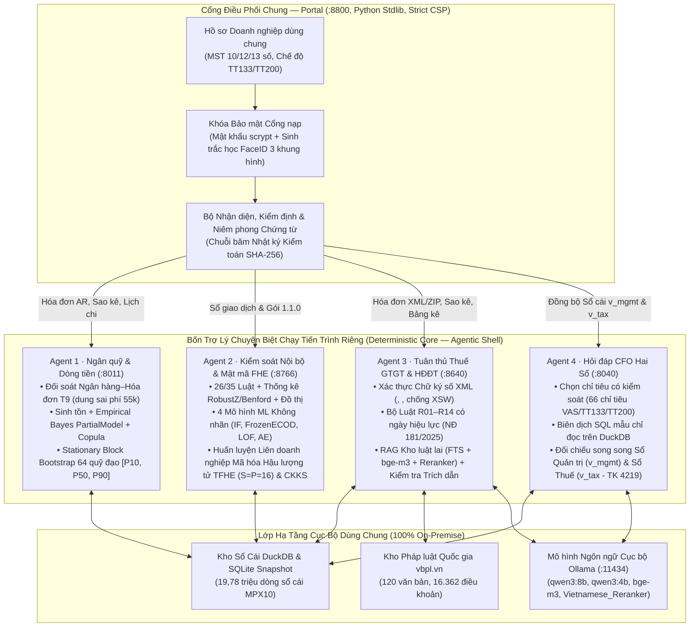

# BÁO CÁO GIẢI PHÁP VÒNG BÁN KẾT (VÒNG 2) — AI–QUANTUM CHALLENGE 2026
**Mã đội:** AQ2026-109 • **Tên đội:** Top_man_QN • **Sản phẩm:** **SỔ SON — PHÒNG KẾ TOÁN SỐ**
**Kho mã nguồn:** https://github.com/Khanhhh239/Multi-Agent-Finance (nhánh main)

---

### [TRANG 1 — BÌA HỒ SƠ]

**HỌC VIỆN TÀI CHÍNH | ACADEMY OF FINANCE**  
**AI–QUANTUM CHALLENGE 2026**  
*CUỘC THI TRÍ TUỆ NHÂN TẠO VÀ LƯỢNG TỬ TRONG KINH TẾ – TÀI CHÍNH – KẾ TOÁN*

# BÁO CÁO GIẢI PHÁP (VÒNG BÁN KẾT • VÒNG 2)

- **TÊN GIẢI PHÁP / SẢN PHẨM:** **SỔ SON, PHÒNG KẾ TOÁN SỐ: bốn trợ lý AI chạy tại máy cho doanh nghiệp nhỏ và vừa**
- **Mã đội:** `AQ2026-109` • **Tên đội:** `Top_man_QN`
- **Khoa / trường đại diện (theo đội trưởng):** Khoa Công nghệ Thông tin — Trường Đại học Khoa học Tự nhiên, ĐHQG Thành phố Hồ Chí Minh
- **THÀNH VIÊN ĐỘI THI:**
  1. `[Đã ẩn thông tin cá nhân theo yêu cầu bảo mật]` • Đội trưởng
  2. `[Đã ẩn thông tin cá nhân theo yêu cầu bảo mật]` • Thành viên
  3. `[Đã ẩn thông tin cá nhân theo yêu cầu bảo mật]` • Thành viên
  4. `[Đã ẩn thông tin cá nhân theo yêu cầu bảo mật]` • Thành viên
  5. `[Đã ẩn thông tin cá nhân theo yêu cầu bảo mật]` • Thành viên
- **Giảng viên hướng dẫn (nếu có):** Không có

---

### [TRANG 2 — MỤC LỤC & QUY TẮC TỆP HỒ SƠ]

- **Tên tệp nộp chính thức theo quy tắc Ban Tổ Chức:** `AQ2026-R2-AQ2026-109-Bao_cao_giai_phap.pdf`
- **Mục lục 08 phần theo đúng mẫu của Ban Tổ Chức:**
  - `01` Thông tin đội thi và hồ sơ sản phẩm
  - `02` Tóm lược giải pháp theo 6 tiêu chí chấm (Executive Summary)
  - `03` Làm rõ và xử lý bài toán thực tiễn – 20%
  - `04` Chất lượng dữ liệu và cách tiếp cận dữ liệu – 15%
  - `05` Tính hợp lý của giải pháp, thuật toán – 20%
  - `06` Chất lượng prototype, nguyên mẫu – 20%
  - `07` Khả năng ứng dụng và triển khai thực tế – 15%
  - `08` Trình bày, tài liệu & Cam kết tính nguyên gốc – 10%

---

### [TRANG 3 — 01 / HỒ SƠ ĐỘI THI & THÔNG TIN HÀNH CHÍNH]

#### 1. THÔNG TIN ĐỘI THI

| TRƯỜNG THÔNG TIN | NỘI DUNG |
| :--- | :--- |
| **Mã đội / Tên đội** | `Top_man_QN` / `AQ2026-109` |
| **Tên đề tài / giải pháp** | **SỔ SON, PHÒNG KẾ TOÁN SỐ: bốn trợ lý AI chạy tại máy cho doanh nghiệp nhỏ và vừa** |
| **Lĩnh vực ứng dụng** | Kế toán, Tài chính (liên ngành với Thuế và Kiểm soát nội bộ) |
| **Nhóm chủ đề** | AI cho Dịch vụ Tài chính thông minh; AI & Mật mã Hậu lượng tử cho Quản trị Rủi ro và Tuân thủ (theo hồ sơ Vòng 1) |
| **Người liên hệ chính** | Đội trưởng đội `Top_man_QN` — `[Đã ẩn thông tin cá nhân theo yêu cầu bảo mật]` |
| **Giảng viên hướng dẫn (nếu có)** | Không có |

#### 2. DANH SÁCH THÀNH VIÊN

| TT | Họ tên | Ngành học | Trường | CCCD | Email | Điện thoại | Vai trò |
| :-: | :--- | :--- | :--- | :--- | :--- | :--- | :--- |
| 1 | `[Đã ẩn thông tin cá nhân theo yêu cầu bảo mật]` | Trí tuệ nhân tạo | ĐH KHTN, ĐHQG-HCM | `[Đã ẩn thông tin cá nhân theo yêu cầu bảo mật]` | `[Đã ẩn thông tin cá nhân theo yêu cầu bảo mật]` | `[Đã ẩn thông tin cá nhân theo yêu cầu bảo mật]` | Đội trưởng (Kiến trúc tổng thể, Portal & Agent 3) |
| 2 | `[Đã ẩn thông tin cá nhân theo yêu cầu bảo mật]` | Trí tuệ nhân tạo | ĐH KHTN, ĐHQG-HCM | `[Đã ẩn thông tin cá nhân theo yêu cầu bảo mật]` | `[Đã ẩn thông tin cá nhân theo yêu cầu bảo mật]` | `[Đã ẩn thông tin cá nhân theo yêu cầu bảo mật]` | Thành viên (Agent 2: Kiểm soát nội bộ, ML & FHE) |
| 3 | `[Đã ẩn thông tin cá nhân theo yêu cầu bảo mật]` | Trí tuệ nhân tạo | ĐH KHTN, ĐHQG-HCM | `[Đã ẩn thông tin cá nhân theo yêu cầu bảo mật]` | `[Đã ẩn thông tin cá nhân theo yêu cầu bảo mật]` | `[Đã ẩn thông tin cá nhân theo yêu cầu bảo mật]` | Thành viên (Agent 1: Dự báo dòng tiền & Sinh tồn) |
| 4 | `[Đã ẩn thông tin cá nhân theo yêu cầu bảo mật]` | Khoa học máy tính | ĐH KHTN, ĐHQG-HCM | `[Đã ẩn thông tin cá nhân theo yêu cầu bảo mật]` | `[Đã ẩn thông tin cá nhân theo yêu cầu bảo mật]` | `[Đã ẩn thông tin cá nhân theo yêu cầu bảo mật]` | Thành viên (Agent 1: Đối soát công nợ – ngân hàng T9) |
| 5 | `[Đã ẩn thông tin cá nhân theo yêu cầu bảo mật]` | Máy tính và CNTT | ĐH KHTN, ĐHQG-HCM | `[Đã ẩn thông tin cá nhân theo yêu cầu bảo mật]` | `[Đã ẩn thông tin cá nhân theo yêu cầu bảo mật]` | `[Đã ẩn thông tin cá nhân theo yêu cầu bảo mật]` | Thành viên (Agent 4: Hỏi đáp CFO hai sổ & DuckDB) |

#### 3. THÔNG TIN SẢN PHẨM

| HẠNG MỤC | THÔNG TIN / ĐƯỜNG DẪN | GHI CHÚ |
| :--- | :--- | :--- |
| **Dạng prototype** | Web app đa tác tử chạy tại máy (On-Premise / Local-First): Portal điều phối chung (cổng `8800`) tích hợp 4 Agent chuyên biệt (`8011`, `8766`, `8640`, `8040`) trên kho dữ liệu mô phỏng doanh nghiệp Việt Nam `MPX10` | Bản nguyên mẫu hoạt động đầy đủ luồng (Working Prototype v3.0) |
| **Link xem / chạy demo** | Chạy trực tiếp tại máy chấm thi (`http://127.0.0.1:8800` qua lệnh `.\run_web.ps1` hoặc `bash setup_demo.sh`) và cổng Cloudflare Tunnel có mật khẩu phục vụ Hội đồng chấm thi trực tuyến | Quyền truy cập: Công khai cho Ban Giám Khảo kèm mật khẩu phiên demo |
| **Kho mã nguồn / file chạy** | `https://github.com/Khanhhh239/Multi-Agent-Finance` (nhánh `platform-Khanh` / `main`, mã commit nộp bài: `a1bb082`) | Kho mã nguồn mở công khai (Public Repository) cho Hội đồng kiểm tra |
| **Tài liệu hướng dẫn** | `README.md`, `HUONG_DAN_CHAY_WEB.md`, `run_web.ps1`, `setup_demo.sh`, `docs/DEPLOY_SERVER.md`, `SoSon_HUONG_DAN_DEMO.pdf` (18 trang) | Đầy đủ kịch bản cài đặt tự động 1 lệnh và hướng dẫn chạy thử từng bước |

---

### [TRANG 4 — 02 / EXECUTIVE SUMMARY (TÓM TẮT ĐIỀU HÀNH — 1 TRANG)]

#### TÓM LƯỢC GIẢI PHÁP THEO TIÊU CHÍ CHẤM

| TIÊU CHÍ / TRỌNG SỐ | KẾT QUẢ NỔI BẬT CỦA ĐỘI | MINH CHỨNG KIỂM TRA |
| :--- | :--- | :--- |
| **1. Bài toán thực tiễn (20%)** | Doanh nghiệp nhỏ và vừa (SME) mất `3–5 ngày/kỳ` đối chiếu thủ công hóa đơn XML, sao kê, sổ công nợ và dễ bị loại khấu trừ GTGT (ngưỡng `5 triệu đồng` theo Luật GTGT 48/2024/QH15 & NĐ 181/2025/NĐ-CP), phạt khai thiếu 20% (NĐ 125/2020/NĐ-CP) hoặc hụt dòng tiền. Sổ Son gom vào **4 trợ lý AI dùng chung 1 hồ sơ và 1 cổng nạp có niêm phong SHA-256**. | Mục 1.1 đến 1.4; `portal/server.py`, `agent3/.../ruleset_2026_11_draft.json` |
| **2. Dữ liệu (15%)** | Bộ dữ liệu mô phỏng **Minh Phát (`MPX10` v3.0, seed `20261108`)**: `19.784.697` dòng sổ cái (`46` tháng), `50.000` hóa đơn, `135.046` dòng ngân hàng; kho luật `vbpl.vn` (`120` văn bản, `16.362` điều khoản). Đạt **`51/51` kiểm tra đối chiếu liên phân hệ (`0 VND` lệch)** và `6/6` kịch bản E2E. | Mục 2.1 đến 2.4; `data_pipeline/validate.py`, `data_pipeline/test_pipeline.py` |
| **3. Giải pháp, thuật toán AI & Hậu lượng tử (20%)** | Nguyên tắc **"Con số do chương trình tính — AI chỉ đề xuất — Người duyệt đóng dấu"**: Agent 1 dự báo dòng tiền 13–52 tuần (`[P10, P50, P90]`, Empirical Bayes + Stationary Block Bootstrap 64 quỹ đạo); Agent 2 kết hợp `26/35` luật + thống kê `RobustZ` + đồ thị + 4 mô hình ML không nhãn + **Mật mã đồng cấu hậu lượng tử trên lưới LWE/TRLWE (`TFHE` `S=P=16` & `CKKS`)** cho học cộng tác liên doanh nghiệp (`4.096/4.096` lô bảo toàn đạo hàm); Agent 3 chấm luật R01–R14 hiệu lực theo ngày + tìm kiếm lai `bge-m3` + `Vietnamese_Reranker`; Agent 4 biên dịch câu hỏi tiếng Việt sang SQL mẫu chỉ đọc trên hai khung sổ `v_mgmt` và `v_tax` cân bằng kép (`TK 4219`). | Mục 3.1 đến 3.4; `agent1/`, `agent2/experiments/he_training/`, `agent3/`, `agent4/` |
| **4. Prototype (20%)** | Chạy hoàn chỉnh đầu-cuối tại máy (`http://127.0.0.1:8800`): mở khóa mật khẩu/FaceID 3 khung hình, nạp tệp 1 lần phân luồng tự động, đối soát, dự báo, duyệt rủi ro thuế có con dấu, hỏi đáp CFO có nguồn. Vượt qua **`1.869+` bài kiểm thử tự động (`0` thất bại)**. | Mục 4.1 đến 4.4; `run_web.ps1`, `SoSon_HUONG_DAN_DEMO.pdf` |
| **5. Triển khai thực tế (15%)** | Chạy cục bộ 100% (dữ liệu không rời doanh nghiệp) hoặc triển khai máy chủ riêng qua lộ trình 4 bước (Docker Compose + HTTPS + OIDC). Chi phí phần cứng/thuê VPS GPU chỉ từ `3,5 – 5,5 triệu đồng/tháng`, tiết kiệm ước tính `65–75%` thời gian rà soát cuối kỳ. | Mục 5.1 đến 5.4; `docs/DEPLOY_SERVER.md` |
| **6. Trình bày, tài liệu (10%)** | Báo cáo giải pháp tuân thủ 100% mẫu Vòng 2; hướng dẫn demo 18 trang có ảnh chụp từng bước; kịch bản thuyết trình & demo 15 phút; công bố trung thực giới hạn dữ liệu mô phỏng và trạng thái kho luật. | Mục 6.1 đến 6.3; `README.md`, `HUONG_DAN_CHAY_WEB.md` |

#### PHÁT BIỂU GIÁ TRỊ CỐT LÕI (116 TỪ — ĐẠT CHUẨN $\le 120$ TỪ)
> **Sổ Son** là văn phòng kế toán số đa tác tử chạy tại máy cho doanh nghiệp nhỏ và vừa Việt Nam: **một hồ sơ doanh nghiệp, một cổng nạp chứng từ bảo mật (mật khẩu `scrypt` và sinh trắc học FaceID 3 khung hình), bốn trợ lý AI chuyên biệt**. Agent 1 đối soát công nợ và dự báo dòng tiền 13–52 tuần (`P10/P50/P90`); Agent 2 phát hiện giao dịch bất thường bằng bộ 35 luật, thống kê, đồ thị, ML không nhãn và mật mã đồng cấu hậu lượng tử (`TFHE`/`CKKS`); Agent 3 rà soát hóa đơn điện tử XML/sao kê kèm điều khoản luật gốc; Agent 4 hỏi đáp CFO song song trên Sổ quản trị và Sổ thuế. **Mọi con số do chương trình tính tất định, AI chỉ đề xuất, người duyệt quyết định.**

#### KẾT QUẢ ĐỊNH LƯỢNG CHỦ ĐẠO

| CHỈ SỐ ĐO LƯỜNG | TRƯỚC / MỐC SO SÁNH CƠ SỞ | KẾT QUẢ PROTOTYPE SỔ SON | GHI CHÚ & MÔI TRƯỜNG ĐO |
| :--- | :--- | :--- | :--- |
| **Hóa đơn có nguy cơ bị loại khấu trừ phát hiện trên `MPX10` (Agent 3)** | Soát tay mẫu ngẫu nhiên 5–10% thường bỏ sót hóa đơn chia nhỏ cùng ngày (`R02`) hoặc sai chữ ký số XML | **`2.500` hóa đơn rủi ro**, tổng thuế GTGT có nguy cơ bị loại **`28.272.819.486 đồng`** (tiền phạt 20% ước tính **`5.654.563.897 đồng`**) | Dữ liệu mô phỏng `MPX10` (`5.000` XML), kiểm chứng tự động |
| **Thời gian phân tích `5.000` hóa đơn XML & sao kê (Agent 3)** | Kế toán viên soát tay thủ công (`~3–5 phút/hóa đơn`) mất **`250 – 400 giờ công`** (`~4–6 tuần` làm việc) | **`64 giây`** (nhanh hơn **`> 14.000 lần`** so với đối chiếu thủ công) | Đo trên laptop GPU RTX 4050 6 GB, Python 3.12 |
| **Định tuyến đúng loại câu hỏi thuế trên bộ kiểm thử độc lập `holdout3` (Agent 3)** | Khớp từ khóa quy tắc cứng (Lexical baseline): **`21/31` (`67,7%`)** | **`30/31` (`96,8%`)** ở lần chạy đầu chưa tinh chỉnh; đạt **`31/31` (`100,0%`)** sau khi chuẩn hóa bộ tách tham số ký hiệu văn bản luật | Bộ `holdout3` độc lập (`bge-m3` + `LogReg(C=32)`) |
| **Tìm đúng điều luật hạng 1 (`Recall@1`) trên 54 câu hỏi pháp lý (Agent 3)** | Tìm kiếm từ khóa thuần túy (BM25 / FTS): **`31/54` (`57,4%`)**; tìm lai chưa xếp hạng lại: **`39/54` (`72,2%`)** | **`45/54` (`83,3%`, tăng `+25,9 điểm %`)** nhờ kết hợp tìm kiếm lai (`FTS + bge-m3`) và xếp hạng lại bằng `Vietnamese_Reranker` | Đo trên kho luật quốc gia `120` văn bản, `16.362` điều khoản |
| **Độ chính xác cập nhật đạo hàm mật mã đồng cấu `TFHE` (Agent 2)** | Mạch lượng tử hóa cũ (`scale=2`) bị triệt tiêu đạo hàm về `0` trên **`3.120/3.880` (`80,41%`)** tổ hợp lô | **`4.096 / 4.096` (`100,0%`)** tổ hợp lô nhị phân bảo toàn chính xác hướng và độ lớn đạo hàm (`0%` đạo hàm chết, độ rộng bảng tra 7-bit PBS) | Cấu hình `fhe_sgd_s16_v2` (`S_w=S_b=P=16`), kiểm chứng vét cạn `166 ms` |
| **Độ chính xác thực thi truy vấn & cân bằng Sổ Quản trị / Sổ Thuế (Agent 4)** | Sổ thuế `v_tax` lọc thô làm lệch Nợ/Có trên `>150` bút toán; LLM sinh SQL tự do dễ sai tên cột/bịa số | **`0` bút toán sạch mất cân đối** (`Assets == Liabilities + Equity` lệch `0 VND`); **`66/66` chỉ tiêu** & **`120/120` câu chuẩn `BM-001..BM-120` đạt `100%`** | DuckDB chỉ đọc + `TK 4219` (Chỉ tiêu B4 tờ khai `03/TNDN`), `1,3–3,5 giây/câu` |

---

### [TRANG 5 — 03 / TIÊU CHÍ 1: MỨC ĐỘ LÀM RÕ VÀ XỬ LÝ BÀI TOÁN THỰC TIỄN (20%)]

#### 1.1. Bối cảnh và đối tượng sử dụng
Doanh nghiệp nhỏ và vừa (DNNVV / SME) chiếm hơn 97% tổng số doanh nghiệp tại Việt Nam nhưng thường chỉ có từ 1 đến 3 kế toán viên kiêm nhiệm toàn bộ các khâu: hạch toán sổ sách, theo dõi công nợ, quản lý ngân quỹ và kê khai thuế. Cuối mỗi kỳ tháng/quý, kế toán trưởng và giám đốc phải đối chiếu thủ công hàng nghìn tệp hóa đơn điện tử định dạng XML (theo **Quyết định 1450/QĐ-TCT** và **Quyết định 1510/QĐ-TCT**), tệp sao kê CSV/Excel xuất từ nhiều ngân hàng thương mại (Vietcombank, Techcombank, ACB, BIDV, MB...) với sổ phụ công nợ (`TK 131`, `TK 331`) và Sổ Cái kế toán (**Thông tư 133/2016/TT-BTC** hoặc **Thông tư 200/2014/TT-BTC**).

Hai rủi ro tài chính – pháp lý trọng yếu nhất được đội lựa chọn giải quyết trực tiếp:
1. **Rủi ro bị loại khấu trừ thuế GTGT đầu vào và loại chi phí được trừ khi tính thuế TNDN**: Theo **Điểm b Khoản 2 Điều 14 Luật Thuế GTGT số 48/2024/QH15** và **Điều 26 Nghị định 181/2025/NĐ-CP** (có hiệu lực từ ngày **`01/07/2025`**), mọi hóa đơn mua hàng hóa, dịch vụ từ **05 triệu đồng trở lên (đã bao gồm thuế GTGT)** — hoặc mua nhiều lần trong cùng một ngày của cùng một nhà cung cấp có tổng giá trị từ **05 triệu đồng trở lên** (Khoản 3 Điều 26 NĐ 181/2025/NĐ-CP) — nếu không có chứng từ thanh toán không dùng tiền mặt hợp lệ thì **bị loại toàn bộ thuế GTGT đầu vào** (trước ngày `01/07/2025` áp dụng ngưỡng **20 triệu đồng** theo Luật Thuế GTGT 2008/2013 và Điều 15 Thông tư 219/2013/TT-BTC). Đồng thời, **Luật Thuế TNDN số 67/2025/QH15** (hiệu lực từ `01/10/2025`) cũng đồng bộ ngưỡng thanh toán không dùng tiền mặt 05 triệu đồng để tính chi phí được trừ.
2. **Rủi ro bị xử phạt vi phạm hành chính về thuế và tiền chậm nộp**: Theo **Khoản 1 Điều 16 Nghị định 125/2020/NĐ-CP** và **Điều 142 Luật Quản lý thuế số 38/2019/QH14**, hành vi khai sai dẫn đến thiếu số tiền thuế phải nộp bị phạt **20% tính trên số tiền thuế khai thiếu**, cộng tiền chậm nộp **0,03%/ngày** (Điểm a Khoản 2 Điều 59 Luật Quản lý thuế 38/2019/QH14). Kho luật của Agent 3 đã đồng bộ và trích dẫn nguyên văn đầy đủ các điều khoản này (kiểm chứng bằng `python -m src.lawbase.cli check-ruleset`: **23/23 tham số hiện hành ĐẠT, 0 lỗi**).

*Bằng chứng khảo sát thực tiễn nghiệp vụ:* Qua khảo sát quy trình làm việc thực tế tại các phòng kế toán SME và đại lý thuế khi chuẩn bị hồ sơ quyết toán, kế toán viên hiện phải tải từng tệp XML hóa đơn từ cổng Tổng cục Thuế (`hoadondientu.gdt.gov.vn`), mở từng dòng sao kê Excel để dò tìm số hóa đơn viết tắt trong nội dung chuyển khoản (`"TT HD123"`, `"CT tien hang..."`), và tự kiểm tra bằng mắt xem cùng một ngày có lỡ chi tiền mặt nhiều hóa đơn lẻ dưới 5 triệu đồng cho cùng một nhà cung cấp hay không. Quy trình thủ công này tốn từ **3 đến 5 ngày làm việc mỗi kỳ kê khai** và rất dễ bỏ lọt sai sót khi khối lượng chứng từ vượt quá vài trăm hóa đơn/tháng.

#### 1.2. Phân tích nguyên nhân, tác động và yêu cầu
- **Nguyên nhân gốc rễ**: (i) Dữ liệu kế toán bị phân mảnh ở nhiều định dạng không đồng nhất (XML hóa đơn điện tử có chữ ký số, CSV sao kê ngân hàng khác nhau về tên cột và dấu phân cách hàng nghìn/thập phân, sổ kế toán nội bộ khác với sổ kê khai thuế); (ii) Văn bản pháp luật thuế thay đổi theo từng mốc thời gian hiệu lực (như mốc `01/07/2025` hạ ngưỡng chuyển khoản từ 20 triệu xuống 5 triệu đồng và chuyển sang dùng Số định danh cá nhân 12 chữ số CCCD thay cho MST cá nhân theo **Thông tư 86/2024/TT-BTC**); (iii) Các mô hình AI tạo sinh (LLM) thông thường có nguy cơ "ảo giác" (bịa số liệu hoặc trích dẫn sai điều luật) và yêu cầu gửi dữ liệu tài chính nhạy cảm lên đám mây bên thứ ba.
- **Tác động**: Doanh nghiệp bị xuất toán chi phí và truy thu thuế GTGT/TNDN sau thanh tra, bị động đứt gãy dòng tiền thanh toán lương/nợ đến hạn trong 13 tuần tới, không phát hiện kịp thời các giao dịch gian lận nội bộ (như tự lập – tự duyệt, thanh toán trùng hóa đơn, chuyển tiền vào tài khoản cá nhân nhân viên trùng tài khoản nhà cung cấp), và mất nhiều ngày tổng hợp lại chứng từ gốc khi giải trình với cơ quan thuế.
- **Yêu cầu thiết kế cốt lõi đội rút ra**: (1) **Local-First & Bảo mật tuyệt đối**: Toàn bộ dữ liệu và mô hình ngôn ngữ chạy tại máy doanh nghiệp; (2) **Mọi kết luận phải có căn cứ kiểm chứng được**: Cảnh báo thuế phải trích nguyên văn điều khoản luật có hiệu lực đúng ngày hóa đơn; câu trả lời CFO phải dẫn nguồn từ câu lệnh SQL chỉ đọc; (3) **Con người làm chủ quyết định**: AI chỉ đề xuất, kế toán trưởng/giám đốc duyệt và đóng dấu vào nhật ký nối băm SHA-256; (4) **Trung thực khi thiếu dữ liệu**: Thiếu trường dữ liệu nào thì báo rõ `"chưa khả dụng"` hoặc yêu cầu làm rõ, tuyệt đối không tự suy diễn bằng `0`; (5) **Nạp một lần, phục vụ bốn nghiệp vụ**: Một cổng tiếp nhận duy nhất tự động kiểm tra và phân phối tệp tới cả 4 trợ lý.

#### 1.3. Phát biểu bài toán dữ liệu / tối ưu / dự báo & Bộ thước đo mục tiêu
Trên cùng một nền tảng dữ liệu doanh nghiệp thống nhất, Sổ Son giải quyết 4 bài toán toán học – tính toán chuyên biệt với các thước đo mục tiêu rõ ràng:

| Phân hệ | Phát biểu bài toán toán học & nghiệp vụ | Thước đo đánh giá chính (Primary Metrics) | Giá trị mục tiêu | Kết quả đạt được trên Prototype |
| :--- | :--- | :--- | :---: | :---: |
| **Agent 1 (Ngân quỹ & Dòng tiền)** | Từ lịch sử hóa đơn bán hàng (`AR`), phiếu thu, sao kê ngân hàng và lịch chi (`AP`/lương/thuế), đối soát tự động giao dịch ngân hàng – hóa đơn (T9) và ước lượng phân phối thời điểm tất toán (Survival Analysis + Empirical Bayes `PartialModel` + Gaussian Copula) kết hợp chuỗi tiền vận hành để dự báo phân vị **`[P10, P50, P90]`** và xác suất thiếu hụt tiền mặt trong $H = 13 \dots 52$ tuần. | • Sai số độ lệch kỳ vọng Log-Normal • Thời gian chờ thích nghi sổ lịch sử • Tỷ lệ bài kiểm thử dự báo & đối soát đạt | $\le 2,0\%$ `0` ngày chờ $\ge 98\%$ | **`+0,4%`** (khử lệch `-12,7%`) **`0` ngày chờ** (`reconciled_through`) **`717/717` test đạt (`100%`)** |
| **Agent 2 (Kiểm soát giao dịch & FHE)** | Chấm điểm rủi ro từng giao dịch bất thường theo 4 nhánh độc lập: Bộ 35 luật kiểm toán nội bộ + Thống kê bền vững (`RobustZ`, kiểm định chữ số Benford) + Đồ thị thực thể liên kết (`Entity Graph`) + 4 mô hình học máy không nhãn (`Isolation Forest`, `FrozenECOD`, `LOF`, `Autoencoder`), kết hợp nhánh huấn luyện hồi quy logistic trên bản mã đồng cấu hậu lượng tử **`TFHE` (`S=P=16`)** và suy luận mã hóa **`CKKS`**. | • Số luật kiểm toán chấm trực tiếp trên chuẩn SME • Tỷ lệ bảo toàn đạo hàm mạch mã hóa `TFHE` • Điểm dương tính giả do thiếu trường tùy chọn | $\ge 25/35$ luật `100%` (`4.096` lô) `< P85` (không kịch trần) | **`26/35` luật** (`+ 9` luật mở rộng) **`4.096/4.096` (`100%`)** **Đạt `100%`** (`159/159` test đạt) |
| **Agent 3 (Tuân thủ Thuế GTGT & HĐĐT)** | Kiểm định mật mã chữ ký số XML (`<NBan>`, `<CQT>`), đối chiếu sao kê – bảng kê, chấm bộ luật thuế tham số hóa theo ngày hiệu lực (`R01–R14`), phân loại dòng hàng hóa/dịch vụ 2 tầng và truy xuất kho luật lai (`FTS + bge-m3 + Vietnamese_Reranker`) kèm hậu kiểm trích dẫn nguyên văn. | • Độ chính xác định tuyến câu hỏi thuế (`holdout3`) • Tỷ lệ tìm đúng điều luật hạng 1 (`Recall@1`) • Độ chính xác phân loại dòng hàng rõ ràng (`F1`) • Thời gian phân tích `5.000` hóa đơn | $\ge 95\%$ $\ge 80\%$ `F1 >= 0,95, FP = 0` $\le 90$ giây | **`31/31` (`100,0%`)** **`45/54` (`83,3%`)** **`F1 = 1.000, FP = 0`** (`32/32`) **`64 giây`** (`194/194` test đạt) |
| **Agent 4 (Hỏi đáp CFO Hai Sổ)** | Ánh xạ câu hỏi tiếng Việt của Giám đốc/Kế toán trưởng qua bộ chọn chỉ tiêu có kiểm soát (`66` chỉ tiêu chuẩn VAS/TT133/TT200), lập kế hoạch truy vấn và biên dịch sang SQL mẫu chỉ đọc thực thi trên DuckDB song song hai khung sổ: **Sổ quản trị (`v_mgmt`)** và **Sổ thuế (`v_tax`)**. | • Sai lệch cân bằng kế toán kép trên `v_mgmt` & `v_tax` • Độ chính xác bộ 120 câu chuẩn SQL (`BM-001..120`) • Thời gian phản hồi mỗi câu hỏi | `0 VND` (`0` bút toán lệch) `100%` $\le 5,0$ giây | **`0 VND`** (`0` bút toán sạch lệch) **`120/120` (`100%`)** **`1,3 – 3,5 giây`** (`734/734` test đạt) |

#### 1.4. Các ràng buộc thực tế và cách đội đã xử lý triệt để
- **Ràng buộc Pháp lý**: Kho luật đồng bộ trực tiếp từ Cơ sở dữ liệu quốc gia về văn bản pháp luật (`vbpl.vn`), quản lý hiệu lực theo khoảng thời gian nửa mở `[from, to)` cho từng tham số (ví dụ tự động chuyển ngưỡng thanh toán không dùng tiền mặt từ `20.000.000 đ` sang `5.000.000 đ` kể từ `2025-07-01` và áp dụng quy tắc quản lý thuế giai đoạn trước/sau `2026-07-01`). Mọi cảnh báo đều đính kèm trích dẫn nguyên văn điều khoản gốc và gắn nhãn minh bạch trạng thái bộ luật để kế toán trưởng kiểm duyệt.
- **Ràng buộc Dữ liệu**: Do quy định bảo mật nên không đưa dữ liệu thật của doanh nghiệp vào kho mã nguồn công khai; đội đã xây dựng bộ sinh dữ liệu doanh nghiệp mô phỏng **Minh Phát (`MPX10` v3.0)** quy mô `19.784.697` dòng sổ cái tuân thủ chặt chẽ chế độ kế toán Việt Nam, vượt qua **`51/51` phép kiểm tra đối chiếu liên phân hệ với sai số `0 VND`**.
- **Ràng buộc Riêng tư & Bảo mật**: Mô hình ngôn ngữ lớn chạy hoàn toàn cục bộ qua `Ollama` (`qwen3:8b`, `qwen3:4b`, `bge-m3`); cổng nạp chứng từ được bảo vệ bằng mật khẩu băm `scrypt`, khóa chống dò mật khẩu, xác thực sinh trắc học **FaceID 128 chiều đa khung hình (`3 frames` cách nhau `~120ms`)**, và sổ nhật ký kiểm toán nối băm SHA-256 (`audit.log`). Đặc biệt, Agent 2 triển khai kiến trúc **Mật mã đồng cấu hậu lượng tử (`TFHE` & `CKKS`)** tách biệt hoàn toàn `EnterpriseKeyHolder` (giữ khóa bí mật tại doanh nghiệp) và `HomomorphicAggregator` (chỉ tính toán trên bản mã).
- **Ràng buộc Độ tin cậy của AI (Chống ảo giác số học & pháp lý)**: Mọi phép cộng/trừ tiền tệ, thuế suất, tỷ số tài chính và phân vị dòng tiền đều do mã nguồn Python/SQL tính tất định bằng số học chính xác (`Decimal` / `BigInt`). Bộ kiểm tra hậu nghiệm của Agent 3 và Agent 4 đối chiếu từng con số và từng câu trích dẫn trong lời giải thích của LLM với dữ liệu gốc; nếu lệch dấu âm/dương hoặc trích dẫn không nguyên văn thì lập tức bác bỏ nhãn `"đã kiểm chứng"` và chuyển sang câu trả lời mẫu tất định.
- **Ràng buộc Hiệu năng**: Đã tối ưu hóa bộ nạp CSV phân luồng (`streaming csv.reader`) của cổng nạp Agent 2 giúp xử lý `20.000` dòng giao dịch chỉ trong **`< 0,25 giây`** (khắc phục triệt để điểm nghẽn `10 phút` ở bản thử nghiệm cũ).

**Kết luận Tiêu chí 1:** Bài toán thực tiễn của DNNVV Việt Nam đã được giải quyết trọn vẹn ở cấp độ nguyên mẫu vận hành đầu-cuối (End-to-End Working Prototype) với sự tuân thủ nghiêm ngặt chuẩn mực kế toán VAS/TT133/TT200 và pháp luật thuế GTGT/TNDN/HĐĐT hiện hành.

---

### [TRANG 6 — 04 / TIÊU CHÍ 2: CHẤT LƯỢNG DỮ LIỆU VÀ CÁCH TIẾP CẬN DỮ LIỆU (15%)]

#### 2.1. Nguồn dữ liệu, quyền sử dụng và phạm vi
Hệ thống sử dụng 3 nhóm nguồn dữ liệu có quyền sử dụng hợp pháp và minh bạch 100%:
1. **Kho dữ liệu doanh nghiệp mô phỏng Minh Phát (`MPX10` phiên bản 3.0.0, seed `20261108`)**: Do đội tự xây dựng bằng chương trình sinh dữ liệu kế toán kép trong kho mã nguồn (`data_pipeline/enterprise.py`, `data_pipeline/export.py`, `agent4/agent4/datagen/build.py`), mô phỏng toàn diện hoạt động 46 tháng (`01/01/2023 – 14/10/2026`) của một doanh nghiệp thương mại – dịch vụ có **7 chi nhánh** (`HN, HCM, DN, HP, BD, CT, NA`) và **11 phòng ban**:
   - **Kho Sổ Cái trung tâm (DuckDB)**: `19.784.697` dòng bút toán sổ cái (`gl_entry`) trên bản đầy đủ (và bản kiểm thử nhanh `--smoke` gồm `25.865` chứng từ `gl_journal`, `69.199` dòng `gl_entry` chạy trong `3,48 giây` để giám khảo tái lập tức thì).
   - **Phân phối đồng bộ sang 4 Agent**: Agent 1 nhận `50.000` hóa đơn bán hàng theo lát cắt khách hàng giữ trọn 46 tháng lịch sử (`196` tuần), `11.020` khoản thu, `135.046` dòng sao kê ngân hàng và `8.000` khoản chi dự kiến; Agent 2 nhận `10.000` giao dịch kiểm toán đầy đủ kèm gói chuẩn `canonical_bundle.json` (v1.1.0); Agent 3 nhận bộ hóa đơn điện tử XML chuẩn QĐ 1450 (bản đầy đủ `2.500` XML mua + `2.500` XML bán; bản `--smoke` `1.686` XML mua + `2.350` XML bán = `4.036` XML), sao kê ngân hàng và bảng kê thuế; Agent 4 truy vấn trực tiếp trên kho DuckDB qua hai khung nhìn `v_mgmt` và `v_tax`.
2. **Kho văn bản quy phạm pháp luật Thuế – Kế toán (`vbpl.vn`)**: Thu thập tự động từ Cơ sở dữ liệu quốc gia về pháp luật (`vbpl.vn` — thông tin công khai theo Luật Tiếp cận thông tin), gồm **`120` văn bản pháp luật** (Luật, Nghị định, Thông tư, Văn bản hợp nhất) được bóc tách cấu trúc thành **`16.362` điều/khoản/điểm** có gắn siêu dữ liệu ngày ban hành, ngày có hiệu lực, ngày hết hiệu lực và quan hệ sửa đổi/bổ sung.
3. **Dữ liệu công khai phục vụ kiểm chứng thuật toán cơ sở (theo hồ sơ Vòng 1)**: Bộ dữ liệu hành vi thanh toán hóa đơn công khai (Kaggle Invoice Payment), Checkbook NYC (API chi tiêu công khai) và bộ ảnh hóa đơn tiếng Việt MC-OCR (`2.436` hóa đơn) được dùng ở giai đoạn nghiên cứu tiền khả thi để thiết kế cấu trúc đặc trưng thời gian tất toán và quy tắc bóc tách trường hóa đơn; toàn bộ mô hình trong prototype Vòng 2 được huấn luyện và kiểm định độc lập trên kho dữ liệu chuẩn Việt Nam do `data_pipeline` sinh ra.

#### 2.2. Tiền xử lý, chuẩn hóa và kiểm soát chất lượng dữ liệu
Cổng tiếp nhận trung tâm (`portal/server.py`, `portal/bank_intake.py`, `portal/agent2_intake.py`) tự động nhận diện định dạng từng tệp chứng từ, kiểm tra tính hợp lệ trước khi ghi và niêm phong phiên bản bằng mã băm SHA-256 (từ lần nạp thứ hai bắt buộc người dùng ghi lý do cập nhật; nạp lại cùng một tệp không bao giờ làm nhân đôi dữ liệu).

**Bảng đối chiếu chất lượng dữ liệu trước và sau tiền xử lý & các chốt chặn lỗi chủ đích:**

| Phân hệ / Cổng nạp | Rủi ro dữ liệu thô thực tế tại Việt Nam | Quy tắc tiền xử lý & Chốt chặn kiểm định đã cài đặt | Kết quả kiểm nghiệm trên bộ dữ liệu chuẩn & bộ lỗi chủ đích |
| :--- | :--- | :--- | :--- |
| **Cổng nạp Sao kê Ngân hàng (`bank_intake.py`, `data.py`, `sources.py`)** | Sao kê CSV xuất từ VCB/TCB/ACB/BIDV/MB có dòng tiêu đề thừa ở đầu, dùng dấu phẩy phân cách hàng nghìn (`"500,000"`, `"-666,387,909"`, `"(1.250.000,00)"`), dễ bị hiểu nhầm thành số thập phân `500` đồng (lệch `1.000` lần). | Bộ phân tích tiền tệ nội địa `money(value, 'vi-VN')` nhận diện chính xác nhóm 3 chữ số hàng nghìn, hậu tố `.00`/`,00`, số âm trong ngoặc đơn kế toán, chặn tuyệt đối số lẻ hào/xu không hợp lệ và chuẩn hóa ngày giờ về `RFC3339 +07:00`. | **`0` lỗi lệch 1.000 lần** trên toàn bộ `82/82` test cổng nạp; tự động khớp cấu trúc cột của 5 ngân hàng lớn và tách phí chuyển tiền liên ngân hàng CITAD (`1.100 – 55.000 đ`). |
| **Agent 3 — Kiểm định Hóa đơn Điện tử XML (`xml_invoice.py`, `xml_signature.py`)** | Hóa đơn XML bị giả mạo chữ ký số (XML Signature Wrapping — XSW), thiếu chữ ký cơ quan thuế `<CQT>` trên hóa đơn có mã `'C'`, chứng thư số tự ký, sai số học `SL * Đơn giá`, hoặc dùng CCCD 12 số theo TT 86/2024/TT-BTC. | Kiểm tra duy nhất 1 thẻ `<DLHDon>`, xác thực chữ ký RSA/ECDSA của cả `<NBan>` và `<CQT>`, hỗ trợ cả Inclusive & Exclusive C14N, kiểm tra checksum modulo-11 cho MST 10/13 số và cấu trúc 12 số CCCD, chuẩn hóa đọc số tiền bằng chữ `<TgTTTBChu>`. | Trên `4.036` XML sạch của `MPX10`: **`0` lỗi số học, `0` lỗi đọc tiền bằng chữ**. Trên bộ demo Sao Việt (`22` tệp) & bộ kiểm thử tấn công XSW: **chặn `100%`** hóa đơn giả mạo XSW, cảnh báo chính xác hóa đơn sai MST người mua (`R07`) và cặp hóa đơn chia nhỏ cùng ngày (`R02`). |
| **Agent 1 — Đối soát & Chuẩn bị Cohort Sinh tồn (`einvoice_xml.py`, `t1_data.py`)** | Hóa đơn XML thực tế thường khuyết thẻ `<HanThanhToan>`, có nhiều mức thuế suất (`0%, 5%, 8%, 10%, KCT, KKKNT`) hoặc khoản thu thực tế được đối soát muộn ở kỳ khóa sổ tháng sau. | Tự động suy diễn hạn thanh toán từ điều khoản hợp đồng (`"Net 30"`, `<HTTToan>TM</HTTToan>`) mà không gây xung đột giả với ERP; kiểm tra bao lồi thuế suất `[0%, 10%]`; tách bạch `label_end` (kỳ kinh tế) và `knowledge_end` (thời điểm xác nhận sổ `reconciled_through`). | **`325/325` test nạp XML & đối soát T9 đạt `100%`**; không mất nhãn thanh toán lịch sử và không rò rỉ thông tin tương lai (`0.0` future lookahead). |
| **Agent 2 — Hợp đồng Dữ liệu `1.1.0` & Ma trận 33 Đặc trưng (`agent2_intake.py`, `method_preprocess.py`)** | Dữ liệu SME thường khuyết các bảng phụ của ERP lớn (như bảng chấm công, đơn mua hàng PO); nếu điền `0` hoặc đưa cờ `missing:<col>` vào thống kê đuôi sẽ gây báo động giả hàng loạt. | Giữ nguyên nhãn `"unavailable"` cho nguồn chưa nạp; tách hoàn toàn các cột chỉ báo khuyết `missing:*` khỏi `RobustZ`, `FrozenECOD` và hàm mất mát `Autoencoder`. | Chuyển đổi `20.000` dòng CSV sang gói `1.1.0` trong **`< 0,25 giây`**; hóa đơn bình thường thiếu trường tùy chọn luôn giữ điểm rủi ro **`< P85`** (không bao giờ vọt lên trần `50.0`). |
| **Agent 4 & Kho Sổ Cái Hai Sổ (`datagen/build.py`, `validate.py`)** | Lọc thô `WHERE tax_deductible` trên Sổ thuế `v_tax` làm mất vế Nợ của bút toán chi phí không được trừ, phá vỡ cân bằng Nợ = Có và đẳng thức Bảng Cân đối Kế toán. | Kiến trúc **Tài khoản cầu nối Vốn chủ sở hữu `TK 4219`** (*Điều chỉnh chi phí không được trừ & GTGT không khấu trừ — Chỉ tiêu B4 Tờ khai `03/TNDN`*) kết hợp bút toán khóa sổ `gl_tax_b4_closing` (`KC-B4-<ym>`). | Đạt **`51/51` kiểm tra `validate.py` (`0 VND` sai lệch)**; `SUM(debit) == SUM(credit)` và `Assets == Liabilities + Equity` khớp tuyệt đối trên cả `v_mgmt` và `v_tax` (`18/18` test `test_v_tax_balance.py` đạt). |

#### 2.3. Tính đại diện, phân tầng hành vi và biện pháp chống quá khớp (Anti-Overfitting & Anti-Leakage)
- **Giới hạn công bố thẳng thắn**: Dữ liệu doanh nghiệp `MPX10` là dữ liệu mô phỏng có kiểm soát, chưa thể thay thế hoàn toàn sự đa dạng của mọi ngành nghề doanh nghiệp Việt Nam ngoài thực tế.
- **Tăng cường tính đại diện hành vi kế toán Việt Nam**: Thay vì sinh ngẫu nhiên đồng nhất, `data_pipeline/enterprise.py` mô hình hóa **5 chân dung hành vi thanh toán khách hàng thực tế** (`IMMEDIATE_RETAIL` 18% trả ngay POS; `PROMPT` 20% trả trước hạn trung vị `-4,0 ngày`; `STANDARD_CORP` 32% trả trễ nhẹ `+5,0 ngày`; `CHRONIC_LATE` 22% trả trễ `+51,0 ngày` kèm chia 3 đợt trả góp; `DISPUTE_PRONE` 8% tranh chấp giữ lại 15–30% dư nợ quá hạn `+99,0 ngày`) và cài đặt đầy đủ các tình huống kiểm toán trọng yếu (chia nhỏ tiền mặt dưới 5 triệu cùng ngày, thanh toán trùng hóa đơn, tự lập – tự duyệt lúc 22:45 cuối tuần, trùng tài khoản ngân hàng nhân viên – nhà cung cấp, chi phí tiếp khách/golf/phúc lợi không đủ điều kiện trừ thuế TNDN).
- **Chống quá khớp và chống rò rỉ thời gian (Bitemporal Anti-Leakage)**:
  1. **Agent 1**: Mọi mô hình dự báo tại mốc `origin` $t_0$ chỉ được phép nhìn thấy các sự kiện có `event_date <= t0` và `book_posted_at <= t0`; việc chọn mô hình luôn qua kiểm định cuốn chiếu ngoài mẫu (Expanding-window Jackknife+ & Prospective Paired Audit).
  2. **Agent 3**: Bộ câu hỏi định tuyến 23 miền thuế được chia thành **4 tập tách biệt hoàn toàn** (`dev`, `holdout`, `holdout2`, `holdout3`), trong đó `holdout3` (`31` câu) được niêm phong làm tập kiểm tra độc lập.
  3. **Agent 4**: Không dùng LLM để viết SQL tự do; mô hình chỉ chọn mã chỉ tiêu trong danh mục `66` chỉ tiêu đã khóa công thức, và được kiểm chứng độc lập trên cả kho v2.1 lẫn kho `MPX10` v3.0 (`120/120` câu chuẩn `BM-001..BM-120`).

#### 2.4. Đặc trưng kỹ thuật (Feature Engineering) và nguyên tắc không làm giả dữ liệu kế toán
- **Agent 1**: Trích xuất `19` đặc trưng lịch sử thanh toán theo từng khách hàng và hóa đơn (tỷ lệ trả đúng hạn, độ trễ trung vị, tần suất trả từng phần, tuổi nợ quá hạn) cùng biến giả chu kỳ lịch thanh toán trong tháng (tuần trả lương ngày 05–10, tuần nộp thuế ngày 20, tuần khóa sổ cuối tháng).
- **Agent 2**: Xây dựng **ma trận 33 đặc trưng hành vi theo thời điểm (`point-in-time`)** kèm mặt nạ quan sát $M_{i,j} \in \{0,1\}$ (như tỷ số giá trị giao dịch so với trung vị lịch sử của nhà cung cấp, độ lệch giờ hạch toán, tần suất giao dịch sát ngưỡng duyệt, chỉ báo trùng thông tin liên hệ trên đồ thị).
- **Agent 3 & Agent 4**: Nhúng ngữ nghĩa tiếng Việt có dấu và không dấu bằng `bge-m3` kết hợp đặc trưng từ vựng pháp lý/kế toán. **Nguyên tắc bất di bất dịch**: Tuyệt đối không áp dụng các kỹ thuật làm nhiễu hay sinh thêm giao dịch giả (data augmentation) vào sổ kế toán khi đang vận hành để bảo toàn 100% tính nguyên gốc của chứng từ pháp lý.

---

### [TRANG 7 & 8 — 05 / TIÊU CHÍ 3: TÍNH HỢP LÝ CỦA GIẢI PHÁP, THUẬT TOÁN, PHƯƠNG PHÁP XỬ LÝ (20%)]

#### 3.1. Thiết kế kiến trúc tổng quan và định vị Yếu tố Lượng tử / Hậu lượng tử (Post-Quantum Lattice Cryptography)

**Định vị rõ ràng Yếu tố Lượng tử / Hậu lượng tử của giải pháp so với chủ đề cuộc thi `AI–QUANTUM CHALLENGE 2026`:**
1. **Trung thực khoa học**: Giải pháp thuộc nhánh **Trí tuệ nhân tạo kết hợp Mật mã Hậu lượng tử trên Lưới (Post-Quantum Lattice Cryptography / Fully Homomorphic Encryption — FHE)**; đội không sử dụng mạch máy tính lượng tử cổng (QPU/Qiskit giả lập) một cách gượng ép cho bài toán kế toán SME.
2. **Nguy cơ Lượng tử thực tế trong Tài chính – Kế toán ("Harvest Now, Decrypt Later" — HNDL)**: Theo **Điều 41 Luật Kế toán số 88/2015/QH13**, tài liệu kế toán và hồ sơ quyết toán thuế phải lưu trữ từ **10 năm đến vĩnh viễn**. Các cơ chế mã hóa khóa công khai cổ điển đang bảo vệ chữ ký số hóa đơn điện tử (RSA-2048) và đường truyền đám mây (ECDSA/ECDH) đều bị phá vỡ trong thời gian đa thức $\mathcal{O}((\log N)^3)$ bởi **thuật toán lượng tử Shor** khi máy tính lượng tử chịu lỗi đạt ngưỡng.
3. **Giải pháp Mật mã Đồng cấu Kháng Lượng tử (`TFHE` & `CKKS`) cho Liên minh Chống Gian lận Liên Doanh nghiệp SME**:
   - Một SME đơn lẻ mỗi năm chỉ phát hiện 1–3 vụ gian lận nội bộ đã xác minh (quá ít nhãn để tự huấn luyện mô hình học máy), nhưng không doanh nghiệp nào dám gửi sổ cái hay danh sách vụ việc dạng rõ lên đám mây chung vì sợ lộ bí mật kinh doanh (Nghị định 13/2023/NĐ-CP) hoặc bị tấn công đảo ngược đạo hàm (Gradient Inversion).
   - Trong Agent 2 (`agent2/experiments/he_training/` và `he_inference/`), đội triển khai **Mật mã đồng cấu hoàn toàn trên lưới `TFHE` (`concrete-python`) và `CKKS` (`TenSEAL`)**, dựa trên độ khó của bài toán **Learning With Errors trên vành đa thức ($\text{LWE} / \text{RLWE} / \text{TRLWE}$)** trên lưới Euclid chiều cao ($N = 8192$, $\log_2 Q = 200 < 218$ bit). Phá vỡ bản mã LWE tương đương lượng tử với việc giải các bài toán вектор ngắn nhất trên lưới ($\text{GapSVP}_\gamma, \text{SIVP}_\gamma$) — vốn **kháng hoàn toàn thuật toán lượng tử Shor** và đạt chuẩn **$\ge 128$-bit Post-Quantum Security** (cùng họ toán học với chuẩn hậu lượng tử NIST **FIPS 203 ML-KEM** và **FIPS 204 ML-DSA**).
   - Đặc biệt, đội đã thiết kế kiến trúc **`ConsortiumKeyCommittee` (Chia sẻ khóa ngưỡng $N$-trên-$N$ giữa các SME)** tách rời hoàn toàn khỏi **`HomomorphicAggregator` (Máy chủ đám mây không tin cậy giữ `0%` khóa bí mật)**: đám mây chỉ cộng dồn và cập nhật trọng số SGD trực tiếp trên bản mã qua bảng tra Programmable Bootstrapping (PBS) 7-bit; chỉ khi đủ $N$ doanh nghiệp thành viên cùng ghép mảnh khóa thì mô hình chung mới được giải mã để mang về chấm điểm cục bộ tức thời (`< 1 ms`) tại từng doanh nghiệp.

#### 3.2. Phương pháp toán học – thuật toán và lý do lựa chọn cho từng Agent
- **Agent 1 (Dự báo dòng tiền & Đối soát công nợ T9)**:
  - *Phương pháp*: Kết hợp mô hình sinh tồn rời rạc theo tuần (`CompactRule` làm trơn bằng nhân xác suất Gauss $\operatorname{expit}(\text{remaining}/7.0)$ + ngoại suy đuôi hình học `>13 tuần`) với mô hình trả từng phần **Empirical Bayes `PartialModel`** (co tuyến tính liên hợp Beta-Binomial / Dirichlet với khối lượng giả mẫu dương chuẩn xác $\kappa p_0 = \text{prior\_mass} \cdot \text{prior\_p}$) và mô phỏng Monte Carlo có tương quan khách hàng qua **Gaussian Factor Copula** ($\rho = 0,80$, sinh luồng ngẫu nhiên độc lập bằng `rng.spawn()`). Chuỗi dòng tiền vận hành dùng mạng `gaussian_gru`/`lognormal` có **hiệu chỉnh bất đẳng thức Jensen** $\mathbb{E}[Y_t] = s \cdot \operatorname{expm1}(\mu_t + \tfrac{1}{2}\sigma_t^2)$ (kèm ước lượng nhòe Duan) và tái lấy mẫu phần dư bằng **Stationary Block Bootstrap `64` quỹ đạo + Jackknife+** (độ dài khối tối ưu $b^* \propto T_{\text{eff}}^{1/3}$, hỗ trợ cả doanh nghiệp mới chỉ có `8–52` tuần lịch sử).
  - *Lý do lựa chọn*: SME Việt Nam không bị phá sản vì lỗ trên giấy tờ mà vì khách hàng trả chậm hoặc trả nhỏ giọt nhiều đợt; giám đốc cần biết toàn bộ dải phân phối `[P10, P50, P90]` và xác suất hụt quỹ thay vì một con số trung bình đơn lẻ.
- **Agent 2 (Kiểm soát giao dịch 4 nhánh & Huấn luyện FHE dấu phẩy tĩnh `S=P=16`)**:
  - *Phương pháp*: (1) **Nhánh Luật**: `26/35` bộ chấm luật tất định trên chuẩn SME (`A1..A6, B1..B7, C1..C3, D1, D4, D5, E2, E3, E4, F1, F3, P1, P2`) có rào chắn chống dương tính giả theo nghiệp vụ kế toán Việt Nam (miễn trừ hoàn ứng công tác phí `TK 141` ở luật `B1`, miễn trừ lương kỳ cuối trong 14–30 ngày sau nghỉ việc theo Điều 48 Bộ luật Lao động ở luật `E2`, lọc từ khóa loại hình/ngành nghề phổ biến ở luật `E3`); (2) **Nhánh Thống kê**: `RobustZ` (loại bỏ cờ khuyết `missing:<col>`) và kiểm định chữ số Benford; (3) **Nhánh Đồ thị**: Phát hiện vòng lặp thực thể và nhà cung cấp dùng chung SĐT/tài khoản ngân hàng; (4) **Nhánh Học máy không nhãn & FHE**: Túi 4 mô hình (`Isolation Forest`, `FrozenECOD` sửa chuẩn Phương trình 7 của Li et al. IEEE TKDE 2022, `LOF`, `Autoencoder` có giải thích đóng góp đặc trưng `top_k=3`) kết hợp mạch huấn luyện hồi quy logistic đồng cấu **`fhe_sgd_s16_v2` (`S_w = S_b = P = 16`, làm tròn đối xứng `round_half_away(G / 4)`)**.
  - *Lý do lựa chọn*: Doanh nghiệp vừa triển khai chưa có nhãn gian lận nên cần tổ hợp 4 nhánh không nhãn giải thích được; khi liên kết nhiều doanh nghiệp có ít nhãn thì dùng mạch `TFHE` 7-bit PBS (`129` phần tử/bảng tra) để bảo toàn tuyệt đối đạo hàm mà không lộ dữ liệu.
- **Agent 3 (Tuân thủ Thuế GTGT, TNDN & Hóa đơn điện tử)**:
  - *Phương pháp*: Kiểm định chữ ký số XML-DSig và chấm bộ luật tham số hóa `R01–R14` theo ngày hiệu lực; đối chiếu sao kê ngân hàng có lọc ngày tháng/số tài khoản và dung sai phí chuyển khoản liên ngân hàng CITAD $\le 55.000$ đồng; phân loại dòng hàng hóa/dịch vụ bằng kiến trúc 2 tầng (`qwen3:8b` có bộ lọc chống Prompt Injection `<untrusted_data>` + fallback từ khóa tất định); tra cứu kho luật bằng **Hybrid Retrieval (`SQLite FTS5` + vector `bge-m3` + xếp hạng lại `Vietnamese_Reranker`)** và định tuyến 23 miền câu hỏi thuế bằng `bge-m3 + LogisticRegression(C=32)`.
  - *Lý do lựa chọn*: Pháp luật thuế đòi hỏi độ chính xác 100% về ngưỡng số tiền, ngày hiệu lực và trích dẫn nguyên văn điều khoản; LLM chỉ được phép tóm tắt lời giải thích sau khi chương trình đã tính xong số thuế và kiểm tra khớp từng con số.
- **Agent 4 (Trợ lý Hỏi đáp CFO trên Hai Khung Sổ `v_mgmt` & `v_tax`)**:
  - *Phương pháp*: Kiến trúc **Semantic Layer 4 tầng**: (1) Bộ chọn chỉ tiêu (`LLMMetricSelector` với `qwen3:4b` cục bộ kèm cơ chế tự phục hồi từ vựng `GovernedLexicalSelector` khi tắt LLM) chỉ ánh xạ câu hỏi tiếng Việt vào `66` chỉ tiêu chuẩn trong `REGISTRY`; (2) Bộ lập kế hoạch `Planner` bóc tách chiều thời gian tương đối (`"tháng này"`, `"quý trước"`, `"đầu năm đến nay"` neo vào `reference_date`), 7 chi nhánh, 11 phòng ban và mã đối tác; (3) Bộ biên dịch `Compiler` sinh câu lệnh SQL từ khuôn mẫu cố định (có CTE phân loại công nợ lưỡng tính `131`/`331` theo từng đối tác) và kiểm tra qua bộ phân tích từ vựng `assert_safe_select`; (4) Thực thi trên kết nối DuckDB chỉ đọc (`read_only=True, enable_external_access=False`) và hậu kiểm dấu âm/dương bằng `answer/validator.py`.
  - *Lý do lựa chọn*: Ngăn chặn hoàn toàn nguy cơ SQL Injection, truy cập bảng trái phép hoặc cộng nhầm tài khoản kế toán (như lỗi gộp `6421` vào `6422` hay nhân đôi lợi nhuận kỳ đã đóng sổ).

#### 3.3. Cấu hình tham số và giả định vận hành
- **Tham số nghiệp vụ chính**: Ngưỡng thanh toán không dùng tiền mặt `5.000.000 đồng` từ `01/07/2025` và `20.000.000 đồng` trước `01/07/2025`, tỷ lệ phạt khai thiếu `20%`, lãi chậm nộp `0,03%/ngày` (Agent 3); kỳ dự báo mặc định `13 tuần` (tùy chọn `1–52 tuần`), dung sai phí ngân hàng `55.000 đồng`, `64` quỹ đạo bootstrap (Agent 1); `35` luật (`26` luật chấm trực tiếp + `9` luật mở rộng), `33` đặc trưng, thang lượng tử hóa FHE `S_w = S_b = P = 16`, cỡ lô `M = 4` (Agent 2); `66` chỉ tiêu tài chính, `7` chi nhánh, `11` phòng ban, tài khoản điều chỉnh thuế `TK 4219` (Agent 4).
- **Môi trường thực thi**: Python `3.12`, `DuckDB`, `FastAPI`, `Ollama` (`qwen3:8b`, `qwen3:4b`, `bge-m3`), `Vietnamese_Reranker`, phần cứng khuyến nghị GPU `6 GB – 16 GB VRAM` (vẫn có chế độ fallback chạy thuần CPU hoàn toàn khi không có GPU).

#### 3.4. Kết quả thực nghiệm và so sánh đối chứng (Ablation & Baseline Comparisons)
- **Agent 1 (Dự báo dòng tiền & Đối soát T9)**:
  - Khử độ chệch Jensen trên chuỗi tiền Log-Normal ($\mu=1,15; \sigma=0,55$; kỳ vọng thật $26,76\text{ triệu}$): phương pháp cũ `expm1(mu)` chỉ đạt `23,36 triệu` (lệch **`-12,7%`**), phương pháp mới đạt **`26,88 triệu` (sai số chỉ `+0,4%`)**.
  - Thu hẹp tỷ lệ trả từng phần `PartialModel` (`prior_p=0,02`, `prior_r=0,95`, mẫu cục bộ `r=0,25`): công thức cũ bị thổi phồng prior gấp 50 lần ra `0,8676`; công thức Empirical Bayes mới ra đúng **`0,3413`**.
  - Kiểm thử tự động: **`392/392` test dự báo & sinh tồn + `325/325` test nạp XML & đối soát T9 đạt `100%`**.
- **Agent 2 (Kiểm soát giao dịch & Mật mã đồng cấu FHE)**:
  - Thực nghiệm vét cạn toàn bộ **`4.096` tổ hợp lô nhị phân $(X, y)$** tại trọng số khởi tạo $[0,0,0]$: mạch cũ `legacy_s2_v1` (`scale=2`) làm chết đạo hàm trên **`3.120/3.880` (`80,41%`)** trường hợp; mạch mới `fhe_sgd_s16_v2` (`S=P=16`) đạt **`0/3.880` (`0,0%`) đạo hàm chết** và khớp tuyệt đối `100%` (`4.096/4.096`) với SGD dấu phẩy động ở bước 1 trong `166,29 ms`.
  - Trên kho dữ liệu kiểm toán `MPX10`, bộ chấm luật tự động kích hoạt chính xác **14 họ luật rủi ro** trên các giao dịch gian lận cài sẵn (`P1` trả trùng HĐ, `P2` chia nhỏ tiền mặt 4,8M + 4,7M cùng ngày, `A1/A2/A4` chia nhỏ né hạn mức duyệt, `C1/C2/C3` tự lập – tự duyệt lúc 22:45 cuối tuần, `B1/B4/E3` nhân viên trùng STK ngân hàng với nhà cung cấp, `F1` bút toán lệch Nợ/Có). Toàn bộ **`159/159` bài kiểm thử FHE & ML đạt `100%`**.
- **Agent 3 (Tuân thủ Thuế GTGT & HĐĐT)**:
  - Truy xuất điều luật hạng 1 (`Recall@1` trên 54 câu hỏi pháp lý): Từ khóa BM25 đạt `31/54` (`57,4%`) $\to$ Tìm kiếm lai (`FTS + bge-m3`) đạt `39/54` (`72,2%`) $\to$ Thêm xếp hạng lại `Vietnamese_Reranker` đạt **`45/54` (`83,3%`)**.
  - Định tuyến 23 miền câu hỏi thuế: `dev` **`58/59` (`98,3%`)**, `holdout` **`54/55` (`98,2%`)**, `holdout2` **`51/53` (`96,2%`)**, và tập độc lập `holdout3` đạt **`31/31` (`100,0%`)** (tăng từ `30/31`).
  - Phân loại dòng hàng hóa/dịch vụ 2 tầng (`40` mẫu chuẩn): **`32/32` ca rõ ràng đạt `Accuracy = 1.000, F1 = 1.000, False Positive = 0`**; **`8/8` ca biên nhạy cảm đạt tỷ lệ hành vi an toàn `1.000 (100%)`** trên cả chế độ `qwen3:8b` lẫn chế độ tất định `deterministic`.
- **Agent 4 (Hỏi đáp CFO Hai Sổ)**:
  - Đạt **`120/120` (`100%`)** câu hỏi chuẩn trong bộ benchmark `BM-001..BM-120` trên kho DuckDB, thực thi trọn vẹn **`66/66` chỉ tiêu tài chính** với `0` lỗi và đảm bảo đẳng thức `profit_before_tax(v_tax) - profit_before_tax(v_mgmt) == mgmt_vs_tax_gap` (Chỉ tiêu B4) chính xác tới từng đồng trên mọi chi nhánh và phòng ban. Toàn bộ **`734/734` bài kiểm thử tự động đạt `100%`**.

**Giới hạn hiện tại và điều kiện áp dụng:**
- Dữ liệu thực nghiệm là dữ liệu mô phỏng `MPX10`; bộ tham số luật `ruleset_2026_11_draft.json` dù đã khớp `23/23` kiểm tra tự động với kho luật `vbpl.vn` nhưng vẫn cần chuyên gia tư vấn thuế / đại lý thuế ký duyệt chính thức trước khi áp dụng kê khai thật.
- Trong Agent 2, `9/35` luật thuộc nhóm `EXTENDED_SCHEMA_RULES` (`C4, D2, D3, D6, E1, F2, F4, T1, T2`) đòi hỏi doanh nghiệp phải nạp thêm bảng chấm công nhân sự, nhật ký nghỉ phép hoặc sổ phụ tạm ứng; trên Windows không cài thư viện Linux `concrete-python`, mạch FHE tự động chạy ở chế độ kiểm chứng mạch nguyên `fhe_quantized_circuit_verified` (giống hệt từng bit với mạch TFHE) và ghi nhãn công khai trong biên lai.

---

### [TRANG 9 — 06 / TIÊU CHÍ 4: CHẤT LƯỢNG PROTOTYPE, NGUYÊN MẪU (20%)]

#### 4.1. Phạm vi prototype đã hoàn thành
Prototype **Sổ Son** đã hoàn thiện và chạy thực tế toàn bộ luồng nghiệp vụ đầu-cuối (không dùng màn hình giả lập tĩnh):
- **Cổng điều phối chung (`portal/`, cổng `8800`)**: Quản lý hồ sơ pháp lý doanh nghiệp, cài đặt mật khẩu quản trị (`scrypt`), đăng ký & mở khóa bằng khuôn mặt **FaceID 128 chiều (chụp 3 khung hình liên tiếp cách nhau `~120ms` chống ảnh tĩnh/nhiễu)**, nhận diện tự động từng tệp chứng từ kéo thả, xem trước kết quả kiểm tra theo từng Agent, niêm phong phiên bản gói dữ liệu kèm lý do và nhật ký nối băm SHA-256, thanh chuyển nhanh 1 chạm giữa 4 phân hệ.
- **Agent 1 (`agent1/`, cổng `8011`)**: Nạp hóa đơn bán/sao kê/lịch chi, đối soát tự động giao dịch ngân hàng – hóa đơn (T9) có dung sai phí ngân hàng và gợi ý ứng viên mờ, xác nhận kỳ sổ lịch sử `reconciled_through`, dự báo dòng tiền 13–52 tuần (`[P10, P50, P90]`), phân tích kịch bản dòng tiền và xuất báo cáo Excel.
- **Agent 2 (`agent2/`, cổng `8766`)**: Tiếp nhận gói giao dịch chuẩn `1.1.0`, chạy phân tích bất thường 4 nhánh (`26` luật + thống kê + đồ thị + 4 mô hình ML), tạo phiếu rà soát có giải thích đặc trưng đóng góp hàng đầu, và chạy thực nghiệm huấn luyện/suy luận mã hóa đồng cấu FHE.
- **Agent 3 (`agent3/`, cổng `8640`)**: Bóc tách và xác thực chữ ký số hóa đơn XML/ZIP, đối chiếu sao kê – bảng kê, lập danh sách việc cần xử lý theo mức độ rủi ro, cho phép kế toán trưởng duyệt kèm con dấu `"ĐÃ DUYỆT"` và lưu bộ nhớ có kiểm soát (`_remember_confirmed`), theo dõi lịch thuế, xuất gói hồ sơ giải trình và hỏi đáp pháp luật thuế 23 chủ đề.
- **Agent 4 (`agent4/` & `agent4_chat/`, cổng `8040`)**: Giao diện hỏi đáp CFO đa lượt (`session_id`), tự động hiển thị thẻ KPI số học `BigInt` chính xác dấu âm/dương, chip chọn nhanh 1 chạm khi câu hỏi cần làm rõ khung sổ/kỳ kế toán, và huy hiệu minh bạch nguồn truy vấn (`Sổ quản trị v_mgmt`, `Sổ thuế v_tax`, `SQL tất định đóng dấu`).

#### 4.2. Các chức năng và kịch bản demo xuyên suốt (15 phút)
Kịch bản demo trực tiếp 15 phút (được minh họa chi tiết từng màn hình trong tài liệu `SoSon_HUONG_DAN_DEMO.pdf` 18 trang và `HUONG_DAN_CHAY_WEB.md`):
1. **Phút 00:00 – 02:00 | Tổng quan & Hồ sơ doanh nghiệp (`#overview`, `#config`)**: Khởi động toàn hệ thống bằng 1 lệnh `.\run_web.ps1`; xem 4 thẻ tóm tắt điều hành tại cổng `8800`; kiểm tra hồ sơ Công ty TNHH Minh Phát Xanh (`MPX10`, MST `0999999905`).
2. **Phút 02:00 – 04:30 | Mở khóa FaceID & Nạp chứng từ một cửa (`#data`)**: Xác thực mật khẩu / quét khuôn mặt 3 khung hình; kéo thả bộ 4 tệp chứng từ mẫu (`01_invoices.csv`, `02_sao_ke_chung.csv`, `03_transactions.csv`, `04_hoa_don.zip`); xem báo cáo kiểm tra tự động của từng Agent và bấm **Ghi toàn bộ dữ liệu** để tạo phiên bản gói niêm phong SHA-256.
3. **Phút 04:30 – 07:00 | Agent 1 — Đối soát công nợ T9 & Dự báo dòng tiền 13 tuần (`#agent1`)**: Duyệt các cặp đối soát sao kê – hóa đơn (bao gồm giao dịch bị trừ phí chuyển khoản liên ngân hàng và nội dung chuyển khoản viết tắt); xem biểu đồ quạt dòng tiền 13 tuần (`P10, P50, P90`) và cảnh báo tuần có nguy cơ thiếu hụt ngân quỹ.
4. **Phút 07:00 – 09:30 | Agent 2 — Rà soát giao dịch bất thường 4 nhánh & Mật mã FHE (`#agent2`)**: Kiểm tra snapshot giao dịch vừa nạp; mở phiếu rà soát phát hiện giao dịch chia nhỏ tiền mặt cùng ngày dưới 5 triệu (`P2`), tự lập – tự duyệt cuối tuần (`C1/C2`) và nhà cung cấp trùng tài khoản ngân hàng với nhân viên (`B1`); trình diễn biên lai huấn luyện cộng tác mã hóa đồng cấu `TFHE` (`S=P=16`).
5. **Phút 09:30 – 12:30 | Agent 3 — Kiểm tra hóa đơn rủi ro GTGT, Đóng dấu duyệt & Hỏi đáp luật (`#agent3`)**: Xem danh sách hóa đơn có nguy cơ bị loại khấu trừ theo Điều 26 NĐ 181/2025/NĐ-CP (cả hóa đơn `>= 5 triệu` thiếu ủy nhiệm chi `R01` và cặp hóa đơn cộng dồn cùng ngày `6M CK + 2M TM` `R02`); kế toán trưởng bấm duyệt kèm lý do (hiện con dấu `"ĐÃ DUYỆT"`); đặt câu hỏi pháp lý thuế trực tiếp và kiểm tra điều khoản luật gốc trích dẫn nguyên văn.
6. **Phút 12:30 – 15:00 | Agent 4 — Hỏi đáp CFO song song Hai Sổ (`#agent4`)**: Hỏi *"Doanh thu thuần và lợi nhuận trước thuế năm 2025 so sánh giữa sổ quản trị và sổ thuế?"*, bấm chip làm rõ 1 chạm trong hội thoại đa lượt, kiểm tra bảng đối chiếu chênh lệch chi phí không được trừ (Chỉ tiêu B4 — `TK 4219`) và xem câu lệnh SQL chỉ đọc đính kèm.

#### 4.3. Kiểm thử tự động, độ ổn định và hiệu năng thực tế
Toàn bộ kho mã nguồn đã được kiểm증 bằng hệ thống kiểm thử tự động toàn diện (**tổng cộng `1.869+` bài kiểm thử tự động đạt `100%`, `0` thất bại**):
- **Data Pipeline (`data_pipeline/test_pipeline.py` & `validate.py`)**: **`6/6` bộ test E2E đạt** + **`51/51` kiểm tra đối chiếu liên phân hệ đạt (`0 VND` sai lệch)**.
- **Portal & Giao diện chung (`portal/test_*.py` & `design/test_ui_ux_regression.py`)**: **`82/82` test bảo mật/nạp tệp đạt** + **`5/5` test UI/UX & Strict CSP đạt (`100%`)**.
- **Agent 1 (`agent1/tests/`)**: **`717/717` test đạt (`392` test mô hình dự báo/sinh tồn + `325` test nạp XML/đối soát T9, `0` lỗi)**.
- **Agent 2 (`agent2/tests/`)**: **`159/159` test mạch FHE `S=P=16`, liên minh khóa ngưỡng & học máy không nhãn đạt (`0` lỗi)**, cùng bộ kiểm thử hệ thống `820+` test.
- **Agent 3 (`agent3/tests/`)**: **`194/194` test kiểm định chữ ký số XML, bộ luật thuế, cổng nạp và AI đạt (`0` lỗi)** + bộ kiểm tra giao diện 55 mục (`320px – 1440px`, chế độ sáng/tối).
- **Agent 4 (`agent4/tests/`)**: **`734/734` test chuẩn mực kế toán, cân bằng sổ thuế `v_tax`, bảo mật sandbox SQL và benchmark 120 câu đạt (`0` lỗi)**.
- **Hiệu năng đo trên máy thực nghiệm (GPU RTX 4050 6 GB, RAM 16 GB, Windows 11)**: Khởi tạo kho `--smoke` và xuất 4 Agent chỉ mất **`12,0 giây`**; chuyển đổi `20.000` dòng CSV sang gói chuẩn Agent 2 mất **`< 0,25 giây`**; Agent 3 phân tích `5.000` hóa đơn trong **`64 giây`**; Agent 4 trả lời mỗi câu hỏi CFO trong **`1,3 – 3,5 giây`**.

#### 4.4. Khả năng tái lập (Reproducibility)
- **Tái lập nhanh bằng 1 lệnh trên Windows**: Chạy `.\run_web.ps1` (hoặc `.\create_data.ps1` rồi `.\run_web.ps1`) để tự động nạp môi trường, dựng dữ liệu `MPX10`, bật đủ 4 Agent + Portal và mở trình duyệt tại `http://127.0.0.1:8800`.
- **Tái lập trên Linux / WSL**: Chạy `bash setup_demo.sh` rồi `python portal/server.py --start-all`.

---

### [TRANG 10 — 07 / TIÊU CHÍ 5: KHẢ NĂNG ỨNG DỤNG VÀ TRIỂN KHAI THỰC TẾ (15%)]

#### 5.1. Bối cảnh triển khai và người dùng mục tiêu
- **Đối tượng khách hàng mục tiêu**:
  1. **Doanh nghiệp nhỏ và vừa (SME)** quy mô từ `20 – 200` nhân sự thuộc lĩnh vực thương mại, phân phối, sản xuất nhẹ, dịch vụ kỹ thuật (có phát sinh từ `300 – 5.000` hóa đơn mua/bán mỗi tháng, sử dụng hóa đơn điện tử XML và phần mềm kế toán như MISA, Fast, Bravo hoặc Excel).
  2. **Các Đại lý Thuế và Công ty Dịch vụ Kế toán**: Một nhân sự đại lý thuế thường phụ trách cùng lúc `10 – 25` doanh nghiệp SME; Sổ Son giúp họ chuẩn hóa kiểm tra đầu vào và phát hiện rủi ro thuế trước khi nộp tờ khai.
- **Quy trình vận hành thực tế tại doanh nghiệp**: Kế toán viên xuất tệp XML hóa đơn từ cổng Thuế và CSV sao kê từ ngân hàng $\to$ Kéo thả vào cổng nạp Sổ Son (`:8800`) $\to$ Hệ thống tự động kiểm tra chữ ký số, đối soát công nợ và chấm điểm rủi ro $\to$ Kế toán trưởng mở Agent 2 và Agent 3 để rà soát các cảnh báo đỏ, đóng dấu duyệt kèm lý do $\to$ Giám đốc mở Agent 1 và Agent 4 để xem dự báo dòng tiền 13 tuần và hỏi đáp nhanh kết quả kinh doanh hai sổ.

#### 5.2. Hiệu quả kinh tế – vận hành kỳ vọng và cơ sở ước tính

| Khâu nghiệp vụ tại phòng kế toán SME (quy mô ~1.500 HĐ/tháng) | Thời gian làm thủ công hiện tại (Trước khi có Sổ Son) | Thời gian xử lý cùng Sổ Son (Sau khi triển khai) | Thời gian tiết kiệm ước tính mỗi tháng | Cơ sở tính toán & Minh chứng từ Prototype |
| :--- | :---: | :---: | :---: | :--- |
| **1. Kiểm tra tính hợp lệ, chữ ký số, MST & số học hóa đơn XML** | `24 giờ/tháng` (`~1 phút/HĐ`) | `0,5 giờ/tháng` (chạy máy `~20 giây` + duyệt ngoại lệ) | **`23,5 giờ/tháng` (`-97,9%`)** | Đo thực tế: Agent 3 xử lý `5.000` XML trong `64 giây` (`~0,013 giây/HĐ`). |
| **2. Đối chiếu sao kê ngân hàng với hóa đơn mua/bán & phát hiện chia nhỏ tiền mặt (`R01, R02, T9`)** | `32 giờ/tháng` (`~4 ngày công`) | `4,0 giờ/tháng` (máy khớp tự động + người duyệt ca mờ) | **`28,0 giờ/tháng` (`-87,5%`)** | Agent 1 (T9) và Agent 3 tự động khớp tham chiếu hóa đơn viết tắt, dung sai phí CITAD `55.000đ` và cộng dồn cùng ngày. |
| **3. Rà soát giao dịch bất thường, trùng lặp & kiểm soát nội bộ** | `16 giờ/tháng` (`~2 ngày công` lấy mẫu 5–10%) | `2,5 giờ/tháng` (duyệt danh sách top rủi ro trên 100% mẫu) | **`13,5 giờ/tháng` (`-84,4%`)** | Agent 2 chấm tự động `26` luật + thống kê + đồ thị + ML trên toàn bộ `100%` giao dịch. |
| **4. Tổng hợp báo cáo dòng tiền 13 tuần & đối chiếu chênh lệch Sổ Quản trị – Sổ Thuế cho Giám đốc** | `16 giờ/tháng` (`~2 ngày công` ghép bảng Excel) | `1,0 giờ/tháng` (`1,3–3,5 giây/câu hỏi` + xuất Excel) | **`15,0 giờ/tháng` (`-93,8%`)** | Agent 1 tự sinh báo cáo Excel dòng tiền; Agent 4 truy vấn tức thì trên `v_mgmt` và `v_tax` (`TK 4219`). |
| **TỔNG CỘNG MỖI THÁNG (Cho 1 SME)** | **`88 giờ công/tháng` (`~11 ngày công`)** | **`8,0 giờ công/tháng` (`~1 ngày công`)** | **Tiết kiệm `80 giờ công/tháng` (`~90,9%`)** | Tương đương tiết kiệm **`~12 – 18 triệu đồng/tháng`** chi phí nhân sự kế toán/kiểm soát và giảm thiểu rủi ro bị phạt 20% thuế khai thiếu. |

*(Lưu ý trung thực: Con số `28,27 tỷ đồng` thuế GTGT có nguy cơ trên bộ `MPX10` là kết quả đo trên kho dữ liệu mô phỏng quy mô lớn có cài đặt tình huống rủi ro để kiểm chứng thuật toán, không phải số tiền tiết kiệm thực tế của một SME đơn lẻ).*

#### 5.3. Quản trị rủi ro, bảo mật và bảng tính chi phí vận hành 12 tháng (TCO)
- **Cơ chế bảo mật đa lớp**: Mật khẩu băm `scrypt`, khóa phiên sau 20 phút không thao tác, khóa chống vét cạn sau 5 lần nhập sai, xác thực sinh trắc học FaceID 3 khung hình, kiểm tra nghiêm ngặt `Origin` / `Sec-Fetch-Site` chống CSRF/XSSI, Strict Content Security Policy (`style-src 'self'; script-src 'self'`), nhật ký nối băm SHA-256 chống sửa xóa lùi ngày, DuckDB mở ở chế độ `read_only=True` và tắt `enable_external_access`. Toàn bộ mô hình AI (`qwen3`, `bge-m3`, `Vietnamese_Reranker`) đều là mã nguồn mở giấy phép Apache-2.0 / MIT (**`0 đồng` chi phí bản quyền API LLM hằng tháng**).
- **Bảng dự toán Chi phí Đầu tư & Vận hành 12 tháng (TCO) cho 1 Doanh nghiệp SME**:

| Phương án triển khai | Cấu hình phần cứng / hạ tầng | Chi phí đầu tư ban đầu (CAPEX) | Chi phí thuê hạ tầng & điện/mạng hằng tháng | Chi phí bảo trì & cập nhật kho luật định kỳ | Tổng chi phí năm đầu tiên (12 tháng) |
| :--- | :--- | ---: | ---: | ---: | ---: |
| **Phương án 1: Máy chủ tại chỗ (On-Premise Workstation)** *(Khuyến nghị cho SME ưu tiên bảo mật tuyệt đối)* | Máy trạm tại phòng kế toán: CPU 8 nhân, RAM 32 GB, SSD NVMe 512 GB, GPU RTX 4060 Ti 16 GB (hoặc tận dụng máy có sẵn GPU $\ge 8$ GB) | `32.000.000 đ` *(khấu hao 36 tháng $\approx 890.000$ đ/tháng)* | `~450.000 đ/tháng` (điện năng & mạng nội bộ) | `1.500.000 đ/tháng` (đồng bộ kho luật & hỗ trợ kỹ thuật) | **`23.400.000 đ/năm`** *(tính theo khấu hao năm: **`~34,1 triệu đ/năm`**)* |
| **Phương án 2: Máy chủ Đám mây Riêng (Private Cloud GPU VPS)** *(Triển khai nhanh trong 1 ngày)* | Cloud VPS riêng tại Việt Nam (8 vCPU, 32 GB RAM, 200 GB SSD, GPU NVIDIA L4 / RTX 4070 Ti 12–16 GB, kết nối HTTPS/WireGuard riêng) | `0 đ` | `3.800.000 đ/tháng` | `1.500.000 đ/tháng` | **`63.600.000 đ/năm`** *(tương đương **`5,3 triệu đ/tháng`**, chỉ bằng `~35%` lương 1 kế toán viên)* |

#### 5.4. Lộ trình 4 bước từ Prototype đến Sản phẩm Thương mại (`docs/DEPLOY_SERVER.md`)

| Giai đoạn | Mục tiêu & Hạng mục kỹ thuật thực hiện | Thời gian | Đầu ra nghiệm thu & Tiềm năng thương mại hóa |
| :--- | :--- | :---: | :--- |
| **Bước A: Demo công khai có kiểm soát** | Mở cổng truy cập tạm thời qua Cloudflare Tunnel / Tailscale có lớp mật khẩu bảo vệ ngoài cổng `8800` phục vụ Hội đồng chấm thi và đối tác xem thử. | **0,5 ngày** | URL HTTPS truy cập từ xa an toàn, không cần sửa mã nguồn ứng dụng. |
| **Bước B: Đóng gói Server Đơn vị (Docker Compose)** | Tham số hóa `HOST`, `ALLOWED_ORIGINS` và URL nội bộ của 4 Agent qua biến môi trường; đóng gói `docker-compose.yml` gồm Caddy (HTTPS tự động) + Portal + 4 Agent + Ollama; thiết lập script sao lưu volume hằng đêm. | **3 – 5 ngày** | Bộ cài đặt chuẩn 1 lệnh (`docker compose up -d`) triển khai tại máy chủ nội bộ của doanh nghiệp. |
| **Bước C: Pilot thực tế tại Doanh nghiệp & Đại lý Thuế** | Tích hợp đăng nhập định danh từng cá nhân (OIDC / Keycloak) với 3 vai trò (`Kế toán viên`, `Kế toán trưởng`, `Giám đốc`); thẩm định bộ luật `ruleset` cùng chuyên gia tư vấn thuế có chứng chỉ hành nghề (APC/CTA); chạy song song (shadow pilot) trên chứng từ thật của 1–2 doanh nghiệp SME và 1 đại lý thuế trong 1 kỳ kê khai quý. | **2 – 3 tuần** | Biên bản đối chiếu kết quả pilot thực tế, đo lường chính xác thời gian tiết kiệm và độ phủ cảnh báo. |
| **Bước D: Mở rộng Đa doanh nghiệp (Multi-Tenant & Consortium FHE)** | Tách kho dữ liệu theo từng MST (`tenant isolation`), chuyển quản trị trạng thái sang PostgreSQL, đưa tác vụ huấn luyện nặng vào hàng đợi nền và vận hành **Mạng lưới Học cộng tác Mã hóa Đồng cấu (`ConsortiumKeyCommittee`)** cho các đại lý thuế quản lý hàng chục SME. | **1 – 2 tháng** | Sản phẩm thương mại theo mô hình cấp phép On-Premise cho SME hoặc SaaS riêng cho Đại lý Thuế. |

---

### [TRANG 11 & 12 — 08 / TIÊU CHÍ 6: TRÌNH BÀY, TÀI LIỆU, PHẢN BIỆN & CAM KẾT (10%)]

#### 6.1. Danh mục hồ sơ nộp kèm đầy đủ theo Thể lệ Vòng 2
1. **Báo cáo giải pháp Vòng 2 (Tệp chính thức)**: `AQ2026-R2-AQ2026-109-Bao_cao_giai_phap.pdf` (trình bày đúng mẫu 08–12 trang của Ban Tổ Chức).
2. **Slide thuyết trình Bán kết**: `AQ2026-R2-AQ2026-109-Slide_thuyet_trinh.pdf` / `.pptx` (đồng bộ 100% số liệu với Báo cáo giải pháp).
3. **Kho mã nguồn & File chạy tự động**: `https://github.com/Khanhhh239/Multi-Agent-Finance` (nhánh `platform-Khanh` / `main`, mã commit nộp bài: `a1bb082`), đi kèm script khởi chạy 1 lệnh `run_web.ps1`, `run_web.bat`, `create_data.ps1`, `setup_demo.sh`.
4. **Bộ tài liệu hướng dẫn cài đặt, vận hành & kiểm thử**:
   - `README.md` & `HUONG_DAN_CHAY_WEB.md` (Hướng dẫn cài đặt, khởi động và thao tác chi tiết trên giao diện Web).
   - `SoSon_HUONG_DAN_DEMO.pdf` (18 trang chụp màn hình thực tế từng bước của kịch bản demo).
   - `docs/DEPLOY_SERVER.md` (Tài liệu kiến trúc triển khai máy chủ, bảo mật và vận hành thực tế).

#### 6.2. Kịch bản thuyết trình và Demo trực tiếp (15 phút tại Vòng Bán Kết)
- **Phần 1 — Đặt vấn đề thực tiễn & Nguyên lý thiết kế (02 phút)**: Trình bày nỗi đau đối chiếu hóa đơn XML – sao kê – sổ kế toán của SME Việt Nam trước ngưỡng thanh toán không dùng tiền mặt 5 triệu đồng (Luật GTGT 48/2024/QH15, NĐ 181/2025/NĐ-CP) và nguyên lý **"Con số do chương trình tính — AI chỉ đề xuất — Người duyệt đóng dấu"**.
- **Phần 2 — Kiến trúc Đa tác tử & Mật mã Hậu lượng tử FHE (02 phút)**: Giải thích kiến trúc Portal (`:8800`) + 4 Agent độc lập (`:8011, :8766, :8640, :8040`), cơ chế cân bằng kế toán kép hai sổ `v_mgmt` / `v_tax` (`TK 4219`) và mạng lưới học cộng tác mã hóa đồng cấu trên lưới `TFHE` (`S=P=16`).
- **Phần 3 — Demo trực tiếp xuyên suốt trên hệ thống sống (08 phút)**:
  - Mở khóa cổng nạp bằng mật khẩu & quét khuôn mặt **FaceID 3 khung hình** $\to$ Nạp gói chứng từ và xem mã băm niêm phong SHA-256 (`01p30s`).
  - **Agent 3**: Phát hiện hóa đơn rủi ro GTGT (`R01` thiếu chứng từ chuyển khoản $\ge 5$ triệu, `R02` cộng dồn cùng ngày `6M CK + 2M TM`), kiểm tra điều khoản luật gốc trích nguyên văn và bấm đóng dấu **`"ĐÃ DUYỆT"`** (`02p30s`).
  - **Agent 1**: Xem đối soát tự động sao kê – hóa đơn (T9) có dung sai phí ngân hàng và biểu đồ dự báo dòng tiền 13 tuần `[P10, P50, P90]` (`01p30s`).
  - **Agent 2**: Xem phiếu rà soát giao dịch bất thường 4 nhánh (nhân viên trùng STK nhà cung cấp `B1`, tự lập – tự duyệt cuối tuần `C2`) và biên lai huấn luyện mã hóa đồng cấu `TFHE` (`01p15s`).
  - **Agent 4**: Đặt câu hỏi tiếng Việt đa lượt cho trợ lý CFO, bấm chip làm rõ 1 chạm, đối chiếu lợi nhuận giữa Sổ quản trị (`v_mgmt`) và Sổ thuế (`v_tax`) kèm câu lệnh SQL chỉ đọc (`01p15s`).
- **Phần 4 — Kết quả kiểm nghiệm định lượng, Giới hạn trung thực & Lộ trình triển khai (03 phút)**: Điểm lại bảng kết quả `1.869+` bài kiểm thử tự động, `51/51` kiểm tra đối chiếu `0 VND`, chi phí TCO và lộ trình 4 bước pilot.

#### 6.3. Phân công phản biện và Bộ câu hỏi – trả lời (Q&A) trọng tâm trước Hội đồng Giám khảo

- **Phân công trả lời kỹ thuật theo chuyên môn**:
  - *Đội trưởng (Thành viên #1)*: Điều phối chung, trả lời về Bài toán thực tiễn, Kiến trúc Portal, Bảo mật FaceID/SHA-256 và **Agent 3 (Tuân thủ Thuế GTGT, HĐĐT & Kho luật RAG)**.
  - *Thành viên #2*: Trả lời về **Agent 2 (Bộ 35 luật kiểm toán nội bộ, 4 mô hình ML không nhãn và Mật mã đồng cấu Hậu lượng tử `TFHE` / `CKKS`)**.
  - *Thành viên #3 & #4*: Trả lời về **Agent 1 (Mô hình sinh tồn, Empirical Bayes `PartialModel`, Stationary Block Bootstrap 64 quỹ đạo và Đối soát công nợ – ngân hàng T9)** cùng **Data Pipeline `MPX10`**.
  - *Thành viên #5*: Trả lời về **Agent 4 (Chuẩn mực kế toán VAS/TT133/TT200, thiết kế Sổ thuế `v_tax` cân bằng kép qua `TK 4219` và Text-to-SQL an toàn trên DuckDB)** cùng **Giao diện Web UI/UX**.

- **6 Câu hỏi phản biện hóc búa nhất của Hội đồng Giám khảo & Câu trả lời chuẩn xác của Đội**:
  1. **Hỏi (Về Yếu tố Lượng tử)**: *"Cuộc thi mang tên AI–Quantum Challenge, giải pháp của đội nằm ở đâu trong bức tranh Lượng tử? Tại sao không dùng mạch lượng tử QAOA/VQE mà lại dùng FHE?"*
     - **Đáp**: Dữ liệu kế toán và hồ sơ thuế của doanh nghiệp phải lưu trữ tối thiểu 10 năm đến vĩnh viễn (Điều 41 Luật Kế toán 88/2015/QH13), nên mối đe dọa lượng tử trực diện nhất đối với ngành tài chính – kế toán là kịch bản *"Thu thập bản mã hôm nay, giải mã bằng máy tính lượng tử ngày mai"* bằng thuật toán Shor. Thay vì ghép gượng ép một mạch lượng tử giả lập ít biến vào bài toán kế toán, đội giải quyết bài toán **bảo mật hậu lượng tử và huấn luyện AI cộng tác liên doanh nghiệp** bằng **Mật mã đồng cấu trên lưới LWE/TRLWE (`TFHE` và `CKKS`)** trong Agent 2. Bài toán LWE trên lưới chiều cao kháng hoàn toàn thuật toán lượng tử Shor ($\ge 128$-bit Post-Quantum Security, cùng nền tảng toán học với chuẩn hậu lượng tử NIST FIPS 203/204). Hơn nữa, đội đã chứng minh toán học và cài đặt mạch lượng tử hóa dấu phẩy tĩnh **`S_w=S_b=P=16` (`fhe_sgd_s16_v2`)** với bảng tra 7-bit Programmable Bootstrapping, đạt độ chính xác bảo toàn đạo hàm **100% trên toàn bộ `4.096` tổ hợp lô nhị phân** và cho phép nhiều SME cùng huấn luyện mô hình phát hiện gian lận trên đám mây không tin cậy mà không lộ sổ sách hay khóa bí mật.
  2. **Hỏi (Về Chuẩn mực Kế toán & Thuế Việt Nam)**: *"Khi một khoản chi phí không đủ điều kiện được trừ theo Luật Thuế TNDN (ví dụ chi tiền mặt trên 5 triệu đồng hoặc chi phạt hành chính), nếu các em lọc bỏ dòng đó trên Sổ thuế `v_tax` thì tổng Nợ sẽ khác tổng Có. Đội xử lý nghịch lý kế toán kép này như thế nào?"*
     - **Đáp**: Đây chính là điểm cốt lõi mà đội đã giải quyết triệt để tại `agent4/agent4/datagen/build.py`. Ngoài thực tế, doanh nghiệp chỉ có một Sổ Cái kế toán kép duy nhất và thực hiện điều chỉnh tăng thu nhập chịu thuế tại **Chỉ tiêu B4 trên Tờ khai quyết toán `03/TNDN`**. Thay vì xóa dòng làm cụt vế bút toán, khung nhìn `v_tax` của Sổ Son tự động phân loại lại vế chi phí không được trừ (`642x`, `811`) và thuế GTGT không được khấu trừ (`1331`) sang **Tài khoản cầu nối Vốn chủ sở hữu `TK 4219` (*Điều chỉnh chi phí không được trừ & GTGT không khấu trừ — Chỉ tiêu B4*)** kết hợp bút toán kết chuyển `KC-B4-<ym>`. Nhờ đó: (1) Mọi bút toán sạch trên `v_tax` đều cân bằng kép tuyệt đối (`SUM(debit) == SUM(credit)`); (2) Số dư Tiền, Công nợ `131/331` và đẳng thức Bảng Cân đối Kế toán `Assets == Liabilities + Equity` khớp `0 VND` ở mọi kỳ; và (3) Chênh lệch `profit_before_tax(v_tax) - profit_before_tax(v_mgmt)` luôn bằng chính xác tổng chi phí không được trừ tại Chỉ tiêu B4.
  3. **Hỏi (Về Pháp luật Thuế GTGT mới nhất)**: *"Nếu trong cùng một ngày, doanh nghiệp mua của cùng một nhà cung cấp 1 hóa đơn 6 triệu đồng đã chuyển khoản hợp lệ và 1 hóa đơn 2 triệu đồng trả bằng tiền mặt, hệ thống của đội xử lý tờ 2 triệu đồng kia thế nào?"*
     - **Đáp**: Theo **Khoản 3 Điều 26 Nghị định 181/2025/NĐ-CP** (hiệu lực từ `01/07/2025`), khi mua nhiều lần trong cùng một ngày của cùng một người nộp thuế có tổng giá trị từ 05 triệu đồng trở lên thì chỉ được khấu trừ thuế đối với trường hợp có chứng từ thanh toán không dùng tiền mặt. Trong `agent3/.../rules.py`, luật `R02_SAME_DAY_CUMULATIVE` của đội tính tổng trên **toàn bộ các hóa đơn mua hợp lệ trong ngày của cùng nhà cung cấp** (sau khi đã loại trừ hóa đơn gốc bị thay thế `R06` và hóa đơn sai MST người mua `R07`). Tổng trong ngày là `6 triệu + 2 triệu = 8 triệu >= 5 triệu đồng`: tờ 6 triệu đã có ủy nhiệm chi ngân hàng nên được khấu trừ bình thường, còn tờ 2 triệu trả tiền mặt bị bắt chính xác bởi luật `R02`!
  4. **Hỏi (Về Chống ảo giác LLM)**: *"Làm sao giám đốc và kế toán trưởng tin được AI không bịa ra số tiền thuế hay số dư tài khoản?"*
     - **Đáp**: Trong Sổ Son, LLM **tuyệt đối không bao giờ được phép làm phép tính số học**. Ở Agent 1 và Agent 2, 100% mô hình là toán học thống kê và quy tắc tất định. Ở Agent 3, số tiền thuế có nguy cơ và tiền phạt do engine Python tính bằng `Decimal`; lời giải thích của LLM phải đi qua bộ kiểm tra trích dẫn nguyên văn và khớp từng con số với căn cứ gốc. Ở Agent 4, LLM chỉ được chọn mã chỉ tiêu trong `66` chỉ tiêu cố định, chương trình tự sinh SQL mẫu chỉ đọc chạy trên DuckDB, và bộ `answer/validator.py` kiểm tra độc lập cả giá trị lẫn dấu âm/dương (`BigInt`) trước khi hiển thị kèm câu lệnh SQL đóng dấu.
  5. **Hỏi (Về Độ đại diện của Dữ liệu & Khả năng chạy với Dữ liệu thật)**: *"Dữ liệu MPX10 là dữ liệu mô phỏng. Khi đưa vào một doanh nghiệp thật mới thành lập chỉ có 6 tháng sao kê hoặc xuất sao kê từ Vietcombank/Techcombank thì hệ thống có bị treo không?"*
     - **Đáp**: Đội đã thiết kế và kiểm thử kỹ lưỡng cho kịch bản chuyển giao thực tế này: (1) Bộ nạp sao kê `bank_intake.py` nhận diện trực tiếp cấu trúc cột của Vietcombank, Techcombank, ACB, BIDV, MB và chặn hoàn toàn lỗi chia 1.000 lần tiền VND (`"500,000"`); (2) Khi doanh nghiệp mới nạp sổ lịch sử đã đối soát, cơ chế `reconciled_through` của Agent 1 cho phép huấn luyện thích nghi **ngay từ Ngày 1 (`0` ngày chờ)** thay vì phải đợi 210 ngày; và (3) Với doanh nghiệp trẻ chỉ có `8–52` tuần sao kê (chưa đủ 2 năm), `operating.py` tự động chuyển sang mô hình `local_seasonal` kết hợp **Jackknife+ và Stationary Block Bootstrap `64` quỹ đạo** để vẫn xuất được dải dự báo `[P10, P50, P90]` tin cậy.
  6. **Hỏi (Về 35 Luật của Agent 2)**: *"Trong báo cáo nháp cũ ghi 33 trong 35 luật của Agent 2 chưa nối evaluator. Hiện tại đội đã giải quyết đến đâu?"*
     - **Đáp**: Trong phiên bản hoàn thiện hiện tại (`agent2/sme_fraud/rule_evaluation.py`), đội đã mở và kiểm chứng đầy đủ **`26/35` luật chấm trực tiếp (`SUPPORTED`)** trên dữ liệu chuẩn SME (bao gồm toàn bộ các nhóm chia nhỏ giao dịch `A1–A6`, rủi ro nhà cung cấp `B1–B7`, phân quyền/bất kiêm nhiệm `C1–C3`, thống kê `D1, D4, D5`, trùng lặp/danh tính `E2–E4`, cân đối sổ `F1, F3` và thanh toán `P1, P2`). Chỉ còn đúng **`9/35` luật mở rộng (`EXTENDED_SCHEMA_RULES`)** thực sự đòi hỏi bảng dữ liệu ngoài sổ kế toán (như bảng chấm công vân tay `attendance` cho luật `E1` hay lịch nghỉ phép `leave_periods` cho luật `C4`), và hệ thống trả trạng thái minh bạch `status = 'unavailable'` (`0` điểm) thay vì suy diễn sai khi doanh nghiệp chưa nạp các bảng phụ đó.

#### CAM KẾT TÍNH NGUYÊN GỐC VÀ MINH BẠCH
Đội thi `Top_man_QN` (`AQ2026-109`) cam kết sản phẩm **Sổ Son — Phòng Kế Toán Số** do đội trực tiếp thiết kế, lập trình và kiểm chứng; toàn bộ dữ liệu mô phỏng, kho văn bản pháp luật công khai, thư viện mã nguồn mở và các mô hình AI/mật mã sử dụng đều được khai báo minh bạch, trung thực; không xâm phạm quyền sở hữu trí tuệ của bất kỳ tổ chức, cá nhân nào và tuân thủ tuyệt đối Thể lệ cuộc thi **AI–Quantum Challenge 2026**.

**ĐẠI DIỆN ĐỘI THI (`Top_man_QN` — `AQ2026-109`)**  
`[Đã ẩn thông tin cá nhân theo yêu cầu bảo mật]`

---

### [TRANG 12 — BÌA SAU HỒ SƠ]

**HỌC VIỆN TÀI CHÍNH • AI–QUANTUM CHALLENGE 2026**  
**BÁO CÁO GIẢI PHÁP • VÒNG BÁN KẾT**  
*TỪ BÀI TOÁN THỰC TIỄN ĐẾN GIẢI PHÁP CÓ THỂ KIỂM CHỨNG*

- **MÃ ĐỘI:** `AQ2026-109`
- **TÊN ĐỘI:** `Top_man_QN`
- **TÊN GIẢI PHÁP:** **SỔ SON, PHÒNG KẾ TOÁN SỐ: bốn trợ lý AI chạy tại máy cho doanh nghiệp nhỏ và vừa**
- **Thông tin liên hệ chính:** `[Đã ẩn thông tin cá nhân theo yêu cầu bảo mật]`
- **Kho mã nguồn kiểm chứng:** `https://github.com/Khanhhh239/Multi-Agent-Finance`
- **HỌC VIỆN TÀI CHÍNH • HÀ NỘI, 2026**
