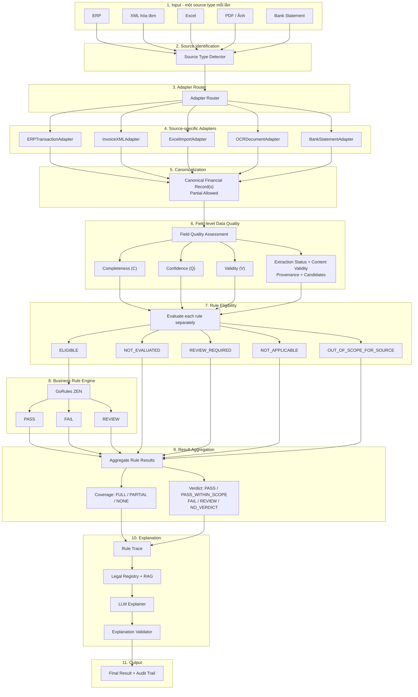
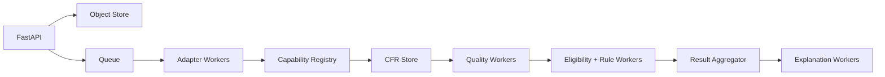
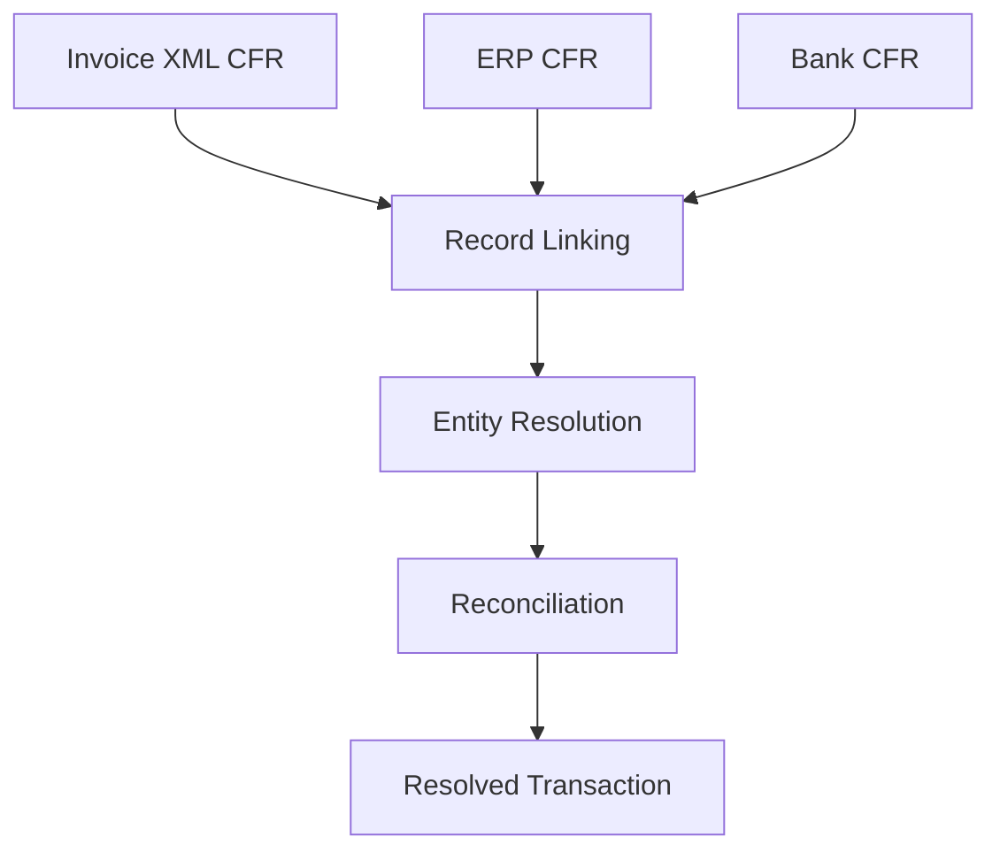
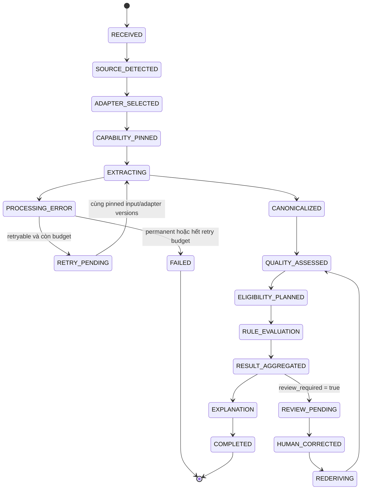
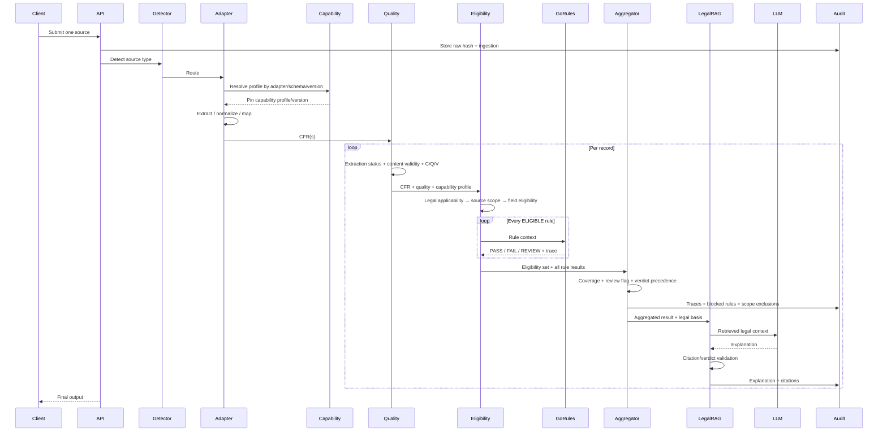

# PLAN.md — Pipeline xử lý dữ liệu tài chính & Tax Compliance cho Agent 3

> **Lộ trình triển khai cập nhật 11/10/2026:** xem [16 PLAN nhỏ theo tiến độ — OCR/PDF trước](plans/README.md). Bộ PLAN này quy định thứ tự triển khai mới thay cho thứ tự XML-first ở mục 1.3/17; nội dung dưới đây tiếp tục là thiết kế và hợp đồng kiến trúc. PLAN_00 đã hoàn tất phạm vi kỹ thuật theo [quyết định người dùng](plans/evidence/plan00/technical_scope_decision.md); dữ liệu thực tế/người đối chiếu chuyển thành điều kiện nghiệm thu chất lượng PLAN_05–06. Trạng thái và bằng chứng nằm trong [gate report](plans/evidence/gate_00.md).

**Trạng thái:** Technical Design / Implementation Plan  
**Phạm vi:** Financial Data Ingestion → Canonicalization → Data Quality → Rule Eligibility → GoRules ZEN → RAG + LLM Explanation  
**Ngôn ngữ triển khai chính đề xuất:** Python 3.12+, FastAPI, Pydantic v2  
**Legal snapshot minh họa ban đầu:** 23/09/2026  
**Rà soát nguồn và hợp đồng lần này:** 11/10/2026; xem Mục 1.7, không phải chứng nhận đã kiểm kê toàn bộ pháp luật hiện hành.

---

# 1. Tổng quan & mục tiêu

## 1.1. Bài toán

Hệ thống cần tiếp nhận dữ liệu tài chính từ nhiều nguồn không đồng nhất gồm **ERP, XML hóa đơn điện tử, Excel, PDF/Ảnh và Bank Statement**, chuẩn hóa dữ liệu về một mô hình chung, đánh giá mức độ đầy đủ và độ tin cậy của dữ liệu, sau đó áp dụng các quy tắc pháp lý/thuế một cách deterministic bằng **GoRules ZEN**. Khó khăn cốt lõi là các nguồn không cung cấp cùng một tập field: XML hóa đơn có thể cung cấp MST, số hóa đơn, thuế suất và line items nhưng không chứng minh giao dịch ngân hàng đã thực sự xảy ra; Bank Statement xác nhận dòng tiền nhưng thường không có VAT rate hoặc MST; ERP chứa dữ liệu accounting nội bộ nhưng schema khác nhau giữa MISA, Odoo, ERPNext hoặc SAP; Excel là semi-structured; PDF/Ảnh cần OCR và NLP nên có uncertainty cao hơn. Vì vậy kiến trúc không được giả định rằng một adapter luôn có thể tạo ra record hoàn chỉnh.

Thiết kế sử dụng mô hình **Canonical Financial Record (CFR)** theo hướng union schema: schema định nghĩa toàn bộ semantic field mà hệ thống có thể cần, nhưng mỗi source chỉ populate những field nó thực sự biết. Field không có dữ liệu không được biểu diễn đơn giản bằng `null` mà phải mang trạng thái cụ thể như `MISSING`, `AMBIGUOUS` hoặc `NOT_PROVIDED_BY_SOURCE`. Mỗi field đồng thời lưu **confidence, provenance và candidates** nếu giá trị chưa chắc chắn.

Một nguyên tắc quan trọng khác là **Data Quality, Rule Scope/Coverage và Tax Compliance là các bài toán khác nhau**. Data Quality mô tả chất lượng extraction/canonicalization của từng field; Rule Scope xác định rule nào có thể đánh giá từ capability của adapter hiện tại; Rule Eligibility kiểm tra rule trong scope có đủ input đáng tin để chạy hay chưa; GoRules trả lời “với các dữ liệu hợp lệ đã cung cấp, rule X cho kết quả PASS, FAIL hay REVIEW?”. Không được biến `MISSING` thành `FAIL`, không được coi rule ngoài khả năng của source là lỗi dữ liệu, và không được cho record thiếu critical field đi qua rule tương ứng chỉ vì overall confidence cao.

## 1.2. Mục tiêu

Hệ thống phải đạt các mục tiêu sau: nhận một source type duy nhất trong mỗi lần ingestion; tách source-specific processing khỏi business rule; chuyển mọi source về semantic schema thống nhất; cho phép partial record; bảo toàn provenance từ raw input đến output; đánh giá Data Quality ở field-level; quản lý source capability theo adapter/profile/version; chỉ chạy các rule trong scope và đủ input; cho phép các rule khác tiếp tục chạy nếu một rule thiếu dữ liệu hoặc cần review; duy trì audit trail đủ để tái hiện quyết định trong tương lai; version hóa rule, capability profile và legal document; và đảm bảo RAG/LLM chỉ đóng vai trò explanation chứ không phải decision maker.

## 1.3. Phạm vi

Kiến trúc đích hỗ trợ năm source type dưới đây. MVP đầu tiên chỉ triển khai Invoice XML theo lát cắt và ước lượng ở Mục 17.1; các adapter còn lại được bổ sung sau MVP.

| Source | Adapter chính | Cardinality |
|---|---|---:|
| ERP | `ERPTransactionAdapter` | 1..N records |
| XML hóa đơn | `InvoiceXMLAdapter` | Thường 1 record/file |
| Excel | `ExcelImportAdapter` | 1..N records |
| PDF / Ảnh | `OCRDocumentAdapter` | 1..N records tùy document |
| Bank Statement | `BankStatementAdapter` | 1..N transactions |

Một lần chạy chỉ nhận **một source type**, nhưng một source file hoàn toàn có thể chứa nhiều record. Ví dụ một Excel 1.000 dòng phải tạo tối đa khoảng 1.000 Canonical Financial Records chứ không tạo một CFR đại diện cho cả file.

## 1.4. Non-goals

Version hiện tại không nhằm thay thế chuyên gia thuế hoặc cung cấp legal advice độc lập; không tự kê khai hoặc nộp thuế; không tự động sửa dữ liệu tài chính nếu không có evidence; không để LLM quyết định PASS/FAIL; không triển khai cross-source reconciliation trong MVP; không cố suy luận field không tồn tại chỉ để làm record “đầy đủ”; không xem một overall quality score cao là bằng chứng rằng mọi critical field đều hợp lệ.

## 1.5. Giả định

**Giả định A1:** Một ingestion request chứa duy nhất một source type nhưng có thể tạo nhiều records.  
**Giả định A2:** Các ngưỡng confidence trong PLAN này là engineering defaults để bootstrap; production threshold phải được calibrate trên labeled validation set và được version hóa.  
**Giả định A3:** Legal rules phải được Legal/Tax Owner duyệt trước khi publish production.  
**Giả định A4:** Tất cả monetary calculation dùng `Decimal`, không dùng binary floating point.  
**Giả định A5:** Ngày tài liệu được lưu ở ISO-8601; timestamp nội bộ phải có timezone.  
**Giả định A6:** Một human-review workflow tồn tại và mọi correction đều được audit.  
**Giả định A7:** Legal Registry quyết định văn bản nào có hiệu lực tại thời điểm nghiệp vụ; không hard-code “luật hiện tại” vào source adapter.  
**Giả định A8:** Các luật minh họa tại Mục 9 là implementation examples và phải qua legal verification trước khi production release.  

**Giả định A9:** `OUT_OF_SCOPE_FOR_SOURCE` chỉ được xác định từ capability profile đã version hóa của adapter/source profile, không được suy ra chỉ vì record hiện tại thiếu field.  
**Giả định A10:** Một tenant quản lý nhiều taxpayer; mỗi request chọn một taxpayer_id được cấp quyền, lấy master revision có provenance; seller/buyer lấy từ chứng từ và `invoice_direction` là giá trị dẫn xuất có audit.

Về legal snapshot hiện tại, Luật Thuế GTGT số 48/2024/QH15 có hiệu lực từ 01/07/2025; Nghị định 181/2025/NĐ-CP cũng có hiệu lực từ 01/07/2025. Nghị định 254/2026/NĐ-CP và Thông tư 91/2026/TT-BTC về hóa đơn điện tử/chứng từ điện tử có hiệu lực từ 01/07/2026.

## 1.6. Thuật ngữ

| Thuật ngữ | Ý nghĩa |
|---|---|
| CFR | Canonical Financial Record |
| Adapter | Module đọc và normalize một source cụ thể |
| Provenance | Nguồn gốc chính xác của field |
| Confidence | Mức độ tin cậy đã calibrate của extraction/mapping |
| Validity | Field có thỏa structural/domain constraint hay không |
| Completeness | Mức độ đầy đủ của tập field cần cho một scope cụ thể |
| Rule Eligibility | Rule có đủ input đáng tin để chạy hay không |
| Partial | Một số rule chạy được, một số rule chưa thể đánh giá |
| Review | Cần human intervention |
| Source Capability | Tập field/rule family một adapter profile có khả năng cung cấp hoặc đánh giá |
| Out of Scope for Source | Rule có thể áp dụng pháp lý nhưng source profile hiện tại không thể cung cấp input cần thiết |
| Pass Within Scope | Mọi rule applicable trong source scope đều PASS nhưng vẫn có applicable rule nằm ngoài source scope |
| Rule Trace | Evidence về input, condition và branch đã tạo verdict |
| Legal Registry | Kho metadata version hóa văn bản pháp luật |

---

## 1.7. Nguồn pháp lý và phạm vi xác minh ngày 11/10/2026

Đã đối chiếu trực tiếp PDF ký số: NĐ 254/2026 **Điều 10 — Nội dung của hóa đơn** (bắt đầu trang PDF 21); Điều 9 là thời điểm lập (trang 16); Điều 43 khoản 2 quy định các văn bản/phần văn bản hết hiệu lực (trang 46), Điều 44 xử lý chuyển tiếp. Giữ mapping Điều 10, không đổi sang Điều 9. [PDF gốc NĐ 254](https://datafiles.chinhphu.vn/cpp/files/vbpq/2026/7/254-ndcp.signed.pdf), [bản lưu trong workspace](../references/legal/254-2026-ND-CP.signed.pdf).

NĐ 181/2025 **Điều 26 — Chứng từ thanh toán không dùng tiền mặt** bắt đầu trang PDF 32; khoản 3 ở trang 34 có quy tắc nhiều lần mua từ một người nộp thuế trong cùng ngày. [PDF gốc NĐ 181](https://datafiles.chinhphu.vn/cpp/files/vbpq/2025/7/181nd.signed.pdf), [bản lưu](../references/legal/181-2025-ND-CP.signed.pdf). Điều 4 NĐ 144/2026 sửa điểm g khoản 2 Điều 26, áp dụng từ 20/06/2026: cần version riêng cho trả chậm/trả góp. [Công báo NĐ 144](https://congbaocdn.chinhphu.vn/180507251028987904/2026/5/18/469482-1778814209_v1_1779067294_signed.pdf).

Các nguồn bổ sung cho Registry: [Luật Quản lý thuế 108/2025/QH15](https://chinhphu.vn/?classid=1&docid=216541&orggroupid=1&pageid=27160); [toàn văn TT 32/2025, Điều 12 thay TT 78/2021 từ 01/06/2025](https://vbpl.vn/botaichinh/Pages/vbpq-toanvan.aspx?ItemID=178309&Keyword=); [nguồn Cục Thuế về NĐ 254/TT 91](https://xaydungchinhsach.chinhphu.vn/nhung-diem-moi-cua-nghi-dinh-254-2026-nd-cp-va-thong-tu-91-2026-tt-btc-ve-hoa-don-dien-tu-chung-tu-dien-tu-119260717143502375.htm); [hiệu lực NĐ 359/2025 từ 01/01/2026](https://cms.baochinhphu.vn/quy-dinh-moi-ve-doi-tuong-khong-chiu-thue-gtgt-102251231181558339.htm); [văn bản hợp nhất VAT dẫn NQ 204/2025](https://datafiles.chinhphu.vn/cpp/files/vbpq/2026/02/12-vbhn-vpqh.pdf). Rule production phải lưu bản gốc của từng văn bản sửa đổi; văn bản hợp nhất dùng tra cứu, không thay nguồn ban hành.

Đợt rà soát xác nhận các nguồn trên, chưa chứng nhận đã thu thập toàn bộ sửa đổi có thể áp dụng đến 11/10/2026. Không tự thay legal_snapshot_id cũ trong fixture bằng ngày mới; snapshot mới chỉ publish sau khi lưu hash, effective intervals và legal review. Checksum MST ở Mục 6.5 vẫn là thuật toán kỹ thuật tham khảo chưa xác nhận nguồn pháp lý hiện hành, không được dùng đơn lẻ để phát hành FAIL về identity.

# 2. Kiến trúc tổng thể

Kiến trúc chia thành 11 tầng. Tầng 1 tiếp nhận một source duy nhất. Tầng 2 nhận diện source. Tầng 3 chọn adapter và capability profile. Tầng 4 xử lý logic riêng của source. Tầng 5 chuyển dữ liệu về CFR. Tầng 6 đánh giá chất lượng field. Tầng 7 xác định legal applicability, source scope và rule eligibility. Tầng 8 chạy mọi deterministic rule `ELIGIBLE` bằng GoRules. Tầng 9 tổng hợp coverage, review flag và verdict. Tầng 10 tạo explanation dựa trên rule trace và legal basis. Tầng 11 trả output và audit trail.



### 2.1. Layer 1 — Input

**Mục đích:** tiếp nhận raw source. **Input:** file, API response hoặc structured payload. **Output:** `SourceEnvelope`. **Logic:** kiểm tra size, MIME, checksum, tenant, idempotency key và lưu immutable raw object. **Edge cases:** corrupted file, password-protected document, zip bomb, unsupported encoding, empty file, duplicate upload.

### 2.2. Layer 2 — Source Identification

**Mục đích:** xác định source type bằng deterministic detection. **Input:** `SourceEnvelope`. **Output:** `DetectedSource`. **Logic:** dùng magic bytes, MIME, extension, XML root, workbook signature, bank format marker hoặc connection metadata. **Edge cases:** `.xml` có thể là hóa đơn, ERP XML hoặc camt.053; file `.pdf` có thể chứa text layer hoặc scan image.

### 2.3. Layer 3 — Adapter Router

**Mục đích:** route source đến đúng adapter. **Input:** source type. **Output:** initialized adapter. **Logic:** registry-based factory thay vì chuỗi `if/else` hard-code. **Edge cases:** source unsupported, adapter disabled, schema version unsupported.

### 2.4. Layer 4 — Source-specific Adapters

**Mục đích:** đọc, extract, normalize source. **Input:** raw source. **Output:** một hoặc nhiều `ExtractedFinancialRecord`. **Logic:** source-specific; xem Mục 4. **Edge cases:** schema drift, missing columns, OCR errors, pagination, nested transactions.

### 2.5. Layer 5 — Canonicalization

**Mục đích:** map field về CFR. **Input:** source-specific extracted fields. **Output:** `CanonicalFinancialRecord[]`. **Logic:** semantic mapping, field status, confidence, provenance, candidates. **Edge cases:** source không cung cấp field, duplicate fields, contradictory values trong cùng document.

### 2.6. Layer 6 — Data Quality Assessment

**Mục đích:** đánh giá quality nhưng không đưa verdict pháp lý hoặc record status. **Input:** CFR. **Output:** extraction status, content validity, field issues và C/Q/V. **Logic:** validation deterministic, source-fidelity classification, confidence calibration, completeness calculation. **Edge cases:** confidence cao nhưng source content invalid; OCR mâu thuẫn chưa đủ evidence; field not applicable.

### 2.7. Layer 7 — Rule Eligibility

**Mục đích:** kiểm tra **từng rule** theo legal applicability → source capability → field eligibility. **Input:** CFR + field quality + active rule metadata + capability profile. **Output:** execution plan và rule eligibility set. **Logic:** applicability, capability, required fields, allowed extraction/content validity, minimum confidence, effective date. **Edge cases:** một rule cần review hoặc ngoài scope nhưng mọi rule `ELIGIBLE` khác vẫn chạy.

### 2.8. Layer 8 — GoRules ZEN

**Mục đích:** áp dụng deterministic tax/business logic cho mọi rule `ELIGIBLE`. **Input:** sanitized rule context. **Output:** per-rule PASS/FAIL/REVIEW + rule trace. **Logic:** decision table/expression đã version hóa; không short-circuit giữa các rule độc lập. **Edge cases:** temporal rule version, exception rule, contradictory conditions.

### 2.9. Layer 9 — Result Aggregation

**Mục đích:** tổng hợp sau khi toàn bộ rule `ELIGIBLE` đã chạy. **Input:** eligibility set + per-rule results. **Output:** source-scoped coverage, scope exclusions, review flag và verdict. **Logic:** precedence `FAIL > REVIEW > NO_VERDICT > PASS_WITHIN_SCOPE > PASS`. **Edge cases:** FAIL đồng thời review_required; full source coverage nhưng còn global scope exclusions.

### 2.10. Layer 10 — RAG + LLM

**Mục đích:** diễn giải verdict bằng căn cứ pháp lý. **Input:** rule trace + legal basis + canonical fields. **Output:** explanation + citations. **Logic:** retrieval bị giới hạn bởi legal mapping; LLM không được thay verdict. **Edge cases:** retrieval nhầm version luật, hallucinated article, explanation contradiction.

### 2.11. Layer 11 — Output

**Mục đích:** tổng hợp và trả kết quả machine-readable/human-readable cùng audit metadata. **Input:** CFR + quality + eligibility + rule results + explanation. **Output:** source scope, coverage, review flag, verdict, explanation và audit. **Edge cases:** `PASS_WITHIN_SCOPE`, FAIL đồng thời review_required, partial coverage, file nhiều records.

---

# 3. Source Identification & Adapter Router

## 3.1. Source Envelope

Mọi input được bọc trong một envelope thống nhất trước khi parse:

```json
{
  "ingestion_id": "ing_01J...",
  "tenant_id": "tenant_demo",
  "taxpayer_id": "tp_abc",
  "received_at": "2026-09-23T22:30:00+07:00",
  "declared_source_type": null,
  "mime_type": "application/xml",
  "file_name": "invoice_001.xml",
  "content_sha256": "sha256:...",
  "size_bytes": 184320,
  "storage_uri": "object://raw/...",
  "idempotency_key": "client-key-001"
}
```

`declared_source_type` chỉ là hint; detector vẫn phải xác minh file thực tế để tránh routing sai hoặc upload nguy hiểm. `tenant_id + taxpayer_id` phải resolve tới một taxpayer master record được cấp quyền trong tenant có `tax_code`, version và provenance trước khi suy ra `invoice_direction`. Không được coi buyer hoặc seller đầu tiên đọc được trên hóa đơn mặc nhiên là taxpayer của tenant.

## 3.2. Detection rules

| Dấu hiệu | Source candidate |
|---|---|
| ERP connector metadata / API session | ERP |
| XML root `HDon` hoặc schema hóa đơn tương ứng | INVOICE_XML |
| ZIP container Office + workbook parts | EXCEL |
| PDF magic `%PDF` | PDF |
| PNG/JPEG/WebP magic bytes | IMAGE |
| XML `BkToCstmrStmt` | BANK_STATEMENT / CAMT053 |
| MT940 markers `:20:`, `:25:`, `:61:` | BANK_STATEMENT |
| CSV headers bank-like | BANK_STATEMENT hoặc EXCEL_TABULAR |

Nếu nhiều classifier cùng match, hệ thống không chọn ngẫu nhiên mà trả `AMBIGUOUS_SOURCE_TYPE`, ví dụ `["EXCEL_GENERIC","BANK_STATEMENT_EXCEL"]`. User hoặc upstream API có thể truyền explicit source type để resolve, nhưng source type này vẫn phải pass structural validation.

## 3.3. Detection pseudocode

Detector trả `detection_status=RESOLVED/AMBIGUOUS/UNSUPPORTED` tách khỏi canonical source type. RESOLVED chỉ dùng ERP/INVOICE_XML/EXCEL/PDF_IMAGE/BANK_STATEMENT; container_format giữ PDF/IMAGE/OOXML/OLE2/CSV/MT940/CAMT053. EXCEL_GENERIC/EXCEL_TABULAR là candidate/profile hints, UNKNOWN_XML là reason UNSUPPORTED, không đi vào CFR enum. PDF statement được nhận diện BANK_STATEMENT với container_format=PDF và bank adapter có thể dùng OCR subpipeline. Không xác định semantic bank-vs-generic thì trả AMBIGUOUS trước router.

```python
def detect_source(envelope: SourceEnvelope) -> DetectedSource:
    content = safe_peek(envelope.storage_uri)

    if envelope.connector_kind == "ERP":
        return DetectedSource("ERP", 1.0)

    if is_xml(content):
        root = secure_xml_root(content)
        if root in INVOICE_ROOTS:
            return DetectedSource("INVOICE_XML", 1.0)
        if root in CAMT053_ROOTS:
            return DetectedSource("BANK_STATEMENT", 1.0)
        return DetectedSource(source_type=None, detection_status="UNSUPPORTED",
                              reason="UNKNOWN_XML")

    if is_office_workbook(content) or is_ole2_excel(content):
        return detect_excel_semantics(content)

    if is_pdf(content):
        return detect_pdf_semantics(content)  # PDF_IMAGE hoặc BANK_STATEMENT

    if is_supported_image(content):
        return DetectedSource("PDF_IMAGE", 1.0, container_format="IMAGE")

    if is_csv(content):
        return detect_tabular_semantics(content)  # EXCEL/BANK_STATEMENT/AMBIGUOUS

    if looks_like_mt940(content):
        return DetectedSource("BANK_STATEMENT", 0.99)

    return DetectedSource(source_type=None, detection_status="UNSUPPORTED",
                          reason="UNSUPPORTED_FORMAT")
```

## 3.4. Router

Router dùng adapter registry:

```python
ADAPTERS = {
    "ERP": ERPTransactionAdapter,
    "INVOICE_XML": InvoiceXMLAdapter,
    "EXCEL": ExcelImportAdapter,
    "PDF_IMAGE": OCRDocumentAdapter,
    "BANK_STATEMENT": BankStatementAdapter,
}
```

Nếu không nhận diện được, ingestion kết thúc với `PROCESSING_ERROR/UNSUPPORTED_SOURCE`; không gửi raw text sang LLM để “đoán” source type.

## 3.5. Source Capability Registry

Sau khi chọn adapter và nhận diện source profile/schema version, Router phải pin một capability profile immutable. Registry mô tả field families và rule families mà profile **có khả năng** cung cấp, không mô tả record cụ thể đã cung cấp đủ hay chưa.

```json
{
  "capability_profile_id": "invoice_xml_v1",
  "capability_profile_version": "1.0.0",
  "adapter": "InvoiceXMLAdapter",
  "adapter_version": "1.0.0",
  "supported_field_patterns": [
    "document.*",
    "parties.*",
    "amount.*",
    "items.*",
    "tax.breakdown.*"
  ],
  "supported_rule_families": [
    "INVOICE_CONTENT",
    "VAT_RATE"
  ],
  "unsupported_rule_families": {
    "PAYMENT_EVIDENCE": "BANK_EVIDENCE_NOT_PRESENT_IN_SOURCE_SCHEMA"
  }
}
```

ERP capability không được khai báo chung cho mọi vendor. Ví dụ ERP profile chỉ có purchase invoice khác ERP profile đã tích hợp payment ledger. Mọi thay đổi capability phải tăng version, qua contract test và được lưu trong audit.

---

# 4. Source-specific Adapters

Mọi adapter implement interface:

```python
class SourceAdapter(Protocol):
    adapter_name: str
    adapter_version: str
    capability_profile_id: str
    capability_profile_version: str

    async def validate_source(self, source: SourceEnvelope) -> None: ...
    async def extract(self, source: SourceEnvelope) -> list[ExtractedRecord]: ...
    async def normalize(self, record: ExtractedRecord) -> NormalizedRecord: ...
    async def to_canonical(self, record: NormalizedRecord) -> CanonicalFinancialRecord: ...
```

Adapter **không chứa tax law**. Một adapter được phép biết schema source, field aliases, datatype, extraction rules và capability profile của chính schema đó nhưng không được tự quyết định “được khấu trừ thuế hay không”. Trước canonicalization, pipeline nạp taxpayer master theo `tenant_id + taxpayer_id`; adapter map seller/buyer từ source, còn một deterministic identity resolver tạo `invoice_direction` và provenance.

## 4.1. ERPTransactionAdapter

**Input:** REST/JSON, OData, SOAP/XML, RPC hoặc ERP export. **Các bước:** authenticate → fetch/paginate → identify entity/document type → resolve vendor/schema capability profile → parse ERP schema → normalize dates/currency/identifiers → map taxpayer/seller/buyer → derive direction → emit CFR. **Công nghệ đề xuất:** `httpx` cho async HTTP, Pydantic v2 cho schema, vendor SDK nếu bắt buộc; development connector ưu tiên ERPNext/Odoo hoặc MISA mock nếu chưa có production credential. **Lỗi thường gặp:** token hết hạn, pagination mất record, vendor schema thay đổi, amount debit/credit đảo dấu, custom fields, timezone, duplicate transaction, partial API permissions. **Output:** một hoặc nhiều CFR có source metadata `system=MISA_AMIS|ODOO|ERPNEXT|...`.

Adapter phải giữ raw identifiers như `erp_transaction_id`, `voucher_number`, `posting_date`, `account_code`, `cost_center` để future reconciliation không phải re-ingest. Capability phải tách theo vendor/module/API permission: purchase-invoice-only profile không được khai báo hỗ trợ payment evidence chỉ vì một profile ERP khác có payment ledger.

## 4.2. InvoiceXMLAdapter

**Input:** XML hóa đơn điện tử. **Các bước:** secure parse → detect schema/version → pin capability profile → namespace resolution → optional XSD validation → extract seller/buyer/items/tax totals → group item taxes thành `tax.breakdown[]` → match taxpayer → derive `invoice_direction` → validate digital-signature metadata nếu có → map CFR. **Công nghệ đề xuất:** `lxml`, `xmlschema`, `xmlsec`; XML parsing phải disable external entity/DTD để tránh XXE. Với XAdES hoặc certificate-chain validation, dùng thư viện đã được security review hoặc dedicated signature validation component thay vì tự viết crypto.

Nghị định 254/2026/NĐ-CP quy định nội dung hóa đơn và có các ngoại lệ mà một số loại hóa đơn không bắt buộc đầy đủ mọi field, vì vậy `MISSING` không đồng nghĩa vi phạm nếu document type thuộc exception. Nghị định này có hiệu lực từ 01/07/2026.

**Lỗi thường gặp:** namespace khác nhau, schema version 2.1.0/2.1.1, vendor extension, invalid XML encoding, malformed signature, certificate expired, duplicate invoice number, adjustment/replacement invoice, taxpayer không khớp seller hoặc buyer, cùng hóa đơn có nhiều nhóm thuế suất. **Output:** thường một CFR/file; field confidence của XML-path extraction có thể rất cao nhưng authenticity/content validity vẫn phải tách khỏi extraction confidence. Nếu taxpayer không khớp hai bên thì `invoice_direction.status=AMBIGUOUS, value=null`, không được mặc định INPUT.

XML invoice là nguồn rất phù hợp để tạo golden labels cho OCR nếu có cặp XML + rendered PDF/image của cùng hóa đơn. Tuy nhiên “XML = ground truth tuyệt đối” chỉ được chấp nhận cho field mà XML đã qua structural/signature validation; không dùng XML để chứng minh sự kiện thanh toán ngân hàng.

## 4.3. ExcelImportAdapter

**Input:** `.xlsx`, `.xls`, `.xlsm`, `.xlsb` hoặc CSV nếu business source khai báo Excel/tabular. **Các bước:** workbook open → sheet detection → header detection → table boundary detection → row extraction → datatype normalization → column semantic mapping → một row/transaction tạo một CFR. **Công nghệ đề xuất:** `openpyxl` cho `.xlsx/.xlsm` và workbook structure, `pandas` hoặc `polars` cho tabular transformation, `xlrd` chỉ cho legacy `.xls` nếu thật sự cần, thư viện `.xlsb` chuyên dụng khi requirement xuất hiện.

Mapping theo thứ tự: exact header dictionary → alias dictionary → normalized/fuzzy match → semantic classifier → LLM fallback có constraint. Ví dụ `"MST người bán"`, `"MST người mua"` và tenant context phải map lần lượt về `parties.seller.tax_code`, `parties.buyer.tax_code` và `taxpayer.tax_code`; cột chung `"MST"` hoặc `"Mã"` phải `AMBIGUOUS` nếu không xác định được role. `invoice_direction` chỉ được dẫn xuất sau khi đối chiếu taxpayer với seller/buyer.

**Lỗi thường gặp:** title nằm trước header, merged cells, hidden rows, multiple sheets, repeated headers, subtotal/footer, Excel date serial, công thức chỉ có cached result, MST bị mất leading zero, number dùng `.`/`,` khác locale, currency text lẫn amount, rows blank, one-to-many item layout và nhiều dòng thuế thuộc cùng chứng từ. **Output:** `N` CFR; file-level object chỉ giữ summary. Nếu nhiều row là line item của một hóa đơn, adapter phải group theo document key trước khi tạo `items[]` và `tax.breakdown[]`, không tạo một VAT rate cấp record.

Không sử dụng `float` cho tiền. Identifier như MST, invoice number, account number luôn được đọc như string.

## 4.4. OCRDocumentAdapter

**Input:** PDF, JPG, PNG, scan hoặc image-based invoice/receipt. **Các bước:** document classification → nếu PDF có text layer thì extract text trước → nếu scan thì rasterize → OCR → layout analysis → text normalization → deterministic regex/dictionary → NER/classifier → bounded LLM fallback → canonical mapping.

**Công nghệ đề xuất:** `PyMuPDF` cho PDF text/render, PaddleOCR cho OCR/layout baseline; NER benchmark có thể so sánh PhoBERT, XLM-R, viBERT, mBERT và baseline rule/TF-IDF tùy subtask. Regex ưu tiên cho MST, date, invoice number, money và reference có pattern rõ. LLM không được trực tiếp tự sửa OCR output mà phải trả candidates cùng evidence span.

**Lỗi thường gặp:** blur, skew, watermark, multi-column, handwritten notes, low contrast, OCR nhầm `5/S`, `0/O`, table line items, duplicate text layer, rotation, nhiều thuế suất và multiple invoices trong một PDF. **Output:** CFR với field-level confidence, bounding box/page provenance và candidates. Seller/buyer, direction và từng tax group phải giữ evidence riêng; OCR không đọc được một nhóm thuế không được biến thành rate chung cho toàn hóa đơn.

Ví dụ ambiguous OCR:

```json
{
  "value": null,
  "status": "AMBIGUOUS",
  "confidence": 0.63,
  "source": "PDF_IMAGE",
  "candidates": [
    {
      "value": "0312345678",
      "confidence": 0.63
    },
    {
      "value": "031234S678",
      "confidence": 0.29
    }
  ],
  "provenance": {
    "page": 1,
    "bbox": [
      122,
      410,
      312,
      448
    ],
    "method": "OCR_NER",
    "extractor_version": "ocr-ner-1.2.0"
  },
  "confidence_basis": "UNAVAILABLE"
}
```

## 4.5. BankStatementAdapter

**Input:** CSV, XLS/XLSX, MT940, ISO 20022 `camt.053`, PDF statement hoặc banking API. **Các bước:** format detection → parser → statement metadata extraction → transaction entry extraction → normalize debit/credit, date, amount, currency → parse reference/description → emit CFR cho từng transaction.

**Công nghệ đề xuất:** standard CSV parser/Pandas/Polars cho table; `lxml` cho camt.053; mature MT940 parser library thay vì regex toàn file; PDF statement đi qua specialized table/OCR path.

**Lỗi thường gặp:** debit/credit dùng hai cột hoặc một signed amount, booking date khác value date, opening/closing balance, reversed transactions, repeated pages, bank-specific narrative, locale number format, masked account, line wrap. **Output:** `N` CFR. `tax.breakdown` thường rỗng và các tax field tương ứng là `NOT_PROVIDED_BY_SOURCE`; rule VAT invoice được đánh dấu `OUT_OF_SCOPE_FOR_SOURCE` theo bank capability profile thay vì coi bank record bị thiếu dữ liệu.

---

# 5. Canonical Schema

## 5.1. Nguyên tắc

CFR là **union schema**. Business field phải được bọc bằng một `FieldObject` để lưu value, extraction status, content validity, confidence và provenance. System metadata như `record_id`, `schema_version`, timestamps hoặc adapter version không cần FieldObject vì chúng do hệ thống tạo deterministic. `parties.seller` và `parties.buyer` giữ identity từ chứng từ; `taxpayer` giữ chủ thể tenant; `counterparty` chỉ là view dẫn xuất tương thích và không phải nguồn sự thật để xác định chiều hóa đơn. Bank transaction giữ account_owner/counterparty quan sát được trong bank_transaction; không ép vai trò bên bán/bên mua cho giao dịch ngân hàng.

## 5.2. Field Object

```json
{
  "value": "0312345678",
  "status": "PRESENT",
  "confidence": 0.98,
  "source": "INVOICE_XML",
  "provenance": {
    "source_path": "/HDon/DLHDon/NDHDon/NBan/MST",
    "page": null,
    "bbox": null,
    "row": null,
    "column": null,
    "method": "XML_PATH",
    "extractor_version": "invoice-xml-1.0.0",
    "calibration_version": null
  },
  "validation": {
    "status": "VALID",
    "source_fidelity": "AUTHORITATIVE",
    "issues": []
  },
  "candidates": [],
  "confidence_basis": "UNAVAILABLE"
}
```

## 5.3. JSON Schema

```json
{
  "$schema": "https://json-schema.org/draft/2020-12/schema",
  "$id": "CanonicalFinancialRecord.schema.json",
  "title": "CanonicalFinancialRecord",
  "type": "object",
  "additionalProperties": false,
  "required": [
    "schema_version",
    "record_id",
    "record_type",
    "source",
    "taxpayer",
    "parties",
    "transaction",
    "document",
    "amount",
    "payment",
    "tax",
    "items",
    "quality"
  ],
  "properties": {
    "schema_version": {
      "type": "string"
    },
    "record_id": {
      "type": "string"
    },
    "parent_ingestion_id": {
      "type": "string"
    },
    "record_index": {
      "type": "integer",
      "minimum": 0
    },
    "record_type": {
      "type": "string",
      "enum": [
        "INVOICE",
        "ERP_TRANSACTION",
        "BANK_TRANSACTION",
        "EXPENSE_RECORD",
        "PAYMENT_RECORD",
        "UNKNOWN_FINANCIAL_RECORD"
      ]
    },
    "source": {
      "$ref": "#/$defs/source"
    },
    "taxpayer": {
      "$ref": "#/$defs/taxpayer"
    },
    "parties": {
      "$ref": "#/$defs/parties"
    },
    "transaction": {
      "$ref": "#/$defs/transaction"
    },
    "document": {
      "$ref": "#/$defs/document"
    },
    "counterparty": {
      "description": "Optional derived compatibility view; seller/buyer remain authoritative",
      "$ref": "#/$defs/counterparty"
    },
    "amount": {
      "$ref": "#/$defs/amount"
    },
    "payment": {
      "$ref": "#/$defs/payment"
    },
    "tax": {
      "$ref": "#/$defs/tax"
    },
    "accounting": {
      "$ref": "#/$defs/accounting"
    },
    "items": {
      "type": "array",
      "items": {
        "$ref": "#/$defs/item"
      }
    },
    "quality": {
      "$ref": "#/$defs/quality"
    },
    "reconciliation": {
      "$ref": "#/$defs/reconciliation"
    },
    "bank_transaction": {
      "type": "object",
      "properties": {
        "account_owner": {
          "$ref": "#/$defs/party"
        },
        "counterparty": {
          "$ref": "#/$defs/party"
        },
        "debit_credit": {
          "$ref": "#/$defs/field"
        }
      }
    }
  },
  "$defs": {
    "extractionStatus": {
      "type": "string",
      "enum": [
        "PRESENT",
        "MISSING",
        "INVALID_EXTRACTION",
        "AMBIGUOUS",
        "NOT_PROVIDED_BY_SOURCE",
        "NOT_APPLICABLE"
      ]
    },
    "candidate": {
      "type": "object",
      "required": [
        "value",
        "confidence"
      ],
      "properties": {
        "value": {},
        "confidence": {
          "type": "number",
          "minimum": 0,
          "maximum": 1
        },
        "evidence": {
          "type": [
            "string",
            "null"
          ]
        }
      }
    },
    "contentValidityStatus": {
      "type": "string",
      "enum": [
        "VALID",
        "INVALID_SOURCE_CONTENT",
        "UNKNOWN",
        "NOT_CHECKED",
        "NOT_APPLICABLE"
      ]
    },
    "fieldValidation": {
      "type": "object",
      "required": [
        "status",
        "issues"
      ],
      "properties": {
        "status": {
          "$ref": "#/$defs/contentValidityStatus"
        },
        "source_fidelity": {
          "type": [
            "string",
            "null"
          ],
          "enum": [
            "AUTHORITATIVE",
            "HIGH",
            "MEDIUM",
            "LOW",
            null
          ]
        },
        "issues": {
          "type": "array",
          "items": {
            "type": "object",
            "required": [
              "code",
              "message"
            ],
            "properties": {
              "code": {
                "type": "string"
              },
              "message": {
                "type": "string"
              },
              "evidence": {}
            }
          }
        }
      }
    },
    "provenance": {
      "type": "object",
      "properties": {
        "source_path": {
          "type": [
            "string",
            "null"
          ]
        },
        "page": {
          "type": [
            "integer",
            "null"
          ],
          "minimum": 1
        },
        "bbox": {
          "type": [
            "array",
            "null"
          ],
          "items": {
            "type": "number"
          },
          "minItems": 4,
          "maxItems": 4
        },
        "sheet": {
          "type": [
            "string",
            "null"
          ]
        },
        "row": {
          "type": [
            "integer",
            "null"
          ],
          "minimum": 1
        },
        "column": {
          "type": [
            "string",
            "null"
          ]
        },
        "method": {
          "type": [
            "string",
            "null"
          ]
        },
        "extractor_version": {
          "type": [
            "string",
            "null"
          ]
        },
        "calibration_version": {
          "type": [
            "string",
            "null"
          ]
        },
        "raw_value": {},
        "human_corrected": {
          "type": "boolean",
          "default": false
        },
        "deterministic_policy_version": {
          "type": [
            "string",
            "null"
          ]
        },
        "review_event_id": {
          "type": [
            "string",
            "null"
          ]
        }
      }
    },
    "field": {
      "type": "object",
      "required": [
        "value",
        "status",
        "confidence",
        "source",
        "provenance",
        "candidates",
        "confidence_basis"
      ],
      "properties": {
        "value": {},
        "status": {
          "$ref": "#/$defs/extractionStatus"
        },
        "confidence": {
          "type": [
            "number",
            "null"
          ],
          "minimum": 0,
          "maximum": 1
        },
        "source": {
          "type": "string"
        },
        "provenance": {
          "$ref": "#/$defs/provenance"
        },
        "validation": {
          "$ref": "#/$defs/fieldValidation"
        },
        "candidates": {
          "type": "array",
          "items": {
            "$ref": "#/$defs/candidate"
          }
        },
        "confidence_basis": {
          "type": "string",
          "enum": [
            "CALIBRATED",
            "DETERMINISTIC",
            "HUMAN_CONFIRMED",
            "UNAVAILABLE"
          ]
        }
      },
      "allOf": [
        {
          "if": {
            "properties": {
              "status": {
                "const": "PRESENT"
              }
            }
          },
          "then": {
            "properties": {
              "value": {
                "not": {
                  "type": "null"
                }
              }
            }
          }
        },
        {
          "if": {
            "properties": {
              "status": {
                "enum": [
                  "MISSING",
                  "AMBIGUOUS",
                  "NOT_PROVIDED_BY_SOURCE",
                  "NOT_APPLICABLE"
                ]
              }
            }
          },
          "then": {
            "properties": {
              "value": {
                "type": "null"
              }
            }
          }
        }
      ]
    },
    "source": {
      "type": "object",
      "required": [
        "source_type",
        "adapter",
        "adapter_version",
        "capability_profile_id",
        "capability_profile_version"
      ],
      "properties": {
        "source_type": {
          "type": "string",
          "enum": [
            "ERP",
            "INVOICE_XML",
            "EXCEL",
            "PDF_IMAGE",
            "BANK_STATEMENT"
          ]
        },
        "system": {
          "type": [
            "string",
            "null"
          ]
        },
        "file_name": {
          "type": [
            "string",
            "null"
          ]
        },
        "content_sha256": {
          "type": [
            "string",
            "null"
          ]
        },
        "adapter": {
          "type": "string"
        },
        "adapter_version": {
          "type": "string"
        },
        "capability_profile_id": {
          "type": "string"
        },
        "capability_profile_version": {
          "type": "string"
        },
        "raw_record_reference": {
          "type": [
            "string",
            "null"
          ]
        }
      }
    },
    "taxpayer": {
      "type": "object",
      "required": [
        "tenant_id",
        "tax_code",
        "taxpayer_id",
        "master_data_version"
      ],
      "properties": {
        "tenant_id": {
          "type": "string"
        },
        "name": {
          "$ref": "#/$defs/field"
        },
        "tax_code": {
          "$ref": "#/$defs/field"
        },
        "taxpayer_id": {
          "type": "string"
        },
        "master_data_version": {
          "type": "string"
        }
      }
    },
    "party": {
      "type": "object",
      "properties": {
        "name": {
          "$ref": "#/$defs/field"
        },
        "tax_code": {
          "$ref": "#/$defs/field"
        },
        "address": {
          "$ref": "#/$defs/field"
        },
        "bank_account": {
          "$ref": "#/$defs/field"
        },
        "bank_name": {
          "$ref": "#/$defs/field"
        }
      }
    },
    "parties": {
      "type": "object",
      "properties": {
        "seller": {
          "$ref": "#/$defs/party"
        },
        "buyer": {
          "$ref": "#/$defs/party"
        }
      }
    },
    "transaction": {
      "type": "object",
      "properties": {
        "transaction_id": {
          "$ref": "#/$defs/field"
        },
        "date": {
          "$ref": "#/$defs/field"
        },
        "booking_date": {
          "$ref": "#/$defs/field"
        },
        "value_date": {
          "$ref": "#/$defs/field"
        },
        "description": {
          "$ref": "#/$defs/field"
        },
        "reference": {
          "$ref": "#/$defs/field"
        },
        "direction": {
          "$ref": "#/$defs/field"
        }
      }
    },
    "document": {
      "type": "object",
      "properties": {
        "document_type": {
          "$ref": "#/$defs/field"
        },
        "number": {
          "$ref": "#/$defs/field"
        },
        "series": {
          "$ref": "#/$defs/field"
        },
        "issue_date": {
          "$ref": "#/$defs/field"
        },
        "xml_version": {
          "$ref": "#/$defs/field"
        },
        "tax_authority_code": {
          "$ref": "#/$defs/field"
        },
        "signature_valid": {
          "$ref": "#/$defs/field"
        },
        "invoice_direction": {
          "$ref": "#/$defs/directionField"
        },
        "adjustment_type": {
          "$ref": "#/$defs/field"
        },
        "related_document_number": {
          "$ref": "#/$defs/field"
        }
      }
    },
    "counterparty": {
      "type": "object",
      "properties": {
        "name": {
          "$ref": "#/$defs/field"
        },
        "tax_code": {
          "$ref": "#/$defs/field"
        },
        "address": {
          "$ref": "#/$defs/field"
        },
        "bank_account": {
          "$ref": "#/$defs/field"
        },
        "bank_name": {
          "$ref": "#/$defs/field"
        },
        "role": {
          "$ref": "#/$defs/field"
        }
      }
    },
    "amount": {
      "type": "object",
      "properties": {
        "subtotal": {
          "$ref": "#/$defs/field"
        },
        "tax": {
          "$ref": "#/$defs/field"
        },
        "discount": {
          "$ref": "#/$defs/field"
        },
        "fees": {
          "$ref": "#/$defs/field"
        },
        "total": {
          "$ref": "#/$defs/field"
        },
        "currency": {
          "$ref": "#/$defs/field"
        }
      }
    },
    "payment": {
      "type": "object",
      "properties": {
        "method": {
          "$ref": "#/$defs/field"
        },
        "status": {
          "$ref": "#/$defs/field"
        },
        "paid_amount": {
          "$ref": "#/$defs/field"
        },
        "payment_date": {
          "$ref": "#/$defs/field"
        },
        "due_date": {
          "$ref": "#/$defs/field"
        },
        "reference": {
          "$ref": "#/$defs/field"
        },
        "evidence_type": {
          "$ref": "#/$defs/field"
        },
        "evidence_reference": {
          "$ref": "#/$defs/field"
        }
      }
    },
    "tax": {
      "type": "object",
      "required": [
        "breakdown"
      ],
      "properties": {
        "total_vat_amount": {
          "$ref": "#/$defs/field"
        },
        "breakdown": {
          "type": "array",
          "items": {
            "$ref": "#/$defs/taxBreakdown"
          }
        },
        "input_vat_claimed": {
          "$ref": "#/$defs/field"
        },
        "business_use": {
          "$ref": "#/$defs/field"
        }
      }
    },
    "taxBreakdown": {
      "type": "object",
      "required": [
        "group_id",
        "vat_rate",
        "vat_category",
        "taxable_amount",
        "vat_amount",
        "item_refs",
        "vat_treatment"
      ],
      "properties": {
        "group_id": {
          "type": "string"
        },
        "vat_rate": {
          "$ref": "#/$defs/field"
        },
        "vat_category": {
          "$ref": "#/$defs/field"
        },
        "taxable_amount": {
          "$ref": "#/$defs/field"
        },
        "vat_amount": {
          "$ref": "#/$defs/field"
        },
        "item_refs": {
          "type": "array",
          "items": {
            "type": "string"
          }
        },
        "vat_treatment": {
          "$ref": "#/$defs/vatTreatmentField"
        }
      }
    },
    "accounting": {
      "type": "object",
      "properties": {
        "account_code": {
          "$ref": "#/$defs/field"
        },
        "cost_center": {
          "$ref": "#/$defs/field"
        },
        "project": {
          "$ref": "#/$defs/field"
        },
        "expense_category": {
          "$ref": "#/$defs/field"
        }
      }
    },
    "item": {
      "type": "object",
      "properties": {
        "line_number": {
          "$ref": "#/$defs/field"
        },
        "description": {
          "$ref": "#/$defs/field"
        },
        "quantity": {
          "$ref": "#/$defs/field"
        },
        "unit": {
          "$ref": "#/$defs/field"
        },
        "unit_price": {
          "$ref": "#/$defs/field"
        },
        "amount_before_tax": {
          "$ref": "#/$defs/field"
        },
        "vat_rate": {
          "$ref": "#/$defs/field"
        },
        "vat_category": {
          "$ref": "#/$defs/field"
        },
        "vat_amount": {
          "$ref": "#/$defs/field"
        },
        "total": {
          "$ref": "#/$defs/field"
        },
        "item_id": {
          "type": "string",
          "minLength": 1
        },
        "vat_treatment": {
          "$ref": "#/$defs/vatTreatmentField"
        }
      },
      "required": [
        "item_id"
      ]
    },
    "quality": {
      "type": "object",
      "required": [
        "completeness",
        "confidence",
        "validity",
        "issues"
      ],
      "properties": {
        "completeness": {
          "type": [
            "number",
            "null"
          ],
          "minimum": 0,
          "maximum": 1
        },
        "confidence": {
          "type": [
            "number",
            "null"
          ],
          "minimum": 0,
          "maximum": 1
        },
        "validity": {
          "type": [
            "number",
            "null"
          ],
          "minimum": 0,
          "maximum": 1
        },
        "issues": {
          "type": "array",
          "items": {
            "type": "object"
          }
        }
      }
    },
    "reconciliation": {
      "type": "object",
      "properties": {
        "group_id": {
          "type": [
            "string",
            "null"
          ]
        },
        "status": {
          "type": "string",
          "enum": [
            "NOT_RECONCILED",
            "MATCHED",
            "PARTIAL_MATCH",
            "CONFLICT"
          ]
        },
        "external_refs": {
          "type": "array",
          "items": {
            "type": "string"
          }
        }
      }
    },
    "directionField": {
      "allOf": [
        {
          "$ref": "#/$defs/field"
        },
        {
          "properties": {
            "value": {
              "enum": [
                "INPUT",
                "OUTPUT",
                null
              ]
            },
            "status": {
              "enum": [
                "PRESENT",
                "AMBIGUOUS"
              ]
            }
          },
          "if": {
            "properties": {
              "status": {
                "const": "PRESENT"
              }
            }
          },
          "then": {
            "properties": {
              "value": {
                "enum": [
                  "INPUT",
                  "OUTPUT"
                ]
              }
            }
          },
          "else": {
            "properties": {
              "value": {
                "type": "null"
              }
            }
          }
        }
      ]
    },
    "vatTreatmentField": {
      "allOf": [
        {
          "$ref": "#/$defs/field"
        },
        {
          "properties": {
            "value": {
              "enum": [
                "TAXABLE_RATE",
                "KCT",
                "KKKNT",
                null
              ]
            }
          }
        }
      ]
    }
  },
  "allOf": [
    {
      "if": {
        "properties": {
          "record_type": {
            "const": "INVOICE"
          }
        }
      },
      "then": {
        "properties": {
          "parties": {
            "required": [
              "seller",
              "buyer"
            ]
          }
        }
      }
    }
  ]
}
```

Tại output Layer 5, `validation` có thể chưa tồn tại hoặc có `status=NOT_CHECKED`; sau Layer 6, mọi field được sử dụng cho eligibility phải có validation state rõ ràng. `document.invoice_direction` chỉ có value INPUT/OUTPUT khi status=PRESENT; không xác định thì status=AMBIGUOUS, value=null và reason code. Giá trị legacy UNKNOWN phải migrate thành AMBIGUOUS/null trước predicate evaluation, không được so UNKNOWN != INPUT rồi kết luận NO_MATCH. `counterparty` là optional derived view; invoice rule tham chiếu taxpayer và parties.seller/buyer; bank rule tham chiếu bank_transaction.account_owner/counterparty. parties vẫn có thể là object rỗng cho BANK_TRANSACTION, không bịa seller/buyer. Không còn `tax.vat_rate` cấp record; hóa đơn một thuế suất cũng được biểu diễn bằng một phần tử trong `tax.breakdown[]`.

## 5.4. Extraction status và content validity

### Identity và hướng hóa đơn

tenant_id là ranh giới phân quyền; taxpayer_id là chủ thể được đánh giá. Registry cho phép nhiều taxpayer trong một tenant, pin master_data_version cho từng request. Không suy taxpayer từ seller/buyer đầu tiên. MST giữ nguyên identifier và suffix; chỉ chuẩn hóa whitespace/separator theo policy, không tự cắt MST 13 số thành 10 số để so bằng. Quan hệ trụ sở/đơn vị phụ thuộc là master-data relation có evidence/effective dates; exact match và quan hệ được pháp lý cho phép là hai loại evidence riêng. Unknown relation, match cả hai bên hoặc không match → invoice_direction AMBIGUOUS/null và review reason. INPUT/OUTPUT chỉ xuất hiện sau resolver đủ evidence.

### VAT treatment và legal category

`vat_treatment.value` gồm TAXABLE_RATE, KCT (không chịu thuế), KKKNT (không phải kê khai, tính nộp thuế); chưa rõ thì AMBIGUOUS/null. Đây là phân loại quan sát/chuẩn hóa, không tự chứng minh áp dụng pháp luật đúng. TAXABLE_RATE có numeric Decimal vat_rate, trong đó 0% là một rate có điều kiện riêng. KCT/KKKNT có vat_rate NOT_APPLICABLE/null; không đổi thành số 0. XML token khác nhau được map theo vendor/profile/version và giữ raw token. `vat_category` là nhóm pháp lý riêng, chỉ được sinh bởi taxonomy mapping có evidence độc lập.

Field confidence_basis phải rõ: CALIBRATED yêu cầu score và calibration_version; DETERMINISTIC yêu cầu deterministic_policy_version; HUMAN_CONFIRMED yêu cầu review_event_id; UNAVAILABLE không được vượt gate xác suất. JSON Schema kiểm tra cấu trúc, validation Layer 6 còn enforce quan hệ basis/provenance và treatment/rate, item_refs uniqueness, quantity/money/date types. Các mẫu XML dùng confidence=null + deterministic policy, không gán xác suất 1.0. Score chưa calibrate chỉ để diagnostic, confidence_basis=UNAVAILABLE và bị gate giữ lại.

Không dùng một enum `INVALID` cho cả lỗi extraction và lỗi thực sự trong chứng từ. Một field có thể được trích xuất chính xác (`PRESENT`) nhưng nội dung nguồn lại vi phạm một kiểm tra deterministic (`INVALID_SOURCE_CONTENT`). Vì vậy mỗi field có hai chiều độc lập.

**Extraction status:**

| Status | Khi gán | Confidence |
|---|---|---|
| `PRESENT` | Có một value usable | `[0,1]` |
| `MISSING` | Source đáng lẽ có field nhưng không quan sát được | `null` hoặc confidence extraction nếu cần |
| `INVALID_EXTRACTION` | Không parse/map được value hoặc evidence cho thấy extraction sai | confidence extraction nếu có |
| `AMBIGUOUS` | Có ≥2 candidate hợp lý hoặc semantic mapping chưa phân giải | confidence của candidate tốt nhất |
| `NOT_PROVIDED_BY_SOURCE` | Loại source về bản chất không chứa field | `null` |
| `NOT_APPLICABLE` | Field không liên quan record type / legal scenario | `null` |

**Content validity:**

| Status | Ý nghĩa |
|---|---|
| `VALID` | Value/source content pass các check đã chạy |
| `INVALID_SOURCE_CONTENT` | Value được quan sát đủ tin cậy nhưng nội dung nguồn vi phạm check deterministic |
| `UNKNOWN` | Chưa đủ evidence để phân biệt lỗi nguồn và lỗi extraction |
| `NOT_CHECKED` | Check chưa được chạy |
| `NOT_APPLICABLE` | Check không áp dụng cho field/record |

`source_fidelity` quyết định cách diễn giải mâu thuẫn. Total không cân trên XML đã xác thực có thể là `PRESENT + INVALID_SOURCE_CONTENT` và trở thành evidence cho rule hóa đơn; cùng mâu thuẫn trên OCR chất lượng thấp phải là `INVALID_EXTRACTION`/`AMBIGUOUS` hoặc `content validity = UNKNOWN` và chuyển review. Không được biến `NOT_PROVIDED_BY_SOURCE` thành confidence `0`; điều đó làm lẫn “source không biết” với “source trả field nhưng extraction rất tệ”.

## 5.5. Record đầy đủ

Ví dụ dưới đây rút gọn metadata lặp lại trong một số `FieldObject` để tập trung vào taxpayer, parties, direction và tax breakdown; implementation phải tuân theo JSON Schema ở Mục 5.3.

```json
{
  "schema_version": "1.0.0",
  "record_id": "rec_001",
  "parent_ingestion_id": "ing_001",
  "record_index": 0,
  "record_type": "INVOICE",
  "source": {
    "source_type": "INVOICE_XML",
    "system": "E_INVOICE_VENDOR",
    "file_name": "invoice_001.xml",
    "content_sha256": "sha256:...",
    "adapter": "InvoiceXMLAdapter",
    "adapter_version": "1.0.0",
    "capability_profile_id": "invoice_xml_v1",
    "capability_profile_version": "1.0.0",
    "raw_record_reference": "invoice_001.xml"
  },
  "taxpayer": {
    "tenant_id": "tenant_001",
    "name": {
      "value": "Công ty ABC",
      "status": "PRESENT",
      "source": "DERIVED",
      "provenance": {
        "method": "EXAMPLE",
        "extractor_version": "example-v1",
        "deterministic_policy_version": "deterministic-fields-v1"
      },
      "candidates": [],
      "confidence": null,
      "confidence_basis": "DETERMINISTIC"
    },
    "tax_code": {
      "value": "0101234567",
      "status": "PRESENT",
      "source": "DERIVED",
      "provenance": {
        "method": "EXAMPLE",
        "extractor_version": "example-v1",
        "deterministic_policy_version": "deterministic-fields-v1"
      },
      "candidates": [],
      "confidence": null,
      "confidence_basis": "DETERMINISTIC"
    },
    "taxpayer_id": "tp_abc",
    "master_data_version": "tp-abc-v1"
  },
  "parties": {
    "seller": {
      "name": {
        "value": "Công ty TNHH Minh Long",
        "status": "PRESENT",
        "source": "DERIVED",
        "provenance": {
          "method": "EXAMPLE",
          "extractor_version": "example-v1",
          "deterministic_policy_version": "deterministic-fields-v1"
        },
        "candidates": [],
        "confidence": null,
        "confidence_basis": "DETERMINISTIC"
      },
      "tax_code": {
        "value": "0312345678",
        "status": "PRESENT",
        "source": "DERIVED",
        "provenance": {
          "method": "EXAMPLE",
          "extractor_version": "example-v1",
          "deterministic_policy_version": "deterministic-fields-v1"
        },
        "candidates": [],
        "confidence": null,
        "confidence_basis": "DETERMINISTIC"
      }
    },
    "buyer": {
      "name": {
        "value": "Công ty ABC",
        "status": "PRESENT",
        "source": "DERIVED",
        "provenance": {
          "method": "EXAMPLE",
          "extractor_version": "example-v1",
          "deterministic_policy_version": "deterministic-fields-v1"
        },
        "candidates": [],
        "confidence": null,
        "confidence_basis": "DETERMINISTIC"
      },
      "tax_code": {
        "value": "0101234567",
        "status": "PRESENT",
        "source": "DERIVED",
        "provenance": {
          "method": "EXAMPLE",
          "extractor_version": "example-v1",
          "deterministic_policy_version": "deterministic-fields-v1"
        },
        "candidates": [],
        "confidence": null,
        "confidence_basis": "DETERMINISTIC"
      }
    }
  },
  "document": {
    "number": {
      "value": "HD000123",
      "status": "PRESENT",
      "confidence": null,
      "source": "INVOICE_XML",
      "provenance": {
        "source_path": "/HDon/DLHDon/TTChung/SHDon",
        "method": "XML_PATH",
        "extractor_version": "invoice-xml-1.0.0",
        "human_corrected": false,
        "deterministic_policy_version": "deterministic-fields-v1"
      },
      "candidates": [],
      "confidence_basis": "DETERMINISTIC"
    },
    "issue_date": {
      "value": "2026-09-23",
      "status": "PRESENT",
      "confidence": null,
      "source": "INVOICE_XML",
      "provenance": {
        "source_path": "/HDon/DLHDon/TTChung/NLap",
        "method": "XML_PATH",
        "extractor_version": "invoice-xml-1.0.0",
        "human_corrected": false,
        "deterministic_policy_version": "deterministic-fields-v1"
      },
      "candidates": [],
      "confidence_basis": "DETERMINISTIC"
    },
    "invoice_direction": {
      "value": "INPUT",
      "status": "PRESENT",
      "confidence": null,
      "source": "DERIVED",
      "provenance": {
        "method": "MATCH_TAXPAYER_TO_BUYER",
        "extractor_version": "direction-1.0.0",
        "human_corrected": false,
        "deterministic_policy_version": "deterministic-fields-v1"
      },
      "candidates": [],
      "confidence_basis": "DETERMINISTIC"
    }
  },
  "counterparty": {
    "name": {
      "value": "Công ty TNHH Minh Long",
      "status": "PRESENT",
      "confidence": null,
      "source": "INVOICE_XML",
      "provenance": {
        "source_path": "/HDon/DLHDon/NDHDon/NBan/Ten",
        "method": "XML_PATH",
        "extractor_version": "invoice-xml-1.0.0",
        "human_corrected": false,
        "deterministic_policy_version": "deterministic-fields-v1"
      },
      "candidates": [],
      "confidence_basis": "DETERMINISTIC"
    },
    "tax_code": {
      "value": "0312345678",
      "status": "PRESENT",
      "confidence": null,
      "source": "INVOICE_XML",
      "provenance": {
        "source_path": "/HDon/DLHDon/NDHDon/NBan/MST",
        "method": "XML_PATH",
        "extractor_version": "invoice-xml-1.0.0",
        "human_corrected": false,
        "deterministic_policy_version": "deterministic-fields-v1"
      },
      "candidates": [],
      "confidence_basis": "DETERMINISTIC"
    },
    "role": {
      "value": "SELLER",
      "status": "PRESENT",
      "confidence": null,
      "source": "DERIVED",
      "provenance": {
        "method": "INVOICE_DIRECTION",
        "human_corrected": false,
        "deterministic_policy_version": "deterministic-fields-v1"
      },
      "candidates": [],
      "confidence_basis": "DETERMINISTIC"
    }
  },
  "amount": {
    "subtotal": {
      "value": "25000000",
      "status": "PRESENT",
      "confidence": null,
      "source": "INVOICE_XML",
      "provenance": {
        "method": "XML_PATH",
        "human_corrected": false,
        "deterministic_policy_version": "deterministic-fields-v1"
      },
      "candidates": [],
      "confidence_basis": "DETERMINISTIC"
    },
    "tax": {
      "value": "2000000",
      "status": "PRESENT",
      "confidence": null,
      "source": "INVOICE_XML",
      "provenance": {
        "method": "XML_PATH",
        "human_corrected": false,
        "deterministic_policy_version": "deterministic-fields-v1"
      },
      "candidates": [],
      "confidence_basis": "DETERMINISTIC"
    },
    "total": {
      "value": "27000000",
      "status": "PRESENT",
      "confidence": null,
      "source": "INVOICE_XML",
      "provenance": {
        "method": "XML_PATH",
        "human_corrected": false,
        "deterministic_policy_version": "deterministic-fields-v1"
      },
      "candidates": [],
      "confidence_basis": "DETERMINISTIC"
    },
    "currency": {
      "value": "VND",
      "status": "PRESENT",
      "confidence": null,
      "source": "INVOICE_XML",
      "provenance": {
        "method": "XML_PATH",
        "human_corrected": false,
        "deterministic_policy_version": "deterministic-fields-v1"
      },
      "candidates": [],
      "confidence_basis": "DETERMINISTIC"
    }
  },
  "payment": {
    "method": {
      "value": "BANK_TRANSFER",
      "status": "PRESENT",
      "confidence": null,
      "source": "INVOICE_XML",
      "provenance": {
        "method": "XML_PATH",
        "human_corrected": false,
        "deterministic_policy_version": "deterministic-fields-v1"
      },
      "candidates": [],
      "confidence_basis": "DETERMINISTIC"
    },
    "evidence_reference": {
      "value": null,
      "status": "NOT_PROVIDED_BY_SOURCE",
      "confidence": null,
      "source": "INVOICE_XML",
      "provenance": {
        "method": "SOURCE_CAPABILITY",
        "human_corrected": false
      },
      "candidates": [],
      "confidence_basis": "UNAVAILABLE"
    }
  },
  "tax": {
    "total_vat_amount": {
      "value": "2000000",
      "status": "PRESENT",
      "confidence": null,
      "source": "INVOICE_XML",
      "provenance": {
        "method": "XML_PATH",
        "human_corrected": false,
        "deterministic_policy_version": "deterministic-fields-v1"
      },
      "candidates": [],
      "confidence_basis": "DETERMINISTIC"
    },
    "breakdown": [
      {
        "group_id": "vat_8",
        "vat_rate": {
          "value": "0.08",
          "status": "PRESENT",
          "source": "DERIVED",
          "provenance": {
            "method": "EXAMPLE",
            "extractor_version": "example-v1",
            "deterministic_policy_version": "deterministic-fields-v1"
          },
          "candidates": [],
          "confidence": null,
          "confidence_basis": "DETERMINISTIC"
        },
        "vat_category": {
          "value": null,
          "status": "NOT_PROVIDED_BY_SOURCE",
          "confidence": null,
          "confidence_basis": "UNAVAILABLE",
          "source": "INVOICE_XML",
          "provenance": {
            "method": "PROFILE_PARSE",
            "extractor_version": "example-v1",
            "deterministic_policy_version": "deterministic-fields-v1"
          },
          "validation": {
            "status": "NOT_CHECKED",
            "issues": []
          },
          "candidates": []
        },
        "taxable_amount": {
          "value": "25000000",
          "status": "PRESENT",
          "source": "DERIVED",
          "provenance": {
            "method": "EXAMPLE",
            "extractor_version": "example-v1",
            "deterministic_policy_version": "deterministic-fields-v1"
          },
          "candidates": [],
          "confidence": null,
          "confidence_basis": "DETERMINISTIC"
        },
        "vat_amount": {
          "value": "2000000",
          "status": "PRESENT",
          "source": "DERIVED",
          "provenance": {
            "method": "EXAMPLE",
            "extractor_version": "example-v1",
            "deterministic_policy_version": "deterministic-fields-v1"
          },
          "candidates": [],
          "confidence": null,
          "confidence_basis": "DETERMINISTIC"
        },
        "item_refs": [
          "item_01JABC"
        ],
        "vat_treatment": {
          "value": "TAXABLE_RATE",
          "status": "PRESENT",
          "confidence": null,
          "confidence_basis": "DETERMINISTIC",
          "source": "INVOICE_XML",
          "provenance": {
            "method": "PROFILE_PARSE",
            "extractor_version": "example-v1",
            "deterministic_policy_version": "deterministic-fields-v1"
          },
          "validation": {
            "status": "NOT_CHECKED",
            "issues": []
          },
          "candidates": []
        }
      }
    ]
  },
  "items": [
    {
      "line_number": {
        "value": "1",
        "status": "PRESENT",
        "source": "DERIVED",
        "provenance": {
          "method": "EXAMPLE",
          "extractor_version": "example-v1",
          "deterministic_policy_version": "deterministic-fields-v1"
        },
        "candidates": [],
        "confidence": null,
        "confidence_basis": "DETERMINISTIC"
      },
      "description": {
        "value": "Hàng hóa A",
        "status": "PRESENT",
        "source": "DERIVED",
        "provenance": {
          "method": "EXAMPLE",
          "extractor_version": "example-v1",
          "deterministic_policy_version": "deterministic-fields-v1"
        },
        "candidates": [],
        "confidence": null,
        "confidence_basis": "DETERMINISTIC"
      },
      "amount_before_tax": {
        "value": "25000000",
        "status": "PRESENT",
        "source": "DERIVED",
        "provenance": {
          "method": "EXAMPLE",
          "extractor_version": "example-v1",
          "deterministic_policy_version": "deterministic-fields-v1"
        },
        "candidates": [],
        "confidence": null,
        "confidence_basis": "DETERMINISTIC"
      },
      "vat_rate": {
        "value": "0.08",
        "status": "PRESENT",
        "source": "DERIVED",
        "provenance": {
          "method": "EXAMPLE",
          "extractor_version": "example-v1",
          "deterministic_policy_version": "deterministic-fields-v1"
        },
        "candidates": [],
        "confidence": null,
        "confidence_basis": "DETERMINISTIC"
      },
      "vat_category": {
        "value": null,
        "status": "NOT_PROVIDED_BY_SOURCE",
        "confidence": null,
        "confidence_basis": "UNAVAILABLE",
        "source": "INVOICE_XML",
        "provenance": {
          "method": "PROFILE_PARSE",
          "extractor_version": "example-v1",
          "deterministic_policy_version": "deterministic-fields-v1"
        },
        "validation": {
          "status": "NOT_CHECKED",
          "issues": []
        },
        "candidates": []
      },
      "vat_amount": {
        "value": "2000000",
        "status": "PRESENT",
        "source": "DERIVED",
        "provenance": {
          "method": "EXAMPLE",
          "extractor_version": "example-v1",
          "deterministic_policy_version": "deterministic-fields-v1"
        },
        "candidates": [],
        "confidence": null,
        "confidence_basis": "DETERMINISTIC"
      },
      "total": {
        "value": "27000000",
        "status": "PRESENT",
        "source": "DERIVED",
        "provenance": {
          "method": "EXAMPLE",
          "extractor_version": "example-v1",
          "deterministic_policy_version": "deterministic-fields-v1"
        },
        "candidates": [],
        "confidence": null,
        "confidence_basis": "DETERMINISTIC"
      },
      "item_id": "item_01JABC",
      "vat_treatment": {
        "value": "TAXABLE_RATE",
        "status": "PRESENT",
        "confidence": null,
        "confidence_basis": "DETERMINISTIC",
        "source": "INVOICE_XML",
        "provenance": {
          "method": "PROFILE_PARSE",
          "extractor_version": "example-v1",
          "deterministic_policy_version": "deterministic-fields-v1"
        },
        "validation": {
          "status": "NOT_CHECKED",
          "issues": []
        },
        "candidates": []
      }
    }
  ],
  "transaction": {},
  "accounting": {},
  "quality": {
    "completeness": null,
    "confidence": null,
    "validity": null,
    "issues": []
  },
  "reconciliation": {
    "group_id": null,
    "status": "NOT_RECONCILED",
    "external_refs": []
  }
}
```

## 5.6. Partial Bank Statement Record

Mẫu dưới đầy đủ envelope/schema nhưng partial về dữ liệu thuế. parties={} là chủ ý cho BANK_TRANSACTION; counterparty quan sát nằm trong bank_transaction. Hóa đơn INVOICE vẫn phải có seller/buyer containers. Tên/MST suy ra từ bank narrative phải có evidence và confidence riêng, không biến thành identity đã được xác thực.

```json
{
  "record_id": "rec_bank_014",
  "record_type": "BANK_TRANSACTION",
  "transaction": {
    "date": {
      "value": "2026-09-23",
      "status": "PRESENT",
      "confidence": null,
      "source": "DERIVED",
      "provenance": {
        "method": "EXAMPLE",
        "extractor_version": "example-v1",
        "deterministic_policy_version": "deterministic-fields-v1"
      },
      "candidates": [],
      "confidence_basis": "DETERMINISTIC"
    },
    "description": {
      "value": "TT HD123 MINH LONG",
      "status": "PRESENT",
      "confidence": null,
      "source": "DERIVED",
      "provenance": {
        "method": "EXAMPLE",
        "extractor_version": "example-v1",
        "deterministic_policy_version": "deterministic-fields-v1"
      },
      "candidates": [],
      "confidence_basis": "DETERMINISTIC"
    }
  },
  "amount": {
    "total": {
      "value": "27000000",
      "status": "PRESENT",
      "confidence": null,
      "source": "DERIVED",
      "provenance": {
        "method": "EXAMPLE",
        "extractor_version": "example-v1",
        "deterministic_policy_version": "deterministic-fields-v1"
      },
      "candidates": [],
      "confidence_basis": "DETERMINISTIC"
    },
    "currency": {
      "value": "VND",
      "status": "PRESENT",
      "confidence": null,
      "source": "DERIVED",
      "provenance": {
        "method": "EXAMPLE",
        "extractor_version": "example-v1",
        "deterministic_policy_version": "deterministic-fields-v1"
      },
      "candidates": [],
      "confidence_basis": "DETERMINISTIC"
    }
  },
  "payment": {
    "method": {
      "value": "BANK_TRANSFER",
      "status": "PRESENT",
      "confidence": null,
      "source": "DERIVED",
      "provenance": {
        "method": "EXAMPLE",
        "extractor_version": "example-v1",
        "deterministic_policy_version": "deterministic-fields-v1"
      },
      "candidates": [],
      "confidence_basis": "DETERMINISTIC"
    }
  },
  "tax": {
    "total_vat_amount": {
      "value": null,
      "status": "NOT_PROVIDED_BY_SOURCE",
      "confidence": null,
      "source": "DERIVED",
      "provenance": {
        "method": "EXAMPLE",
        "extractor_version": "example-v1"
      },
      "candidates": [],
      "confidence_basis": "UNAVAILABLE"
    },
    "breakdown": []
  },
  "schema_version": "1.0.0",
  "parent_ingestion_id": "ing_bank_001",
  "record_index": 0,
  "source": {
    "source_type": "BANK_STATEMENT",
    "adapter": "BankStatementAdapter",
    "adapter_version": "1.0.0",
    "capability_profile_id": "bank_csv_v1",
    "capability_profile_version": "1.0.0",
    "raw_record_reference": "statement.csv:row14"
  },
  "taxpayer": {
    "tenant_id": "tenant_001",
    "taxpayer_id": "tp_abc",
    "master_data_version": "tp-abc-v1",
    "tax_code": {
      "value": "0101234567",
      "status": "PRESENT",
      "confidence": null,
      "confidence_basis": "DETERMINISTIC",
      "source": "TENANT_MASTER",
      "provenance": {
        "method": "PROFILE_PARSE",
        "extractor_version": "example-v1",
        "deterministic_policy_version": "deterministic-fields-v1"
      },
      "validation": {
        "status": "NOT_CHECKED",
        "issues": []
      },
      "candidates": []
    }
  },
  "parties": {},
  "bank_transaction": {
    "account_owner": {
      "tax_code": {
        "value": "0101234567",
        "status": "PRESENT",
        "confidence": null,
        "confidence_basis": "DETERMINISTIC",
        "source": "TENANT_MASTER",
        "provenance": {
          "method": "PROFILE_PARSE",
          "extractor_version": "example-v1",
          "deterministic_policy_version": "deterministic-fields-v1"
        },
        "validation": {
          "status": "NOT_CHECKED",
          "issues": []
        },
        "candidates": []
      }
    },
    "counterparty": {
      "name": {
        "value": "MINH LONG",
        "status": "PRESENT",
        "confidence": 0.82,
        "source": "DERIVED",
        "provenance": {
          "method": "EXAMPLE",
          "extractor_version": "example-v1"
        },
        "candidates": [],
        "confidence_basis": "UNAVAILABLE"
      },
      "tax_code": {
        "value": null,
        "status": "NOT_PROVIDED_BY_SOURCE",
        "confidence": null,
        "source": "DERIVED",
        "provenance": {
          "method": "EXAMPLE",
          "extractor_version": "example-v1"
        },
        "candidates": [],
        "confidence_basis": "UNAVAILABLE"
      }
    },
    "debit_credit": {
      "value": "DEBIT",
      "status": "PRESENT",
      "confidence": null,
      "confidence_basis": "DETERMINISTIC",
      "source": "BANK_STATEMENT",
      "provenance": {
        "method": "PROFILE_PARSE",
        "extractor_version": "example-v1",
        "deterministic_policy_version": "deterministic-fields-v1"
      },
      "validation": {
        "status": "NOT_CHECKED",
        "issues": []
      },
      "candidates": []
    }
  },
  "document": {},
  "items": [],
  "quality": {
    "completeness": null,
    "confidence": null,
    "validity": null,
    "issues": []
  }
}
```

Record trên nằm trong scope của rule phân tích giao dịch ngân hàng. Các rule VAT invoice là `OUT_OF_SCOPE_FOR_SOURCE` theo capability profile của bank adapter, không làm giảm source-scoped coverage.

---

# 6. Data Quality Assessment

Data Quality được đánh giá ở **field-level trước**, còn C/Q/V aggregate chỉ phục vụ monitoring, prioritization và file summary. Rule eligibility không được quyết định chỉ bằng một score tổng.

## 6.1. Completeness \(C\)

Với một scope \(T\) gồm các field kỳ vọng \(F_T\):

\[
C_T=\frac{\sum_{i\in F_T}w_i p_i}{\sum_{i\in F_T}w_i}
\]

Trong đó \(p_i=1\) nếu field usable (`PRESENT`) và \(p_i=0\) nếu required field không usable. `NOT_APPLICABLE` phải được loại khỏi denominator. Field nằm ngoài capability profile của source cũng phải loại khỏi \(F_T\) của **source-scoped completeness**; không được dùng `NOT_PROVIDED_BY_SOURCE` để âm thầm hạ điểm một scope mà source không thể đáp ứng. Nếu capability profile nói source có thể cung cấp field nhưng record cụ thể không có, field đó mới tính là không usable.

`w_i` là business importance cho reporting scope, **không phải legal threshold**.

## 6.2. Confidence \(Q\)

Confidence của field:

\[
q_i\in[0,1]
\]

`q_i` phải là **calibrated confidence** của pipeline extraction/mapping tương ứng. Không nên dùng công thức nhân OCR confidence × source reliability × validity rồi gọi kết quả đó là xác suất đúng. Validity phải được giữ riêng.

Aggregate confidence chỉ dùng tập field usable có confidence_basis=CALIBRATED và q_i khác null, ký hiệu F_T^{cal}. Các field deterministic/human-confirmed không có calibrated score bị loại khỏi cả tử số và mẫu số; fidelity được báo riêng:

\[
Q_T=\frac{\sum_{i\in F_T^{cal}} w_i p_i q_i}{\sum_{i\in F_T^{cal}}w_i p_i}
\]

Nếu không có field usable với calibrated confidence, `Q=null`.

## 6.3. Validity \(V\)

Giả sử task có tập deterministic checks \(A_T\), mỗi check \(j\) có kết quả \(v_j\in\{0,1\}\) và weight \(u_j\):

\[
V_T=\frac{\sum_{j\in A_T}u_jv_j}{\sum_{j\in A_T}u_j}
\]

Các check không áp dụng phải loại khỏi denominator. Validity check thất bại phải gắn trực tiếp issue vào field liên quan thay vì chỉ giảm một số điểm aggregate. Layer 6 chỉ trả metrics, field validation và issues; không tạo `quality.status = READY/PARTIAL/REVIEW`. Eligibility, coverage và review requirement thuộc Layer 7.

## 6.4. Confidence calibration

Với source deterministic, quality confidence không lấy null score làm 0 hay 1: chỉ tổng hợp calibrated fields đủ điều kiện; khi không có calibrated field thì Q=null, kèm số lượng theo confidence_basis. Deterministic fidelity được báo riêng bằng validation/provenance policy.

Calibration thực hiện riêng cho từng **extractor family + field family + model version**. Ví dụ OCR số tiền và NER tên nhà cung cấp không dùng chung một calibration curve. Quy trình: lấy labeled validation set → lưu raw confidence → đo reliability curve/ECE/Brier score → fit calibration model → validate trên held-out set → publish `calibration_version`.

Classifier logits có thể dùng temperature scaling; binary mapping score có thể dùng logistic/Platt calibration; non-monotonic raw scores có thể dùng isotonic regression nếu sample đủ. OCR engine score phải được calibrate bằng ground truth invoice thực tế thay vì coi score vendor là probability.

```yaml
calibration:
  extractor: "invoice-ocr-v2"
  field_family: "tax_code"
  method: "isotonic"
  version: "cal-taxcode-2026-09-01"
  validation_dataset: "golden-invoice-v3"
```

Production threshold được chọn dựa trên trade-off giữa **False auto-eligibility** và **Review Rate**; không hard-code threshold chỉ vì 0.9 “có vẻ cao”.

## 6.5. Validity rules

| Field/check | Validation | Kết quả khi fail |
|---|---|---|
| MST format | 10 digit base; đơn vị phụ thuộc có thể dùng base + suffix theo cấu trúc pháp luật hiện hành | `INVALID_EXTRACTION` nếu không parse được; `INVALID_SOURCE_CONTENT` nếu authoritative source thực sự chứa MST sai |
| MST checksum | Tính check digit cho base MST khi algorithm áp dụng; offline check chỉ xác nhận syntactic consistency, không chứng minh doanh nghiệp còn hoạt động | `INVALID_SOURCE_CONTENT` hoặc WARN khi source fidelity đủ mạnh; nếu OCR chưa chắc chắn thì `AMBIGUOUS/INVALID_EXTRACTION` |
| Taxpayer existence/status | Tra cứu nguồn chính thức nếu integration cho phép | Domain issue, không thay checksum |
| Date | Parse ISO/local format; calendar date phải tồn tại | `INVALID_EXTRACTION` hoặc `INVALID_SOURCE_CONTENT` theo fidelity |
| Invoice issue date | Không nằm ngoài legal/technical range cho phép; không suy luận effective law bằng current date | Issue |
| Currency | Valid supported ISO-style code/config | `INVALID_EXTRACTION` hoặc `INVALID_SOURCE_CONTENT` theo fidelity |
| Money | Parse bằng Decimal, locale-aware | `INVALID_EXTRACTION` nếu parse thất bại |
| Quantity | Numeric và domain-consistent | `INVALID_EXTRACTION` hoặc content issue theo fidelity |
| Amount total | `subtotal + tax + fees - discount ≈ total` | XML authoritative: `INVALID_SOURCE_CONTENT`; OCR uncertain: `INVALID_EXTRACTION/UNKNOWN` |
| Tax breakdown | Tổng `items[].vat_amount` và `tax.breakdown[].vat_amount` phải cân với `tax.total_vat_amount` | `INVALID_SOURCE_CONTENT` hoặc `UNKNOWN` theo fidelity |
| VAT rate theo dòng/nhóm | Phải hợp legal rate theo date + item/category | Rule/domain issue ở item hoặc breakdown group |
| XML XSD | XML conform đúng schema version đã nhận diện | Document `INVALID_SOURCE_CONTENT` hoặc processing error tùy loại lỗi |
| Signature | Cryptographic signature/certificate/digest check nếu applicable | Content/security issue hoặc `REVIEW` |
| Debit/Credit | Bank record phải xác định direction rõ | `AMBIGUOUS/INVALID_EXTRACTION` |
| Balance | Nếu statement cung cấp đủ dữ liệu, opening ± transactions ≈ closing | Record/file issue |

Mã số thuế 10 chữ số sử dụng chữ số thứ 10 làm số kiểm tra; thuật toán truyền thống dùng weights `31,29,23,19,17,13,7,5,3` trên chín chữ số đầu. Nguồn pháp lý cũ của cơ quan nhà nước mô tả thuật toán này; implementation production phải có regression test với dữ liệu hiện hành và không được dùng checksum để thay thế việc tra cứu trạng thái taxpayer.

Pseudo-code:

```python
WEIGHTS = [31, 29, 23, 19, 17, 13, 7, 5, 3]

def validate_tax_code_checksum(base_10: str) -> bool:
    if len(base_10) != 10 or not base_10.isdigit():
        return False

    total = sum(int(base_10[i]) * WEIGHTS[i] for i in range(9))
    remainder = total % 11
    check = 10 - remainder

    if check < 0 or check > 9:
        return False

    return int(base_10[9]) == check
```

Rule trên chỉ là **offline structural validation**. Taxpayer identity/status phải được xác minh qua authoritative registry nếu requirement cần.

Về VAT, Luật 48/2024/QH15 quy định các nhóm thuế suất 0%, 5% và 10%; trong giai đoạn giảm VAT, một số nhóm vốn thuộc mức 10% được giảm 2 điểm phần trăm theo Nghị quyết 204/2025/QH15 đến hết 31/12/2026, với các nhóm loại trừ theo nghị quyết. Vì vậy validator không được hard-code “chỉ 0/5/10”; policy phải date-aware và category-aware.

---

# 7. Source Scope / Critical-field Gate / Rule Eligibility

## 7.1. Ba bước phải tách riêng

Mỗi rule đi qua ba bước theo đúng thứ tự:

```text
Legal applicability
→ Source capability scope
→ Field-level eligibility
```

`NOT_APPLICABLE` có nghĩa rule không áp dụng về mặt pháp lý cho giao dịch. `OUT_OF_SCOPE_FOR_SOURCE` có nghĩa rule vẫn có thể áp dụng ngoài đời thực nhưng adapter/profile hiện tại không thể cung cấp loại evidence cần thiết. Hai trạng thái này không đồng nghĩa.

Applicability và temporal selection phải trả `MATCH / NO_MATCH / UNKNOWN`, không trả Boolean. Chỉ `NO_MATCH` có evidence mới được loại bằng `NOT_APPLICABLE`. Thiếu ngày, taxpayer, chiều hóa đơn hoặc dữ liệu ngoại lệ phải là `UNKNOWN`; không lấy ngày hiện tại thay ngày nghiệp vụ. Kết quả ghi rõ predicate, input revisions và reason codes. Khi thiếu ngày để chọn phiên bản, giữ một planning entry theo rule family với `rule_version=null`; tuyệt đối chưa chạy engine. Sau khi bổ sung ngày, resolver chọn đúng phiên bản immutable.

Capability được xác định độc lập là `SUPPORTED / UNSUPPORTED / UNKNOWN`. Registry thiếu hoặc lỗi không đồng nghĩa source không hỗ trợ: đây là lỗi planning cần retry/operator xử lý. Khi applicability `UNKNOWN`, vẫn ghi capability đã resolve; chỉ chuyển thành `OUT_OF_SCOPE_FOR_SOURCE` nếu applicability đã `MATCH` và capability `UNSUPPORTED`. Nếu applicability chưa rõ nhưng capability đã `UNSUPPORTED`, giữ exclusion chưa xác nhận trong `unresolved_applicability`, không tự tạo yêu cầu review dữ liệu mà source không có khả năng cung cấp. Trạng thái chưa rõ luôn chặn `PASS` và `PASS_WITHIN_SCOPE`.

Capability phải được đăng ký theo `adapter + source profile + version`, không chỉ theo tên source thô:

```yaml
capability_profile_id: invoice_xml_v1
capability_profile_version: 1.0.0
adapter: InvoiceXMLAdapter
adapter_version: 1.0.0

supported_rule_families:
  - INVOICE_CONTENT
  - VAT_RATE

supported_field_patterns:
  - document.*
  - parties.*
  - amount.*
  - items.*
  - tax.breakdown.*

unsupported_rule_families:
  PAYMENT_EVIDENCE:
    reason: "Invoice XML không chứng minh giao dịch ngân hàng đã thực sự xảy ra"
```

Không được gán `OUT_OF_SCOPE_FOR_SOURCE` chỉ vì record hiện tại thiếu field. Nếu capability profile khai báo source có thể cung cấp field nhưng record cụ thể không có, rule phải nhận `NOT_EVALUATED_MISSING_INPUT`, `NOT_EVALUATED_LOW_CONFIDENCE` hoặc `REVIEW_REQUIRED`.

## 7.2. Gate theo từng rule

Ngưỡng tiền chỉ được quyết định tại **planning applicability policy**. Engine nhận pinned planning evidence đã MATCH, không đánh giá lại ngưỡng để trả NOT_APPLICABLE. Policy phải xét trigger từng hóa đơn và tổng mua cùng supplier/cùng ngày theo Điều 26 khoản 3. Thiếu complete daily-purchase evidence không được coi tổng ngày bằng amount của một XML. Profile XML không hỗ trợ PAYMENT_EVIDENCE/daily ledger trả scope limitation hoặc unresolved applicability theo thứ tự Mục 7.1. Bộ payment rules cho request có ledger đầy đủ mới kiểm tra được nhánh cộng ngày; MVP XML không tuyên bố PASS về thanh toán.

Không tồn tại một `critical_fields` toàn hệ thống. Mỗi rule khai báo applicability và field riêng:

```yaml
rule_id: VAT_NON_CASH_PAYMENT_001
rule_version: 1.1.0
rule_family: PAYMENT_EVIDENCE
effective_from: 2025-07-01
effective_to: null

applicability:
  all:
    - field: document.invoice_direction
      equals: INPUT
    - policy: non_cash_threshold_scope
      version: non-cash-scope-v1
      currency: VND
      single_invoice_inclusive_threshold: "5000000"
      include_same_supplier_same_day_aggregation: true
  # Conditional inputs: date, amount/currency, seller, daily-purchase completeness,
  # taxpayer VAT method/claim context, exception/deferred-payment facts.
  # Unsupported evidence remains OUT_OF_SCOPE; incomplete evidence stays UNKNOWN.

required_fields:
  taxpayer.tax_code:
    allowed_extraction_status: [PRESENT]
    allowed_content_validity: [VALID]
    min_confidence: 0.99

  amount.total:
    allowed_extraction_status: [PRESENT]
    allowed_content_validity: [VALID]
    min_confidence: 0.99

  payment.evidence_type:
    allowed_extraction_status: [PRESENT]
    allowed_content_validity: [VALID]
    min_confidence: 0.95

confidence_policy:
  require_calibration_for_probabilistic: true
  deterministic_policy_version: deterministic-fields-v1

evaluation_unit: RECORD

optional_fields:
  payment.due_date:
    allowed_extraction_status: [PRESENT, NOT_PROVIDED_BY_SOURCE]

legal_basis:
  - document: "181/2025/NĐ-CP"
    article: "26"

effective_date_field: "document.issue_date"
```

`required_fields` là input phải usable để tính toán. Applicability inputs phải khai báo typed requirements tương tự (date/direction/exception), đi qua validation và confidence policy trước khi so predicate; không so trực tiếp raw `value`. Metadata mẫu trên chỉ minh họa, chưa phải gói rule production đầy đủ: điều kiện ngưỡng, currency, payment timing và exception phải được khai báo trước publish.

### 7.2.1. Hợp đồng field và evidence dùng cho rule

Mọi input sau Layer 6 phải có `field_path`, typed `value`, extraction `status`, `validation.status`, `provenance` tham chiếu raw object/revision và confidence policy. Rule loader kiểm tra metadata với typed field registry; `value: {}` trong schema tổng quát ở Mục 5 không đủ làm hợp đồng thực thi. Decimal serialize bằng string chuẩn; dates dùng ISO date; boolean không nhận chuỗi `"false"`; enum không nhận giá trị ngoài tập cho phép. `PRESENT` yêu cầu value khác null, đúng kiểu. MISSING/NOT_PROVIDED_BY_SOURCE/NOT_APPLICABLE yêu cầu value=null; AMBIGUOUS giữ value=null và candidates có evidence. INVALID_EXTRACTION giữ raw text trong provenance thay vì giả thành typed value hợp lệ.

Thiếu validation hoặc `NOT_CHECKED/UNKNOWN` không được bỏ qua gate. Với extraction/mapping xác suất, phải có confidence trong [0,1], calibration version đã pin và đúng extractor/field family. Với extraction deterministic hoặc human confirmation, confidence nullable chỉ được chấp nhận theo policy đã version hóa, có provenance; không mặc định `confidence=1.0`. Human correction cũng phải chạy lại validation. Ngưỡng trong bảng chỉ áp dụng cho confidence đã calibrate, không ép score xác suất đạt 1.0 để chứng minh chắc chắn tuyệt đối.

Rule kiểm tra nội dung sai được phép khai báo `allowed_content_validity: [VALID, INVALID_SOURCE_CONTENT]` cùng tập issue codes/fidelity policy cụ thể. Điều này chỉ áp dụng cho check tương ứng, không cho mọi dữ liệu nguồn sai đi qua mọi rule.

Rule phát hiện thiếu nội dung khai báo **observations** tách khỏi required usable values:

```yaml
observations:
  seller_tax_code_presence:
    field_path: parties.seller.tax_code
    accepts: [PRESENT_VALUE, CONFIRMED_ABSENT]
    source_fidelity_policy_version: source-fidelity-v1
```

Observation có `kind`, `field_path`, `source_revision`, `evidence_ref`, `method`, `validator_version` và fidelity policy đã pin. `CONFIRMED_ABSENT` chỉ được tạo khi parser đã duyệt đầy đủ đúng document/profile và xác nhận field không tồn tại hoặc rỗng theo policy. Field vẫn `MISSING + INVALID_SOURCE_CONTENT`; gate dùng observation thay vì yêu cầu field đó PRESENT. OCR không đọc thấy hoặc XML chưa parse hoàn tất chỉ là `UNKNOWN`, không phải confirmed absence. Required inputs để xác định loại hóa đơn/ngoại lệ vẫn phải usable.

### 7.2.2. Đơn vị đánh giá

Mỗi planning entry có khóa `evaluation_key = (evaluation_id, rule_id, rule_version, unit_type, unit_id)`. `unit_type` là `RECORD / ITEM / TAX_GROUP`; record dùng unit_id=record_id, item/group dùng immutable item_id/group_id. Nếu chưa chọn được version, entry tạm có rule_version=null và không được chạy. Item cần `item_id` riêng, không dựa vào vị trí array hoặc line number có thể đổi. `tax.breakdown[].item_refs` tham chiếu item_id và phải kiểm tra tồn tại/duy nhất trước execution.

Gate resolve field trên **một unit**, không duyệt mọi item rồi chặn toàn hóa đơn. Shared inputs bị thiếu có thể block nhiều unit; lỗi riêng một item không chặn item độc lập. Unit discovery phải có `COMPLETE / INCOMPLETE / UNKNOWN` và evidence: không suy ra completeness chỉ từ việc đã đọc được vài dòng. Nếu items rỗng hoặc chưa đọc hết, tạo discovery blocker; không được coi tập rỗng là tất cả rule đều PASS. Dùng một chiến lược ITEM hoặc TAX_GROUP cho mỗi rule version, tránh đếm hai lần cùng phép kiểm tra. VAT legal category phải có evidence phân loại độc lập với VAT rate quan sát được, không suy category từ rate rồi dùng lại để xác nhận chính rate đó.

Điều 26 Nghị định 181/2025/NĐ-CP quy định chứng từ thanh toán không dùng tiền mặt đối với hàng hóa, dịch vụ mua vào từ **05 triệu đồng trở lên đã bao gồm VAT**, kèm các trường hợp đặc thù; đây là một ví dụ rule cần temporal/legal configuration thay vì hard-code trong adapter.

## 7.3. Rule Eligibility Status

Mỗi rule có đúng một trạng thái eligibility:

```text
ELIGIBLE
NOT_EVALUATED_MISSING_INPUT
NOT_EVALUATED_LOW_CONFIDENCE
NOT_EVALUATED_INVALID_EXTRACTION
OUT_OF_SCOPE_FOR_SOURCE
NOT_APPLICABLE
REVIEW_REQUIRED
NOT_EVALUATED_UNKNOWN_APPLICABILITY
NOT_EVALUATED_PLANNING_ERROR
```

Mỗi entry đồng thời lưu `applicability`, `capability`, `reasons[]`, `next_action` và `review_required`. next_action gồm `NONE / HUMAN_REVIEW / REQUEST_DATA / REEXTRACT / RETRY / OPERATOR / COLLECT_OTHER_SOURCE`. Low confidence, ambiguous, invalid extraction hoặc validation chưa rõ trong scope đều cần HUMAN_REVIEW/REEXTRACT và `review_required=true`. Thiếu input dùng REQUEST_DATA, `review_required=false` cho đến khi có conflict cần người quyết định. Unknown applicability trong scope cần review; ngoài capability đã xác nhận dùng COLLECT_OTHER_SOURCE và review_required=false. Planning/engine error cần RETRY/OPERATOR, không tự biến thành tax REVIEW/FAIL. `NOT_EVALUATED_INVALID_EXTRACTION` được giữ riêng thay vì gộp vào REVIEW_REQUIRED; review flag vẫn true.

`NOT_EVALUATED_*` và `OUT_OF_SCOPE_FOR_SOURCE` không phải `FAIL`. `INVALID_SOURCE_CONTENT` không tự động làm rule ineligible: nếu rule đang kiểm tra chính lỗi nội dung đó và source fidelity đủ mạnh, field vẫn `PRESENT` và issue được truyền vào GoRules làm evidence.

## 7.4. Execution và record summary

Eligibility không tạo một nhãn `READY/PARTIAL/REVIEW` để điều khiển toàn record. Engine phải lập execution plan, chạy **mọi rule `ELIGIBLE`**, rồi mới tổng hợp coverage, review requirement và verdict. Một rule `REVIEW_REQUIRED` không được ngăn các rule độc lập khác chạy.

Source-scoped coverage chỉ dùng các rule vừa legally applicable vừa nằm trong capability profile:

```text
FULL    = mọi in-scope applicable rule đã được đánh giá
PARTIAL = có ít nhất một rule đã đánh giá và ít nhất một in-scope applicable rule chưa đánh giá
NONE    = không có in-scope applicable rule nào được đánh giá
```

`OUT_OF_SCOPE_FOR_SOURCE` không nằm trong mẫu số source-scoped coverage, nhưng phải được trả riêng trong `scope_exclusions`. Có thể lưu thêm global coverage phục vụ điều phối cross-source tương lai; global coverage không được giả làm coverage của request hiện tại.

Trong hợp đồng thực thi, coverage đếm **evaluation units** đã xác nhận applicability=MATCH và capability=SUPPORTED, không chỉ rule_id. Một execution ERROR không được tính là evaluated. Unknown applicability/capability và unit-discovery blockers được đếm riêng; có blocker chưa phân giải thì coverage không được FULL (PARTIAL nếu đã có unit evaluated, ngược lại NONE). Nếu không có unit trong scope thì coverage=NONE, không dùng phép suy luận trên tập rỗng. Các số đếm distinct rule families chỉ phục vụ thống kê riêng.

## 7.5. Matrix field × task/rule family

Các threshold dưới đây là **engineering assumptions ban đầu**, không phải quy định pháp luật và phải calibrate trước production.

| Field | Invoice Structure | VAT Rate | Non-cash Payment | Payment Analysis |
|---|---:|---:|---:|---:|
| `taxpayer.tax_code` | Required | Required | Required | Conditional |
| `document.invoice_direction` | Required | Required | Required=`INPUT` | Optional |
| `document.number` | Required, Q≥0.95 | Optional | Optional | Optional |
| `document.issue_date` | Required, Q≥0.95 | Required, Q≥0.95 | Required, Q≥0.95 | Optional |
| `parties.seller.tax_code` | Conditional | Optional | Optional | Optional |
| `parties.buyer.tax_code` | Conditional | Optional | Optional | Optional |
| `amount.subtotal` | Required | Required | Optional | Optional |
| `amount.tax` | Required | Required | Optional | Optional |
| `amount.total` | Required, Q≥0.99 | Required | Required, Q≥0.99 | Required |
| `items[].vat_rate` hoặc `tax.breakdown[].vat_rate` | Conditional | Required, Q≥0.95 | Optional | N/A |
| `items[].vat_category` hoặc `tax.breakdown[].vat_category` | N/A | Required/Derived | N/A | N/A |
| `payment.method` | Optional | N/A | Required | Required |
| `payment.evidence_type` | N/A | N/A | Required | Optional |
| `transaction.date` | Optional | Optional | Conditional | Required |

Monitoring thresholds gợi ý ban đầu:

| Scope | C | Q | V | Vai trò |
|---|---:|---:|---:|---|
| Invoice structured XML | ≥0.95 | ≥0.98 | 1.0 critical checks | Monitoring |
| Excel mapped record | ≥0.85 | ≥0.90 | 1.0 critical checks | Monitoring |
| OCR document | ≥0.80 | calibrated | 1.0 critical checks | Monitoring |
| Rule eligibility | Không dùng aggregate C/Q/V | Field-level gate | Field-level gate | Decision |

Định nghĩa FULL/PARTIAL còn chịu điều kiện không có unknown/discovery/planning blocker: đã đánh giá hết các unit đang biết chưa đủ để FULL khi tập unit chưa được xác định đầy đủ.

## 7.6. Pseudocode

```python
def evaluate_rule_eligibility(record, unit, rule_family, capability_profile):
    # Các helper trả typed objects, giữ reason/evidence, không ép UNKNOWN thành False.
    scope = resolve_capability(capability_profile, rule_family, unit)
    selection = select_temporal_rule(record, rule_family)  # date cũng phải qua gate
    if scope.state == "UNKNOWN" or selection.has_registry_error:
        return planning_entry(unit, selection, applicability_state="UNKNOWN",
                              capability=scope,
                              status="NOT_EVALUATED_PLANNING_ERROR",
                              next_action="OPERATOR", review_required=False)
    if selection.state == "UNKNOWN":  # thiếu/ambiguous/invalid date
        # selection.rule=None, rule_version=None; không đọc rule.applicability.
        needs_review = scope.state == "SUPPORTED"
        return planning_entry(unit, selection, applicability_state="UNKNOWN",
                              capability=scope,
                              status="NOT_EVALUATED_UNKNOWN_APPLICABILITY",
                              next_action="HUMAN_REVIEW" if needs_review
                              else "COLLECT_OTHER_SOURCE",
                              review_required=needs_review)
    # Không có version cho một ngày đã biết trong supported historical window
    # là registry gap (has_registry_error), không tự suy NOT_APPLICABLE.
    applicability = evaluate_applicability(record, unit, selection)
    if applicability.state == "NO_MATCH":
        return planning_entry(unit, selection, applicability, scope,
                              status="NOT_APPLICABLE", next_action="NONE")
    if applicability.state == "UNKNOWN":
        needs_review = scope.state == "SUPPORTED"
        return planning_entry(
            unit, selection, applicability, scope,
            status="NOT_EVALUATED_UNKNOWN_APPLICABILITY",
            next_action="HUMAN_REVIEW" if needs_review else "COLLECT_OTHER_SOURCE",
            review_required=needs_review,
        )
    if scope.state == "UNSUPPORTED":
        return planning_entry(unit, selection, applicability, scope,
                              status="OUT_OF_SCOPE_FOR_SOURCE",
                              next_action="COLLECT_OTHER_SOURCE")

    rule = selection.rule  # version bắt buộc đã pin
    failures = []
    for path, requirement in rule.required_fields.items():
        field = resolve_unit_field(record, unit, path)
        # Gate luôn kiểm tra typed value, status, validation và provenance.
        failures.extend(check_value_contract(field, requirement))
        # None chỉ hợp lệ theo deterministic/human policy đã pin;
        # probabilistic input cần calibrated score + calibration version.
        failures.extend(check_confidence_policy(field, requirement,
                                                rule.confidence_policy))
    for name, requirement in rule.observations.items():
        observation = resolve_observation(record, unit, name)
        failures.extend(check_observation_contract(observation, requirement))

    # Giữ mọi reason; status chọn theo thứ tự, flag/action xét toàn bộ failures.
    if failures:
        return blocked_entry_from_failures(
            unit, rule, applicability, scope, failures,
            status_precedence=["INVALID_EXTRACTION", "LOW_CONFIDENCE",
                               "REVIEW_REQUIRED", "MISSING_INPUT"],
        )
    return planning_entry(unit, selection, applicability, scope,
                          status="ELIGIBLE", next_action="NONE")
```

Execution và aggregation phải tách thành hai bước:

```python
plan = build_evaluation_plan(record, pinned_ruleset, capability_profile)
# Plan gồm entries + discovery blockers; không bỏ mất empty/incomplete items.
rule_results = []
for entry in plan.entries:
    if entry.status != "ELIGIBLE":
        continue
    # Wrapper bắt timeout/engine error/schema violation, ghi ERROR, tiếp tục unit khác.
    # Chỉ các lỗi dự kiến được xử lý ở đây; lỗi worker được scheduler retry/audit.
    result = evaluate_safely(entry, build_rule_context(record, entry))
    rule_results.append(result)

summary = aggregate_evaluation(plan, rule_results)
```

Helper `blocked_entry_from_failures` ánh xạ INVALID_EXTRACTION → NOT_EVALUATED_INVALID_EXTRACTION; LOW_CONFIDENCE (gồm thiếu calibrated score/version) → NOT_EVALUATED_LOW_CONFIDENCE; AMBIGUOUS/VALIDATION_UNKNOWN/CONTENT_VALIDITY_REVIEW → REVIEW_REQUIRED; thiếu usable input → NOT_EVALUATED_MISSING_INPUT. Validation/provenance/typed-value không hợp lệ luôn tạo failure, không được skip vì None. Review flag là OR của mọi reason cần review, kể cả status chính là missing input hoặc lỗi khác. Helper mang tính mô tả contract, chưa phải implementation của project.


---

Confidence helper chỉ kiểm tra score của value đã được quan sát usable; field không tồn tại trả MISSING_INPUT từ value gate, không phát sinh LOW_CONFIDENCE giả. Typed/provenance violation trên field PRESENT được ánh xạ INVALID_EXTRACTION; thiếu validation → VALIDATION_UNKNOWN. Helper phải giữ reason codes ổn định để task routing không phụ thuộc text thông báo.

Tên trường summary chuẩn theo Mục 11 là `unit_counts`, `blocked_units`, `scope_exclusions`, `unresolved_applicability`, `discovery_blockers`, `operational_errors`, `coverage`, `review_required`, `reasons`, `verdict`. API tạo review_tasks từ entry/blocker cần người xử lý và outcome REVIEW, giữ evaluation key và revision.

# 8. REVIEW Workflow

Correction tạo revision mới và chạy dependency graph của derivations trước Layer 6: sửa taxpayer/seller/buyer → tính lại invoice_direction/counterparty; sửa item amount/rate/treatment → tính lại derived tax groups, derived totals và validations liên quan. Không overwrite totals/party identity gốc được quan sát từ nguồn; giữ observed vs derived values riêng, đối chiếu mâu thuẫn để review. Ghi derived_from field revisions và derivation/policy/taxonomy versions, invalidate kết quả phụ thuộc cũ. Không chạy lại OCR nếu chỉ sửa typed field, trừ khi reviewer yêu cầu re-extraction.

Review có thể được kích hoạt bởi `AMBIGUOUS`, `INVALID_EXTRACTION`, `content validity = UNKNOWN`, low-confidence critical field, conflicting values, failed signature, unknown Excel mapping hoặc rule-level condition không thể xác định deterministic. `INVALID_SOURCE_CONTENT` từ authoritative source không mặc định kích hoạt review nếu rule đã được thiết kế để đánh giá chính lỗi nội dung đó.

Reviewer phải thấy **raw evidence và candidate**, không chỉ thấy một textbox trống. Với OCR cần hiển thị image crop/bbox; Excel hiển thị sheet/row/column; XML hiển thị XPath/raw element; bank statement hiển thị source row/reference.

UI mẫu:

```text
Field: parties.seller.tax_code
Status: AMBIGUOUS

Nguồn: PDF page 1
Confidence: 0.63

Candidates:
[ ] 0312345678   0.63
[ ] 031234S678   0.29
[ ] Nhập giá trị khác

Evidence:
"Ma so thue: 031234?678"
```

Correction event không overwrite lịch sử:

```json
{
  "review_event_id": "rev_001",
  "record_id": "rec_001",
  "field_path": "parties.seller.tax_code",
  "previous": {
    "value": null,
    "status": "AMBIGUOUS",
    "source": "DERIVED",
    "provenance": {
      "method": "EXAMPLE",
      "extractor_version": "example-v1"
    },
    "candidates": [],
    "confidence": null,
    "confidence_basis": "UNAVAILABLE"
  },
  "selected_value": "0312345678",
  "action": "SELECT_CANDIDATE",
  "reviewer_id": "user_123",
  "reviewed_at": "2026-09-23T23:12:00+07:00"
}
```

Sau correction, field được chuyển thành `PRESENT`, provenance thêm `human_corrected=true`, sau đó record **re-derive tại Layer 5 rồi re-enter Layer 6 — Data Quality**, không chạy lại OCR trừ khi reviewer yêu cầu re-extraction:


Review data có thể trở thành training/calibration data, nhưng không được online-learning trực tiếp vào production model. Flow bắt buộc là `review labels → curated dataset → offline training/calibration → evaluation → model registry → controlled release`.

---

# 9. Business Rule Engine — GoRules ZEN

## 9.1. Rule context

GoRules không nên nhận raw CFR toàn bộ nếu không cần. Rule Eligibility Layer chỉ build context cho rule `ELIGIBLE` và chỉ từ field cần thiết, nhưng phải truyền **value + extraction status + content validity + confidence** nếu rule cần phân biệt uncertainty. Rule `OUT_OF_SCOPE_FOR_SOURCE` không được gọi GoRules.

```json
{
  "rule_context": {
    "invoice_direction": {
      "value": "INPUT",
      "status": "PRESENT",
      "confidence": null,
      "source": "DERIVED",
      "provenance": {
        "method": "EXAMPLE",
        "extractor_version": "example-v1",
        "deterministic_policy_version": "deterministic-fields-v1"
      },
      "candidates": [],
      "confidence_basis": "DETERMINISTIC"
    },
    "amount_total": {
      "value": "27000000",
      "status": "PRESENT",
      "confidence": null,
      "content_validity": "VALID",
      "source": "DERIVED",
      "provenance": {
        "method": "EXAMPLE",
        "extractor_version": "example-v1",
        "deterministic_policy_version": "deterministic-fields-v1"
      },
      "candidates": [],
      "confidence_basis": "DETERMINISTIC"
    },
    "payment_evidence": {
      "value": "BANK_TRANSFER",
      "status": "PRESENT",
      "confidence": null,
      "content_validity": "VALID",
      "source": "DERIVED",
      "provenance": {
        "method": "EXAMPLE",
        "extractor_version": "example-v1",
        "deterministic_policy_version": "deterministic-fields-v1"
      },
      "candidates": [],
      "confidence_basis": "DETERMINISTIC"
    }
  }
}
```

Một rule không được tự coi `null = false`. `null`, `MISSING`, `NOT_PROVIDED_BY_SOURCE`, `OUT_OF_SCOPE_FOR_SOURCE` và `NOT_APPLICABLE` có semantic khác nhau; hai trạng thái cuối được xử lý trước GoRules.

### 9.1.1. Execution context contract

Context bắt buộc kèm `evaluation_key`, `record_revision`, `context_schema_version`, rule/package hash, capability version, legal snapshot và effective-date evidence. `inputs` giữ typed values + field paths + validation/confidence-policy/provenance references; `observations` giữ presence/absence evidence ở Mục 7.2.1. Ví dụ trên chỉ rút gọn phần values, không thay full execution envelope. Optional field không dùng để mặc định nhánh PASS khi thiếu; nếu một nhánh cần field đó, nhánh phải trả REVIEW hoặc planner yêu cầu field theo conditional requirements.

Money từ CFR được serialize bằng Decimal string nhưng không so sánh trực tiếp string trong expression. Wrapper phải cung cấp toán tử decimal đã kiểm chứng hoặc integer minor units có currency/scale/range giới hạn rõ. Chốt rounding, tolerance và precision theo currency/rule version; kiểm tra engine boundary để không âm thầm chuyển sang float. Không trộn currency hoặc cộng tiền không có chính sách FX đã version hóa.

## 9.2. Rule result

```json
{
  "rule_id": "VAT_NON_CASH_PAYMENT_001",
  "rule_version": "1.1.0",
  "evaluation_id": "eval_001",
  "unit_type": "RECORD",
  "unit_id": "rec_001",
  "attempt_id": "attempt_001",
  "eligibility": "ELIGIBLE",
  "execution_status": "SUCCEEDED",
  "result": "PASS",
  "error": null,
  "trace": {
    "inputs": {
      "amount.total": "27000000",
      "payment.evidence_type": "BANK_TRANSFER"
    },
    "planning_evidence_ref": "plan_eval_001:non_cash_threshold_scope",
    "conditions": [
      {
        "expression": "has_non_cash_evidence == true",
        "result": true
      }
    ]
  },
  "legal_basis": [
    {
      "document": "181/2025/NĐ-CP",
      "article": "26"
    }
  ]
}
```

### 9.2.1. Kết quả thành công, lỗi và retry

Mỗi eligible unit có đúng một terminal outcome được chọn cho mỗi evaluation revision; mọi attempt vẫn được lưu audit. `execution_status=SUCCEEDED` yêu cầu `result` thuộc PASS/FAIL/REVIEW, `error=null` và trace hợp lệ. `execution_status=ERROR` yêu cầu `result=null`, error có `code`, `retryable`, `attempt_id`, `next_action`; không tạo PASS/FAIL/REVIEW giả cho timeout, package load failure, context mismatch, unknown decision branch hoặc output schema violation. SUCCEEDED/REVIEW nghĩa engine đã chạy nhưng chưa kết luận được, vẫn tính coverage evaluated và tạo review flag.

Kết quả phải khớp evaluation key, record revision và pinned versions. Unexpected/duplicate result, outcome cho entry không ELIGIBLE hoặc SUCCEEDED nhưng thiếu trace đều là contract error; bộ tổng hợp từ chối tạo kết luận và giữ lỗi operational. Không chọn retry outcome bằng thứ tự array: scheduler chọn terminal attempt hợp lệ và chống ghi đè bằng transaction/unique constraint. Nếu thiếu outcome của một ELIGIBLE entry, aggregator tạo operational reason `MISSING_EXECUTION_OUTCOME`, coverage chưa đủ và yêu cầu retry. Hủy job/worker crash phải giữ trạng thái pending/error, không publish PASS.

```json
{
  "evaluation_id": "eval_001",
  "rule_id": "VAT_RATE_001",
  "rule_version": "1.0.0",
  "unit_type": "ITEM",
  "unit_id": "item_002",
  "attempt_id": "attempt_002",
  "execution_status": "ERROR",
  "result": null,
  "error": {
    "code": "ENGINE_TIMEOUT",
    "retryable": true,
    "next_action": "RETRY"
  }
}
```

## 9.3. Decision Table mẫu 1 — Điều kiện chứng từ thanh toán không dùng tiền mặt

Từ 01/07/2025, Nghị định 181/2025/NĐ-CP quy định yêu cầu chứng từ thanh toán không dùng tiền mặt đối với hàng hóa/dịch vụ mua vào từ 5 triệu đồng trở lên đã bao gồm VAT, với các trường hợp đặc thù quy định chi tiết.

| Amount incl. VAT | Special case | Payment evidence | Due status | Result |
|---:|---|---|---|---|
| `< 5,000,000` | Đã xác nhận tổng mua cùng nhà cung cấp/cùng ngày dưới ngưỡng và không có trigger khác | Any | Any | Planner `NOT_APPLICABLE` |
| `< 5,000,000` | Tổng mua cùng nhà cung cấp/cùng ngày đạt ngưỡng | Any | Any | Planner MATCH, xét payment evidence theo profile |
| `< 5,000,000` | Chưa biết tổng mua cùng ngày | Any | Any | Planner UNKNOWN; nếu profile không hỗ trợ dữ liệu tổng hợp, yêu cầu source bổ sung |
| `>= 5,000,000` | No | Valid non-cash evidence | Due/paid | `PASS` |
| `>= 5,000,000` | No | Confirmed cash-only evidence | Due | `FAIL` |
| `>= 5,000,000` | No | Source profile không hỗ trợ payment evidence | Unknown | `OUT_OF_SCOPE_FOR_SOURCE` trước GoRules |
| `>= 5,000,000` | No | Profile hỗ trợ nhưng record thiếu evidence | Unknown | `NOT_EVALUATED_MISSING_INPUT` |
| `>= 5,000,000` | Deferred/installment | Not yet due | Not due | Chuyển specialized deferred-payment rule |
| `>= 5,000,000` | Statutory special case | Any | Any | Chuyển specialized exception rule |

Không được kết luận `FAIL` chỉ vì invoice XML không cung cấp bank evidence. Với `invoice_xml_v1`, rule là `OUT_OF_SCOPE_FOR_SOURCE`; với một ERP profile đã khai báo hỗ trợ payment evidence nhưng record cụ thể thiếu evidence, rule là `NOT_EVALUATED_MISSING_INPUT`. Cả hai đều không phải bằng chứng rằng doanh nghiệp thanh toán tiền mặt.

Bảng trên mô tả cả planning lẫn execution. NOT_APPLICABLE/OUT_OF_SCOPE/NOT_EVALUATED và routing ngoại lệ phải được giải quyết trước engine; engine chỉ nhận eligible branch và trả PASS/FAIL/REVIEW. Các nhánh `< threshold` và ngoại lệ cần đủ validated applicability inputs; chưa rõ amount/date/currency/exception không được coi là không áp dụng. Rule phiên bản production phải xác định rõ chứng cứ thanh toán, thời điểm và specialized exception coverage; không dùng bảng minh họa này thay toàn bộ chính sách pháp lý.

## 9.4. Decision Table mẫu 2 — VAT rate theo thời điểm và classification

Luật Thuế GTGT 48/2024/QH15 có các mức cơ bản 0%, 5% và 10%; Nghị quyết 204/2025/QH15 áp dụng giảm 2 điểm phần trăm cho các nhóm hàng hóa/dịch vụ đủ điều kiện vốn thuộc mức 10% trong giai đoạn áp dụng, với nhóm loại trừ theo văn bản.

| Issue date | Item/breakdown legal category | Item/breakdown VAT rate | Result |
|---|---|---:|---|
| In effective reduction period | Eligible 10% category | 8% | `PASS` |
| In effective reduction period | Excluded category | 10% | `PASS` |
| In effective reduction period | Eligible 10% category | 10% | `FAIL/REVIEW` theo legal policy |
| Any | Statutory 5% category | 5% | `PASS` |
| Any | Unknown category | Any | Gate `REVIEW_REQUIRED`, không gọi engine |
| Any | `items[].vat_rate` hoặc `tax.breakdown[].vat_rate = AMBIGUOUS` | Any | Gate `REVIEW_REQUIRED`, review_required=true |

Nếu category đã có evidence nhưng legal policy chưa bao phủ trường hợp, rule có thể SUCCEEDED/REVIEW với reason `POLICY_UNRESOLVED`. Cột `FAIL/REVIEW theo legal policy` chỉ là placeholder thiết kế: rule publish phải chọn nhánh xác định theo policy đã duyệt. Dữ liệu category/rate thiếu hoặc không chắc chắn bị gate trước engine. Mỗi item/group có evaluation key riêng; nhóm đủ dữ liệu vẫn được chạy khi nhóm khác bị block.

Rule này bắt buộc dùng **legal date + product/service taxonomy** và chạy trên từng item hoặc từng `tax.breakdown[]`, không chạy trên một `tax.vat_rate` cấp hóa đơn. Sau khi đánh giá từng nhóm, hệ thống mới tổng hợp kết quả hóa đơn. Không hard-code `8%` như rate permanent.

## 9.5. Decision Table mẫu 3 — Nội dung hóa đơn điện tử

Điều 10 Nghị định 254/2026/NĐ-CP quy định các nội dung của hóa đơn như số hóa đơn, thông tin người bán, thông tin người mua, hàng hóa/dịch vụ, số tiền, VAT, thời điểm lập và các thành phần liên quan; đồng thời có các trường hợp hóa đơn không nhất thiết có đầy đủ một số nội dung.

| Invoice type exception | Required content | Evidence of absence | Source fidelity | Result |
|---|---|---|---|---|
| No | All required present | No | Any | `PASS` |
| Yes | Field exempted missing | Confirmed | XML | `PASS` |
| No | Required field missing | Confirmed absent | Validated XML | `FAIL` |
| No | Required field missing | Extraction uncertain | OCR/PDF | Gate `REVIEW_REQUIRED` |
| Unknown invoice subtype | Missing potentially exempted field | Any | Any | Applicability `UNKNOWN`, cần review nếu in scope |

Điểm quan trọng là **source fidelity**: XML parser xác nhận element bắt buộc thực sự không tồn tại tạo evidence `INVALID_SOURCE_CONTENT`, khác với OCR không nhìn thấy field do ảnh mờ (`INVALID_EXTRACTION`, `AMBIGUOUS` hoặc content validity `UNKNOWN`).

Nhánh confirmed absence dùng observations ở Mục 7.2.1; không đưa seller tax code đang MISSING vào tập required usable values. Điều kiện “No exception” và “Yes exception” phải có evidence đủ tin cậy. Chữ ký hợp lệ chỉ chứng minh tính toàn vẹn/xác thực trong phạm vi kiểm tra, không tự chứng minh mọi nội dung nguồn đúng về nghiệp vụ.

## 9.6. Rule trace

Rule trace phải lưu condition-level evidence:

Trace đầy đủ còn phải giữ evaluation key/unit, execution status, input revision/hash, presence/absence observations, decimal/tolerance policy và các pinned versions; mẫu dưới chỉ minh họa conditions. Evidence dùng để kết luận FAIL phải truy ngược được tới raw input hoặc correction event.

```json
{
  "rule_id": "INV_CONTENT_001",
  "rule_version": "2.1.0",
  "evaluated_at": "2026-09-23T23:20:00+07:00",
  "effective_date": "2026-09-23",
  "result": "PASS",
  "conditions": [
    {
      "condition_id": "seller_tax_code_required",
      "input_path": "parties.seller.tax_code",
      "observed_status": "PRESENT",
      "observed_value": "0312345678",
      "result": true
    }
  ]
}
```

## 9.7. Rule → legal basis mapping

Mapping là static metadata có review:

```yaml
rule_id: INV_CONTENT_001
rule_version: 2.1.0

legal_basis:
  - document_id: ND_254_2026
    document_number: "254/2026/NĐ-CP"
    article: "10"

effective_from: 2026-07-01
effective_to: null

approved_by:
  legal_reviewer: "legal_team"
  approved_at: "2026-09-20"
```

## 9.8. Versioning

### 9.8.1. Registry lịch sử và selection theo thời điểm

Registry phải chứa cả văn bản hết hiệu lực để replay. Danh mục tối thiểu: ND_123_2020, ND_41_2022 (phần Điều 1), ND_70_2025, TT_78_2021, TT_32_2025, LAW_108_2025, ND_254_2026, TT_91_2026; VAT registry còn có LAW_48_2024 cùng các sửa đổi LAW_90_2025/LAW_149_2025, ND_181_2025, ND_359_2025, ND_144_2026 và chính sách giảm thuế. Mỗi entry có official_source_url, content_hash thực, effective intervals, relation type (AMENDS/REPLACES/IMPLEMENTS) và scope điều/khoản. supersedes trong ví dụ ND_254_2026 phản ánh Điều 43 khoản 2; không xóa lịch sử ND_123/ND_70/Điều 1 ND_41. Không suy toàn bộ ND_41 hết hiệu lực. Chuyển tiếp Điều 44 phải được mã hóa riêng theo loại nghiệp vụ.

Metadata selection minh họa cho INV_CONTENT_001 (effective_to là ngày cuối cùng còn áp dụng; các rule payload phải được duyệt trước publish):

| Rule version | effective_from | effective_to | Legal basis cần pin |
|---|---|---|---|
| 1.0.0 | 2022-07-01 | 2025-05-31 | ND_123_2020 Điều 10, sửa đổi Điều 1 ND_41_2022 theo phạm vi; TT_78_2021 |
| 1.1.0 | 2025-06-01 | 2026-06-30 | ND_123_2020 Điều 10 đã sửa bởi ND_70_2025; TT_32_2025 |
| 2.1.0 | 2026-07-01 | null | ND_254_2026 Điều 10 và chuyển tiếp Điều 44; LAW_108_2025; TT_91_2026 |

Nguồn ngày hiệu lực lịch sử: [NĐ 123/2020](https://vanban.chinhphu.vn/default.aspx?docid=201365&pageid=27160), [TT 78/2021](https://vanban.chinhphu.vn/?classid=1&docid=204200&pageid=27160); việc TT 32 thay TT 78 và nguồn 2026 ở Mục 1.7. Đây là version routing contract, không khẳng định payload 1.x đã được xây/kiểm duyệt. Trước 2022-07-01 nằm ngoài supported historical window: trả unsupported historical period/NO_VERDICT; không gán NOT_APPLICABLE và không dùng rule mới hồi tố. Registry gap/overlap trong window được xem là planning error. Legal Owner có thể chia nhỏ interval nếu ngoại lệ/sửa đổi khác yêu cầu.

TT_78_2021 không được áp dụng xuyên suốt đến 30/06/2026: TT_32_2025 đã thay từ 01/06/2025. Cần pin PDF TT_91 và đối chiếu điều khoản thay thế/chuyển tiếp trước publish, không suy replacement toàn bộ chỉ từ tên văn bản. Ví dụ approval ở Mục 9.7 là placeholder, chưa đại diện cho duyệt pháp lý thực tế.

Payment/deferred-payment rule chọn snapshot theo legal-date policy của nghiệp vụ: issue_date, due_date/payment_date và kỳ khấu trừ có thể khác nhau. Không chỉ dùng issue_date cho mọi hiệu ứng pháp lý. ND_144_2026 effective_from=2026-06-20 phải được pin trong phiên bản xử lý điểm g khoản 2 Điều 26 tương ứng, có boundary/replay tests. Predicate ngưỡng tiền giữ ở planning, engine trace tham chiếu planning_evidence_ref; không xuất NOT_APPLICABLE từ engine.

Cần version hóa ba thứ độc lập:

```text
GoRules Rule Version
≠
Legal Document Version
≠
Source Capability Profile Version
```

Legal Registry:

```json
{
  "document_id": "ND_254_2026",
  "document_number": "254/2026/NĐ-CP",
  "issuer": "Chính phủ",
  "promulgated_date": "2026-06-30",
  "effective_from": "2026-07-01",
  "effective_to": null,
  "content_hash": "sha256:...",
  "supersedes": [
    {
      "document_id": "ND_123_2020",
      "scope": "ALL"
    },
    {
      "document_id": "ND_70_2025",
      "scope": "ALL"
    },
    {
      "document_id": "ND_41_2022",
      "scope": "ARTICLE_1"
    }
  ],
  "status": "EFFECTIVE",
  "implements": [
    "LAW_108_2025"
  ],
  "replacement_basis": {
    "article": "43",
    "clause": "2"
  },
  "transition_basis": {
    "article": "44"
  },
  "official_source_url": "https://datafiles.chinhphu.vn/cpp/files/vbpq/2026/7/254-ndcp.signed.pdf"
}
```

Audit record phải pin:

```json
{
  "legal_snapshot_id": "legal_snapshot_2026_09_23",
  "rule_package_version": "tax-rules-3.4.0",
  "capability_profile_id": "invoice_xml_v1",
  "capability_profile_version": "1.0.0",
  "rule_id": "INV_CONTENT_001",
  "rule_version": "2.1.0"
}
```

Một giao dịch cũ phải có khả năng re-run với legal snapshot tương ứng. Không giả định luật mới áp dụng hồi tố nếu metadata không nói vậy.

---

# 10. RAG + LLM Explainer

## 10.1. Nguyên tắc

GoRules là **source of truth của verdict**. Legal Registry là **source of truth của legal basis**. LLM chỉ là language renderer.

```text
Rule Engine = quyết định
Legal Registry = căn cứ
RAG = lấy đúng đoạn pháp luật
LLM = diễn giải
```

## 10.2. Nguồn dữ liệu

Danh mục baseline bên dưới phải được đọc cùng registry lịch sử/sửa đổi ở Mục 9.8.1 và nguồn ở Mục 1.7; không chỉ index luật 2026 rồi giải thích hóa đơn cũ.

Ưu tiên nguồn chính thức: Công báo Chính phủ, Cổng văn bản Chính phủ, Bộ Tài chính, Cục Thuế và văn bản signed PDF/official HTML. Hiện legal baseline liên quan trực tiếp gồm Luật 48/2024/QH15, Nghị định 181/2025/NĐ-CP, Nghị quyết 204/2025/QH15, Nghị định 254/2026/NĐ-CP và Thông tư 91/2026/TT-BTC.

## 10.3. Chunking

Không chunk luật theo fixed 500 tokens thuần túy. Chunk theo cấu trúc pháp lý:

```text
Document
 └── Chapter
      └── Article
           └── Clause
                └── Point
```

Metadata:

```json
{
  "document_id": "ND_181_2025",
  "article": "26",
  "clause": "1",
  "point": null,
  "effective_from": "2025-07-01",
  "effective_to": null,
  "content_hash": "sha256:...",
  "text": "..."
}
```

## 10.4. Hybrid Retrieval

Pipeline:

```text
Query derived from rule trace
        ↓
Legal-basis filter
        ↓
BM25 lexical retrieval
        +
Dense embedding retrieval
        ↓
Reciprocal Rank Fusion
        ↓
Optional reranker
        ↓
Top legal chunks
```

Đề xuất triển khai: OpenSearch/Elasticsearch cho BM25 và có thể vector search nếu muốn giảm số service; hoặc OpenSearch cho BM25 + Qdrant cho dense retrieval rồi hợp nhất bằng RRF. Không cho retriever tìm toàn bộ corpus nếu rule đã pin `legal_basis`; search space đầu tiên phải giới hạn vào mapped legal documents/articles.

## 10.5. Prompt template

```text
SYSTEM:
Bạn là mô-đun giải thích kết quả của hệ thống tax compliance.
Bạn KHÔNG được thay đổi verdict do Rule Engine cung cấp.
Bạn chỉ được sử dụng:
1. Rule trace.
2. Canonical values được cung cấp.
3. Legal passages trong CONTEXT.

Nếu CONTEXT không đủ, hãy nói rằng căn cứ hiện có chưa đủ để giải thích chi tiết.
Không tự tạo điều, khoản hoặc số văn bản.

VERDICT:
{{verdict}}

RULE TRACE:
{{rule_trace}}

CANONICAL VALUES:
{{canonical_fields}}

LEGAL BASIS:
{{legal_basis}}

RETRIEVED CONTEXT:
{{retrieved_chunks}}

TASK:
Giải thích ngắn gọn:
- rule nào được áp dụng;
- dữ liệu nào dẫn tới kết quả;
- căn cứ điều/khoản nào;
- nếu REVIEW/NO_VERDICT/PASS_WITHIN_SCOPE, dữ liệu nào còn thiếu hoặc rule nào nằm ngoài source scope.
```

## 10.6. Explanation Validator

Sau LLM phải validate:

```python
checks = [
    explanation.verdict == rule_result.verdict,
    all(citation in allowed_legal_basis for citation in explanation.citations),
    no_unknown_document_numbers(explanation),
    canonical_values_match(explanation, record),
    citations_effective_on_transaction_date(explanation),
]
```

Nếu fail: retry một lần với constrained prompt; nếu vẫn fail, fallback deterministic template, không trả hallucinated explanation.

Prompt injection trong legal document hoặc user-uploaded document phải được coi là untrusted text; không thực thi instruction lấy từ corpus.

---

# 11. Output & Audit Trail

## 11.1. Tách quality, scope, coverage, review và verdict

Không dùng một field duy nhất cho extraction quality, source scope, compliance coverage và compliance result.

```text
quality metrics:
completeness / confidence / validity / issues

source scope:
in_scope_rules / out_of_scope_rules

source-scoped coverage:
FULL / PARTIAL / NONE

review_required:
true / false

verdict:
PASS / PASS_WITHIN_SCOPE / FAIL / REVIEW / NO_VERDICT
```

`coverage` chỉ tính các rule legally applicable và nằm trong capability profile của source. `OUT_OF_SCOPE_FOR_SOURCE` được trả riêng, không làm coverage từ `FULL` thành `PARTIAL`.

Đơn vị tính chính thức là evaluation unit ở Mục 7.2.2. Coverage cần thêm `units_in_scope`, `units_evaluated`, `units_blocked`, `units_out_of_scope`, `units_unknown_applicability`, `units_unknown_capability` và `discovery_blockers`. Distinct rule count không thay unit count. Mọi unknown/planning/discovery blocker được trả rõ và chặn FULL dù một phần units đã chạy hết.

`PASS` chỉ xác nhận **ruleset/version đã chọn, trên record revision và tập unit đã discover đầy đủ**. Nó không xác nhận mọi nghĩa vụ thuế của tenant. `PASS_WITHIN_SCOPE` cần ít nhất một unit trong scope đã PASS, mọi unit trong scope đều PASS, không còn unknown/error/discovery blocker và có confirmed scope exclusion. Tất cả rule ngoài scope → NONE/NO_VERDICT với reason `NO_IN_SCOPE_UNIT`.

### Verdict precedence

Aggregation chạy sau khi mọi rule `ELIGIBLE` đã được thực thi. Precedence ở record level:

| Thứ tự | Điều kiện | Verdict |
|---:|---|---|
| 1 | Có ít nhất một rule result `FAIL` | `FAIL` |
| 2 | Không có FAIL; có SUCCEEDED/REVIEW hoặc planning entry/discovery blocker review_required=true | `REVIEW` |
| 3 | Không có FAIL/REVIEW; còn blocked/unknown/discovery blocker, operational error hoặc không có unit đủ evidence để kết luận | `NO_VERDICT` |
| 4 | Mọi in-scope applicable rule đều PASS và có ít nhất một applicable rule `OUT_OF_SCOPE_FOR_SOURCE` | `PASS_WITHIN_SCOPE` |
| 5 | Mọi legally applicable rule đều in scope, đã đánh giá và PASS | `PASS` |

Tóm tắt precedence: `FAIL > REVIEW > NO_VERDICT > PASS_WITHIN_SCOPE > PASS`. Nếu không có legally applicable rule nào, verdict là `NO_VERDICT` với reason `NO_APPLICABLE_RULE`.

```python
def aggregate_evaluation(plan, rule_results):
    # Reject duplicate/unexpected keys, stale revisions và malformed outcomes.
    # Contract error làm evaluation processing ERROR, không publish verdict.
    outcomes = validate_and_index_terminal_outcomes(plan, rule_results)
    entries = plan.entries
    in_scope = [e for e in entries
                if e.applicability == "MATCH" and e.capability == "SUPPORTED"]
    out_of_scope = [e for e in entries if e.status == "OUT_OF_SCOPE_FOR_SOURCE"]
    unresolved = [e for e in entries
                  if e.status != "NOT_APPLICABLE"
                  and (e.applicability == "UNKNOWN" or e.capability == "UNKNOWN")]
    succeeded = {key: r for key, r in outcomes.items()
                 if r.execution_status == "SUCCEEDED"}
    blocked = [e for e in in_scope if e.key not in succeeded]
    operational_errors = collect_operational_errors(plan, outcomes)
    # Bao gồm planning error, ERROR và ELIGIBLE không có terminal outcome.
    incomplete = bool(blocked or unresolved or plan.discovery_blockers
                      or operational_errors)

    if not succeeded:
        coverage = "NONE"
    elif incomplete:
        coverage = "PARTIAL"
    else:
        coverage = "FULL"

    review_required = (
        any(e.review_required for e in entries)
        or any(b.review_required for b in plan.discovery_blockers)
        or any(r.result == "REVIEW" for r in succeeded.values())
    )
    if any(r.result == "FAIL" for r in succeeded.values()):
        verdict = "FAIL"
    elif review_required:
        verdict = "REVIEW"
    elif incomplete or not in_scope:
        verdict = "NO_VERDICT"
    elif all(r.result == "PASS" for r in succeeded.values()):
        verdict = "PASS_WITHIN_SCOPE" if out_of_scope else "PASS"
    else:
        verdict = "NO_VERDICT"

    return EvaluationSummary(
        coverage=coverage, verdict=verdict, review_required=review_required,
        scope_exclusions=out_of_scope, blocked_units=blocked,
        unresolved_applicability=unresolved,
        discovery_blockers=plan.discovery_blockers,
        operational_errors=operational_errors,
        reasons=derive_summary_reasons(plan, blocked, unresolved,
                                       operational_errors, verdict),
        unit_counts=count_units(plan, succeeded, blocked),
    )
```

`validate_and_index_terminal_outcomes` chỉ chấp nhận outcome của eligible in-scope entry trong cùng evaluation revision và version; SUCCEEDED chỉ nhận PASS/FAIL/REVIEW. `collect_operational_errors` không tạo human review; `review_required` chỉ OR những yêu cầu người xử lý đã được xác định. Vì vậy ERROR đơn lẻ → NO_VERDICT + operational_errors; ERROR cùng FAIL → vẫn FAIL nhưng coverage PARTIAL và lỗi được giữ. Unknown applicability ngoài capability → NO_VERDICT + COLLECT_OTHER_SOURCE, không tự coi là scope exclusion đã xác nhận. NO_APPLICABLE_RULE chỉ dùng khi mọi entry đã xác nhận NOT_APPLICABLE và discovery hoàn tất; empty ruleset là configuration error, không phải không có nghĩa vụ áp dụng.

Coverage/evaluation status và ingestion processing status độc lập. `processing.status` gồm QUEUED/RUNNING/SUCCESS/PARTIAL_ERROR/ERROR, chỉ phản ánh lỗi kỹ thuật; REVIEW không phải processing ERROR. Có CFR và một số phần chạy được cùng lỗi kỹ thuật → PARTIAL_ERROR; không thể hoàn tất parsing/planning hoặc kết quả vi phạm contract → ERROR. Contract error trả verdict=null và không gọi explainer như thể có kết luận hợp lệ. Audit vẫn lưu các outcome trước đó để điều tra, không xóa lịch sử.

Một record có thể đồng thời có `verdict=FAIL`, `coverage=PARTIAL` và `review_required=true`: vi phạm đã xác định vẫn được báo, trong khi các phần chưa đánh giá và review backlog vẫn được giữ nguyên.

## 11.2. Final output schema

```json
{
  "ingestion_id": "ing_001",
  "record_id": "rec_001",
  "processing": {
    "source_type": "INVOICE_XML",
    "adapter": "InvoiceXMLAdapter",
    "adapter_version": "1.0.0",
    "capability_profile_id": "invoice_xml_v1",
    "capability_profile_version": "1.0.0",
    "status": "SUCCESS"
  },
  "canonical_record": {},
  "quality": {
    "completeness": 0.94,
    "confidence": 0.98,
    "validity": 1.0,
    "issues": []
  },
  "evaluation": {
    "evaluation_id": "eval_001",
    "record_revision": 1,
    "ruleset_id": "VAT_COMPLIANCE",
    "ruleset_version": "1.0.0",
    "scope": "SOURCE_CAPABILITY",
    "rules_selected": 12,
    "rules_legally_applicable": 9,
    "rules_in_scope": 8,
    "rules_out_of_scope": 1,
    "scope_exclusions": [
      {
        "rule_id": "VAT_NON_CASH_PAYMENT_001",
        "eligibility": "OUT_OF_SCOPE_FOR_SOURCE",
        "reason": "PAYMENT_EVIDENCE_NOT_SUPPORTED"
      }
    ],
    "coverage": "FULL",
    "review_required": false,
    "verdict": "PASS_WITHIN_SCOPE",
    "rules_evaluated": 8,
    "rules_not_evaluated": 0,
    "unit_counts": {
      "selected": 12,
      "not_applicable": 3,
      "in_scope": 8,
      "evaluated": 8,
      "blocked": 0,
      "out_of_scope": 1,
      "unknown_applicability": 0,
      "unknown_capability": 0
    },
    "unresolved_applicability": [],
    "discovery_blockers": [],
    "operational_errors": [],
    "blocked_units": [],
    "review_tasks": [],
    "reasons": [
      "ALL_IN_SCOPE_UNITS_PASS",
      "CONFIRMED_SCOPE_EXCLUSIONS"
    ],
    "rule_results": [
      {
        "rule_id": "INV_CONTENT_001",
        "rule_version": "2.1.0",
        "unit_type": "RECORD",
        "unit_id": "rec_001",
        "attempt_id": "attempt_001",
        "execution_status": "SUCCEEDED",
        "result": "PASS",
        "error": null,
        "trace": {}
      }
    ],
    "rule_results_omitted_for_brevity": 7
  },
  "explanation": {
    "text": "...",
    "citations": []
  },
  "audit": {
    "canonical_schema_version": "1.0.0",
    "rule_package_version": "tax-rules-3.4.0",
    "legal_snapshot_id": "legal_snapshot_2026_09_23",
    "capability_profile_id": "invoice_xml_v1",
    "capability_profile_version": "1.0.0",
    "extractor_versions": {},
    "calibration_versions": {},
    "evaluated_at": "2026-09-23T23:30:00+07:00"
  }
}
```

## 11.3. File-level summary

Excel/Bank Statement:

```json
{
  "ingestion_id": "ing_excel_001",
  "summary": {
    "source_records": 1000,
    "canonical_records": 997,
    "processing_errors": 3,
    "coverage_full": 810,
    "coverage_partial": 150,
    "coverage_none": 37,
    "review_required": 110,
    "pass": 505,
    "pass_within_scope": 95,
    "fail": 120,
    "review_verdict": 90,
    "no_verdict": 187
  }
}
```

File-level summary không thay record-level result.

Ví dụ này giả định source rows đã group thành 1.000 record candidates; 997 CFR thành công và 3 lỗi trước canonicalization. Nếu một invoice có nhiều source rows, phải báo `source_rows` và `record_candidates` riêng, không ép số hàng bằng số CFR. Các số verdict và coverage là hai phân hoạch độc lập của 997 CFR; review_required là số record có flag true, có thể gồm cả FAIL và phải ≥ review_verdict. Ví dụ 110 gồm 90 REVIEW và 20 FAIL cần review thêm. Các counter file-level đếm record, không đếm evaluation units; unit counters được tổng hợp ở nhóm riêng. Mỗi record chỉ lấy một evaluation revision được chọn cho summary, không cộng retry hoặc phiên bản cũ.

Output ở Mục 11.2 là ví dụ rút gọn, không phải JSON Schema hoàn chỉnh: rule_results phải đầy đủ hoặc phân trang với tổng số/reference, không dùng trường omitted_for_brevity trong API production. `evaluation_id` từ envelope phải được giữ trên mọi outcome thực tế; trace rỗng trong ví dụ là placeholder, không qua execution contract. Full schema cần enforce invariants: in_scope=evaluated+blocked; succeeded outcome keys duy nhất và thuộc eligible entries; tổng selected phân hoạch theo applicability/capability đã xác định, unknown intersection không được cộng hai lần. `PASS/PASS_WITHIN_SCOPE` cấm unresolved/discovery/operational blockers. Verdict REVIEW luôn review_required=true; FAIL không xóa review flag. Source-scoped FULL không chứng minh global coverage.

## 11.4. Audit requirements

Audit phải có raw file hash, adapter/version, capability profile/version, extraction method, model version, calibration version, taxpayer master-data reference, invoice-direction derivation, human corrections, CFR before/after review, active rule versions, rule trace, source-scope exclusions, legal snapshot, retrieved legal chunk IDs và LLM model/prompt version. Audit event nên append-only.

Audit phải bổ sung evaluation_id, record_revision, full evaluation key, applicability/capability predicates và evidence, unit-discovery manifest/completeness, typed context hash, presence/absence observations, deterministic/source-fidelity/decimal policy versions, mọi execution attempt/error và terminal-attempt selection. Review correction dùng expected_record_revision; stale correction bị từ chối hoặc yêu cầu reviewer tải lại evidence, không chọn candidate_index trên revision đã đổi. Re-evaluate tạo evaluation_id mới và ghi explicit replay pinned versions hay evaluate với versions mới; kết quả cũ giữ nguyên.

---

## 11.5. Acceptance cases của hợp đồng

Các ca dưới phải trở thành regression fixtures khi triển khai; đây là kỳ vọng thiết kế, không phải báo cáo test trên backend hiện tại.

| Tình huống | Coverage | Verdict | Review / action |
|---|---|---|---|
| Mọi unit trong ruleset PASS, discovery hoàn tất, không exclusion | FULL | PASS | false |
| Mọi unit trong scope PASS, có confirmed exclusion | FULL | PASS_WITHIN_SCOPE | false; collect other source nếu cần đánh giá toàn phần |
| Chỉ có confirmed exclusions | NONE | NO_VERDICT | false; NO_IN_SCOPE_UNIT |
| Có FAIL, unit khác cần review | PARTIAL | FAIL | true |
| Một unit SUCCEEDED/REVIEW, không blocker khác | FULL | REVIEW | true |
| Chỉ có low confidence / validation chưa rõ trong scope | NONE | REVIEW | true |
| Chỉ thiếu usable input, không conflict | NONE | NO_VERDICT | REQUEST_DATA |
| Một PASS, một engine ERROR hoặc missing outcome | PARTIAL | NO_VERDICT | RETRY/OPERATOR, không tự tạo human review |
| Một FAIL, một engine ERROR | PARTIAL | FAIL | Giữ operational error độc lập |
| Một PASS, applicability chưa rõ ở source không hỗ trợ | PARTIAL | NO_VERDICT | COLLECT_OTHER_SOURCE |
| Một PASS, unit discovery chưa hoàn tất | PARTIAL | NO_VERDICT hoặc REVIEW | Theo review flag của discovery blocker |
| Một item PASS, item khác thiếu input | PARTIAL | NO_VERDICT | Không mất kết quả item đã chạy |
| Mọi entry confirmed NOT_APPLICABLE, discovery hoàn tất | NONE | NO_VERDICT | NO_APPLICABLE_RULE |
| Outcome duplicate/khác revision/không ELIGIBLE hoặc enum sai | Không publish summary hợp lệ | null | processing ERROR, contract error |

Gate fixtures phải bao gồm missing validation, nullable confidence đúng/sai policy, thiếu calibration, UNKNOWN date/direction, confirmed absence trên XML và absence chưa xác nhận trên OCR. Chỉ confirmed absence với đủ applicability evidence được đưa vào rule để có thể FAIL; các trạng thái chưa chắc chắn không được biến thành vi phạm.

# 12. API & Triển khai

## 12.1. Backend stack đề xuất

```text
FastAPI
Pydantic v2
PostgreSQL
Redis
Object Storage: S3 / MinIO
Async Worker: Celery / Arq / RQ
GoRules ZEN
OpenSearch + Qdrant hoặc OpenSearch hybrid
Docker
```

PostgreSQL chứa metadata/CFR/audit pointers; raw files và large artifacts lưu object store.

## 12.2. API

### Upload source

```http
POST /v1/ingestions
Idempotency-Key: abc-123
Content-Type: multipart/form-data
```

Fields:

```text
file
source_type_hint?
ruleset?
tenant_id
taxpayer_id
```

Response:

```json
{
  "ingestion_id": "ing_001",
  "status": "QUEUED"
}
```

### ERP ingestion

```http
POST /v1/ingestions/erp
```

```json
{
  "tenant_id": "tenant_001",
  "taxpayer_id": "tp_abc",
  "connector": "ERPNext",
  "resource": "Purchase Invoice",
  "record_ids": [
    "PINV-001",
    "PINV-002"
  ],
  "ruleset": "VAT_COMPLIANCE"
}
```

### Job status

```http
GET /v1/ingestions/{ingestion_id}
```

### Record

```http
GET /v1/records/{record_id}
```

### Human review

Danh sách task và outcome phân trang:

```http
GET /v1/review-tasks?taxpayer_id=tp_abc&status=OPEN&cursor=...&limit=50
GET /v1/records/{record_id}/evaluations/{evaluation_id}/rule-results?cursor=...&limit=100
GET /v1/records/{record_id}/evaluations/{evaluation_id}/planning-entries?cursor=...&limit=100
```

Mỗi page có items, next_cursor, total và evaluation_id/revision cố định. Cursor ràng buộc tenant/taxpayer/filters/evaluation; kiểm tra authorization trên mọi page. Trang rule_results chỉ chứa terminal outcomes; planning-entries chứa cả blocked/excluded/unknown. Không paginate qua nhiều revision như một evaluation duy nhất. Review task có task_id, evaluation key, record_revision, evidence/candidate IDs và next_action.

```http
POST /v1/records/{record_id}/reviews
```

```json
{
  "expected_record_revision": 1,
  "corrections": [
    {
      "field_path": "parties.seller.tax_code",
      "candidate_id": "candidate_taxcode_001"
    }
  ]
}
```

### Re-evaluate

```http
POST /v1/records/{record_id}/evaluate
```

Có thể dùng khi legal/rule/capability version thay đổi, taxpayer master được sửa hoặc sau human correction. Re-evaluation phải pin toàn bộ version mới và giữ kết quả cũ trong audit.

## 12.3. Async processing

Review API bắt buộc expected_record_revision và candidate_id ổn định; không dùng array index làm identity qua revisions. Correction atomically ghi revision/event mới, invalidate derivations bị ảnh hưởng rồi re-derive ở Layer 5 trước quality/eligibility. Queue task cũ được supersede, không overwrite kết quả evaluation cũ.

Excel, Bank Statement nhiều dòng, PDF OCR và ERP bulk phải đi worker queue. API nên trả `202 Accepted`. Worker chia workload theo ingestion rồi record-level fan-out; GoRules evaluation có thể chạy parallel nếu rules independent.



## 12.4. Idempotency

Idempotency key kết hợp:

```text
tenant_id
+
taxpayer_id
+
client_idempotency_key
+
content_sha256
+
requested_ruleset_version
+
taxpayer_master_version
+
adapter_and_capability_profile_version
```

Không process lại cùng request nếu identical hash, same tenant context và same idempotency key. Re-evaluation với rule, legal, taxpayer master hoặc capability version mới là operation khác.

---

# 13. Testing & Đánh giá

## 13.1. Unit Testing

Test parser từng source, seller/buyer/taxpayer mapping, invoice-direction derivation, mixed VAT breakdown, date/amount normalization, extraction/content-validity transitions, checksum, arithmetic validity, capability selection, rule eligibility, version selection, verdict precedence và explanation validation.

## 13.2. Contract Testing

Mỗi adapter phải pass common contract:

```python
def test_adapter_contract(adapter, sample):
    records = adapter.process(sample)

    assert isinstance(records, list)

    for record in records:
        validate_json_schema(record)
        assert record.source.adapter == adapter.name
        assert record.source.capability_profile_id == adapter.capability_profile_id
        assert all_field_statuses_valid(record)
        assert all_present_fields_have_provenance(record)
```

## 13.3. Property-based Testing

Dùng Hypothesis cho date, currency, money, tax code, locale number, Excel header variation và arithmetic invariant.

Ví dụ:

```python
@given(
    subtotal=decimals(min_value=0, max_value=1_000_000_000),
    tax=decimals(min_value=0, max_value=100_000_000)
)
def test_total_invariant(subtotal, tax):
    total = subtotal + tax
    assert validate_total(subtotal, tax, total)
```

## 13.4. Golden Dataset

Golden dataset nên có:

```text
raw source
+
canonical ground truth
+
field status
+
content validity + source fidelity
+
provenance expectation
+
capability profile + scope expectation
+
rule expectation
```

Một tập rất có giá trị là:

```text
XML hóa đơn validated
+
PDF/image render của cùng hóa đơn
```

XML cung cấp labels cho OCR/NER, nhưng chỉ field tương ứng và sau validation.

## 13.5. Rule Testing

Mỗi rule cần positive, negative, boundary, exception và temporal tests. Phải có fixture INPUT/OUTPUT/AMBIGUOUS(null) direction, invoice trộn 5%/8%/10%, source content invalid trên XML, extraction uncertain trên OCR, source profile hỗ trợ/không hỗ trợ rule và record thiếu field dù profile có hỗ trợ. Aggregator cần test đầy đủ precedence, gồm FAIL đồng thời REVIEW, PASS_WITHIN_SCOPE và NO_APPLICABLE_RULE. Rule/capability change phải chạy regression trên historical fixtures trước publish. Cần mutation testing cho thresholds để phát hiện test suite quá yếu.

## 13.6. Metrics

| Metric | Ý nghĩa |
|---|---|
| Field exact-match / F1 | Extraction quality |
| Numeric accuracy | Amount/date/tax extraction |
| Review Rate | Tỷ lệ record cần human |
| Partial Rate | Tỷ lệ evaluation thiếu rule coverage |
| Auto-eligible Precision | Bao nhiêu rule tự động được cho chạy thực sự an toàn |
| Pass-within-scope Rate | Tỷ lệ record đạt PASS trong source scope nhưng còn global scope exclusion |
| Scope-exclusion Rate | Tỷ lệ applicable rule bị loại vì source capability |
| Review Recall | Bao nhiêu problematic record bị gate giữ lại |
| ECE | Confidence calibration |
| Brier Score | Probabilistic calibration |
| Rule regression pass rate | Rule determinism |
| Citation precision | Citation đúng legal basis |
| Explanation contradiction rate | LLM có mâu thuẫn verdict không |
| P50/P95 latency | Performance |
| Throughput records/minute | Scalability |
| Adapter error rate | Operational reliability |

Không đặt target tùy ý trong PLAN. Target chính thức được xác lập sau baseline benchmark và risk assessment.

---

# 14. Bảo mật, Logging & Monitoring

Raw financial data là sensitive business data. Hệ thống phải mã hóa TLS in transit và encryption at rest; secrets lưu secret manager, không `.env` production; RBAC/tenant isolation; short-lived ERP tokens; object store access qua signed URL hoặc internal role.

File upload phải có maximum size/page/row limits, malware scan, MIME sniffing và decompression protection. XML parser phải disable external entity/DTD; PDF/OCR worker chạy sandbox/resource limit.

Log không ghi nguyên bank account, MST hoặc personal identifier nếu không cần. Structured logging dùng masked/hash reference:

```json
{
  "record_id": "rec_001",
  "event": "FIELD_REVIEW_REQUIRED",
  "field_path": "parties.seller.tax_code",
  "value_hash": "sha256:...",
  "adapter": "OCRDocumentAdapter"
}
```

Monitoring cần dashboard cho: ingestion success/error, adapter schema drift, field missing rate, ambiguous rate, OCR confidence drift, calibration drift, review backlog, GoRules error, rule outcome distribution, retrieval failure, LLM validation failure, latency P95/P99.

Alert ví dụ:

```text
XML schema failure rate tăng > baseline
Excel unknown-column rate tăng mạnh
OCR calibrated confidence distribution drift
REVIEW queue vượt SLA
Rule package load failure
Legal document hash mismatch
LLM contradiction validator > threshold
```

Audit trail nên append-only; privileged operations như rule publish, legal mapping update, human override phải ghi actor/time/version.

Nếu sử dụng external LLM API, raw financial content chỉ được gửi khi deployment/privacy policy cho phép. Tốt nhất chỉ gửi minimum necessary canonical fields và retrieved legal passages, không gửi toàn bộ raw file.

---

# 15. Mở rộng tương lai

## 15.1. Cross-source Reconciliation

MVP giữ nguyên `1 request = 1 source type`, nhưng schema đã có `reconciliation` và `external_refs`. Vì vậy `PASS_WITHIN_SCOPE` là kết quả hợp lệ của MVP, không phải lỗi cần giả lập bằng cách tự suy luận bank evidence. Phase reconciliation có thể liên kết evidence từ source khác rồi re-evaluate với một capability/scope mới được audit riêng.

Phase sau:



Matching signals:

```text
invoice number
amount
date proximity
taxpayer/seller/buyer tax code
derived counterparty role
bank reference
ERP transaction id
```

Reconciliation score phải tách khỏi extraction confidence.

## 15.2. Adapter plugin architecture

Adapter registry cho phép thêm:

```text
CSV generic
Email attachment
POS
E-commerce platform
Accounting SaaS
Custom customer schema
```

mà không sửa core pipeline.

## 15.3. Rule expansion

Có thể thêm TNDN, withholding tax, expense deductibility, payroll compliance hoặc anomaly/fraud rules nhưng giữ nguyên interface `CFR + Capability Profile → Applicability/Eligibility → Rule Engine → Aggregator`.

---

# 16. Rủi ro & quyết định thiết kế còn mở

| Rủi ro / quyết định | Tác động | Giảm thiểu |
|---|---|---|
| Schema canonical quá lớn | Nhiều null/complex code | Field status + domain modules + schema versioning |
| Schema canonical quá nhỏ | Mất dữ liệu source | Extension namespace + raw provenance |
| Overall C/Q/V che lỗi critical | False auto-eligibility | Field-level gate per rule |
| Gate quá chặt | Review Rate cao | Cho mọi rule độc lập `ELIGIBLE` chạy; coverage tổng hợp sau execution |
| Source không có evidence nhưng vẫn tính vào coverage | Single-source không bao giờ PASS | Versioned capability profile + `OUT_OF_SCOPE_FOR_SOURCE` + `PASS_WITHIN_SCOPE` |
| Nhầm `OUT_OF_SCOPE_FOR_SOURCE` với record thiếu field | Che giấu lỗi dữ liệu | Chỉ capability registry được tạo scope exclusion |
| Không xác định taxpayer/chiều hóa đơn | Áp dụng sai rule đầu vào/đầu ra | Tenant taxpayer master + seller/buyer + derived `invoice_direction` |
| Hóa đơn nhiều thuế suất bị ép thành một rate | Verdict VAT sai | Rule theo `items[]`/`tax.breakdown[]` + reconciliation totals |
| Gộp lỗi OCR và lỗi nội dung nguồn | False FAIL hoặc review thừa | Extraction status tách content validity + source fidelity |
| Confidence chưa calibrate | Threshold vô nghĩa | Labeled set + ECE/Brier + calibration version |
| OCR sai MST/amount | Tax decision sai | Candidates + checksum/format + review |
| LLM hallucinate luật | Explanation sai | Pinned legal basis + citation validator |
| Luật thay đổi | Kết quả cũ không reproducible | Legal Registry + effective date + snapshots |
| GoRules rule thay đổi | Audit mismatch | Immutable rule version |
| XML vendor schema khác | Parse failure | Namespace/version registry + contract tests |
| Excel header tự do | Mapping ambiguity | Alias + semantic mapping + review |
| Bank format khác nhau | Debit/credit sai | Bank-specific profiles + reconciliation checks |
| File nhiều record | Một row lỗi làm fail file | Record-level isolation |
| Human correction không audit | Không truy vết được | Immutable review events |
| Feedback loop làm model drift | Quality giảm âm thầm | Offline retrain + model registry |
| MST checksum đúng nhưng doanh nghiệp không tồn tại | False trust | Checksum chỉ structural; registry lookup riêng |
| VAT 8%/10% thay đổi theo thời gian | Sai rate | Temporal tax-rate policy registry |
| Legal text amended | Retrieval sai version | effective_from/effective_to + hash |
| Duplicate ingestion | Double evaluation | Content hash + idempotency key |
| PDF malicious | Security issue | sandbox + limits + antivirus |
| External LLM data leakage | Compliance/privacy | minimal payload + approved provider/on-prem |

Các quyết định còn mở trước production gồm calibration threshold, source-authority policy, external taxpayer registry integration, chính sách signature validation XAdES, max upload size, review SLA, retention period và deployment model cho LLM.

---

# 17. Roadmap triển khai

## 17.1. Lát cắt MVP và ước lượng

MVP: một vendor/profile XML → taxpayer identity/direction → CFR/quality → invoice-content + VAT policy/taxonomy đã giới hạn → GoRules → deterministic explainer → review/audit. Non-cash có đầy đủ planning/scope output trong MVP nhưng XML đơn lẻ không chứng minh payment hoặc complete daily ledger: kết quả out-of-scope/unknown, không giả PASS. Kiểm thử execution payment bằng fixtures evidence đã duyệt; tích hợp payment ledger là lát cắt sau. Không gọi đây là hoàn tất khấu trừ VAT nếu còn scope exclusion.

Ước lượng kỹ thuật ban đầu cho một developer toàn thời gian, đã có XML hợp pháp và người duyệt nghiệp vụ; không phải cam kết lịch hay thời gian phê duyệt pháp lý:

| Gói công việc | Ngày công dự kiến | Điều kiện nghiệm thu |
|---|---:|---|
| Spike ZEN boundary/trace, chốt contracts + legal intervals | 3–5 | Phiên bản SDK pin; money/trace policy có fixture |
| XML profile, identity resolver, schema/persistence | 4–6 | Parse/provenance + direction/branch MST tests |
| Quality, taxonomy whitelist, applicability/eligibility | 5–8 | Unknown/absence/KCT/KKKNT không bị ép PASS/FAIL |
| Ba rule families, aggregator, replay/audit | 4–6 | Boundary/historical/error/partial-unit fixtures đạt |
| API/review tối thiểu, template explanation, eval report | 4–6 | Re-derive corrections, pagination và end-to-end report |
| Tổng | 20–31 | Chưa gồm ERP/Excel/OCR production, taxonomy toàn ngành, cross-source reconciliation và hardening |

Các Phase bên dưới là roadmap kiến trúc đích; ưu tiên một vertical slice thay vì xây hết năm adapter trước khi có rule đầu tiên chạy. Taxonomy mapping whitelist có thể hoàn thiện trước connector ERP; rule chỉ auto-evaluate category đã đủ evidence.

## 17.2. Spike ZEN và Taxonomy deliverables

Spike sớm trên đúng Python binding/version deployed: kiểm tra Decimal/string/integer range, rounding boundary, empty/no-hit behavior, trace shape và timeout/error contract. Kết quả cục bộ zen-engine 0.53.0 ở [báo cáo spike](../research/ZEN_CONTRACT_SPIKE_2026_10_11.md); không suy từ README phiên bản mới rằng binding cũ có cùng semantics. Condition-level trace ở Mục 9.2 là trace chuẩn do wrapper xây từ condition IDs/pinned expressions/input hashes, không mặc định engine cung cấp sẵn. Lưu cả raw engine trace và normalized trace; nếu không chứng minh được condition đã đánh giá thì ghi NOT_OBSERVED, không dựng giá trị true giả.

Taxonomy deliverable trước khi auto-run VAT_RATE: versioned product/service taxonomy + mapping registry theo SKU/catalog/description/HS khi phù hợp, mapping evidence, effective dates, source, reviewer và coverage report. Mapping không lấy vat_rate quan sát làm nhãn ground truth. Unmapped/conflicting category → review; KCT/KKKNT có legal mapping riêng, không gộp với 0%. MVP dùng whitelist category đã duyệt; benchmark exact-match và auto-eligible precision, không hứa phân loại mọi dòng từ XML text. Pin taxonomy_version/mapping_version trong CFR derivation provenance, context và audit.

## Phase 0 — Legal Registry & Canonical Contract

**Deliverable:** `CanonicalFinancialRecord v1`, extraction-status enum, content-validity model, taxpayer/seller/buyer + `invoice_direction`, item/tax-breakdown schema, Source Capability Registry, Legal Registry, Rule Metadata và JSON Schema/Pydantic models. **Tiêu chí hoàn thành:** tất cả sample ERP/XML/Excel/PDF/Bank và hóa đơn trộn nhiều thuế suất có thể biểu diễn mà không phá semantic; schema có migration/version strategy; Legal Owner duyệt data model.

## Phase 1 — Core Ingestion + Invoice XML

**Deliverable:** Source Envelope, Source Detector, Adapter Router, Object Storage, `InvoiceXMLAdapter`, namespace/version handling, seller/buyer mapping, taxpayer matching, invoice-direction derivation, tax breakdown, basic XSD/signature metadata và CFR persistence. **Tiêu chí hoàn thành:** sample XML hợp lệ được parse deterministic; mixed-rate invoice giữ đúng item/tax groups; malformed/unsupported XML bị reject đúng; provenance đầy đủ; unit/contract tests pass.

## Phase 2 — Excel + Bank Statement

**Deliverable:** `ExcelImportAdapter`, header/sheet detection, row/document grouping, seller/buyer role mapping, CSV/XLSX bank parser, MT940/camt.053 baseline, per-profile capability metadata và file-level summary. **Tiêu chí hoàn thành:** file nhiều records tạo đúng CFR count; line items cùng hóa đơn tạo đúng tax breakdown; một row lỗi không làm mất các row khác; numeric/date normalization deterministic.

## Phase 3 — Field-level Data Quality

**Deliverable:** extraction/content validity engine, source-fidelity policy, C/Q/V calculator, field issues, MST/date/amount/tax-breakdown validators và calibration interface. **Tiêu chí hoàn thành:** quality output reproducible; phân biệt được OCR extraction error với authoritative source-content error; không còn `quality.status`; overall C/Q/V không tham gia trực tiếp tax verdict.

## Phase 4 — Rule Eligibility + REVIEW

**Deliverable:** legal applicability, versioned source capability, per-rule field requirements, `OUT_OF_SCOPE_FOR_SOURCE`, execution plan, scoped coverage, candidate storage, review API/UI và re-derive Layer 5 rồi re-enter pipeline từ Layer 6. **Tiêu chí hoàn thành:** rule ngoài capability không làm giảm source-scoped coverage; thiếu một field chỉ block rule liên quan; mọi rule `ELIGIBLE` vẫn chạy dù rule khác cần review; correction có immutable audit event.

## Phase 5 — GoRules ZEN Integration

**Deliverable:** deterministic rule context, per-item/per-tax-group decision tables, rule trace, versioned rule packages, legal mapping và verdict aggregator với precedence `FAIL > REVIEW > NO_VERDICT > PASS_WITHIN_SCOPE > PASS`. **Tiêu chí hoàn thành:** ít nhất ba end-to-end verified rule families chạy trên fixtures; FAIL không xóa review flag; historical rule/capability version có thể reproduce; rule regression suite pass 100%.

## Phase 6 — OCR/PDF Pipeline

**Deliverable:** PDF text-first extraction, PaddleOCR fallback, layout extraction, Regex + NER benchmark, seller/buyer và per-item tax extraction, field candidates, source-fidelity classification và calibrated confidence. **Tiêu chí hoàn thành:** golden dataset report gồm field-level/tax-group metrics, calibration metrics, Review Rate và latency; critical field threshold được chọn từ validation data thay vì intuition; OCR arithmetic mismatch không bị kết luận như authoritative source-content failure.

## Phase 7 — RAG + LLM Explainer

**Deliverable:** legal corpus pipeline, article/clause chunking, BM25+dense hybrid retrieval, prompt, explanation validator, citation mapping. **Tiêu chí hoàn thành:** explainer không được thay verdict; citation nằm trong legal whitelist; contradiction test pass; khi validator fail phải fallback deterministic.

## Phase 8 — ERP Connectors

**Deliverable:** common ERP connector contract; ERPNext/Odoo test connector; MISA/SAP/Dynamics connector khi có credential/business requirement; capability profile riêng theo vendor/module/permission. **Tiêu chí hoàn thành:** vendor-specific schema map taxpayer/seller/buyer và direction sang CFR mà không thay core pipeline; profile không có payment ledger không tuyên bố hỗ trợ payment-evidence rule; pagination/token refresh/idempotency test pass.

## Phase 9 — Production Hardening

**Deliverable:** security controls, RBAC, audit, monitoring, alerts, backup, queue scaling, rate limits, disaster recovery và model/rule/legal/capability registries. **Tiêu chí hoàn thành:** load test, security review, recovery drill, audit reproducibility test và production readiness checklist hoàn tất.

## Phase 10 — Cross-source Reconciliation

Không thuộc MVP. **Deliverable tương lai:** link invoice ↔ ERP ↔ bank transaction, entity resolution, consistency scoring và resolved transaction. **Tiêu chí hoàn thành:** reconciliation có benchmark precision/recall độc lập và không làm thay đổi meaning của extraction confidence.

---

# Phụ lục A — State Machine



`REVIEW_PENDING` là một workflow flag/queue sau aggregation, không phải cổng chặn `RULE_EVALUATION`. Tất cả rule `ELIGIBLE` đã chạy trước khi record được đưa vào review.

# Phụ lục B — Processing Sequence



# Phụ lục C — Nguyên tắc quyết định cuối cùng

Hợp đồng chi tiết ở Mục 7, 9, 11 là chuẩn cho execution: coverage đếm evaluation units; UNKNOWN applicability/capability và discovery blocker chặn FULL/PASS; execution ERROR không tạo tax verdict và không tính evaluated. Sơ đồ tầng/state machine mô tả happy path, không thay nhánh operational error/retry hay contract error có verdict=null. PASS luôn giới hạn theo ruleset/version đã chọn.

Hệ thống phải duy trì năm dimension độc lập: **data quality metrics**, **source scope**, **rule coverage**, **review requirement** và **compliance verdict**. Không được gộp chúng thành một score hoặc status duy nhất.

```text
Data Quality Metrics:
completeness / confidence / validity / issues

Source Scope:
in_scope_rules / out_of_scope_rules / capability_profile_version

Source-scoped Rule Coverage:
FULL / PARTIAL / NONE

Review Requirement:
true / false + reasons

Compliance Verdict:
PASS / PASS_WITHIN_SCOPE / FAIL / REVIEW / NO_VERDICT
```

`NOT_APPLICABLE` được loại vì rule không áp dụng pháp lý. `OUT_OF_SCOPE_FOR_SOURCE` được lưu trong scope exclusions vì rule có thể áp dụng nhưng source hiện tại không cung cấp loại evidence cần thiết. Chỉ các in-scope applicable rule mới nằm trong mẫu số source-scoped coverage.

Ví dụ đã phát hiện vi phạm trong khi vẫn còn rule cần review:

```json
{
  "quality": {
    "completeness": 0.84,
    "confidence": 0.96,
    "validity": 0.9,
    "issues": []
  },
  "coverage": "PARTIAL",
  "review_required": true,
  "verdict": "FAIL",
  "meaning": "Đã phát hiện ít nhất một vi phạm xác định; một số rule khác vẫn cần review hoặc chưa đủ input."
}
```

Ví dụ mọi rule trong source scope đều PASS nhưng payment-evidence rule nằm ngoài XML capability:

```json
{
  "scope": {
    "capability_profile_id": "invoice_xml_v1",
    "capability_profile_version": "1.0.0",
    "out_of_scope_rules": [
      "VAT_NON_CASH_PAYMENT_001"
    ]
  },
  "coverage": "FULL",
  "review_required": false,
  "verdict": "PASS_WITHIN_SCOPE",
  "meaning": "Mọi rule mà source XML có khả năng đánh giá đều PASS; kết quả không xác nhận payment evidence."
}
```

Chỉ khi không còn applicable rule ngoài source scope, mọi applicable rule đã được đánh giá và tất cả đều PASS mới được kết luận:

```json
{
  "scope_exclusions": [],
  "coverage": "FULL",
  "review_required": false,
  "verdict": "PASS"
}
```

Precedence bắt buộc khi tổng hợp là `FAIL > REVIEW > NO_VERDICT > PASS_WITHIN_SCOPE > PASS`. `FAIL` không xóa `review_required=true`; coverage và scope exclusions luôn được trả độc lập.

Đây là nguyên tắc an toàn quan trọng nhất của toàn bộ kiến trúc: **không biến thiếu dữ liệu thành tuân thủ, không biến giới hạn của một source thành lỗi record, không biến uncertainty thành vi phạm, không bỏ qua vi phạm đã xác định chỉ vì còn review, và không để LLM thay thế deterministic evidence + rule engine.**
