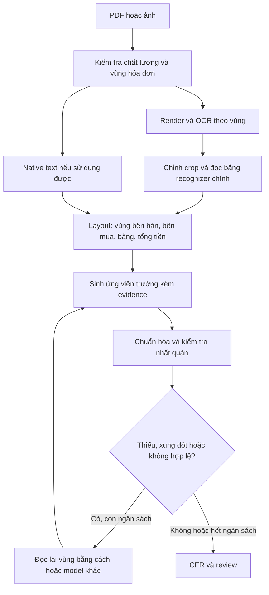

# Kế hoạch nâng cấp OCR và extraction V2

Ngày lập: 14/10/2026. Cập nhật: bắt đầu triển khai trong **PLAN_06**, không chuyển sang PLAN_07. Trạng thái: **IN_PROGRESS — baseline và nhánh thử nghiệm**, chưa promote model/cấu hình OCR mặc định.

Theo xác nhận của người dùng, người code có thể tự đối chiếu trên UI để nghiệm thu kỹ thuật. Các nhãn/kết quả này ghi `SELF_CHECK_NOT_INDEPENDENT`; không yêu cầu một reviewer khác để tiếp tục sửa code hoặc thử nghiệm. Gate thống kê về khả năng tổng quát vẫn cần thiết kế mẫu/nhãn phù hợp, chưa được coi PASS từ việc tự test UI. Tiến độ và bằng chứng: [runbook V2 trong PLAN_06](evidence/ocr_extraction_v2/runbook.md).

Mục tiêu: giảm trường trống và trường điền sai trên hóa đơn có bố cục mới; mọi giá trị phải truy được về chứng từ. Đây là nhánh củng cố PLAN_02–06, thực hiện trước khi mở rộng compliance ở PLAN_07. Không thay thế các invariant trong NEW_PLAN.

## 1. Vì sao cần nâng cấp cả pipeline

Hiện tại dùng PP-OCRv6 để phát hiện chữ, VietOCR vgg_transformer để đọc chữ. Đây chưa phải pipeline dùng recognizer PP-OCRv6.

Các điểm đã kiểm tra trong mã nguồn:

- Adapter cắt hình chữ nhật bao quanh polygon, chưa chỉnh phối cảnh từng dòng, chưa có padding/tách dòng dài một cách rõ ràng.
- Cấu hình VietOCR đặt chiều cao 32, chiều rộng tối đa 512; hàm resize giới hạn chiều rộng trước khi resize. Dòng quá dài có thể bị nén ngang. Đây là giả thuyết cần đo trên crop thực tế, chưa phải kết luận cho mọi lỗi tên.
- Beam search bị tắt cố định; cần đưa vào cấu hình để thử nghiệm, không mặc định bật sẽ tốt hơn.
- Điểm detection không thể được coi là độ tin cậy nhận dạng chữ hay độ đúng của trường.
- Extraction còn dựa nhiều vào alias, dòng cùng hàng, khoảng cách và ngữ cảnh bên bán/bên mua. Chữ đọc đúng vẫn có thể không được gán vào trường.

Bộ pilot hiện tại: 8 trang từ nguồn công khai, 1 trang tài liệu đào tạo báo riêng; ảnh OCR là bản raster của 3 PDF, chưa đại diện ảnh chụp thực tế. Nhãn do agent đối chiếu, chưa có người độc lập xác nhận. Địa chỉ và toàn bộ ô bảng chưa được chấm đầy đủ. Xem [báo cáo gốc](evidence/real_invoice_pilot_v1/REPORT.md).

Vì vậy cần đo riêng: phát hiện chữ → đọc chữ → hiểu vùng/bảng → gán trường → chuẩn hóa → quyết định cần review. Không lấy tỷ lệ ô được điền làm accuracy.

## 2. Kiến trúc đề xuất

Không OCR lại toàn bộ PDF khi chỉ một vùng có vấn đề. Native và OCR giữ nguồn riêng; khác nhau phải lưu xung đột. VLM là một nguồn ứng viên bổ sung, không được tự ghi đè kết quả đã được reviewer xác nhận.

## 3. Lộ trình theo bằng chứng và đường găng dữ liệu

V2-0 luôn làm trước. V2-1/2/3 là tên các gói công việc, không phải thứ tự cố định: cuối V2-0 phải quyết định chọn, hoãn hoặc bỏ từng nhánh theo inventory/oracle. Không triển khai một kỹ thuật chỉ vì có trong danh sách. Các ước lượng dưới đây là ngày công kỹ thuật cơ sở, chưa gồm dữ liệu và buffer.

| Mốc | Công việc | Ngày công | Điều kiện chuyển mốc |
|---|---|---:|---|
| V2-0 | Khóa split, chẩn đoán, baseline và quyết định nhánh | 1–2 | Có decision record, chủ dữ liệu và kế hoạch nhãn |
| V2-1 | Sửa render, detector/crop và dòng dài | 2–4 | Cải thiện trên dev, không phá geometry/evidence |
| V2-2 | Kiểm tra charset (0,5 ngày), so sánh recognizer | 2,5–3,5 | Charset và runtime đạt trước benchmark |
| V2-3 | Layout và extraction theo vùng/ngữ nghĩa | 4–6 | Bố cục mới được kiểm tra, không chỉ thêm alias |
| V2-4 | Recovery có giới hạn và VLM thử nghiệm | 3–5 | Đo được số trường cứu đúng và lỗi phát sinh |
| V2-5 | Calibration, UI, shadow và nghiệm thu | 2–3 | Báo cáo holdout, hồi quy, rollback đủ |
| Nhánh tùy chọn | Fine-tune thành phần còn yếu | 5–10 | Có nhãn đủ chất lượng và lỗi phù hợp để train |

Nếu chọn toàn bộ nhánh chính: 14,5–23,5 ngày công cơ sở; cộng buffer 30–50% thành khoảng 19–36 ngày công kỹ thuật. V2-3 và spike môi trường VLM ở V2-4 có rủi ro cao; buffer không phải phần thời gian có thể bỏ khi chốt lịch. Nếu oracle cho thấy lỗi bind chiếm ưu thế, lát cắt đầu là V2-0 + phần phù hợp của V2-3, chưa cần đổi recognizer.

Lịch thực tế phụ thuộc cả nhánh dữ liệu. Không cộng cơ học các ngày công chạy đồng thời thành deadline. Chốt lại lịch sau đo năng suất gán nhãn và khả năng phần cứng ở V2-0; nếu một người làm cả kỹ thuật và dữ liệu phải cộng phần công tương ứng.

### V2-0 — Biết chính xác đang hỏng ở đâu

0. Trước khi sửa runtime, tạo manifest nhóm dev/calibration/test, hash tài liệu, nguồn, template family và trạng thái đã từng được dùng tuning. **Toàn bộ pilot cũ đã dùng sửa code là dev/regression**, không thể khóa lại 2–3 trang rồi gọi là holdout độc lập. Thu thêm tối thiểu 2–3 họ bố cục chưa dùng phát triển (ít nhất một chứng từ mỗi họ) làm smoke holdout khóa sớm; đây vẫn chưa đủ để nghiệm thu thống kê. Chưa thu được thì chỉ tiến hành dev và ghi gate độc lập PENDING, không giả vờ đã có holdout.
1. Đóng băng phiên bản model, package, cấu hình, extractor, SHA-256 đầu vào và kết quả baseline. Không ghi đè các phase lịch sử.
2. Xuất ảnh gốc, detection overlay, từng crop, text từng block, vùng layout, ứng viên và quyết định chọn/loại.
3. Gắn chẩn đoán riêng, không tùy tiện mở rộng enum status công khai:
   - `TEXT_NOT_DETECTED`: vùng có chữ nhưng không có box.
   - `TEXT_MISREAD`: có box nhưng đọc sai.
   - `CROP_TRUNCATED`: mất đầu/cuối dòng hoặc crop gộp nhiều dòng.
   - `FIELD_UNBOUND`: đã có giá trị đúng trong blocks nhưng chưa gán trường.
   - `ROLE_CONFLICT`: không phân biệt được bên bán/bên mua hoặc hóa đơn hiện tại/hóa đơn tham chiếu.
   - `NORMALIZATION_FAILED`: có raw value nhưng không parse được.
   - `TABLE_STRUCTURE_FAILED`: lệch hàng/cột hoặc mất dòng tiếp nối.
   - `SOURCE_CONFLICT`: các nguồn cung cấp giá trị khác nhau.
   - `NOT_PRINTED` chỉ dùng khi nhãn đối chiếu xác nhận; runtime không được suy ra từ OCR trống.
4. Làm ba phép đo oracle: recognizer trên crop cắt tay; extractor trên text và tọa độ đã sửa; normalizer trên raw value đúng. Kết quả cho biết giới hạn của từng lớp.
5. Chọn 10–20 lỗi tiêu biểu, gồm cả trường đã điền nhưng sai; lập bảng expected/observed/cause/fix/evidence.
6. Đo cold start từ tiến trình mới đến kết quả, warm theo vòng đời worker thật (nếu adapter vẫn reload model thì ghi rõ), p50/p95, RAM đỉnh và tỷ lệ fallback/retry theo trang/job ngay trong baseline. Lưu máy, số lần chạy và timeout; không so latency của hai máy hoặc hai lifecycle khác nhau mà không ghi chú.
7. Đếm lỗi theo field và hóa đơn, gắn nguyên nhân chính + nguyên nhân phụ, ưu tiên WRONG_PRESENT của MST/totals trước số lượng lỗi. Báo oracle gain riêng cho read/bind/normalize; không cộng gain chồng lấn thành tổng cải thiện dự kiến.
8. Lập `decision_record.md`: số lỗi theo lớp, nhánh chọn/hoãn/bỏ, lý do, tác động kỳ vọng, ngân sách thí nghiệm, người phụ trách và gate tiếp theo. Nếu text đã đúng mà bind sai chiếm ưu thế, ưu tiên V2-3; nếu crop đúng mà read sai, chọn V2-2 hoặc spike fine-tune VietOCR; nếu detector/crop yếu mới chọn biến thể tương ứng của V2-1. VLM chỉ spike khi lỗi còn lại phù hợp và có ngân sách runtime.

Đầu ra dự kiến: `evidence/ocr_extraction_v2/baseline.json`, `error_inventory.csv`, `oracle_report.md`, `decision_record.md`, `data_workplan.md`; split manifest chi tiết để local nếu chứa thông tin nhạy cảm. Dữ liệu chứa thông tin chứng từ để local; báo cáo đưa Git dùng ID và tổng hợp. Chưa được coi V2-0 hoàn tất nếu thiếu quyết định nhánh hoặc chưa chỉ định người chịu trách nhiệm dữ liệu; có thể bàn giao phần baseline kỹ thuật trước.

### Bộ dữ liệu chạy xuyên suốt V2-0 đến V2-5

- Mục tiêu đầu: 100 hóa đơn độc lập, khoảng 10 họ bố cục nếu có nguồn hợp lệ; đây là bộ phát triển ban đầu, **không mặc định đủ cho gate**. Bộ test cuối phải đáp ứng mẫu số riêng tại mục 4, ngoài dev/calibration; tổng dữ liệu có thể vượt 200–300. Không dùng số ảnh augment để thay số hóa đơn thực.
- Bao phủ PDF text, PDF scan, ảnh chụp nghiêng/mờ/bóng; bên bán không nhãn, song ngữ, địa chỉ dài, điều chỉnh, số tiền 0, KCT/KKKNT, nhiều thuế suất, bảng không kẻ, nhiều trang.
- Thu thập nguồn/quyền sử dụng; tách bản công khai, đào tạo, chứng từ doanh nghiệp và dữ liệu tổng hợp. Không tự gửi hóa đơn lên dịch vụ ngoài.
- Nhãn gồm vùng, text, vai trò, toàn bộ trường đang hiển thị và ô bảng; có `không in`, `không đọc được`, `chưa xác nhận`. Không biến trường chưa gán nhãn thành lỗi model.
- Người đối chiếu xác nhận các trường trọng yếu và giải quyết bất đồng. Nếu chưa có người đối chiếu, ghi rõ kết quả là thử nghiệm kỹ thuật.
- Chia dev/calibration/test theo họ bố cục và nguồn; cùng hóa đơn, cùng template và bản raster/augment nằm cùng nhóm. Giữ test khóa kín, không chọn threshold/model dựa vào test.
- Khi số họ bố cục quá ít, dùng đánh giá bỏ ra từng nhóm và báo giới hạn; không công bố khả năng tổng quát từ pilot đã dùng để sửa code.

Chủ công việc dưới đây là vai trò cần leader giao tên cụ thể trong `data_workplan.md` ở V2-0, chưa phải những người đã nhận nhiệm vụ:

| Việc dữ liệu | Chủ chịu trách nhiệm | Mốc và ước lượng khởi đầu | Điều kiện bàn giao |
|---|---|---|---|
| Nguồn và quyền sử dụng | Data owner do leader chỉ định | D0–D2 lập danh sách nguồn; thời gian xin quyền ghi riêng | Nguồn/quyền rõ, không cần người triển khai đoán |
| Dedup, nhóm template, khóa split | Kỹ sư triển khai + data owner | 0,5–1 ngày công đầu | Manifest có hash, nhóm, contamination và người giữ test |
| Pilot nhãn để đo năng suất | Labeler + người kiểm tra độc lập | D1–D3; 10 hóa đơn, ghi phút/tài liệu và số dòng | Có hướng dẫn nhãn, bất đồng được giải quyết |
| 100 hóa đơn phát triển | Labeler; người kiểm tra xác nhận | Sơ bộ 20–40 phút/hóa đơn = 33–67 giờ; kiểm tra thêm 8–17 giờ | Khoảng 5–11 ngày công, cập nhật bằng năng suất pilot; bảng dài tính riêng |
| Test độc lập đạt mẫu số gate | Data owner + người giữ test | Lập kế hoạch số lượng sau D3; chưa có nguồn thì lịch nghiệm thu PENDING | Đủ mẫu theo field, template, phương thức đầu vào; nhãn được xác nhận |
| Phân xử nhãn | Reviewer nghiệp vụ, leader giải quyết trường hợp còn bất đồng | Hàng đợi kiểm tra ít nhất 2 lần/tuần khi chạy pilot | Người phân xử không chọn nhãn chỉ vì giống output model |

D0 là ngày bắt đầu triển khai V2. Cuối D3 phải cập nhật dự báo lịch kỹ thuật/dữ liệu, phần thiếu và người phụ trách; không giữ deadline 19–36 ngày nếu dữ liệu chưa có. Các con số công nhãn là giả định lập ngân sách, cần đo lại, không phải năng suất đã đạt.

### Nhánh XML ưu tiên khi có dữ liệu kèm theo

- Nếu có XML hóa đơn gốc cùng PDF, ưu tiên parser cấu trúc thay OCR cho các field XML biểu diễn được. Tách parser, schema/version mapping, validator và signature status; không cần triển khai toàn bộ PLAN_10 để thử tạo nhãn.
- XML parse được không đồng nghĩa dữ liệu đúng tuyệt đối: có thể ghép nhầm hóa đơn, sai mapping/phiên bản, sai dữ liệu đầu nguồn hoặc PDF thể hiện khác XML. Chữ ký hợp lệ cũng không chứng minh mọi nội dung nghiệp vụ đúng; kết quả kiểm tra pháp lý thuộc scope riêng.
- Ghép cặp bằng danh tính hóa đơn và hash/provenance; kiểm tra các trường trọng yếu và khác biệt PDF–XML. Chữ ký được ghi VERIFIED/INVALID/NOT_VERIFIED theo khả năng thực tế, không mặc định verified.
- Cặp đã đối chiếu cung cấp **nhãn gợi ý** cho field/ô bảng, không tự cung cấp polygon/text-line label. Các trường chỉ có trong XML nhưng không in trên PDF không được dùng để phạt OCR hoặc điền như evidence nhìn thấy trên PDF.
- Sampling kiểm tra nhãn gợi ý: 20 cặp đầu kiểm tra toàn bộ; sau đó ít nhất 10% mỗi nguồn/phiên bản và toàn bộ cặp xung đột. Đây là kiểm soát tạo nhãn, không thay mẫu số gate độc lập.
- Nhánh này không có tuyên bố về hiệu lực NĐ/TT tại ngày hiện tại; khi triển khai parser/validator phải đối chiếu đặc tả và quy định áp dụng theo ngày chứng từ. Quyền sử dụng dữ liệu và quyền gửi dịch vụ ngoài vẫn giữ nguyên.

### V2-1 — Cải thiện ảnh và vùng chữ trước khi thay model

1. Giữ native text sử dụng được; phát hiện lớp chữ hỏng, thứ tự sai và vùng có chữ không được native phủ.
2. Thử render 150/200/300 DPI trên dev; đo chữ nhỏ, RAM và thời gian. 300 DPI A4 khoảng 8,7 triệu pixel: phải kiểm tra lại giới hạn render/pixel/RAM, không chỉ tăng DPI.
3. Thử chỉnh nghiêng, xoay và phối cảnh khi có dấu hiệu cần thiết. Ảnh đã tốt giữ nguyên. Lưu transform để đưa evidence về tọa độ trang gốc.
4. Thử crop polygon được chỉnh thẳng, padding có giới hạn và kiểm tra không cắt dấu tiếng Việt.
5. Dòng dài: phát hiện khi tỷ lệ khung hình sẽ vượt giới hạn resize; thử tách theo khoảng trắng và cửa sổ chồng lấn. Giữ mapping từng đoạn, ghép chống trùng, không tách MST/số tiền giữa chuỗi.
6. Thử giới hạn chiều rộng lớn hơn trong nhánh thử nghiệm; đo accuracy, RAM và tương thích model. Không coi tăng width là cách sửa chắc chắn.
7. Tuning detector theo vùng chữ nhỏ/bảng; thử tiling có overlap và khử box trùng. Giới hạn số tile và thời gian.
8. Không mặc định xóa đường kẻ, watermark hoặc super-resolution: chỉ thêm khi ablation chứng minh có lợi và không mất dấu/ký tự.

Gate: tọa độ sau xoay/crop map đúng; không mất đầu/cuối dòng; hồi quy hóa đơn rõ nét không xấu đi. Báo cáo số trường cứu đúng, số trường mới sai và tài nguyên cho mỗi biến thể.

Ngân sách ablation ban đầu: tối đa 6 cấu hình đơn biến và 1 cấu hình kết hợp các thay đổi thắng, tối đa 2 ngày công chạy/phân tích trong ngân sách V2-1. Mỗi thử nghiệm có giả thuyết và nhóm lỗi đích; giữ model, dữ liệu và phần còn lại cố định. Chỉ mở thêm bằng decision record sau khi có kết quả.

Ngưỡng giữ biến thể trên dev: sửa ròng ít nhất 2 lỗi field và giảm ít nhất 10% lỗi trong nhóm đích, không tạo WRONG_PRESENT trọng yếu mới; p95 không tăng quá 25% trừ khi đã chọn rõ trade-off cho fallback có giới hạn. Nếu nhóm đích dưới 10 lỗi, coi là bằng chứng khám phá, chưa bật mặc định. Hai thử nghiệm liên tiếp không đạt thì dừng nhóm kỹ thuật đó. Các ngưỡng này kiểm soát công phát triển, không phải kiểm định hiệu quả ngoài dev.

### V2-2 — Chọn bộ đọc chữ bằng thực nghiệm

Preflight bắt buộc khoảng 0,5 ngày: pin model/revision và kiểm tra dictionary/tokenizer **thực sự đi kèm weights** có biểu diễn đủ chữ Việt hoa/thường, dấu, `đ/Đ`, chữ số và ký tự invoice. Thử cả NFC/NFD, chuỗi có dấu và line crop thực; lưu tập ký tự thiếu, chuỗi lỗi và hash dictionary. Nhãn `lang=vi` trong tài liệu không đủ để pass. Có [issue báo thiếu dấu ở dictionary PP-OCRv6](https://github.com/PaddlePaddle/PaddleOCR/issues/18254); đây là báo cáo cần xác minh theo artifact, không kết luận mọi bản hiện tại đều lỗi. Nếu không pass, hoãn candidate; không tự thêm dictionary vào weights vì có thể lệch output head. So chi phí spike fine-tune VietOCR với thay model trước quyết định.

Chạy trên cùng crop, cùng nhãn và tách cả kết quả crop cắt tay/crop tự động:

| Ứng viên | Vai trò trong thí nghiệm |
|---|---|
| VietOCR hiện tại | Baseline bắt buộc |
| VietOCR + crop mới | Tách hiệu quả xử lý ảnh khỏi hiệu quả thay model |
| PP-OCRv6_medium_rec | Đối chứng recognizer; hiện hệ thống mới dùng detector v6 |
| Recognizer thứ hai theo trường | Chỉ giữ nếu có lợi trên tên/MST/số tiền và đáp ứng tài nguyên |

Thử beam search riêng nếu hỗ trợ; không trộn đồng thời nhiều thay đổi rồi quy công cho model. Đo CER, đúng toàn dòng, đúng MST, đúng chuỗi tiền, dấu tiếng Việt, tên dài, p50/p95 và RAM. Điểm từ hai model không so sánh trực tiếp khi chưa calibration.

Chọn một recognizer chính; recognizer thứ hai chỉ gọi khi trigger có bằng chứng. Hai model cùng đọc sai vẫn có thể đồng thuận, nên agreement không phải chứng minh đúng.

### V2-3 — Nâng cấp extraction khi chữ đã đọc được

1. Phân vùng hóa đơn trong trang, loại header/footer của tài liệu chứa hóa đơn; nhận biết nhiều hóa đơn trước khi gán trường.
2. Thử PP-StructureV3 cho layout/bảng sau adapter độc lập. Model layout tổng quát không tự phân biệt chính xác seller/buyer: cần lớp gán vai trò riêng.
3. Xây graph block theo cùng hàng/cột, dưới nhãn, thuộc vùng và tiếp nối dòng; không ghép toàn trang thành một chuỗi.
4. Sinh ứng viên từ nhãn tương đương, kiểu dữ liệu và vai trò vùng. Nhãn generic `MST`, `Địa chỉ` được ràng buộc theo vùng thay vì chọn số gần nhất toàn trang.
5. Hỗ trợ value dưới nhãn, tên không có nhãn, nhãn bị OCR lỗi nhẹ, bố cục hai cột. Fuzzy match dùng để tìm nhãn; không tự sửa MST hoặc tên doanh nghiệp thành giá trị đoán.
6. Thêm extractor ngữ nghĩa như adapter thử nghiệm: nhận blocks có ID + layout, trả JSON schema với field/value/evidence IDs/abstain. Có thể dùng VLM ở V2-4 khi regex/spatial không đủ; chưa cần train KIE nếu chưa có nhãn.
7. Bảng: tách dòng hàng và dòng tổng, ô gộp, mô tả nhiều dòng, header lặp và trang tiếp nối; giữ item_id ổn định theo hợp đồng hiện có.
8. Phân biệt số/ngày hóa đơn hiện tại với hóa đơn được tham chiếu trong điều chỉnh. Không dùng ngày tra cứu/chữ ký làm ngày lập.
9. Chuẩn hóa Decimal, ngày, MST đơn vị phụ thuộc, 0%, KCT, KKKNT theo schema hiện có; trạng thái thuế đặc biệt không ép thành rate số.
10. Kiểm tra net/VAT/gross và dòng hàng theo quy tắc làm tròn khai báo. Phép tính phát hiện bất thường, không điền số không được in như thể đã OCR thấy.

Validator Việt Nam là trigger/review flag, không phải phép sửa giá trị: định dạng MST; checksum chỉ bật sau khi có nguồn chính thức, phạm vi loại định danh/ngày áp dụng và test vector đã kiểm tra. Chưa xác minh được checksum thì đánh dấu NOT_IMPLEMENTED, không áp dụng công thức truyền miệng và không coi chuỗi đúng checksum là MST đang tồn tại. Định dạng ký hiệu/mẫu số phải version theo thời điểm/loại hóa đơn; không dùng một regex cho mọi năm. Kiểm tra net + VAT = gross phải xét chiết khấu/phí và sai số làm tròn được khai báo; không ép mọi hóa đơn vào công thức đơn giản.

Gate: kiểm tra bằng text đã sửa để đo extraction riêng; có regression cho đảo vai trò, số tham chiếu, bố cục khác và thiếu thật. Mỗi giá trị chọn được có evidence; trường không đủ căn cứ vẫn cần review.

### V2-4 — Đọc lại có mục tiêu và VLM

Trigger: không có ứng viên cho trường được kỳ vọng, parse thất bại, hai nguồn xung đột, crop có dấu hiệu bị cắt hoặc tổng tiền bất nhất. Không trigger chỉ vì trường tùy chọn trống.

Thứ tự recovery:

1. Mở rộng crop hoặc render lại vùng ở độ phân giải phù hợp.
2. Chạy recognizer thứ hai trên cùng vùng; giữ cả hai observation.
3. Với vùng bố cục khó, thử PaddleOCR-VL-1.6 cho spotting/table/document parsing theo khả năng adapter. Chỉ đưa vào production sau thử tương thích phần cứng/runtime và benchmark nội bộ.
4. Lớp gán trường ngữ nghĩa phải tham chiếu blocks/boxes hợp lệ. Nếu VLM trả text nhưng không có vị trí, chưa coi là evidence hoàn chỉnh; grounding riêng hoặc giữ ứng viên để người kiểm tra.
5. Không suy tên/MST từ kiến thức model hoặc tự chọn giá trị làm tổng khớp. Không coi self-confidence của VLM là xác suất đúng.
6. Đặt giới hạn theo trang/job: số lần retry, vùng, pixel, timeout, RAM/token và phiên bản cấu hình. Giá trị ban đầu thí nghiệm: tối đa 2 vòng recovery, 1 lượt VLM/vùng; phải điều chỉnh sau đo latency.
7. Hết ngân sách thì trả kết quả một phần cùng lý do cần review; lỗi model phụ không làm mất kết quả chính.

VLM thử trong environment riêng, khóa model/package/hash; không nâng cấp đồng loạt môi trường VietOCR đang chạy. CPU là nhánh tối thiểu; GPU/WSL/server là nhánh thử nếu có và tương thích. Cloud là lựa chọn sau khi xác định quyền gửi dữ liệu, chi phí và dịch vụ phù hợp; chưa bật trong kế hoạch triển khai mặc định.

Đầu ra: bảng rescue đúng/sai/không thay đổi, nguồn bằng chứng, thời gian tăng thêm. Chỉ bật từng trigger có lợi trên calibration; test dùng đánh giá cuối.

### V2-5 — Đưa vào ứng dụng và nghiệm thu

1. Registry tách detector/recognizer/layout/semantic extractor/recovery policy; model plug-in dùng input/output đã chuẩn hóa, không để UI phụ thuộc tên model.
2. Observation có source, model version, config hash, raw text, geometry, transform và điểm có loại rõ ràng. Trường score không có để null; không lấy detection score làm OCR confidence.
3. Lưu provenance của mọi ứng viên và lý do chọn/loại. Migrate schema nếu cần, giữ đọc được CFR cũ; không sửa reviewer correction đã xác nhận.
4. UI hiển thị lý do thiếu/xung đột bằng tiếng Việt và vùng nguồn tương ứng; cho đọc lại vùng cụ thể. Hiển thị riêng ứng viên với giá trị đã xác nhận.
5. Khi sửa MST/vai trò/tổng tiền, re-derive và chạy lại quality theo hợp đồng hiện tại; không dùng dữ liệu dẫn xuất cũ.
6. Chạy shadow V1/V2 trên cùng input; người dùng vẫn dùng V1 cho đến khi gate được thông qua. Chỉ promote bằng cấu hình, có rollback về V1.
7. Kiểm tra timeout, crash, file nhiều trang, resume, hủy job, bằng chứng sai trang, truy cập khác tenant và browser flow upload→OCR→review→export.

Shadow tạo hàng đợi nhãn cho mọi bất đồng V1/V2, gồm giá trị, trạng thái, vai trò và dòng hàng. Reviewer nghiệp vụ do leader chỉ định phân xử dựa trên chứng từ; agent/kỹ sư chuẩn bị evidence. Trong pilot tối thiểu 50 hóa đơn độc lập hoặc toàn bộ số hiện có nếu ít hơn (khi đó chưa đạt mốc), kiểm tra toàn bộ bất đồng field trọng yếu, toàn bộ trường hợp V2 chuyển thành PRESENT và ít nhất 20 hóa đơn được chọn ngẫu nhiên bất kể hai bản có đồng thuận. Không chỉ chấm các case bất đồng: hai model có thể cùng sai. Hàng đợi này là tập phân tích có thiên lệch, không thay test đại diện. Dữ liệu test bị đưa vào vòng sửa code trở thành regression; vòng nghiệm thu sau phải dùng test mới.

## 4. Cách đo và gate chất lượng

Các ngưỡng dưới đây là mục tiêu đề xuất, không phải kết quả đã đạt hoặc cam kết 100%.

### 4.1. Quy ước đo phải khóa trước thử nghiệm

- Chuẩn hóa Unicode **NFC** cho prediction và label trước CER/exact match. Giữ dấu tiếng Việt, không lowercase hoặc bỏ dấu để làm đẹp điểm. Raw text không bị ghi đè. CER tính theo code point sau NFC; báo rõ nếu thêm metric grapheme riêng.
- Field exact match dùng quy tắc chuẩn hóa đã version theo loại: MST là chuỗi giữ số 0 đầu; tiền dùng Decimal; ngày ISO; tên/địa chỉ chỉ chuẩn hóa khoảng trắng được khai báo. Báo cả raw transcription match và canonical field match, không trộn.
- Mẫu số accuracy gồm mọi field được in, đọc được và có nhãn đã xác nhận trong scope; WRONG/MISSING/AMBIGUOUS đều chưa đúng. Nhãn chưa xác nhận/không đọc được báo riêng và không bị lặng lẽ loại khỏi scope ảnh khó.
- Wrong-present đo trong số field được hệ thống chọn PRESENT có nhãn xác nhận. Báo thêm số WRONG_PRESENT / toàn bộ field kỳ vọng và coverage PRESENT để không giảm rủi ro bằng cách bỏ trống hết. Giá trị do reviewer sửa không tính là độ đúng của model.
- Chấm mỗi field path riêng: seller.tax_id và buyer.tax_id, net/VAT/gross, số/ký hiệu/ngày, tên/địa chỉ từng bên. Không cộng 3 tổng tiền trên một hóa đơn thành 3 phép thử độc lập cho cùng một tuyên bố rủi ro.

| Chỉ số | Cách dùng |
|---|---|
| Detection recall/CER/đúng toàn dòng | Chẩn đoán OCR, không thay thế field accuracy |
| Field exact match | Chấm riêng MST, số/ký hiệu, ngày, tên, địa chỉ, totals |
| Cell/row exact match | Chấm từng ô và cấu trúc bảng, không chỉ đếm số hàng |
| Document exact match | Toàn bộ trường bắt buộc của một hóa đơn đúng |
| Fill rate | Báo riêng; điền sai không được tính thành công |
| Wrong-present rate | Số trường sai nhưng được chọn PRESENT / số trường PRESENT đã chấm |
| Recovery precision | Số lần recovery sửa đúng / số lần recovery làm thay đổi trường |
| Review rate và thời gian sửa | Đo công sức người dùng, cùng phạm vi và chính sách |
| p50/p95, RAM, fallback rate | Đo end-to-end trên máy thực, tách cold/warm |

### 4.2. Cỡ mẫu và ý nghĩa thống kê

Với 0 lỗi trong n phép thử Bernoulli độc lập, chặn trên lỗi một phía 95% là `U = 1 - 0.05^(1/n)`, gần `3/n`. Vì vậy 150 mẫu không lỗi cho U khoảng 1,98%; 60 mẫu không lỗi khoảng 4,87%; 600 mẫu không lỗi khoảng 0,498%. Có lỗi thì tính giới hạn nhị thức chính xác một phía, không tiếp tục dùng 3/n. [NIST: giới hạn tin cậy nhị thức chính xác](https://www.itl.nist.gov/div898/software/dataplot/refman2/auxillar/exacbici.htm).

Đây là giới hạn **theo từng field**, không phải bảo đảm đồng thời cho mọi field. Nếu cần tuyên bố đồng thời phải khóa cách điều chỉnh multiple comparisons và tính lại cỡ mẫu trước test. Các field cùng invoice, template/nguồn lặp có tương quan; số đếm thô không tự đáp ứng giả định độc lập. Báo số invoice, nguồn, template và strata; dùng bootstrap theo cụm để mô tả bất định khi phù hợp, nhưng không dùng bootstrap 0 lỗi để tuyên bố rủi ro bằng 0. Nếu thiết kế mẫu không hỗ trợ suy luận, chỉ báo kết quả quan sát và ghi statistical gate PENDING.

### 4.3. Các tầng gate theo ưu tiên

| Gate | Điều kiện | Mẫu số tối thiểu và cách kết luận |
|---|---|---|
| Kỹ thuật | Regression/geometry/evidence pass; không mất reviewer correction; có cold/warm/fallback baseline | Toàn bộ regression phù hợp; không suy ra accuracy thị trường |
| Dev | Mục tiêu giảm ≥30% lỗi field cùng mẫu; không tăng WRONG_PRESENT trọng yếu | Báo số lỗi trước/sau và từng case; chỉ tiêu phát triển, không có ý nghĩa nghiệm thu độc lập |
| Smoke holdout | Kiểm tra sớm bố cục chưa dùng sửa code | Tối thiểu 2–3 họ bố cục mới; báo đúng/sai từng case, không gọi là pass gate 98% |
| Pilot field trọng yếu | Exact match quan sát ≥98% theo từng MST, số/ký hiệu/ngày và net/VAT/gross | ≥150 invoice độc lập có field đã xác nhận cho mỗi path; chỉ xác nhận lỗi <2% ở mức 95% khi U<2%, không chỉ dựa point estimate |
| Pilot tên/địa chỉ | Exact match quan sát ≥95% theo từng path | ≥60 invoice độc lập/path; muốn xác nhận lỗi <5% cần U<5%; có lỗi có thể cần thêm mẫu |
| Wrong-present trọng yếu — ưu tiên cao nhất | **0 lỗi quan sát** ở seller/buyer MST và net/VAT/gross; dừng promote nếu có lỗi | Pilot chưa đủ mẫu chỉ là phát hiện lỗi. Muốn xác nhận rủi ro <0,5% theo path ở mức 95%: ≥600 PRESENT độc lập/path và U<0,5%; chưa đủ ghi PENDING |
| Release vận hành | Scope test đủ strata, latency/RAM theo ngân sách chốt V2-0, review flow/rollback pass | Không tuyên bố release chất lượng khi gate rủi ro hoặc nhãn độc lập còn thiếu |

Một lỗi WRONG_PRESENT trọng yếu buộc triage và sửa/thu hẹp scope trước khi promote, dù exact match trung bình cao. Sau khi sửa bằng test lỗi, test đó chuyển thành regression, không dùng lại để chứng minh độc lập. Chốt kích thước test và quy tắc pass trước khi chạy; không kiểm tra lặp rồi dừng ngay khi khoảng tin cậy đẹp. Nếu cần đánh giá tuần tự phải thiết kế riêng.

100 hóa đơn tổng, chia thêm dev/calibration/test, không đủ các mẫu số trên. Ví dụ nếu chỉ 70% field được chọn PRESENT, cần hơn 600 invoice để có 600 PRESENT cho path đó; không lấy trường khác bù. Data owner phải ước lượng lại nguồn/số lượng ở D3. Nếu chưa đủ, có thể tiếp tục pilot **review bắt buộc** với kết quả quan sát, chưa xác nhận statistical/release gate và chưa đổi mặc định theo quy trình promote của kế hoạch.

Trong tất cả trường hợp MVP vẫn review bắt buộc. Calibration tương lai phải đo coverage–risk theo field; các gate này không cấp quyền auto-accept. Latency chốt sau V2-0 trên phần cứng thực, tách cold/warm, timeout và tỷ lệ fallback; không đặt SLA VLM trước benchmark.

## 5. Khi nào mới fine-tune

Chỉ mở nhánh train nếu crop đã đúng mà recognizer vẫn sai có hệ thống, hoặc layout/bảng sai có nhãn vùng phù hợp. Không train recognizer để sửa lỗi gán seller/buyer.

1. Ưu tiên thu thập line crop khó: dấu tiếng Việt, tên dài, MST, ký hiệu, chữ nhỏ và watermark. Mốc chuẩn bị 3.000–10.000 crop có nhãn là ngân sách khởi đầu, không bảo đảm đủ.
2. Không đưa hóa đơn cùng template/nguồn hoặc augment của holdout vào train. Lưu manifest split và label provenance.
3. Train recognizer và detector/layout là các thí nghiệm riêng; dữ liệu detector cần polygon, dữ liệu nhận dạng cần text crop, KIE cần field/role.
4. Đo đường cong theo lượng dữ liệu. Chỉ thay model khi thắng baseline trên holdout chưa dùng tuning và đáp ứng runtime.
5. Reviewer correction là dữ liệu chờ xét duyệt, không tự động đưa vào train. Lưu model card và rollback weights cũ.

## 6. Thứ tự bắt đầu cụ thể

1. Giao data owner/labeler/reviewer/người giữ test, khóa contamination manifest và thu smoke holdout mới; pilot cũ chỉ dùng dev/regression.
2. Tạo baseline, cold/warm/fallback, error inventory và oracle; ưu tiên WRONG_PRESENT MST/totals và trường có text nhưng chưa bind.
3. Ký decision record chọn/hoãn/bỏ V2-1/2/3; chọn ablation theo lớp lỗi, kiểm tra charset trước mọi thay recognizer. Chưa đủ dữ liệu vẫn có thể thử dev, không báo độc lập đã đạt.
4. Thực hiện nhánh ưu tiên với ngân sách và stop rule; thử VLM chỉ khi lỗi và phần cứng phù hợp. Khai thác XML kèm PDF khi có nguồn đủ điều kiện.
5. Mở rộng nhãn theo mẫu số gate, calibration, shadow có người phân xử và test độc lập trước promote mặc định; rollback giữ sẵn.

Không cần chờ đủ 100 hóa đơn để bắt đầu bước kỹ thuật 1–3. Cần nhãn độc lập trước khi tuyên bố chất lượng ngoài pilot.

## 7. Tài liệu tham khảo đã kiểm tra

- [PP-OCRv6 — tài liệu chính thức](https://github.com/PaddlePaddle/PaddleOCR/blob/main/docs/version3.x/algorithm/PP-OCRv6/PP-OCRv6.md): detector/recognizer là hai thành phần có thể đánh giá riêng. Benchmark nhà phát triển không phải kết quả hóa đơn của dự án.
- [VietOCR — xử lý ảnh trong mã nguồn tác giả](https://github.com/pbcquoc/vietocr/blob/master/vietocr/tool/translate.py): resize theo chiều cao và giới hạn chiều rộng. Đây là căn cứ cho thí nghiệm crop dài; hiệu quả phải đo tại dự án.
- [PP-StructureV3 — hướng dẫn chính thức](https://github.com/PaddlePaddle/PaddleOCR/blob/main/docs/version3.x/pipeline_usage/PP-StructureV3.en.md): layout, bảng và thứ tự đọc; cần adapter và lớp hiểu vai trò invoice riêng.
- [PaddleOCR-VL-1.6 — model card chính thức](https://huggingface.co/PaddlePaddle/PaddleOCR-VL-1.6): ứng viên parsing/spotting/table. Không coi chất lượng benchmark tổng quát là bảo đảm trên hóa đơn Việt Nam.
- [Document preprocessing — tài liệu chính thức](https://www.paddleocr.ai/main/en/version3.x/pipeline_usage/doc_preprocessor.html): định hướng thử xoay/chỉnh trang có điều kiện.
- [Issue PP-OCRv6 #18254](https://github.com/PaddlePaddle/PaddleOCR/issues/18254): báo cáo cộng đồng trong kho chính thức về dấu tiếng Việt; cần tái kiểm tra artifact/revision, không coi issue là kết luận mọi model hiện tại.
- [NIST — exact binomial confidence limits](https://www.itl.nist.gov/div898/software/dataplot/refman2/auxillar/exacbici.htm): cơ sở dùng giới hạn tin cậy thay vì chỉ tỷ lệ quan sát; cỡ mẫu vẫn phụ thuộc thiết kế lấy mẫu và tính độc lập.

Các URL theo nhánh main có thể thay đổi. Khi triển khai phải pin revision/model hash và ghi snapshot nguồn vào evidence thí nghiệm.
