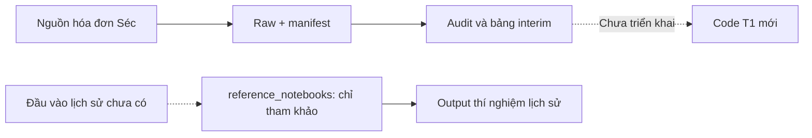

# Tổng quan dự án

Cập nhật: 2026-10-19. Đây là nơi ghi phạm vi và trạng thái hiện tại của checkout; kết quả thí nghiệm có bằng chứng riêng trong báo cáo.

## Bài toán và phạm vi

Đích sản phẩm là giúp SME Việt Nam bán chịu B2B dự báo dòng tiền 13 tuần, phát hiện nguy cơ thiếu tiền và ưu tiên thu nợ. [Bản đồ nhiệm vụ T0–T13](explanation/user-needs-and-tasks.md) mô tả phạm vi thiết kế đầy đủ.

Bộ notebook thử nghiệm trước đây về **thời điểm trả và cash-in từ hóa đơn phải thu đang mở** được giữ tại `reference_notebooks/`, chỉ để tham khảo phương pháp, code và kết quả lịch sử. Bộ này có baseline, LightGBM phân vị, conformal calibration, Monte Carlo, survival và các thử nghiệm ưu tiên thu nợ, stress, dashboard. Code T1 mới sẽ được xây riêng; hiện chưa có trong checkout. Có notebook hoặc thiết kế chưa đồng nghĩa chức năng đã được kiểm định trong doanh nghiệp.

## Thành phần hiện có

| Thành phần | Trạng thái và nguồn chi tiết |
|---|---|
| Mã tham khảo | Notebook 01–12 và helper Python tại `reference_notebooks/`; [mục lục](../reference_notebooks/README.md) xác định thứ tự cũ và nguồn `.py` của 11/12. Output lưu sẵn là kết quả lịch sử. |
| Code T1 mới | Chưa triển khai; sẽ xây riêng, không mặc định kế thừa pipeline notebook tham khảo. |
| Nguồn T1 | Đã tải và audit hai nguồn hóa đơn Séc; giữ thêm mẫu BPI/DC. [Hướng dẫn dữ liệu T1](../data/T1/README.md) giải thích nội dung, mục đích và giới hạn. |
| Đầu vào huấn luyện | `data/dataset.csv`, các bảng `data/processed/` và model mà notebook lịch sử yêu cầu chưa có. Chưa có adapter đưa dữ liệu Séc vào pipeline này. |
| Kiến trúc mở rộng | T0–T13 và hệ thống bốn agent nằm trong [tài liệu thiết kế](README.md); không mặc định đã có code triển khai ở checkout. |
| Kiểm tra repository | Có checker tài liệu và test của checker; [Contributing](CONTRIBUTING.md) hướng dẫn chạy. Đây không phải kiểm thử chất lượng mô hình. |

## Giới hạn cần giữ khi phát triển

- Dữ liệu Séc là hóa đơn nhà cung cấp được tổ chức công thanh toán; cần kiểm định chuyển miền sang SME B2B Việt Nam. Không có bộ dữ liệu đầy đủ cho mọi task T2–T8.
- Thiếu ngày trả không tự chứng minh hóa đơn chưa trả; ngày ghi thanh toán không tự chứng minh ngày tiền khả dụng tại ngân hàng. Phải xác định nhãn và phạm vi quan sát trước khi train.
- Feature phải là thông tin biết được tại cutoff. Dữ liệu công bố sau thanh toán không mặc định dùng được để dự báo từ API công khai trước thanh toán. Quy ước cụ thể cho T1 nằm tại [hợp đồng dữ liệu T1](reference/t1-data-contracts.md); trang đó không định nghĩa hợp đồng cho toàn bộ T0–T13.
- Chưa có môi trường dependency được khóa phiên bản hoặc kết quả chạy lại toàn pipeline trên nguồn Séc. Chưa đủ bằng chứng để kết luận triển khai production hoặc đạt SOTA.

Khi phạm vi, khả năng chạy hoặc trạng thái tích hợp thay đổi, sửa trang này; hướng dẫn chi tiết và số liệu vẫn nằm ở tài liệu chuyên trách.
