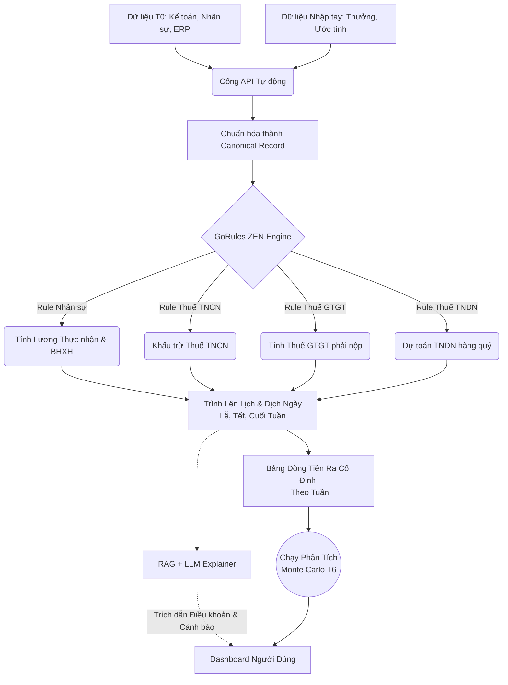

# Thiết kế Phân hệ T5: Chi cố định và Lịch nghĩa vụ


## 1. Mục tiêu


Dự báo chính xác các khoản chi **cố định** và **nghĩa vụ theo lịch** (lương, thuế, bảo hiểm) trong tương lai phục vụ cho Phân hệ T6 (Phân tích Monte Carlo), giúp xác định các điểm nghẽn thanh khoản (tuần nào tiền mặt xuống dưới mức an toàn).


## 2. Phương pháp & Kiến trúc lõi


* **Bộ máy quy tắc (Rule-based Engine) + Lịch tất định:** Không sử dụng học máy (Machine Learning) hay LLM để tính toán con số.
* **Lý do:** Các khoản nghĩa vụ tài chính và thuế có thể tính toán chính xác 100% từ văn bản pháp luật và hợp đồng lao động. Quy trình này đảm bảo tính minh bạch, hoàn toàn kiểm toán được (auditable) và loại bỏ rủi ro "ảo giác" (hallucination) của AI.
* **Tích hợp LLM:** Chỉ sử dụng LLM kết hợp RAG để giải thích cơ sở pháp lý và cảnh báo rủi ro khi người dùng truy vấn.


---


## 3. Các khoản chi xử lý & Kỳ hạn chuẩn


| Khoản chi | Nguồn dữ liệu & Quy tắc tính | Hạn nộp theo luật định |
| --- | --- | --- |
| **Lương & Phụ cấp** | Dựa trên hợp đồng lao động, chấm công và quy chế phụ cấp (xăng xe, ăn trưa). | Thường mùng 5 (hoặc 10) hàng tháng |
| **Thuế GTGT (VAT)** | Tính từ Dữ liệu thô dự báo (VAT Đầu ra − VAT Đầu vào). | **Kỳ tháng:** Ngày 20 tháng sau<br>


<br>**Kỳ quý:** Ngày cuối cùng tháng đầu quý sau |
| **Thuế TNCN** | Áp dụng bậc thang lũy tiến (5%–35%), trừ gia cảnh (Bản thân 11tr, người phụ thuộc 4.4tr). | **Kỳ tháng:** Ngày 20 tháng sau<br>


<br>**Kỳ quý:** Ngày cuối cùng tháng đầu quý sau |
| **Thuế TNDN** | Ước tính lợi nhuận ròng × Thuế suất (20% hoặc 17% cho SME). | **Tạm nộp:** Tránh ngày 30 tháng đầu quý sau<br>


<br>**Quyết toán:** Chậm nhất 31/03 năm sau |
| **BHXH/BHYT/BHTN** | DN gánh 21.5%, NLĐ 10.5%. Mức đóng tối đa không vượt trần 36 tháng lương cơ sở (64.8tr). | Trước ngày 15 tháng sau |
| **Kinh phí Công đoàn** | 2% tổng quỹ lương làm căn cứ đóng BHXH. | Cùng thời điểm đóng BHXH hàng tháng |


---


## 4. Cấu trúc Lịch Nghĩa Vụ (JSON Schema)


```json
{
  "obligation_id": "TAX_VAT_2026_Q3",
  "type": "tax",
  "sub_type": "vat",
  "amount": 24500000,
  "due_date": "2026-10-31",
  "recurrence": "quarterly",
  "legal_basis": "Điều 44 Luật Quản lý thuế 2019",
  "priority": "high",
  "is_flexible": false,
  "status": "forecasted"
}


```


**Quy tắc Dịch chuyển Ngày (Date-Shifting Rules):**


1. **Ngày nghỉ/Lễ:** Nếu ngày đến hạn rơi vào cuối tuần hoặc ngày nghỉ Lễ quốc gia, tự động dời về **ngày làm việc liền trước đó** (VD: Hạn nộp là Chủ nhật ngày 20, dời lịch chi tiền về thứ Sáu ngày 18 để đảm bảo thanh khoản).
2. **Tháng thiếu ngày:** Nếu hạn là ngày 31 nhưng tháng chỉ có 30 ngày (hoặc 28/29 ngày), tự động gán vào ngày cuối cùng của tháng đó.
3. **Kỳ nghỉ Tết Nguyên Đán:** Thuật toán tự động phát hiện khoảng thời gian nghỉ Tết (dựa vào API Lễ). Dời lịch chi lương tháng cận Tết lên sớm 5–7 ngày, chi BHXH lên sớm 3–5 ngày trước kỳ nghỉ.
4. **Lương tháng 13 / Thưởng:** Áp dụng chế độ nhập thủ công (hoặc tỷ lệ % doanh thu dự kiến) gán trực tiếp vào tháng 12 hoặc tháng 1.


---


## 5. Phân quyền và Mức độ Tự động hóa


| Mức độ | Khoản mục | Trách nhiệm xử lý & Cập nhật |
| --- | --- | --- |
| **Tự động 100%** | BHXH, BHYT, BHTN, Kinh phí Công đoàn, Thuế TNCN | Hệ thống tự tính toán dựa trên file nhân sự & luật hiện hành. |
| **Bán tự động** | Thuế TNDN (Tạm nộp), Thuế GTGT | Kế toán viên đối soát và nhập ước tính doanh thu/lợi nhuận. Hệ thống tự map vào lịch. |
| **Thủ công 100%** | Thưởng Tết, Lương tháng 13, Thưởng KPI, Chi phí bất thường | CEO phê duyệt, Kế toán viên nhập liệu thủ công vào lịch dự báo. |


---


## 6. Lược đồ Cơ sở dữ liệu (SQL DDL)


Cấu trúc lưu trữ cần tách biệt giữa thông tin gốc (tĩnh) và lịch chi trả (động):


```sql
-- Thông tin gốc người lao động
CREATE TABLE employees (
    id VARCHAR(50) PRIMARY KEY,
    name VARCHAR(255) NOT NULL,
    base_salary DECIMAL(15,2) NOT NULL,
    allowances JSONB, -- Các phụ cấp cố định
    dependents INT DEFAULT 0,
    start_date DATE,
    contract_type VARCHAR(50),
    is_active BOOLEAN DEFAULT TRUE
);


-- Định nghĩa các khoản nghĩa vụ cố định
CREATE TABLE fixed_obligations (
    id VARCHAR(50) PRIMARY KEY,
    type VARCHAR(50) NOT NULL, -- 'salary', 'tax', 'insurance', 'union'
    name VARCHAR(255),
    estimated_amount DECIMAL(15,2),
    due_day INT, -- Ngày đến hạn chuẩn hàng tháng/quý
    recurrence VARCHAR(50), -- 'monthly', 'quarterly', 'yearly'
    legal_basis TEXT,
    priority VARCHAR(20) DEFAULT 'high',
    is_flexible BOOLEAN DEFAULT FALSE
);


-- Lịch dự báo chi tiết (Được sinh tự động từ Rule Engine)
CREATE TABLE payment_schedule (
    id VARCHAR(50) PRIMARY KEY,
    obligation_id VARCHAR(50) REFERENCES fixed_obligations(id),
    week_id VARCHAR(20) NOT NULL, -- VD: '2026-W42' (Phục vụ gom nhóm T6)
    scheduled_date DATE NOT NULL,
    amount DECIMAL(15,2) NOT NULL,
    status VARCHAR(20) DEFAULT 'pending', -- 'pending', 'paid', 'delayed'
    actual_date DATE,
    notes TEXT
);


```


---


## 7. Logic Tích hợp với T6 (Phân tích Monte Carlo)


Mô-đun T5 đóng vai trò là "máy bơm" dữ liệu dòng tiền ra (cash outflow) cố định để T6 chạy giả lập các kịch bản rủi ro.


```python
from datetime import datetime, timedelta


def build_cashflow_outflow(fixed_expenses, variable_forecasts, target_weeks=13):
    """
    Kết hợp chi phí cố định (T5) và chi phí biến đổi dự báo
    để tạo baseline dòng tiền chi cho T6 chạy Monte Carlo.
    """
    # Khởi tạo kịch bản rủi ro theo từng tuần
    cashflow_scenarios = {w: {'total_outflow': 0, 'details': []} for w in range(1, target_weeks + 1)}
   
    # Map chi phí cố định từ Rule Engine
    for expense in fixed_expenses:
        week_idx = expense['week_index']
        if 1 <= week_idx <= target_weeks:
            cashflow_scenarios[week_idx]['total_outflow'] += expense['amount']
            cashflow_scenarios[week_idx]['details'].append(expense)
           
    # Map chi phí biến đổi (Dự báo từ AI)
    for w in range(1, target_weeks + 1):
        cashflow_scenarios[w]['total_outflow'] += variable_forecasts.get(w, 0)
       
    return cashflow_scenarios


```


---


## 8. Giao diện Người dùng (UI/UX)


1. **Dashboard "Lịch Chi Cố Định – 4 đến 13 tuần tới":**
* Hiển thị dạng Timeline ngang hoặc Bảng Kanban chia theo tuần (Week 1, Week 2...).
* **Cảnh báo màu sắc (Heatmap):**
* 🔴 Đỏ: Tuần có tổng chi > Threshold an toàn (VD: 100tr) hoặc Tuần có > 3 nghĩa vụ Thuế/Lương dồn lại.
* 🟡 Vàng: Có khoản chi lớn linh hoạt (Thưởng) cần quyết định.
* 🟢 Xanh: Thanh khoản an toàn.


2. **Cấu hình Sandbox (Tính năng Hoãn chi):**
* Checkbox/Toggle cho phép CEO gạt nút để "Hoãn nộp Thuế TNDN" hoặc "Chia nhỏ Lương tháng 13 làm 2 đợt". Hệ thống tính toán lại ngay lập tức và render lại biểu đồ Cash flow.


---


## 9. Lộ trình Triển khai (8 Tuần)


| Phase | Thời gian | Tính năng / Deliverables | Tiêu chí hoàn thành (DoD) |
| --- | --- | --- | --- |
| **Phase 1** | Tuần 1–2 | Thiết lập Core Engine tính lương, thuế TNCN & tích hợp API Lịch nghỉ lễ VN. | Pass ≥95% Unit test với 50 kịch bản lương/phụ thuộc phức tạp. |
| **Phase 2** | Tuần 3–4 | Cấu hình Rule Thuế GTGT, TNDN & BHXH. Xác thực với tờ khai thật. | Mức độ sai lệch < 0.1% so với dữ liệu quyết toán kế toán. |
| **Phase 3** | Tuần 5–6 | Kết nối API lấy dữ liệu T0, tích hợp đầu ra vào T6 (Monte Carlo), phát triển UI. | Hệ thống render thành công biểu đồ rủi ro thanh khoản 13 tuần tới. |
| **Phase 4** | Tuần 7–8 | Xử lý Edge Cases (Tháng thiếu ngày, NV mới ký HĐLĐ, Trượt trần BHXH), viết Document. | Bộ Rule tự động điều hướng hoàn hảo qua các tháng cận Tết. |


---


## 10. Luồng Xử lý Dữ liệu Toàn cảnh (Architecture Diagram)





---


## 11. Căn cứ Pháp lý (Bộ Quy tắc Cập nhật)


Hệ thống Rule Engine được đối chiếu và tham chiếu trực tiếp tới:


* **Luật Thuế GTGT:** Luật số 13/2008/QH12 (Sửa đổi 2013, 2016).
* **Luật Thuế TNDN:** Luật số 14/2008/QH12 (Sửa đổi 2013, 2014).
* **Luật Thuế TNCN:** Luật số 04/2007/QH12 (Sửa đổi 2012, 2014) & Thông tư 111/2013/TT-BTC.
* **Bảo hiểm Xã hội:** Luật BHXH 2014 (Phiên bản mới nhất áp dụng thay đổi 2024/2025).
* **Quản lý Thuế:** Luật Quản lý thuế số 38/2019/QH14 (Quy định về thời hạn nộp hồ sơ và dời ngày nghỉ/lễ).


